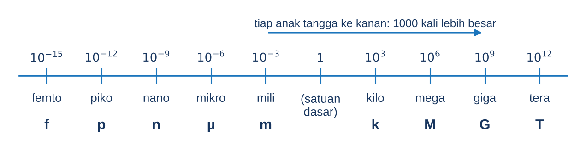
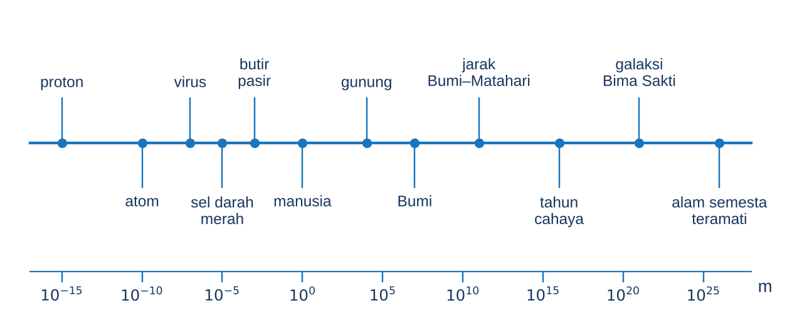
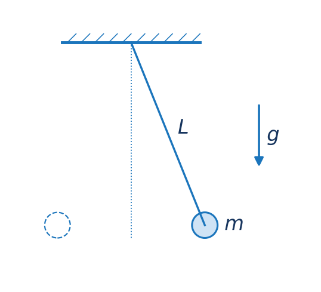
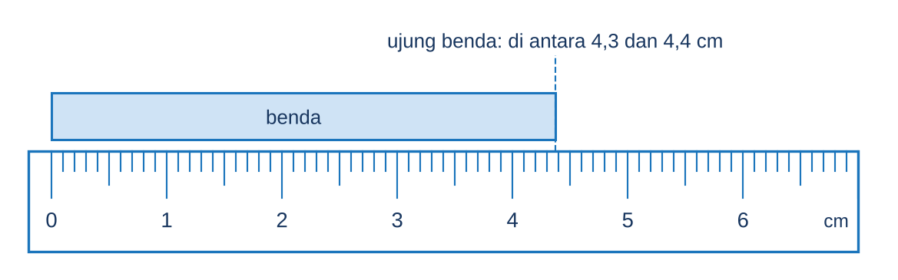
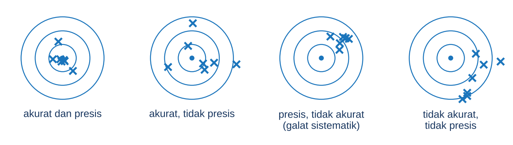
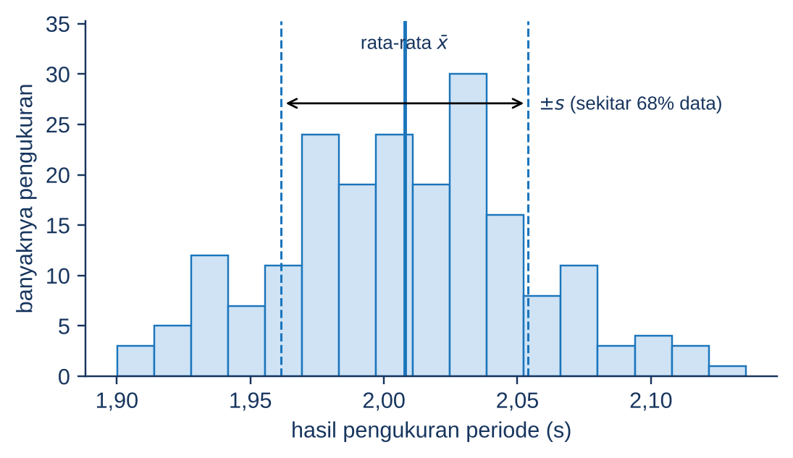
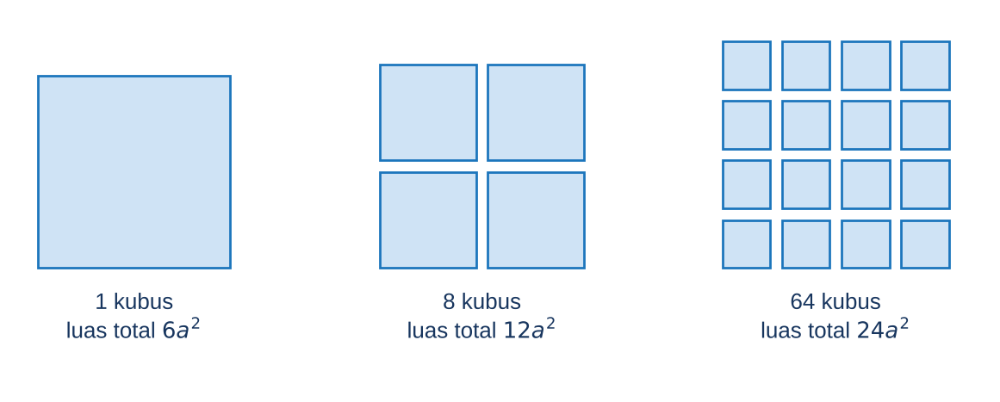

# Bab 1 Pengukuran dan Vektor

Bab ini memberi dua alat yang dipakai di seluruh buku. Yang pertama adalah bahasa pengukuran: satuan, dimensi, angka penting, ketidakpastian, dan estimasi. Yang kedua adalah vektor, cara menyatakan besaran yang memiliki arah.

Pada 23 September 1999, wahana antariksa *Mars Climate Orbiter* menyalakan mesinnya untuk masuk ke orbit Mars, setelah perjalanan lebih dari sembilan bulan. Beberapa menit kemudian sinyalnya hilang dan tidak pernah kembali. Wahana itu melintas terlalu dekat dengan planet dan hancur di atmosfer Mars.

Penyelidikan menemukan penyebabnya, dan penyebab itu bukan kerusakan mesin atau kesalahan teori. Satu tim menulis perangkat lunak yang melaporkan dorongan mesin kecil dalam satuan *pound-gaya sekon*. Tim lain membaca angka-angka itu sebagai *newton sekon*. Kedua satuan berbeda dengan faktor sekitar 4,45. Selama berbulan-bulan, setiap koreksi lintasan dihitung dengan angka yang meleset sebesar itu, sampai kesalahan kecil yang menumpuk membuat wahana tiba di tempat yang salah.

Hukum-hukum Newton yang dipakai kedua tim sudah benar. Yang salah adalah hal yang kelihatannya paling sepele dalam fisika: **angka tanpa satuan yang jelas tidak berarti apa-apa.**

::: {.kuis}
**Pertanyaan pembuka**

Sebuah angka hasil pengukuran, misalnya "panjang meja ini 1,52", sebenarnya membawa tiga informasi sekaligus. Apa saja ketiganya? Bab ini adalah jawaban panjangnya. Jawaban pendeknya ada di ringkasan bab.
:::

::: {.tujuan}
**Tujuan belajar**

Setelah mempelajari bab ini, kamu mampu:

1. Menjelaskan cara kerja fisika: pengamatan, model, hukum, dan teori, serta peran penyederhanaan.
2. Menyebutkan tujuh satuan pokok SI, memakai awalan satuan, dan menjelaskan gagasan di balik definisi satuan modern.
3. Mengubah satuan dengan metode faktor konversi, termasuk untuk luas, volume, dan satuan gabungan.
4. Memakai analisis dimensi untuk memeriksa persamaan dan menebak bentuk suatu hubungan.
5. Menentukan banyaknya angka penting dan membulatkan hasil hitungan dengan benar.
6. Membedakan akurasi dan presisi, galat acak dan galat sistematik, serta menghitung ketidakpastian hasil dari ketidakpastian data.
7. Membuat perkiraan orde besaran untuk besaran yang tidak diketahui.
8. Menghubungkan massa, massa jenis, dan jumlah atom atau molekul.
9. Menerapkan lima langkah pemecahan masalah yang dipakai di seluruh buku ini.
10. Membedakan besaran skalar dan vektor, dan menuliskan vektor dengan notasi yang benar.
11. Menjumlahkan dan mengurangkan vektor secara grafis.
12. Menguraikan vektor menjadi komponen, dan menyusun kembali besar dan arahnya dari komponen, di kuadran mana pun.
13. Menjumlahkan vektor dengan komponen dan vektor satuan.
14. Menghitung perkalian titik dan memakainya untuk mencari sudut dan proyeksi.
15. Menghitung perkalian silang dan menentukan arahnya dengan kaidah tangan kanan.
:::

::: {.mat}
**Prasyarat**

Aljabar dasar (memindahkan suku, pangkat, dan akar) serta notasi ilmiah seperti $3{,}0 \times 10^8$. Tidak ada fisika yang perlu dikuasai sebelumnya. Jika notasi ilmiah belum lancar, baca dulu kotak Matematika di subbab 1.2.
:::

## 1.1 Cara kerja fisika

Fisika adalah usaha memahami alam dengan aturan sesedikit mungkin. Sebuah apel jatuh, Bulan mengelilingi Bumi, dan air laut pasang surut. Tiga peristiwa itu terlihat tidak berhubungan, tetapi ketiganya ternyata tunduk pada satu hukum gravitasi yang sama. Menemukan kesatuan seperti itulah tujuan fisika.

Cara kerjanya bisa diringkas menjadi sebuah lingkaran yang tidak pernah selesai:

1. **Mengamati dan mengukur.** Fisika berangkat dari alam, bukan dari pendapat. Pengamatan harus bisa diulang oleh orang lain dan dinyatakan dengan angka.
2. **Membuat model.** Kita membuang rincian yang tidak penting dan menyimpan intinya.
3. **Merumuskan hubungan.** Hubungan antarbesaran ditulis dalam bahasa matematika.
4. **Meramalkan dan menguji.** Model dipakai untuk meramalkan hasil percobaan baru. Jika ramalannya meleset, modelnya diperbaiki atau dibuang.

Beberapa kata dipakai dengan arti khusus dalam fisika dan sering disalahpahami:

| Istilah | Arti dalam fisika | Contoh |
|---|---|---|
| **Model** | Gambaran yang disederhanakan dari suatu sistem | Bumi sebagai sebuah titik ketika membahas orbitnya; gas sebagai kumpulan bola kecil |
| **Hukum** | Pernyataan ringkas tentang pola yang selalu teramati, biasanya berupa persamaan | Hukum gravitasi Newton; hukum kekekalan energi |
| **Teori** | Kerangka luas yang menjelaskan banyak hukum dan sudah teruji berkali-kali | Teori relativitas; teori kinetik gas; mekanika kuantum |
| **Hipotesis** | Dugaan yang belum cukup teruji | — |

::: {.awas}
**Awas · "Cuma teori"**

Dalam percakapan sehari-hari, "teori" berarti dugaan. Dalam sains artinya hampir berlawanan: teori adalah penjelasan yang paling teruji yang kita miliki. Teori tidak "naik pangkat" menjadi hukum. Hukum menyatakan *apa* yang terjadi, sedangkan teori menjelaskan *mengapa*.
:::

### Seni menyederhanakan

Model yang baik sengaja "salah" dalam hal-hal yang tidak penting. Ketika menghitung waktu jatuh sebuah batu dari atap, kita mengabaikan hambatan udara, bentuk batu, dan putaran Bumi. Hasilnya tetap sangat dekat dengan kenyataan. Jika yang jatuh adalah selembar kertas, hambatan udara tidak boleh diabaikan lagi, dan modelnya harus diganti.

Model yang paling sering dipakai di bagian awal buku ini adalah **model partikel**: benda dianggap sebagai satu titik yang memiliki massa tetapi tidak memiliki ukuran. Model ini cocok selama ukuran dan putaran benda tidak memengaruhi pertanyaan yang diajukan. Sebuah mobil yang melaju di jalan tol boleh dianggap partikel jika kita menanyakan waktu tempuhnya, tetapi tidak jika kita menanyakan mengapa ia terguling di tikungan.

Setiap model punya **batas berlaku**. Mekanika Newton sangat tepat untuk bola, mobil, dan planet, tetapi gagal untuk benda yang bergerak mendekati kecepatan cahaya (di sana relativitas mengambil alih, Bab 15) dan untuk benda seukuran atom (di sana mekanika kuantum mengambil alih, Bab 15). Mekanika Newton tidak menjadi "salah" karenanya. Ia adalah pendekatan yang luar biasa baik di dalam wilayahnya. Fisikawan yang baik selalu tahu di mana batas modelnya.

::: {.kuis}
**Kuis cepat 1.1**

Untuk pertanyaan mana model partikel **tidak** memadai? (a) Berapa lama Bumi mengelilingi Matahari? (b) Mengapa ada siang dan malam di Bumi? (c) Berapa jauh bola yang ditendang melayang sebelum jatuh? (d) Mengapa bola yang ditendang bisa melengkung ke samping?
:::

## 1.2 Besaran dan satuan

### Besaran fisika

**Besaran** adalah sifat yang bisa diukur dan dinyatakan dengan angka: panjang, waktu, massa, suhu. Rasa haus dan keindahan bukan besaran fisika, karena tidak ada alat dan aturan yang disepakati untuk mengukurnya.

Mengukur berarti **membandingkan** sebuah besaran dengan besaran sejenis yang dijadikan patokan. Patokan itu disebut **satuan**. Ketika kita berkata panjang meja 1,52 m, artinya panjang meja itu 1,52 kali panjang patokan yang bernama "satu meter". Jadi setiap hasil ukur selalu terdiri atas dua bagian:

$$
\text{besaran} = \text{nilai} \times \text{satuan}.
$$

Cara pandang ini bukan basa-basi. Satuan benar-benar diperlakukan seperti faktor dalam perkalian: bisa dikalikan, dibagi, dan dicoret. Seluruh teknik konversi di subbab 1.4 bersandar pada gagasan ini.

### Sistem Internasional (SI)

Dulu setiap daerah punya satuannya sendiri: hasta, depa, kaki, jengkal. Perdagangan dan sains membutuhkan satu sistem bersama. Sistem itu lahir di Prancis pada akhir abad ke-18 sebagai sistem metrik, lalu berkembang menjadi **Sistem Internasional** (SI) yang dipakai ilmuwan di seluruh dunia.

SI dibangun dari tujuh **besaran pokok**. Semua besaran lain, yang disebut **besaran turunan**, diperoleh dari perkalian dan pembagian besaran pokok.

| Besaran pokok | Satuan | Simbol | Dipakai mulai |
|---|---|---|---|
| Panjang | meter | m | Bab 1 |
| Massa | kilogram | kg | Bab 1 |
| Waktu | sekon | s | Bab 1 |
| Arus listrik | ampere | A | Bab 13 |
| Suhu termodinamika | kelvin | K | Bab 10 |
| Jumlah zat | mol | mol | Bab 1 dan Bab 10 |
| Intensitas cahaya | kandela | cd | jarang dipakai di buku ini |

Seluruh mekanika (Bab 1 sampai Bab 9 buku ini) hanya membutuhkan tiga yang pertama: meter, kilogram, dan sekon.

Beberapa contoh besaran turunan:

| Besaran turunan | Didefinisikan sebagai | Satuan SI | Nama khusus |
|---|---|---|---|
| Luas | panjang × panjang | m² | — |
| Volume | panjang³ | m³ | — |
| Kelajuan | panjang / waktu | m/s | — |
| Percepatan | kelajuan / waktu | m/s² | — |
| Massa jenis | massa / volume | kg/m³ | — |
| Gaya | massa × percepatan | kg·m/s² | newton (N) |
| Energi | gaya × panjang | kg·m²/s² | joule (J) |
| Tekanan | gaya / luas | kg/(m·s²) | pascal (Pa) |

### Dari benda patokan ke tetapan alam

Bagaimana "satu meter" ditetapkan? Sejarahnya memperlihatkan bagaimana fisika terus mencari patokan yang makin kokoh.

**Meter.** Mula-mula (1790-an) meter ditetapkan sebagai satu per sepuluh juta jarak dari Kutub Utara ke khatulistiwa. Karena jarak itu sulit diukur ulang, meter kemudian diwujudkan sebagai jarak antara dua goresan pada sebuah batang logam yang disimpan di dekat Paris. Batang bisa memuai, tergores, atau hilang. Sejak 1983, meter didefinisikan lewat cahaya: laju cahaya dalam ruang hampa **ditetapkan** tepat $c = 299\,792\,458$ m/s, sehingga satu meter adalah jarak yang ditempuh cahaya dalam $1/299\,792\,458$ sekon.

**Sekon.** Dulu sekon adalah $1/86\,400$ dari satu hari. Tetapi putaran Bumi tidak sepenuhnya teratur, dan perlahan melambat. Kini sekon didefinisikan lewat atom sesium-133: satu sekon adalah waktu untuk $9\,192\,631\,770$ getaran gelombang yang dipancarkan atom itu pada peralihan tertentu. Jam atom yang memakai prinsip ini bisa begitu teliti sehingga hanya meleset sekitar satu sekon dalam ratusan juta tahun.

**Kilogram.** Sampai 2019, kilogram adalah massa sebuah silinder logam platina–iridium yang disimpan di Prancis. Ini satuan terakhir yang masih bergantung pada sebuah benda. Masalahnya, ketika dibandingkan dengan salinan-salinannya, massa silinder itu ternyata bergeser sekitar 50 mikrogram dalam seabad, dan tidak ada yang bisa memastikan mana yang berubah. Sejak 20 Mei 2019, kilogram didefinisikan dengan menetapkan nilai **tetapan Planck**, $h = 6{,}626\,070\,15 \times 10^{-34}$ kg·m²/s. Karena meter dan sekon sudah terdefinisi, penetapan $h$ otomatis menetapkan kilogram.

Sejak 2019, **ketujuh** satuan pokok didefinisikan dengan cara yang sama: dengan menetapkan nilai pasti tujuh tetapan alam (termasuk laju cahaya, tetapan Planck, muatan elementer, tetapan Boltzmann, dan tetapan Avogadro). Gagasannya indah: tetapan alam sama di mana saja dan kapan saja, sehingga laboratorium mana pun, bahkan di planet lain, bisa mewujudkan satuan yang sama tanpa harus meminjam benda patokan dari Paris.

::: {.terapan}
**Terapan · Mengapa GPS butuh jam atom**

Penerima GPS di ponselmu menentukan posisi dengan mengukur waktu tempuh sinyal radio dari beberapa satelit. Sinyal itu bergerak dengan laju cahaya, sekitar 30 cm setiap nanosekon ($10^{-9}$ s). Jika jam satelit meleset satu mikrosekon saja, posisi yang dihitung meleset sekitar 300 m. Karena itu setiap satelit GPS membawa jam atom, dan definisi sekon berbasis atom menjadi bagian dari navigasi sehari-hari.
:::

### Awalan satuan

Fisika membentang dari ukuran inti atom sampai ukuran galaksi. Agar tidak menulis deretan nol yang panjang, SI memakai **awalan** yang menyatakan pangkat sepuluh.

{width=95%}

| Awalan | Simbol | Faktor | Contoh |
|---|---|---|---|
| tera | T | $10^{12}$ | kapasitas diska 1 TB |
| giga | G | $10^{9}$ | daya pembangkit 1 GW |
| mega | M | $10^{6}$ | frekuensi radio 100 MHz |
| kilo | k | $10^{3}$ | 1 km = 1000 m |
| senti | c | $10^{-2}$ | 1 cm = 0,01 m |
| mili | m | $10^{-3}$ | 1 mg = 0,001 g |
| mikro | µ | $10^{-6}$ | ukuran bakteri sekitar 1 µm |
| nano | n | $10^{-9}$ | panjang gelombang cahaya hijau sekitar 550 nm |
| piko | p | $10^{-12}$ | jari-jari atom sekitar 100 pm |
| femto | f | $10^{-15}$ | ukuran proton sekitar 1 fm |

Tiga hal yang sering keliru:

- **Huruf besar dan kecil berbeda arti.** m adalah mili ($10^{-3}$), M adalah mega ($10^{6}$). Selisihnya satu miliar kali. Simbol kilo adalah k kecil.
- **Kilogram sudah mengandung awalan.** Satuan pokok massa adalah kilogram, bukan gram. Dalam rumus fisika, massa hampir selalu harus dalam kg.
- **Awalan ikut dipangkatkan.** $1\ \text{cm}^3 = (10^{-2}\ \text{m})^3 = 10^{-6}\ \text{m}^3$, bukan $10^{-2}\ \text{m}^3$. Kesalahan ini dibahas khusus di subbab 1.4.

::: {.mat}
**Matematika · Notasi ilmiah**

Bilangan ditulis sebagai $a \times 10^n$ dengan $1 \le a < 10$ dan $n$ bilangan bulat. Contoh: $299\,800\,000 = 2{,}998 \times 10^8$ dan $0{,}000\,052 = 5{,}2 \times 10^{-5}$.

Aturan pangkat yang terus dipakai:

- $10^a \times 10^b = 10^{a+b}$, misalnya $10^3 \times 10^{-9} = 10^{-6}$.
- $10^a / 10^b = 10^{a-b}$, misalnya $10^{8} / 10^{-2} = 10^{10}$.
- $(10^a)^b = 10^{ab}$, misalnya $(10^{-2})^3 = 10^{-6}$.

Untuk mengalikan, kalikan bagian depannya dan jumlahkan pangkatnya: $(3 \times 10^8)(2 \times 10^{-3}) = 6 \times 10^5$.
:::

::: {.kuis}
**Kuis cepat 1.2**

Urutkan dari yang terkecil ke terbesar: (a) 0,5 mm, (b) 300 µm, (c) $2 \times 10^{5}$ nm, (d) $4 \times 10^{-4}$ m.
:::

## 1.3 Skala alam semesta

Salah satu kemampuan yang membedakan fisikawan adalah **rasa terhadap ukuran**: tahu secara kasar seberapa besar, berat, atau lama sesuatu, sebelum menghitungnya. Tabel berikut layak dibaca pelan-pelan. Nilai-nilainya dibulatkan, karena yang penting adalah pangkat sepuluhnya, yang disebut **orde besaran**.

{width=98%}

| Panjang | (m) | Massa | (kg) | Selang waktu | (s) |
|---|---|---|---|---|---|
| Ukuran proton | $10^{-15}$ | Elektron | $9 \times 10^{-31}$ | Cahaya melintasi inti atom | $10^{-23}$ |
| Ukuran atom | $10^{-10}$ | Proton | $1{,}7 \times 10^{-27}$ | Satu getaran cahaya tampak | $2 \times 10^{-15}$ |
| Virus | $10^{-7}$ | Bakteri | $10^{-15}$ | Satu getaran molekul | $10^{-13}$ |
| Sel darah merah | $8 \times 10^{-6}$ | Nyamuk | $2 \times 10^{-6}$ | Satu detak jantung | $1$ |
| Manusia | $1{,}7$ | Manusia | $7 \times 10^{1}$ | Satu hari | $8{,}6 \times 10^{4}$ |
| Jari-jari Bumi | $6{,}4 \times 10^{6}$ | Bumi | $6 \times 10^{24}$ | Satu tahun | $3{,}2 \times 10^{7}$ |
| Jarak Bumi–Matahari | $1{,}5 \times 10^{11}$ | Matahari | $2 \times 10^{30}$ | Umur manusia | $2 \times 10^{9}$ |
| Satu tahun cahaya | $9{,}5 \times 10^{15}$ | Galaksi Bima Sakti | $\sim 10^{42}$ | Umur alam semesta | $4{,}4 \times 10^{17}$ |
| Alam semesta teramati | $\sim 10^{26}$ | | | | |

Beberapa hal yang patut direnungkan dari tabel ini:

- Dari proton sampai alam semesta teramati terbentang lebih dari 40 orde besaran. Manusia berada kira-kira di tengah skala itu.
- Satu tahun berisi sekitar $3{,}2 \times 10^7$ sekon. Angka ini berguna dan mudah diingat sebagai "kira-kira $\pi \times 10^7$ sekon".
- Perbandingan ukuran atom terhadap ukuran proton ($10^5$) kira-kira sama dengan perbandingan sebuah stadion terhadap sebutir kelereng di tengahnya. Atom hampir seluruhnya ruang kosong.

Mengatakan dua besaran "berbeda tiga orde besaran" berarti yang satu sekitar $10^3 = 1000$ kali yang lain. Cara cepat menentukan orde besaran sebuah bilangan: tulis dalam notasi ilmiah, lalu bulatkan ke pangkat sepuluh terdekat. Karena $\sqrt{10} \approx 3{,}16$, bagian depan di bawah sekitar 3 dibulatkan ke bawah dan di atasnya ke atas. Jadi $2 \times 10^{6}$ berorde $10^6$, sedangkan $7 \times 10^{6}$ berorde $10^7$.

::: {.kuis}
**Kuis cepat 1.3**

Tanpa menghitung teliti: berapa orde besaran banyaknya sekon dalam umur manusia 80 tahun? (a) $10^5$ (b) $10^7$ (c) $10^9$ (d) $10^{11}$
:::

## 1.4 Konversi satuan

### Gagasan dasarnya: mengalikan dengan satu

Karena satuan diperlakukan seperti faktor perkalian, mengubah satuan tidak memerlukan hafalan "dikali atau dibagi". Cukup satu gagasan: **mengalikan sebuah besaran dengan 1 tidak mengubah besaran itu.**

Dari $1\ \text{km} = 1000\ \text{m}$ kita bisa membuat dua pecahan yang nilainya 1:

$$
\frac{1000\ \text{m}}{1\ \text{km}} = 1 \qquad\text{dan}\qquad \frac{1\ \text{km}}{1000\ \text{m}} = 1 .
$$

Pecahan seperti ini disebut **faktor konversi**. Untuk mengubah satuan, kalikan dengan faktor konversi yang membuat satuan lama **tercoret**, persis seperti mencoret faktor yang sama di pembilang dan penyebut sebuah pecahan:

$$
7{,}5\ \text{km} = 7{,}5\ \text{km} \times \frac{1000\ \text{m}}{1\ \text{km}} = 7500\ \text{m}.
$$

Satuan km muncul di pembilang (pada 7,5 km) dan di penyebut (pada faktor konversi), sehingga saling mencoret dan yang tersisa hanya m.

Jika kamu memilih pecahan yang terbalik, satuannya tidak tercoret dan hasilnya bersatuan km²/m. Itu tanda yang jelas bahwa ada yang salah. **Satuan menjadi pemeriksa otomatis.**

::: {.strategi}
**Strategi · Konversi satuan dengan rantai faktor**

1. Tulis besaran awal lengkap dengan satuannya.
2. Kalikan dengan faktor konversi (pecahan bernilai 1) sehingga satuan yang tidak diinginkan tercoret. Untuk satuan gabungan, pakai beberapa faktor berurutan.
3. Jika satuannya dipangkatkan (luas, volume), **pangkatkan seluruh faktor konversinya**.
4. Periksa: apakah satuan akhirnya benar? Apakah angkanya membesar ketika satuannya mengecil, dan sebaliknya?
:::

::: {.contoh}
**Contoh 1.1 · Kilometer per jam ke meter per sekon**

Batas kecepatan di jalan tol adalah 90 km/jam. Nyatakan dalam m/s.

**Rencana.** Ada dua satuan yang harus diubah: km menjadi m, dan jam menjadi s. Kita butuh $1\ \text{km} = 1000\ \text{m}$ dan $1\ \text{jam} = 3600\ \text{s}$.

**Penyelesaian.**

$$
90\ \frac{\text{km}}{\text{jam}} = 90\ \frac{\text{km}}{\text{jam}} \times \frac{1000\ \text{m}}{1\ \text{km}} \times \frac{1\ \text{jam}}{3600\ \text{s}} = \frac{90 \times 1000}{3600}\ \frac{\text{m}}{\text{s}} = 25\ \text{m/s}.
$$

**Memahami hasil.** Satu sekon jauh lebih singkat daripada satu jam, jadi wajar bila angkanya mengecil. 25 m setiap sekon kira-kira panjang dua bus, masuk akal untuk mobil di jalan tol.

**Pola yang layak diingat.** $1\ \text{m/s} = 3{,}6\ \text{km/jam}$. Dari km/jam ke m/s, bagi dengan 3,6. Dari m/s ke km/jam, kali dengan 3,6.
:::

### Luas dan volume: jebakan pangkat

::: {.contoh}
**Contoh 1.2 · Massa jenis raksa**

Massa jenis raksa adalah 13,6 g/cm³. Nyatakan dalam satuan SI, kg/m³.

**Rencana.** Ubah g ke kg, lalu cm³ ke m³. Faktor untuk volume harus dipangkatkan tiga.

**Penyelesaian.**

$$
13{,}6\ \frac{\text{g}}{\text{cm}^3} \times \frac{1\ \text{kg}}{1000\ \text{g}} \times \left(\frac{100\ \text{cm}}{1\ \text{m}}\right)^3 = 13{,}6 \times \frac{1}{10^3} \times 10^6\ \frac{\text{kg}}{\text{m}^3} = 1{,}36 \times 10^4\ \text{kg/m}^3 .
$$

**Memahami hasil.** Satu meter kubik raksa bermassa 13,6 ton. Terdengar sangat besar, tetapi satu meter kubik memang besar: air saja sudah satu ton per meter kubik, dan raksa 13,6 kali lebih rapat dari air.

**Pola yang layak diingat.** $1\ \text{g/cm}^3 = 1000\ \text{kg/m}^3$.
:::

::: {.awas}
**Awas · Satu meter kubik bukan seratus sentimeter kubik**

$1\ \text{m} = 100\ \text{cm}$, tetapi $1\ \text{m}^2 = 100^2\ \text{cm}^2 = 10^4\ \text{cm}^2$ dan $1\ \text{m}^3 = 100^3\ \text{cm}^3 = 10^6\ \text{cm}^3$. Bayangkan sebuah kubus bersisi 1 m: ada 100 baris, 100 kolom, dan 100 lapis kubus kecil bersisi 1 cm, seluruhnya satu juta. Hubungan yang berguna: $1\ \text{L} = 1\ \text{dm}^3 = 1000\ \text{cm}^3 = 10^{-3}\ \text{m}^3$, dan $1\ \text{mL} = 1\ \text{cm}^3$.
:::

::: {.contoh}
**Contoh 1.3 · Mengisi kolam renang**

Kolam renang berukuran 25 m × 10 m dengan kedalaman rata-rata 1,8 m diisi dengan selang yang mengalirkan 2,5 liter per menit. (a) Berapa liter volume kolam? (b) Nyatakan laju alir selang dalam m³/s. (c) Berapa hari kolam terisi penuh?

**Penyelesaian.**

(a) $V = 25 \times 10 \times 1{,}8 = 450\ \text{m}^3$. Karena $1\ \text{m}^3 = 1000\ \text{L}$, $V = 4{,}5 \times 10^5$ L.

(b) $2{,}5\ \dfrac{\text{L}}{\text{menit}} \times \dfrac{10^{-3}\ \text{m}^3}{1\ \text{L}} \times \dfrac{1\ \text{menit}}{60\ \text{s}} = 4{,}2 \times 10^{-5}\ \text{m}^3/\text{s}$.

(c) $t = \dfrac{4{,}5 \times 10^5\ \text{L}}{2{,}5\ \text{L/menit}} = 1{,}8 \times 10^5\ \text{menit} \times \dfrac{1\ \text{jam}}{60\ \text{menit}} \times \dfrac{1\ \text{hari}}{24\ \text{jam}} = 125\ \text{hari}.$

**Memahami hasil.** Empat bulan dengan selang taman. Hasil ini mengejutkan, tetapi masuk akal: 2,5 L per menit berarti satu ember dalam empat menit, dan kolam itu berisi 45 000 ember.
:::

### Satuan di luar SI

Beberapa satuan non-SI masih sering dijumpai. Kamu tidak perlu menghafal semuanya, tetapi harus bisa memakainya jika diberi faktor konversinya.

| Besaran | Hubungan |
|---|---|
| Panjang | 1 inci = 2,54 cm (tepat); 1 mil = 1,609 km; 1 ångström (Å) = $10^{-10}$ m |
| Volume | 1 L = $10^{-3}$ m³; 1 galon AS = 3,785 L |
| Massa | 1 ton = 1000 kg; 1 satuan massa atom (u) = $1{,}6605 \times 10^{-27}$ kg |
| Waktu | 1 hari = 86 400 s; 1 tahun ≈ $3{,}156 \times 10^7$ s |
| Gaya | 1 pound-gaya (lbf) = 4,448 N |
| Tekanan | 1 atm = 101 325 Pa; 1 bar = $10^5$ Pa; 1 psi = 6,895 kPa |
| Energi | 1 kalori = 4,184 J; 1 kWh = $3{,}6 \times 10^6$ J; 1 eV = $1{,}602 \times 10^{-19}$ J |
| Sudut | $180^\circ = \pi$ rad |

Kembali ke *Mars Climate Orbiter*: angka 100 lbf·s yang dibaca sebagai 100 N·s meleset menjadi kurang dari seperempat nilai sebenarnya, karena 100 lbf·s = 444,8 N·s. Satu baris konversi akan menyelamatkan wahana itu.

::: {.kuis}
**Kuis cepat 1.4**

Sebuah kubus bersisi 2 cm. Volumenya dalam m³ adalah: (a) $8 \times 10^{-2}$ (b) $8 \times 10^{-4}$ (c) $8 \times 10^{-6}$ (d) $2 \times 10^{-6}$
:::

## 1.5 Analisis dimensi

### Dimensi sebuah besaran

**Dimensi** menyatakan *jenis* sebuah besaran, lepas dari satuan yang dipakai. Jarak Surabaya–Jakarta bisa ditulis dalam kilometer, mil, atau tahun cahaya, tetapi jenisnya tetap **panjang**. Dalam mekanika, tiga dimensi pokok diberi lambang:

$$
\text{panjang: } \mathsf{L}, \qquad \text{massa: } \mathsf{M}, \qquad \text{waktu: } \mathsf{T}.
$$

Dimensi suatu besaran ditulis dengan kurung siku. Beberapa contoh:

| Besaran | Dimensi | Satuan SI |
|---|---|---|
| Luas | $[A] = \mathsf{L}^2$ | m² |
| Volume | $[V] = \mathsf{L}^3$ | m³ |
| Kelajuan | $[v] = \mathsf{L}\mathsf{T}^{-1}$ | m/s |
| Percepatan | $[a] = \mathsf{L}\mathsf{T}^{-2}$ | m/s² |
| Massa jenis | $[\rho] = \mathsf{M}\mathsf{L}^{-3}$ | kg/m³ |
| Gaya | $[F] = \mathsf{M}\mathsf{L}\mathsf{T}^{-2}$ | N |
| Energi | $[E] = \mathsf{M}\mathsf{L}^2\mathsf{T}^{-2}$ | J |

Bilangan murni seperti 2, $\pi$, dan $\tfrac12$ tidak berdimensi. Sudut (dalam radian) juga tidak berdimensi, karena didefinisikan sebagai perbandingan dua panjang (panjang busur dibagi jari-jari). Akibatnya, isi fungsi seperti $\sin(\ldots)$, $\cos(\ldots)$, $e^{(\ldots)}$, dan $\ln(\ldots)$ **harus tidak berdimensi**.

### Aturan emas: apel tidak bisa dijumlahkan dengan jeruk

::: {.inti}
**Setiap suku dalam sebuah persamaan fisika harus berdimensi sama.**
:::

Kita tidak bisa menjumlahkan 3 meter dengan 5 sekon, dan tidak bisa menyamakan sebuah gaya dengan sebuah energi. Aturan ini memberi alat pemeriksa yang sangat kuat: **persamaan yang dimensinya tidak cocok pasti salah.** (Kebalikannya tidak berlaku. Persamaan yang dimensinya cocok belum tentu benar, karena analisis dimensi buta terhadap bilangan murni seperti $\tfrac12$ atau $2\pi$.)

::: {.contoh}
**Contoh 1.4 · Memeriksa sebuah rumus**

Seorang mahasiswa mengingat rumus jarak tempuh benda yang dipercepat sebagai $x = v_0 t + \tfrac12 a t$. Temannya mengingat $x = v_0 t + \tfrac12 a t^2$. Tanpa membuka buku, tentukan mana yang mungkin benar.

**Rencana.** Ruas kiri berdimensi panjang, $\mathsf{L}$. Setiap suku di kanan harus berdimensi $\mathsf{L}$ juga.

**Penyelesaian.**

- $[v_0 t] = (\mathsf{L}\mathsf{T}^{-1})(\mathsf{T}) = \mathsf{L}$. Cocok.
- $[a t] = (\mathsf{L}\mathsf{T}^{-2})(\mathsf{T}) = \mathsf{L}\mathsf{T}^{-1}$. Ini dimensi kelajuan, bukan panjang. **Tidak cocok.**
- $[a t^2] = (\mathsf{L}\mathsf{T}^{-2})(\mathsf{T}^2) = \mathsf{L}$. Cocok.

Rumus pertama pasti salah. Rumus kedua lolos pemeriksaan dimensi. (Bahwa koefisiennya memang $\tfrac12$ baru akan kita buktikan di Bab 2.)

**Memahami hasil.** Biasakan melakukan pemeriksaan ini pada setiap jawaban akhir soal. Waktunya sepuluh detik, dan ia menangkap sebagian besar kesalahan aljabar.
:::

### Menebak bentuk rumus

Analisis dimensi bisa melangkah lebih jauh dari sekadar memeriksa. Kadang ia **meramalkan bentuk** sebuah hubungan sebelum teorinya kita ketahui.

{width=30%}

::: {.contoh}
**Contoh 1.5 · Periode bandul dari dimensinya saja**

Sebuah bandul sederhana terdiri atas beban bermassa $m$ di ujung tali sepanjang $L$ (Gambar 1.3). Periode $T$ adalah waktu untuk satu ayunan bolak-balik. Dengan analisis dimensi, tentukan bagaimana $T$ bergantung pada $m$, $L$, dan percepatan gravitasi $g$.

**Memahami soal.** Kita menduga periode hanya bisa bergantung pada tiga besaran itu (untuk ayunan kecil). Kita belum punya teori bandul; teorinya baru muncul di Bab 8.

**Rencana.** Misalkan $T = C\,m^a L^b g^c$, dengan $C$ bilangan tak berdimensi dan $a$, $b$, $c$ pangkat yang dicari. Samakan dimensi kedua ruas.

**Penyelesaian.** Dimensi ruas kanan:

$$
[m^a L^b g^c] = \mathsf{M}^a\,\mathsf{L}^b\,(\mathsf{L}\mathsf{T}^{-2})^c = \mathsf{M}^a\,\mathsf{L}^{b+c}\,\mathsf{T}^{-2c}.
$$

Ruas kiri berdimensi $\mathsf{T}^1 = \mathsf{M}^0\mathsf{L}^0\mathsf{T}^1$. Samakan pangkat tiap dimensi:

- $\mathsf{M}$: $a = 0$.
- $\mathsf{T}$: $-2c = 1$, sehingga $c = -\tfrac12$.
- $\mathsf{L}$: $b + c = 0$, sehingga $b = \tfrac12$.

Jadi

$$
T = C\sqrt{\frac{L}{g}} .
$$

**Memahami hasil.** Hasil ini memuat tiga ramalan yang bisa diuji. Pertama, periode **tidak bergantung pada massa** beban, sesuatu yang mengejutkan dan memang benar. Kedua, tali empat kali lebih panjang menghasilkan periode dua kali lebih lama. Ketiga, di Bulan (dengan $g$ lebih kecil) bandul berayun lebih lambat. Analisis dimensi tidak bisa memberi nilai $C$. Teori di Bab 8 menunjukkan $C = 2\pi$.

**Bagaimana jika…** kita memasukkan juga sudut simpangan awal $\theta_0$? Sudut tidak berdimensi, jadi analisis dimensi tidak bisa mengatakan apa pun tentangnya: $C$ boleh jadi bergantung pada $\theta_0$. Kenyataannya memang begitu. Untuk ayunan besar, periode sedikit lebih lama.
:::

::: {.strategi}
**Strategi · Menebak rumus dengan analisis dimensi**

1. Daftarkan besaran yang masuk akal memengaruhi hasilnya. Langkah ini butuh penilaian fisika, bukan matematika.
2. Tulis hasil sebagai perkalian besaran-besaran itu dengan pangkat yang belum diketahui.
3. Samakan pangkat $\mathsf{M}$, $\mathsf{L}$, dan $\mathsf{T}$ di kedua ruas. Tiga dimensi memberi tiga persamaan, jadi cara ini menentukan paling banyak tiga pangkat.
4. Ingat keterbatasannya: bilangan murni tidak bisa ditentukan, dan jika besaran yang didaftarkan salah, hasilnya juga salah.
:::

::: {.contoh}
**Contoh 1.6 · Energi ledakan dari sebuah foto**

Pada 1945, uji coba bom atom pertama dipotret dengan kamera berkecepatan tinggi. Foto-fotonya dipublikasikan beberapa tahun kemudian, lengkap dengan skala panjang dan catatan waktu, sementara energi ledakannya masih dirahasiakan. Fisikawan Inggris G. I. Taylor memperkirakan energi itu hanya dari foto. Ia bernalar bahwa jari-jari bola api $R$ pada waktu $t$ setelah ledakan hanya bergantung pada energi ledakan $E$, massa jenis udara $\rho$, dan $t$. Tentukan bentuk hubungannya, lalu perkirakan $E$ jika pada $t = 0{,}025$ s jari-jari bola api sekitar 140 m. Massa jenis udara 1,2 kg/m³.

**Rencana.** Misalkan $R = C\,E^a \rho^b t^c$ dan samakan dimensinya. $[E] = \mathsf{M}\mathsf{L}^2\mathsf{T}^{-2}$ dan $[\rho] = \mathsf{M}\mathsf{L}^{-3}$.

**Penyelesaian.**

$$
\mathsf{L} = (\mathsf{M}\mathsf{L}^2\mathsf{T}^{-2})^a(\mathsf{M}\mathsf{L}^{-3})^b\,\mathsf{T}^c = \mathsf{M}^{a+b}\,\mathsf{L}^{2a-3b}\,\mathsf{T}^{-2a+c}.
$$

- $\mathsf{M}$: $a + b = 0$, sehingga $b = -a$.
- $\mathsf{L}$: $2a - 3b = 1$, sehingga $5a = 1$ dan $a = \tfrac15$, $b = -\tfrac15$.
- $\mathsf{T}$: $-2a + c = 0$, sehingga $c = \tfrac25$.

$$
R = C\left(\frac{E\,t^2}{\rho}\right)^{1/5} \quad\Longrightarrow\quad E = \frac{\rho R^5}{C^5\,t^2}.
$$

Dengan anggapan $C \approx 1$ (perhitungan Taylor yang lebih teliti memang memberi nilai mendekati 1):

$$
E \approx \frac{(1{,}2)(140)^5}{(0{,}025)^2} \approx 1 \times 10^{14}\ \text{J}.
$$

**Memahami hasil.** Energi ledakan biasa dinyatakan dalam kiloton TNT, dengan 1 kiloton = $4{,}184 \times 10^{12}$ J. Hasil kita setara sekitar 25 kiloton. Nilai resmi yang kemudian diumumkan sekitar 20 kiloton. Dengan satu foto, satu penggaris, dan analisis dimensi, kita mendapat jawaban yang benar dalam 25%. Perhatikan juga kepekaannya: karena $E \propto R^5$, salah membaca jari-jari sebesar 10% mengubah $E$ sekitar 60%.
:::

::: {.kuis}
**Kuis cepat 1.5**

Dalam persamaan $x = A\sin(Bt)$, $x$ adalah posisi dan $t$ waktu. Dimensi $A$ dan $B$ berturut-turut adalah: (a) $\mathsf{L}$ dan $\mathsf{T}$ (b) $\mathsf{L}$ dan $\mathsf{T}^{-1}$ (c) tak berdimensi dan $\mathsf{T}^{-1}$ (d) $\mathsf{L}\mathsf{T}^{-1}$ dan $\mathsf{T}$
:::

## 1.6 Angka penting

### Setiap pengukuran punya batas

{width=80%}

Lihat Gambar 1.4. Ujung benda jelas melewati garis 4,3 cm dan belum mencapai 4,4 cm. Dengan menaksir posisinya di antara dua garis, kita bisa menulis 4,37 cm. Dua digit pertama **pasti**. Digit terakhir adalah **taksiran**: orang lain mungkin membaca 4,36 atau 4,38. Menulis 4,3700 cm akan menyesatkan, karena penggaris ini tidak mampu memberi informasi sehalus itu.

**Angka penting** adalah semua digit yang pasti ditambah satu digit taksiran. Banyaknya angka penting memberi tahu pembaca seberapa teliti sebuah pengukuran. Jadi 4,37 cm (tiga angka penting) dan 4,370 cm (empat angka penting) adalah dua pernyataan yang berbeda: yang kedua mengaku sepuluh kali lebih teliti.

### Menghitung banyaknya angka penting

| Aturan | Contoh | Banyaknya angka penting |
|---|---|---|
| Semua digit bukan nol adalah angka penting | 4,37 | 3 |
| Nol di antara digit bukan nol adalah angka penting | 20,05 | 4 |
| Nol di depan hanya penunjuk letak koma, bukan angka penting | 0,00420 | 3 |
| Nol di belakang **setelah koma** adalah angka penting | 1,0500 | 5 |
| Nol di belakang bilangan bulat tanpa koma bersifat ambigu | 1200 | 2, 3, atau 4 |

Ambiguitas pada baris terakhir dihilangkan dengan notasi ilmiah: $1{,}2 \times 10^3$ (dua angka penting), $1{,}20 \times 10^3$ (tiga), $1{,}200 \times 10^3$ (empat). Inilah salah satu alasan fisikawan menyukai notasi ilmiah.

**Bilangan eksak** tidak membatasi angka penting. Termasuk di sini bilangan hasil mencacah (12 butir telur), bilangan dalam definisi (1 inci = 2,54 cm tepat; 1 menit = 60 s), dan bilangan murni dalam rumus (angka 2 dalam $2\pi r$).

### Angka penting dalam hitungan

Hasil hitungan tidak boleh mengaku lebih teliti daripada data yang paling kasar. Ada dua aturan praktis.

::: {.inti}
**Perkalian dan pembagian:** hasil ditulis dengan angka penting sebanyak data yang angka pentingnya **paling sedikit**.

**Penjumlahan dan pengurangan:** hasil ditulis sampai **tempat desimal** yang sama dengan data yang tempat desimalnya paling sedikit.
:::

::: {.contoh}
**Contoh 1.7 · Dua aturan, dua hitungan**

(a) Sebuah pelat logam berukuran 21,3 cm × 9,80 cm. Berapa luasnya? (b) Tiga benda bermassa 105,2 g, 3,47 g, dan 0,018 g ditimbang dengan tiga neraca berbeda. Berapa massa totalnya?

**Penyelesaian.**

(a) Kalkulator memberi $21{,}3 \times 9{,}80 = 208{,}74$. Kedua data punya tiga angka penting, jadi hasilnya ditulis dengan tiga angka penting: $A = 209\ \text{cm}^2$.

(b) Kalkulator memberi $105{,}2 + 3{,}47 + 0{,}018 = 108{,}688$. Data paling kasar (105,2) hanya diketahui sampai satu tempat desimal, jadi hasilnya ditulis sampai satu tempat desimal: $m = 108{,}7$ g.

**Memahami hasil.** Mengapa aturannya berbeda? Pada penjumlahan, yang menentukan adalah **letak** digit yang meragukan. Persepuluhan gram pada 105,2 sudah meragukan, sehingga digit seperseratus dan seperseribu dari data lain tidak ada artinya. Pada perkalian, yang menentukan adalah ketelitian **relatif**. Data tiga angka penting teliti sampai sekitar satu bagian per beberapa ratus, dan hasil kalinya tidak bisa lebih baik dari itu.
:::

::: {.awas}
**Awas · Membulatkan terlalu dini**

Dalam hitungan berlangkah banyak, simpan satu atau dua digit ekstra di langkah-langkah antara, dan bulatkan **hanya pada jawaban akhir**. Membulatkan di setiap langkah menumpuk kesalahan. Contoh: $\sqrt{2} \times \sqrt{2}$ harus 2. Jika $\sqrt2$ dibulatkan dulu menjadi 1,4, hasilnya 1,96. Di buku ini, hasil antara sering ditulis dengan digit ekstra karena alasan ini.
:::

::: {.awas}
**Awas · Pengurangan bisa memusnahkan angka penting**

$5{,}237 - 5{,}214 = 0{,}023$. Dua bilangan empat angka penting menghasilkan selisih yang hanya dua angka penting. Mengurangkan dua bilangan yang hampir sama selalu menurunkan ketelitian relatif secara drastis. Percobaan yang baik dirancang agar tidak bergantung pada selisih kecil antara dua bilangan besar.
:::

Di buku ini, data soal umumnya diberikan dengan dua atau tiga angka penting, dan jawaban ditulis dengan ketelitian yang sama. Bilangan seperti "5 m" dalam soal dianggap sama telitinya dengan data lain dalam soal itu, kecuali dinyatakan lain.

::: {.kuis}
**Kuis cepat 1.6**

Hasil $\dfrac{6{,}40 \times 2{,}5}{0{,}0100}$ yang ditulis dengan angka penting yang benar adalah: (a) 1600 (b) $1{,}6 \times 10^3$ (c) $1{,}60 \times 10^3$ (d) $1{,}600 \times 10^3$
:::

## 1.7 Ketidakpastian pengukuran

Angka penting adalah cara kasar menyatakan ketelitian. Cara yang lebih jujur dan lebih berguna adalah menuliskan **ketidakpastian** secara terang-terangan:

$$
x = x_\text{terbaik} \pm \Delta x .
$$

Menulis $L = (4{,}37 \pm 0{,}02)$ cm berarti kita cukup yakin nilai sebenarnya berada di antara 4,35 cm dan 4,39 cm. Dalam sains, hasil ukur tanpa ketidakpastian adalah hasil yang belum selesai, karena tanpa itu kita tidak bisa menilai apakah dua hasil saling cocok, atau apakah sebuah hasil mendukung suatu teori.

### Akurasi dan presisi

{width=96%}

Dua kata ini dalam percakapan sehari-hari sering dianggap sama, tetapi dalam pengukuran berbeda arti (Gambar 1.5):

- **Presisi** menyatakan seberapa **rapat** hasil-hasil pengukuran berulang satu sama lain.
- **Akurasi** menyatakan seberapa **dekat** hasil pengukuran dengan nilai sebenarnya.

Timbangan yang selalu menunjuk 0,3 kg terlalu besar sangat presis (hasilnya konsisten) tetapi tidak akurat. Perbedaan ini berasal dari dua jenis galat (*error*):

| | Galat acak | Galat sistematik |
|---|---|---|
| Sifat | Berubah-ubah secara tak terduga dari satu pengukuran ke pengukuran berikutnya, kadang terlalu besar, kadang terlalu kecil | Selalu menggeser hasil ke arah yang sama |
| Contoh | Waktu reaksi saat menekan stopwatch; getaran; pembacaan skala yang sedikit berbeda | Penggaris yang ujungnya aus; neraca yang tidak dinolkan; stopwatch yang berjalan lambat |
| Memengaruhi | Presisi | Akurasi |
| Cara mengurangi | Mengulang pengukuran dan merata-ratakan | Mengkalibrasi alat; mengubah metode; membandingkan dengan patokan |
| Terlihat dari data? | Ya, dari sebaran data | **Tidak.** Data yang tergeser bersama-sama tetap terlihat rapi |

::: {.awas}
**Awas · "Galat" bukan berarti "keliru"**

Dalam fisika, galat (*error*) tidak berarti kekeliruan pengukur. Galat adalah selisih yang tidak terhindarkan antara hasil ukur dan nilai sebenarnya. Salah membaca skala atau salah mencatat adalah **kekeliruan**, dan itu diperbaiki dengan mengulang, bukan dengan analisis ketidakpastian.
:::

### Ketidakpastian satu kali pengukuran

Jika sebuah besaran hanya diukur satu kali, ketidakpastiannya ditaksir dari alatnya. Aturan praktis yang umum:

- **Alat berskala** (penggaris, gelas ukur, termometer cairan): setengah dari skala terkecil. Penggaris milimeter: $\pm 0{,}5$ mm.
- **Alat digital**: satu satuan pada digit terakhir yang ditampilkan, kecuali buku petunjuk alat menyebut lain.

Aturan ini hanya titik awal. Jika benda yang diukur tepinya tidak tegas, atau waktu reaksimu 0,2 s ketika menekan stopwatch yang menampilkan seperseratus sekon, ketidakpastian yang jujur lebih besar daripada yang disarankan alatnya.

### Ketidakpastian mutlak dan relatif

**Ketidakpastian mutlak** $\Delta x$ bersatuan sama dengan besarannya. **Ketidakpastian relatif** adalah perbandingannya terhadap nilai terbaik, biasanya dalam persen:

$$
\text{ketidakpastian relatif} = \frac{\Delta x}{|x_\text{terbaik}|}.
$$

Ketidakpastian relatiflah yang menunjukkan mutu sebuah pengukuran. Ketidakpastian 1 mm sangat baik untuk panjang lapangan sepak bola (0,001%), tetapi buruk untuk tebal sebuah koin (50%).

### Pengukuran berulang: rata-rata dan simpangan baku

{width=68%}

Jika sebuah besaran diukur berulang kali dan hasilnya berbeda-beda karena galat acak (Gambar 1.6), taksiran terbaik nilainya adalah **rata-rata**:

$$
\bar x = \frac{x_1 + x_2 + \cdots + x_N}{N}.
$$

Sebaran data diukur dengan **simpangan baku** $s$, yang secara kasar adalah jarak khas sebuah pengukuran dari rata-rata:

$$
s = \sqrt{\frac{(x_1 - \bar x)^2 + (x_2 - \bar x)^2 + \cdots + (x_N - \bar x)^2}{N - 1}} .
$$

Simpangan baku menyatakan ketidakpastian **satu** pengukuran. Rata-rata dari $N$ pengukuran lebih dapat dipercaya daripada satu pengukuran, karena galat acak yang terlalu besar dan yang terlalu kecil cenderung saling menghapus. Ketidakpastian rata-rata, yang disebut **galat baku rata-rata**, adalah

$$
\Delta\bar x = \frac{s}{\sqrt{N}} .
$$

Akar di penyebut membawa kabar baik dan kabar buruk. Mengulang pengukuran memang memperbaiki hasil. Tetapi untuk memperkecil ketidakpastian sepuluh kali, banyaknya pengukuran harus diperbanyak **seratus** kali. Dan tidak ada jumlah pengulangan yang bisa menghapus galat sistematik.

::: {.contoh}
**Contoh 1.8 · Mengukur waktu ayunan**

Seorang mahasiswa mengukur waktu 10 ayunan bandul sebanyak lima kali dan memperoleh 20,1 s; 20,3 s; 19,9 s; 20,2 s; 20,0 s. Nyatakan hasil pengukuran waktu 10 ayunan, lalu periode bandulnya.

**Penyelesaian.**

Rata-rata: $\bar t = \dfrac{20{,}1 + 20{,}3 + 19{,}9 + 20{,}2 + 20{,}0}{5} = 20{,}10$ s.

Simpangan dari rata-rata: $0{,}0$; $+0{,}2$; $-0{,}2$; $+0{,}1$; $-0{,}1$. Jumlah kuadratnya $0 + 0{,}04 + 0{,}04 + 0{,}01 + 0{,}01 = 0{,}10$.

Simpangan baku: $s = \sqrt{0{,}10/4} = 0{,}158$ s. Galat baku rata-rata: $\Delta\bar t = 0{,}158/\sqrt5 = 0{,}07$ s.

Hasil: $t_{10} = (20{,}10 \pm 0{,}07)$ s. Periode adalah sepersepuluhnya. Karena 10 adalah bilangan eksak, ketidakpastiannya ikut dibagi 10:

$$
T = (2{,}010 \pm 0{,}007)\ \text{s}.
$$

**Memahami hasil.** Mengukur 10 ayunan sekaligus, bukan satu ayunan, adalah trik penting. Galat saat menekan stopwatch (sekitar 0,2 s) sama besarnya entah kita mengukur satu ayunan atau sepuluh, tetapi setelah dibagi 10, pengaruhnya pada periode menjadi sepersepuluhnya.
:::

::: {.strategi}
**Strategi · Menuliskan hasil pengukuran**

1. Bulatkan ketidakpastian menjadi **satu** angka penting (boleh dua jika digit pertamanya 1).
2. Bulatkan nilai terbaik sampai **tempat desimal yang sama** dengan ketidakpastiannya.
3. Tulis satuan satu kali, di luar kurung: $(9{,}80 \pm 0{,}07)\ \text{m/s}^2$.

Jadi $9{,}80088 \pm 0{,}0684$ ditulis $9{,}80 \pm 0{,}07$, bukan $9{,}80088 \pm 0{,}07$ dan bukan $9{,}8 \pm 0{,}0684$.
:::

### Perambatan ketidakpastian

Sering kali besaran yang kita inginkan tidak diukur langsung, tetapi **dihitung** dari besaran-besaran yang diukur. Ketidakpastian data lalu "merambat" ke hasil. Ada dua aturan sederhana yang cukup untuk hampir semua praktikum tahun pertama.

**Aturan 1: penjumlahan dan pengurangan.** Jika $q = x + y$ atau $q = x - y$, ketidakpastian **mutlak**-nya dijumlahkan:

$$
\Delta q \approx \Delta x + \Delta y .
$$

Alasannya mudah dilihat. Nilai terbesar yang mungkin untuk $x + y$ adalah $(x + \Delta x) + (y + \Delta y)$, yang melebihi nilai terbaik sebesar $\Delta x + \Delta y$. Perhatikan bahwa pada pengurangan pun ketidakpastian **dijumlahkan**, tidak dikurangkan: nilai terbesar $x - y$ terjadi saat $x$ terlalu besar dan $y$ terlalu kecil.

**Aturan 2: perkalian dan pembagian.** Jika $q = xy$ atau $q = x/y$, ketidakpastian **relatif**-nya dijumlahkan:

$$
\frac{\Delta q}{|q|} \approx \frac{\Delta x}{|x|} + \frac{\Delta y}{|y|} .
$$

Untuk melihat alasannya, kalikan $(x + \Delta x)(y + \Delta y) = xy + x\,\Delta y + y\,\Delta x + \Delta x\,\Delta y$. Suku terakhir adalah hasil kali dua bilangan kecil, jadi boleh diabaikan. Kelebihan dari $xy$ adalah $x\,\Delta y + y\,\Delta x$, dan membaginya dengan $xy$ memberi aturan di atas.

**Akibat untuk pangkat.** Karena $x^n$ adalah $x$ dikalikan dengan dirinya $n$ kali, ketidakpastian relatifnya menjadi $n$ kali lipat:

$$
q = x^n \quad\Longrightarrow\quad \frac{\Delta q}{|q|} \approx |n|\,\frac{\Delta x}{|x|} .
$$

Aturan pangkat ini punya pesan praktis yang penting: **besaran yang dipangkatkan tinggi harus diukur paling teliti.** Dalam volume bola, $V \propto r^3$, galat 1% pada jari-jari menjadi galat 3% pada volume.

::: {.contoh}
**Contoh 1.9 · Logam apakah ini?**

Sebuah balok logam ditimbang dan diukur: massa $(54{,}2 \pm 0{,}1)$ g, dengan sisi-sisi $(2{,}00 \pm 0{,}01)$ cm, $(3{,}00 \pm 0{,}01)$ cm, dan $(3{,}35 \pm 0{,}01)$ cm. Tentukan massa jenisnya beserta ketidakpastiannya. Mungkinkah balok ini aluminium ($2{,}70$ g/cm³)? Mungkinkah titanium ($4{,}51$ g/cm³)?

**Rencana.** $\rho = m/(abc)$ hanya melibatkan perkalian dan pembagian, jadi ketidakpastian relatif dijumlahkan.

**Penyelesaian.**

Nilai terbaik: $V = 2{,}00 \times 3{,}00 \times 3{,}35 = 20{,}1$ cm³, sehingga $\rho = 54{,}2/20{,}1 = 2{,}697$ g/cm³.

Ketidakpastian relatif tiap data:

| Besaran | Ketidakpastian relatif |
|---|---|
| massa | $0{,}1/54{,}2 = 0{,}18\%$ |
| sisi 2,00 cm | $0{,}01/2{,}00 = 0{,}50\%$ |
| sisi 3,00 cm | $0{,}01/3{,}00 = 0{,}33\%$ |
| sisi 3,35 cm | $0{,}01/3{,}35 = 0{,}30\%$ |
| **jumlah** | **1,3%** |

$\Delta\rho = 0{,}013 \times 2{,}697 = 0{,}04$ g/cm³. Jadi

$$
\rho = (2{,}70 \pm 0{,}04)\ \text{g/cm}^3 .
$$

**Memahami hasil.** Nilai aluminium berada di dalam rentang 2,66 sampai 2,74 g/cm³, jadi hasil ini **cocok** dengan aluminium. Titanium berada sangat jauh di luar rentang, jadi kemungkinan itu tertolak. Perhatikan juga tabelnya: penyumbang terbesar adalah sisi terpendek. Jika ingin memperbaiki percobaan, ukurlah sisi itu dengan jangka sorong. Neraca yang lebih mahal hampir tidak akan menolong.
:::

::: {.contoh}
**Contoh 1.10 · Mengukur percepatan gravitasi dengan bandul**

Di Bab 8 akan ditunjukkan bahwa periode bandul sederhana adalah $T = 2\pi\sqrt{L/g}$, sehingga $g = 4\pi^2 L/T^2$. Seorang mahasiswa mengukur $L = (1{,}000 \pm 0{,}002)$ m dan $T = (2{,}007 \pm 0{,}005)$ s. Tentukan $g$ beserta ketidakpastiannya.

**Penyelesaian.**

Nilai terbaik: $g = \dfrac{4\pi^2 (1{,}000)}{(2{,}007)^2} = \dfrac{39{,}478}{4{,}0280} = 9{,}801\ \text{m/s}^2$.

Ketidakpastian relatif: $L$ menyumbang $0{,}002/1{,}000 = 0{,}20\%$. $T$ berpangkat dua, jadi menyumbang $2 \times 0{,}005/2{,}007 = 0{,}50\%$. Bilangan $4\pi^2$ eksak. Jumlahnya 0,70%.

$\Delta g = 0{,}0070 \times 9{,}801 = 0{,}07\ \text{m/s}^2$, sehingga

$$
g = (9{,}80 \pm 0{,}07)\ \text{m/s}^2 .
$$

**Memahami hasil.** Nilai yang diterima untuk kebanyakan tempat di Indonesia sekitar 9,78 m/s², berada di dalam rentang hasil kita. Karena $T$ dikuadratkan, pengukuran waktu adalah titik lemah percobaan ini, dan trik "ukur banyak ayunan sekaligus" dari Contoh 1.8 adalah cara memperbaikinya.
:::

::: {.mat}
**Matematika · Aturan yang lebih halus**

Menjumlahkan ketidakpastian secara langsung, seperti di atas, adalah taksiran **terburuk**: semua galat dianggap kompak bergeser ke arah yang paling merugikan. Jika galat-galatnya acak dan tidak saling bergantung, sebagian akan saling menghapus, dan taksiran yang lebih realistis adalah menjumlahkannya **secara kuadrat**:

$$
\Delta q = \sqrt{(\Delta x)^2 + (\Delta y)^2} \quad\text{(penjumlahan)}, \qquad \frac{\Delta q}{|q|} = \sqrt{\left(\frac{\Delta x}{x}\right)^2 + \left(\frac{\Delta y}{y}\right)^2} \quad\text{(perkalian)}.
$$

Untuk Contoh 1.10, cara ini memberi $\Delta g = 0{,}05\ \text{m/s}^2$, sedikit lebih kecil dari 0,07. Kedua cara diterima di praktikum tahun pertama, asalkan disebutkan cara mana yang dipakai. Buku ini memakai penjumlahan langsung kecuali dinyatakan lain.
:::

### Membandingkan dua hasil

Dua hasil ukur dikatakan **cocok** (konsisten) jika rentang ketidakpastiannya bertumpang-tindih, atau lebih telitinya, jika selisih keduanya tidak jauh lebih besar daripada ketidakpastian gabungannya. Hasil $9{,}80 \pm 0{,}07$ cocok dengan nilai acuan 9,78. Hasil $9{,}95 \pm 0{,}03$ tidak cocok. Ketidakcocokan seperti itu bukan aib. Ia memberi tahu kita bahwa ada galat sistematik yang belum ditemukan, atau, sesekali dalam sejarah sains, bahwa ada fisika baru.

::: {.kuis}
**Kuis cepat 1.7**

Jari-jari sebuah bola diukur dengan ketidakpastian relatif 2%. Ketidakpastian relatif luas permukaannya ($4\pi r^2$) dan volumenya ($\tfrac43\pi r^3$) berturut-turut kira-kira: (a) 2% dan 2% (b) 4% dan 6% (c) 4% dan 8% (d) 8% dan 6%
:::

## 1.8 Estimasi dan orde besaran

Banyak pertanyaan penting tidak butuh jawaban teliti. Seorang insinyur yang merancang jembatan perlu tahu lebih dulu apakah bebannya puluhan ton atau puluhan ribu ton. Seorang peneliti perlu tahu apakah percobaannya akan berlangsung sejam atau seabad sebelum memulainya. Kemampuan menjawab "kira-kira berapa?" dengan cepat adalah keterampilan inti fisikawan.

Soal-soal seperti ini sering disebut **soal Fermi**, dari nama fisikawan Enrico Fermi, yang terkenal mahir menaksir dengan data seadanya. Kuncinya: **pecah besaran yang tidak diketahui menjadi faktor-faktor yang masing-masing bisa ditaksir**, lalu kalikan. Setiap faktor mungkin meleset dua atau tiga kali, tetapi sebagian terlalu besar dan sebagian terlalu kecil, sehingga hasil akhirnya biasanya benar dalam satu orde besaran.

::: {.strategi}
**Strategi · Soal estimasi**

1. Pecah besaran yang ditanya menjadi rantai perkalian besaran yang kamu punya rasa terhadapnya.
2. Taksir tiap faktor dengan **satu angka penting**. Pakai angka yang mudah dihitung.
3. Kalikan, lalu tulis hasilnya sebagai satu angka penting kali pangkat sepuluh.
4. Uji kewajaran: bandingkan dengan sesuatu yang kamu ketahui, atau taksir dengan jalur lain.
:::

::: {.contoh}
**Contoh 1.11 · Berapa kali kamu bernapas seumur hidup?**

**Rencana.** Banyaknya napas = (napas per menit) × (menit per tahun) × (umur dalam tahun).

**Penyelesaian.** Orang dewasa yang sedang santai bernapas sekitar 15 kali per menit. Satu tahun berisi $60 \times 24 \times 365 \approx 5 \times 10^5$ menit. Ambil umur 75 tahun.

$$
N \approx 15 \times (5 \times 10^5) \times 75 \approx 6 \times 10^8 .
$$

Sekitar setengah miliar napas.

**Memahami hasil.** Jumlah detak jantung dengan cara yang sama (70 per menit) sekitar $3 \times 10^9$. Jantung berdetak kira-kira empat sampai lima kali setiap satu napas, dan itu cocok dengan pengalaman.
:::

::: {.contoh}
**Contoh 1.12 · Berapa tukang tambal ban di Surabaya?**

**Rencana.** Ini soal Fermi sejati: tidak ada rumus, dan tidak ada data resmi di tangan. Kita menaksir dari kebutuhan: (banyaknya ban bocor per tahun) dibagi (banyaknya ban yang bisa ditambal satu tukang per tahun).

**Penyelesaian.**

- Penduduk Surabaya sekitar 3 juta. Jika ada satu sepeda motor untuk setiap dua orang, terdapat sekitar $1{,}5 \times 10^6$ sepeda motor.
- Tiap motor mengalami ban bocor kira-kira dua kali setahun, sehingga ada sekitar $3 \times 10^6$ tambalan per tahun.
- Satu tukang menambal sekitar 10 ban sehari dan bekerja 300 hari setahun, jadi sekitar 3000 tambalan per tahun.

$$
N \approx \frac{3 \times 10^6}{3 \times 10^3} = 10^3 .
$$

Sekitar seribu tukang tambal ban.

**Memahami hasil.** Seribu tukang di kota seluas sekitar 330 km² berarti rata-rata tiga tukang per kilometer persegi. Di jalan-jalan utama mereka memang terlihat setiap beberapa ratus meter. Jawaban 100 atau 10 000 sama-sama terasa janggal, jadi orde besarannya dapat dipercaya. Angka yang lebih teliti dari itu tidak bisa dijamin oleh cara ini, dan tidak perlu.
:::

::: {.contoh}
**Contoh 1.13 · Massa udara di ruang kuliah**

Berapa massa udara di dalam ruang kuliah berukuran 8 m × 10 m × 3 m? Massa jenis udara sekitar 1,2 kg/m³.

**Penyelesaian.** $V = 8 \times 10 \times 3 = 240\ \text{m}^3$, sehingga $m = \rho V \approx 1{,}2 \times 240 \approx 3 \times 10^2$ kg.

**Memahami hasil.** Udara di satu ruang kuliah bermassa sekitar 300 kg, setara empat atau lima orang dewasa. Hampir semua orang menebak jauh lebih kecil. Di sinilah nilai estimasi: ia mengoreksi intuisi yang keliru.
:::

::: {.coba}
**Coba sendiri · Tebal selembar kertas**

Kamu tidak bisa mengukur tebal selembar kertas dengan penggaris. Tetapi satu rim kertas (500 lembar) mudah diukur: tebalnya sekitar 5 cm. Jadi tebal selembar kertas sekitar $5\ \text{cm}/500 = 0{,}1$ mm. Ukur sendiri rim kertas di dekatmu, lalu taksir ketidakpastiannya. Prinsip "ukur banyak, lalu bagi" ini sama dengan trik sepuluh ayunan di Contoh 1.8, dan dipakai di seluruh fisika eksperimen.
:::

::: {.kuis}
**Kuis cepat 1.8**

Perkiraan terbaik untuk banyaknya helai rambut di kepala manusia adalah: (a) $10^3$ (b) $10^5$ (c) $10^7$ (d) $10^9$. (Petunjuk: taksir luas kulit kepala dan jarak antarhelai.)
:::

## 1.9 Massa jenis dan jumlah zat

### Massa jenis

Mengapa sebongkah besi terasa "berat" dan sebongkah gabus terasa "ringan", padahal sekarung gabus bisa lebih berat daripada sebuah paku? Yang kita maksud sebenarnya adalah **massa jenis**: massa per satuan volume.

$$
\rho = \frac{m}{V} .
$$

Massa jenis adalah sifat **bahan**, bukan sifat benda. Sepotong kecil emas dan sebatang besar emas punya massa jenis yang sama. Satuan SI-nya kg/m³, tetapi g/cm³ juga sangat umum dipakai, terutama di kimia.

| Bahan | Massa jenis (kg/m³) | Bahan | Massa jenis (kg/m³) |
|---|---|---|---|
| Udara (20 °C, 1 atm) | 1,2 | Aluminium | $2{,}70 \times 10^3$ |
| Kayu (jati kering) | $\sim 0{,}7 \times 10^3$ | Besi | $7{,}87 \times 10^3$ |
| Es | $0{,}917 \times 10^3$ | Tembaga | $8{,}96 \times 10^3$ |
| Air (4 °C) | $1{,}000 \times 10^3$ | Raksa | $13{,}6 \times 10^3$ |
| Air laut | $1{,}03 \times 10^3$ | Emas | $19{,}3 \times 10^3$ |

Perhatikan betapa sempit rentang zat padat dan cair: semuanya berkisar antara sekitar $10^3$ dan $2 \times 10^4$ kg/m³. Gas kira-kira seribu kali lebih renggang. Penjelasannya ada di tingkat atom: dalam zat padat dan cair atom-atom saling bersentuhan, sedangkan dalam gas jarak antarmolekul sekitar sepuluh kali ukuran molekulnya, dan $10^3$ adalah sepuluh pangkat tiga.

### Atom, mol, dan tetapan Avogadro

Benda sehari-hari tersusun dari atom dalam jumlah yang sangat besar. Untuk menghitungnya dipakai satuan pokok ketujuh, **mol**. Satu mol berisi tepat

$$
N_A = 6{,}022\,140\,76 \times 10^{23}
$$

partikel. Bilangan ini disebut **tetapan Avogadro**. Mol hanyalah satuan cacah, seperti "lusin" untuk 12 atau "rim" untuk 500, tetapi untuk bilangan yang sangat besar.

Nilai itu dipilih agar ada hubungan praktis: **massa satu mol suatu zat dalam gram sama angkanya dengan massa atom atau massa molekul relatifnya.** Massa atom relatif karbon-12 adalah 12, dan satu mol karbon-12 bermassa 12 g. Massa satu mol disebut **massa molar** $M$. Dengan itu,

$$
n = \frac{m}{M} \quad(\text{jumlah mol}), \qquad N = n\,N_A \quad(\text{jumlah partikel}), \qquad m_\text{satu atom} = \frac{M}{N_A} .
$$

::: {.contoh}
**Contoh 1.14 · Atom dalam sebuah cincin emas**

Sebuah cincin emas murni bermassa 5,00 g. Massa molar emas 197,0 g/mol. (a) Berapa atom emas di dalamnya? (b) Berapa massa satu atom emas?

**Penyelesaian.**

(a) $n = \dfrac{5{,}00\ \text{g}}{197{,}0\ \text{g/mol}} = 0{,}02538$ mol, sehingga $N = 0{,}02538 \times 6{,}022 \times 10^{23} = 1{,}53 \times 10^{22}$ atom.

(b) $m_\text{atom} = \dfrac{197{,}0\ \text{g/mol}}{6{,}022 \times 10^{23}\ \text{mol}^{-1}} = 3{,}27 \times 10^{-22}\ \text{g} = 3{,}27 \times 10^{-25}$ kg.

**Memahami hasil.** Cincin sekecil itu berisi sekitar sepuluh ribu miliar miliar atom. Sebagai pembanding, banyaknya bintang di seluruh alam semesta teramati ditaksir "hanya" sekitar $10^{22}$ sampai $10^{24}$.
:::

::: {.contoh}
**Contoh 1.15 · Menaksir ukuran sebuah molekul**

Taksirlah jarak antarmolekul dalam air cair, hanya dari massa jenis air (1000 kg/m³) dan massa molarnya (18,0 g/mol).

**Gambaran fisis.** Bayangkan setiap molekul menempati sebuah kubus kecil bersisi $d$, dan kubus-kubus itu memenuhi ruang tanpa celah. Maka $d$ adalah jarak antarpusat molekul yang bertetangga, dan sekaligus taksiran ukuran molekul, karena dalam zat cair molekul-molekul saling bersentuhan.

**Penyelesaian.** Satu mol air bermassa 0,0180 kg dan bervolume

$$
V_\text{mol} = \frac{m}{\rho} = \frac{0{,}0180\ \text{kg}}{1000\ \text{kg/m}^3} = 1{,}80 \times 10^{-5}\ \text{m}^3
$$

(yaitu 18 mL, sekitar satu sendok makan). Volume untuk satu molekul:

$$
d^3 = \frac{V_\text{mol}}{N_A} = \frac{1{,}80 \times 10^{-5}}{6{,}022 \times 10^{23}} = 2{,}99 \times 10^{-29}\ \text{m}^3 \quad\Longrightarrow\quad d = 3{,}1 \times 10^{-10}\ \text{m}.
$$

**Memahami hasil.** Hasilnya sekitar 0,3 nm, cocok dengan ukuran molekul kecil yang diperoleh dari percobaan difraksi sinar-X. Dengan dua angka yang ada di sampul buku kimia mana pun dan sebuah model sederhana, kita mendapat ukuran sesuatu yang tidak akan pernah terlihat oleh mata.
:::

{width=78%}

::: {.terapan}
**Terapan · Mengapa serbuk bereaksi lebih cepat daripada bongkahan**

Sebuah kubus bersisi $a$ memiliki luas permukaan $6a^2$. Jika kubus itu dibelah menjadi kubus-kubus kecil bersisi $a/n$, terdapat $n^3$ kubus kecil dengan luas total $n^3 \times 6(a/n)^2 = 6a^2 n$ (Gambar 1.7). Luas permukaan bertambah $n$ kali, padahal massanya tetap.

Kubus 1 cm yang dibelah sampai menjadi butiran 1 nm ($n = 10^7$) berubah dari 6 cm² menjadi 6000 m², hampir seluas lapangan sepak bola. Reaksi kimia pada zat padat terjadi di permukaannya. Itulah sebabnya gula halus larut lebih cepat daripada gula batu, debu tepung di udara bisa meledak sedangkan sekarung tepung tidak, dan katalis industri dibuat berpori atau berukuran nanometer. Semuanya akibat dari sebuah fakta geometri: volume sebanding dengan pangkat tiga ukuran, sedangkan luas dengan pangkat dua.
:::

::: {.kuis}
**Kuis cepat 1.9**

Dua bola pejal terbuat dari bahan yang sama. Jari-jari bola B dua kali jari-jari bola A. Massa bola B adalah … kali massa bola A. (a) 2 (b) 4 (c) 6 (d) 8
:::

## 1.10 Strategi umum pemecahan masalah

Memecahkan soal fisika adalah keterampilan, dan seperti keterampilan lain, ia dilatih dengan cara yang benar. Kesalahan yang paling umum adalah langsung mencari rumus yang memuat huruf-huruf dalam soal. Cara itu kadang berhasil untuk soal yang mudah dan selalu gagal untuk soal yang sungguh-sungguh.

Seluruh contoh di buku ini mengikuti lima langkah yang sama. Pada soal sederhana beberapa langkah digabung, tetapi urutannya tidak berubah.

::: {.strategi}
**Strategi umum · Lima langkah**

**1. Pahami.** Baca soal dua kali. Apa yang terjadi? Apa yang diketahui, dan apa yang ditanya? Ceritakan ulang soal dengan kata-katamu sendiri. Buat sketsa.

**2. Modelkan.** Sederhanakan. Benda mana yang boleh dianggap partikel? Apa yang boleh diabaikan (hambatan udara, massa tali)? Tetapkan sumbu koordinat dan arah positif. Beri lambang untuk setiap besaran, termasuk yang belum diketahui.

**3. Rencanakan.** Prinsip fisika apa yang berlaku? Tulis persamaan-persamaan yang menghubungkan yang diketahui dengan yang ditanya. Hitung: apakah banyaknya persamaan cukup untuk banyaknya yang tidak diketahui?

**4. Kerjakan.** Selesaikan **dengan lambang lebih dulu**, sampai yang ditanya berdiri sendiri di satu ruas. Baru kemudian masukkan angka beserta satuannya.

**5. Periksa.** Apakah satuannya benar? Apakah besar dan tandanya masuk akal? Apa yang terjadi pada kasus ekstrem (massa sangat besar, sudut nol, gesekan nol)? Bisakah diperiksa dengan cara lain?
:::

Dua dari kebiasaan itu layak dijelaskan alasannya.

**Mengapa lambang dulu, angka kemudian?** Rumus akhir berbentuk lambang memperlihatkan hal-hal yang tidak terlihat dari sebuah angka: besaran mana yang ternyata tidak berpengaruh (seperti massa dalam periode bandul), bagaimana hasil berubah jika data diubah, dan apakah dimensinya benar. Selain itu, jika ada salah hitung, kamu cukup mengulang satu baris, bukan seluruh pekerjaan.

**Mengapa memeriksa kasus ekstrem?** Karena pada kasus ekstrem kita sering sudah tahu jawabannya tanpa menghitung. Jika rumusmu untuk percepatan balok di bidang miring tidak memberi nol ketika bidangnya datar, rumus itu salah, apa pun yang dikatakan aljabarmu.

::: {.contoh}
**Contoh 1.16 · Lima langkah pada satu soal**

Sebuah tangki air berbentuk silinder berdiameter 1,20 m dan tinggi 1,50 m diisi penuh. Tangki kosongnya bermassa 85 kg. Bolehkah tangki penuh itu diletakkan di atas dak beton yang dirancang untuk beban paling besar 2,0 ton?

**Memahami soal.** Kita perlu massa total tangki dan air, lalu membandingkannya dengan 2,0 ton = 2000 kg.

**Gambaran fisis.** Tangki dianggap silinder sempurna yang terisi penuh, dan tebal dindingnya diabaikan. Massa jenis air 1000 kg/m³.

**Rencana.** $m_\text{air} = \rho V$ dengan volume silinder $V = \pi r^2 h$ dan $r = d/2$. Massa total $m = m_\text{tangki} + \rho\pi r^2 h$.

**Penyelesaian.** Dengan lambang: $m = m_\text{tangki} + \tfrac14\pi\rho d^2 h$. Dengan angka:

$$
m = 85\ \text{kg} + \tfrac14\pi(1000\ \text{kg/m}^3)(1{,}20\ \text{m})^2(1{,}50\ \text{m}) = 85 + 1696 = 1781\ \text{kg} \approx 1{,}8 \times 10^3\ \text{kg}.
$$

Massa total sekitar 1,8 ton, di bawah batas 2,0 ton. Boleh, dengan cadangan sekitar 10%.

**Memahami hasil.** *Satuan:* (kg/m³)(m²)(m) = kg. Benar. *Kewajaran:* volume tangki sekitar 1,7 m³, dan setiap meter kubik air bermassa satu ton. Cocok. *Kepekaan:* massa sebanding dengan $d^2$. Jika diameternya ternyata 1,30 m, massa air menjadi $1696 \times (1{,}30/1{,}20)^2 = 1990$ kg dan total 2075 kg, **melampaui** batas. Selisih diameter 10 cm mengubah kesimpulan. Jadi diameterlah yang harus diukur dengan teliti, dan cadangan 10% itu lebih tipis daripada kelihatannya.
:::
