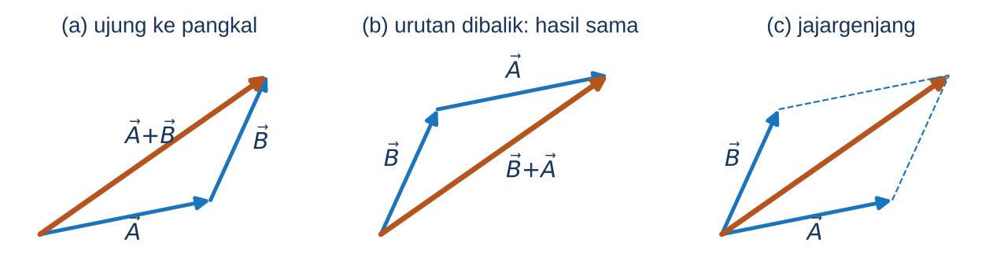
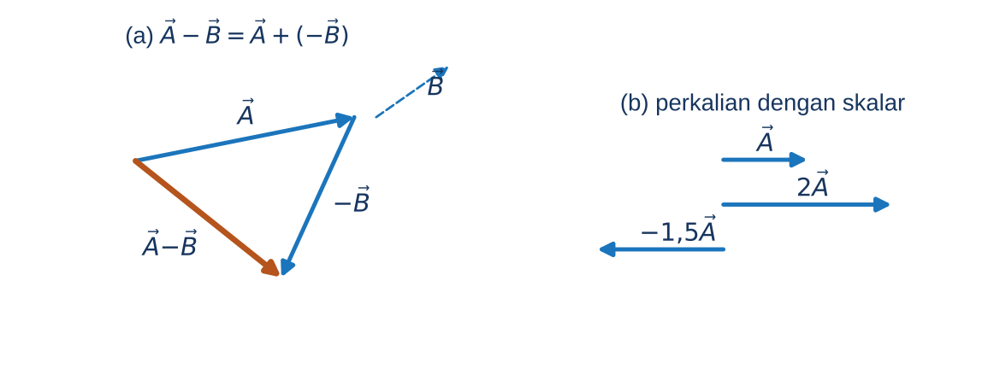
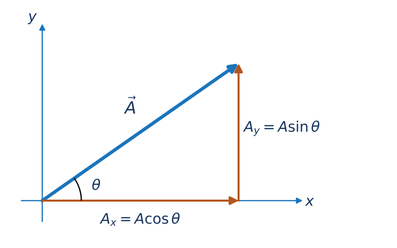
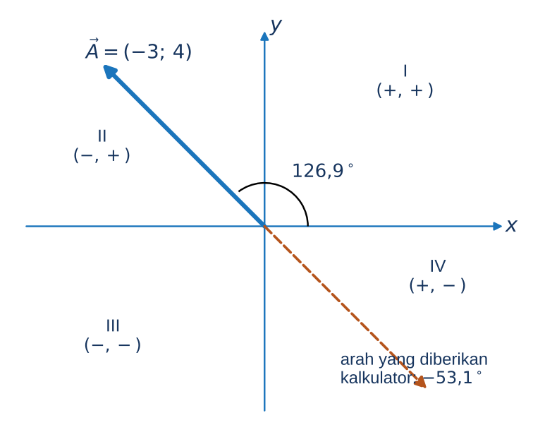
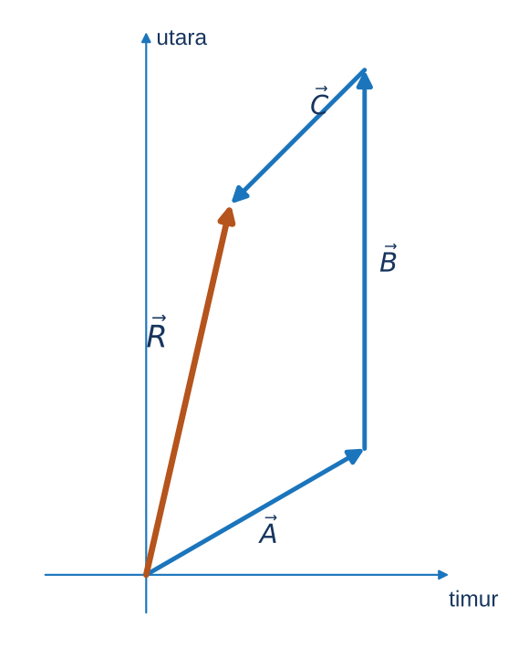
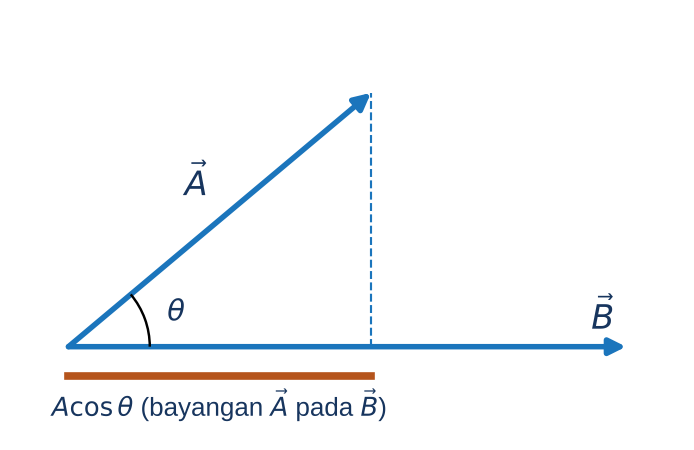
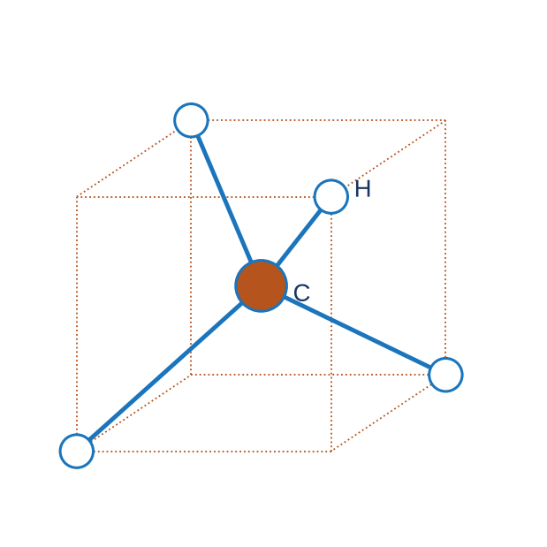
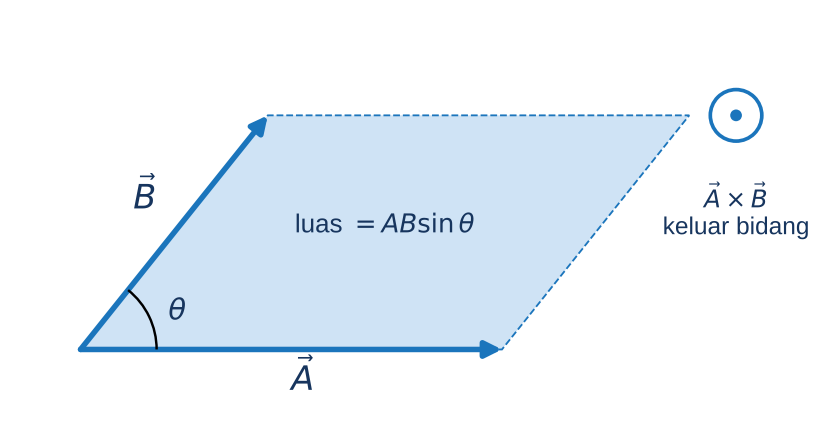

## 1.11 Skalar dan vektor

Seorang nelayan di Selat Madura menerima pesan radio dari temannya: "Ikannya banyak di sini, 5 kilometer dari dermaga!" Pesan itu hampir tidak berguna. Lima kilometer ke arah mana? Titik-titik yang berjarak 5 km dari dermaga membentuk sebuah lingkaran sepanjang lebih dari 30 km. Dengan tambahan tiga kata, "ke arah timur laut", pesannya menjadi lengkap.

Banyak besaran fisika seperti itu: tidak selesai dinyatakan dengan sebuah angka dan satuan, karena **arahnya** sama pentingnya dengan besarnya. Bab ini membangun bahasa matematika untuk besaran semacam itu. Bahasa ini akan dipakai di hampir setiap bab berikutnya: kecepatan, percepatan, gaya, momentum, medan listrik, dan medan magnet semuanya vektor.

::: {.kuis}
**Pertanyaan pembuka subbab 1.11**

Dalam molekul metana, CH₄, empat atom hidrogen mengelilingi atom karbon secara simetris. Sudut antara dua ikatan C–H mana pun adalah 109,5°. Dari mana angka yang aneh itu berasal? Mengapa bukan 90° atau 120°? Jawabannya, yang ternyata hanya butuh dua baris hitungan vektor, ada di subbab 1.15.
:::

**Skalar** adalah besaran yang dinyatakan lengkap oleh satu bilangan dan satuannya: massa 2 kg, suhu 30 °C, waktu 5 s, energi 100 J. Skalar dijumlahkan seperti bilangan biasa.

**Vektor** adalah besaran yang memiliki **besar** dan **arah**, dan yang dijumlahkan menurut aturan khusus (subbab 1.12). Perpindahan adalah contoh dasarnya: "5 km ke timur laut".

| Skalar | Vektor |
|---|---|
| jarak tempuh | perpindahan |
| kelajuan | kecepatan |
| massa | gaya |
| waktu | percepatan |
| suhu | momentum |
| energi | medan listrik |

**Notasi.** Vektor ditulis dengan panah di atasnya, $\vec A$. **Besarnya** ditulis $|\vec A|$ atau cukup $A$ (huruf miring tanpa panah), dan selalu positif atau nol. Dalam gambar, vektor adalah anak panah: panjangnya menyatakan besar (menurut skala tertentu), arahnya menyatakan arah.

Dua vektor **sama** jika besar dan arahnya sama, di mana pun letaknya. Jadi sebuah vektor boleh digeser ke mana saja asalkan panjang dan arahnya tidak diubah. Sifat inilah yang membuat penjumlahan secara grafis bisa dilakukan.

::: {.awas}
**Awas · $A$ bukan $\vec A$**

Menulis $\vec A = 5$ m adalah kesalahan, karena ruas kiri vektor dan ruas kanan bukan. Yang benar: $A = 5$ m, atau $|\vec A| = 5$ m. Dalam tulisan tangan, jangan lupakan panahnya. Persamaan $\vec C = \vec A + \vec B$ dan $C = A + B$ adalah dua pernyataan yang sangat berbeda, dan yang kedua biasanya salah.
:::

::: {.kuis}
**Kuis cepat 1.10**

Manakah yang merupakan besaran vektor? (a) volume sebuah tangki (b) berat sebuah batu (c) kelajuan angin (d) suhu udara
:::

## 1.12 Penjumlahan vektor secara grafis

### Aturan ujung ke pangkal

Jika kamu berjalan mengikuti perpindahan $\vec A$, lalu dari titik itu mengikuti perpindahan $\vec B$, perpindahan totalmu adalah anak panah dari titik awal sampai titik akhir. Itulah arti penjumlahan vektor.

{width=96%}

::: {.strategi}
**Strategi · Menjumlahkan vektor dengan gambar**

1. Gambar $\vec A$ menurut skala.
2. Letakkan **pangkal** $\vec B$ di **ujung** $\vec A$.
3. Vektor jumlah $\vec R = \vec A + \vec B$ adalah anak panah dari pangkal $\vec A$ ke ujung $\vec B$.
4. Untuk lebih dari dua vektor, sambung terus ujung ke pangkal. Jumlahnya adalah anak panah dari pangkal vektor pertama ke ujung vektor terakhir.
:::

Urutan penjumlahan tidak berpengaruh: $\vec A + \vec B = \vec B + \vec A$ (Gambar 1.8b).

Hal terpenting yang diperlihatkan gambar itu: **besar vektor jumlah umumnya bukan jumlah besar-besarnya.** Besar $\vec A + \vec B$ bisa bernilai berapa saja antara $|A - B|$ (jika keduanya berlawanan arah) dan $A + B$ (jika keduanya searah). Tiga sisi sebuah segitiga tidak bisa dijumlahkan begitu saja.

### Negatif vektor, pengurangan, dan perkalian dengan skalar

{width=88%}

**Negatif** sebuah vektor, $-\vec B$, adalah vektor yang besarnya sama dengan $\vec B$ tetapi arahnya berlawanan. **Pengurangan** didefinisikan sebagai penjumlahan dengan negatifnya:

$$
\vec A - \vec B = \vec A + (-\vec B).
$$

Pengurangan vektor muncul setiap kali kita menghitung **perubahan**, misalnya perubahan kecepatan $\Delta\vec v = \vec v_\text{akhir} - \vec v_\text{awal}$. Bab 2 memakainya untuk menurunkan percepatan pada gerak melingkar.

**Mengalikan vektor dengan skalar** $c$ menghasilkan vektor yang panjangnya $|c|$ kali semula. Arahnya tetap jika $c$ positif dan berbalik jika $c$ negatif (Gambar 1.9b). Satuan ikut dikalikan: perpindahan (m) dibagi waktu (s) menghasilkan kecepatan (m/s) yang searah dengan perpindahan itu.

::: {.contoh}
**Contoh 1.17 · Dua perpindahan tegak lurus**

Sebuah perahu berlayar 3,0 km ke timur, lalu 4,0 km ke utara. Tentukan besar dan arah perpindahan totalnya.

**Gambaran fisis.** Kedua perpindahan saling tegak lurus, sehingga bersama vektor jumlahnya membentuk segitiga siku-siku.

**Penyelesaian.** Dengan Pythagoras: $R = \sqrt{3{,}0^2 + 4{,}0^2} = 5{,}0$ km. Arahnya: $\tan\theta = \dfrac{4{,}0}{3{,}0}$, sehingga $\theta = 53^\circ$ di utara dari timur.

**Memahami hasil.** Perahu menempuh jarak 7,0 km, tetapi perpindahannya hanya 5,0 km. Besar vektor jumlah (5,0) lebih kecil dari jumlah besar-besarnya (7,0), sebagaimana mestinya untuk dua vektor yang tidak searah.
:::

Cara grafis memberi gambaran yang jelas, tetapi ketelitiannya terbatas oleh penggaris dan busur derajat, dan tidak praktis untuk tiga dimensi. Untuk menghitung, kita butuh cara lain: komponen.

::: {.kuis}
**Kuis cepat 1.11**

Dua vektor masing-masing besarnya 5 N dan 8 N. Besar jumlah keduanya **tidak mungkin**: (a) 3 N (b) 7 N (c) 13 N (d) 14 N
:::

## 1.13 Komponen vektor

### Menguraikan vektor

Setiap vektor pada bidang bisa dipandang sebagai jumlah dua vektor yang saling tegak lurus: satu sejajar sumbu $x$, satu sejajar sumbu $y$. Panjang bertanda kedua vektor itu disebut **komponen**, $A_x$ dan $A_y$.

{width=58%}

Jika $\theta$ adalah sudut vektor **diukur dari sumbu $x$ positif, berlawanan arah jarum jam** (Gambar 1.10), maka

$$
\boxed{A_x = A\cos\theta, \qquad A_y = A\sin\theta}
$$

Komponen adalah **bilangan bertanda**, bukan vektor. $A_x$ negatif berarti vektornya condong ke arah $-x$. Dengan komponen, sebuah vektor berubah menjadi sepasang bilangan biasa, dan semua aljabar biasa bisa dipakai. Inilah seluruh manfaat komponen.

::: {.mat}
**Matematika · Trigonometri segitiga siku-siku**

Pada segitiga siku-siku dengan salah satu sudut lancip $\theta$:

$$
\sin\theta = \frac{\text{sisi depan}}{\text{sisi miring}}, \qquad \cos\theta = \frac{\text{sisi samping}}{\text{sisi miring}}, \qquad \tan\theta = \frac{\text{sisi depan}}{\text{sisi samping}} = \frac{\sin\theta}{\cos\theta}.
$$

"Depan" dan "samping" ditentukan dari sudut $\theta$ yang dipakai. Identitas terpenting: $\sin^2\theta + \cos^2\theta = 1$, yang tidak lain adalah teorema Pythagoras.

| $\theta$ | 0° | 30° | 45° | 60° | 90° |
|---|---|---|---|---|---|
| $\sin\theta$ | 0 | $\tfrac12$ | $\tfrac{\sqrt2}{2} \approx 0{,}707$ | $\tfrac{\sqrt3}{2} \approx 0{,}866$ | 1 |
| $\cos\theta$ | 1 | $\tfrac{\sqrt3}{2} \approx 0{,}866$ | $\tfrac{\sqrt2}{2} \approx 0{,}707$ | $\tfrac12$ | 0 |

Untuk mencari sudut dari perbandingan sisi, pakai fungsi kebalikan: $\theta = \tan^{-1}(\ldots)$, $\sin^{-1}(\ldots)$, atau $\cos^{-1}(\ldots)$. Pastikan kalkulator berada pada mode derajat jika sudutnya dalam derajat.
:::

::: {.contoh}
**Contoh 1.18 · Menguraikan sebuah gaya**

Sebuah tali menarik kotak dengan gaya 50 N pada sudut 30° di atas arah mendatar. Tentukan komponen mendatar dan tegak gaya itu.

**Penyelesaian.**

$$
F_x = 50\cos 30^\circ = 43\ \text{N}, \qquad F_y = 50\sin 30^\circ = 25\ \text{N}.
$$

**Memahami hasil.** $\sqrt{43{,}3^2 + 25{,}0^2} = 50$ N. Cocok. Dari gaya 50 N, hanya 43 N yang benar-benar menarik kotak ke depan. Sisanya mengangkat kotak sedikit. Pemahaman ini akan sangat penting di Bab 3.
:::

::: {.awas}
**Awas · Kosinus tidak selalu untuk $x$**

Rumus $A_x = A\cos\theta$ hanya benar jika $\theta$ diukur **dari sumbu $x$**. Jika sudut yang diberikan diukur dari sumbu $y$ (misalnya "20° dari arah utara"), perannya tertukar. Jangan menghafal "cos untuk $x$". Gambar segitiganya, lalu tentukan sisi mana yang berada di samping sudut (kosinus) dan mana yang di depannya (sinus).
:::

### Dari komponen kembali ke besar dan arah

Sebaliknya, jika komponen diketahui:

$$
\boxed{A = \sqrt{A_x^2 + A_y^2}, \qquad \tan\theta = \frac{A_y}{A_x}}
$$

Rumus besar selalu aman. Rumus arah punya jebakan.

{width=54%}

::: {.contoh}
**Contoh 1.19 · Jebakan kuadran**

Sebuah vektor memiliki komponen $A_x = -3{,}0$ m dan $A_y = +4{,}0$ m. Tentukan besar dan arahnya.

**Penyelesaian.** $A = \sqrt{(-3{,}0)^2 + 4{,}0^2} = 5{,}0$ m.

Kalkulator memberi $\tan^{-1}\left(\dfrac{4{,}0}{-3{,}0}\right) = -53^\circ$. Sudut itu berada di kuadran IV, padahal vektor dengan $x$ negatif dan $y$ positif jelas berada di **kuadran II** (Gambar 1.11). Arah yang benar: $\theta = -53^\circ + 180^\circ = 127^\circ$ dari sumbu $x$ positif.

**Memahami hasil.** $5{,}0\cos 127^\circ = -3{,}0$ dan $5{,}0\sin 127^\circ = +4{,}0$. Cocok.

**Mengapa kalkulator keliru?** Karena $\dfrac{4}{-3}$ dan $\dfrac{-4}{3}$ adalah bilangan yang sama. Setelah dibagi, informasi tentang komponen mana yang negatif sudah hilang. Fungsi $\tan^{-1}$ hanya mengembalikan sudut antara $-90^\circ$ dan $+90^\circ$.
:::

::: {.strategi}
**Strategi · Menentukan arah dari komponen**

1. **Selalu gambar dulu** vektornya dari tanda kedua komponen, untuk mengetahui kuadrannya.
2. Hitung sudut lancip $\alpha = \tan^{-1}\left(\left|A_y\right|/\left|A_x\right|\right)$, yaitu sudut terhadap sumbu $x$ terdekat.
3. Nyatakan arah dengan gambar itu: "$\alpha$ di atas sumbu $x$ negatif", atau ubah ke sudut baku: kuadran I: $\alpha$; kuadran II: $180^\circ - \alpha$; kuadran III: $180^\circ + \alpha$; kuadran IV: $360^\circ - \alpha$.

Dalam pemrograman, fungsi `atan2(Ay, Ax)` melakukan semua ini secara otomatis.
:::

::: {.kuis}
**Kuis cepat 1.12**

Sebuah vektor berada di kuadran III. Tanda komponen-komponennya adalah: (a) $A_x > 0$, $A_y > 0$ (b) $A_x < 0$, $A_y > 0$ (c) $A_x < 0$, $A_y < 0$ (d) $A_x > 0$, $A_y < 0$
:::

## 1.14 Vektor satuan dan penjumlahan dengan komponen

### Vektor satuan

**Vektor satuan** adalah vektor tak berdimensi yang besarnya tepat 1. Gunanya hanya satu: menunjukkan arah. Vektor satuan pada arah sumbu $x$, $y$, dan $z$ positif ditulis $\hat\imath$, $\hat\jmath$, dan $\hat k$ (dibaca "i topi", dan seterusnya). Dengan vektor satuan, sebuah vektor ditulis lengkap sebagai

$$
\vec A = A_x\,\hat\imath + A_y\,\hat\jmath + A_z\,\hat k .
$$

Gaya pada Contoh 1.18, misalnya, adalah $\vec F = (43\,\hat\imath + 25\,\hat\jmath)$ N. Dalam tiga dimensi, besarnya $A = \sqrt{A_x^2 + A_y^2 + A_z^2}$.

### Menjumlahkan dengan komponen

Di sinilah komponen membayar jerih payah kita. Jika $\vec R = \vec A + \vec B$, maka

$$
\boxed{R_x = A_x + B_x, \qquad R_y = A_y + B_y}
$$

**Komponen $x$ hanya dijumlahkan dengan komponen $x$, dan komponen $y$ dengan komponen $y$.** Soal vektor dua dimensi terpecah menjadi dua soal bilangan biasa yang terpisah.

::: {.strategi}
**Strategi · Menjumlahkan vektor dengan komponen**

1. Gambar sketsa dan pilih sumbu. Pilih sumbu yang membuat sebanyak mungkin vektor sejajar sumbu.
2. Uraikan setiap vektor menjadi komponen. Perhatikan tandanya.
3. Buat tabel: satu baris untuk tiap vektor, satu kolom untuk tiap sumbu. Jumlahkan tiap kolom.
4. Jika diminta, ubah hasilnya kembali menjadi besar dan arah (ingat jebakan kuadran).
5. Periksa terhadap sketsa: apakah besar dan arahnya masuk akal?
:::

{width=42%}

::: {.contoh}
**Contoh 1.20 · Perjalanan seorang pendaki**

Seorang pendaki berjalan 2,0 km pada arah 30° di utara dari timur, lalu 3,0 km ke utara, lalu 1,5 km ke barat daya (45° di selatan dari barat). Di mana ia berada relatif terhadap titik awalnya?

**Gambaran fisis.** Timur sebagai $+x$ dan utara sebagai $+y$ (Gambar 1.12).

**Penyelesaian.**

| Vektor | Komponen $x$ (km) | Komponen $y$ (km) |
|---|---|---|
| $\vec A$ | $2{,}0\cos 30^\circ = +1{,}73$ | $2{,}0\sin 30^\circ = +1{,}00$ |
| $\vec B$ | $0$ | $+3{,}00$ |
| $\vec C$ | $-1{,}5\cos 45^\circ = -1{,}06$ | $-1{,}5\sin 45^\circ = -1{,}06$ |
| $\vec R$ | $+0{,}67$ | $+2{,}94$ |

$R = \sqrt{0{,}67^2 + 2{,}94^2} = 3{,}0$ km. Kedua komponen positif (kuadran I), jadi $\theta = \tan^{-1}\left(\dfrac{2{,}94}{0{,}67}\right) = 77^\circ$ di utara dari timur.

**Memahami hasil.** Pendaki menempuh 6,5 km tetapi hanya 3,0 km dari titik awal, hampir tepat di utara. Sketsa pada Gambar 1.12 menunjukkan hal yang sama.
:::

::: {.contoh}
**Contoh 1.21 · Gaya ketiga yang menyeimbangkan**

Tiga tali diikat pada sebuah cincin. Tali pertama menarik dengan 100 N ke arah $+x$. Tali kedua menarik dengan 80 N pada sudut 120° dari sumbu $x$. Berapa besar dan arah tarikan tali ketiga agar jumlah ketiga gaya nol?

**Rencana.** Syaratnya $\vec F_1 + \vec F_2 + \vec F_3 = 0$, sehingga $\vec F_3 = -(\vec F_1 + \vec F_2)$.

**Penyelesaian.**

$$
F_{1x} + F_{2x} = 100 + 80\cos 120^\circ = 100 - 40 = 60\ \text{N}, \qquad F_{1y} + F_{2y} = 0 + 80\sin 120^\circ = 69\ \text{N}.
$$

Jadi $\vec F_3 = (-60\,\hat\imath - 69\,\hat\jmath)$ N. Besarnya $\sqrt{60^2 + 69^2} = 92$ N. Kedua komponen negatif (kuadran III): $\alpha = \tan^{-1}(69/60) = 49^\circ$, sehingga $\theta = 180^\circ + 49^\circ = 229^\circ$.

**Memahami hasil.** Gaya ketiga harus berlawanan dengan jumlah dua gaya pertama, yang mengarah ke kanan atas. Jadi ia mengarah ke kiri bawah. Cocok. Syarat "jumlah vektor gaya nol" adalah inti Bab 3.
:::

::: {.kuis}
**Kuis cepat 1.13**

$\vec A = 3\,\hat\imath + 4\,\hat\jmath$ dan $\vec B = 3\,\hat\imath - 4\,\hat\jmath$. Besar $\vec A + \vec B$ adalah: (a) 0 (b) 6 (c) 8 (d) 10
:::

## 1.15 Perkalian titik

Vektor bisa dikalikan dengan dua cara yang berbeda. Cara pertama menghasilkan **skalar**, cara kedua menghasilkan **vektor**. Keduanya lahir dari kebutuhan fisika.

### Definisi

**Perkalian titik** (*dot product*, atau perkalian skalar) dua vektor didefinisikan sebagai

$$
\boxed{\vec A \cdot \vec B = AB\cos\theta}
$$

dengan $\theta$ sudut di antara keduanya ketika pangkalnya dipertemukan. Hasilnya **skalar**.

{width=58%}

Arti geometrinya (Gambar 1.13): $A\cos\theta$ adalah panjang "bayangan" (**proyeksi**) $\vec A$ pada arah $\vec B$. Jadi perkalian titik mengukur **seberapa jauh dua vektor searah**:

| Sudut | $\vec A \cdot \vec B$ | Arti |
|---|---|---|
| $0^\circ$ | $AB$ (terbesar) | searah |
| $0^\circ < \theta < 90^\circ$ | positif | sebagian searah |
| $90^\circ$ | $0$ | **tegak lurus** |
| $90^\circ < \theta < 180^\circ$ | negatif | sebagian berlawanan |
| $180^\circ$ | $-AB$ | berlawanan arah |

Baris tengah sangat berguna: **dua vektor (yang tidak nol) saling tegak lurus jika dan hanya jika perkalian titiknya nol.**

Di Bab 4, perkalian titik muncul sebagai **usaha**: $W = \vec F \cdot \vec d$. Hanya bagian gaya yang searah perpindahan yang melakukan usaha, dan perkalian titik persis mengambil bagian itu.

### Menghitung dengan komponen

Untuk vektor satuan, $\hat\imath \cdot \hat\imath = \hat\jmath \cdot \hat\jmath = \hat k \cdot \hat k = 1$ (searah, besarnya 1) dan $\hat\imath \cdot \hat\jmath = \hat\jmath \cdot \hat k = \hat k \cdot \hat\imath = 0$ (tegak lurus). Jika $(A_x\hat\imath + A_y\hat\jmath + A_z\hat k) \cdot (B_x\hat\imath + B_y\hat\jmath + B_z\hat k)$ dijabarkan, dari sembilan suku hanya tiga yang tidak nol:

$$
\boxed{\vec A \cdot \vec B = A_xB_x + A_yB_y + A_zB_z}
$$

Kedua rumus bersama-sama memberi cara termudah untuk mencari **sudut antara dua vektor**:

$$
\cos\theta = \frac{\vec A \cdot \vec B}{AB} = \frac{A_xB_x + A_yB_y + A_zB_z}{AB}.
$$

Perhatikan juga bahwa $\vec A \cdot \vec A = A^2$.

::: {.contoh}
**Contoh 1.22 · Sudut antara dua vektor**

Tentukan sudut antara $\vec A = 3\,\hat\imath + 4\,\hat\jmath$ dan $\vec B = 5\,\hat\imath + 12\,\hat\jmath$.

**Penyelesaian.** $\vec A \cdot \vec B = (3)(5) + (4)(12) = 63$. $A = 5$ dan $B = 13$.

$$
\cos\theta = \frac{63}{(5)(13)} = 0{,}969 \quad\Longrightarrow\quad \theta = 14^\circ .
$$

**Memahami hasil.** $\vec A$ membentuk sudut $53{,}1^\circ$ dengan sumbu $x$ dan $\vec B$ membentuk $67{,}4^\circ$. Selisihnya $14{,}3^\circ$. Cocok.
:::

{width=40%}

::: {.contoh}
**Contoh 1.23 · Sudut ikatan metana (jawaban pertanyaan pembuka)**

Tentukan sudut antara dua ikatan C–H dalam metana.

**Gambaran fisis.** Empat atom H yang letaknya setara di sekitar atom C membentuk bangun tetrahedron. Cara termudah menggambarkannya: letakkan atom C di pusat sebuah kubus bersisi 2 satuan (titik asal), dan keempat atom H di empat titik sudut yang berselang-seling (Gambar 1.14). Koordinatnya:

$$
(1, 1, 1), \quad (1, -1, -1), \quad (-1, 1, -1), \quad (-1, -1, 1).
$$

Keempat titik itu sama jauhnya dari pusat, dan sama jauhnya satu dari yang lain, jadi benar-benar setara.

**Penyelesaian.** Ambil dua ikatan sebagai vektor $\vec A = (1, 1, 1)$ dan $\vec B = (1, -1, -1)$.

$$
\vec A \cdot \vec B = (1)(1) + (1)(-1) + (1)(-1) = -1, \qquad A = B = \sqrt{1^2 + 1^2 + 1^2} = \sqrt3 .
$$

$$
\cos\theta = \frac{-1}{(\sqrt3)(\sqrt3)} = -\frac13 \quad\Longrightarrow\quad \theta = 109{,}5^\circ .
$$

**Memahami hasil.** Pasangan lain mana pun memberi hasil yang sama, sesuai kesetaraan keempat ikatan. Sudutnya lebih besar dari 90°, karena dalam tiga dimensi empat arah bisa saling menjauh lebih lebar daripada empat arah pada bidang datar. Itulah sebabnya metana tidak datar: susunan tetrahedral menempatkan keempat pasangan elektron ikatan sejauh mungkin satu dari yang lain. Angka "109,5°" yang dihafal di kimia tidak lain adalah $\cos^{-1}(-\tfrac13)$.
:::

::: {.kuis}
**Kuis cepat 1.14**

$\vec A \cdot \vec B$ bernilai negatif. Maka sudut antara $\vec A$ dan $\vec B$: (a) kurang dari 90° (b) tepat 90° (c) lebih dari 90° (d) tidak bisa ditentukan
:::

## 1.16 Perkalian silang

### Definisi

**Perkalian silang** (*cross product*, atau perkalian vektor) menghasilkan **vektor** baru, $\vec C = \vec A \times \vec B$:

- **Besarnya:** $\boxed{|\vec A \times \vec B| = AB\sin\theta}$, dengan $\theta$ sudut di antara keduanya ($0^\circ \le \theta \le 180^\circ$).
- **Arahnya:** tegak lurus terhadap $\vec A$ **dan** terhadap $\vec B$, yaitu tegak lurus bidang yang memuat keduanya, menurut **kaidah tangan kanan**.

{width=62%}

::: {.strategi}
**Strategi · Kaidah tangan kanan**

Rentangkan jari-jari tangan **kanan** searah $\vec A$. Putar telapak tangan sehingga jari-jari bisa menekuk ke arah $\vec B$ melalui sudut yang lebih kecil. Ibu jari yang tegak menunjukkan arah $\vec A \times \vec B$.

Pada gambar di atas kertas, arah **keluar** dari halaman dilambangkan ⊙ (ujung anak panah yang datang ke arahmu) dan arah **masuk** ke halaman dilambangkan ⊗ (ekor anak panah yang menjauh).
:::

Besarnya, $AB\sin\theta$, adalah **luas jajargenjang** yang dibentuk kedua vektor (Gambar 1.15). Jadi perkalian silang mengukur **seberapa jauh dua vektor saling tegak lurus**, kebalikan dari perkalian titik:

- Dua vektor **sejajar** (atau berlawanan arah): perkalian silangnya **nol**. Khususnya $\vec A \times \vec A = 0$.
- Dua vektor **tegak lurus**: besarnya maksimum, $AB$.

::: {.awas}
**Awas · Urutan menentukan arah**

$\vec A \times \vec B = -\vec B \times \vec A$. Menukar urutan membalik arah hasilnya. (Coba dengan tangan kananmu.) Ini berbeda dari perkalian bilangan dan dari perkalian titik, yang urutannya bebas.
:::

Perkalian silang akan muncul sebagai **torsi** $\vec\tau = \vec r \times \vec F$, **momentum sudut** $\vec L = \vec r \times \vec p$, dan **gaya magnet** $\vec F = q\vec v \times \vec B$ (Bab 14).

### Menghitung dengan komponen

Untuk vektor satuan pada sistem koordinat tangan kanan:

$$
\hat\imath \times \hat\jmath = \hat k, \qquad \hat\jmath \times \hat k = \hat\imath, \qquad \hat k \times \hat\imath = \hat\jmath,
$$

sedangkan urutan terbalik memberi tanda minus ($\hat\jmath \times \hat\imath = -\hat k$), dan $\hat\imath \times \hat\imath = \hat\jmath \times \hat\jmath = \hat k \times \hat k = 0$. Urutan $\hat\imath \to \hat\jmath \to \hat k \to \hat\imath$ mudah diingat sebagai putaran berulang. Dengan menjabarkan, diperoleh

$$
\boxed{\vec A \times \vec B = (A_yB_z - A_zB_y)\,\hat\imath + (A_zB_x - A_xB_z)\,\hat\jmath + (A_xB_y - A_yB_x)\,\hat k}
$$

Untuk dua vektor pada bidang $xy$ ($A_z = B_z = 0$), hanya komponen $z$ yang tersisa: $\vec A \times \vec B = (A_xB_y - A_yB_x)\,\hat k$.

::: {.contoh}
**Contoh 1.24 · Perkalian silang dua vektor pada bidang**

Diketahui $\vec A = 2\,\hat\imath + 3\,\hat\jmath$ dan $\vec B = 4\,\hat\imath - \hat\jmath$. Tentukan $\vec A \times \vec B$ dan luas jajargenjang yang dibentuk keduanya.

**Penyelesaian.** $\vec A \times \vec B = \left[(2)(-1) - (3)(4)\right]\hat k = -14\,\hat k$.

Hasilnya mengarah ke $-z$ (masuk ke halaman, jika sumbu $x$ ke kanan dan $y$ ke atas). Luas jajargenjang adalah besarnya: 14 satuan luas.

**Memahami hasil.** Dengan tangan kanan: jari searah $\vec A$ (kanan atas), menekuk ke $\vec B$ (kanan bawah) berarti berputar **searah** jarum jam, sehingga ibu jari menunjuk masuk ke halaman. Cocok dengan tanda minus. Pemeriksaan kedua: hasil perkalian silang harus tegak lurus kedua vektor, dan $-14\,\hat k$ memang tegak lurus bidang $xy$.
:::

::: {.contoh}
**Contoh 1.25 · Kunci pas dan torsi**

Sebuah kunci pas sepanjang 0,30 m dipakai mengencangkan baut. Gaya 20 N dikerjakan di ujung gagang, membentuk sudut 60° dengan gagang. Besar efek putarnya (torsi) adalah $|\vec r \times \vec F|$. Hitung nilainya, dan tentukan pada sudut berapa efek putarnya terbesar.

**Penyelesaian.** $|\vec r \times \vec F| = rF\sin\theta = (0{,}30)(20)\sin 60^\circ = 5{,}2$ N·m.

Nilai terbesar terjadi saat $\sin\theta = 1$, yaitu gaya tegak lurus gagang: $6{,}0$ N·m.

**Memahami hasil.** Pengalaman sehari-hari membenarkan: mendorong kunci pas searah gagangnya ($\theta = 0$) tidak memutar baut sama sekali, dan mendorong tegak lurus gagang paling efektif. Perkalian silang menangkap persis hal itu.
:::

::: {.kuis}
**Kuis cepat 1.15**

Sumbu $x$ ke kanan, sumbu $y$ ke atas halaman. Arah $\hat\jmath \times \hat\imath$ adalah: (a) keluar dari halaman (b) masuk ke halaman (c) ke kanan (d) nol
:::
