# Bab 2 Kinematika

Pada 2 Agustus 1971, di permukaan Bulan, astronaut David Scott berdiri di depan kamera televisi dengan sebuah palu geologi di tangan kanan dan sehelai bulu elang di tangan kiri. Ia mengangkat keduanya setinggi dada, lalu melepaskannya bersamaan. Jutaan orang di Bumi menonton palu dan bulu itu turun berdampingan dan menyentuh debu Bulan pada saat yang sama.

"Ternyata Tuan Galileo benar," kata Scott.

Hampir empat abad sebelumnya, Galileo Galilei menentang keyakinan yang sudah bertahan dua ribu tahun, yaitu bahwa benda berat jatuh lebih cepat daripada benda ringan. Ia tidak punya ruang hampa untuk membuktikannya. Yang ia punya adalah bidang miring, bola perunggu, jam air, dan sebuah gagasan baru: bahwa gerak bisa **diukur** dan dinyatakan dengan matematika. Bab ini mengikuti jalan yang ia buka.

::: {.kuis}
**Pertanyaan pembuka**

Di Bumi, palu jelas sampai lebih dulu daripada bulu. Jadi apa sebenarnya yang "benar" dari Galileo? Dan jika palu dijatuhkan dari ketinggian 1,6 m di Bulan, berapa lama ia melayang sebelum menyentuh tanah? Jawabannya ada di subbab 2.7.
:::

::: {.tujuan}
**Tujuan belajar**

Setelah mempelajari bab ini, kamu mampu:

1. Membedakan posisi, perpindahan, dan jarak tempuh, serta memakai tanda untuk menyatakan arah.
2. Menghitung kecepatan rata-rata dan kelajuan rata-rata, dan menjelaskan perbedaannya.
3. Mendefinisikan kecepatan sesaat sebagai limit, menafsirkannya sebagai kemiringan grafik posisi–waktu, dan menghitungnya dengan turunan.
4. Mendefinisikan percepatan, menentukan tandanya, dan memutuskan apakah benda makin cepat atau makin lambat.
5. Berpindah di antara grafik posisi, kecepatan, dan percepatan: kemiringan untuk turun satu tingkat, luas untuk naik satu tingkat.
6. Menurunkan dan memakai persamaan gerak dengan percepatan konstan.
7. Menyelesaikan soal jatuh bebas, termasuk benda yang dilempar ke atas.
8. Menyelesaikan soal gerak bertahap dan soal dua benda.
9. Memakai turunan dan integral untuk gerak dengan percepatan yang berubah, dan menghitung gerak selangkah demi selangkah dengan komputer.
10. Menyatakan posisi, kecepatan, dan percepatan sebagai vektor, dan menjelaskan mengapa kecepatan selalu menyinggung lintasan.
11. Memecah gerak dua dimensi menjadi dua gerak satu dimensi yang tidak saling memengaruhi.
12. Menurunkan dan memakai persamaan gerak peluru: lintasan, waktu melayang, tinggi maksimum, dan jangkauan.
13. Menyelesaikan soal gerak peluru yang titik awal dan akhirnya berbeda ketinggian.
14. Menurunkan percepatan sentripetal $v^2/r$ dan memakainya pada gerak melingkar beraturan.
15. Menguraikan percepatan menjadi bagian radial dan bagian tangensial.
16. Menghubungkan kecepatan yang diukur dari kerangka acuan yang berbeda.
:::

::: {.mat}
**Prasyarat**

Bab 1 (satuan, konversi, angka penting, lima langkah pemecahan masalah). Aljabar: menyelesaikan persamaan linear dan persamaan kuadrat. Tidak diperlukan pengetahuan kalkulus; turunan dan integral diperkenalkan dari awal di bab ini.
:::

## 2.1 Posisi, perpindahan, dan jarak

### Di mana benda berada?

Untuk menyatakan letak sebuah benda, kita membutuhkan tiga kesepakatan: sebuah **titik acuan** (titik nol), sebuah **arah positif**, dan sebuah **satuan panjang**. Ketiganya membentuk **sumbu koordinat**. Untuk gerak sepanjang garis lurus, satu sumbu sudah cukup, dan biasanya diberi nama sumbu $x$ (atau sumbu $y$ untuk gerak naik-turun).

**Posisi** $x$ adalah letak benda pada sumbu itu, lengkap dengan tandanya. $x = +40$ m berarti 40 m dari titik nol ke arah positif. $x = -30$ m berarti 30 m dari titik nol ke arah berlawanan.

Pemilihan titik nol dan arah positif **sepenuhnya bebas**. Fisikanya tidak berubah, hanya angkanya. Yang penting, pilihan itu dibuat satu kali di awal soal dan dipegang terus sampai akhir.

Sepanjang bab ini benda diperlakukan dengan **model partikel** (subbab 1.1): mobil, bola, dan pelari dianggap sebagai satu titik.

### Perpindahan

**Perpindahan** adalah perubahan posisi:

$$
\Delta x = x_\text{akhir} - x_\text{awal} .
$$

Lambang $\Delta$ (huruf Yunani delta) selalu berarti "akhir dikurangi awal". Kita akan sering memakainya: $\Delta t$, $\Delta v$, dan seterusnya.

Perpindahan memiliki besar **dan arah**. Dalam satu dimensi, arah dinyatakan oleh tandanya: positif berarti ke arah sumbu positif, negatif berarti ke arah sebaliknya. Besaran yang memiliki besar dan arah disebut **vektor** (Bab 1 membahasnya secara penuh). Besaran yang hanya memiliki besar, seperti massa dan waktu, disebut **skalar**.

Perpindahan hanya peduli pada titik awal dan titik akhir, tidak pada jalan yang ditempuh. **Jarak tempuh** berbeda: ia adalah panjang seluruh lintasan yang dilalui, selalu positif, dan tidak memiliki arah.

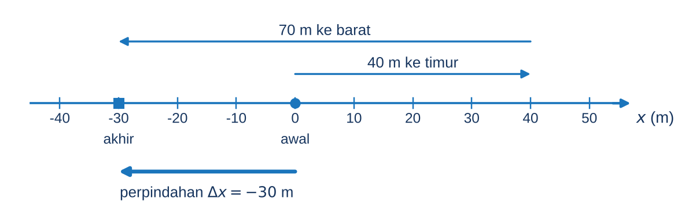{width=88%}

::: {.contoh}
**Contoh 2.1 · Perpindahan dan jarak**

Seseorang berjalan 40 m ke timur, lalu berbalik dan berjalan 70 m ke barat (Gambar 2.1). Tentukan perpindahan dan jarak tempuhnya.

**Gambaran fisis.** Pilih titik awal sebagai $x = 0$ dan timur sebagai arah positif.

**Penyelesaian.** Setelah tahap pertama, $x = +40$ m. Setelah tahap kedua, $x = 40 - 70 = -30$ m.

- Perpindahan: $\Delta x = x_\text{akhir} - x_\text{awal} = -30 - 0 = -30$ m, yaitu 30 m ke barat.
- Jarak tempuh: $40 + 70 = 110$ m.

**Memahami hasil.** Jika barat yang dipilih sebagai arah positif, perpindahannya menjadi $+30$ m. Angkanya berubah tanda, tetapi artinya tetap sama: 30 m ke barat. Jarak tempuh tidak terpengaruh oleh pilihan sumbu.
:::

::: {.awas}
**Awas · Perpindahan bukan jarak**

Seorang pelari yang menyelesaikan satu putaran lintasan 400 m dan kembali ke garis start menempuh **jarak** 400 m, tetapi **perpindahannya nol**. Besar perpindahan sama dengan jarak tempuh hanya jika benda bergerak lurus tanpa pernah berbalik arah.
:::

::: {.kuis}
**Kuis cepat 2.1**

Sebuah lift bergerak dari lantai 1 naik ke lantai 5, lalu turun ke lantai 2. Jarak antarlantai 4 m. Dengan arah ke atas positif, perpindahan dan jarak tempuh lift adalah: (a) $+4$ m dan 4 m (b) $+4$ m dan 28 m (c) $+28$ m dan 28 m (d) $-12$ m dan 28 m
:::

## 2.2 Kecepatan rata-rata dan kelajuan rata-rata

### Dua ukuran "seberapa cepat"

Dua mobil sama-sama menempuh perjalanan dari kota A ke kota B. Yang tiba lebih dulu kita sebut "lebih cepat". Ukuran ini menggabungkan perubahan posisi dengan waktu yang diperlukan:

$$
\boxed{v_\text{rata} = \frac{\Delta x}{\Delta t} = \frac{x_\text{akhir} - x_\text{awal}}{t_\text{akhir} - t_\text{awal}}}
$$

Inilah **kecepatan rata-rata**. Karena dibentuk dari perpindahan, ia juga vektor: tandanya menunjukkan arah. Satuannya m/s.

Ada ukuran kedua yang memakai jarak tempuh:

$$
\text{kelajuan rata-rata} = \frac{\text{jarak tempuh}}{\Delta t} .
$$

**Kelajuan rata-rata** adalah skalar dan tidak pernah negatif. Spidometer dan catatan "rata-rata 60 km/jam" di perjalanan mengukur kelajuan, bukan kecepatan.

Dalam bahasa sehari-hari "kecepatan" dan "kelajuan" dipakai bergantian. Dalam fisika keduanya dibedakan dengan ketat: **kecepatan** (*velocity*) punya arah, **kelajuan** (*speed*) tidak.

::: {.contoh}
**Contoh 2.2 · Kecepatan dan kelajuan rata-rata**

Perjalanan pada Contoh 2.1 berlangsung selama 50 s. Tentukan kecepatan rata-rata dan kelajuan rata-ratanya.

**Penyelesaian.**

$$
v_\text{rata} = \frac{\Delta x}{\Delta t} = \frac{-30\ \text{m}}{50\ \text{s}} = -0{,}60\ \text{m/s}, \qquad \text{kelajuan rata-rata} = \frac{110\ \text{m}}{50\ \text{s}} = 2{,}2\ \text{m/s}.
$$

**Memahami hasil.** Tanda negatif berarti secara keseluruhan orang itu berpindah ke barat. Kelajuan rata-rata jauh lebih besar daripada besar kecepatan rata-rata, karena sebagian besar langkahnya "terbuang" untuk berbalik.
:::

### Kecepatan rata-rata pada grafik posisi–waktu

Cara terbaik melihat sebuah gerak adalah dengan **grafik posisi terhadap waktu** (grafik $x$–$t$): waktu pada sumbu mendatar, posisi pada sumbu tegak. Grafik ini **bukan** gambar lintasan benda. Bendanya bergerak sepanjang garis lurus, sedangkan grafiknya bisa melengkung naik-turun.

Pada grafik $x$–$t$, $\Delta x$ adalah selisih tegak dan $\Delta t$ selisih mendatar antara dua titik. Perbandingannya adalah **kemiringan garis lurus yang menghubungkan kedua titik itu**. Garis seperti ini disebut **tali busur**.

::: {.inti}
**Kecepatan rata-rata = kemiringan tali busur pada grafik $x$–$t$.**
:::

Tali busur yang curam berarti gerak cepat. Tali busur yang menanjak berarti gerak ke arah positif, yang menurun berarti gerak ke arah negatif, dan yang mendatar berarti perpindahan nol.

### Jebakan merata-ratakan

::: {.contoh}
**Contoh 2.3 · Surabaya–Malang: mengapa bukan 45 km/jam?**

Sebuah mobil menempuh 90 km. Separuh jarak pertama (45 km) ditempuh dengan kelajuan 60 km/jam, dan separuh jarak kedua dengan 30 km/jam karena macet. Berapa kelajuan rata-rata seluruh perjalanan?

**Memahami soal.** Godaannya adalah menjawab $(60 + 30)/2 = 45$ km/jam. Mari periksa dengan definisi.

**Rencana.** Kelajuan rata-rata = jarak total dibagi **waktu total**. Kita perlu waktu tiap tahap.

**Penyelesaian.**

$$
t_1 = \frac{45\ \text{km}}{60\ \text{km/jam}} = 0{,}75\ \text{jam}, \qquad t_2 = \frac{45\ \text{km}}{30\ \text{km/jam}} = 1{,}50\ \text{jam}.
$$

$$
\text{kelajuan rata-rata} = \frac{90\ \text{km}}{0{,}75 + 1{,}50\ \text{jam}} = 40\ \text{km/jam}.
$$

**Memahami hasil.** Hasilnya lebih dekat ke 30 daripada ke 60. Ini wajar: mobil menghabiskan waktu **dua kali lebih lama** di tahap lambat, jadi tahap lambat lebih "berbobot". Rata-rata kelajuan adalah rata-rata terhadap **waktu**, bukan terhadap jarak.

**Bagaimana jika…** mobil melaju 60 km/jam selama separuh **waktu** dan 30 km/jam selama separuh waktu sisanya? Maka jarak totalnya $60(T/2) + 30(T/2) = 45T$, dan kelajuan rata-ratanya memang 45 km/jam. Rata-rata sederhana hanya benar jika selang **waktunya** sama.
:::

::: {.awas}
**Awas · Kecepatan rata-rata bukan rata-rata kecepatan**

Jangan menjumlahkan beberapa kecepatan lalu membaginya. Selalu kembali ke definisi: perpindahan total dibagi waktu total.
:::

::: {.kuis}
**Kuis cepat 2.2**

Kamu berjalan dari rumah ke warung dengan kelajuan tetap, lalu langsung pulang lewat jalan yang sama dengan kelajuan dua kali lebih besar. Kecepatan rata-rata seluruh perjalanan adalah: (a) nol (b) rata-rata kedua kelajuan (c) lebih kecil dari rata-rata kedua kelajuan, tetapi tidak nol (d) tidak bisa ditentukan
:::

## 2.3 Kecepatan sesaat

### Masalahnya

Kecepatan rata-rata 40 km/jam tidak mengatakan apa-apa tentang yang terjadi di tengah perjalanan. Mobil itu mungkin sempat melaju 80 km/jam, sempat berhenti di lampu merah, bahkan sempat mundur. Padahal spidometer menunjukkan sebuah angka **pada setiap saat**. Apa arti "kecepatan pada satu saat"?

Pertanyaan ini lebih licin daripada kelihatannya. Pada satu saat yang tepat, benda tidak berpindah sama sekali, dan waktu yang berlalu nol. Kecepatannya seolah-olah $0/0$, yang tidak berarti apa-apa. Paradoks ini membingungkan para pemikir sejak zaman Yunani kuno, dan penyelesaiannya oleh Newton dan Leibniz pada abad ke-17 melahirkan **kalkulus**.

### Gagasannya: perkecil selang waktu

Jalan keluarnya: hitung kecepatan rata-rata dalam selang waktu yang **makin lama makin singkat** di sekitar saat yang diminati, dan lihat menuju angka berapa hasilnya.

::: {.contoh}
**Contoh 2.4 · Mendekati satu saat**

Posisi sebuah kereta mainan dinyatakan oleh $x = 3{,}0t^2$, dengan $x$ dalam meter dan $t$ dalam sekon. Tentukan kecepatannya tepat pada $t = 2{,}0$ s.

**Rencana.** Hitung kecepatan rata-rata dari $t = 2$ s sampai $t = 2 + \Delta t$ untuk $\Delta t$ yang makin kecil. Pada $t = 2$ s, $x = 12$ m.

**Penyelesaian.**

| $\Delta t$ (s) | $x$ pada $t = 2 + \Delta t$ (m) | $\Delta x$ (m) | $v_\text{rata} = \Delta x/\Delta t$ (m/s) |
|---|---|---|---|
| 1 | 27 | 15 | 15 |
| 0,1 | 13,23 | 1,23 | 12,3 |
| 0,01 | 12,1203 | 0,1203 | 12,03 |
| 0,001 | 12,012003 | 0,012003 | 12,003 |

Makin kecil $\Delta t$, makin dekat hasilnya ke **12 m/s**. Itulah kecepatan sesaat pada $t = 2$ s.

**Periksa dengan aljabar.** Untuk $\Delta t$ sembarang,

$$
\frac{\Delta x}{\Delta t} = \frac{3(2 + \Delta t)^2 - 3(2)^2}{\Delta t} = \frac{12\,\Delta t + 3(\Delta t)^2}{\Delta t} = 12 + 3\,\Delta t .
$$

Ketika $\Delta t$ mengecil menuju nol, suku $3\,\Delta t$ lenyap dan tersisa tepat 12 m/s. Pembagian dengan nol tidak pernah terjadi: kita menyederhanakan **dulu**, baru kemudian membiarkan $\Delta t$ mengecil.
:::

Proses "membiarkan $\Delta t$ mengecil menuju nol" disebut mengambil **limit**. **Kecepatan sesaat** didefinisikan sebagai

$$
\boxed{v = \lim_{\Delta t \to 0}\frac{\Delta x}{\Delta t} = \frac{dx}{dt}}
$$

Lambang $\dfrac{dx}{dt}$ dibaca "turunan $x$ terhadap $t$". Ia bukan pecahan biasa, melainkan singkatan untuk seluruh proses limit di atas. Mulai sekarang, kata "kecepatan" tanpa keterangan berarti kecepatan sesaat, dan **kelajuan** (sesaat) adalah besarnya, yaitu nilai mutlak kecepatan. Spidometer menunjukkan kelajuan sesaat.

### Arti geometrinya: kemiringan garis singgung

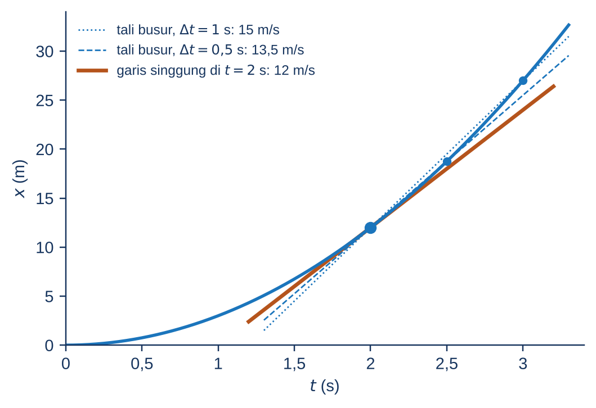{width=66%}

Pada grafik $x$–$t$, kecepatan rata-rata adalah kemiringan tali busur. Ketika titik kedua digeser mendekati titik pertama, tali busur berputar dan akhirnya berimpit dengan **garis singgung**, yaitu garis yang hanya menyentuh kurva di satu titik itu (Gambar 2.2).

::: {.inti}
**Kecepatan sesaat = kemiringan garis singgung pada grafik $x$–$t$.**
:::

Dari sini grafik $x$–$t$ bisa dibaca sekilas:

| Bentuk grafik $x$–$t$ | Arti |
|---|---|
| Garis lurus menanjak | kecepatan tetap, ke arah positif |
| Garis lurus menurun | kecepatan tetap, ke arah negatif |
| Garis mendatar | diam |
| Makin curam | kelajuan bertambah |
| Makin landai | kelajuan berkurang |
| Puncak atau lembah (garis singgung mendatar) | kecepatan sesaat nol; benda sedang berbalik arah |

::: {.mat}
**Matematika · Turunan**

Turunan sebuah fungsi $f(t)$ adalah laju perubahannya:

$$
\frac{df}{dt} = \lim_{\Delta t \to 0}\frac{f(t + \Delta t) - f(t)}{\Delta t}.
$$

Kita tidak perlu menghitung limit setiap kali. Cukup tiga aturan untuk hampir seluruh bab ini.

**Aturan pangkat.** $\dfrac{d}{dt}\left(t^n\right) = n\,t^{n-1}$. Contoh: turunan $t^2$ adalah $2t$; turunan $t^3$ adalah $3t^2$; turunan $t$ adalah 1.

**Tetapan.** Turunan sebuah tetapan adalah nol (tetapan tidak berubah). Tetapan pengali ikut saja: turunan $5t^2$ adalah $5 \times 2t = 10t$.

**Jumlah.** Turunan suatu jumlah adalah jumlah turunannya: turunan $4t^3 - 7t + 2$ adalah $12t^2 - 7$.

*Dari mana aturan pangkat?* Untuk $t^2$: $\dfrac{(t + \Delta t)^2 - t^2}{\Delta t} = \dfrac{2t\,\Delta t + (\Delta t)^2}{\Delta t} = 2t + \Delta t$, yang menuju $2t$. Pangkat lain mengikuti pola yang sama. Aturan untuk sinus, kosinus, dan eksponen diperkenalkan saat dibutuhkan (Bab 8). Ringkasan lengkap ada di Lampiran A.
:::

Dengan aturan pangkat, Contoh 2.4 selesai dalam satu baris: $v = \dfrac{d}{dt}(3{,}0t^2) = 6{,}0t$, sehingga pada $t = 2{,}0$ s, $v = 12$ m/s. Lebih dari itu, kita memperoleh kecepatan pada **setiap** saat, bukan hanya satu saat.

::: {.kuis}
**Kuis cepat 2.3**

Grafik $x$–$t$ sebuah benda berupa garis lurus yang menurun. Pernyataan yang benar: (a) benda melambat (b) benda bergerak dengan kecepatan tetap ke arah negatif (c) percepatan benda negatif (d) benda bergerak menuruni lereng
:::

## 2.4 Percepatan

### Laju perubahan kecepatan

Kecepatan menyatakan seberapa cepat **posisi** berubah. **Percepatan** menyatakan seberapa cepat **kecepatan** berubah. Definisinya mengikuti pola yang sama persis:

$$
\boxed{a_\text{rata} = \frac{\Delta v}{\Delta t}}, \qquad \boxed{a = \lim_{\Delta t \to 0}\frac{\Delta v}{\Delta t} = \frac{dv}{dt}}
$$

Satuan percepatan adalah (m/s) per sekon, ditulis m/s². Percepatan 3 m/s² berarti kecepatan bertambah 3 m/s **setiap sekon**.

Karena $v = dx/dt$, percepatan adalah "turunan dari turunan" posisi, yang disebut **turunan kedua**:

$$
a = \frac{dv}{dt} = \frac{d^2x}{dt^2}.
$$

Pada grafik **kecepatan–waktu** (grafik $v$–$t$), percepatan adalah kemiringan garis singgungnya, persis seperti kecepatan adalah kemiringan pada grafik $x$–$t$.

::: {.contoh}
**Contoh 2.5 · Mobil dan remnya**

Sebuah mobil mencapai 100 km/jam dari keadaan diam dalam 8,0 s. Kemudian pengemudi mengerem dan mobil berhenti dalam 3,2 s. Tentukan percepatan rata-rata pada kedua tahap. Arah gerak mobil diambil positif.

**Penyelesaian.** $100\ \text{km/jam} = 100/3{,}6 = 27{,}8$ m/s.

$$
a_1 = \frac{27{,}8 - 0}{8{,}0} = +3{,}5\ \text{m/s}^2, \qquad a_2 = \frac{0 - 27{,}8}{3{,}2} = -8{,}7\ \text{m/s}^2.
$$

**Memahami hasil.** Rem menghasilkan perubahan kecepatan yang jauh lebih cepat daripada mesin. Sebagai pembanding, percepatan benda jatuh adalah 9,8 m/s². Pengereman keras mendekati nilai itu, dan itulah sebabnya tubuh terdorong kuat ke depan.
:::

### Tanda percepatan: sumber salah paham nomor satu

Percepatan adalah vektor, dan tandanya menyatakan **arah perubahan kecepatan**, bukan apakah benda bertambah cepat atau bertambah lambat. Untuk mengetahui yang terakhir, bandingkan tanda percepatan dengan tanda kecepatan:

::: {.inti}
**$a$ dan $v$ bertanda sama → kelajuan bertambah. $a$ dan $v$ berlawanan tanda → kelajuan berkurang.**
:::

| Kecepatan | Percepatan | Yang terjadi | Contoh (arah timur positif) |
|---|---|---|---|
| $+$ | $+$ | makin cepat, ke arah positif | mobil ke timur menginjak gas |
| $+$ | $-$ | makin lambat, ke arah positif | mobil ke timur mengerem |
| $-$ | $-$ | **makin cepat**, ke arah negatif | mobil ke barat menginjak gas |
| $-$ | $+$ | **makin lambat**, ke arah negatif | mobil ke barat mengerem |

::: {.awas}
**Awas · "Percepatan negatif berarti melambat"**

Tidak selalu. Mobil yang bergerak ke barat (kecepatan negatif) dan menginjak gas memiliki percepatan negatif, tetapi kelajuannya **bertambah**. Kata "perlambatan" sebaiknya hanya dipakai untuk arti "kelajuan berkurang", dan jangan disamakan dengan "percepatan negatif".
:::

::: {.awas}
**Awas · Kecepatan nol tidak berarti percepatan nol**

Bola yang dilempar ke atas berhenti sesaat di titik tertingginya: kecepatannya nol. Tetapi kecepatannya **sedang berubah** (dari ke atas menjadi ke bawah), jadi percepatannya tidak nol. Kalau percepatannya nol di sana, bola itu akan tetap diam melayang. Sebaliknya, mobil yang melaju lurus dengan 100 km/jam tetap memiliki percepatan nol.
:::

### Diagram gerak

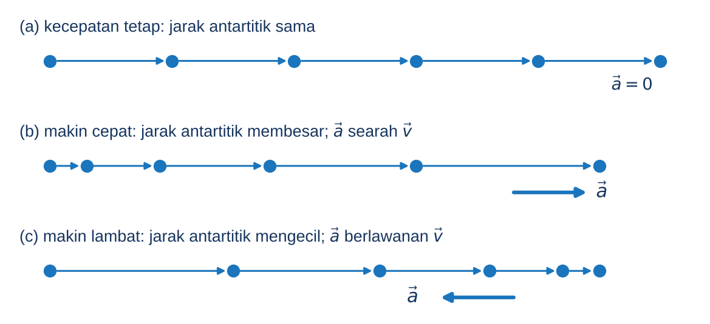{width=88%}

**Diagram gerak** adalah alat sederhana untuk "melihat" kecepatan dan percepatan. Bayangkan benda dipotret berkali-kali pada selang waktu yang sama, dan semua potret ditumpuk dalam satu gambar (Gambar 2.3).

- Jarak antartitik yang **sama** berarti kecepatan tetap.
- Jarak antartitik yang **membesar** berarti benda makin cepat: percepatan searah gerak.
- Jarak antartitik yang **mengecil** berarti benda makin lambat: percepatan berlawanan dengan arah gerak.

Menggambar diagram gerak adalah langkah "Modelkan" yang baik untuk hampir semua soal di bab ini, karena tanda percepatan langsung terlihat dari gambarnya.

::: {.contoh}
**Contoh 2.6 · Gerak yang berbalik arah dua kali**

Posisi sebuah partikel dinyatakan oleh $x = 2{,}0t^3 - 9{,}0t^2 + 12t$ ($x$ dalam meter, $t$ dalam sekon), untuk $0 \le t \le 3$ s. (a) Tentukan kecepatan dan percepatannya sebagai fungsi waktu. (b) Kapan partikel berhenti sesaat, dan di mana? (c) Kapan partikel bergerak ke arah negatif? (d) Berapa perpindahan dan jarak tempuhnya dari $t = 0$ sampai $t = 3$ s?

**Rencana.** Turunkan sekali untuk kecepatan dan sekali lagi untuk percepatan. Benda berhenti sesaat ketika $v = 0$.

**Penyelesaian.**

(a) $v = \dfrac{dx}{dt} = 6{,}0t^2 - 18t + 12$ dan $a = \dfrac{dv}{dt} = 12t - 18$.

(b) $v = 6(t^2 - 3t + 2) = 6(t - 1)(t - 2) = 0$, sehingga $t = 1$ s dan $t = 2$ s. Posisinya: $x(1) = 2 - 9 + 12 = 5$ m dan $x(2) = 16 - 36 + 24 = 4$ m.

(c) $v$ negatif ketika $(t - 1)$ dan $(t - 2)$ berlawanan tanda, yaitu untuk $1 < t < 2$ s.

(d) Posisi-posisi penting: $x(0) = 0$; $x(1) = 5$ m; $x(2) = 4$ m; $x(3) = 54 - 81 + 36 = 9$ m.

- Perpindahan: $\Delta x = 9 - 0 = 9$ m.
- Jarak tempuh: maju 5 m, mundur 1 m, maju 5 m, jumlahnya 11 m.

**Memahami hasil.** Gambar 2.4 memperlihatkan ketiga grafik. Di puncak dan lembah grafik $x$–$t$, grafik $v$–$t$ memotong nol. Percepatan nol pada $t = 1{,}5$ s, tepat ketika kecepatan mencapai nilai paling negatifnya ($v = -1{,}5$ m/s): di sana kecepatan sedang "berbalik" dari menurun menjadi menaik. Perhatikan pula bahwa pada $t = 1$ s kecepatan nol tetapi percepatan $-6$ m/s², contoh nyata kotak Awas di atas.
:::

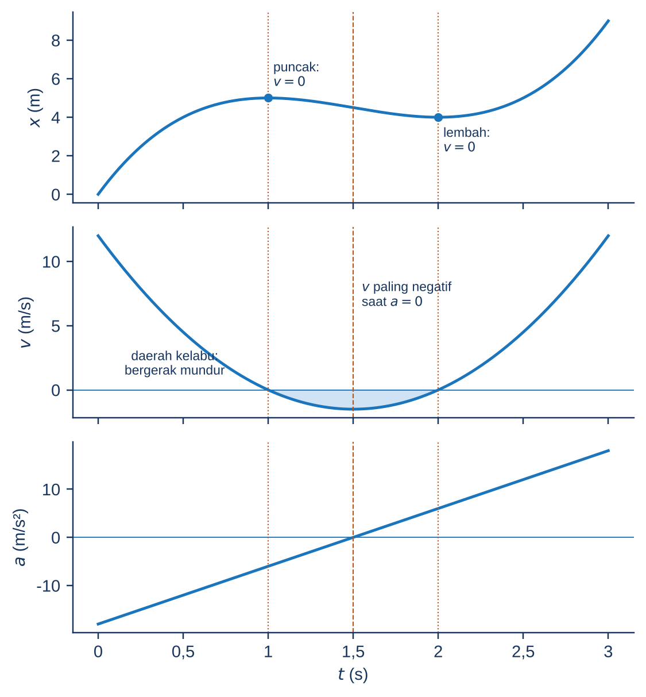{width=62%}

::: {.terapan}
**Terapan · Sensor percepatan di sakumu**

Setiap ponsel pintar berisi **akselerometer**, sensor seukuran butir pasir yang mengukur percepatan ribuan kali per detik. Ponsel memakainya untuk memutar layar, menghitung langkah, dan mendeteksi jatuh. Kantong udara mobil dipicu oleh sensor sejenis: jika percepatan melampaui batas tertentu selama beberapa milidetik, kantong udara mengembang. Dengan aplikasi gratis seperti *phyphox*, sensor ini bisa kamu pakai sebagai alat praktikum.
:::

::: {.kuis}
**Kuis cepat 2.4**

Sebuah mobil bergerak ke arah $-x$ dan sedang mengerem. Tanda kecepatan dan percepatannya berturut-turut: (a) $-$, $-$ (b) $-$, $+$ (c) $+$, $-$ (d) $+$, $+$
:::

## 2.5 Membaca grafik gerak

### Turun satu tingkat: kemiringan

Posisi, kecepatan, dan percepatan membentuk tiga tingkat. Kita sudah tahu cara **turun**: kemiringan grafik $x$–$t$ memberi kecepatan, dan kemiringan grafik $v$–$t$ memberi percepatan.

$$
x \;\xrightarrow{\ \text{kemiringan}\ }\; v \;\xrightarrow{\ \text{kemiringan}\ }\; a
$$

Sekarang pertanyaan sebaliknya: jika kita tahu kecepatan setiap saat, bisakah kita menemukan perpindahannya?

### Naik satu tingkat: luas

Mulai dari kasus paling mudah. Jika kecepatan **tetap**, $\Delta x = v\,\Delta t$. Pada grafik $v$–$t$, itu adalah tinggi kali lebar sebuah persegi panjang, yaitu **luasnya**.

Jika kecepatan berubah, potong selang waktu menjadi pita-pita sempit (Gambar 2.5). Dalam satu pita, kecepatan hampir tidak sempat berubah, sehingga perpindahan kecil dalam pita itu kira-kira $v\,\Delta t$, yaitu luas pita. Jumlah semua pita mendekati perpindahan total. Makin sempit pitanya, makin tepat hasilnya, dan pada limitnya jumlah itu menjadi tepat sama dengan luas di bawah kurva.

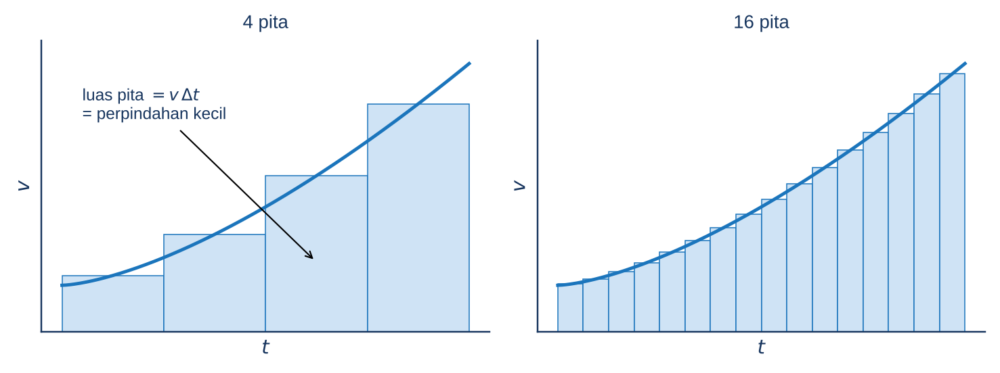{width=86%}

::: {.inti}
**Perpindahan = luas di bawah grafik $v$–$t$.** &nbsp; **Perubahan kecepatan = luas di bawah grafik $a$–$t$.**
:::

$$
x \;\xleftarrow{\ \text{luas}\ }\; v \;\xleftarrow{\ \text{luas}\ }\; a
$$

Dua catatan:

- Luas di **bawah sumbu waktu** (ketika $v$ negatif) dihitung **negatif**: benda bergerak mundur. Luas bertanda memberi perpindahan. Jika semua luas dihitung positif, hasilnya jarak tempuh.
- Luas hanya memberi **perubahan**. Untuk mengetahui posisi akhir, kita juga harus tahu posisi awalnya.

::: {.contoh}
**Contoh 2.7 · Perjalanan sebuah lift**

Sebuah lift mulai dari diam, mempercepat secara tetap sampai 2,0 m/s dalam 4,0 s, bergerak dengan kecepatan tetap selama 6,0 s, lalu melambat secara tetap dan berhenti dalam 2,0 s. (a) Gambar grafik $v$–$t$. (b) Tentukan percepatan tiap tahap. (c) Berapa jauh lift itu naik?

**Penyelesaian.**

(a) Grafiknya berbentuk trapesium (Gambar 2.6).

(b) Percepatan adalah kemiringan tiap ruas: $a_1 = \dfrac{2{,}0 - 0}{4{,}0} = +0{,}50\ \text{m/s}^2$; $a_2 = 0$; $a_3 = \dfrac{0 - 2{,}0}{2{,}0} = -1{,}0\ \text{m/s}^2$.

(c) Perpindahan adalah luas di bawah grafik:

- segitiga pertama: $\tfrac12(4{,}0)(2{,}0) = 4{,}0$ m;
- persegi panjang: $(6{,}0)(2{,}0) = 12$ m;
- segitiga terakhir: $\tfrac12(2{,}0)(2{,}0) = 2{,}0$ m.

Total 18 m, kira-kira enam lantai.

**Memahami hasil.** Kecepatan rata-rata seluruh perjalanan $18/12 = 1{,}5$ m/s, lebih kecil dari 2,0 m/s karena lift tidak selalu bergerak dengan kecepatan penuh. Masuk akal.
:::

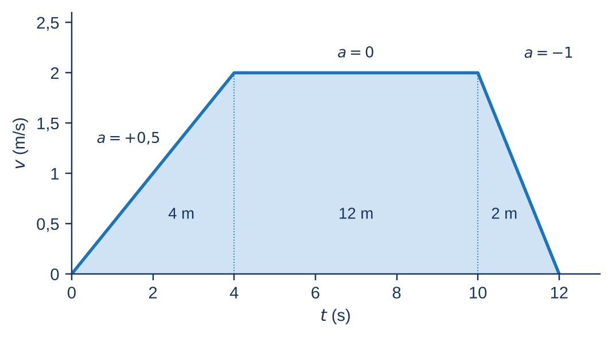{width=66%}

::: {.mat}
**Matematika · Integral**

Menjumlahkan tak terhingga banyak pita yang tak terhingga sempit disebut **mengintegralkan**. Luas di bawah kurva $v(t)$ dari $t_1$ sampai $t_2$ ditulis

$$
\Delta x = \int_{t_1}^{t_2} v\,dt .
$$

Lambang $\int$ adalah huruf S yang dipanjangkan, dari kata *summa* (jumlah). $v\,dt$ adalah luas satu pita: tinggi $v$ kali lebar $dt$.

Fakta terpenting dalam kalkulus: **integral adalah kebalikan turunan.** Karena $v$ adalah turunan $x$, maka $x$ adalah fungsi yang turunannya $v$. Jadi untuk mengintegralkan, carilah fungsi yang jika diturunkan menghasilkan yang kita punya:

$$
\int t^n\,dt = \frac{t^{n+1}}{n+1} + C \qquad (n \ne -1).
$$

Contoh: $\int t\,dt = \tfrac12 t^2 + C$ dan $\int 3t^2\,dt = t^3 + C$. Periksa dengan menurunkan hasilnya. Tetapan $C$ muncul karena turunan sebuah tetapan adalah nol, sehingga kemiringan saja tidak menentukan "tinggi awal". Dalam soal gerak, $C$ ditentukan dari posisi atau kecepatan awal. Untuk integral dengan batas, hitung fungsi hasil pada batas atas dikurangi pada batas bawah, dan $C$ saling menghapus.
:::

::: {.strategi}
**Strategi · Membaca grafik gerak**

1. **Baca dulu sumbu tegaknya.** Grafik $x$–$t$ dan grafik $v$–$t$ yang bentuknya sama menceritakan gerak yang sama sekali berbeda.
2. **Nilai** grafik menjawab pertanyaan tentang besaran itu sendiri.
3. **Kemiringan** menjawab pertanyaan tentang besaran satu tingkat di bawahnya ($x \to v \to a$).
4. **Luas** menjawab pertanyaan tentang *perubahan* besaran satu tingkat di atasnya ($a \to v \to x$).
5. Titik potong dengan sumbu waktu: pada grafik $x$–$t$ benda berada di titik nol; pada grafik $v$–$t$ benda berhenti sesaat dan berbalik arah.
:::

::: {.kuis}
**Kuis cepat 2.5**

Grafik $v$–$t$ sebuah benda berupa garis lurus mendatar di **bawah** sumbu waktu. Benda itu: (a) diam (b) bergerak dengan kecepatan tetap ke arah negatif (c) melambat (d) memiliki percepatan negatif yang tetap
:::

## 2.6 Gerak dengan percepatan konstan

Banyak gerak penting memiliki percepatan yang tetap atau hampir tetap: benda jatuh di dekat permukaan Bumi, mobil yang mengerem keras, pesawat di landasan pacu. Untuk gerak seperti ini kita bisa menurunkan beberapa persamaan yang menjawab hampir semua pertanyaan. Persamaan-persamaan ini bukan hukum alam baru. Semuanya hanyalah akibat dari definisi kecepatan dan percepatan.

Kita memakai lambang berikut: pada $t = 0$ benda berada di posisi $x_0$ dengan kecepatan $v_0$; pada waktu $t$ benda berada di $x$ dengan kecepatan $v$; percepatannya $a$, tetap.

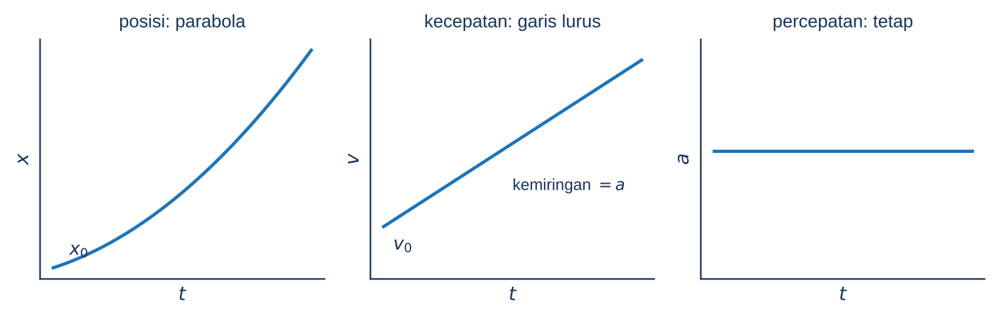{width=92%}

### Persamaan pertama: kecepatan

Jika percepatan tetap, percepatan rata-rata sama dengan percepatan sesaat, sehingga $a = \dfrac{v - v_0}{t - 0}$. Jadi

$$
\boxed{v = v_0 + at} \qquad \text{(2.1)}
$$

Dalam kata-kata: kecepatan sekarang adalah kecepatan awal ditambah perubahan sebesar $a$ setiap sekon selama $t$ sekon. Grafiknya garis lurus dengan kemiringan $a$ (Gambar 2.7).

### Persamaan kedua: posisi

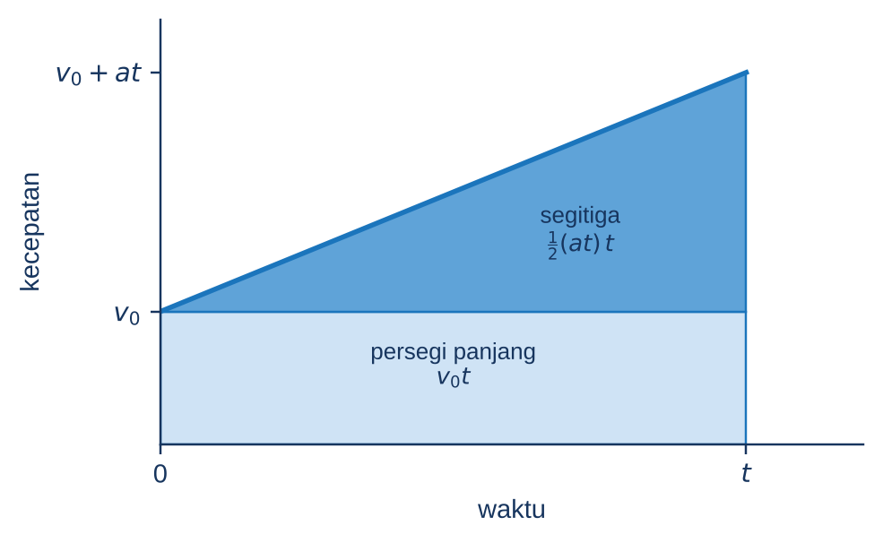{width=50%}

Perpindahan adalah luas di bawah grafik $v$–$t$. Untuk percepatan konstan, daerah itu berupa trapesium yang bisa dipecah menjadi persegi panjang dan segitiga (Gambar 2.8):

- persegi panjang: lebar $t$, tinggi $v_0$, luas $v_0t$;
- segitiga: alas $t$, tinggi $at$ (yaitu kenaikan kecepatan), luas $\tfrac12(t)(at) = \tfrac12at^2$.

$$
\boxed{x = x_0 + v_0t + \tfrac12at^2} \qquad \text{(2.2)}
$$

Suku $v_0t$ adalah jarak yang akan ditempuh seandainya tidak ada percepatan. Suku $\tfrac12at^2$ adalah tambahan (atau pengurangan) karena kecepatan berubah. Faktor $\tfrac12$ adalah faktor luas segitiga: kecepatan tambahan tidak langsung sebesar $at$, tetapi tumbuh dari nol sampai $at$, sehingga rata-ratanya setengahnya.

### Persamaan ketiga: kecepatan rata-rata

Luas trapesium yang sama juga bisa dihitung sebagai rata-rata kedua sisi sejajar dikali lebarnya:

$$
\boxed{x = x_0 + \tfrac12(v_0 + v)\,t} \qquad \text{(2.3)}
$$

Artinya, untuk percepatan konstan, kecepatan rata-rata adalah **rata-rata kecepatan awal dan akhir**. Ini hanya benar untuk percepatan konstan (bandingkan dengan Contoh 2.3).

### Persamaan keempat: tanpa waktu

Sering kali waktu tidak diketahui dan tidak ditanyakan. Dari (2.1), $t = (v - v_0)/a$. Masukkan ke (2.3):

$$
x - x_0 = \tfrac12(v_0 + v)\,\frac{v - v_0}{a} = \frac{v^2 - v_0^2}{2a},
$$

sehingga

$$
\boxed{v^2 = v_0^2 + 2a(x - x_0)} \qquad \text{(2.4)}
$$

### Memilih persamaan

Lima besaran terlibat: $x - x_0$, $v_0$, $v$, $a$, dan $t$. Setiap persamaan memuat empat di antaranya dan **tidak memuat satu**. Itulah petunjuk memilihnya.

| Persamaan | | Tidak memuat |
|---|---|---|
| (2.1) | $v = v_0 + at$ | perpindahan $x - x_0$ |
| (2.2) | $x = x_0 + v_0t + \tfrac12at^2$ | kecepatan akhir $v$ |
| (2.3) | $x = x_0 + \tfrac12(v_0 + v)t$ | percepatan $a$ |
| (2.4) | $v^2 = v_0^2 + 2a(x - x_0)$ | waktu $t$ |

::: {.strategi}
**Strategi · Soal percepatan konstan**

1. **Gambar.** Buat sketsa dan diagram gerak. Tetapkan titik nol dan arah positif.
2. **Daftarkan lima besaran** $x - x_0$, $v_0$, $v$, $a$, $t$. Isi yang diketahui **dengan tandanya**, dan tandai yang ditanya. Perhatikan informasi tersembunyi: "dari keadaan diam" berarti $v_0 = 0$; "sampai berhenti" berarti $v = 0$.
3. **Pilih persamaan** yang memuat tiga besaran yang diketahui dan satu yang ditanya, yaitu persamaan yang *tidak* memuat besaran yang tidak diketahui dan tidak ditanya.
4. **Kerjakan** dengan lambang dulu, lalu angka.
5. **Periksa** tanda, satuan, dan kewajaran.
:::

::: {.awas}
**Awas · Hanya untuk percepatan konstan**

Persamaan (2.1) sampai (2.4) **tidak berlaku** jika percepatan berubah. Jika geraknya terdiri atas beberapa tahap dengan percepatan berbeda (mempercepat, lalu kecepatan tetap, lalu mengerem), pakai persamaan itu **terpisah untuk tiap tahap**, dengan keadaan akhir satu tahap menjadi keadaan awal tahap berikutnya.
:::

::: {.contoh}
**Contoh 2.8 · Panjang landasan pacu**

Sebuah pesawat jet mulai dari diam di ujung landasan dan mempercepat secara tetap dengan 2,5 m/s². Pesawat harus mencapai 75 m/s untuk lepas landas. (a) Berapa lama pesawat berada di landasan? (b) Berapa panjang landasan paling sedikit?

**Gambaran fisis.** Arah gerak positif, $x_0 = 0$. Diketahui $v_0 = 0$, $v = 75$ m/s, $a = 2{,}5$ m/s². Ditanya $t$ dan $x$.

**Penyelesaian.**

(a) Besaran yang tidak terlibat adalah perpindahan, jadi pakai (2.1): $t = \dfrac{v - v_0}{a} = \dfrac{75}{2{,}5} = 30$ s.

(b) Waktu tidak perlu dipakai, jadi pakai (2.4): $x = \dfrac{v^2 - v_0^2}{2a} = \dfrac{75^2}{2(2{,}5)} = 1125\ \text{m} \approx 1{,}1$ km.

**Memahami hasil.** Dengan (2.3): $x = \tfrac12(0 + 75)(30) = 1125$ m. Cocok. Landasan pacu bandara besar panjangnya 3 km atau lebih, memberi cadangan yang lapang.

**Bagaimana jika…** kecepatan lepas landasnya dua kali lebih besar? Karena $x \propto v^2$, landasan harus **empat** kali lebih panjang. Ketergantungan kuadrat ini akan muncul berulang kali.
:::

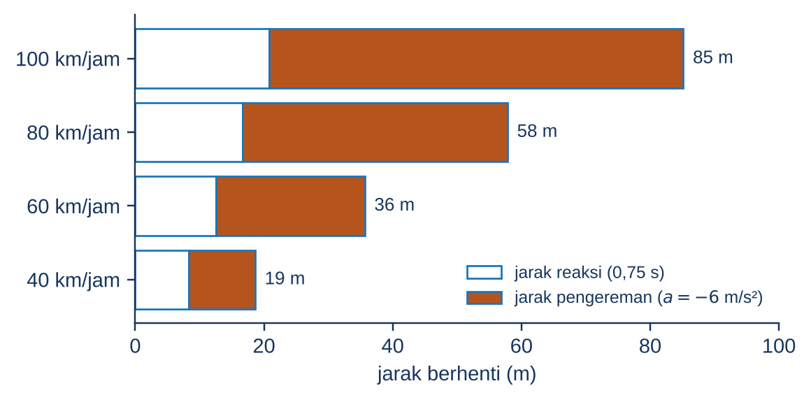{width=72%}

::: {.contoh}
**Contoh 2.9 · Jarak berhenti**

Seorang pengemudi yang melaju 72 km/jam melihat rintangan di depan. Ia butuh 0,75 s untuk bereaksi sebelum menginjak rem. Setelah itu mobil melambat dengan percepatan tetap $-6{,}0$ m/s². (a) Berapa jarak yang ditempuh sampai mobil berhenti? (b) Berapa jarak itu jika kelajuan awalnya dua kali lebih besar?

**Gambaran fisis.** Ada **dua tahap**. Tahap reaksi: kecepatan tetap, $a = 0$. Tahap pengereman: $a = -6{,}0$ m/s², sampai $v = 0$. $v_0 = 72/3{,}6 = 20$ m/s.

**Rencana.** Tahap 1: $d_1 = v_0t_\text{reaksi}$. Tahap 2 tidak melibatkan waktu, jadi pakai (2.4): $0 = v_0^2 + 2a\,d_2$, sehingga $d_2 = -\dfrac{v_0^2}{2a}$.

**Penyelesaian.**

$$
d = v_0t_\text{reaksi} + \frac{v_0^2}{2|a|} .
$$

(a) $d = (20)(0{,}75) + \dfrac{20^2}{2(6{,}0)} = 15 + 33{,}3 = 48$ m.

(b) Dengan $v_0 = 40$ m/s: $d = 30 + 133 = 163$ m.

**Memahami hasil.** Kelajuan menjadi dua kali, tetapi jarak berhenti menjadi 3,4 kali. Jarak reaksi berlipat dua, sedangkan jarak pengereman berlipat **empat** (Gambar 2.9). Inilah alasan fisika di balik batas kecepatan, dan di balik anjuran menjaga jarak yang makin jauh pada kelajuan tinggi.
:::

::: {.kuis}
**Kuis cepat 2.6**

Sebuah benda mulai dari diam dan bergerak dengan percepatan tetap. Dalam waktu $t$ ia menempuh jarak $d$. Jarak yang ditempuhnya dalam waktu $2t$ (dihitung dari awal) adalah: (a) $2d$ (b) $3d$ (c) $4d$ (d) $8d$
:::

## 2.7 Jatuh bebas

### Penemuan Galileo

Selama hampir dua ribu tahun orang mengikuti Aristoteles: benda berat jatuh lebih cepat daripada benda ringan, sebanding dengan beratnya. Pernyataan ini terasa sesuai pengalaman, karena batu memang jatuh lebih cepat daripada daun.

Galileo membantahnya dengan sebuah percobaan pikiran yang cerdik. Andaikan benda berat memang jatuh lebih cepat. Sekarang ikat sebuah batu besar dengan sebuah batu kecil. Batu kecil yang "lambat" seharusnya menahan batu besar, sehingga gabungannya jatuh **lebih lambat** daripada batu besar sendirian. Tetapi gabungan itu juga **lebih berat** daripada batu besar, sehingga seharusnya jatuh **lebih cepat**. Dua kesimpulan yang bertentangan dari satu anggapan berarti anggapannya salah. Satu-satunya jalan keluar yang konsisten: semua benda jatuh dengan cara yang sama.

Lalu mengapa daun jatuh lebih lambat? Karena **udara**. Hambatan udara berpengaruh besar pada benda yang ringan dan lebar, dan hampir tidak berpengaruh pada benda yang padat dan berat. Di Bulan, yang tidak berudara, palu dan bulu jatuh bersama.

**Jatuh bebas** adalah gerak benda yang hanya dipengaruhi gravitasi, dengan hambatan udara diabaikan. Benda yang dilempar ke atas juga sedang "jatuh bebas" sejak lepas dari tangan, walaupun sedang bergerak naik.

::: {.inti}
**Di dekat permukaan Bumi, semua benda yang jatuh bebas memiliki percepatan yang sama, berarah ke bawah, sebesar $g \approx 9{,}80\ \text{m/s}^2$, apa pun massa, bentuk, dan bahannya.**
:::

Nilai $g$ sedikit berbeda dari tempat ke tempat: sekitar 9,78 m/s² di khatulistiwa dan 9,83 m/s² di kutub, serta sedikit lebih kecil di tempat tinggi. Di buku ini dipakai $g = 9{,}80$ m/s² kecuali dinyatakan lain. Penjelasan mengapa semua benda jatuh dengan percepatan sama menunggu Bab 3 (hukum Newton).

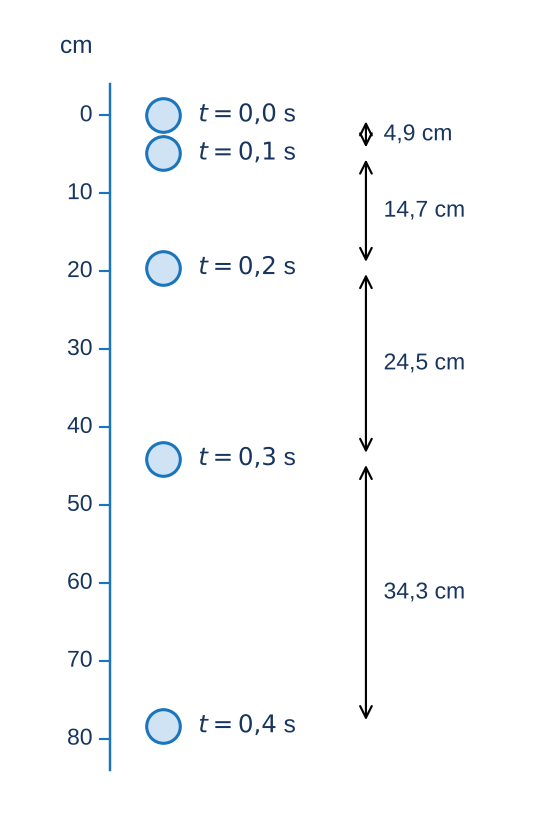{width=36%}

Galileo tidak punya jam yang cukup teliti untuk mengukur benda jatuh. Ia memperlambat geraknya dengan menggelindingkan bola di bidang miring, dan menemukan pola yang juga terlihat pada Gambar 2.10: jarak yang ditempuh dalam selang waktu berurutan berbanding seperti **bilangan ganjil**, $1 : 3 : 5 : 7 : \ldots$ Karena $1 + 3 = 4$, $1 + 3 + 5 = 9$, dan seterusnya, jarak total sebanding dengan **kuadrat waktu**. Itulah persamaan (2.2) dengan $v_0 = 0$, dan itulah tanda percepatan yang tetap.

### Persamaan jatuh bebas

Jatuh bebas adalah gerak dengan percepatan konstan, jadi semua persamaan subbab 2.6 berlaku. Kita cukup mengganti nama sumbu menjadi $y$ (tegak) dan memasukkan percepatannya. Dengan **arah ke atas positif**, percepatannya $a = -g$:

$$
v = v_0 - gt, \qquad y = y_0 + v_0t - \tfrac12gt^2, \qquad v^2 = v_0^2 - 2g(y - y_0).
$$

::: {.awas}
**Awas · $g$ selalu positif**

$g$ adalah **besar** percepatan gravitasi, $9{,}80\ \text{m/s}^2$, bilangan positif. Tanda minus berasal dari pilihan sumbu. Jika kamu memilih arah ke bawah sebagai positif (sering lebih enak untuk benda yang hanya bergerak turun), maka $a = +g$. Kedua pilihan benar, asalkan konsisten untuk **semua** besaran: posisi, kecepatan, dan percepatan.
:::

::: {.contoh}
**Contoh 2.10 · Tinggi jembatan**

Sebuah batu dilepaskan dari sebuah jembatan dan menyentuh air 2,5 s kemudian. (a) Berapa tinggi jembatan di atas air? (b) Berapa kelajuan batu saat menyentuh air?

**Gambaran fisis.** Batu hanya bergerak turun, jadi pilih arah **ke bawah** positif dan titik lepas sebagai $y_0 = 0$. Maka $v_0 = 0$, $a = +g$, $t = 2{,}5$ s.

**Penyelesaian.**

(a) $y = \tfrac12gt^2 = \tfrac12(9{,}80)(2{,}5)^2 = 30{,}6\ \text{m} \approx 31$ m.

(b) $v = gt = (9{,}80)(2{,}5) = 24{,}5\ \text{m/s} \approx 25$ m/s, sekitar 88 km/jam.

**Memahami hasil.** Kecepatan rata-rata $\tfrac12(0 + 24{,}5) = 12{,}25$ m/s selama 2,5 s memberi 30,6 m. Cocok. Ini cara praktis menaksir kedalaman sumur atau tinggi tebing dengan stopwatch. (Untuk ketinggian besar, waktu rambat bunyi perlu diperhitungkan; lihat Soal 33.)
:::

### Benda yang dilempar ke atas

Benda yang dilempar ke atas mengalami percepatan $-g$ **sepanjang** perjalanannya: saat naik, di titik tertinggi, dan saat turun. Kecepatannya berkurang 9,8 m/s setiap sekon. Saat naik ia melambat, lalu melewati nol di titik tertinggi, lalu menjadi makin negatif saat turun. Tidak ada yang istimewa pada percepatan di titik tertinggi.

Dari sini muncul dua sifat simetri yang berguna (jika hambatan udara diabaikan):

- Waktu naik dari suatu ketinggian ke titik tertinggi sama dengan waktu turun kembali ke ketinggian itu.
- Kelajuan benda saat melewati suatu ketinggian ketika turun sama dengan kelajuannya saat melewati ketinggian itu ketika naik. Hanya arahnya yang berlawanan.

Keduanya terlihat dari $v^2 = v_0^2 - 2g(y - y_0)$: kelajuan hanya bergantung pada ketinggian.

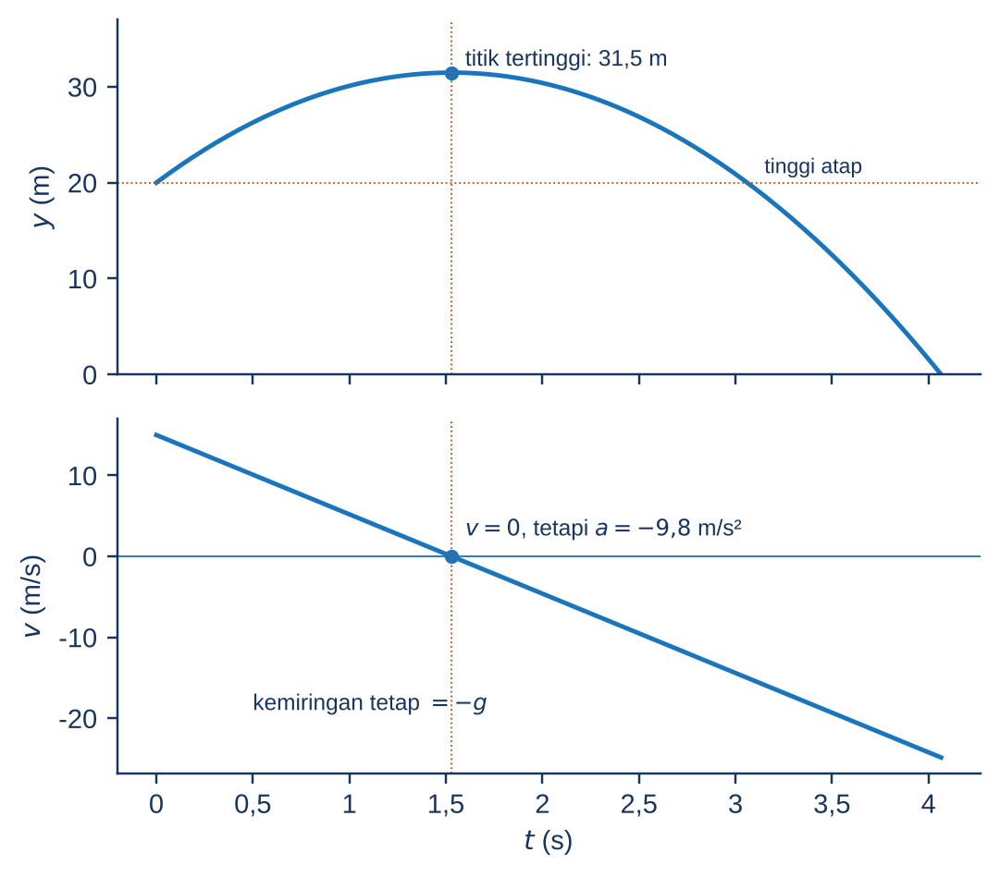{width=62%}

::: {.contoh}
**Contoh 2.11 · Bola dilempar ke atas dari tepi atap**

Dari tepi atap gedung setinggi 20 m, sebuah bola dilempar tegak lurus ke atas dengan kelajuan 15 m/s. Saat turun, bola melewati tepi atap dan jatuh ke tanah. Tentukan (a) ketinggian maksimum bola di atas tanah, (b) waktu untuk mencapai titik tertinggi, (c) kecepatan bola saat kembali melewati tepi atap, (d) waktu total sampai menyentuh tanah, dan (e) kecepatannya saat menyentuh tanah.

**Gambaran fisis.** Arah ke atas positif, tanah sebagai $y = 0$. Maka $y_0 = 20$ m, $v_0 = +15$ m/s, $a = -9{,}80$ m/s². Seluruh perjalanan, naik lalu turun, adalah **satu** gerak dengan percepatan konstan, jadi tidak perlu dipecah.

**Penyelesaian.**

(a) Di titik tertinggi $v = 0$. Dari $v^2 = v_0^2 - 2g(y - y_0)$: $y - y_0 = \dfrac{v_0^2}{2g} = \dfrac{15^2}{2(9{,}80)} = 11{,}5$ m. Jadi $y_\text{maks} = 31{,}5$ m di atas tanah.

(b) Dari $v = v_0 - gt$ dengan $v = 0$: $t = \dfrac{v_0}{g} = \dfrac{15}{9{,}80} = 1{,}53$ s.

(c) Di tepi atap, $y = y_0$, sehingga $v^2 = v_0^2$. Bola sedang turun, jadi $v = -15$ m/s.

(d) Di tanah $y = 0$: $0 = 20 + 15t - 4{,}90t^2$, atau $4{,}90t^2 - 15t - 20 = 0$.

$$
t = \frac{15 \pm \sqrt{15^2 + 4(4{,}90)(20)}}{2(4{,}90)} = \frac{15 \pm 24{,}84}{9{,}80}.
$$

Akar positif: $t = 4{,}07$ s. Akar negatif ($t = -1{,}00$ s) dibahas di bawah.

(e) $v = v_0 - gt = 15 - (9{,}80)(4{,}065) = -24{,}8$ m/s.

**Memahami hasil.** Dengan (2.4) langsung dari atap ke tanah: $v^2 = 15^2 - 2(9{,}80)(0 - 20) = 617$, sehingga $|v| = 24{,}8$ m/s. Cocok, dan tandanya negatif karena bola bergerak turun.

**Apa arti akar negatif?** Persamaan gerak tidak tahu bahwa bola baru dilempar pada $t = 0$. Ia menggambarkan sebuah parabola yang memanjang ke masa lalu. Akar $t = -1{,}00$ s berarti: seandainya bola itu dilempar dari tanah satu sekon lebih awal dengan kelajuan yang tepat, ia akan melewati tepi atap pada $t = 0$ dengan kecepatan $+15$ m/s. Akar "yang dibuang" dalam fisika hampir selalu punya arti, dan memahaminya adalah latihan yang baik.
:::

::: {.coba}
**Coba sendiri · Mengukur waktu reaksimu dengan penggaris**

Minta temanmu memegang ujung atas sebuah penggaris 30 cm sehingga tergantung tegak. Letakkan jempol dan telunjukmu terbuka di sekitar angka nol, tanpa menyentuh. Temanmu melepaskan penggaris tanpa aba-aba, dan kamu menangkapnya secepat mungkin. Baca angka di tempat jarimu menangkap: itulah jarak jatuh $d$. Waktu reaksimu adalah

$$
t = \sqrt{\frac{2d}{g}} .
$$

Jika tertangkap pada 15 cm, $t = \sqrt{2(0{,}15)/9{,}80} = 0{,}17$ s. Ulangi sepuluh kali dan hitung rata-rata serta galat baku rata-ratanya (subbab 1.7). Waktu reaksi inilah yang menjadi "tahap pertama" dalam Contoh 2.9.
:::

### Jawaban pertanyaan pembuka

Yang benar dari Galileo: **tanpa hambatan udara**, semua benda jatuh dengan percepatan yang sama. Di Bumi, bulu kalah karena udara, bukan karena ringan.

Di Bulan, percepatan jatuh bebas hanya 1,62 m/s², sekitar seperenam nilai di Bumi. Palu (dan bulu) yang dilepas dari 1,6 m menyentuh tanah setelah

$$
t = \sqrt{\frac{2h}{g_\text{Bulan}}} = \sqrt{\frac{2(1{,}6)}{1{,}62}} = 1{,}4\ \text{s}.
$$

Di Bumi, waktu jatuh dari ketinggian yang sama hanya 0,57 s. Itulah sebabnya gerak di rekaman Apollo tampak seperti gerak lambat.

::: {.kuis}
**Kuis cepat 2.7**

Sebuah bola dilempar tegak lurus ke atas. Di titik tertingginya: (a) kecepatan dan percepatannya nol (b) kecepatannya nol, percepatannya $g$ ke bawah (c) kecepatannya nol, percepatannya $g$ ke atas (d) kecepatannya tidak nol, percepatannya nol
:::

## 2.8 Gerak bertahap dan gerak dua benda

Soal yang lebih menantang biasanya melibatkan lebih dari satu tahap (seperti Contoh 2.9) atau lebih dari satu benda. Tidak ada rumus baru. Yang diperlukan adalah pembukuan yang rapi.

::: {.strategi}
**Strategi · Soal dua benda**

1. Pakai **satu** sumbu dan **satu** jam untuk kedua benda. Tetapkan titik nol dan saat $t = 0$ bersama.
2. Tulis posisi **masing-masing** benda sebagai fungsi waktu, $x_A(t)$ dan $x_B(t)$. Jika satu benda berangkat belakangan selama $T$, waktunya bergerak adalah $t - T$.
3. Terjemahkan syarat soal menjadi persamaan. "Menyusul" atau "bertemu" berarti **posisi sama pada waktu yang sama**: $x_A(t) = x_B(t)$. "Jarak terjauh/terdekat" berarti **kecepatan sama**.
4. Selesaikan untuk $t$, lalu hitung besaran lain yang ditanya.
5. Periksa dengan grafik $x$–$t$ kedua benda: pertemuan adalah titik potong kedua kurva.
:::

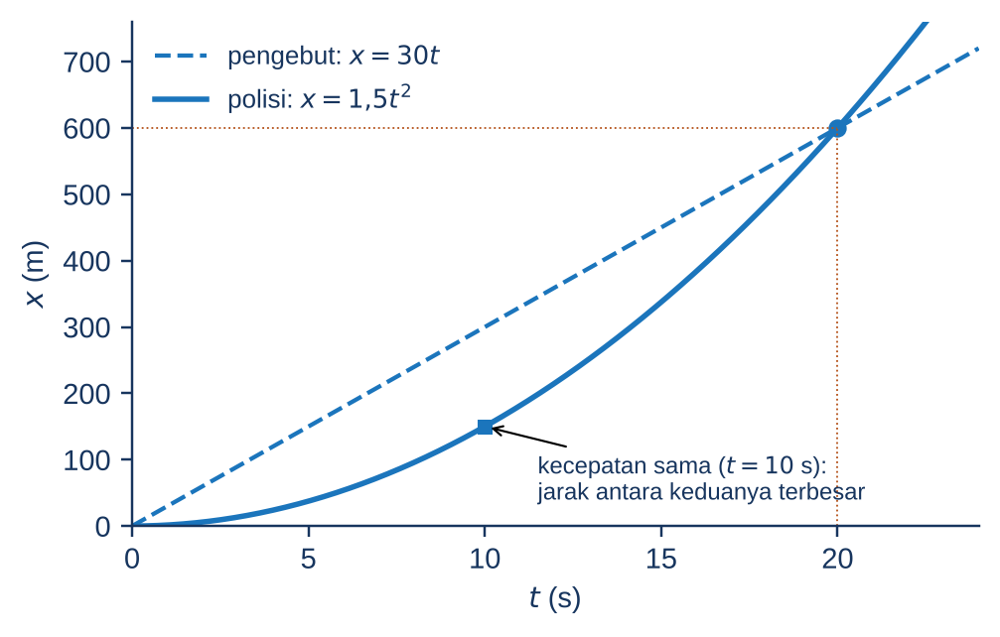{width=62%}

::: {.contoh}
**Contoh 2.12 · Polisi mengejar pengebut**

Sebuah mobil melaju dengan kecepatan tetap 30 m/s melewati mobil polisi yang diam di tepi jalan. Tepat saat dilewati, mobil polisi mulai mengejar dengan percepatan tetap 3,0 m/s². (a) Kapan dan di mana polisi menyusul? (b) Berapa kecepatan mobil polisi saat itu? (c) Kapan jarak antara keduanya paling besar?

**Gambaran fisis.** Titik nol di tempat polisi mula-mula, $t = 0$ saat mobil pengebut lewat, arah gerak positif.

**Rencana.** Pengebut: $x_P = 30t$. Polisi: $x_Q = \tfrac12(3{,}0)t^2 = 1{,}5t^2$. Menyusul berarti $x_Q = x_P$.

**Penyelesaian.**

(a) $1{,}5t^2 = 30t$, sehingga $t(1{,}5t - 30) = 0$. Akar $t = 0$ adalah saat keduanya berdampingan di awal. Akar yang dicari: $t = 20$ s, pada $x = 30(20) = 600$ m.

(b) $v_Q = at = (3{,}0)(20) = 60$ m/s.

(c) Selama polisi lebih lambat daripada pengebut, jarak di antara keduanya bertambah. Begitu polisi lebih cepat, jarak itu berkurang. Jarak terbesar terjadi saat **kecepatan keduanya sama**: $3{,}0t = 30$, yaitu $t = 10$ s. Saat itu $x_P = 300$ m dan $x_Q = 150$ m, terpisah 150 m.

**Memahami hasil.** Saat menyusul, kecepatan polisi tepat **dua kali** kecepatan pengebut. Ini bukan kebetulan. Keduanya menempuh jarak sama dalam waktu sama, jadi kecepatan rata-ratanya harus sama. Kecepatan rata-rata polisi (dari diam, percepatan tetap) adalah setengah kecepatan akhirnya. Maka kecepatan akhirnya harus dua kali kecepatan pengebut. Hasil seperti ini, yang bisa dijelaskan tanpa hitungan, adalah tanda bahwa jawabannya benar.

**Bagaimana jika…** polisi baru mulai mengejar 2,0 s setelah dilewati? Dengan $t$ diukur sejak polisi mulai bergerak, pengebut sudah berada 60 m di depan: $1{,}5t^2 = 30t + 60$, atau $t^2 - 20t - 40 = 0$. Hasilnya $t = 10 + \sqrt{140} = 21{,}8$ s. Keterlambatan 2 s memperpanjang pengejaran hampir 2 s dan menambah jaraknya lebih dari 100 m.
:::

::: {.contoh}
**Contoh 2.13 · Dua bola bertemu di udara**

Bola A dijatuhkan dari ketinggian 20 m. Pada saat yang sama, bola B dilempar tegak lurus ke atas dari tanah, tepat di bawah bola A, dengan kelajuan 16 m/s. Kapan dan di mana keduanya bertemu?

**Gambaran fisis.** Arah ke atas positif, tanah $y = 0$, $t = 0$ saat keduanya dilepas.

**Rencana.** $y_A = 20 - \tfrac12gt^2$ dan $y_B = 16t - \tfrac12gt^2$. Bertemu berarti $y_A = y_B$.

**Penyelesaian.**

$$
20 - \tfrac12gt^2 = 16t - \tfrac12gt^2 \quad\Longrightarrow\quad 20 = 16t \quad\Longrightarrow\quad t = 1{,}25\ \text{s}.
$$

Suku $\tfrac12gt^2$ saling menghapus. Ketinggian pertemuan: $y = 20 - \tfrac12(9{,}80)(1{,}25)^2 = 12{,}3$ m.

**Memahami hasil.** Mengapa $g$ lenyap? Kedua bola mengalami percepatan yang **sama**, sehingga gravitasi tidak mengubah gerak mereka **relatif satu terhadap yang lain**. Dilihat dari bola A, bola B mendekat dengan kecepatan tetap 16 m/s dari jarak 20 m, dan itu memakan waktu $20/16 = 1{,}25$ s. Pengamat yang ikut jatuh bersama bola A akan melihat gerak lurus beraturan. Gagasan ini, bahwa di dalam kerangka yang jatuh bebas gravitasi seolah lenyap, adalah benih teori relativitas umum Einstein.

Saat bertemu, kecepatan B adalah $16 - (9{,}80)(1{,}25) = +3{,}8$ m/s (masih naik) dan kecepatan A adalah $-12{,}3$ m/s.
:::

::: {.kuis}
**Kuis cepat 2.8**

Dari tempat yang sama dan pada saat yang sama, satu bola dijatuhkan dan satu bola dilempar ke bawah. Selama keduanya masih di udara, jarak antara kedua bola: (a) tetap (b) bertambah sebanding dengan waktu (c) bertambah sebanding dengan kuadrat waktu (d) berkurang
:::

## 2.9 Percepatan yang berubah

### Kalkulus kinematika

Persamaan-persamaan subbab 2.6 hanya berlaku untuk percepatan konstan. Hubungan yang berlaku **selalu** adalah definisinya:

$$
v = \frac{dx}{dt}, \qquad a = \frac{dv}{dt}.
$$

Membalik kedua definisi itu dengan integral (subbab 2.5) memberi

$$
\boxed{v(t) = v_0 + \int_0^t a\,dt}, \qquad \boxed{x(t) = x_0 + \int_0^t v\,dt}
$$

Dalam kata-kata: kecepatan sekarang adalah kecepatan awal ditambah luas di bawah grafik $a$–$t$, dan posisi sekarang adalah posisi awal ditambah luas di bawah grafik $v$–$t$.

Persamaan percepatan konstan langsung muncul sebagai kasus khusus. Jika $a$ tetap, $\int_0^t a\,dt = at$, sehingga $v = v_0 + at$. Lalu $\int_0^t (v_0 + at)\,dt = v_0t + \tfrac12at^2$, sehingga $x = x_0 + v_0t + \tfrac12at^2$. Dua baris kalkulus menggantikan seluruh penurunan geometri di subbab 2.6.

::: {.contoh}
**Contoh 2.14 · Percepatan yang berkurang terhadap waktu**

Sebuah mobil mainan bertenaga pegas mulai dari diam di titik nol. Karena pegasnya mengendur, percepatannya berkurang menurut $a = 6{,}0 - 2{,}0t$ ($a$ dalam m/s², $t$ dalam s). (a) Tentukan kecepatan dan posisinya sebagai fungsi waktu. (b) Berapa kelajuan terbesarnya, dan kapan? (c) Kapan dan di mana mobil berhenti?

**Rencana.** Integralkan $a$ untuk memperoleh $v$, lalu integralkan $v$ untuk memperoleh $x$. Kecepatan terbesar terjadi saat $a = 0$ (di sana kecepatan berhenti bertambah).

**Penyelesaian.**

(a) $v = 0 + \displaystyle\int_0^t (6{,}0 - 2{,}0t)\,dt = 6{,}0t - 1{,}0t^2$. Lalu $x = 0 + \displaystyle\int_0^t (6{,}0t - 1{,}0t^2)\,dt = 3{,}0t^2 - \tfrac13t^3$.

(b) $a = 0$ saat $t = 3{,}0$ s. Di sana $v = 6{,}0(3{,}0) - (3{,}0)^2 = 9{,}0$ m/s.

(c) $v = t(6{,}0 - t) = 0$ saat $t = 6{,}0$ s. Posisinya $x = 3{,}0(36) - \tfrac13(216) = 108 - 72 = 36$ m.

**Memahami hasil.** Turunkan kembali: $\dfrac{d}{dt}(3{,}0t^2 - \tfrac13t^3) = 6{,}0t - t^2$ dan $\dfrac{d}{dt}(6{,}0t - t^2) = 6{,}0 - 2{,}0t$. Cocok. Seandainya percepatannya tetap 6,0 m/s² selama 3 s, kecepatannya akan 18 m/s. Hasil kita setengahnya, wajar karena percepatannya terus mengecil.
:::

### Hambatan udara dan kecepatan terminal

Benda yang jatuh di udara tidak mempercepat selamanya. Makin cepat ia jatuh, makin besar hambatan udara, sehingga percepatannya mengecil. Untuk benda yang jatuh cukup cepat, model yang baik adalah

$$
a = g - kv^2 ,
$$

dengan $k$ tetapan yang bergantung pada bentuk dan massa benda (asal-usulnya dibahas di Bab 3). Ketika $kv^2$ tumbuh menyamai $g$, percepatan menjadi nol dan kelajuan tidak bertambah lagi. Kelajuan itu disebut **kecepatan terminal**:

$$
v_T = \sqrt{\frac{g}{k}} .
$$

Penerjun payung dengan badan terbentang memiliki kecepatan terminal sekitar 55 m/s (200 km/jam). Tetes hujan sekitar 9 m/s. Seandainya tidak ada udara, tetes hujan dari awan setinggi 2 km akan menghantam kepala kita dengan kelajuan sekitar 200 m/s.

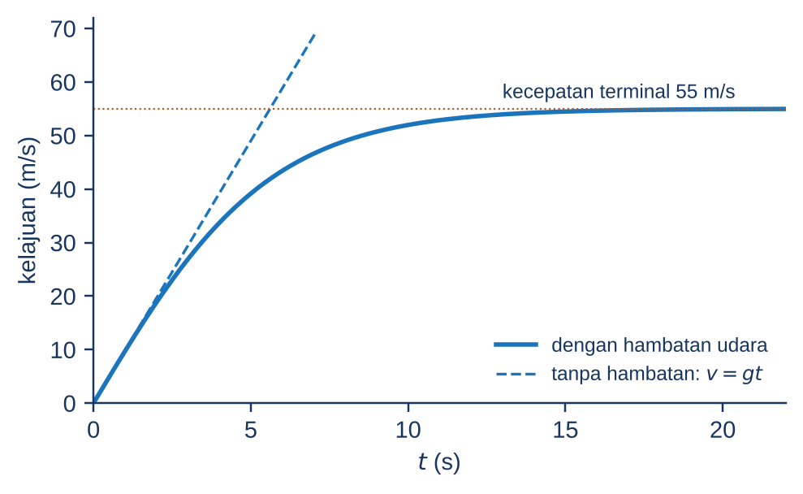{width=62%}

### Menghitung gerak selangkah demi selangkah

Percepatan $a = g - kv^2$ bergantung pada kecepatan, yang justru sedang dicari. Integralnya tidak bisa dikerjakan dengan aturan pangkat. Tetapi kita bisa kembali ke gagasan paling dasar bab ini: dalam selang waktu yang **sangat singkat** $\Delta t$, percepatan hampir tetap, sehingga

$$
v_\text{baru} = v_\text{lama} + a\,\Delta t, \qquad x_\text{baru} = x_\text{lama} + v_\text{lama}\,\Delta t .
$$

Hitung percepatan dari kecepatan saat ini, majukan kecepatan dan posisi satu langkah kecil, lalu ulangi. Cara ini disebut **metode Euler**. Ia membosankan untuk tangan, tetapi sangat mudah untuk komputer, dan bisa dipakai untuk percepatan **apa pun**. Hampir semua simulasi fisika, dari prakiraan cuaca sampai lintasan wahana antariksa, pada dasarnya melakukan hal ini dengan cara yang lebih halus.

::: {.contoh}
**Contoh 2.15 · Penerjun payung dengan komputer**

Dengan metode Euler dan $\Delta t = 0{,}01$ s, hitung kelajuan penerjun payung ($v_T = 55$ m/s) pada beberapa saat, dan bandingkan dengan jatuh bebas tanpa udara.

**Rencana.** $k = g/v_T^2 = 9{,}80/55^2 = 3{,}24 \times 10^{-3}\ \text{m}^{-1}$. Intinya hanya tiga baris yang diulang:

```python
a = g - k*v*v      # percepatan saat ini
v = v + a*dt       # majukan kecepatan
t = t + dt         # majukan waktu
```

**Penyelesaian.** Hasilnya, dibandingkan dengan penyelesaian tepat (yang diperoleh dengan kalkulus lanjut) dan dengan jatuh bebas:

| $t$ (s) | Euler (m/s) | Tepat (m/s) | Tanpa udara, $gt$ (m/s) |
|---|---|---|---|
| 2 | 18,8 | 18,8 | 19,6 |
| 5 | 39,2 | 39,2 | 49,0 |
| 10 | 52,0 | 52,0 | 98,0 |
| 20 | 54,9 | 54,9 | 196 |

**Memahami hasil.** Hasil Euler dan hasil tepat sama sampai tiga angka penting. Selama dua sekon pertama, udara hampir tidak berpengaruh. Setelah 10 sekon, penerjun sudah mencapai 95% kecepatan terminalnya (Gambar 2.13). Model jatuh bebas baik untuk benda padat yang jatuh sebentar, dan buruk untuk jatuh yang lama. Itulah batas berlakunya.
:::
