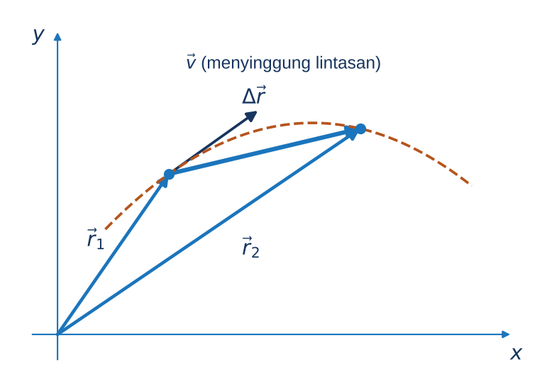
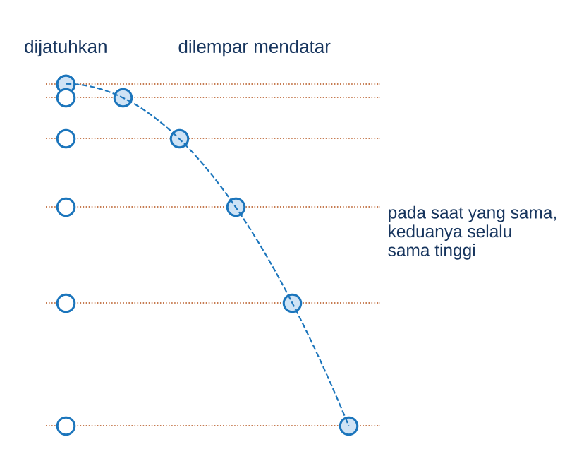
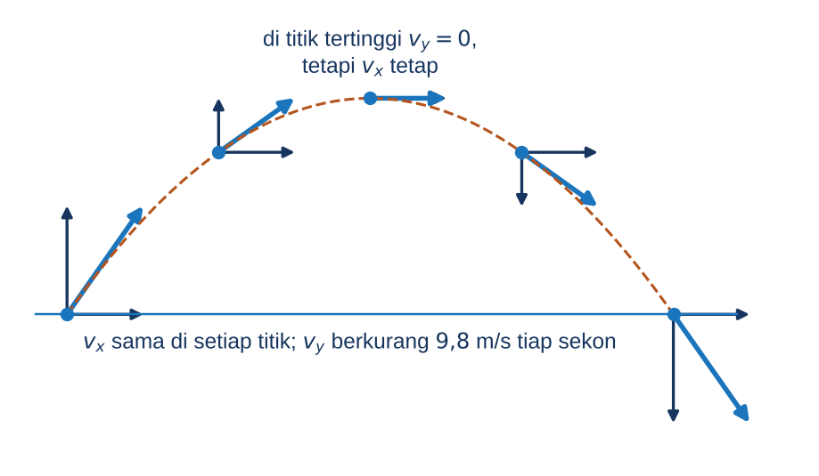
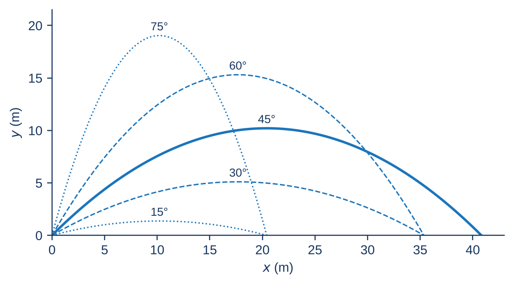
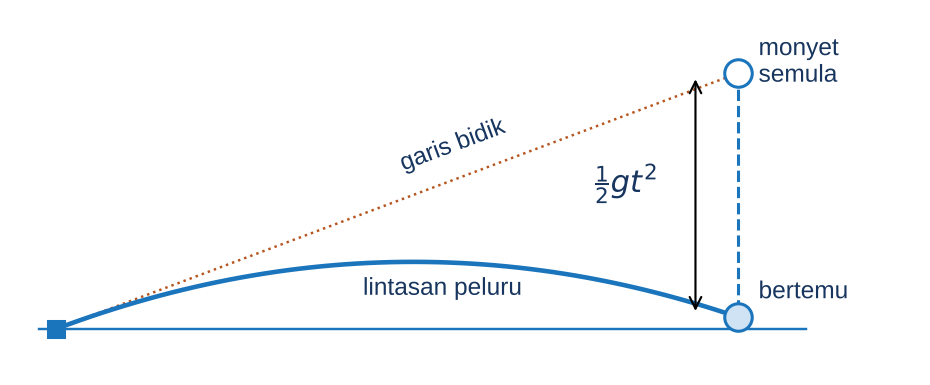
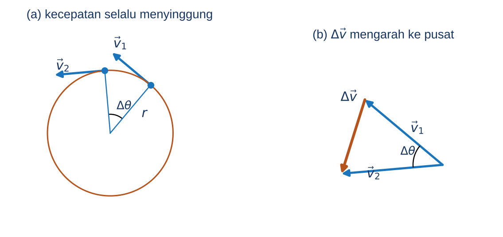
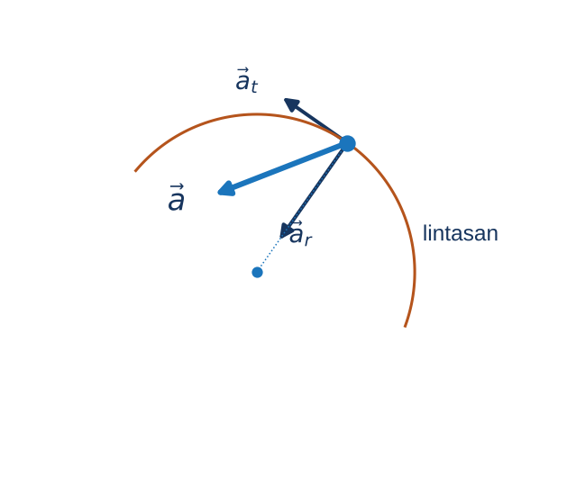
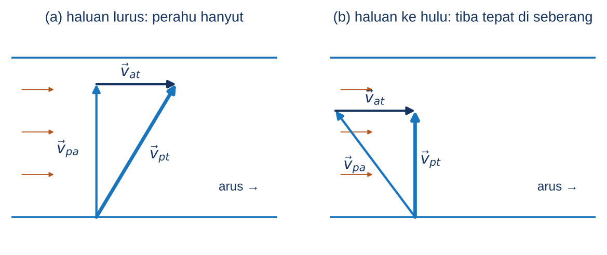
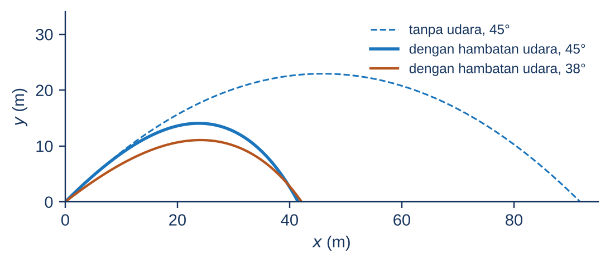

## 2.10 Posisi, kecepatan, dan percepatan sebagai vektor

Seekor monyet lepas dari kandangnya dan bergelantungan di dahan pohon. Dokter hewan kebun binatang membidiknya dengan senapan bius. Monyet itu cerdik: ia mengawasi laras senapan, dan tepat ketika melihat kilatan tembakan, ia melepaskan pegangannya dan menjatuhkan diri, dengan harapan peluru bius lewat di atas kepalanya.

Dokter hewan tahu bahwa peluru tidak bergerak lurus. Gravitasi akan menariknya turun selama perjalanan. Apakah ia harus membidik sedikit di atas monyet untuk mengimbangi turunnya peluru? Atau di bawahnya, karena monyet akan jatuh? Dan apakah jawabannya bergantung pada kecepatan peluru, yang tidak ia ketahui dengan tepat?

::: {.kuis}
**Pertanyaan pembuka subbab 2.10**

Ke mana dokter hewan harus membidik: di atas monyet, tepat ke monyet, atau di bawahnya? Jawabannya, yang termasuk hasil paling elegan dalam mekanika, ada di subbab 2.13.
:::

### Vektor posisi dan perpindahan

Letak sebuah partikel dinyatakan oleh **vektor posisi** $\vec r$, yaitu anak panah dari titik asal ke partikel itu:

$$
\vec r = x\,\hat\imath + y\,\hat\jmath + z\,\hat k .
$$

Ketika partikel bergerak, ujung $\vec r$ menelusuri **lintasannya**. **Perpindahan** dalam suatu selang waktu adalah perubahan vektor posisi, $\Delta\vec r = \vec r_2 - \vec r_1$ (Gambar 2.14).

{width=60%}

### Kecepatan

Definisi di subbab 2.1–2.9 dibawa utuh, dengan vektor menggantikan bilangan:

$$
\vec v_\text{rata} = \frac{\Delta\vec r}{\Delta t}, \qquad \boxed{\vec v = \frac{d\vec r}{dt} = \frac{dx}{dt}\,\hat\imath + \frac{dy}{dt}\,\hat\jmath + \frac{dz}{dt}\,\hat k}
$$

Jadi setiap komponen kecepatan adalah turunan komponen posisi yang bersesuaian: $v_x = dx/dt$, $v_y = dy/dt$, $v_z = dz/dt$.

Ke mana arah kecepatan sesaat? Ketika selang waktu diperkecil, titik kedua pada Gambar 2.14 mendekati titik pertama, dan $\Delta\vec r$ makin sejajar dengan lintasan di titik itu. Pada limitnya:

::: {.inti}
**Kecepatan sesaat selalu menyinggung lintasan, searah gerak.**
:::

Kelajuan adalah besar vektor kecepatan: $v = \sqrt{v_x^2 + v_y^2 + v_z^2}$.

### Percepatan

$$
\vec a_\text{rata} = \frac{\Delta\vec v}{\Delta t}, \qquad \boxed{\vec a = \frac{d\vec v}{dt}}, \qquad a_x = \frac{dv_x}{dt},\ a_y = \frac{dv_y}{dt},\ a_z = \frac{dv_z}{dt}.
$$

Di sini muncul hal yang benar-benar baru. Dalam satu dimensi, kecepatan hanya bisa berubah **besarnya**. Dalam dua dimensi, vektor kecepatan juga bisa berubah **arahnya**. Keduanya adalah perubahan kecepatan, dan keduanya berarti ada percepatan.

::: {.inti}
**Benda mengalami percepatan jika kelajuannya berubah, atau arah geraknya berubah, atau keduanya.**
:::

Mobil yang membelok dengan angka spidometer tetap sedang dipercepat. Penumpang merasakannya sebagai dorongan ke samping. Gagasan ini menjadi inti subbab 2.14.

::: {.contoh}
**Contoh 2.16 · Kecepatan dan percepatan dari posisi**

Posisi sebuah partikel adalah $\vec r = (2{,}0t^2)\,\hat\imath + (6{,}0t - 1{,}0t^3)\,\hat\jmath$, dengan $r$ dalam meter dan $t$ dalam sekon. Tentukan kecepatan, kelajuan, dan percepatannya pada $t = 1{,}0$ s.

**Penyelesaian.** Turunkan tiap komponen:

$$
\vec v = (4{,}0t)\,\hat\imath + (6{,}0 - 3{,}0t^2)\,\hat\jmath, \qquad \vec a = (4{,}0)\,\hat\imath + (-6{,}0t)\,\hat\jmath .
$$

Pada $t = 1{,}0$ s: $\vec v = (4{,}0\,\hat\imath + 3{,}0\,\hat\jmath)$ m/s, dengan kelajuan $\sqrt{4{,}0^2 + 3{,}0^2} = 5{,}0$ m/s pada arah $37^\circ$ di atas sumbu $x$. Percepatannya $\vec a = (4{,}0\,\hat\imath - 6{,}0\,\hat\jmath)\ \text{m/s}^2$, besarnya $7{,}2\ \text{m/s}^2$ pada arah $56^\circ$ di bawah sumbu $x$.

**Memahami hasil.** Kecepatan dan percepatan menunjuk ke arah yang berbeda. Ini hal biasa dalam dua dimensi: percepatan menunjukkan ke mana kecepatan sedang **berubah**, bukan ke mana benda sedang bergerak.
:::

::: {.kuis}
**Kuis cepat 2.9**

Sebuah mobil melaju di jalan melingkar dengan angka spidometer tetap 40 km/jam. Pernyataan yang benar: (a) kecepatan dan percepatannya tetap (b) kecepatannya tetap, percepatannya nol (c) kecepatannya berubah, percepatannya tidak nol (d) kecepatannya berubah, percepatannya nol
:::

## 2.11 Gerak dengan percepatan konstan dan kemandirian gerak

Jika vektor percepatan tetap (besar **dan** arahnya), setiap komponen memenuhi persamaan subbab 2.1–2.9 secara terpisah:

$$
\boxed{\vec v = \vec v_0 + \vec a\,t, \qquad \vec r = \vec r_0 + \vec v_0\,t + \tfrac12\vec a\,t^2}
$$

Ditulis per komponen:

| Arah $x$ | Arah $y$ |
|---|---|
| $v_x = v_{0x} + a_xt$ | $v_y = v_{0y} + a_yt$ |
| $x = x_0 + v_{0x}t + \tfrac12a_xt^2$ | $y = y_0 + v_{0y}t + \tfrac12a_yt^2$ |

Perhatikan apa yang **tidak** ada: $a_y$ tidak muncul di persamaan $x$, dan $a_x$ tidak muncul di persamaan $y$. Kedua arah hanya dihubungkan oleh satu hal, yaitu **waktu $t$ yang sama**.

::: {.inti}
**Kemandirian gerak:** gerak pada arah $x$ dan gerak pada arah $y$ berlangsung tanpa saling memengaruhi. Gerak dua dimensi adalah dua gerak satu dimensi yang berjalan serentak.
:::

{width=58%}

Gambar 2.15 memperlihatkan percobaan klasiknya. Satu bola dijatuhkan, dan pada saat yang sama bola lain dilempar mendatar. Bola kedua menempuh lintasan yang jauh lebih panjang, tetapi pada setiap saat kedua bola berada pada ketinggian yang sama, dan keduanya **menyentuh lantai bersamaan**. Gerak mendatar bola kedua sama sekali tidak mengubah gerak jatuhnya. Kamu bisa mencobanya dengan dua uang logam di tepi meja: sentil satu dengan penggaris sehingga terlempar mendatar, sambil penggaris yang sama menyenggol yang lain hingga jatuh. Dengarkan bunyinya: hanya terdengar satu ketukan.

::: {.contoh}
**Contoh 2.17 · Bola menggelinding dari meja**

Sebuah bola menggelinding dari tepi meja setinggi 1,20 m dengan kelajuan mendatar 2,5 m/s. (a) Berapa lama bola berada di udara? (b) Seberapa jauh dari kaki meja bola mendarat? (c) Berapa kecepatannya sesaat sebelum menyentuh lantai?

**Gambaran fisis.** Titik asal di tepi meja, $+x$ mendatar searah gerak, $+y$ **ke bawah**. Maka $v_{0x} = 2{,}5$ m/s, $v_{0y} = 0$, $a_x = 0$, $a_y = +g$.

**Rencana.** Arah tegak menentukan waktu. Arah mendatar memakai waktu itu untuk menentukan jarak.

**Penyelesaian.**

(a) Tegak: $y = \tfrac12gt^2$, sehingga $t = \sqrt{\dfrac{2y}{g}} = \sqrt{\dfrac{2(1{,}20)}{9{,}80}} = 0{,}495$ s.

(b) Mendatar: $x = v_{0x}t = (2{,}5)(0{,}495) = 1{,}2$ m.

(c) $v_x = 2{,}5$ m/s (tidak berubah) dan $v_y = gt = (9{,}80)(0{,}495) = 4{,}85$ m/s. Kelajuannya $\sqrt{2{,}5^2 + 4{,}85^2} = 5{,}5$ m/s, pada arah $\tan^{-1}(4{,}85/2{,}5) = 63^\circ$ di bawah arah mendatar.

**Memahami hasil.** Waktu jatuh 0,495 s sama dengan waktu jatuh bola yang dijatuhkan begitu saja dari 1,20 m. Kelajuan mendatar hanya menentukan **seberapa jauh**, bukan **berapa lama**.
:::

::: {.kuis}
**Kuis cepat 2.10**

Dari tepi tebing, peluru A ditembakkan mendatar dengan 300 m/s dan peluru B dijatuhkan dari ketinggian yang sama pada saat yang sama. Dengan mengabaikan udara: (a) B tiba di tanah lebih dulu (b) A tiba lebih dulu (c) keduanya tiba bersamaan (d) bergantung pada massa peluru
:::

## 2.12 Gerak peluru

**Gerak peluru** adalah gerak benda yang dilempar atau ditembakkan, lalu bergerak hanya di bawah pengaruh gravitasi. Bola yang ditendang, batu yang dilempar, dan atlet lompat jauh yang sudah meninggalkan tanah semuanya "peluru" dalam arti ini. Modelnya memakai dua penyederhanaan: hambatan udara diabaikan, dan $g$ dianggap tetap.

### Persamaan gerak peluru

Pilih titik lempar sebagai titik asal, $+x$ mendatar dan $+y$ ke atas. Benda dilempar dengan kelajuan $v_0$ pada **sudut elevasi** $\theta$ di atas arah mendatar. Komponen kecepatan awalnya:

$$
v_{0x} = v_0\cos\theta, \qquad v_{0y} = v_0\sin\theta .
$$

Percepatannya $a_x = 0$ dan $a_y = -g$. Maka:

| | Mendatar (kecepatan tetap) | Tegak (jatuh bebas) |
|---|---|---|
| Kecepatan | $v_x = v_0\cos\theta$ | $v_y = v_0\sin\theta - gt$ |
| Posisi | $x = (v_0\cos\theta)\,t$ | $y = (v_0\sin\theta)\,t - \tfrac12gt^2$ |

Seluruh gerak peluru ada di dalam tabel ini. Rumus-rumus berikutnya hanyalah akibatnya.

{width=82%}

::: {.awas}
**Awas · Di titik tertinggi, kecepatan tidak nol**

Di titik tertinggi hanya komponen **tegak** kecepatan yang nol. Peluru masih bergerak mendatar dengan $v_x = v_0\cos\theta$ (Gambar 2.16). Dan percepatannya di sana, seperti di semua titik lain, tetap $g$ ke bawah.
:::

### Bentuk lintasan

Dari persamaan mendatar, $t = \dfrac{x}{v_0\cos\theta}$. Masukkan ke persamaan tegak:

$$
\boxed{y = (\tan\theta)\,x - \frac{g}{2v_0^2\cos^2\theta}\,x^2} \qquad \text{(2.5)}
$$

Bentuknya $y = bx - cx^2$, yaitu **parabola** yang terbuka ke bawah. Galileo-lah yang pertama kali membuktikan hal ini.

### Waktu melayang, tinggi maksimum, dan jangkauan

Tiga besaran berikut berlaku untuk peluru yang **mendarat pada ketinggian yang sama** dengan titik lemparnya.

**Waktu melayang.** Peluru kembali ke $y = 0$ ketika $(v_0\sin\theta)\,t - \tfrac12gt^2 = 0$. Selain $t = 0$, penyelesaiannya

$$
t_\text{layang} = \frac{2v_0\sin\theta}{g} .
$$

**Tinggi maksimum.** Di titik tertinggi $v_y = 0$. Dari $v_y^2 = v_{0y}^2 - 2gy$:

$$
H = \frac{v_0^2\sin^2\theta}{2g} .
$$

**Jangkauan** adalah jarak mendatar selama waktu melayang: $R = (v_0\cos\theta)\,t_\text{layang} = \dfrac{2v_0^2\sin\theta\cos\theta}{g}$. Dengan identitas $2\sin\theta\cos\theta = \sin 2\theta$:

$$
\boxed{R = \frac{v_0^2\sin 2\theta}{g}} \qquad \text{(2.6)}
$$

{width=80%}

Rumus (2.6) menyimpan tiga pelajaran (Gambar 2.17):

- **Jangkauan terjauh dicapai pada $\theta = 45^\circ$**, karena $\sin 2\theta$ paling besar (bernilai 1) saat $2\theta = 90^\circ$. Nilainya $R_\text{maks} = v_0^2/g$.
- **Dua sudut yang berjumlah 90° memberi jangkauan sama**, misalnya 30° dan 60°, karena $\sin 2\theta = \sin(180^\circ - 2\theta)$. Lemparan yang landai tiba lebih cepat. Lemparan yang curam melayang lebih lama dan lebih tinggi.
- **Jangkauan sebanding dengan $v_0^2$.** Melempar dua kali lebih cepat berarti empat kali lebih jauh. Dan karena $R \propto 1/g$, lompatan yang sama di Bulan enam kali lebih jauh.

Mengapa 45°? Jangkauan adalah hasil kali kelajuan mendatar dan waktu melayang. Sudut kecil memberi kelajuan mendatar besar tetapi waktu melayang singkat. Sudut besar sebaliknya. Sudut 45° adalah kompromi terbaik antara keduanya.

::: {.awas}
**Awas · Rumus jangkauan punya syarat**

Rumus $t_\text{layang}$, $H$, dan $R$ di atas **hanya** berlaku jika peluru mendarat pada ketinggian yang sama dengan titik lempar. Untuk kasus lain (dilempar dari tebing, mengenai dinding), kembalilah ke tabel persamaan gerak. Tabel itu selalu benar.
:::

::: {.contoh}
**Contoh 2.18 · Tendangan bola**

Sebuah bola ditendang dari tanah dengan kelajuan 20 m/s pada sudut 30°. Tentukan (a) waktu melayang, (b) tinggi maksimum, dan (c) jangkauannya. (d) Bandingkan dengan tendangan pada sudut 60°.

**Penyelesaian.** $v_{0x} = 20\cos 30^\circ = 17{,}3$ m/s dan $v_{0y} = 20\sin 30^\circ = 10{,}0$ m/s.

(a) $t_\text{layang} = \dfrac{2(10{,}0)}{9{,}80} = 2{,}04$ s.

(b) $H = \dfrac{(10{,}0)^2}{2(9{,}80)} = 5{,}1$ m.

(c) $R = v_{0x}t_\text{layang} = (17{,}3)(2{,}04) = 35$ m.

(d) Pada 60°: $v_{0x} = 10{,}0$ m/s dan $v_{0y} = 17{,}3$ m/s. Waktu melayang 3,53 s, tinggi maksimum 15,3 m, dan jangkauan $(10{,}0)(3{,}53) = 35$ m.

**Memahami hasil.** Jangkauan keduanya sama, sesuai aturan sudut berjumlah 90°. Tendangan 60° tiga kali lebih tinggi dan melayang 1,7 kali lebih lama. Itulah sebabnya penjaga gawang menendang tinggi untuk memberi waktu kepada rekan-rekannya, sedangkan umpan terobosan ditendang landai agar cepat tiba.
:::

::: {.kuis}
**Kuis cepat 2.11**

Sebuah peluru ditembakkan miring ke atas. Dengan mengabaikan udara, percepatannya di titik tertinggi lintasan adalah: (a) nol (b) $g$ ke bawah (c) $g$ ke atas (d) mendatar
:::

## 2.13 Gerak peluru: kasus yang lebih umum

::: {.strategi}
**Strategi · Soal gerak peluru**

1. **Gambar** lintasannya. Pilih titik asal (biasanya titik lempar) dan arah sumbu.
2. **Uraikan kecepatan awal**: $v_{0x} = v_0\cos\theta$ dan $v_{0y} = v_0\sin\theta$ (negatif jika dilempar ke bawah).
3. **Buat dua daftar besaran**, mendatar ($a_x = 0$) dan tegak ($a_y = -g$), yang dihubungkan oleh **waktu yang sama**.
4. Cari **waktu** dari arah yang datanya lengkap (biasanya arah tegak), lalu pakai di arah yang lain.
5. **Periksa**: apakah tanda dan besarnya masuk akal? Apakah waktu jatuhnya sebanding dengan jatuh bebas dari ketinggian itu?
:::

::: {.contoh}
**Contoh 2.19 · Dilempar dari tepi tebing**

Sebuah batu dilempar dari tepi tebing setinggi 45 m dengan kelajuan 15 m/s pada sudut 30° di atas arah mendatar. (a) Berapa lama batu berada di udara? (b) Seberapa jauh dari kaki tebing batu jatuh? (c) Berapa kelajuannya saat menyentuh tanah?

**Gambaran fisis.** Titik asal di titik lempar, $+y$ ke atas. Tanah berada di $y = -45$ m. $v_{0x} = 15\cos 30^\circ = 13{,}0$ m/s, $v_{0y} = 15\sin 30^\circ = 7{,}5$ m/s.

**Penyelesaian.**

(a) Tegak: $-45 = 7{,}5t - 4{,}90t^2$, atau $4{,}90t^2 - 7{,}5t - 45 = 0$.

$$
t = \frac{7{,}5 + \sqrt{7{,}5^2 + 4(4{,}90)(45)}}{2(4{,}90)} = \frac{7{,}5 + 30{,}6}{9{,}80} = 3{,}9\ \text{s}.
$$

(b) Mendatar: $x = (13{,}0)(3{,}89) = 51$ m.

(c) $v_x = 13{,}0$ m/s. $v_y = 7{,}5 - (9{,}80)(3{,}89) = -30{,}6$ m/s. Kelajuan: $\sqrt{13{,}0^2 + 30{,}6^2} = 33$ m/s.

**Memahami hasil.** Kelajuan akhir bisa diperiksa tanpa waktu. Untuk arah tegak, $v_y^2 = v_{0y}^2 + 2g(45)$, dan $v_x$ tetap, sehingga $v^2 = v_0^2 + 2g(45) = 225 + 882 = 1107$, yaitu $v = 33$ m/s. Rumus ini **tidak memuat sudut lempar**. Batu yang dilempar ke atas, mendatar, atau ke bawah dengan kelajuan awal sama akan menyentuh tanah dengan kelajuan yang sama. Di Bab 4 hasil ini akan dikenali sebagai kekekalan energi.
:::

::: {.contoh}
**Contoh 2.20 · Lemparan ke ring basket**

Seorang pemain melepaskan bola dari ketinggian 2,00 m pada sudut 50° menuju ring setinggi 3,05 m yang berjarak mendatar 6,0 m. Berapa kelajuan lemparan yang diperlukan?

**Memahami soal.** Titik awal dan akhir berbeda ketinggian, jadi rumus jangkauan tidak berlaku. Kita tahu ke mana bola harus pergi, $x = 6{,}0$ m dan $y = 3{,}05 - 2{,}00 = 1{,}05$ m, tetapi tidak tahu waktunya.

**Rencana.** Persamaan lintasan (2.5) menghubungkan $x$ dan $y$ tanpa waktu. Selesaikan untuk $v_0$.

**Penyelesaian.** Dari (2.5):

$$
v_0^2 = \frac{g\,x^2}{2\cos^2\theta\,(x\tan\theta - y)} = \frac{(9{,}80)(6{,}0)^2}{2\cos^2 50^\circ\left[(6{,}0)\tan 50^\circ - 1{,}05\right]} = \frac{352{,}8}{2(0{,}413)(6{,}10)} = 70{,}0 .
$$

Jadi $v_0 = 8{,}4$ m/s.

**Memahami hasil.** Jika $x\tan\theta - y$ bernilai nol atau negatif, tidak ada penyelesaian. Artinya garis bidik lurus pun tidak mencapai sasaran, apalagi lintasan yang melengkung ke bawah. Di sini garis bidik melewati ketinggian $(6{,}0)\tan 50^\circ = 7{,}2$ m di atas titik lepas, jauh di atas ring, dan gravitasi menurunkan bola sejauh 6,1 m selama perjalanan.
:::

### Monyet dan dokter hewan

Sekarang pertanyaan pembuka. Misalkan dokter hewan membidik **tepat ke monyet**, yang berada pada jarak mendatar $d$ dan ketinggian $h$.

**Tanpa gravitasi**, peluru bergerak lurus sepanjang garis bidik dengan kelajuan $v_0$ dan mengenai monyet yang tetap menggantung.

**Dengan gravitasi**, posisi tegak peluru adalah

$$
y_\text{peluru} = \underbrace{(v_0\sin\theta)\,t}_{\text{posisi pada garis bidik}} - \tfrac12gt^2 .
$$

Peluru berada $\tfrac12gt^2$ **di bawah garis bidik**. Monyet, yang melepaskan diri pada saat yang sama, berada pada

$$
y_\text{monyet} = h - \tfrac12gt^2 ,
$$

yaitu $\tfrac12gt^2$ **di bawah posisi semulanya**. Keduanya "jatuh" sejauh yang persis sama dari tempat mereka seharusnya berada tanpa gravitasi. Ketika peluru mencapai garis tegak tempat monyet berada, keduanya berada di titik yang sama (Gambar 2.18).

{width=72%}

::: {.inti}
**Bidik tepat ke monyet.** Peluru akan mengenainya, berapa pun kelajuan peluru (asalkan cukup untuk mencapai monyet sebelum monyet tiba di tanah).
:::

Kelajuan peluru hanya menentukan **di ketinggian berapa** pertemuan itu terjadi: peluru cepat mengenai monyet di dekat dahan, peluru lambat mengenainya di dekat tanah. Ini kembali gagasan Contoh 2.13: dua benda yang jatuh bebas bersama-sama tidak "merasakan" gravitasi satu terhadap yang lain. Monyet akan selamat jika ia **tidak** melepaskan diri.

::: {.kuis}
**Kuis cepat 2.12**

Tiga batu dilempar dari puncak tebing dengan kelajuan awal sama: A miring ke atas, B mendatar, C miring ke bawah. Dengan mengabaikan udara, urutan kelajuan saat menyentuh tanah adalah: (a) A > B > C (b) C > B > A (c) ketiganya sama (d) B paling besar
:::

## 2.14 Gerak melingkar beraturan

**Gerak melingkar beraturan** adalah gerak pada lintasan lingkaran dengan **kelajuan tetap**. Jarum detik jam, satelit pada orbit lingkaran, dan sampel di dalam sentrifus adalah contohnya.

Kelajuannya tetap, tetapi **kecepatannya tidak**: arah vektor kecepatan terus berubah. Maka benda itu pasti dipercepat. Pertanyaannya: ke mana arah percepatannya, dan berapa besarnya?

### Menurunkan percepatan sentripetal

{width=84%}

Tinjau partikel di dua titik yang berdekatan pada lingkaran berjari-jari $r$ (Gambar 2.19a). Dalam selang waktu $\Delta t$, jari-jari yang menuju partikel berputar sebesar sudut $\Delta\theta$, dan partikel menempuh busur sepanjang $v\,\Delta t$. Untuk sudut kecil, busur itu hampir sama dengan tali busurnya.

Kecepatan selalu tegak lurus jari-jari. Jadi ketika jari-jari berputar sebesar $\Delta\theta$, vektor kecepatan ikut berputar sebesar sudut yang **sama**. Gambar kedua vektor kecepatan dari satu pangkal (Gambar 2.19b). Keduanya sama panjang ($v$) dan mengapit sudut $\Delta\theta$, membentuk segitiga sama kaki dengan alas $\Delta v$. Segitiga ini **sebangun** dengan segitiga yang dibentuk oleh dua jari-jari (panjang $r$) dan tali busur (panjang $v\,\Delta t$), karena keduanya sama kaki dengan sudut puncak yang sama. Maka perbandingan alas terhadap kakinya sama:

$$
\frac{\Delta v}{v} = \frac{v\,\Delta t}{r} \quad\Longrightarrow\quad \frac{\Delta v}{\Delta t} = \frac{v^2}{r} .
$$

Untuk arahnya, perhatikan Gambar 2.19b: ketika $\Delta\theta$ mengecil, $\Delta\vec v$ menjadi tegak lurus terhadap $\vec v$, yaitu sepanjang jari-jari, menuju pusat.

$$
\boxed{a_c = \frac{v^2}{r}} \qquad \text{arah: selalu menuju pusat lingkaran}
$$

Percepatan ini disebut **percepatan sentripetal** ("mencari pusat"). Besarnya tetap, tetapi arahnya terus berubah, karena selalu menunjuk ke pusat dari mana pun partikel berada. Jadi gerak melingkar beraturan **bukan** gerak dengan percepatan konstan, dan persamaan subbab 2.11 tidak berlaku untuknya.

### Periode

**Periode** $T$ adalah waktu untuk satu putaran. Dalam satu putaran partikel menempuh keliling $2\pi r$, sehingga

$$
v = \frac{2\pi r}{T}, \qquad a_c = \frac{v^2}{r} = \frac{4\pi^2r}{T^2} .
$$

Bentuk kedua berguna jika yang diketahui adalah periode atau banyaknya putaran per menit, bukan kelajuan.

::: {.awas}
**Awas · Tidak ada "percepatan ke luar"**

Penumpang mobil yang membelok merasa terlempar ke luar tikungan. Tetapi percepatan mobil, dan penumpangnya, mengarah ke **dalam**. Yang dirasakan penumpang adalah kecenderungan tubuhnya untuk terus bergerak lurus sementara mobil membelok di bawahnya. Pintu mobillah yang mendorong penumpang ke dalam. Penjelasan lengkapnya ada di Bab 3.
:::

::: {.contoh}
**Contoh 2.21 · Tiga gerak melingkar**

Hitung percepatan sentripetal (a) mobil yang melaju 15 m/s di tikungan berjari-jari 50 m; (b) Bulan pada orbitnya, dengan jari-jari orbit $3{,}84 \times 10^8$ m dan periode 27,3 hari; (c) sampel dalam sentrifus laboratorium yang berputar 5000 putaran per menit pada jarak 10 cm dari sumbu.

**Penyelesaian.**

(a) $a_c = \dfrac{15^2}{50} = 4{,}5\ \text{m/s}^2$, sekitar $0{,}46g$.

(b) $T = 27{,}3 \times 86\,400 = 2{,}36 \times 10^6$ s. $a_c = \dfrac{4\pi^2(3{,}84 \times 10^8)}{(2{,}36 \times 10^6)^2} = 2{,}72 \times 10^{-3}\ \text{m/s}^2$.

(c) $T = \dfrac{60\ \text{s}}{5000} = 0{,}0120$ s. $a_c = \dfrac{4\pi^2(0{,}10)}{(0{,}0120)^2} = 2{,}7 \times 10^4\ \text{m/s}^2$, sekitar $2800g$.

**Memahami hasil.** (a) Hampir setengah $g$: penumpang jelas merasakan dorongan ke samping. (b) Percepatan Bulan sekitar $g/3600$. Bulan berjarak kira-kira 60 kali jari-jari Bumi dari pusat Bumi, dan $60^2 = 3600$. Newton melihat kecocokan ini dan menyimpulkan bahwa gravitasi melemah sebanding dengan kuadrat jarak. (c) Inilah guna sentrifus: di dalamnya, partikel yang sedikit lebih rapat daripada cairannya mengendap ribuan kali lebih cepat daripada jika hanya mengandalkan gravitasi.
:::

::: {.kuis}
**Kuis cepat 2.13**

Sebuah benda bergerak melingkar beraturan. Jika kelajuannya dijadikan dua kali dan jari-jari lintasannya juga dijadikan dua kali, percepatan sentripetalnya menjadi: (a) sama (b) dua kali (c) empat kali (d) setengahnya
:::

## 2.15 Percepatan tangensial dan radial

Bagaimana jika benda bergerak pada lintasan melengkung **dan** kelajuannya berubah, seperti mobil yang mengerem sambil membelok? Percepatannya diuraikan menjadi dua bagian yang saling tegak lurus (Gambar 2.20):

{width=46%}

| | Percepatan radial $a_r$ | Percepatan tangensial $a_t$ |
|---|---|---|
| Arah | tegak lurus kecepatan, menuju pusat kelengkungan | sejajar kecepatan (searah atau berlawanan) |
| Besar | $v^2/r$ | $dv/dt$ (laju perubahan **kelajuan**) |
| Yang diubahnya | **arah** kecepatan | **besar** kecepatan |

Besar percepatan totalnya $a = \sqrt{a_r^2 + a_t^2}$.

Pembagian ini merangkum seluruh bab. Gerak lurus hanya punya bagian tangensial. Gerak melingkar beraturan hanya punya bagian radial. Gerak yang umum punya keduanya. Untuk lintasan yang bukan lingkaran, $r$ adalah **jari-jari kelengkungan** lintasan di titik itu, yaitu jari-jari lingkaran yang paling pas dengan lintasan di sana.

::: {.contoh}
**Contoh 2.22 · Mengerem di tikungan**

Sebuah mobil memasuki tikungan berjari-jari 80 m dengan kelajuan 20 m/s sambil mengerem, sehingga kelajuannya berkurang $3{,}0\ \text{m/s}$ setiap sekon. Tentukan besar percepatan totalnya saat itu.

**Penyelesaian.** $a_r = \dfrac{20^2}{80} = 5{,}0\ \text{m/s}^2$ (ke pusat tikungan). $a_t = 3{,}0\ \text{m/s}^2$ (berlawanan arah gerak).

$$
a = \sqrt{5{,}0^2 + 3{,}0^2} = 5{,}8\ \text{m/s}^2 ,
$$

pada arah $\tan^{-1}(3{,}0/5{,}0) = 31^\circ$ ke belakang dari arah menuju pusat.

**Memahami hasil.** Percepatan total lebih besar daripada masing-masing bagiannya. Ban harus menyediakan gaya untuk keduanya sekaligus. Itulah sebabnya mengerem keras di tengah tikungan mudah membuat ban selip: "jatah" cengkeraman ban sudah terpakai untuk membelok.
:::

## 2.16 Gerak relatif

### Kecepatan bergantung pada pengamat

Seorang pramugari berjalan ke depan di lorong pesawat dengan 1 m/s. Bagi penumpang yang duduk, kecepatannya 1 m/s. Bagi pengamat di tanah, kecepatannya sekitar 251 m/s. Keduanya benar. **Kecepatan selalu diukur relatif terhadap sesuatu**, yang disebut **kerangka acuan**.

Untuk menghindari kebingungan, pakai dua indeks: $\vec v_{AB}$ berarti "kecepatan A relatif terhadap B". Aturan penghubungnya:

$$
\boxed{\vec v_{AC} = \vec v_{AB} + \vec v_{BC}}
$$

Kecepatan A relatif terhadap C sama dengan kecepatan A relatif terhadap B **ditambah** kecepatan B relatif terhadap C. Cara mengingatnya: indeks tengah yang sama (B) "saling mencoret", meninggalkan indeks terluar (A dan C). Selain itu, $\vec v_{BA} = -\vec v_{AB}$.

Ini penjumlahan **vektor**. Dalam satu dimensi ia menjadi penjumlahan bertanda. Dalam dua dimensi kita menggambar segitiga kecepatan.

::: {.awas}
**Awas · Aturan ini punya batas**

Penjumlahan kecepatan seperti ini sangat tepat untuk kelajuan sehari-hari, tetapi gagal untuk kelajuan yang mendekati laju cahaya. Di sana berlaku aturan Einstein (Bab 15), yang menjamin tidak ada yang melampaui laju cahaya.
:::

{width=88%}

::: {.contoh}
**Contoh 2.23 · Menyeberangi sungai**

Sebuah sungai lebarnya 200 m dan arusnya 1,5 m/s. Sebuah perahu dapat bergerak 2,5 m/s relatif terhadap air. (a) Jika haluan perahu diarahkan tegak lurus tepian, berapa lama perahu menyeberang, dan seberapa jauh ia hanyut? (b) Ke mana haluan harus diarahkan agar perahu tiba tepat di seberang titik berangkatnya, dan berapa lama penyeberangannya?

**Gambaran fisis.** $+x$ searah arus, $+y$ menyeberang. $\vec v_{pt} = \vec v_{pa} + \vec v_{at}$, dengan $\vec v_{at} = 1{,}5\,\hat\imath$ m/s.

**Penyelesaian.**

(a) $\vec v_{pa} = 2{,}5\,\hat\jmath$, sehingga $\vec v_{pt} = (1{,}5\,\hat\imath + 2{,}5\,\hat\jmath)$ m/s (Gambar 2.21a). Menyeberang hanya ditentukan komponen $y$: $t = \dfrac{200}{2{,}5} = 80$ s. Selama itu perahu hanyut $x = (1{,}5)(80) = 120$ m ke hilir.

(b) Agar $\vec v_{pt}$ tidak punya komponen sepanjang sungai, haluan harus condong **ke hulu** sebesar sudut $\alpha$ dari arah tegak lurus tepian, sehingga komponen $x$ kecepatan perahu menghapus arus (Gambar 2.21b):

$$
2{,}5\sin\alpha = 1{,}5 \quad\Longrightarrow\quad \alpha = 37^\circ .
$$

Kelajuan menyeberangnya $2{,}5\cos 37^\circ = 2{,}0$ m/s, sehingga $t = \dfrac{200}{2{,}0} = 100$ s.

**Memahami hasil.** Menyeberang lurus memakan waktu lebih lama (100 s lawan 80 s), karena sebagian kelajuan perahu "dihabiskan" untuk melawan arus. **Cara tercepat menyeberang adalah mengarahkan haluan tegak lurus tepian** dan menerima hanyutnya. Arus tidak memperlambat penyeberangan sama sekali: ini kemandirian gerak dari subbab 2.11.

**Bagaimana jika…** arusnya lebih cepat daripada perahu? Maka $\sin\alpha$ harus lebih besar dari 1, yang mustahil. Perahu tidak bisa menyeberang lurus, ke mana pun haluannya diarahkan (lihat Soal 34).
:::

::: {.contoh}
**Contoh 2.24 · Pesawat dan angin samping**

Sebuah pesawat kecil terbang dengan kelajuan 250 km/jam relatif terhadap udara. Pilot ingin terbang tepat ke utara, sementara angin bertiup ke timur dengan 60 km/jam. Ke mana pesawat harus diarahkan, dan berapa kelajuannya relatif terhadap tanah?

**Rencana.** $\vec v_{pt} = \vec v_{pu} + \vec v_{ut}$. Hasilnya harus tepat ke utara, jadi komponen timur–barat dari $\vec v_{pu}$ harus menghapus angin. Soal ini sama persis dengan Contoh 2.23(b).

**Penyelesaian.** Pesawat diarahkan sebesar $\alpha$ ke **barat** dari utara: $250\sin\alpha = 60$, sehingga $\alpha = 14^\circ$. Kelajuan relatif terhadap tanah: $\sqrt{250^2 - 60^2} = 243$ km/jam.

**Memahami hasil.** Pesawat tampak terbang "miring" terhadap lintasannya di atas tanah, pemandangan yang biasa terlihat saat pesawat mendarat dalam angin samping.
:::

::: {.terapan}
**Terapan · Mengapa hujan tampak miring dari dalam mobil**

Hujan yang jatuh tegak dengan 8 m/s terlihat miring bagi pelari yang bergerak 6 m/s. Relatif terhadap pelari, hujan memiliki komponen mendatar 6 m/s ke arahnya, sehingga datang dengan kelajuan $\sqrt{8^2 + 6^2} = 10$ m/s pada sudut $\tan^{-1}(6/8) = 37^\circ$ dari arah tegak. Itulah sebabnya payung harus dicondongkan ke depan saat berjalan cepat, dan mengapa jejak hujan di kaca samping mobil makin mendatar saat mobil makin kencang. Para astronom memakai gagasan yang sama: karena Bumi bergerak pada orbitnya, teleskop harus dicondongkan sedikit ke arah gerak Bumi untuk menangkap cahaya bintang. Gejala ini, yang disebut aberasi cahaya, memberi salah satu pengukuran pertama laju cahaya.
:::

::: {.kuis}
**Kuis cepat 2.15**

Kamu berenang menyeberangi sungai berarus dengan selalu menghadap tegak lurus tepian. Jika arusnya tiba-tiba menjadi dua kali lebih deras, waktu yang kamu perlukan untuk sampai ke seberang: (a) dua kali lebih lama (b) lebih lama, tetapi kurang dari dua kali (c) sama (d) lebih singkat
:::

### Catatan tentang hambatan udara

{width=78%}

Semua rumus gerak peluru di bab ini mengabaikan udara. Untuk benda padat yang lambat, anggapan itu baik. Untuk bola yang ditendang keras atau peluru sungguhan, tidak. Gambar 2.22 memperlihatkan hasil hitungan komputer (metode Euler dari subbab 2.9, kini untuk dua komponen) untuk satu contoh: jangkauan turun dari 92 m menjadi sekitar 42 m, lintasan turun lebih curam daripada naiknya, dan sudut terbaik bergeser dari 45° ke sekitar 39°.
