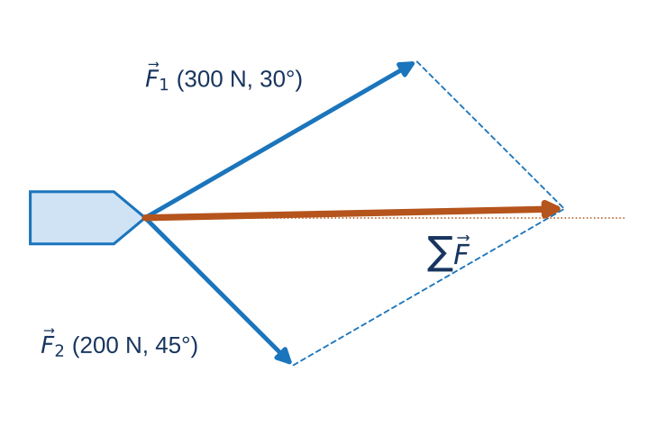
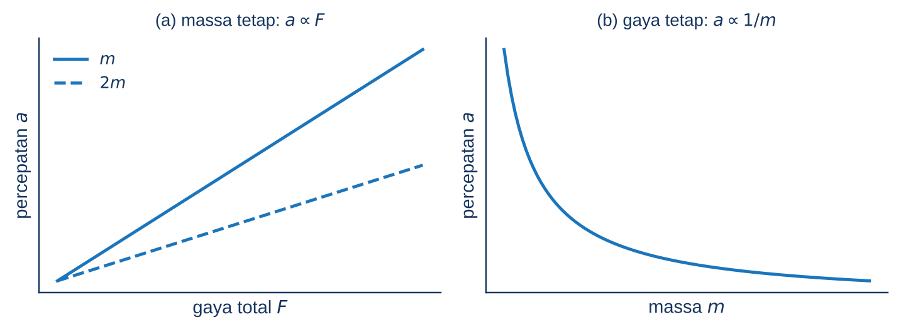
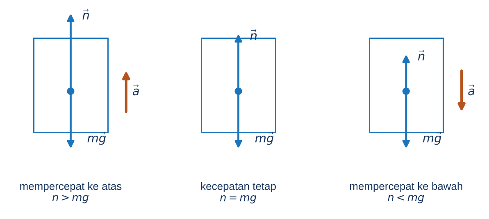
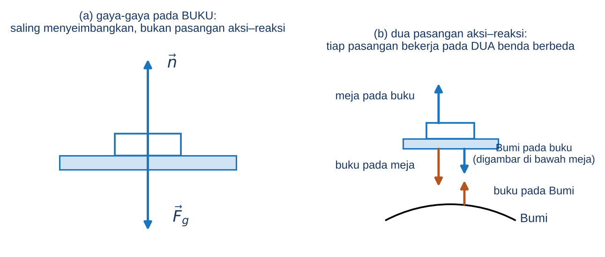
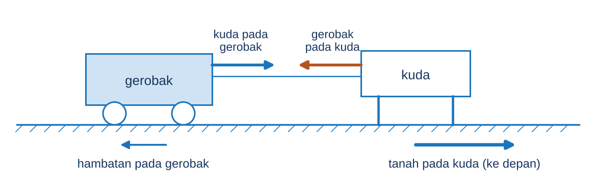
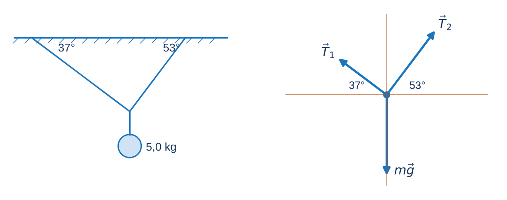
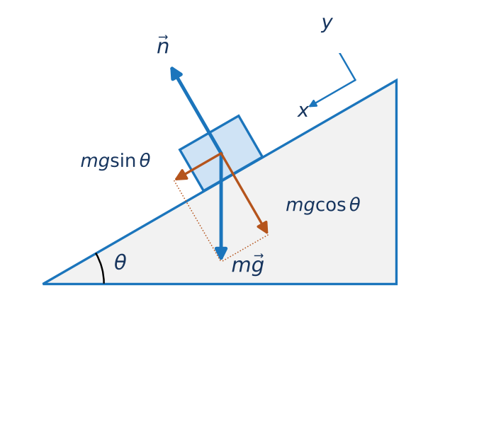
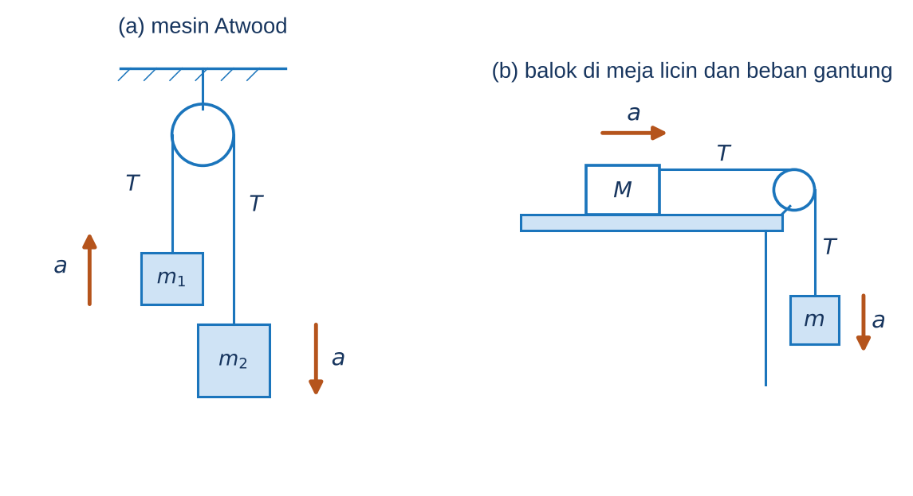
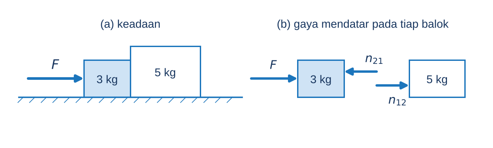

# Bab 3 Hukum Newton dan Penerapannya

Seorang murid yang cerdik pernah mengajukan keberatan terhadap hukum ketiga Newton. "Jika seekor kuda menarik gerobak," katanya, "maka menurut hukum itu gerobak menarik kuda ke belakang dengan gaya yang sama besar. Dua gaya yang sama besar dan berlawanan arah saling menghapus. Jadi kuda itu tidak mungkin bisa menggerakkan gerobak, sekuat apa pun ia menarik."

Kita tahu kuda bisa menarik gerobak, jadi ada yang salah dengan penalaran itu. Tetapi apa? Hukum ketiga Newton memang benar: gaya gerobak pada kuda **selalu** sama besar dengan gaya kuda pada gerobak, bahkan saat keduanya sedang dipercepat. Menemukan letak kekeliruan murid itu adalah ujian terbaik untuk mengetahui apakah seseorang sungguh memahami hukum-hukum Newton.

::: {.kuis}
**Pertanyaan pembuka**

Di mana letak kesalahan penalaran "kuda tidak mungkin menggerakkan gerobak"? Gaya apa yang sebenarnya membuat kuda dan gerobak bergerak maju? Jawabannya ada di subbab 3.6.
:::

::: {.tujuan}
**Tujuan belajar**

Setelah mempelajari bab ini, kamu mampu:

1. Menjelaskan gaya sebagai interaksi antara dua benda, dan menjumlahkan gaya sebagai vektor.
2. Menyatakan hukum pertama Newton dan menjelaskan arti kelembaman dan kerangka acuan inersia.
3. Memakai hukum kedua Newton, $\sum\vec F = m\vec a$, per komponen.
4. Membedakan massa dan berat, dan menentukan gaya normal serta tegangan tali dari hukum Newton.
5. Mengenali pasangan aksi–reaksi dan membedakannya dari gaya-gaya yang seimbang pada satu benda.
6. Menggambar diagram benda bebas yang benar.
7. Menyelesaikan soal keseimbangan, bidang miring licin, lift, dan benda-benda yang terhubung.
8. Membedakan gesekan statis dan gesekan kinetis, dan memakai modelnya dengan benar.
9. Memutuskan apakah sebuah benda bergerak atau tetap diam, dan menentukan gaya gesek yang sesungguhnya bekerja.
10. Menyelesaikan soal bidang miring kasar, tarikan bersudut, benda terhubung, dan balok bertumpuk.
11. Menerapkan hukum kedua Newton pada gerak melingkar mendatar: tikungan datar, tikungan miring, dan bandul kerucut.
12. Menerapkan hukum kedua Newton pada gerak melingkar tegak dan menjelaskan berat semu.
13. Memakai model gaya hambat dan menghitung kecepatan terminal.
14. Menjelaskan asal gaya "sentrifugal" dan gaya fiktif lain di kerangka yang dipercepat.
:::

::: {.mat}
**Prasyarat**

Bab 1 (komponen dan penjumlahan vektor) dan Bab 2 (percepatan, persamaan gerak, dan vektor percepatan). Gesekan sengaja ditunda ke subbab 3.9–3.14, supaya hukum-hukumnya bisa dipelajari dalam bentuk yang paling bersih.
:::

## 3.1 Gaya

### Gaya adalah interaksi

Dalam bahasa sehari-hari, gaya adalah dorongan atau tarikan. Definisi itu cukup sebagai titik awal, tetapi ada satu hal yang harus ditambahkan dan tidak boleh dilupakan:

::: {.inti}
**Setiap gaya adalah interaksi antara dua benda.** Selalu ada benda yang *mengerjakan* gaya dan benda yang *dikenai* gaya.
:::

Gaya tidak pernah "dimiliki" oleh sebuah benda, dan tidak pernah muncul begitu saja. Jika kamu tidak bisa menyebutkan benda apa yang mengerjakan suatu gaya, gaya itu tidak ada. Kebiasaan menanyakan "gaya ini dikerjakan **oleh apa** pada **apa**?" akan menyelamatkanmu dari sebagian besar kesalahan di bab ini.

Gaya bisa dikelompokkan menjadi dua:

| Gaya sentuh | Gaya jarak jauh |
|---|---|
| Muncul ketika dua benda bersentuhan | Bekerja tanpa sentuhan, lewat medan |
| dorongan tangan, tegangan tali, gaya normal, gesekan, gaya pegas, hambatan udara | gravitasi, gaya listrik, gaya magnet |

Di tingkat atom, pembagian ini melebur: gaya sentuh ternyata adalah gaya listrik antara atom-atom kedua permukaan. Di tingkat sehari-hari, pembagian ini memberi aturan praktis yang sangat berguna: **satu-satunya gaya jarak jauh dalam soal mekanika biasa adalah gravitasi. Semua gaya lain memerlukan sentuhan.** Untuk menemukan semua gaya pada sebuah benda, cukup telusuri apa saja yang menyentuhnya, lalu tambahkan beratnya.

### Gaya adalah vektor

Gaya memiliki besar dan arah, dan beberapa gaya pada satu benda dijumlahkan sebagai vektor. Jumlah vektor semua gaya pada sebuah benda disebut **gaya total** (atau gaya resultan), $\sum\vec F$. Dalam segala hal yang menyangkut gerak benda sebagai partikel, gaya-gaya itu bisa digantikan oleh gaya totalnya.

Satuan gaya adalah **newton** (N), yang didefinisikan di subbab 3.4. Sebagai gambaran: berat sebuah apel kecil sekitar 1 N, dan berat orang dewasa sekitar 700 N.

{width=66%}

::: {.contoh}
**Contoh 3.1 · Dua perahu tunda**

Dua perahu tunda menarik sebuah tongkang. Perahu pertama menarik dengan 300 N pada arah 30° di kiri arah haluan, perahu kedua dengan 200 N pada arah 45° di kanan arah haluan (Gambar 3.1). Tentukan gaya total pada tongkang.

**Gambaran fisis.** $+x$ searah haluan, $+y$ ke kiri.

**Penyelesaian.**

| Gaya | Komponen $x$ (N) | Komponen $y$ (N) |
|---|---|---|
| $\vec F_1$ | $300\cos 30^\circ = 259{,}8$ | $300\sin 30^\circ = +150{,}0$ |
| $\vec F_2$ | $200\cos 45^\circ = 141{,}4$ | $-200\sin 45^\circ = -141{,}4$ |
| $\sum\vec F$ | $401{,}2$ | $+8{,}6$ |

Besarnya $\sqrt{401{,}2^2 + 8{,}6^2} = 401$ N, pada arah $\tan^{-1}(8{,}6/401{,}2) = 1{,}2^\circ$ di kiri arah haluan.

**Memahami hasil.** Kedua gaya berjumlah besar 500 N, tetapi gaya totalnya hanya 401 N. Sebagian tarikan terbuang karena kedua perahu juga saling menarik ke samping. Gaya totalnya hampir tepat searah haluan, dan itu memang tujuan menata dua perahu tunda seperti ini.
:::

## 3.2 Hukum pertama Newton

### Apa yang terjadi jika tidak ada gaya?

Dorong sebuah buku di atas meja, lalu lepaskan. Buku itu melambat dan berhenti. Pengalaman seperti ini membuat orang percaya selama dua ribu tahun, mengikuti Aristoteles, bahwa **keadaan alami benda adalah diam**, dan benda hanya bergerak selama ada yang mendorongnya.

Galileo melihat lebih dalam. Buku itu berhenti bukan karena "kehabisan dorongan", melainkan karena ada gaya yang menghentikannya: gesekan. Makin licin permukaannya, makin jauh buku meluncur. Lalu ia bertanya: bagaimana jika gesekan dihilangkan sama sekali?

{width=88%}

Percobaan pikirannya (Gambar 3.2) membawa ke kesimpulan yang bertentangan dengan Aristoteles: **gerak tidak memerlukan sebab. Yang memerlukan sebab adalah perubahan gerak.** Newton menjadikan gagasan ini hukum pertamanya.

::: {.inti}
**Hukum pertama Newton.** Jika gaya total pada sebuah benda nol, benda yang diam tetap diam, dan benda yang bergerak tetap bergerak lurus dengan kecepatan tetap.
:::

Kecenderungan benda mempertahankan keadaan geraknya disebut **kelembaman** (inersia), sehingga hukum ini juga disebut hukum kelembaman. Contohnya ada di mana-mana:

- Saat bus mengerem mendadak, tubuhmu "terlempar" ke depan. Sebenarnya tubuhmu hanya meneruskan geraknya, sementara bus melambat di bawahmu.
- Wahana *Voyager* sudah melaju lebih dari empat puluh tahun dengan mesin mati, dan akan terus melaju. Tidak ada yang menghentikannya.
- Taplak meja yang disentak cepat bisa ditarik tanpa menjatuhkan piring di atasnya.

Perhatikan bahwa hukum pertama berbicara tentang **gaya total nol**, bukan "tidak ada gaya". Buku yang diam di meja dikenai dua gaya (berat dan dorongan meja), tetapi jumlahnya nol. Benda dengan gaya total nol dikatakan berada dalam **keseimbangan**, baik ketika diam maupun ketika bergerak dengan kecepatan tetap.

::: {.awas}
**Awas · "Benda bergerak pasti sedang didorong"**

Ini salah paham yang paling tua dan paling bandel dalam fisika. Bola yang sudah lepas dari tangan pelempar **tidak** lagi dikenai gaya dari tangan. Tidak ada "gaya lempar" yang ikut terbang bersama bola. Setelah lepas, gaya pada bola hanya gravitasi dan hambatan udara. Bola terus bergerak karena kelembaman, dan kelembaman bukan gaya.
:::

### Kerangka acuan inersia

Hukum pertama tidak berlaku untuk semua pengamat. Di dalam bus yang mengerem, sebuah bola di lantai tiba-tiba menggelinding ke depan tanpa ada yang mendorongnya. Menurut penumpang, hukum pertama dilanggar.

Kerangka acuan tempat hukum pertama berlaku disebut **kerangka inersia**. Bus yang mengerem, lift yang mempercepat, dan komidi putar bukan kerangka inersia. Kerangka yang bergerak dengan kecepatan tetap terhadap sebuah kerangka inersia juga inersia. Permukaan Bumi bukan kerangka inersia yang sempurna, karena Bumi berputar, tetapi percepatannya sangat kecil (lihat Soal 70 Bab 2: 0,3% dari $g$), sehingga untuk hampir semua keperluan Bumi boleh dianggap kerangka inersia.

Jadi hukum pertama punya dua peran: ia menyatakan apa yang dilakukan benda tanpa gaya total, dan ia **menetapkan dari kerangka mana** hukum-hukum berikutnya boleh dipakai. Di buku ini, hukum Newton selalu diterapkan dari kerangka inersia, biasanya tanah.

::: {.kuis}
**Kuis cepat 3.1**

Sebuah wahana antariksa melaju di ruang antarbintang, jauh dari bintang dan planet mana pun, dengan mesin menyala. Lalu mesinnya dimatikan. Wahana itu akan: (a) segera berhenti (b) melambat perlahan sampai berhenti (c) terus bergerak dengan kecepatan tetap (d) terus bertambah cepat
:::

## 3.3 Massa

Sebuah bola pingpong dan sebuah bola boling diam di lantai. Tendang keduanya dengan gaya yang sama. Bola pingpong melesat, bola boling hampir tidak bergerak (dan kakimu sakit). Bola boling lebih "enggan" diubah geraknya. Ukuran keengganan itu adalah **massa**.

**Massa** adalah ukuran kelembaman sebuah benda: makin besar massanya, makin kecil percepatan yang dihasilkan gaya yang sama. Massa adalah skalar, satuannya kilogram, dan merupakan sifat benda itu sendiri. Massa tidak bergantung pada tempat: sebuah batu bermassa 2 kg di Bumi, di Bulan, dan di ruang hampa yang jauh dari mana pun.

Perbandingan massa dua benda bisa ditentukan dengan mengerjakan gaya yang sama pada keduanya dan membandingkan percepatannya:

$$
\frac{m_1}{m_2} = \frac{a_2}{a_1} .
$$

Massa tidak sama dengan berat (subbab 3.5), tidak sama dengan volume, dan tidak sama dengan "banyaknya zat" dalam arti kimia (mol), walaupun dalam kehidupan sehari-hari semuanya berjalan seiring.

## 3.4 Hukum kedua Newton

Hukum pertama mengatakan apa yang terjadi jika gaya total nol. Hukum kedua mengatakan apa yang terjadi jika tidak nol.

{width=86%}

Percobaan menunjukkan dua hal (Gambar 3.3). Pertama, percepatan sebuah benda **sebanding dengan gaya total** padanya, dan **searah** dengannya: gaya dua kali memberi percepatan dua kali. Kedua, untuk gaya total yang sama, percepatan **berbanding terbalik dengan massa**: massa dua kali, percepatan setengahnya. Keduanya digabung menjadi satu pernyataan:

::: {.inti}
**Hukum kedua Newton.** Percepatan sebuah benda sebanding dengan gaya total yang bekerja padanya dan berbanding terbalik dengan massanya:
$$\sum\vec F = m\vec a .$$
:::

Beberapa hal yang harus diperhatikan dalam persamaan yang pendek ini:

- **$\sum\vec F$ adalah gaya total**, jumlah vektor **semua** gaya pada benda itu. Bukan salah satu gaya, dan bukan gaya yang terbesar.
- **Hanya gaya yang bekerja *pada* benda itu yang dijumlahkan.** Gaya yang dikerjakan benda itu pada benda lain tidak ikut.
- **$m\vec a$ bukan gaya.** Ia adalah *akibat* dari gaya total. Jangan pernah menggambar "$ma$" sebagai salah satu anak panah gaya.
- Ini persamaan **vektor**, jadi berlaku untuk tiap komponen secara terpisah:

$$
\sum F_x = ma_x, \qquad \sum F_y = ma_y, \qquad \sum F_z = ma_z .
$$

- Hukum pertama adalah kasus khususnya: jika $\sum\vec F = 0$ maka $\vec a = 0$.

**Satuan gaya.** Hukum kedua mendefinisikan newton: satu newton adalah gaya total yang memberi massa 1 kg percepatan $1\ \text{m/s}^2$.

$$
1\ \text{N} = 1\ \text{kg}\cdot\text{m/s}^2 .
$$

::: {.dalam}
**Lebih dalam · Bentuk asli hukum kedua: laju perubahan momentum**

Dalam *Principia* (1687), Newton tidak menulis $F = ma$. Ia menulis bahwa *perubahan gerak sebanding dengan gaya penggerak dan terjadi sepanjang garis lurus tempat gaya itu bekerja*. Yang ia sebut "gerak" adalah hasil kali massa dan kecepatan, besaran yang sekarang kita namai **momentum**, $\vec p = m\vec v$ (dibahas lengkap di Bab 5). Dalam bahasa modern:

$$
\boxed{\sum\vec F = \frac{d\vec p}{dt} = \frac{d(m\vec v)}{dt}} \qquad \text{(3.1)}
$$

Jika massa benda tetap, $m$ dapat dikeluarkan dari turunan:

$$
\frac{d(m\vec v)}{dt} = m\frac{d\vec v}{dt} = m\vec a .
$$

Jadi $\sum\vec F = m\vec a$ adalah **kasus khusus** bentuk momentum, yang berlaku untuk benda bermassa tetap. Hampir semua soal di bab ini termasuk kasus itu, sehingga bentuk $m\vec a$ yang paling sering dipakai. Tetapi bentuk momentum lebih mendasar, karena tiga alasan:

1. **Berlaku juga jika massa berubah**: roket yang membakar bahan bakarnya, ban berjalan yang kejatuhan pasir, selang yang menyemburkan air. Pada sistem seperti itu $\sum\vec F \ne m\vec a$.
2. **Tetap berlaku dalam relativitas** (Bab 15), dengan momentum $\vec p = \gamma m\vec v$. Bentuk $m\vec a$ tidak.
3. **Langsung memberi hukum kekekalan momentum**: jika gaya total nol, $d\vec p/dt = 0$, sehingga momentum tetap (Bab 5).

Bentuk ini juga menjelaskan arti gaya secara lebih jernih: **gaya adalah laju mengalirnya momentum ke dalam sebuah benda**. Satu newton berarti momentum $1\ \text{kg·m/s}$ berpindah ke benda tiap sekon. Gaya kecil yang bekerja lama dan gaya besar yang bekerja sebentar dapat memindahkan momentum yang sama.
:::

::: {.contoh}
**Contoh 3.2 · Semburan air pada dinding**

Selang menyemburkan air 0,50 kg tiap sekon dengan kelajuan 8,0 m/s tegak lurus ke dinding. Air menempel lalu meleleh turun, sehingga kecepatan mendatarnya menjadi nol. Berapa gaya air pada dinding?

**Gambaran fisis.** Tidak ada satu benda bermassa tetap yang dipercepat; yang ada adalah aliran air yang terus-menerus kehilangan momentum. Pakai bentuk momentum.

**Penyelesaian.** Tiap sekon, air bermomentum $(0{,}50\ \text{kg})(8{,}0\ \text{m/s}) = 4{,}0\ \text{kg·m/s}$ dihentikan dinding. Dinding harus mengambil momentum itu dengan laju $4{,}0\ \text{kg·m/s}$ tiap sekon:

$$
F = \frac{\Delta p}{\Delta t} = \frac{\Delta m}{\Delta t}\,v = (0{,}50\ \text{kg/s})(8{,}0\ \text{m/s}) = 4{,}0\ \text{N}.
$$

Menurut hukum ketiga, air didorong dinding dengan gaya 4,0 N, dan dinding didorong air dengan gaya yang sama.

**Memahami hasil.** Jika air memantul balik dengan kelajuan sama, perubahan momentumnya dua kali lipat, dan gayanya 8,0 N. Itu sebabnya turbin air Pelton dirancang agar air **berbalik arah** di sudu-sudunya.
:::

::: {.contoh}
**Contoh 3.3 · Gaya tanpa percepatan: ban berjalan dan pasir**

Pasir jatuh tegak dari corong ke atas ban berjalan dengan laju 20 kg/s. Ban bergerak mendatar dengan kelajuan tetap 1,5 m/s. Abaikan gesekan pada roda ban. Berapa gaya mendatar yang harus diberikan motor agar kelajuan ban tidak berubah?

**Memahami soal.** Ban bergerak dengan kecepatan **tetap**, jadi percepatannya nol. Apakah gaya totalnya nol? Tidak: tiap sekon, 20 kg pasir yang semula tidak bergerak mendatar harus dipercepat sampai 1,5 m/s.

**Penyelesaian.** Momentum mendatar sistem (ban + pasir di atasnya) bertambah dengan laju

$$
\frac{dp}{dt} = \frac{dm}{dt}\,v = (20\ \text{kg/s})(1{,}5\ \text{m/s}) = 30\ \text{N}.
$$

Motor harus memberi gaya 30 N.

**Memahami hasil.** Rumus $F = ma$ memberi nol karena $a = 0$, dan itu keliru: massa sistem bertambah terus. Dengan bentuk momentum, jawabannya langsung. Menariknya, daya motor $Fv = 45$ W, sedangkan energi kinetik pasir hanya bertambah $\tfrac12(dm/dt)v^2 = 22{,}5$ W. Setengah sisanya menjadi kalor ketika pasir tergelincir di permukaan ban sebelum ikut bergerak.
:::

::: {.contoh}
**Contoh 3.4 · Dari gerak ke gaya**

Sebuah mobil bermassa 1200 kg mencapai 25 m/s dari keadaan diam dalam 10 s dengan percepatan tetap. Berapa gaya total yang bekerja padanya?

**Rencana.** Kinematika memberi percepatan, lalu hukum kedua memberi gaya.

**Penyelesaian.** $a = \dfrac{\Delta v}{\Delta t} = \dfrac{25}{10} = 2{,}5\ \text{m/s}^2$. $\sum F = ma = (1200)(2{,}5) = 3{,}0 \times 10^3$ N, searah gerak.

**Memahami hasil.** Ini gaya **total**. Gaya dorong ke depan pada mobil pasti lebih besar dari 3000 N, karena sebagiannya dipakai mengimbangi hambatan udara dan hambatan gelinding.
:::

::: {.contoh}
**Contoh 3.5 · Dari gaya ke gerak**

Tongkang pada Contoh 3.1 bermassa 250 kg. Abaikan hambatan air. Berapa percepatannya, dan seberapa jauh ia bergerak dalam 10 s pertama jika mulai dari diam?

**Penyelesaian.** $a = \dfrac{\sum F}{m} = \dfrac{401}{250} = 1{,}6\ \text{m/s}^2$, searah gaya total. Jaraknya $x = \tfrac12at^2 = \tfrac12(1{,}6)(10)^2 = 80$ m.

**Memahami hasil.** Kedua contoh ini memperlihatkan dua arah pemakaian hukum kedua. Dari gerak yang diketahui kita menyimpulkan gayanya (Contoh 3.4), dan dari gaya yang diketahui kita meramalkan geraknya (Contoh 3.5). Seluruh mekanika adalah variasi dari dua pola ini.
:::

::: {.kuis}
**Kuis cepat 3.2**

Gaya total $F$ memberi benda bermassa $m$ percepatan $a$. Gaya total $2F$ pada benda bermassa $4m$ memberi percepatan: (a) $a/4$ (b) $a/2$ (c) $2a$ (d) $8a$
:::

::: {.kuis}
**Kuis cepat 3.3**

Sebuah benda bergerak ke timur. Arah gaya total padanya: (a) pasti ke timur (b) pasti tidak nol (c) pasti nol (d) bisa ke mana saja, termasuk nol
:::

## 3.5 Tiga gaya yang selalu muncul

### Berat

**Berat** adalah gaya gravitasi yang dikerjakan Bumi (atau benda langit lain) pada sebuah benda. Di Bab 2 kita mencatat bahwa semua benda yang jatuh bebas memiliki percepatan $g$ ke bawah. Menurut hukum kedua, gaya yang menghasilkan percepatan itu haruslah

$$
\boxed{\vec F_g = m\vec g}, \qquad F_g = mg .
$$

Gaya ini bekerja pada benda **setiap saat**, baik ketika benda itu jatuh, diam di meja, maupun sedang dilempar ke atas. Arahnya selalu ke bawah, menuju pusat Bumi.

| | Massa | Berat |
|---|---|---|
| Apa | ukuran kelembaman | gaya gravitasi pada benda |
| Jenis besaran | skalar | vektor |
| Satuan | kilogram | newton |
| Bergantung tempat? | tidak | ya, sebanding dengan $g$ setempat |

::: {.contoh}
**Contoh 3.6 · Astronaut di Bumi dan di Bulan**

Seorang astronaut bermassa 80 kg. Berapa beratnya di Bumi dan di Bulan ($g_\text{Bulan} = 1{,}62\ \text{m/s}^2$)?

**Penyelesaian.** Di Bumi: $F_g = (80)(9{,}80) = 784$ N. Di Bulan: $F_g = (80)(1{,}62) = 130$ N.

**Memahami hasil.** Massanya tetap 80 kg di kedua tempat. Di Bulan ia jauh lebih mudah **mengangkat** dirinya (beratnya seperenam), tetapi sama sulitnya untuk **menghentikan** dirinya saat berlari, karena kelembamannya tidak berubah.
:::

::: {.awas}
**Awas · "Berat saya 60 kilo"**

Dalam percakapan sehari-hari, "berat" diberi satuan kilogram. Dalam fisika, itu massa. Timbangan badan sebenarnya mengukur gaya (seberapa kuat kamu menekannya), lalu menampilkannya sebagai massa dengan anggapan $g = 9{,}8\ \text{m/s}^2$. Timbangan yang sama di Bulan akan menunjukkan angka yang salah.
:::

### Gaya normal

Sebuah buku diam di atas meja. Berat menariknya ke bawah, tetapi buku tidak dipercepat, jadi pasti ada gaya ke atas yang mengimbanginya. Gaya itu dikerjakan oleh meja dan disebut **gaya normal**, $\vec n$. Kata "normal" di sini berarti "tegak lurus": gaya normal selalu **tegak lurus permukaan sentuh**, mendorong benda menjauhi permukaan.

Dari mana meja "tahu" harus mendorong seberapa kuat? Meja sedikit melendut ketika ditekan, seperti kasur pegas yang sangat kaku. Makin kuat ditekan, makin melendut, dan makin kuat ia mendorong balik. Lendutan itu terlalu kecil untuk terlihat, tetapi nyata.

::: {.inti}
**Gaya normal tidak punya rumus sendiri.** Besarnya menyesuaikan diri: sebesar yang diperlukan agar benda tidak menembus permukaan. Nilainya selalu ditentukan dari hukum kedua Newton.
:::

Menulis $n = mg$ secara otomatis adalah kesalahan yang sangat umum. Itu hanya benar untuk benda di permukaan **mendatar**, **tanpa percepatan tegak**, dan **tanpa gaya tegak lain**. Tiga contoh berikut memperlihatkan bagaimana gaya normal berubah.

- Buku 1,5 kg di meja, ditekan tangan dengan 10 N ke bawah: $n - mg - 10 = 0$, sehingga $n = 14{,}7 + 10 = 24{,}7$ N.
- Buku yang sama, ditarik ke atas dengan 5 N (tidak sampai terangkat): $n + 5 - mg = 0$, sehingga $n = 9{,}7$ N.
- Benda di bidang miring: $n = mg\cos\theta$ (Contoh 3.10).

{width=84%}

::: {.contoh}
**Contoh 3.7 · Menimbang badan di dalam lift**

Seseorang bermassa 60 kg berdiri di atas timbangan di dalam lift. Berapa gaya normal dari timbangan, dan angka berapa yang ditunjukkannya, ketika lift (a) diam atau bergerak dengan kecepatan tetap; (b) mempercepat ke atas dengan $2{,}0\ \text{m/s}^2$; (c) mempercepat ke bawah dengan $2{,}0\ \text{m/s}^2$; (d) jatuh bebas karena kabelnya putus?

**Gambaran fisis.** Benda yang ditinjau: orang. Gaya padanya: berat $mg$ ke bawah dan gaya normal $n$ ke atas (Gambar 3.4). Arah ke atas positif.

**Rencana.** $\sum F_y = n - mg = ma_y$, sehingga $n = m(g + a_y)$.

**Penyelesaian.**

| Keadaan | $a_y$ (m/s²) | $n = m(g + a_y)$ | Angka timbangan ($n/g$) |
|---|---|---|---|
| (a) diam atau kecepatan tetap | 0 | 588 N | 60 kg |
| (b) mempercepat ke atas | $+2{,}0$ | 708 N | 72 kg |
| (c) mempercepat ke bawah | $-2{,}0$ | 468 N | 48 kg |
| (d) jatuh bebas | $-9{,}80$ | 0 | 0 |

**Memahami hasil.** Berat orang itu tetap 588 N di keempat keadaan. Yang berubah adalah gaya normal, dan gaya normallah yang dibaca timbangan dan dirasakan telapak kaki. Sensasi "berat" kita adalah sensasi gaya sentuh, bukan gaya gravitasi. Besaran $n$ sering disebut **berat semu**.

Yang menentukan adalah **arah percepatan**, bukan arah gerak. Lift yang bergerak naik tetapi sedang melambat memiliki percepatan ke bawah, dan penumpangnya merasa ringan, seperti pada (c).
:::

::: {.terapan}
**Terapan · Mengapa astronaut melayang**

Astronaut di Stasiun Antariksa Internasional sering dikatakan "tanpa gravitasi". Itu keliru. Pada ketinggian 400 km, gravitasi masih sekitar 88% nilainya di permukaan Bumi (Soal 73 Bab 2). Astronaut melayang karena mereka, bersama stasiunnya, terus-menerus **jatuh bebas** mengelilingi Bumi, persis seperti kasus (d) di atas. Tidak ada lantai yang menekan kaki mereka, jadi berat semunya nol. Keadaan ini lebih tepat disebut *tanpa bobot semu* atau gravitasi mikro. Kamu merasakannya sekilas di puncak ayunan atau saat wahana menukik.
:::

### Tegangan tali

Tali yang ditarik kencang mengerjakan gaya pada benda di kedua ujungnya. Gaya ini disebut **tegangan**, $\vec T$. Dua sifatnya:

- Tali hanya bisa **menarik**, tidak bisa mendorong. Tegangan selalu mengarah sepanjang tali, menjauhi benda yang ditariknya.
- Untuk **tali ideal** (massanya dapat diabaikan dan tidak mulur) yang melewati **katrol ideal** (ringan dan licin), besar tegangan **sama di sepanjang tali**. Katrol hanya membelokkan arah tegangan.

Alasan sifat kedua: jika tali tidak bermassa, gaya total pada setiap potongannya harus nol (karena $ma = 0$), sehingga tarikan di kedua ujung potongan itu harus sama besar. Tali yang bermassa tidak demikian (Soal 39). Seperti gaya normal, tegangan tidak punya rumus sendiri dan ditentukan dari hukum Newton.

::: {.kuis}
**Kuis cepat 3.4**

Sebuah lift bergerak **naik** dan sedang **melambat** menjelang lantai tujuannya. Dibandingkan dengan berat penumpang, gaya normal dari lantai: (a) lebih besar (b) sama (c) lebih kecil (d) nol
:::

## 3.6 Hukum ketiga Newton

### Gaya selalu berpasangan

Tekan dinding dengan telapak tanganmu. Kamu merasakan dinding menekan balik. Makin keras kamu menekan, makin keras tekanan baliknya. Ini bukan kebetulan. Karena gaya adalah interaksi antara dua benda, ia selalu muncul berpasangan.

::: {.inti}
**Hukum ketiga Newton.** Jika benda A mengerjakan gaya pada benda B, maka benda B mengerjakan gaya pada benda A yang sama besar dan berlawanan arah:
$$\vec F_{A\ \text{pada}\ B} = -\vec F_{B\ \text{pada}\ A} .$$
:::

Kedua gaya ini disebut **pasangan aksi–reaksi**. Nama itu agak menyesatkan, karena tidak ada yang lebih dulu: keduanya muncul dan lenyap bersamaan, dan mana yang disebut "aksi" bebas dipilih.

Tiga ciri pasangan aksi–reaksi, yang semuanya harus dipenuhi:

1. Keduanya bekerja pada **dua benda yang berbeda**.
2. Keduanya **sejenis** (sama-sama gravitasi, atau sama-sama gaya normal, dan seterusnya).
3. Keduanya sama besar dan berlawanan arah, **selalu**, tanpa peduli massa atau gerak kedua benda.

Karena bekerja pada benda yang berbeda, pasangan aksi–reaksi **tidak pernah saling menghapus**. Yang bisa saling menghapus hanyalah gaya-gaya yang bekerja pada benda yang **sama**.

{width=92%}

::: {.awas}
**Awas · Gaya normal bukan "reaksi" dari berat**

Pada buku yang diam di meja, gaya normal dan berat sama besar dan berlawanan arah. Tetapi keduanya **bukan** pasangan aksi–reaksi (Gambar 3.5a): keduanya bekerja pada benda yang sama (buku), dan jenisnya berbeda. Keduanya sama besar karena hukum **pertama** (buku tidak dipercepat), bukan karena hukum ketiga. Buktinya: di lift yang mempercepat, keduanya tidak lagi sama besar.

Pasangan dari berat buku (Bumi menarik buku) adalah **buku menarik Bumi**. Pasangan dari gaya normal (meja mendorong buku) adalah **buku menekan meja** (Gambar 3.5b).
:::

::: {.strategi}
**Strategi · Menemukan pasangan aksi–reaksi**

Tulis gaya itu dalam kalimat lengkap: "**A** mengerjakan gaya [jenis] pada **B**." Pasangannya diperoleh dengan menukar kedua nama: "**B** mengerjakan gaya [jenis] pada **A**." Jika kalimatmu tidak berbentuk seperti itu, yang kamu punya bukan pasangan aksi–reaksi.
:::

### Sama gaya, beda akibat

Jika gayanya selalu sama besar, mengapa akibatnya sering sangat berbeda? Karena akibat sebuah gaya bergantung pada **massa** benda yang dikenainya.

::: {.contoh}
**Contoh 3.8 · Apel dan Bumi**

Sebuah apel bermassa 0,20 kg jatuh dari pohon. (a) Berapa gaya Bumi pada apel? (b) Berapa gaya apel pada Bumi? (c) Berapa percepatan masing-masing? Massa Bumi $5{,}97 \times 10^{24}$ kg.

**Penyelesaian.**

(a) $F = mg = (0{,}20)(9{,}80) = 1{,}96$ N, ke bawah.

(b) Menurut hukum ketiga: 1,96 N, ke atas. Apel menarik Bumi sama kuatnya dengan Bumi menarik apel.

(c) Apel: $a = 9{,}80\ \text{m/s}^2$. Bumi: $a = \dfrac{1{,}96}{5{,}97 \times 10^{24}} = 3{,}3 \times 10^{-25}\ \text{m/s}^2$.

**Memahami hasil.** Bumi memang "jatuh ke arah apel", tetapi dengan percepatan yang tidak mungkin terukur. Hal yang sama terjadi ketika truk bertabrakan dengan sepeda motor: gaya pada keduanya sama besar, tetapi percepatan sepeda motor jauh lebih besar karena massanya jauh lebih kecil.
:::

### Kuda dan gerobak

{width=88%}

Sekarang kita bisa menjawab pertanyaan pembuka. Kesalahan murid itu adalah **menjumlahkan dua gaya yang bekerja pada benda yang berbeda**. Gaya kuda pada gerobak bekerja pada gerobak. Gaya gerobak pada kuda bekerja pada kuda. Keduanya tidak pernah muncul dalam satu persamaan $\sum F = ma$ untuk satu benda, jadi tidak bisa "saling menghapus".

Untuk mengetahui apakah **gerobak** bergerak, lihat hanya gaya pada gerobak (Gambar 3.6): tarikan kuda ke depan dan hambatan ke belakang. Jika tarikan lebih besar, gerobak dipercepat.

Untuk mengetahui apakah **kuda** bergerak, lihat hanya gaya pada kuda: tarikan gerobak ke belakang, dan **dorongan tanah ke depan**. Kuda menekan tanah ke belakang dengan kakinya, dan menurut hukum ketiga tanah mendorong kuda ke depan. Jika dorongan tanah lebih besar daripada tarikan gerobak, kuda dipercepat.

Jadi yang membuat kuda dan gerobak maju adalah **tanah**. Buktinya: di atas es yang licin sempurna, kuda yang paling kuat pun tidak bisa menggerakkan gerobak yang paling ringan. Hal yang sama berlaku untuk berjalan kaki, mobil (jalan mendorong ban ke depan), dan roket (gas buang yang disemburkan ke belakang mendorong roket ke depan).

::: {.kuis}
**Kuis cepat 3.5**

Sebuah truk besar bertabrakan dengan sebuah mobil kecil. Selama tabrakan, besar gaya truk pada mobil dibandingkan dengan gaya mobil pada truk: (a) lebih besar (b) sama (c) lebih kecil (d) bergantung pada kelajuan masing-masing
:::

## 3.7 Diagram benda bebas dan strategi

Hampir semua kesalahan dalam soal dinamika terjadi sebelum persamaan pertama ditulis: ada gaya yang terlupa, ada gaya khayalan yang ditambahkan, atau gaya pada benda lain ikut dihitung. Alat untuk mencegahnya adalah **diagram benda bebas**: gambar **satu** benda, terpisah dari lingkungannya, dengan **semua** gaya yang bekerja **pada** benda itu.

::: {.strategi}
**Strategi · Menggambar diagram benda bebas**

1. **Pilih bendanya.** Satu benda, atau sekumpulan benda yang bergerak bersama sebagai satu sistem.
2. **Gambar benda itu sebagai titik**, terpisah dari yang lain.
3. **Gambar beratnya**, $mg$ ke bawah. Ini satu-satunya gaya jarak jauh.
4. **Telusuri semua yang menyentuh benda itu.** Tiap sentuhan memberi gaya: permukaan memberi gaya normal (dan gesekan, subbab 3.9–3.14), tali memberi tegangan, tangan memberi dorongan.
5. **Beri nama tiap gaya** dan periksa: bisakah kamu menyebutkan benda yang mengerjakannya? Jika tidak, hapus.
6. **Jangan gambar**: $m\vec a$, kecepatan, "gaya gerak", atau gaya yang dikerjakan benda itu pada benda lain.
7. Gambar sumbu koordinat di samping diagram, dan tandai arah percepatan (jika diketahui) di luar diagram.
:::

::: {.strategi}
**Strategi · Soal hukum Newton**

1. **Pahami dan modelkan.** Benda apa saja yang terlibat? Apa yang diabaikan (gesekan, massa tali)?
2. **Gambar diagram benda bebas** untuk tiap benda.
3. **Pilih sumbu.** Arahkan satu sumbu **searah percepatan** (atau sepanjang permukaan), sehingga percepatan hanya punya satu komponen.
4. **Tulis $\sum F_x = ma_x$ dan $\sum F_y = ma_y$** untuk tiap benda. Untuk benda yang terhubung, tulis juga hubungan percepatannya (biasanya sama besar).
5. **Selesaikan** dengan lambang, lalu angka.
6. **Periksa** satuan, tanda, dan kasus ekstrem.
:::

## 3.8 Penerapan hukum Newton

### Keseimbangan

Benda dalam keseimbangan memiliki $\vec a = 0$, sehingga $\sum F_x = 0$ dan $\sum F_y = 0$.

{width=84%}

::: {.contoh}
**Contoh 3.9 · Lampu yang digantung dua tali**

Sebuah lampu bermassa 5,0 kg digantung dengan dua tali yang membentuk sudut 37° dan 53° terhadap langit-langit (Gambar 3.7). Tentukan tegangan kedua tali.

**Gambaran fisis.** Benda yang ditinjau: **simpul** tempat ketiga tali bertemu. Simpul itu diam. Tali bawah menariknya ke bawah dengan gaya sebesar berat lampu, $mg = 49$ N.

**Rencana.** Dua persamaan keseimbangan untuk dua besaran yang dicari, $T_1$ dan $T_2$.

**Penyelesaian.**

$$
\sum F_x = 0: \quad -T_1\cos 37^\circ + T_2\cos 53^\circ = 0 ,
$$
$$
\sum F_y = 0: \quad T_1\sin 37^\circ + T_2\sin 53^\circ - mg = 0 .
$$

Dari persamaan pertama, $T_2 = T_1\dfrac{\cos 37^\circ}{\cos 53^\circ} = 1{,}327\,T_1$. Masukkan ke persamaan kedua: $T_1(0{,}602) + 1{,}327\,T_1(0{,}799) = 49$, sehingga $1{,}662\,T_1 = 49$.

$$
T_1 = 29\ \text{N}, \qquad T_2 = 39\ \text{N}.
$$

**Memahami hasil.** Jumlah kedua tegangan (68 N) lebih besar daripada berat lampu (49 N), karena sebagian tarikan tiap tali "terbuang" untuk saling melawan secara mendatar. Tali yang lebih tegak ($T_2$) memikul bagian yang lebih besar. Kasus ekstrem: jika kedua tali hampir mendatar, tegangannya menjadi sangat besar. Itulah sebabnya tali jemuran yang ditarik sangat kencang mudah putus oleh beban kecil.
:::

### Bidang miring licin

{width=62%}

::: {.contoh}
**Contoh 3.10 · Meluncur di bidang miring licin**

Sebuah balok bermassa 2,0 kg dilepas dari diam di puncak bidang miring licin sepanjang 3,0 m yang membentuk sudut 30° dengan arah mendatar. Tentukan (a) percepatan balok, (b) gaya normal, dan (c) kelajuannya di dasar bidang.

**Gambaran fisis.** Gaya pada balok: berat $mg$ (ke bawah) dan gaya normal $n$ (tegak lurus bidang). Tidak ada gesekan.

**Rencana.** Pilih sumbu $x$ **sejajar bidang, ke arah turun**, dan sumbu $y$ tegak lurus bidang (Gambar 3.8). Dengan pilihan ini percepatan hanya punya komponen $x$, dan hanya satu gaya (berat) yang perlu diuraikan. Sudut antara berat dan arah tegak lurus bidang sama dengan sudut kemiringan $\theta$, sehingga komponennya $mg\sin\theta$ (sejajar bidang) dan $mg\cos\theta$ (tegak lurus bidang).

**Penyelesaian.**

(a) $\sum F_x = mg\sin\theta = ma$, sehingga
$$a = g\sin\theta = (9{,}80)\sin 30^\circ = 4{,}9\ \text{m/s}^2 .$$

(b) $\sum F_y = n - mg\cos\theta = 0$, sehingga $n = mg\cos\theta = (2{,}0)(9{,}80)\cos 30^\circ = 17$ N.

(c) Dari $v^2 = 2ax$: $v = \sqrt{2(4{,}9)(3{,}0)} = 5{,}4$ m/s.

**Memahami hasil.** Massa tercoret dari percepatan: semua benda meluncur sama cepat di bidang licin, sama seperti semua benda jatuh sama cepat. Kasus ekstrem: untuk $\theta = 0$ (bidang datar), $a = 0$ dan $n = mg$. Untuk $\theta = 90^\circ$ (dinding tegak), $a = g$ dan $n = 0$: jatuh bebas. Keduanya benar. Inilah yang dimanfaatkan Galileo: bidang miring "mengencerkan" gravitasi menjadi $g\sin\theta$ sehingga geraknya cukup lambat untuk diukur.
:::

::: {.awas}
**Awas · Mana sinus, mana kosinus?**

Jangan menghafal. Uji dengan kasus ekstrem: pada bidang datar ($\theta = 0$) komponen berat sepanjang bidang harus nol, jadi komponen itu pasti memuat $\sin\theta$ (karena $\sin 0 = 0$). Komponen tegak lurus bidang harus sama dengan $mg$, jadi memuat $\cos\theta$ (karena $\cos 0 = 1$).
:::

### Benda-benda yang terhubung

{width=84%}

::: {.contoh}
**Contoh 3.11 · Mesin Atwood**

Dua beban, $m_1 = 3{,}0$ kg dan $m_2 = 5{,}0$ kg, dihubungkan dengan tali ideal yang melewati katrol ideal (Gambar 3.9a). Tentukan percepatan beban dan tegangan tali.

**Gambaran fisis.** $m_2$ lebih berat, jadi ia turun dan $m_1$ naik. Tali tidak mulur, jadi besar percepatan keduanya sama, $a$. Pilih arah positif **searah gerak masing-masing**: ke atas untuk $m_1$, ke bawah untuk $m_2$.

**Penyelesaian.**

$$
m_1: \quad T - m_1g = m_1a, \qquad\qquad m_2: \quad m_2g - T = m_2a .
$$

Jumlahkan kedua persamaan. Tegangan saling menghapus:

$$
(m_2 - m_1)g = (m_1 + m_2)a \quad\Longrightarrow\quad a = \frac{m_2 - m_1}{m_1 + m_2}\,g = \frac{2{,}0}{8{,}0}(9{,}80) = 2{,}5\ \text{m/s}^2 .
$$

Dari persamaan $m_1$: $T = m_1(g + a) = (3{,}0)(9{,}80 + 2{,}45) = 37$ N.

**Memahami hasil.** Tegangan (37 N) berada di antara berat $m_1$ (29 N) dan berat $m_2$ (49 N). Memang harus begitu: $T$ lebih besar dari $m_1g$ agar $m_1$ dipercepat ke atas, dan lebih kecil dari $m_2g$ agar $m_2$ dipercepat ke bawah. Kasus ekstrem: jika $m_1 = m_2$, $a = 0$. Jika $m_1 = 0$, $a = g$. Rumus percepatannya juga bisa dibaca sebagai "gaya penggerak total $(m_2 - m_1)g$ dibagi massa total yang digerakkan".
:::

::: {.contoh}
**Contoh 3.12 · Balok di meja licin dan beban gantung**

Sebuah balok $M = 4{,}0$ kg di atas meja licin dihubungkan dengan tali lewat katrol ke beban $m = 1{,}0$ kg yang menggantung (Gambar 3.9b). Tentukan percepatan dan tegangan tali.

**Penyelesaian.** Untuk balok (arah mendatar): $T = Ma$. Untuk beban (arah ke bawah positif): $mg - T = ma$. Jumlahkan:

$$
a = \frac{m}{M + m}\,g = \frac{1{,}0}{5{,}0}(9{,}80) = 1{,}96\ \text{m/s}^2, \qquad T = Ma = 7{,}8\ \text{N}.
$$

**Memahami hasil.** Tegangan tali (7,8 N) **lebih kecil** daripada berat beban gantung (9,8 N). Banyak orang mengira tali menarik balok dengan gaya sebesar berat beban. Itu hanya benar jika beban tidak dipercepat. Beban yang dipercepat ke bawah, seperti penumpang lift pada Contoh 3.7(c), "terasa lebih ringan" bagi talinya.
:::

{width=90%}

::: {.contoh}
**Contoh 3.13 · Dua balok yang bersentuhan**

Dua balok, 3,0 kg dan 5,0 kg, bersentuhan di atas lantai licin. Gaya mendatar 24 N mendorong balok 3,0 kg ke arah balok 5,0 kg (Gambar 3.10). (a) Berapa percepatannya? (b) Berapa gaya sentuh di antara kedua balok? (c) Bagaimana jika gaya yang sama mendorong dari sisi balok 5,0 kg?

**Rencana.** Untuk percepatan, pandang kedua balok sebagai **satu sistem**: gaya sentuh di antara mereka adalah gaya dalam yang saling menghapus. Untuk gaya sentuh, tinjau **satu balok** saja.

**Penyelesaian.**

(a) Sistem: $F = (m_1 + m_2)a$, sehingga $a = \dfrac{24}{8{,}0} = 3{,}0\ \text{m/s}^2$.

(b) Balok 5,0 kg hanya dikenai satu gaya mendatar, yaitu dorongan balok 3,0 kg: $n_{12} = m_2a = (5{,}0)(3{,}0) = 15$ N.

(c) Percepatannya tetap $3{,}0\ \text{m/s}^2$. Sekarang gaya sentuh harus mempercepat balok 3,0 kg: $n = (3{,}0)(3{,}0) = 9{,}0$ N.

**Memahami hasil.** Untuk (b), periksa dengan balok 3,0 kg: $F - n_{21} = 24 - 15 = 9{,}0\ \text{N} = (3{,}0)(3{,}0)$. Cocok. Gaya sentuh selalu lebih kecil daripada $F$: balok pertama "memakai" sebagian gaya untuk mempercepat dirinya sendiri dan hanya meneruskan sisanya. Gaya sentuh lebih besar ketika balok yang lebih ringan yang didorong, karena lebih banyak massa yang harus didorong melalui bidang sentuh.
:::

::: {.strategi}
**Strategi · Sistem atau benda satu per satu?**

- Untuk mencari **percepatan** benda-benda yang bergerak bersama: pandang sebagai **satu sistem**. Gaya antarbenda di dalam sistem (tegangan, gaya sentuh) tidak muncul.
- Untuk mencari **gaya di antara** benda-benda itu: tinjau **satu benda** saja, sehingga gaya itu menjadi gaya luar baginya. Pilih benda yang diagramnya paling sederhana.
:::

::: {.kuis}
**Kuis cepat 3.6**

Pada Contoh 3.12, jika massa beban gantung dijadikan sangat besar dibandingkan massa balok, percepatan sistem mendekati: (a) nol (b) $g$ (c) tak berhingga (d) $2g$
:::
