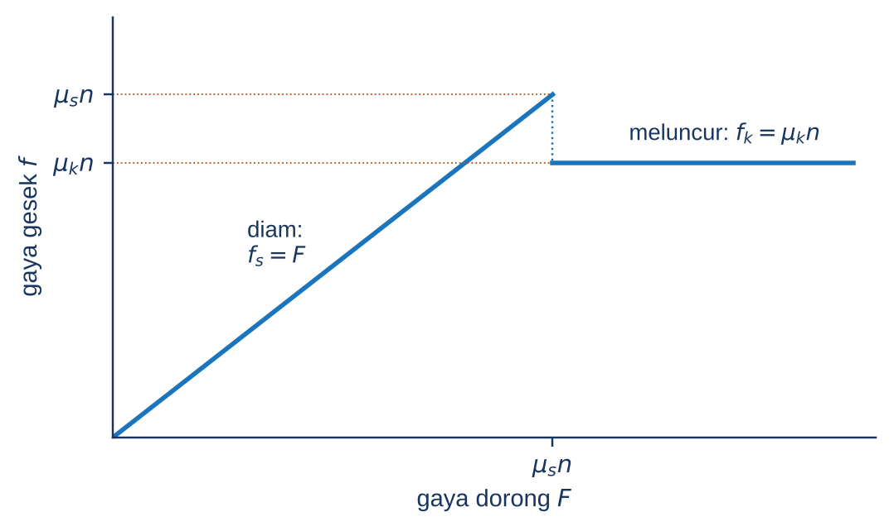
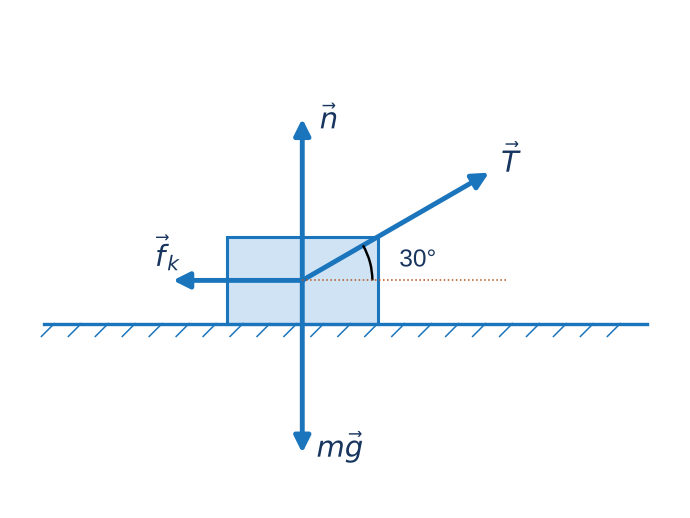
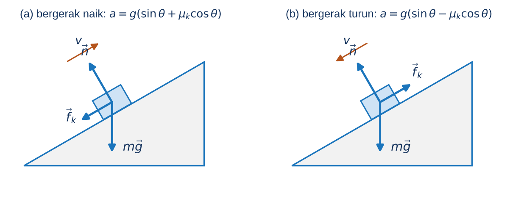
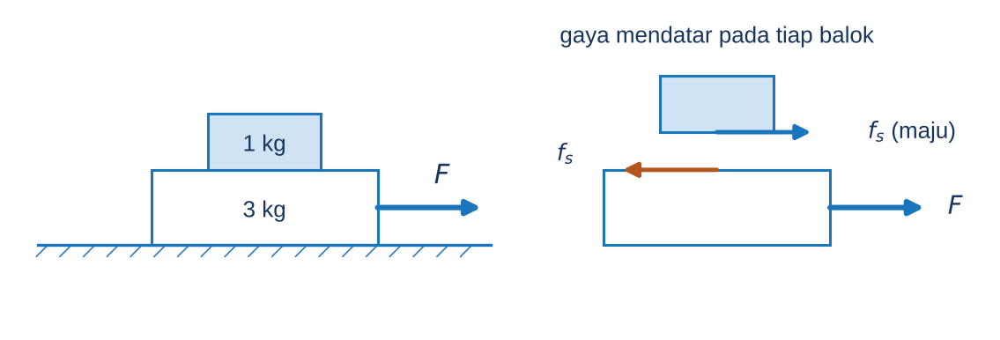
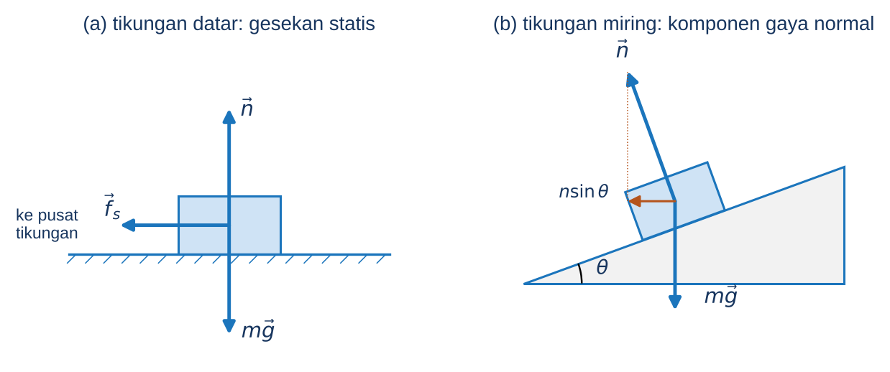
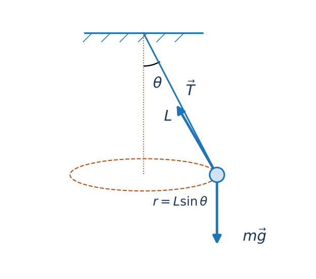
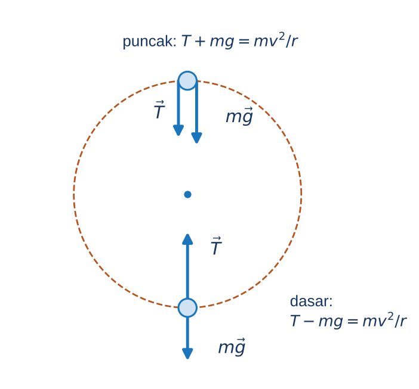
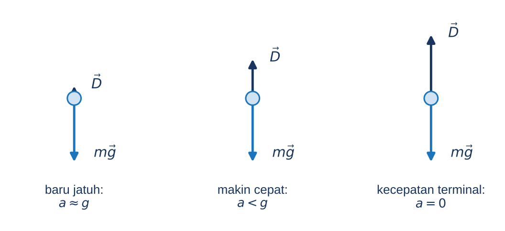
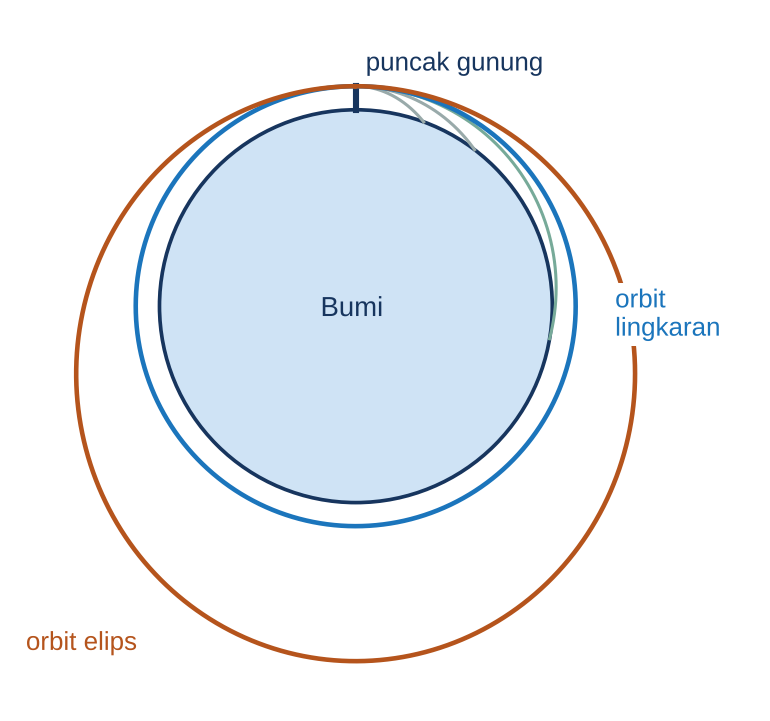

## 3.9 Gesekan

Di pasar malam ada pertunjukan yang membuat penonton menahan napas: **tong setan**. Seorang pengendara sepeda motor memacu kendaraannya di dalam sebuah tong kayu raksasa, makin lama makin cepat, sampai ia melaju mengitari **dinding tegak** tong itu, sejajar dengan tanah, beberapa meter di atas lantai. Tidak ada rel, tidak ada tali. Penonton yang berdiri di bibir tong melihatnya berputar tepat di bawah mereka.

Gravitasi jelas menariknya ke bawah. Dindingnya tegak, jadi tidak bisa menopangnya dari bawah. Lalu apa yang menahannya?

::: {.kuis}
**Pertanyaan pembuka subbab 3.9**

Gaya apa yang menahan pengendara tong setan agar tidak jatuh? Mengapa ia harus melaju cukup cepat, dan berapa kelajuan paling kecilnya? Jawabannya memerlukan dua gagasan bab ini sekaligus, gesekan dan gerak melingkar, dan ada di subbab 3.11.
:::

### Dua jenis gesekan

Dorong sebuah lemari berat dengan pelan. Lemari itu tidak bergerak. Dorong lebih kuat: masih diam. Menurut hukum pertama Newton, gaya total pada lemari yang diam adalah nol, jadi ada gaya lain yang persis mengimbangi doronganmu, sebesar apa pun dorongan itu. Gaya itu adalah **gesekan statis**, yang dikerjakan lantai pada lemari.

Dorong makin kuat. Pada suatu saat lemari itu tiba-tiba "lepas" dan mulai meluncur. Setelah meluncur, ternyata lebih mudah menjaganya tetap bergerak daripada memulainya tadi. Gaya dari lantai yang sekarang melawan gerak lemari adalah **gesekan kinetis**.

{width=66%}

Gambar 3.11 merangkum perilaku ini. Dari percobaan diperoleh model sederhana yang dipakai di seluruh buku:

::: {.inti}
**Gesekan statis** (benda tidak bergeser terhadap permukaan): $\quad f_s \le \mu_sn$

**Gesekan kinetis** (benda meluncur terhadap permukaan): $\quad f_k = \mu_kn$
:::

Di sini $n$ adalah besar gaya normal, $\mu_s$ adalah **koefisien gesek statis**, dan $\mu_k$ adalah **koefisien gesek kinetis**. Keduanya bilangan tak berdimensi yang bergantung pada pasangan permukaan, dan umumnya $\mu_k < \mu_s$.

Perhatikan tanda "$\le$" pada gesekan statis. Ini perbedaan paling penting antara keduanya:

| | Gesekan statis | Gesekan kinetis |
|---|---|---|
| Kapan | permukaan tidak saling bergeser | permukaan saling bergeser |
| Besar | **berapa saja** dari nol sampai $\mu_sn$, sebesar yang diperlukan untuk mencegah geseran | selalu $\mu_kn$ |
| Arah | melawan **kecenderungan** bergeser | melawan arah geseran |
| Cara menentukan | dari hukum Newton, seperti gaya normal dan tegangan | dari rumus |

::: {.awas}
**Awas · $f_s = \mu_sn$ hanya berlaku di ambang gerak**

Menulis $f_s = \mu_sn$ untuk setiap benda yang diam adalah kesalahan yang sangat umum. $\mu_sn$ adalah nilai **terbesar** yang sanggup diberikan gesekan statis. Sebuah buku yang diam di meja datar, tanpa didorong, mengalami gesekan statis **nol**. Seperti gaya normal, gesekan statis menyesuaikan diri.
:::

Sifat-sifat lain model ini, yang semuanya hanya pendekatan tetapi cukup baik:

- Gaya gesek sebanding dengan gaya normal, bukan dengan berat. (Keduanya sama hanya di permukaan datar tanpa gaya tegak lain.)
- Gaya gesek hampir tidak bergantung pada **luas** bidang sentuh. Bata yang diletakkan pada sisi lebar atau sisi sempitnya mengalami gesekan yang sama.
- Gesekan kinetis hampir tidak bergantung pada kelajuan geseran.

| Pasangan permukaan | $\mu_s$ | $\mu_k$ |
|---|---|---|
| Karet pada aspal kering | 1,0 | 0,8 |
| Karet pada aspal basah | 0,7 | 0,5 |
| Baja pada baja (kering) | 0,7 | 0,6 |
| Kayu pada kayu | 0,4 | 0,2 |
| Es pada es | 0,1 | 0,03 |
| Teflon pada teflon | 0,04 | 0,04 |
| Sendi manusia (berpelumas alami) | 0,01 | 0,003 |

Nilai-nilai ini adalah nilai khas. Koefisien gesek sangat peka terhadap kebersihan, kelembapan, dan kekasaran permukaan, sehingga nilai sebenarnya bisa berbeda cukup jauh.

### Dari mana gesekan berasal?

{width=62%}

Permukaan yang tampak halus sebenarnya bergunung-gunung pada skala mikroskopik (Gambar 3.12). Dua permukaan hanya benar-benar bersentuhan di puncak-puncak tonjolannya, sehingga luas sentuh yang sesungguhnya jauh lebih kecil daripada luas yang tampak. Di titik-titik sentuh itu atom-atom kedua permukaan berada sangat dekat dan saling berikatan lemah, seperti "las dingin" kecil. Menggeser permukaan berarti terus-menerus memutus dan membentuk ikatan-ikatan itu.

Gambaran ini menjelaskan sifat-sifat tadi. Jika gaya normal diperbesar, tonjolan-tonjolan lebih tertekan dan luas sentuh sesungguhnya bertambah, sehingga gesekan bertambah. Jika luas yang tampak diperbesar pada berat yang sama, tekanan pada tiap tonjolan berkurang, dan luas sentuh sesungguhnya kira-kira tetap. Gesekan pada dasarnya adalah gaya **listrik** antaratom, sama seperti ikatan kimia.

::: {.contoh}
**Contoh 3.14 · Bergerak atau tidak?**

Sebuah peti bermassa 40 kg terletak di lantai datar, dengan $\mu_s = 0{,}50$ dan $\mu_k = 0{,}40$. Tentukan gaya gesek dan percepatan peti jika didorong mendatar dengan (a) 150 N; (b) 250 N.

**Rencana.** Gaya normal $n = mg = 392$ N. Gesekan statis paling besar: $f_{s,\text{maks}} = \mu_sn = (0{,}50)(392) = 196$ N. Bandingkan dorongan dengan nilai ini.

**Penyelesaian.**

(a) $150\ \text{N} < 196\ \text{N}$: peti **tetap diam**. Gesekan statis mengimbangi dorongan: $f_s = 150$ N (bukan 196 N). Percepatan nol.

(b) $250\ \text{N} > 196\ \text{N}$: peti **meluncur**. Sekarang gesekannya kinetis: $f_k = \mu_kn = (0{,}40)(392) = 157$ N.

$$
a = \frac{F - f_k}{m} = \frac{250 - 157}{40} = 2{,}3\ \text{m/s}^2 .
$$

**Memahami hasil.** Begitu peti lepas, gesekan turun dari 196 N menjadi 157 N. Itulah sebabnya benda yang didorong sering "melompat" maju saat mulai bergerak. Untuk menjaga peti meluncur dengan kecepatan tetap, cukup dorongan 157 N.
:::

::: {.strategi}
**Strategi · Soal dengan gesekan**

1. Gambar diagram benda bebas. Tentukan **gaya normal** lebih dulu dari hukum Newton pada arah tegak lurus permukaan. Jangan menganggap $n = mg$.
2. **Benda sudah meluncur?** Gesekannya kinetis: $f_k = \mu_kn$, berlawanan dengan arah geseran.
3. **Benda diam, atau belum diketahui?** Anggap benda diam, hitung gaya gesek statis yang **diperlukan** agar tetap diam, lalu bandingkan dengan $\mu_sn$. Jika yang diperlukan lebih kecil atau sama, benda memang diam dan itulah gaya geseknya. Jika lebih besar, benda meluncur, dan hitung ulang dengan gesekan kinetis.
4. Arah gesekan statis: berlawanan dengan arah benda **akan** bergeser seandainya permukaan licin.
:::

::: {.kuis}
**Kuis cepat 3.7**

Sebuah kardus bermassa 10 kg diam di lantai mendatar ($\mu_s = 0{,}5$). Tidak ada yang mendorongnya. Gaya gesek statis pada kardus adalah: (a) 0 (b) 49 N (c) 98 N (d) antara 0 dan 49 N
:::

::: {.kuis}
**Kuis cepat 3.8**

Kamu menekan sebuah buku ke dinding tegak dengan gaya mendatar, dan buku itu tidak jatuh. Gaya gesek statis dari dinding pada buku: (a) sama dengan gaya tekanmu (b) sama dengan berat buku (c) sama dengan $\mu_s$ kali berat buku (d) nol
:::

## 3.10 Soal-soal dengan gesekan

### Tarikan bersudut

{width=52%}

::: {.contoh}
**Contoh 3.15 · Menarik koper**

Sebuah koper bermassa 20 kg ditarik di lantai mendatar dengan tali yang membentuk sudut 30° di atas arah mendatar. Tegangan tali 80 N dan $\mu_k = 0{,}25$. Berapa percepatan koper?

**Gambaran fisis.** Gaya pada koper: tegangan $T$, berat $mg$, gaya normal $n$, dan gesekan kinetis $f_k$ ke belakang (Gambar 3.13).

**Penyelesaian.**

Arah tegak (tidak ada percepatan): $n + T\sin 30^\circ - mg = 0$, sehingga

$$
n = mg - T\sin 30^\circ = 196 - 40 = 156\ \text{N}.
$$

Gesekan: $f_k = \mu_kn = (0{,}25)(156) = 39$ N.

Arah mendatar: $T\cos 30^\circ - f_k = ma$, sehingga $a = \dfrac{69{,}3 - 39}{20} = 1{,}5\ \text{m/s}^2$.

**Memahami hasil.** Gaya normal (156 N) lebih kecil daripada berat (196 N), karena tali ikut mengangkat koper. Seandainya kita memakai $n = mg$, gesekannya menjadi 49 N dan percepatannya $1{,}0\ \text{m/s}^2$, sepertiga terlalu kecil.

**Bagaimana jika…** koper itu **didorong** dengan gaya yang sama, miring 30° ke bawah? Maka $n = mg + T\sin 30^\circ = 236$ N, gesekannya 59 N, dan percepatannya hanya $0{,}5\ \text{m/s}^2$. Mendorong ke bawah menekan benda ke lantai dan memperbesar gesekan. Itulah sebabnya menarik gerobak lebih ringan daripada mendorongnya.
:::

### Bidang miring kasar

{width=90%}

Pada bidang miring bersudut $\theta$, gaya normalnya $n = mg\cos\theta$ (Contoh 3.10), dan komponen berat sepanjang bidang adalah $mg\sin\theta$ ke arah turun. Tiga pertanyaan muncul berulang kali.

**Apakah balok yang diam akan meluncur?** Gesekan statis yang diperlukan untuk menahannya adalah $mg\sin\theta$. Yang tersedia paling banyak $\mu_smg\cos\theta$. Balok tetap diam selama $mg\sin\theta \le \mu_smg\cos\theta$, yaitu

$$
\boxed{\tan\theta \le \mu_s}
$$

Sudut terbesar tempat balok masih diam, $\theta_\text{kritis} = \tan^{-1}\mu_s$, tidak bergantung pada massa balok. Ini cara termudah mengukur $\mu_s$.

**Berapa percepatan balok yang meluncur turun?** Gesekan kinetis ke atas lereng (Gambar 3.14b):

$$
a_\text{turun} = g(\sin\theta - \mu_k\cos\theta) \quad\text{(ke bawah lereng)}.
$$

**Berapa percepatan balok yang meluncur naik?** Sekarang gesekan dan komponen berat sama-sama ke bawah lereng (Gambar 3.14a):

$$
a_\text{naik} = g(\sin\theta + \mu_k\cos\theta) \quad\text{(ke bawah lereng, memperlambat)}.
$$

::: {.contoh}
**Contoh 3.16 · Sudut kritis**

Koefisien gesek antara sebuah balok dan papan adalah $\mu_s = 0{,}40$ dan $\mu_k = 0{,}30$. (a) Pada sudut berapa balok mulai meluncur ketika papan perlahan dimiringkan? (b) Berapa percepatan balok jika papan dimiringkan 30°?

**Penyelesaian.**

(a) $\theta_\text{kritis} = \tan^{-1}(0{,}40) = 22^\circ$.

(b) Karena $30^\circ > 22^\circ$, balok meluncur: $a = g(\sin 30^\circ - 0{,}30\cos 30^\circ) = 9{,}80(0{,}500 - 0{,}260) = 2{,}4\ \text{m/s}^2$.

**Memahami hasil.** Tanpa gesekan, percepatannya $g\sin 30^\circ = 4{,}9\ \text{m/s}^2$. Gesekan memotongnya menjadi kurang dari separuh.
:::

::: {.contoh}
**Contoh 3.17 · Naik, berhenti, lalu turun?**

Sebuah balok bermassa 2,0 kg disentil sehingga meluncur naik di bidang miring 30° dengan kelajuan awal 6,0 m/s. Koefisien geseknya $\mu_s = 0{,}40$ dan $\mu_k = 0{,}30$. (a) Seberapa jauh balok naik? (b) Apakah balok turun kembali, atau tetap diam di titik tertingginya? (c) Jika turun, berapa kelajuannya saat tiba kembali di titik awal?

**Memahami soal.** Soal ini punya tiga tahap, dan arah gesekan berubah di antaranya. Itulah yang membuatnya sering dikerjakan salah.

**Penyelesaian.**

(a) **Naik.** Perlambatan: $a_\text{naik} = g(\sin 30^\circ + 0{,}30\cos 30^\circ) = 9{,}80(0{,}760) = 7{,}45\ \text{m/s}^2$. Dari $v^2 = v_0^2 - 2a_\text{naik}d$ dengan $v = 0$:

$$
d = \frac{v_0^2}{2a_\text{naik}} = \frac{36}{2(7{,}45)} = 2{,}4\ \text{m}.
$$

(b) **Di titik tertinggi.** Balok diam sesaat. Apakah gesekan statis sanggup menahannya? Syaratnya $\tan\theta \le \mu_s$. Di sini $\tan 30^\circ = 0{,}58 > 0{,}40$. Tidak sanggup, jadi balok **turun kembali**.

(c) **Turun.** Percepatan: $a_\text{turun} = g(\sin 30^\circ - 0{,}30\cos 30^\circ) = 2{,}35\ \text{m/s}^2$. Dari diam, sejauh 2,42 m:

$$
v = \sqrt{2a_\text{turun}d} = \sqrt{2(2{,}35)(2{,}42)} = 3{,}4\ \text{m/s}.
$$

**Memahami hasil.** Balok kembali dengan kelajuan 3,4 m/s, jauh lebih kecil dari 6,0 m/s saat berangkat. Gesekan melawan gerak di kedua arah, sehingga "merugikan" dua kali. Perjalanan naik memakan waktu $6{,}0/7{,}45 = 0{,}81$ s, sedangkan perjalanan turun $\sqrt{2(2{,}42)/2{,}35} = 1{,}4$ s: naik lebih cepat daripada turun. Di Bab 4 soal yang sama akan diselesaikan ulang dengan energi, dan kehilangan kelajuan itu akan terlihat sebagai energi yang berubah menjadi panas.

**Bagaimana jika…** $\mu_s = 0{,}60$? Maka $\tan 30^\circ < \mu_s$, dan balok **tetap diam** di titik tertinggi. Gesekan statis di sana sebesar $mg\sin 30^\circ = 9{,}8$ N, bukan $\mu_sn = 10{,}2$ N.
:::

### Benda terhubung dan balok bertumpuk

::: {.contoh}
**Contoh 3.18 · Balok di meja kasar dan beban gantung**

Balok A bermassa 4,0 kg di atas meja mendatar dihubungkan lewat katrol ke beban B bermassa 2,0 kg yang menggantung. (a) Jika $\mu_k = 0{,}20$ dan sistem sedang bergerak, tentukan percepatan dan tegangan tali. (b) Jika sistem mula-mula diam dan $\mu_s = 0{,}60$, apakah sistem mulai bergerak?

**Penyelesaian.**

(a) Untuk A: $n = m_Ag = 39{,}2$ N, $f_k = (0{,}20)(39{,}2) = 7{,}84$ N, dan $T - f_k = m_Aa$. Untuk B: $m_Bg - T = m_Ba$. Jumlahkan:

$$
a = \frac{m_Bg - f_k}{m_A + m_B} = \frac{19{,}6 - 7{,}84}{6{,}0} = 1{,}96\ \text{m/s}^2, \qquad T = m_B(g - a) = 15{,}7\ \text{N}.
$$

(b) Jika sistem diam, tegangan tali sama dengan berat B: $T = 19{,}6$ N. Gesekan statis yang diperlukan pada A juga 19,6 N. Yang tersedia: $\mu_sn = (0{,}60)(39{,}2) = 23{,}5$ N. Karena $19{,}6 < 23{,}5$, sistem **tetap diam**, dengan $f_s = 19{,}6$ N.

**Memahami hasil.** Bandingkan dengan Contoh 3.12 (meja licin, beban 1,0 kg). Gesekan muncul sebagai pengurang gaya penggerak di pembilang. Sistem baru bergerak sendiri jika $m_B > \mu_sm_A$.
:::

{width=88%}

::: {.contoh}
**Contoh 3.19 · Balok bertumpuk**

Sebuah balok 1,0 kg diletakkan di atas balok 3,0 kg yang berada di lantai licin. Koefisien gesek statis antara kedua balok 0,40. Berapa gaya mendatar terbesar yang boleh dikerjakan pada balok **bawah** agar balok atas tidak tergelincir?

**Memahami soal.** Balok atas ikut dipercepat. Gaya apa yang mempercepatnya? Satu-satunya gaya mendatar padanya adalah **gesekan statis dari balok bawah, ke arah depan** (Gambar 3.15). Di sini gesekan adalah gaya penggerak, bukan penghambat.

**Penyelesaian.** Balok atas: $f_s = m_1a$. Gesekan statis paling besar $\mu_sm_1g$, sehingga percepatan terbesar tanpa tergelincir adalah

$$
a_\text{maks} = \mu_sg = (0{,}40)(9{,}80) = 3{,}92\ \text{m/s}^2 .
$$

Untuk sistem kedua balok: $F_\text{maks} = (m_1 + m_2)a_\text{maks} = (4{,}0)(3{,}92) = 16$ N.

**Memahami hasil.** $a_\text{maks} = \mu_sg$ tidak bergantung pada massa balok atas. Hasil yang sama berlaku untuk barang di bak truk: truk tidak boleh mempercepat atau mengerem lebih dari $\mu_sg$ jika muatannya tidak diikat.

**Bagaimana jika…** gaya dikerjakan pada balok **atas**? Sekarang gesekanlah yang harus mempercepat balok bawah: $f_s = m_2a$, dengan $f_s \le \mu_sm_1g$. Jadi $a_\text{maks} = \mu_sm_1g/m_2 = 1{,}31\ \text{m/s}^2$ dan $F_\text{maks} = (4{,}0)(1{,}31) = 5{,}2$ N, jauh lebih kecil.
:::

::: {.awas}
**Awas · Gesekan tidak selalu melawan gerak**

Gesekan melawan **geseran antara dua permukaan**, bukan melawan gerak benda. Pada Contoh 3.19, gesekan pada balok atas searah dengan geraknya. Ketika kamu berjalan, gesekan statis dari lantai pada telapak sepatumu mengarah ke **depan**: tanpa gesekan itu kakimu akan tergelincir ke belakang. Gesekanlah yang membuat kita bisa berjalan dan mobil bisa melaju.
:::

::: {.kuis}
**Kuis cepat 3.9**

Sebuah balok meluncur naik di bidang miring kasar, berhenti sesaat, lalu meluncur turun. Besar percepatannya saat naik dibandingkan saat turun: (a) lebih besar (b) sama (c) lebih kecil (d) bergantung pada massa
:::

## 3.11 Dinamika gerak melingkar

### Gaya sentripetal bukan gaya baru

Di Bab 2 kita menemukan bahwa benda yang bergerak melingkar dengan kelajuan $v$ pada jari-jari $r$ memiliki percepatan $v^2/r$ menuju pusat. Menurut hukum kedua Newton, percepatan itu harus dihasilkan oleh gaya total yang juga menuju pusat:

$$
\boxed{\sum F_\text{ke pusat} = \frac{mv^2}{r}}
$$

Gaya total yang menuju pusat ini sering disebut **gaya sentripetal**. Nama itu berbahaya, karena memberi kesan ada jenis gaya baru. Tidak ada.

::: {.inti}
**"Gaya sentripetal" adalah nama untuk *peran*, bukan nama jenis gaya.** Peran itu selalu dimainkan oleh gaya-gaya yang sudah kita kenal: tegangan, gesekan, gaya normal, gravitasi, atau gabungannya.
:::

| Gerak melingkar | Gaya yang berperan sebagai gaya sentripetal |
|---|---|
| Batu diputar dengan tali | tegangan tali |
| Mobil di tikungan datar | gesekan statis dari jalan |
| Mobil di tikungan miring | komponen mendatar gaya normal |
| Bulan mengelilingi Bumi | gravitasi |
| Pakaian di mesin pengering | gaya normal dari dinding tabung |
| Elektron dalam model atom Bohr | gaya listrik dari inti |

::: {.awas}
**Awas · Jangan menggambar "gaya sentripetal" di diagram benda bebas**

Diagram benda bebas hanya memuat gaya yang dikerjakan benda lain: berat, normal, tegangan, gesekan. $mv^2/r$ berada di ruas **kanan** hukum kedua, sebagai $ma$. Menggambarnya sebagai gaya tambahan berarti menghitungnya dua kali. Dan jika talinya putus, benda tidak "terlempar ke luar": ia bergerak lurus menyinggung lingkaran, sesuai hukum pertama.
:::

::: {.strategi}
**Strategi · Soal gerak melingkar**

1. Gambar benda pada **satu saat**, dilihat dari arah yang membuat lingkarannya tampak dari samping. Tandai pusat lingkaran.
2. Gambar diagram benda bebas dengan gaya-gaya nyata saja.
3. Pilih satu sumbu **menuju pusat**. Sumbu lain tegak lurus bidang lingkaran (biasanya tegak).
4. Arah ke pusat: $\sum F = mv^2/r$. Arah lain: $\sum F = 0$ (jika tidak ada percepatan ke arah itu).
5. Selesaikan dan periksa kasus ekstrem.
:::

{width=90%}

::: {.contoh}
**Contoh 3.20 · Kelajuan terbesar di tikungan datar**

Sebuah mobil melaju di tikungan datar berjari-jari 50 m. Koefisien gesek statis ban dengan aspal kering 0,80. (a) Berapa kelajuan terbesar agar mobil tidak tergelincir? (b) Berapa jika jalan basah, dengan $\mu_s = 0{,}40$?

**Gambaran fisis.** Gaya pada mobil (Gambar 3.16a): berat, gaya normal, dan gesekan statis **ke arah pusat tikungan**. Gesekannya statis, karena ban yang menggelinding tidak bergeser terhadap jalan.

**Penyelesaian.** Tegak: $n = mg$. Ke pusat: $f_s = \dfrac{mv^2}{r}$. Syarat tidak tergelincir $f_s \le \mu_sn$:

$$
\frac{mv^2}{r} \le \mu_smg \quad\Longrightarrow\quad v_\text{maks} = \sqrt{\mu_sgr} .
$$

(a) $v_\text{maks} = \sqrt{(0{,}80)(9{,}80)(50)} = 19{,}8$ m/s, sekitar 71 km/jam.

(b) $v_\text{maks} = \sqrt{(0{,}40)(9{,}80)(50)} = 14{,}0$ m/s, sekitar 50 km/jam.

**Memahami hasil.** Massa mobil tercoret: truk dan sedan punya batas kelajuan yang sama (selama tidak terguling). Kelajuan aman sebanding dengan $\sqrt{\mu_s}$, sehingga jalan basah memangkasnya sekitar 30%. Di jalan es ($\mu_s \approx 0{,}1$) batasnya tinggal 25 km/jam.
:::

::: {.contoh}
**Contoh 3.21 · Tikungan yang dimiringkan**

Sebuah tikungan jalan tol berjari-jari 200 m dirancang agar mobil yang melaju 25 m/s (90 km/jam) dapat melewatinya **tanpa mengandalkan gesekan sama sekali**. Berapa sudut kemiringan jalannya?

**Gambaran fisis.** Tanpa gesekan, gaya pada mobil hanya berat dan gaya normal (Gambar 3.16b). Gaya normal tegak lurus jalan, jadi condong ke arah pusat tikungan sebesar sudut $\theta$ dari arah tegak. Percepatannya **mendatar** (ke pusat lingkaran), jadi pakai sumbu mendatar dan tegak, bukan sumbu sejajar jalan.

**Penyelesaian.**

$$
\text{tegak:}\quad n\cos\theta = mg, \qquad \text{ke pusat:}\quad n\sin\theta = \frac{mv^2}{r} .
$$

Bagi persamaan kedua dengan yang pertama:

$$
\boxed{\tan\theta = \frac{v^2}{rg}} = \frac{25^2}{(200)(9{,}80)} = 0{,}319 \quad\Longrightarrow\quad \theta = 18^\circ .
$$

**Memahami hasil.** Pada kelajuan rancangan, mobil bisa melewati tikungan itu bahkan di atas es. Mobil yang lebih cepat cenderung bergeser ke luar, yang lebih lambat cenderung melorot ke dalam, dan pada kedua keadaan itu gesekan membantu. Perhatikan bahwa di sini $n = mg/\cos\theta$, **lebih besar** dari $mg$, berbeda dari balok di bidang miring ($n = mg\cos\theta$). Bedanya ada pada arah percepatan. Sekali lagi: gaya normal ditentukan oleh hukum Newton, bukan oleh rumus hafalan.
:::

{width=40%}

::: {.contoh}
**Contoh 3.22 · Bandul kerucut**

Sebuah beban di ujung tali sepanjang 1,0 m diputar sehingga bergerak pada lingkaran mendatar, dengan tali membentuk sudut tetap 30° terhadap arah tegak (Gambar 3.17). Tentukan kelajuan beban dan periode putarannya.

**Penyelesaian.** Jari-jari lingkaran $r = L\sin\theta = 0{,}50$ m.

$$
\text{tegak:}\quad T\cos\theta = mg, \qquad \text{ke pusat:}\quad T\sin\theta = \frac{mv^2}{r} .
$$

Bagi: $\tan\theta = \dfrac{v^2}{rg}$, sehingga $v = \sqrt{rg\tan\theta} = \sqrt{(0{,}50)(9{,}80)\tan 30^\circ} = 1{,}7$ m/s.

Periode: $T_\text{putar} = \dfrac{2\pi r}{v} = 2\pi\sqrt{\dfrac{L\cos\theta}{g}} = 1{,}9$ s.

**Memahami hasil.** Persamaannya **sama persis** dengan tikungan miring pada Contoh 3.21, dengan tegangan tali menggantikan gaya normal. Dua situasi yang tampak berbeda ternyata satu soal yang sama. Mengenali kesamaan seperti ini adalah keterampilan yang lebih berharga daripada menghafal rumus mana pun.
:::

::: {.contoh}
**Contoh 3.23 · Tong setan (jawaban pertanyaan pembuka)**

Seorang pengendara melaju mengitari dinding tegak tong setan berjari-jari 4,0 m. Koefisien gesek statis antara ban dan dinding kayu 0,60. Berapa kelajuan paling kecil agar ia tidak melorot?

**Gambaran fisis.** Tiga gaya bekerja pada pengendara dan motornya: berat $mg$ ke bawah, gaya normal $n$ dari dinding yang mengarah **mendatar ke pusat tong**, dan gesekan statis $f_s$ dari dinding yang mengarah **ke atas**.

**Penyelesaian.**

$$
\text{ke pusat:}\quad n = \frac{mv^2}{r}, \qquad \text{tegak:}\quad f_s = mg .
$$

Syarat $f_s \le \mu_sn$ memberi $mg \le \mu_s\dfrac{mv^2}{r}$, sehingga

$$
v_\text{min} = \sqrt{\frac{gr}{\mu_s}} = \sqrt{\frac{(9{,}80)(4{,}0)}{0{,}60}} = 8{,}1\ \text{m/s},
$$

sekitar 29 km/jam.

**Memahami hasil.** Jadi yang menahan pengendara adalah **gesekan statis**. Tetapi gesekan memerlukan gaya normal, dan gaya normal di sini muncul karena dinding harus terus membelokkan pengendara ke pusat. Makin cepat ia melaju, makin kuat dinding menekannya, makin besar gesekan yang tersedia. Jika ia melambat di bawah 29 km/jam, gaya normal mengecil, gesekan tidak lagi cukup, dan ia melorot. Karena itu pengendara selalu menambah kelajuan dulu di dasar tong sebelum naik ke dinding. Massa tercoret: penonton tidak perlu khawatir pengendara yang gemuk lebih mudah jatuh.
:::

::: {.kuis}
**Kuis cepat 3.10**

Sebuah mobil melewati tikungan datar dengan kelajuan tetap. Gaya total pada mobil: (a) nol, karena kelajuannya tetap (b) mengarah ke depan (c) mengarah ke pusat tikungan (d) mengarah ke luar tikungan
:::

## 3.12 Gerak melingkar tegak

Pada lingkaran tegak, berat benda kadang membantu menyediakan gaya ke pusat (di puncak) dan kadang melawannya (di dasar). Kelajuan biasanya tidak tetap, tetapi di titik puncak dan titik dasar semua gaya sejajar jari-jari, sehingga $\sum F_\text{ke pusat} = mv^2/r$ langsung bisa dipakai di kedua titik itu.

{width=48%}

Untuk benda di ujung tali (Gambar 3.18):

$$
\text{puncak:}\quad T + mg = \frac{mv^2}{r}, \qquad\qquad \text{dasar:}\quad T - mg = \frac{mv^2}{r} .
$$

Tali hanya bisa menarik, jadi $T$ tidak boleh negatif. Di puncak, itu berarti

$$
\boxed{v_\text{puncak} \ge \sqrt{gr}}
$$

Pada kelajuan tepat $\sqrt{gr}$ tegangan nol: berat saja sudah pas untuk membelokkan benda. Di bawah kelajuan itu, berat "terlalu besar" untuk lingkaran berjari-jari $r$, tali mengendur, dan benda jatuh meninggalkan lingkaran.

::: {.contoh}
**Contoh 3.24 · Ember berisi air**

Sebuah ember berisi air, bermassa total 2,0 kg, diputar pada lingkaran tegak berjari-jari 1,0 m. (a) Berapa kelajuan paling kecil di puncak agar air tidak tumpah? (b) Jika kelajuan di puncak 5,0 m/s, berapa tegangan tali di sana? (c) Berapa tegangan di dasar jika kelajuan di sana juga 5,0 m/s?

**Penyelesaian.**

(a) $v_\text{min} = \sqrt{gr} = \sqrt{(9{,}80)(1{,}0)} = 3{,}1$ m/s, kira-kira satu putaran tiap 2 s.

(b) $T = m\left(\dfrac{v^2}{r} - g\right) = 2{,}0(25 - 9{,}80) = 30$ N.

(c) $T = m\left(\dfrac{v^2}{r} + g\right) = 2{,}0(25 + 9{,}80) = 70$ N.

**Memahami hasil.** Mengapa air tidak tumpah di puncak, padahal ember terbalik? Air memang "jatuh": percepatannya ke bawah sebesar $v^2/r$, yang **lebih besar** dari $g$. Dasar ember harus mendorong air ke bawah agar air mengikuti lingkaran. Air tidak punya kesempatan mendahului ember. Tegangan di dasar lebih dari dua kali tegangan di puncak. Karena itu tali yang diputar tegak hampir selalu putus di dekat titik terendah.
:::

::: {.contoh}
**Contoh 3.25 · Mobil di puncak bukit dan di dasar lembah**

Sebuah mobil bermassa 1200 kg melaju 15 m/s melewati puncak bukit yang penampangnya berupa busur lingkaran berjari-jari 40 m. (a) Berapa gaya normal dari jalan? (b) Pada kelajuan berapa mobil mulai terangkat dari jalan? (c) Berapa gaya normal di dasar lembah dengan jari-jari dan kelajuan yang sama?

**Gambaran fisis.** Di puncak bukit, pusat lingkaran berada **di bawah** mobil. Di dasar lembah, pusatnya **di atas** mobil.

**Penyelesaian.**

(a) Ke pusat (ke bawah): $mg - n = \dfrac{mv^2}{r}$, sehingga $n = m\left(g - \dfrac{v^2}{r}\right) = 1200(9{,}80 - 5{,}63) = 5{,}0 \times 10^3$ N.

(b) Mobil terangkat saat $n = 0$: $v = \sqrt{gr} = \sqrt{(9{,}80)(40)} = 19{,}8$ m/s, sekitar 71 km/jam.

(c) Ke pusat (ke atas): $n - mg = \dfrac{mv^2}{r}$, sehingga $n = 1200(9{,}80 + 5{,}63) = 1{,}85 \times 10^4$ N.

**Memahami hasil.** Berat mobil 11 760 N. Di puncak bukit gaya normal turun menjadi kurang dari separuhnya, dan penumpang merasa ringan. Di dasar lembah gaya normal 1,6 kali berat, dan penumpang merasa tertekan ke kursi. Ini berat semu dari Contoh 3.7, dengan percepatan sentripetal menggantikan percepatan lift. Pada kelajuan di (b), penumpang sesaat tanpa bobot semu, dan ban kehilangan cengkeraman, sehingga mobil tidak bisa dikemudikan atau direm.
:::

::: {.kuis}
**Kuis cepat 3.11**

Seorang anak duduk di ayunan yang sedang berayun. Di titik terendah, tegangan tali ayunan dibandingkan dengan berat anak itu: (a) lebih kecil (b) sama (c) lebih besar (d) nol
:::

## 3.13 Gaya hambat dan kecepatan terminal

Benda yang bergerak melalui udara atau air mengalami **gaya hambat** dari fluida itu. Arahnya selalu berlawanan dengan arah gerak benda relatif terhadap fluida. Berbeda dari gesekan antarpermukaan padat, gaya hambat **bergantung pada kelajuan**. Ada dua model sederhana.

| | Hambatan sebanding $v$ | Hambatan sebanding $v^2$ |
|---|---|---|
| Rumus | $D = bv$ | $D = \tfrac12C\rho Av^2$ |
| Berlaku untuk | benda sangat kecil atau lambat dalam fluida kental: debu, tetes kabut, bakteri, kelereng dalam minyak | benda sehari-hari di udara: bola, mobil, penerjun payung |
| Asal fisisnya | fluida mengalir halus di sekitar benda | benda harus menyingkirkan fluida di depannya |

Pada model kedua, $\rho$ adalah massa jenis fluida, $A$ luas penampang benda yang menghadap arah gerak, dan $C$ **koefisien hambat**, bilangan tak berdimensi yang bergantung pada bentuk: sekitar 0,5 untuk bola, sekitar 0,3 untuk mobil yang ramping, dan sekitar 1 untuk penerjun dengan badan terbentang. (Soal 22 Bab 1 membuktikan bahwa $C$ memang tak berdimensi.)

{width=78%}

### Kecepatan terminal

Benda yang dijatuhkan dari diam mula-mula hanya dikenai berat, dan percepatannya $g$. Saat kelajuannya bertambah, gaya hambat tumbuh, sehingga gaya total dan percepatannya mengecil (Gambar 3.19). Hukum kedua, dengan arah ke bawah positif:

$$
mg - D = ma .
$$

Ketika $D$ menyamai $mg$, percepatan menjadi nol dan benda jatuh dengan kelajuan tetap, yaitu **kecepatan terminal**. Untuk hambatan sebanding $v^2$:

$$
mg = \tfrac12C\rho Av_T^2 \quad\Longrightarrow\quad \boxed{v_T = \sqrt{\frac{2mg}{C\rho A}}}
$$

Inilah asal tetapan $k$ pada subbab 2.9: membagi hukum kedua dengan $m$ memberi $a = g - kv^2$ dengan $k = C\rho A/(2m)$. Untuk hambatan sebanding $v$, hasilnya $v_T = mg/b$.

::: {.contoh}
**Contoh 3.26 · Penerjun payung dan tetes hujan**

Taksir kecepatan terminal (a) penerjun payung bermassa 80 kg yang jatuh dengan badan terbentang ($C = 1{,}0$; $A = 0{,}70\ \text{m}^2$); (b) tetes hujan berjari-jari 1,0 mm ($C = 0{,}5$). Massa jenis udara $1{,}2\ \text{kg/m}^3$.

**Penyelesaian.**

(a) $v_T = \sqrt{\dfrac{2(80)(9{,}80)}{(1{,}0)(1{,}2)(0{,}70)}} = 43$ m/s, sekitar 155 km/jam.

(b) Massa tetes: $m = \rho_\text{air}\cdot\tfrac43\pi r^3 = (1000)\tfrac43\pi(1{,}0 \times 10^{-3})^3 = 4{,}2 \times 10^{-6}$ kg. Luas penampang: $A = \pi r^2 = 3{,}1 \times 10^{-6}\ \text{m}^2$.

$$
v_T = \sqrt{\frac{2(4{,}2 \times 10^{-6})(9{,}80)}{(0{,}5)(1{,}2)(3{,}1 \times 10^{-6})}} = 6{,}6\ \text{m/s}.
$$

**Memahami hasil.** Kedua angka sesuai dengan pengamatan. Untuk benda yang bentuknya sama, $m \propto r^3$ dan $A \propto r^2$, sehingga $v_T \propto \sqrt{r}$: **benda yang lebih besar jatuh lebih cepat**. Tetes gerimis yang halus melayang turun pelan-pelan, hujan lebat menghantam keras, dan tetes kabut (jari-jari beberapa mikrometer) nyaris tidak jatuh. Jadi Aristoteles tidak sepenuhnya keliru: di dalam udara, benda berat memang jatuh lebih cepat. Yang ia lewatkan adalah bahwa penyebabnya udara, bukan sifat jatuh itu sendiri.

**Bagaimana jika…** penerjun membuka payungnya? Luas penampang membesar puluhan kali, dan $v_T \propto 1/\sqrt{A}$ turun menjadi sekitar 5 sampai 6 m/s (Soal 34), setara melompat dari ketinggian 1,5 m.
:::

::: {.terapan}
**Terapan · Mengendap dan memisah**

Di laboratorium kimia dan biologi, kecepatan terminal partikel kecil di dalam cairan dipakai untuk **memisahkan** campuran. Partikel yang lebih besar atau lebih rapat mengendap lebih cepat. Untuk partikel yang sangat kecil seperti protein atau virus, pengendapan oleh gravitasi terlalu lambat: bisa bertahun-tahun. Sentrifus mengganti $g$ dengan percepatan sentripetal yang ribuan sampai ratusan ribu kali lebih besar (Contoh 2.21), sehingga pemisahan selesai dalam hitungan menit atau jam. Hambatan sebanding $v$ yang sama juga menjadi dasar percobaan tetes minyak Millikan, yang pertama kali mengukur muatan elektron (Bab 12).
:::

::: {.kuis}
**Kuis cepat 3.12**

Dua bola berukuran sama dijatuhkan dari gedung tinggi: satu dari besi, satu dari gabus. Dengan memperhitungkan hambatan udara, yang benar adalah: (a) keduanya tiba bersamaan (b) bola besi tiba lebih dulu (c) bola gabus tiba lebih dulu (d) bergantung pada warnanya
:::

## 3.14 Kerangka yang dipercepat dan gaya fiktif

Penumpang mobil yang membelok ke kiri merasa "terlempar ke kanan". Penumpang bus yang mengerem merasa "terdorong ke depan". Tetapi tidak ada benda yang mengerjakan gaya-gaya itu. Apa yang terjadi?

Dilihat dari tanah (kerangka inersia), penjelasannya sederhana: tubuh penumpang cenderung terus bergerak lurus, sementara mobil membelok. Pintu mobil kemudian mendorong penumpang **ke kiri**, menuju pusat tikungan, agar ia ikut membelok.

Dilihat dari dalam mobil (kerangka yang dipercepat), penumpang tampak diam, padahal ada gaya dari pintu yang mendorongnya ke kiri. Agar hukum Newton tetap bisa dipakai di kerangka itu, pengamat di dalam mobil harus menambahkan sebuah gaya khayalan ke kanan yang mengimbangi dorongan pintu. Gaya khayalan seperti ini disebut **gaya fiktif** (atau gaya inersia). Di kerangka yang berputar, namanya **gaya sentrifugal**.

Gaya fiktif tidak dikerjakan oleh benda apa pun dan tidak punya pasangan aksi–reaksi. Ia muncul semata-mata karena pengamatnya sendiri dipercepat.

::: {.awas}
**Awas · Satu kerangka, satu cara**

Gaya sentrifugal hanya boleh dipakai jika kamu bekerja di kerangka yang berputar. Di kerangka inersia, gaya itu **tidak ada**. Mencampur keduanya, misalnya menggambar gaya sentripetal dan gaya sentrifugal sekaligus lalu menyimpulkan gaya totalnya nol, adalah kesalahan serius: benda yang gaya totalnya nol bergerak lurus, bukan melingkar. Buku ini selalu bekerja di kerangka inersia.
:::

Ada gaya fiktif kedua di kerangka berputar, yang hanya bekerja pada benda yang **bergerak** relatif terhadap kerangka itu: **gaya Coriolis**. Karena Bumi berputar, gaya inilah yang membelokkan angin dan arus laut, sehingga badai berputar berlawanan arah jarum jam di belahan Bumi utara dan searah jarum jam di belahan selatan. Pengaruhnya pada benda sehari-hari sangat kecil. Arah pusaran air di lubang wastafel ditentukan oleh bentuk wastafel dan sisa gerak air, bukan oleh putaran Bumi.

## 3.15 Gravitasi universal

Sejauh ini berat benda dianggap sudah diketahui: $w = mg$ dengan $g = 9{,}80\ \text{m/s}^2$. Tetapi mengapa benda jatuh? Mengapa Bulan tidak jatuh? Mengapa $g$ di Bulan hanya seperenam nilainya di Bumi? Jawaban Newton atas ketiga pertanyaan itu adalah satu hukum.

### Hukum gravitasi Newton

::: {.inti}
**Hukum gravitasi universal.** Setiap dua benda bermassa saling tarik dengan gaya yang sebanding dengan hasil kali massanya dan berbanding terbalik dengan kuadrat jaraknya:

$$
F = \frac{Gm_1m_2}{r^2}, \qquad G = 6{,}674 \times 10^{-11}\ \text{N·m}^2/\text{kg}^2 .
$$
:::

Gaya itu bekerja sepanjang garis hubung kedua benda, selalu tarik-menarik, dan merupakan pasangan aksi–reaksi: Bumi menarik apel sama kuat dengan apel menarik Bumi. Bedanya hanya pada akibatnya: massa Bumi $6 \times 10^{24}$ kali massa apel, sehingga percepatan Bumi tidak terukur.

Kata **universal** adalah inti gagasan Newton: gaya yang menjatuhkan apel adalah gaya yang sama yang menahan Bulan di orbitnya dan planet-planet di sekitar Matahari. Untuk benda berbentuk bola yang setangkup, jarak $r$ diukur dari pusat ke pusat; bola itu menarik benda di luarnya seolah-olah seluruh massanya terpusat di pusatnya. (Hasil yang sama untuk muatan listrik dibuktikan dengan hukum Gauss di subbab 12.5.)

Tetapan $G$ sangat kecil. Henry Cavendish pertama kali mengukurnya pada tahun 1798 dengan neraca puntir: dua bola timbal kecil digantung pada batang, dan gaya tarik yang sangat lemah dari dua bola timbal besar di dekatnya memuntir benang penggantungnya sedikit sekali.

### Dari mana nilai g berasal

Di permukaan Bumi yang bermassa $M_B$ dan berjari-jari $R_B$, berat benda adalah gaya gravitasi itu sendiri:

$$
mg = \frac{GM_Bm}{R_B^2} \quad\Longrightarrow\quad \boxed{g = \frac{GM_B}{R_B^2}} \qquad \text{(3.2)}
$$

Massa benda tercoret. Itulah sebabnya semua benda jatuh dengan percepatan yang sama (subbab 2.7): benda yang massanya dua kali ditarik dua kali lebih kuat, tetapi juga dua kali lebih lembam. Kesamaan massa "yang ditarik gravitasi" dan massa "yang melawan percepatan" ini telah diuji sampai ketelitian $10^{-15}$, dan menjadi titik tolak teori relativitas umum Einstein.

Pada ketinggian $h$ di atas permukaan, $g$ berkurang:

$$
g(h) = g_0\left(\frac{R_B}{R_B + h}\right)^2 . \qquad \text{(3.3)}
$$

| Tempat | $g$ (m/s²) |
|---|---|
| Permukaan Bumi (rata-rata) | 9,80 |
| Puncak Everest (8,8 km) | 9,77 |
| Stasiun Antariksa Internasional (400 km) | 8,69 |
| Orbit geostasioner (35 800 km) | 0,22 |
| Permukaan Bulan | 1,62 |
| Permukaan Mars | 3,71 |
| Permukaan Jupiter | 25,9 |

### Orbit

{width=50%}

Bayangkan meriam di puncak gunung yang sangat tinggi menembakkan peluru mendatar (Gambar 3.20). Makin cepat pelurunya, makin jauh ia mendarat. Pada kelajuan tertentu, permukaan Bumi melengkung menjauh tepat secepat peluru jatuh: peluru terus jatuh, tetapi tidak pernah mendarat. Itulah **orbit**.

Untuk orbit lingkaran berjari-jari $r$, gravitasi berperan sebagai gaya sentripetal (subbab 3.11):

$$
\frac{GMm}{r^2} = \frac{mv^2}{r} \quad\Longrightarrow\quad \boxed{v = \sqrt{\frac{GM}{r}}, \qquad T = 2\pi\sqrt{\frac{r^3}{GM}}} \qquad \text{(3.4)}
$$

Bentuk kedua adalah **hukum ketiga Kepler**: kuadrat periode orbit sebanding dengan pangkat tiga jari-jarinya. Kepler menemukannya pada tahun 1619 dari data posisi planet, tanpa tahu alasannya; Newton menurunkannya dari hukum gravitasi. Massa benda yang mengorbit tercoret, sehingga stasiun antariksa dan sebuah obeng yang lepas dari tangan astronaut mengorbit bersama.

**Tanpa bobot bukan berarti tanpa gravitasi.** Astronaut di stasiun antariksa merasakan gravitasi hampir 90% nilainya di permukaan Bumi. Mereka melayang karena mereka dan stasiunnya **jatuh bebas bersama-sama**, seperti penumpang lift yang kabelnya putus (subbab 3.8): lantai tidak perlu menahan mereka, sehingga gaya normal, yang kita rasakan sebagai "berat", nol.

::: {.contoh}
**Contoh 3.27 · Seberapa lemah gravitasi?**

Dua orang masing-masing bermassa 70 kg berdiri berjarak 1,0 m. Berapa gaya gravitasi di antara keduanya? Bandingkan dengan berat masing-masing.

**Penyelesaian.**

$$
F = \frac{(6{,}674 \times 10^{-11})(70)(70)}{(1{,}0)^2} = 3{,}3 \times 10^{-7}\ \text{N}.
$$

Berat tiap orang $(70)(9{,}80) = 686$ N, dua miliar kali lebih besar.

**Memahami hasil.** Gaya $3 \times 10^{-7}$ N setara berat sebutir debu. Gravitasi antara benda sehari-hari tidak terasa; ia baru menjadi penting jika salah satu benda bermassa sebesar planet. Di dalam atom dan molekul, gravitasi $10^{39}$ kali lebih lemah daripada gaya listrik (Contoh 12.5), sehingga tidak berperan sama sekali dalam kimia.
:::

::: {.contoh}
**Contoh 3.28 · Menimbang Bumi**

Dari $g = 9{,}80\ \text{m/s}^2$, jari-jari Bumi $6{,}371 \times 10^6$ m, dan $G$, tentukan massa Bumi dan massa jenis rata-ratanya.

**Penyelesaian.** Dari (3.2):

$$
M_B = \frac{gR_B^2}{G} = \frac{(9{,}80)(6{,}371 \times 10^6)^2}{6{,}674 \times 10^{-11}} = 5{,}96 \times 10^{24}\ \text{kg}.
$$

Volume Bumi: $\tfrac43\pi R_B^3 = 1{,}083 \times 10^{21}\ \text{m}^3$. Massa jenis rata-rata: $\dfrac{5{,}96 \times 10^{24}}{1{,}083 \times 10^{21}} = 5500\ \text{kg/m}^3$.

**Memahami hasil.** Batuan kerak Bumi bermassa jenis sekitar 2700 kg/m³, setengah rata-rata itu. Jadi bagian dalam Bumi harus jauh lebih rapat: itulah bukti pertama bahwa Bumi berinti besi. Karena itulah percobaan Cavendish dijuluki "menimbang Bumi": begitu $G$ diketahui, massa Bumi langsung dapat dihitung.
:::

::: {.contoh}
**Contoh 3.29 · Stasiun antariksa**

Stasiun Antariksa Internasional mengorbit pada ketinggian sekitar 410 km. Hitung (a) $g$ di sana; (b) kelajuan orbitnya; (c) periodenya. ($GM_B = 3{,}98 \times 10^{14}\ \text{m}^3/\text{s}^2$)

**Penyelesaian.** $r = 6{,}371 \times 10^6 + 4{,}1 \times 10^5 = 6{,}78 \times 10^6$ m.

(a) $g = \dfrac{GM_B}{r^2} = \dfrac{3{,}98 \times 10^{14}}{(6{,}78 \times 10^6)^2} = 8{,}66\ \text{m/s}^2$, yaitu 88% nilai di permukaan.

(b) $v = \sqrt{\dfrac{GM_B}{r}} = \sqrt{\dfrac{3{,}98 \times 10^{14}}{6{,}78 \times 10^6}} = 7{,}66 \times 10^3$ m/s.

(c) $T = \dfrac{2\pi r}{v} = 5{,}56 \times 10^3$ s $= 93$ menit.

**Memahami hasil.** Hampir 28 000 km/jam; stasiun mengelilingi Bumi sekitar enam belas kali sehari. Satelit di orbit rendah mana pun memerlukan kelajuan sekitar 7,9 km/s, kelajuan yang diperoleh dari $\sqrt{gR_B}$.
:::

::: {.contoh}
**Contoh 3.30 · Orbit geostasioner**

Satelit komunikasi ditempatkan pada orbit yang periodenya tepat satu hari sideris (86 164 s), sehingga tampak diam di atas satu titik di khatulistiwa. Berapa jari-jari dan ketinggian orbit itu?

**Penyelesaian.** Dari (3.4), $r^3 = \dfrac{GM_BT^2}{4\pi^2}$:

$$
r = \left[\frac{(3{,}98 \times 10^{14})(86\,164)^2}{4\pi^2}\right]^{1/3} = 4{,}22 \times 10^7\ \text{m}.
$$

Ketinggian: $4{,}22 \times 10^7 - 6{,}37 \times 10^6 = 3{,}58 \times 10^7$ m $\approx 35\,800$ km.

**Memahami hasil.** Antena parabola televisi satelit yang terpasang mati di atap rumah mengarah ke satelit-satelit pada orbit ini. Satelit GPS mengorbit lebih rendah (20 200 km) dengan periode setengah hari.
:::

::: {.contoh}
**Contoh 3.31 · Menimbang Matahari**

Bumi mengitari Matahari pada jarak $1{,}496 \times 10^{11}$ m dengan periode satu tahun ($3{,}156 \times 10^7$ s). Berapa massa Matahari?

**Penyelesaian.** Dari (3.4), $M = \dfrac{4\pi^2r^3}{GT^2}$:

$$
M_\odot = \frac{4\pi^2(1{,}496 \times 10^{11})^3}{(6{,}674 \times 10^{-11})(3{,}156 \times 10^7)^2} = 1{,}99 \times 10^{30}\ \text{kg}.
$$

**Memahami hasil.** Massa Bumi sendiri tidak diperlukan; ia tercoret. Dengan cara yang sama astronom menimbang planet dari orbit bulan-bulannya, bintang dari orbit planet-planetnya, dan bahkan menyimpulkan adanya lubang hitam di pusat galaksi kita dari orbit bintang-bintang di sekitarnya.
:::

::: {.contoh}
**Contoh 3.32 · Berat di dunia lain**

Seorang mahasiswa bermassa 60 kg. Berapa beratnya di Bulan ($M = 7{,}35 \times 10^{22}$ kg; $R = 1{,}737 \times 10^6$ m) dan di Mars ($g = 3{,}71\ \text{m/s}^2$)? Apakah massanya berubah?

**Penyelesaian.** $g_\text{Bulan} = \dfrac{(6{,}674 \times 10^{-11})(7{,}35 \times 10^{22})}{(1{,}737 \times 10^6)^2} = 1{,}63\ \text{m/s}^2$.

Berat di Bulan: $(60)(1{,}63) = 98$ N. Di Mars: $(60)(3{,}71) = 223$ N. Di Bumi: 588 N.

**Memahami hasil.** Massanya tetap 60 kg di mana pun; yang berubah hanya berat, yaitu gaya gravitasi padanya. Neraca dua lengan, yang membandingkan massa dengan massa, menunjukkan angka yang sama di Bumi dan di Bulan. Timbangan pegas, yang mengukur gaya, tidak.
:::

::: {.kuis}
**Kuis cepat 3.13**

Jika jarak Bumi–Bulan menjadi dua kali, gaya tarik di antara keduanya menjadi berapa kali semula? Bagaimana periode orbit Bulan berubah?
:::

## 3.16 Asal-usul gaya dan batas-batas mekanika Newton

### Empat gaya dasar

Bab ini memakai banyak nama gaya: berat, normal, tegangan, gesekan, hambat, pegas. Apakah alam memiliki begitu banyak jenis gaya? Tidak. Semua interaksi yang dikenal berasal dari **empat gaya dasar**.

| Gaya dasar | Bekerja pada | Kekuatan relatif | Jangkauan | Peran |
|---|---|---|---|---|
| Kuat | kuark (proton, neutron) | 1 | $10^{-15}$ m | mengikat inti atom |
| Elektromagnetik | muatan listrik | $10^{-2}$ | tak berhingga | atom, molekul, kimia, semua gaya sentuh |
| Lemah | semua partikel dasar | $10^{-6}$ | $10^{-18}$ m | peluruhan radioaktif beta |
| Gravitasi | massa | $10^{-38}$ | tak berhingga | planet, bintang, galaksi |

Gaya kuat dan lemah hanya bekerja di dalam inti atom. Dalam kehidupan sehari-hari, yang tersisa hanya dua: **gravitasi** dan **elektromagnetik**. Dan semua gaya **sentuh** yang kita pakai di bab ini adalah gaya elektromagnetik:

- **Gaya normal** adalah tolakan antara awan elektron atom-atom permukaan meja dan buku, yang menguat tajam ketika keduanya didesak berdekatan (kurva energi potensial, subbab 4.8).
- **Tegangan tali** adalah tarikan listrik antara molekul-molekul tali yang sedikit diregangkan.
- **Gesekan** berasal dari ikatan-ikatan sementara antaratom di titik-titik sentuh kedua permukaan.
- **Gaya pegas** adalah tarikan dan tolakan antaratom dalam logam pegas yang sedikit menjauh atau mendekat dari jarak setimbangnya.

Itu sebabnya fisika dan kimia bertemu di sini: gaya yang membuat meja kokoh dan gaya yang mengikat atom menjadi molekul adalah gaya yang sama, hanya dilihat pada skala berbeda.

### Gaya dan energi potensial

Di Bab 4 kita akan melihat cara kedua memerikan gaya: lewat **energi potensial**. Untuk gaya yang hanya bergantung pada letak, gaya sama dengan **minus kemiringan** grafik energi potensial terhadap letak, $F = -dU/dx$. Bola di lereng bergerak ke arah energi potensial yang lebih rendah. Atom-atom dalam molekul pun demikian: mereka didorong ke jarak tempat energi potensialnya paling rendah, yaitu panjang ikatan. Kimiawan jarang berbicara tentang gaya dan lebih sering tentang energi, tetapi keduanya adalah dua bahasa untuk hal yang sama.

### Batas berlaku hukum Newton

Hukum-hukum Newton luar biasa berhasil: dengan hukum-hukum itu, wahana antariksa dikirim ke planet lain dan mendarat dengan ketelitian beberapa kilometer. Tetapi mereka memiliki batas berlaku yang jelas.

| Keadaan | Yang terjadi | Teori yang berlaku |
|---|---|---|
| Kelajuan mendekati $c$ | waktu dan panjang bergantung pada pengamat; $F = ma$ gagal | relativitas khusus (Bab 15) |
| Gravitasi sangat kuat | ruang dan waktu melengkung | relativitas umum |
| Ukuran seperti atom | partikel berperilaku sebagai gelombang; lintasan tidak bermakna | mekanika kuantum (Bab 15) |
| Kerangka acuan dipercepat | hukum pertama tidak berlaku tanpa gaya fiktif | tambahkan gaya fiktif (subbab 3.14) |

Teori-teori yang lebih baru **tidak membuang** mekanika Newton; mereka mengandungnya sebagai batas. Untuk kelajuan jauh di bawah $c$ dan benda yang jauh lebih besar dari atom, ramalan relativitas dan mekanika kuantum menjadi sama dengan ramalan Newton. Inilah cara ilmu berkembang: setiap teori yang baik tetap benar di wilayah tempat ia sudah diuji.

::: {.contoh}
**Contoh 3.33 · Kapan Newton cukup?**

Hitung perbandingan $v/c$ untuk (a) pesawat jet 250 m/s; (b) Bumi mengitari Matahari, 30 km/s; (c) elektron berenergi kinetik 1,0 keV, dihitung secara klasik. Koreksi relativitas kira-kira sebesar $\tfrac12(v/c)^2$. Seberapa besar koreksi itu pada tiap keadaan?

**Penyelesaian.** $c = 3{,}00 \times 10^8$ m/s.

| | $v/c$ | $\tfrac12(v/c)^2$ |
|---|---|---|
| (a) jet | $8{,}3 \times 10^{-7}$ | $3 \times 10^{-13}$ |
| (b) Bumi | $1{,}0 \times 10^{-4}$ | $5 \times 10^{-9}$ |
| (c) elektron 1 keV | 0,063 | 0,002 |

Untuk (c): $v = \sqrt{2K/m} = \sqrt{\dfrac{2(1000)(1{,}602 \times 10^{-19})}{9{,}109 \times 10^{-31}}} = 1{,}9 \times 10^7$ m/s.

**Memahami hasil.** Untuk benda sehari-hari, bahkan untuk planet, koreksinya jauh di bawah ketelitian alat ukur mana pun. Untuk elektron yang dipercepat beberapa kilovolt, koreksinya sudah 0,2%; pada ratusan kilovolt (mikroskop elektron), relativitas wajib dipakai (Bab 15).
:::

::: {.contoh}
**Contoh 3.34 · Hukum ketiga untuk gravitasi**

Sebuah apel bermassa 0,10 kg jatuh dari pohon. (a) Berapa gaya yang dikerjakan apel pada Bumi? (b) Berapa percepatan Bumi karena gaya itu? ($M_B = 5{,}97 \times 10^{24}$ kg)

**Penyelesaian.**

(a) Menurut hukum ketiga, sama dengan berat apel: $(0{,}10)(9{,}80) = 0{,}98$ N, ke atas, menuju apel.

(b) $a = \dfrac{0{,}98}{5{,}97 \times 10^{24}} = 1{,}6 \times 10^{-25}\ \text{m/s}^2$.

**Memahami hasil.** Gaya sama besar, akibat sangat berbeda, karena massanya berbeda $10^{25}$ kali. Selama apel jatuh 1 m (0,45 s), Bumi bergerak naik $\tfrac12at^2 \approx 2 \times 10^{-26}$ m, sepersejuta miliar ukuran inti atom. Hukum ketiga tetap berlaku; kita hanya tidak dapat melihat akibatnya.
:::

::: {.kuis}
**Kuis cepat 3.14**

Ketika kamu menekan meja dengan telapak tangan, gaya dasar apa yang mencegah tanganmu menembus meja?
:::
