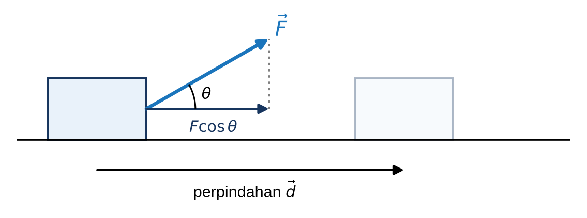
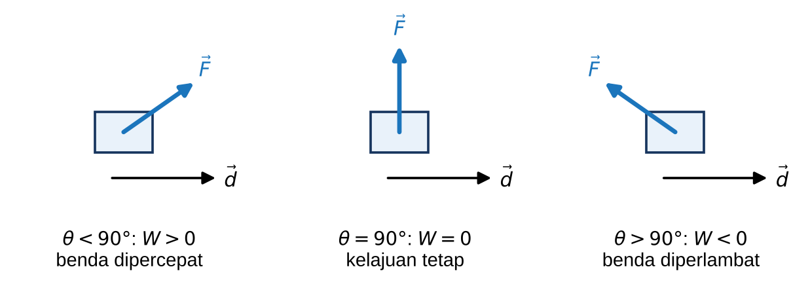
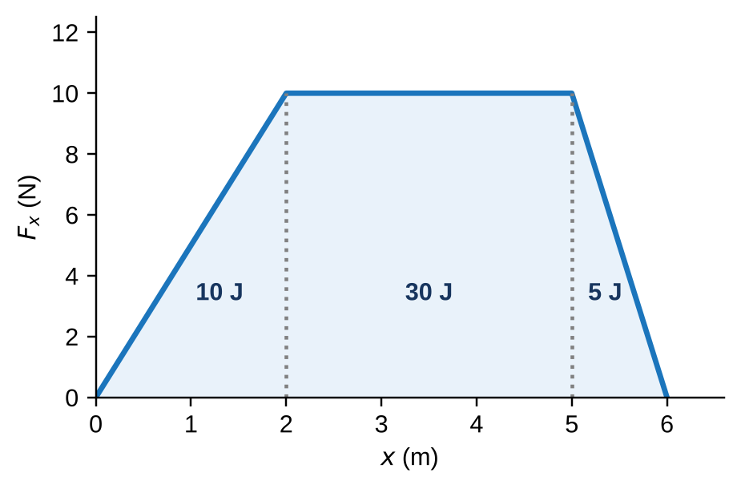
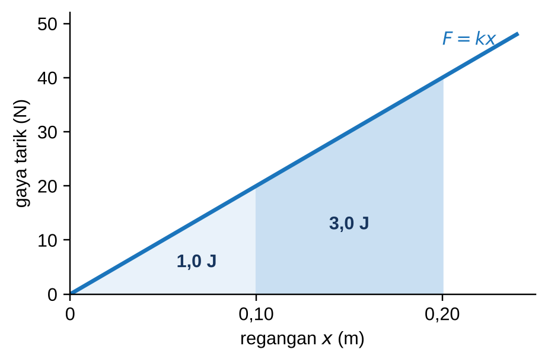

# Bab 4 Usaha dan Energi

Di wahana halilintar, kereta ditarik pelan-pelan ke puncak pertama, lalu dilepas. Setelah itu tidak ada mesin yang mendorongnya. Kereta menukik, menanjak, berputar terbalik di lingkaran tegak, dan penumpangnya tidak jatuh. Perancangnya harus menjawab satu pertanyaan sebelum wahana dibangun: **seberapa tinggi puncak pertama agar kereta selamat melewati lingkaran itu?**

Dengan hukum Newton saja, pertanyaan ini sangat sulit. Lintasannya melengkung, arah gaya normal berubah di setiap titik, dan percepatannya tidak pernah tetap. Dengan gagasan **energi**, jawabannya selesai dalam tiga baris (Contoh 4.34), dan bentuk lintasannya ternyata tidak penting sama sekali.

Itulah kekuatan energi: ia mengabaikan rincian perjalanan dan hanya membandingkan keadaan awal dengan keadaan akhir. Gagasan ini pula yang paling sering kamu pakai di kimia. Entalpi reaksi, energi ikatan, energi aktivasi, dan tingkat energi elektron semuanya berdiri di atas isi bab ini.

::: {.tujuan}
**Tujuan belajar**

Setelah mempelajari bab ini, kamu mampu:

1. Menghitung usaha oleh gaya konstan, termasuk tandanya, dengan rumus sudut maupun perkalian titik.
2. Menghitung usaha oleh gaya yang berubah dari luas di bawah grafik dan dari integral, termasuk usaha pada pegas.
3. Memakai teorema usaha–energi untuk menghubungkan usaha total dengan perubahan kelajuan.
4. Menghitung daya rata-rata dan daya sesaat, serta mengonversi kWh, joule, dan kalori.
5. Membedakan gaya konservatif dan takkonservatif, serta menghitung energi potensial gravitasi dan pegas.
6. Menerapkan kekekalan energi mekanik pada benda jatuh, bandul, lintasan melengkung, dan pegas.
7. Menyusun neraca energi ketika ada gesekan atau gaya luar.
8. Membaca diagram energi potensial: titik balik, kesetimbangan stabil dan takstabil, serta hubungan gaya dengan kemiringan kurva.
9. Mengaitkan semua itu dengan energi ikatan dan satuan energi yang dipakai di kimia.
:::

::: {.mat}
**Prasyarat**

Dari Bab 1: komponen vektor dan perkalian titik (subbab 1.15). Dari Bab 2: persamaan gerak dengan percepatan konstan dan makna luas di bawah grafik (subbab 2.5 dan 2.6). Dari Bab 3: diagram benda bebas, gaya normal, gesekan, dan gerak melingkar (subbab 3.7, 3.9, dan 3.12).
:::

## 4.1 Usaha oleh gaya konstan

Dalam bahasa sehari-hari, "usaha" berarti apa saja yang melelahkan. Dalam fisika artinya sempit dan tepat: usaha adalah **ukuran energi yang dipindahkan oleh sebuah gaya ketika titik tangkap gaya itu berpindah**.

{width=74%}

Perhatikan Gambar 4.1. Sebuah gaya konstan $\vec F$ bekerja pada benda yang berpindah lurus sejauh $\vec d$. Sudut antara gaya dan perpindahan adalah $\theta$. Usaha oleh gaya itu didefinisikan sebagai

$$
\boxed{W = Fd\cos\theta} \qquad \text{(4.1)}
$$

Ada dua cara membaca rumus ini, dan keduanya berguna:

- $W = (F\cos\theta)\,d$: komponen gaya **searah perpindahan**, dikalikan perpindahan.
- $W = F\,(d\cos\theta)$: gaya, dikalikan komponen perpindahan **searah gaya**.

Satuan usaha adalah newton meter, yang diberi nama **joule**: $1\ \text{J} = 1\ \text{N·m} = 1\ \text{kg·m}^2/\text{s}^2$. Satu joule kira-kira usaha untuk mengangkat sebuah apel kecil (100 g) setinggi satu meter. Usaha adalah **skalar**: ia memiliki tanda, tetapi tidak memiliki arah.

### Tanda usaha

{width=88%}

Tanda usaha membawa makna fisika (Gambar 4.2):

| Sudut | Usaha | Arti | Contoh |
|---|---|---|---|
| $0° \le \theta < 90°$ | positif | gaya **memberi** energi kepada benda | kamu mendorong troli |
| $\theta = 90°$ | nol | gaya tidak mengubah energi benda | gaya normal pada benda yang bergeser di lantai datar |
| $90° < \theta \le 180°$ | negatif | gaya **mengambil** energi dari benda | gesekan pada benda yang meluncur |

Tiga keadaan menghasilkan usaha nol, dan ketiganya sering menjebak:

1. **Tidak ada perpindahan.** Kamu mendorong tembok sekuat tenaga sampai berkeringat. Tembok tidak bergeser, jadi usahamu pada tembok nol. Kamu lelah karena otot terus memakai energi kimia untuk tetap tegang, tetapi tidak ada energi yang berpindah ke tembok.
2. **Gaya tegak lurus perpindahan.** Kamu berjalan mendatar sambil menjinjing ember. Gaya tanganmu ke atas, perpindahannya mendatar, jadi usahanya nol.
3. **Gaya ke pusat pada gerak melingkar.** Tegangan tali pada batu yang diputar selalu tegak lurus arah gerak. Usahanya nol, dan memang kelajuan batu tidak berubah.

### Usaha sebagai perkalian titik

Rumus (4.1) persis sama dengan definisi perkalian titik dari subbab 1.15:

$$
W = \vec F \cdot \vec d = F_xd_x + F_yd_y + F_zd_z \qquad \text{(4.2)}
$$

Bentuk komponen ini sangat praktis ketika gaya dan perpindahan diberikan dalam vektor satuan, karena sudutnya tidak perlu dicari.

### Usaha total

Jika beberapa gaya bekerja pada satu benda, masing-masing melakukan usahanya sendiri. **Usaha total** dapat dihitung dengan dua cara yang hasilnya sama:

$$
W_\text{total} = W_1 + W_2 + W_3 + \dots = \Big(\sum \vec F\Big)\cdot\vec d .
$$

Cara pertama (menjumlahkan usaha tiap gaya) biasanya lebih aman, karena kamu dipaksa memeriksa tiap gaya satu per satu.

::: {.strategi}
**Strategi · Menghitung usaha**

1. **Gambar diagram benda bebas.** Setiap gaya pada diagram berpotensi melakukan usaha.
2. **Gambar vektor perpindahan** di samping diagram itu.
3. Untuk tiap gaya, tentukan **sudutnya terhadap perpindahan** (bukan terhadap sumbu $x$, bukan terhadap bidang miring).
4. Hitung $W = Fd\cos\theta$ untuk tiap gaya, **lengkap dengan tandanya**.
5. Jumlahkan jika yang ditanya usaha total.
:::

::: {.contoh}
**Contoh 4.1 · Menarik koper di bandara**

Seorang penumpang menarik koper sejauh 20 m di lantai mendatar. Gaya tariknya 50 N dengan arah 30° di atas mendatar. Gaya gesek pada roda koper 30 N. Hitung usaha oleh (a) gaya tarik, (b) gaya gesek, (c) gaya normal dan berat, serta (d) usaha total.

**Memahami soal.** Empat gaya bekerja pada koper: tarikan, gesekan, gaya normal, dan berat. Perpindahannya mendatar.

**Penyelesaian.**

(a) $W_F = Fd\cos 30° = (50)(20)(0{,}866) = 866$ J.

(b) Gesekan berlawanan arah dengan perpindahan, $\theta = 180°$: $W_f = (30)(20)\cos 180° = -600$ J.

(c) Gaya normal dan berat tegak lurus perpindahan: $W_n = W_g = 0$.

(d) $W_\text{total} = 866 - 600 + 0 + 0 = 266$ J.

**Memahami hasil.** Komponen tegak gaya tarik ($50\sin 30° = 25$ N) tidak melakukan usaha. Komponen itu hanya mengurangi gaya normal. Usaha total positif, jadi koper bertambah cepat; subbab 4.3 akan menghitung seberapa cepat.
:::

::: {.contoh}
**Contoh 4.2 · Mengangkat, lalu membawa**

Seorang pekerja mengangkat peti 15 kg setinggi 1,2 m dengan kelajuan tetap, lalu membawanya berjalan mendatar sejauh 10 m, juga dengan kelajuan tetap. Hitung usaha pekerja dan usaha gravitasi pada tiap tahap.

**Penyelesaian.**

*Tahap mengangkat.* Kelajuan tetap berarti gaya pekerja sama besar dengan berat: $F = mg = (15)(9{,}80) = 147$ N, ke atas. Perpindahan juga ke atas.

$$
W_\text{pekerja} = (147)(1{,}2)\cos 0° = +176\ \text{J}, \qquad W_g = (147)(1{,}2)\cos 180° = -176\ \text{J}.
$$

*Tahap membawa.* Gaya pekerja tetap ke atas, tetapi perpindahannya mendatar: $W_\text{pekerja} = 0$ dan $W_g = 0$.

**Memahami hasil.** Pada tahap pertama usaha totalnya nol, sesuai dengan kelajuan yang tidak berubah. Lalu ke mana 176 J dari pekerja itu pergi? Energi itu tersimpan sebagai **energi potensial gravitasi** peti (subbab 4.5). Pada tahap kedua pekerja jelas merasa lelah, tetapi ia tidak memindahkan energi ke peti. Definisi usaha dalam fisika memang tidak mengukur kelelahan.
:::

::: {.contoh}
**Contoh 4.3 · Usaha dari komponen**

Gaya $\vec F = (6{,}0\,\hat\imath - 2{,}0\,\hat\jmath)$ N bekerja pada partikel yang berpindah $\vec d = (3{,}0\,\hat\imath + 1{,}0\,\hat\jmath)$ m. Hitung usaha gaya itu dan sudut antara gaya dan perpindahan.

**Penyelesaian.**

$$
W = F_xd_x + F_yd_y = (6{,}0)(3{,}0) + (-2{,}0)(1{,}0) = 16\ \text{J}.
$$

Besar gaya $F = \sqrt{36 + 4} = 6{,}32$ N dan besar perpindahan $d = \sqrt{9 + 1} = 3{,}16$ m. Maka

$$
\cos\theta = \frac{W}{Fd} = \frac{16}{(6{,}32)(3{,}16)} = 0{,}80, \qquad \theta = 37°.
$$

**Memahami hasil.** Komponen $y$ menyumbang usaha negatif karena gaya dan perpindahan pada arah itu berlawanan. Totalnya tetap positif.
:::

::: {.contoh}
**Contoh 4.4 · Peti didorong naik di bidang miring kasar**

Peti 20 kg didorong naik sejauh 5,0 m di bidang miring 30° oleh gaya 150 N yang sejajar bidang. Koefisien gesek kinetisnya 0,20. Hitung usaha tiap gaya dan usaha totalnya.

**Gambaran fisis.** Gaya pada peti: dorongan (sejajar bidang, ke atas), berat, gaya normal, dan gesekan kinetis (sejajar bidang, ke bawah). Perpindahan sejajar bidang, ke atas.

**Penyelesaian.**

*Dorongan:* $W_F = (150)(5{,}0) = +750$ J.

*Berat:* sudut antara berat (ke bawah) dan perpindahan (naik sepanjang bidang) adalah $90° + 30° = 120°$:

$$
W_g = mgd\cos 120° = (196)(5{,}0)(-0{,}50) = -490\ \text{J}.
$$

*Gaya normal:* tegak lurus perpindahan, $W_n = 0$.

*Gesekan:* $n = mg\cos 30° = 169{,}7$ N, sehingga $f_k = (0{,}20)(169{,}7) = 33{,}9$ N dan $W_f = -(33{,}9)(5{,}0) = -170$ J.

*Total:* $W_\text{total} = 750 - 490 - 170 = +90$ J.

**Memahami hasil.** Usaha gravitasi dapat dibaca dengan cara lain: peti naik setinggi $h = 5{,}0\sin 30° = 2{,}5$ m, dan $W_g = -mgh = -(196)(2{,}5) = -490$ J. Usaha gravitasi **hanya bergantung pada beda ketinggian**, bukan pada panjang bidang. Sifat ini akan menjadi sangat penting di subbab 4.5.
:::

::: {.awas}
**Awas · Sudut yang dipakai adalah sudut antara gaya dan perpindahan**

Kesalahan paling sering pada soal bidang miring adalah memakai sudut kemiringan bidang untuk semua gaya. Sudut dalam $W = Fd\cos\theta$ adalah sudut antara **vektor gaya** dan **vektor perpindahan**. Untuk berat pada benda yang naik di bidang miring bersudut $\alpha$, sudut itu $90° + \alpha$. Untuk benda yang turun, $90° - \alpha$. Cara yang lebih aman: usaha gravitasi selalu sama dengan $-mg\,\Delta y$, dengan $\Delta y$ perubahan ketinggian.
:::

::: {.kuis}
**Kuis cepat 4.1**

Sebuah satelit mengelilingi Bumi pada orbit lingkaran dengan kelajuan tetap. Berapa usaha gaya gravitasi Bumi pada satelit selama satu putaran: positif, negatif, atau nol?
:::

### Usaha gravitasi pada lintasan apa pun

Contoh 4.4 memberi petunjuk penting: usaha gravitasi pada peti hanya bergantung pada kenaikan ketinggiannya. Ini berlaku umum. Berat selalu berarah tegak ke bawah, jadi dalam bentuk komponen $\vec F_g = -mg\,\hat\jmath$. Untuk perpindahan apa pun $\vec d = \Delta x\,\hat\imath + \Delta y\,\hat\jmath$,

$$
W_g = \vec F_g\cdot\vec d = -mg\,\Delta y . \qquad \text{(4.3)}
$$

Komponen mendatar perpindahan tidak muncul sama sekali. Lintasan berkelok, bertangga, atau melingkar dapat dipecah menjadi banyak perpindahan kecil, dan untuk tiap potongan berlaku rumus yang sama. Jumlahnya tetap $-mg$ kali kenaikan ketinggian total.

::: {.contoh}
**Contoh 4.5 · Mendaki gunung**

Seorang pendaki 70 kg dengan ransel 15 kg mendaki dari pos awal ke puncak yang 1200 m lebih tinggi, melalui jalur berkelok sepanjang 9,0 km. (a) Berapa usaha gravitasi pada pendaki dan ranselnya? (b) Jika tubuh mengubah 25% energi makanan menjadi usaha mekanik, berapa energi makanan (dalam kkal) yang diperlukan hanya untuk melawan gravitasi?

**Penyelesaian.**

(a) $W_g = -mg\,\Delta y = -(85)(9{,}80)(1200) = -1{,}0 \times 10^6$ J. Panjang jalur 9,0 km tidak dipakai.

(b) Pendaki harus menyediakan usaha $+1{,}0 \times 10^6$ J, yaitu $10^6/4184 = 239$ kkal. Dengan efisiensi 25%, energi makanan yang diperlukan $239/0{,}25 = 960$ kkal.

**Memahami hasil.** Jalur berkelok tidak mengurangi usaha melawan gravitasi. Yang berkurang adalah **gaya** yang diperlukan pada tiap langkah, karena usaha yang sama disebar pada jarak yang lebih panjang. Itu juga alasan jalan pegunungan dibuat berkelok dan bidang miring dipakai untuk menaikkan barang ke truk.
:::

### Usaha oleh tegangan tali dan gaya penopang

Tegangan tali dapat melakukan usaha positif, negatif, atau nol, bergantung pada arah gerak benda.

::: {.contoh}
**Contoh 4.6 · Lift yang turun**

Kabin lift 900 kg turun sejauh 12 m. Hitung usaha kabel, usaha gravitasi, dan usaha total jika kabin (a) turun dengan kelajuan tetap; (b) turun dengan percepatan $1{,}5\ \text{m/s}^2$ ke bawah.

**Penyelesaian.** Perpindahan ke bawah, jadi gravitasi melakukan usaha positif dan kabel (yang menarik ke atas) melakukan usaha negatif.

(a) $T = mg = 8820$ N. $W_T = -(8820)(12) = -1{,}06 \times 10^5$ J dan $W_g = +1{,}06 \times 10^5$ J. Usaha total nol.

(b) Hukum kedua, dengan arah ke bawah positif: $mg - T = ma$, sehingga $T = m(g - a) = 900(8{,}30) = 7470$ N.

$W_T = -(7470)(12) = -8{,}96 \times 10^4$ J, $W_g = +1{,}06 \times 10^5$ J, dan $W_\text{total} = +1{,}62 \times 10^4$ J.

**Memahami hasil.** Pada (b), usaha total harus sama dengan $(ma)d = (900)(1{,}5)(12) = 1{,}62 \times 10^4$ J. Cocok. Pada kedua keadaan kabel **mengambil** energi dari kabin. Tanpa kabel, seluruh usaha gravitasi akan menjadi energi gerak.
:::

::: {.contoh}
**Contoh 4.7 · Dua tali penarik perahu**

Sebuah perahu ditarik menyusuri kanal oleh dua orang di kedua tepi. Masing-masing menarik dengan gaya 300 N, dan tiap tali membentuk sudut 25° terhadap arah kanal. Gaya hambat air 500 N. Hitung usaha tiap penarik, usaha hambatan air, dan usaha total ketika perahu maju 50 m.

**Penyelesaian.**

Tiap penarik: $W = (300)(50)\cos 25° = 1{,}36 \times 10^4$ J. Berdua: $2{,}72 \times 10^4$ J.

Hambatan air: $W = -(500)(50) = -2{,}50 \times 10^4$ J.

Total: $W_\text{total} = 2{,}72 \times 10^4 - 2{,}50 \times 10^4 = 2{,}2 \times 10^3$ J.

**Memahami hasil.** Komponen gaya tarik yang melintang kanal ($300\sin 25° = 127$ N dari tiap sisi) saling meniadakan dan tidak melakukan usaha, karena perahu tidak berpindah ke samping. Hampir 10% tarikan tiap orang "terbuang" menjadi gaya yang tidak memindahkan energi.
:::

### Usaha bergantung pada kerangka acuan

Perpindahan bergantung pada siapa yang mengukur, jadi usaha juga demikian. Seorang penumpang kereta mendorong kopernya 2 m ke depan di lorong gerbong. Menurut penumpang lain, perpindahan koper 2 m. Menurut orang di peron, koper berpindah jauh lebih besar karena kereta juga melaju. Kedua pengamat memperoleh usaha yang berbeda dan perubahan energi kinetik yang berbeda, tetapi **keduanya menemukan bahwa teorema usaha–energi berlaku** di kerangka masing-masing (subbab 4.3). Aturan praktisnya: pilih satu kerangka inersia, lalu ukur semua perpindahan dan kecepatan di kerangka itu.

## 4.2 Usaha oleh gaya yang berubah

Rumus $W = Fd\cos\theta$ hanya berlaku jika gayanya tetap. Kebanyakan gaya di alam tidak tetap: gaya pegas bertambah ketika pegas makin diregangkan, dan gaya antara dua atom berubah tajam terhadap jarak. Kita memerlukan cara yang lebih umum.

### Usaha sebagai luas

Gagasannya sama dengan gagasan di subbab 2.5 ketika mencari perpindahan dari grafik kecepatan. Bagi lintasan menjadi potongan-potongan kecil $\Delta x$. Pada tiap potongan gaya hampir tetap, jadi usahanya $F_x\,\Delta x$, yaitu luas persegi panjang tipis di bawah grafik $F_x$ terhadap $x$. Jumlah semua potongan adalah luas total:

$$
\boxed{W = \text{luas di bawah grafik } F_x \text{ terhadap } x} \qquad \text{(4.4)}
$$

Luas di bawah sumbu (gaya negatif) dihitung negatif.

{width=56%}

::: {.contoh}
**Contoh 4.8 · Usaha dari grafik**

Gaya searah sumbu $x$ pada sebuah balok berubah seperti Gambar 4.3: naik linear dari 0 sampai 10 N pada 2 m pertama, tetap 10 N sampai $x = 5$ m, lalu turun linear menjadi nol di $x = 6$ m. Berapa usaha gaya itu dari $x = 0$ sampai $x = 6$ m?

**Penyelesaian.** Bagi menjadi tiga bangun:

- segitiga pertama: $\tfrac12(2)(10) = 10$ J,
- persegi panjang: $(3)(10) = 30$ J,
- segitiga terakhir: $\tfrac12(1)(10) = 5$ J.

$W = 10 + 30 + 5 = 45$ J.

**Memahami hasil.** Jika gayanya 10 N di sepanjang 6 m, usahanya 60 J. Hasil kita lebih kecil dari itu, sesuai dengan grafik yang "terpotong" di kedua ujung.
:::

### Usaha sebagai integral

Jika potongan $\Delta x$ dibuat makin kecil tanpa batas, jumlah itu menjadi **integral**:

$$
\boxed{W = \int_{x_i}^{x_f} F_x\,dx} \qquad \text{(4.5)}
$$

::: {.mat}
**Matematika · Integral yang diperlukan di bab ini**

Integral adalah kebalikan dari turunan. Untuk pangkat, aturannya

$$
\int x^n\,dx = \frac{x^{n+1}}{n+1} \qquad (n \ne -1).
$$

Naikkan pangkatnya satu, lalu bagi dengan pangkat yang baru. Untuk integral berbatas, hitung hasilnya di batas atas lalu kurangi dengan hasilnya di batas bawah:

$$
\int_1^3 2x\,dx = \Big[x^2\Big]_1^3 = 9 - 1 = 8 .
$$

Tetapan dapat dikeluarkan dari integral, dan integral dari suatu jumlah sama dengan jumlah integralnya. Hanya itu yang diperlukan di bab ini.
:::

::: {.contoh}
**Contoh 4.9 · Usaha dengan integral**

Gaya pada sebuah partikel adalah $F_x = 12 - 3x^2$, dengan $F_x$ dalam newton dan $x$ dalam meter. Hitung usaha gaya itu ketika partikel berpindah dari $x = 0$ ke $x = 2{,}0$ m.

**Penyelesaian.**

$$
W = \int_0^{2} (12 - 3x^2)\,dx = \Big[12x - x^3\Big]_0^{2} = (24 - 8) - 0 = 16\ \text{J}.
$$

**Memahami hasil.** Gaya bernilai 12 N di $x = 0$ dan turun menjadi nol di $x = 2$ m. Usahanya harus di antara 0 dan $(12)(2) = 24$ J. Hasil 16 J masuk akal. Jika partikel terus bergerak melewati $x = 2$ m, gaya menjadi negatif dan mulai mengambil energi kembali.
:::

### Gaya pegas dan hukum Hooke

Pegas adalah contoh gaya berubah yang paling penting, karena banyak sekali sistem berperilaku seperti pegas: tali busur, tulang, jembatan, dan **ikatan kimia** antara dua atom.

Selama pegas tidak diregangkan terlalu jauh, gaya yang dikerjakan pegas sebanding dengan perubahan panjangnya:

$$
\boxed{F_\text{pegas} = -kx} \qquad \text{(4.6)}
$$

Ini **hukum Hooke**. Di sini $x$ adalah simpangan ujung pegas dari posisi alaminya (positif jika diregangkan, negatif jika ditekan), dan $k$ adalah **konstanta pegas** dengan satuan N/m. Pegas yang kaku memiliki $k$ besar. Tanda minus menyatakan bahwa gaya pegas selalu berusaha **mengembalikan** pegas ke panjang alaminya: pegas yang diregangkan menarik, pegas yang ditekan mendorong.

{width=56%}

Untuk meregangkan pegas secara perlahan, tanganmu harus mengerjakan gaya $F = +kx$, yang melawan gaya pegas. Usaha tanganmu untuk meregangkan pegas dari posisi alami sampai simpangan $x$ adalah luas segitiga di Gambar 4.4:

$$
W_\text{tangan} = \int_0^x kx'\,dx' = \tfrac12kx^2 .
$$

Dari simpangan $x_i$ ke $x_f$:

$$
\boxed{W_\text{tangan} = \tfrac12kx_f^2 - \tfrac12kx_i^2} \qquad\qquad W_\text{pegas} = -\big(\tfrac12kx_f^2 - \tfrac12kx_i^2\big) \qquad \text{(4.7)}
$$

Usaha oleh pegas adalah negatif dari usaha tangan, karena gayanya berlawanan.

::: {.contoh}
**Contoh 4.10 · Sepuluh sentimeter pertama dan kedua**

Sebuah pegas memiliki $k = 200$ N/m. Berapa usaha yang diperlukan untuk meregangkannya (a) dari panjang alami sampai 0,10 m; (b) dari 0,10 m sampai 0,20 m?

**Penyelesaian.**

(a) $W = \tfrac12(200)(0{,}10)^2 = 1{,}0$ J.

(b) $W = \tfrac12(200)(0{,}20)^2 - \tfrac12(200)(0{,}10)^2 = 4{,}0 - 1{,}0 = 3{,}0$ J.

**Memahami hasil.** Jarak regangannya sama, tetapi usahanya tiga kali lipat, karena pada tahap kedua gaya yang harus dilawan lebih besar. Kesalahan umum pada (b) adalah menghitung $\tfrac12k(0{,}10)^2$ lagi. Usaha pegas bergantung pada $x^2$, jadi **selisih kuadrat** tidak sama dengan **kuadrat selisih**.
:::

::: {.contoh}
**Contoh 4.11 · Menentukan konstanta pegas**

Sebuah beban 2,0 kg digantungkan pada pegas tegak, dan pegas bertambah panjang 4,9 cm. (a) Berapa konstanta pegasnya? (b) Berapa usaha untuk menarik beban itu turun 3,0 cm lagi dari posisi setimbang?

**Penyelesaian.**

(a) Dalam keadaan setimbang, gaya pegas mengimbangi berat: $kx_0 = mg$, sehingga

$$
k = \frac{mg}{x_0} = \frac{(2{,}0)(9{,}80)}{0{,}049} = 400\ \text{N/m}.
$$

(b) Regangan pegas berubah dari 0,049 m menjadi 0,079 m. Usaha untuk meregangkan pegas:

$$
\tfrac12(400)(0{,}079^2 - 0{,}049^2) = 200(0{,}00624 - 0{,}00240) = 0{,}768\ \text{J}.
$$

Selama itu gravitasi juga melakukan usaha pada beban: $mg(0{,}030) = 0{,}588$ J. Jadi usaha tangan saja adalah $0{,}768 - 0{,}588 = 0{,}18$ J.

**Memahami hasil.** Ada cara pintas yang bagus: untuk beban yang tergantung, simpangan dari **posisi setimbang** berperilaku seperti pegas tanpa gravitasi. Usaha tangan $= \tfrac12k(0{,}030)^2 = 0{,}18$ J. Hasilnya sama. Fakta ini akan dipakai lagi di Bab 8.
:::

::: {.kuis}
**Kuis cepat 4.2**

Pegas A dan B diregangkan dengan gaya yang sama besar. Pegas A dua kali lebih kaku daripada B. Pegas mana yang menerima usaha lebih besar?
:::

### Usaha pada lintasan melengkung

Jika lintasannya melengkung, arah perpindahan berubah terus. Pecah lintasan menjadi potongan sangat pendek $d\vec s$. Pada tiap potongan, hanya komponen gaya yang **menyinggung lintasan**, $F_\parallel$, yang melakukan usaha:

$$
W = \int \vec F\cdot d\vec s = \int F_\parallel\,ds . \qquad \text{(4.8)}
$$

Komponen gaya yang tegak lurus lintasan hanya membelokkan benda dan tidak memindahkan energi. Inilah alasan umum mengapa gaya ke pusat pada gerak melingkar tidak melakukan usaha.

::: {.contoh}
**Contoh 4.12 · Menarik bandul perlahan-lahan**

Beban bandul 2,0 kg tergantung pada tali 1,5 m. Beban ditarik sangat perlahan dengan gaya **mendatar** sampai tali membentuk sudut 35° terhadap garis tegak. (a) Berapa gaya mendatar yang diperlukan di posisi akhir? (b) Berapa usaha gaya itu selama proses?

**Gambaran fisis.** "Sangat perlahan" berarti beban selalu hampir setimbang. Gaya mendatar yang diperlukan berubah terhadap sudut, jadi $W = Fd$ tidak dapat dipakai langsung.

**Penyelesaian.**

(a) Setimbang di sudut $\theta$: $T\cos\theta = mg$ dan $T\sin\theta = F$, sehingga $F = mg\tan\theta$. Di 35°: $F = (19{,}6)(0{,}700) = 13{,}7$ N. Di awal ($\theta = 0$) gaya itu nol.

(b) Cara panjang: potongan lintasan $ds = L\,d\theta$, dan komponen $F$ yang menyinggung lintasan adalah $F\cos\theta$:

$$
W = \int_0^{\theta} (mg\tan\theta')\cos\theta'\,L\,d\theta' = mgL\int_0^{\theta}\sin\theta'\,d\theta' = mgL(1 - \cos\theta).
$$

$W = (2{,}0)(9{,}80)(1{,}5)(1 - 0{,}819) = 5{,}3$ J.

Cara pendek: energi kinetik tidak berubah dan tegangan tali tidak melakukan usaha, jadi usaha tangan sama dengan negatif usaha gravitasi: $W = mg\,\Delta y = mgL(1 - \cos\theta)$. Hasilnya sama.

**Memahami hasil.** Jika kita keliru memakai "gaya akhir kali jarak mendatar", hasilnya $(13{,}7)(1{,}5\sin 35°) = 11{,}8$ J, lebih dari dua kali jawaban yang benar. Gaya itu tidak sebesar 13,7 N di sepanjang jalan.
:::

### Pegas gabungan

Dua pegas dapat digabung dengan dua cara, dan gabungannya berperilaku seperti satu pegas dengan konstanta efektif.

**Paralel** (berdampingan, simpangannya sama). Gaya totalnya $F = k_1x + k_2x$, sehingga

$$
k_\text{paralel} = k_1 + k_2 .
$$

**Seri** (bersambung ujung ke ujung, gayanya sama). Simpangan total $x = F/k_1 + F/k_2$, sehingga

$$
\frac{1}{k_\text{seri}} = \frac{1}{k_1} + \frac{1}{k_2} \qquad\text{atau}\qquad k_\text{seri} = \frac{k_1k_2}{k_1 + k_2}.
$$

Pegas paralel lebih kaku daripada masing-masing pegas. Pegas seri lebih lunak daripada pegas yang paling lunak. Aturan ini kebalikan dari aturan hambatan listrik (Bab 13) dan sama dengan aturan kapasitor (Bab 12).

::: {.contoh}
**Contoh 4.13 · Energi pada pegas gabungan**

Dua pegas, $k_1 = 300$ N/m dan $k_2 = 600$ N/m, ditarik dengan gaya 30 N. Hitung konstanta efektif dan energi yang tersimpan jika keduanya dipasang (a) paralel, (b) seri.

**Penyelesaian.** Dengan gaya yang diketahui, $x = F/k$ dan energi $\tfrac12kx^2 = F^2/(2k)$.

(a) $k = 900$ N/m. Energi $= \dfrac{30^2}{2(900)} = 0{,}50$ J.

(b) $k = \dfrac{(300)(600)}{900} = 200$ N/m. Energi $= \dfrac{30^2}{2(200)} = 2{,}25$ J.

**Memahami hasil.** Dengan **gaya yang sama**, susunan yang lebih lunak menyimpan energi lebih banyak, karena meregang lebih jauh. Dengan **regangan yang sama**, kesimpulannya terbalik: susunan yang lebih kaku menyimpan lebih banyak. Selalu periksa besaran mana yang dijaga tetap.
:::

### Di luar hukum Hooke

Hukum Hooke adalah pendekatan untuk simpangan kecil. Karet gelang, tali bungee, dan ikatan kimia yang diregangkan jauh tidak lagi mengikuti $F = kx$. Rumus $\tfrac12kx^2$ tidak berlaku lagi, tetapi rumus umum (4.5) tetap berlaku.

::: {.contoh}
**Contoh 4.14 · Tali karet yang tidak linear**

Gaya untuk meregangkan sebuah tali karet sejauh $x$ adalah $F = 50x + 200x^3$ (N, dengan $x$ dalam meter). Berapa usaha untuk meregangkannya dari 0 sampai 0,20 m? Bandingkan dengan pegas Hooke berkonstanta 50 N/m.

**Penyelesaian.**

$$
W = \int_0^{0{,}20}(50x + 200x^3)\,dx = \Big[25x^2 + 50x^4\Big]_0^{0{,}20} = 25(0{,}040) + 50(0{,}0016) = 1{,}0 + 0{,}08 = 1{,}08\ \text{J}.
$$

Pegas Hooke saja: 1,0 J.

**Memahami hasil.** Suku pangkat tiga hanya menambah 8% pada regangan 20 cm. Pada regangan 5 cm, tambahannya hanya 0,5%. Itulah arti "hukum Hooke berlaku untuk simpangan kecil": suku-suku pangkat tinggi baru terasa ketika simpangannya besar. Gagasan yang sama muncul lagi untuk ikatan kimia di subbab 4.8.
:::

## 4.3 Energi kinetik dan teorema usaha–energi

Usaha total positif mempercepat benda, dan usaha total negatif memperlambatnya. Sekarang kita buat hubungan itu menjadi tepat.

Ambil benda bermassa $m$ yang dikenai gaya total konstan $F$ searah geraknya. Percepatannya $a = F/m$. Dari persamaan gerak di subbab 2.6, $v_f^2 = v_i^2 + 2ad$, sehingga $ad = \tfrac12(v_f^2 - v_i^2)$. Maka

$$
W_\text{total} = Fd = mad = \tfrac12mv_f^2 - \tfrac12mv_i^2 .
$$

Besaran $\tfrac12mv^2$ muncul dengan sendirinya. Kita beri nama **energi kinetik**:

$$
\boxed{K = \tfrac12mv^2} \qquad \text{(4.9)}
$$

dan hasil di atas menjadi **teorema usaha–energi**:

$$
\boxed{W_\text{total} = \Delta K = K_f - K_i} \qquad \text{(4.10)}
$$

Penurunan di atas memakai gaya konstan, tetapi hasilnya berlaku umum, juga untuk gaya yang berubah dan lintasan yang melengkung.

::: {.mat}
**Matematika · Bukti untuk gaya yang berubah**

Dengan hukum kedua Newton, $F_x = m\,\dfrac{dv}{dt}$. Tulis $\dfrac{dv}{dt} = \dfrac{dv}{dx}\dfrac{dx}{dt} = v\dfrac{dv}{dx}$. Maka

$$
W_\text{total} = \int F_x\,dx = \int m v\frac{dv}{dx}\,dx = \int_{v_i}^{v_f} mv\,dv = \tfrac12mv_f^2 - \tfrac12mv_i^2 .
$$

Tidak ada anggapan tentang bentuk $F_x$. Teorema ini adalah hukum kedua Newton yang sudah diintegralkan terhadap posisi.
:::

Beberapa hal tentang energi kinetik:

- **Selalu positif atau nol**, karena memuat $v^2$. Arah gerak tidak berpengaruh.
- **Bergantung pada kuadrat kelajuan.** Kelajuan dua kali berarti energi kinetik empat kali. Inilah sebabnya jarak pengereman membengkak pada kelajuan tinggi (Contoh 4.15).
- **Bergantung pada kerangka acuan.** Penumpang kereta memiliki energi kinetik nol menurut penumpang lain dan besar menurut orang di peron. Yang penting dalam setiap perhitungan adalah konsisten memakai satu kerangka.

| Benda | Energi kinetik (kira-kira) |
|---|---|
| Molekul N₂ di udara pada suhu kamar | $6 \times 10^{-21}$ J |
| Nyamuk terbang | $10^{-7}$ J |
| Bola sepak ditendang keras | 100 J |
| Orang berlari | 2000 J |
| Mobil di jalan tol | $5 \times 10^5$ J |
| Pesawat penumpang saat jelajah | $10^{10}$ J |

::: {.strategi}
**Strategi · Kapan memakai teorema usaha–energi**

Pakai teorema ini jika soal menghubungkan **gaya, jarak, dan kelajuan**, dan **tidak menanyakan waktu**. Langkahnya:

1. Pilih bendanya, tentukan keadaan awal dan keadaan akhir.
2. Daftar semua gaya, hitung usaha masing-masing di antara dua keadaan itu.
3. Tulis $W_\text{total} = \tfrac12mv_f^2 - \tfrac12mv_i^2$, lalu selesaikan.

Jika soal menanyakan **waktu** atau **percepatan**, kembalilah ke hukum Newton dan kinematika.
:::

::: {.contoh}
**Contoh 4.15 · Jarak pengereman**

Mobil 1200 kg melaju 25 m/s (90 km/jam). Pengemudi mengerem sampai roda terkunci, dan gaya gesek jalan pada mobil 7500 N. (a) Berapa jarak sampai mobil berhenti? (b) Bagaimana jika kelajuan awalnya dua kali lipat?

**Penyelesaian.**

(a) Hanya gesekan yang melakukan usaha: $W_\text{total} = -fd$. Teorema usaha–energi:

$$
-fd = 0 - \tfrac12mv_i^2 \quad\Longrightarrow\quad d = \frac{mv_i^2}{2f} = \frac{(1200)(25)^2}{2(7500)} = 50\ \text{m}.
$$

(b) Jarak sebanding dengan $v_i^2$. Kelajuan dua kali berarti jarak empat kali: 200 m.

**Memahami hasil.** Hasil ini sama dengan $d = v^2/(2a)$ dari kinematika, dengan $a = f/m = 6{,}25\ \text{m/s}^2$. Pelajaran pentingnya: menambah kelajuan 40% saja (dari 25 menjadi 35 m/s) hampir menggandakan jarak pengereman, karena $1{,}4^2 = 1{,}96$.
:::

::: {.contoh}
**Contoh 4.16 · Kelajuan peti di ujung bidang miring**

Peti di Contoh 4.4 mulai dari diam. Berapa kelajuannya setelah didorong 5,0 m?

**Penyelesaian.** Usaha total sudah dihitung: $W_\text{total} = 90{,}3$ J. Maka

$$
\tfrac12mv^2 = 90{,}3 \quad\Longrightarrow\quad v = \sqrt{\frac{2(90{,}3)}{20}} = 3{,}0\ \text{m/s}.
$$

**Memahami hasil.** Dengan hukum Newton: gaya total sepanjang bidang $= 150 - 98 - 33{,}9 = 18{,}1$ N, $a = 0{,}903\ \text{m/s}^2$, dan $v = \sqrt{2(0{,}903)(5{,}0)} = 3{,}0$ m/s. Sama. Untuk gaya konstan, dua cara itu setara. Keunggulan cara energi baru terasa ketika gayanya berubah.
:::

::: {.contoh}
**Contoh 4.17 · Balok yang dikenai gaya berubah**

Balok 2,5 kg di lantai licin mula-mula diam, lalu dikenai gaya di Contoh 4.8 (Gambar 4.3). Berapa kelajuannya di $x = 6$ m?

**Penyelesaian.** Usaha totalnya adalah luas grafik, 45 J:

$$
v = \sqrt{\frac{2W}{m}} = \sqrt{\frac{2(45)}{2{,}5}} = 6{,}0\ \text{m/s}.
$$

**Memahami hasil.** Dengan hukum Newton, percepatannya berubah di tiga tahap dan soal ini harus dikerjakan tiga kali. Dengan energi, cukup satu baris.
:::

::: {.contoh}
**Contoh 4.18 · Balok menumbuk pegas**

Balok 0,50 kg meluncur di meja licin dengan kelajuan 3,0 m/s, lalu menumbuk pegas mendatar dengan $k = 450$ N/m. Berapa jauh pegas tertekan sebelum balok berhenti sesaat?

**Penyelesaian.** Hanya pegas yang melakukan usaha, dan usahanya negatif: $W_\text{pegas} = -\tfrac12kx^2$.

$$
-\tfrac12kx^2 = 0 - \tfrac12mv^2 \quad\Longrightarrow\quad x = v\sqrt{\frac mk} = 3{,}0\sqrt{\frac{0{,}50}{450}} = 0{,}10\ \text{m}.
$$

**Memahami hasil.** Gaya pegas terbesar adalah $kx = 45$ N, hampir sepuluh kali berat balok. Percepatannya berubah terus selama penekanan, jadi persamaan percepatan konstan tidak dapat dipakai di sini. Setelah berhenti sesaat, pegas mendorong balok kembali, dan balok meninggalkan pegas dengan kelajuan 3,0 m/s lagi.
:::

::: {.contoh}
**Contoh 4.19 · Peluru menembus papan**

Peluru 8,0 g dengan kelajuan 400 m/s menembus papan setebal 3,0 cm dan keluar dengan kelajuan 250 m/s. (a) Berapa gaya hambat rata-rata papan? (b) Berapa tebal papan sejenis yang diperlukan untuk menghentikan peluru itu?

**Penyelesaian.**

(a) $\Delta K = \tfrac12(0{,}0080)(250^2 - 400^2) = 0{,}0040(62\,500 - 160\,000) = -390$ J.

$-F(0{,}030) = -390$, sehingga $F = 1{,}3 \times 10^4$ N.

(b) Untuk berhenti, seluruh $K_i = \tfrac12(0{,}0080)(400)^2 = 640$ J harus diambil: $d = 640/(1{,}3 \times 10^4) = 0{,}049$ m, atau 4,9 cm.

**Memahami hasil.** Peluru kehilangan 37,5% kelajuannya di 3,0 cm pertama, tetapi itu berarti 61% energinya. Sisa 39% energi habis dalam 1,9 cm berikutnya. Energi, bukan kelajuan, yang berkurang merata terhadap jarak ketika gayanya tetap.
:::

::: {.awas}
**Awas · Usaha total, bukan usaha salah satu gaya**

Teorema usaha–energi memakai usaha oleh **semua** gaya. Pada Contoh 4.2, pekerja melakukan usaha +176 J tetapi energi kinetik peti tidak berubah, karena gravitasi melakukan −176 J. Kalau hasil perhitunganmu memberi kelajuan yang terlalu besar, biasanya ada gaya yang terlupa, dan yang paling sering terlupa adalah gravitasi dan gesekan.
:::

::: {.kuis}
**Kuis cepat 4.3**

Truk bermassa empat kali massa mobil, tetapi kelajuannya setengah kelajuan mobil. Mana yang memiliki energi kinetik lebih besar? Jika keduanya direm dengan gaya yang sama besar, mana yang berhenti dalam jarak lebih pendek?
:::

### Sistem beberapa benda

Teorema usaha–energi dapat diterapkan pada **satu benda** atau pada **sistem** beberapa benda. Untuk sistem, energi kinetiknya adalah jumlah energi kinetik semua anggotanya, dan usahanya adalah jumlah usaha semua gaya pada semua anggota. Gaya dalam (antara anggota sistem) sering kali saling meniadakan usahanya, misalnya tegangan tali ideal yang menghubungkan dua balok.

::: {.contoh}
**Contoh 4.20 · Dua balok yang terhubung**

Balok 4,0 kg di meja licin dihubungkan lewat katrol ke beban gantung 1,0 kg. Sistem dilepas dari diam. Berapa kelajuan keduanya setelah beban turun 0,50 m?

**Penyelesaian.** Ambil kedua benda sebagai sistem. Tegangan tali melakukan $+Td$ pada balok dan $-Td$ pada beban, jumlahnya nol. Gaya normal dan berat balok tegak lurus geraknya. Hanya gravitasi pada beban gantung yang melakukan usaha:

$$
m_2gd = \tfrac12(m_1 + m_2)v^2 \quad\Longrightarrow\quad v = \sqrt{\frac{2(1{,}0)(9{,}80)(0{,}50)}{5{,}0}} = 1{,}4\ \text{m/s}.
$$

**Memahami hasil.** Di Bab 3 percepatan sistem ini $1{,}96\ \text{m/s}^2$, dan $v = \sqrt{2(1{,}96)(0{,}50)} = 1{,}4$ m/s. Sama. Perhatikan bahwa usaha gravitasi 4,9 J itu harus menggerakkan **kedua** benda, bukan hanya beban yang jatuh.
:::

### Gaya rata-rata saat berhenti mendadak

Teorema usaha–energi menjelaskan mengapa jarak berhenti menentukan besar gaya. Benda dengan energi kinetik $K$ yang dihentikan dalam jarak $d$ mengalami gaya rata-rata $F = K/d$. Makin pendek jaraknya, makin besar gayanya. Sabuk pengaman, kantong udara, helm, dan zona remuk pada mobil semuanya bekerja dengan **memperpanjang jarak berhenti**.

::: {.contoh}
**Contoh 4.21 · Mendarat dengan lutut ditekuk**

Seseorang bermassa 70 kg melompat turun dari ketinggian 1,0 m. Hitung gaya rata-rata lantai pada kakinya jika saat mendarat pusat massanya masih turun sejauh (a) 0,40 m karena lutut ditekuk; (b) 2,0 cm karena kaki dibiarkan kaku.

**Gambaran fisis.** Dari awal lompatan sampai berhenti, pusat massa turun $h + d$. Energi kinetik awal dan akhir nol. Gravitasi bekerja sepanjang $h + d$, dan lantai hanya sepanjang $d$.

**Penyelesaian.**

$$
mg(h + d) - Fd = 0 \quad\Longrightarrow\quad F = mg\,\frac{h + d}{d}.
$$

(a) $F = (686)\dfrac{1{,}40}{0{,}40} = 2{,}4 \times 10^3$ N, sekitar 3,5 kali berat badan.

(b) $F = (686)\dfrac{1{,}02}{0{,}020} = 3{,}5 \times 10^4$ N, sekitar 51 kali berat badan.

**Memahami hasil.** Gaya pada (b) cukup untuk mematahkan tulang. Jarak berhenti yang 20 kali lebih pendek menghasilkan gaya sekitar 15 kali lebih besar. Di sini lantai tidak berpindah, jadi secara ketat "usaha lantai" adalah cara pembukuan untuk energi yang diserap otot dan sendi (lihat subbab 4.7 tentang gaya dalam).
:::

::: {.contoh}
**Contoh 4.22 · Jarak berhenti total sebuah mobil**

Pengemudi memerlukan waktu reaksi 1,0 s sebelum menginjak rem. Setelah itu mobil diperlambat $7{,}0\ \text{m/s}^2$. Hitung jarak berhenti total pada kelajuan (a) 50 km/jam, (b) 100 km/jam.

**Penyelesaian.** Jarak total = jarak selama reaksi + jarak pengereman $= vt_r + \dfrac{v^2}{2a}$.

(a) $v = 13{,}9$ m/s: $13{,}9 + \dfrac{193}{14} = 13{,}9 + 13{,}8 = 28$ m.

(b) $v = 27{,}8$ m/s: $27{,}8 + \dfrac{772}{14} = 27{,}8 + 55{,}1 = 83$ m.

**Memahami hasil.** Jarak reaksi sebanding dengan $v$, sedangkan jarak pengereman sebanding dengan $v^2$ karena berasal dari energi kinetik. Pada kelajuan rendah keduanya seimbang. Pada kelajuan tinggi, suku energi kinetik mendominasi: kelajuan dua kali membuat jarak total tiga kali.
:::

## 4.4 Daya

Mengangkat sekarung semen ke lantai tiga memerlukan usaha yang sama, baik dilakukan dalam satu menit maupun satu jam. Yang berbeda adalah **laju** usaha itu dilakukan. Laju itulah yang disebut **daya**:

$$
\boxed{P_\text{rata-rata} = \frac{W}{\Delta t}} \qquad\qquad P = \frac{dW}{dt} \qquad \text{(4.11)}
$$

Satuannya joule per sekon, yang diberi nama **watt**: $1\ \text{W} = 1\ \text{J/s}$. Satuan lama yang masih dipakai untuk mesin adalah daya kuda, $1\ \text{hp} = 746$ W.

Jika gaya $\vec F$ bekerja pada benda yang bergerak dengan kecepatan $\vec v$, maka dalam selang waktu singkat $dt$ usahanya $\vec F\cdot\vec v\,dt$, sehingga

$$
\boxed{P = \vec F \cdot \vec v = Fv\cos\theta} \qquad \text{(4.12)}
$$

Rumus ini menjelaskan mengapa kendaraan memerlukan gigi rendah di tanjakan. Daya mesin terbatas, jadi untuk memperoleh gaya dorong besar, kelajuan harus dikurangi.

### Kilowatt-jam adalah satuan energi

Karena energi = daya × waktu, satuan energi dapat ditulis sebagai satuan daya kali satuan waktu. Tagihan listrik memakai **kilowatt-jam**:

$$
1\ \text{kWh} = (1000\ \text{W})(3600\ \text{s}) = 3{,}6 \times 10^6\ \text{J} = 3{,}6\ \text{MJ}.
$$

Dua satuan energi lain yang sering kamu temui:

| Satuan | Nilai dalam joule | Dipakai untuk |
|---|---|---|
| kalori (kal) | 4,184 J | kalor dalam kimia |
| kilokalori (kkal) | 4184 J | energi makanan ("Kalori" pada label) |
| kilowatt-jam (kWh) | $3{,}6 \times 10^6$ J | energi listrik |
| elektronvolt (eV) | $1{,}602 \times 10^{-19}$ J | energi satu atom atau elektron |

| Sumber atau pemakai | Daya (kira-kira) |
|---|---|
| Lampu LED | 10 W |
| Tubuh manusia saat istirahat | 100 W |
| Pesepeda yang mengayuh kuat | 300 W |
| Setrika atau pemanas air | 1000 W |
| Mesin mobil | $10^5$ W |
| Pembangkit listrik besar | $10^9$ W |
| Matahari | $4 \times 10^{26}$ W |

::: {.contoh}
**Contoh 4.23 · Daya untuk mengangkat**

(a) Motor lift mengangkat kabin 800 kg setinggi 30 m dalam 20 s dengan kelajuan tetap. Berapa daya motornya? (b) Seorang mahasiswa 60 kg berlari menaiki tangga setinggi 3,0 m dalam 4,0 s. Berapa daya rata-ratanya?

**Penyelesaian.**

(a) $P = \dfrac{mgh}{\Delta t} = \dfrac{(800)(9{,}80)(30)}{20} = 1{,}18 \times 10^4$ W, sekitar 12 kW.

(b) $P = \dfrac{(60)(9{,}80)(3{,}0)}{4{,}0} = 441$ W, sekitar 0,6 hp.

**Memahami hasil.** Untuk (a), periksa dengan $P = Fv$: gaya 7840 N dan kelajuan 1,5 m/s memberi 11,8 kW. Untuk (b), manusia hanya dapat mempertahankan daya sebesar itu selama beberapa detik. Daya yang dapat dipertahankan berjam-jam hanya sekitar 100 W.
:::

::: {.contoh}
**Contoh 4.24 · Daya mesin di jalan datar dan di tanjakan**

Mobil 1200 kg melaju dengan kelajuan tetap 30 m/s. Gaya hambat total (udara dan gesekan guling) 600 N. Berapa daya yang harus diberikan mesin ke roda (a) di jalan datar; (b) di tanjakan dengan kemiringan 5,0°?

**Penyelesaian.**

(a) Kelajuan tetap berarti gaya dorong sama dengan gaya hambat: $P = Fv = (600)(30) = 18$ kW.

(b) Di tanjakan, gaya dorong juga harus melawan komponen berat sepanjang jalan:

$$
F = 600 + mg\sin 5{,}0° = 600 + (1200)(9{,}80)(0{,}0872) = 600 + 1025 = 1625\ \text{N}.
$$

$P = (1625)(30) = 49$ kW.

**Memahami hasil.** Tanjakan yang tampak landai menaikkan kebutuhan daya hampir tiga kali. Itulah sebabnya truk bermuatan melambat di tanjakan: dengan daya yang sama, kelajuan harus turun.
:::

::: {.contoh}
**Contoh 4.25 · Energi listrik dan energi makanan**

(a) Sebuah pemanas air 1000 W dipakai 2,0 jam sehari selama 30 hari. Berapa energi yang dipakainya dalam kWh dan dalam joule? Jika tarifnya Rp1.500 per kWh, berapa biayanya? (b) Sepiring nasi mengandung sekitar 180 kkal. Jika tubuh mengubah 25% energi makanan menjadi usaha mekanik, berapa tinggi tangga yang dapat didaki orang 60 kg dengan energi itu?

**Penyelesaian.**

(a) $E = (1{,}0\ \text{kW})(60\ \text{jam}) = 60$ kWh $= 2{,}2 \times 10^8$ J. Biayanya $60 \times 1500 = $ Rp90.000.

(b) Energi makanan: $(180)(4184) = 7{,}53 \times 10^5$ J. Yang menjadi usaha: $1{,}88 \times 10^5$ J. Maka

$$
h = \frac{1{,}88 \times 10^5}{(60)(9{,}80)} = 320\ \text{m}.
$$

**Memahami hasil.** Hasil (b) mengejutkan: sepiring nasi cukup untuk mendaki gedung 80 lantai. Energi kimia dalam makanan memang sangat rapat dibandingkan energi mekanik sehari-hari. Itu juga sebabnya menurunkan berat badan hanya dengan olahraga terasa lambat.
:::

::: {.kuis}
**Kuis cepat 4.4**

Dua mobil bermassa sama dipercepat dari diam sampai 20 m/s. Mobil A memerlukan 5 s dan mobil B 10 s. Bandingkan (a) usaha total pada tiap mobil, (b) daya rata-ratanya.
:::

### Gerak dengan daya tetap

Mesin lebih tepat dimodelkan sebagai pemberi **daya** yang hampir tetap daripada pemberi gaya tetap. Jika daya $P$ tetap dan benda mulai dari diam, usaha sampai waktu $t$ adalah $Pt$, sehingga

$$
\tfrac12mv^2 = Pt \quad\Longrightarrow\quad v = \sqrt{\frac{2Pt}{m}} . \qquad \text{(4.13)}
$$

Kelajuan tumbuh seperti $\sqrt t$, bukan sebanding dengan $t$. Gaya dorongnya $F = P/v$ mengecil ketika kelajuan bertambah, jadi percepatan terbesar terjadi di awal.

::: {.contoh}
**Contoh 4.26 · Mobil dengan daya tetap**

Mesin sebuah mobil 1200 kg memberi daya tetap 60 kW ke roda. Abaikan hambatan. (a) Berapa waktu untuk mencapai 100 km/jam dari diam? (b) Berapa percepatannya pada kelajuan 10 m/s dan 25 m/s?

**Penyelesaian.**

(a) $v = 27{,}8$ m/s. $t = \dfrac{mv^2}{2P} = \dfrac{(1200)(27{,}8)^2}{2(60\,000)} = 7{,}7$ s.

(b) $a = \dfrac{F}{m} = \dfrac{P}{mv}$. Pada 10 m/s: $\dfrac{60\,000}{(1200)(10)} = 5{,}0\ \text{m/s}^2$. Pada 25 m/s: $2{,}0\ \text{m/s}^2$.

**Memahami hasil.** Percepatan turun ketika kelajuan naik, sesuai pengalaman: mobil terasa "menendang" pada kelajuan rendah dan melemah pada kelajuan tinggi. Rumus ini memberi percepatan tak hingga pada $v = 0$, yang tentu tidak nyata. Pada kelajuan sangat rendah, pembatasnya adalah gesekan ban dengan jalan, bukan daya mesin.
:::

### Hambatan udara: daya sebanding dengan pangkat tiga kelajuan

Pada kelajuan jalan raya, gaya hambat udara pada kendaraan sebanding dengan kuadrat kelajuan (subbab 3.13): $D = \tfrac12\rho C_dAv^2$. Daya untuk melawannya adalah

$$
P = Dv = \tfrac12\rho C_dA\,v^3 . \qquad \text{(4.14)}
$$

::: {.contoh}
**Contoh 4.27 · Harga dari melaju lebih cepat**

Untuk sebuah mobil, $C_dA = 0{,}60\ \text{m}^2$ dan massa jenis udara $1{,}2\ \text{kg/m}^3$. Hitung gaya hambat udara dan daya untuk melawannya pada (a) 25 m/s (90 km/jam), (b) 35 m/s (126 km/jam).

**Penyelesaian.**

(a) $D = \tfrac12(1{,}2)(0{,}60)(25)^2 = 225$ N dan $P = (225)(25) = 5{,}6$ kW.

(b) $D = \tfrac12(1{,}2)(0{,}60)(35)^2 = 441$ N dan $P = (441)(35) = 15{,}4$ kW.

**Memahami hasil.** Kelajuan naik 40%, tetapi daya naik $1{,}4^3 = 2{,}7$ kali. Energi **per kilometer** sama dengan gaya hambat, jadi naik $1{,}4^2 = 1{,}96$ kali. Itu sebabnya konsumsi bahan bakar per kilometer membengkak di jalan tol, dan sebabnya pesepeda balap sangat peduli pada posisi badan.
:::

### Efisiensi

Tidak ada mesin yang mengubah seluruh energi masukannya menjadi usaha yang berguna. **Efisiensi** adalah perbandingan keduanya:

$$
\eta = \frac{\text{energi (atau daya) keluaran yang berguna}}{\text{energi (atau daya) masukan}} . \qquad \text{(4.15)}
$$

| Alat | Efisiensi (kira-kira) |
|---|---|
| Motor listrik besar | 90–95% |
| Otot manusia | 20–25% |
| Mesin bensin | 25–30% |
| Mesin diesel | 35–45% |
| Lampu pijar (energi menjadi cahaya) | 5% |
| Lampu LED | 30–40% |

Sisa energinya hampir selalu menjadi energi termal. Mengapa mesin kalor tidak mungkin 100% efisien adalah pokok Bab 11.

::: {.contoh}
**Contoh 4.28 · Efisiensi motor derek**

Motor listrik sebuah derek mengangkat beban 200 kg setinggi 15 m dalam 25 s dengan kelajuan tetap, sambil memakai daya listrik 1,5 kW. Berapa efisiensinya?

**Penyelesaian.** Daya keluaran: $P = \dfrac{mgh}{t} = \dfrac{(200)(9{,}80)(15)}{25} = 1176$ W. Efisiensi: $\eta = \dfrac{1176}{1500} = 0{,}78$, atau 78%.

**Memahami hasil.** Dari 1500 W yang masuk, 324 W menjadi panas di motor, roda gigi, dan kabel.
:::

::: {.contoh}
**Contoh 4.29 · Konsumsi bahan bakar**

Sebuah mobil memerlukan 18 kW di roda untuk melaju tetap 30 m/s. Efisiensi keseluruhan dari bahan bakar ke roda 25%. Bensin menyimpan energi kimia 34 MJ per liter. Berapa kilometer yang ditempuh dengan satu liter bensin?

**Penyelesaian.** Daya dari bahan bakar: $18/0{,}25 = 72$ kW. Energi bahan bakar per meter: $\dfrac{72\,000\ \text{J/s}}{30\ \text{m/s}} = 2400$ J/m, atau 2,4 MJ/km.

$$
\text{jarak per liter} = \frac{34\ \text{MJ}}{2{,}4\ \text{MJ/km}} = 14\ \text{km}.
$$

**Memahami hasil.** Angka 14 km per liter cocok dengan mobil sungguhan, dan itu diperoleh hanya dari daya, kelajuan, dan efisiensi. Dari tiap liter bensin, tiga perempatnya menjadi panas di radiator dan knalpot.
:::

::: {.contoh}
**Contoh 4.30 · Daya jantung**

Jantung orang dewasa yang beristirahat memompa sekitar 5,0 liter darah per menit melawan tekanan rata-rata 13,3 kPa (100 mmHg). Berapa daya mekanik jantung?

**Rencana.** Usaha untuk mendorong zat cair bertekanan $p$ melalui pipa berpenampang $A$ sejauh $d$ adalah $W = Fd = (pA)d = pV$, dengan $V$ volume yang dipindahkan. Jadi daya = tekanan × debit.

**Penyelesaian.** Debit: $\dfrac{5{,}0 \times 10^{-3}\ \text{m}^3}{60\ \text{s}} = 8{,}3 \times 10^{-5}\ \text{m}^3/\text{s}$.

$$
P = (1{,}33 \times 10^4)(8{,}3 \times 10^{-5}) = 1{,}1\ \text{W}.
$$

**Memahami hasil.** Hanya sekitar satu watt, tetapi tanpa henti. Dalam sehari itu 96 kJ, setara dengan mengangkat orang 70 kg setinggi 140 m. Hubungan $W = pV$ akan muncul lagi sebagai usaha gas di Bab 11.
:::

