## 4.5 Gaya konservatif dan energi potensial

Pada Contoh 4.2, pekerja memberi 176 J kepada peti, tetapi energi kinetik peti tidak bertambah. Energi itu tidak hilang. Jika peti dijatuhkan dari ketinggian itu, gravitasi mengembalikan 176 J tersebut sebagai energi kinetik. Energi yang "tersimpan dalam posisi" seperti ini disebut **energi potensial**.

Tidak semua gaya dapat menyimpan energi. Usaha melawan gesekan tidak pernah kembali: balok yang didorong di lantai kasar lalu dilepas tidak meluncur balik. Jadi ada dua golongan gaya.

### Gaya konservatif

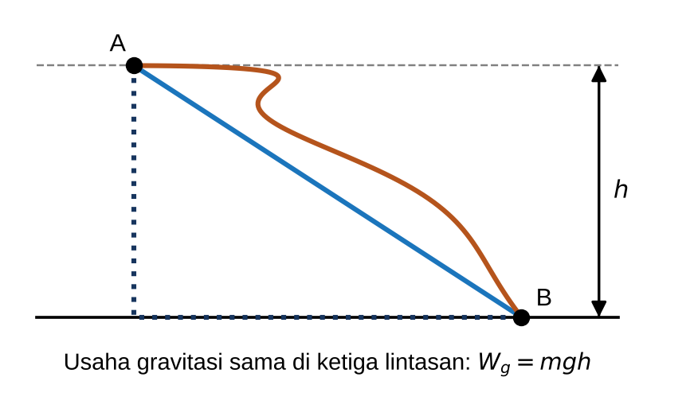{width=58%}

Sebuah gaya disebut **konservatif** jika usahanya ketika benda berpindah dari satu titik ke titik lain **tidak bergantung pada lintasan** yang ditempuh, hanya pada titik awal dan titik akhir. Pernyataan yang setara: usaha gaya itu pada **lintasan tertutup** (kembali ke titik semula) adalah nol.

Gravitasi adalah contohnya. Pada Gambar 4.5, pecah lintasan apa pun menjadi langkah-langkah kecil mendatar dan tegak. Pada langkah mendatar, gravitasi tegak lurus perpindahan dan usahanya nol. Yang tersisa hanyalah jumlah langkah tegak, yaitu beda ketinggian:

$$
W_g = -mg\,\Delta y = -mg(y_f - y_i). \qquad \text{(4.16)}
$$

Gaya pegas juga konservatif: menurut (4.7), usahanya hanya bergantung pada simpangan awal dan akhir.

Gesekan kinetis **tidak** konservatif. Usahanya $-f_k \times$ (panjang lintasan), jadi lintasan yang lebih panjang berarti usaha negatif yang lebih besar, dan pada lintasan tertutup usahanya tidak nol.

| Gaya konservatif | Gaya takkonservatif |
|---|---|
| gravitasi | gesekan kinetis |
| gaya pegas | gaya hambat udara dan zat cair |
| gaya listrik antarmuatan (Bab 12) | dorongan atau tarikan tangan, mesin |
| gaya antaratom dalam ikatan kimia | tegangan tali yang ditarik dari luar |

### Energi potensial

Untuk setiap gaya konservatif, kita dapat mendefinisikan fungsi posisi $U$ yang disebut **energi potensial**, sedemikian sehingga

$$
\boxed{\Delta U = U_f - U_i = -W_\text{konservatif}} \qquad \text{(4.17)}
$$

Tanda minus berarti: ketika gaya konservatif melakukan usaha **positif** (benda jatuh, pegas mengendur), energi potensial **berkurang**. Energi itu berpindah dari simpanan menjadi energi gerak.

**Energi potensial gravitasi** (di dekat permukaan Bumi). Dari (4.16) dan (4.17), $\Delta U_g = mg\,\Delta y$, sehingga

$$
\boxed{U_g = mgy} \qquad \text{(4.18)}
$$

dengan $y$ ketinggian di atas suatu **titik acuan** yang kita pilih.

**Energi potensial pegas.** Dari (4.7),

$$
\boxed{U_s = \tfrac12kx^2} \qquad \text{(4.19)}
$$

dengan $x$ simpangan dari panjang alami. Karena $x$ dikuadratkan, pegas yang ditekan dan pegas yang diregangkan sama-sama menyimpan energi positif.

Tiga hal yang perlu dipegang:

1. **Titik nol bebas dipilih.** Hanya **perubahan** energi potensial yang memiliki makna fisika. Kamu boleh menaruh $y = 0$ di lantai, di meja, atau di puncak gedung; jawaban akhir tidak berubah. Pilih yang membuat hitungan paling sederhana, biasanya titik terendah dalam soal, lalu **jangan diubah di tengah jalan**.
2. **Energi potensial boleh negatif.** Benda di bawah titik acuan memiliki $U_g < 0$. Itu tidak aneh; artinya hanya "lebih rendah daripada acuan".
3. **Energi potensial milik sistem**, bukan milik satu benda. $U_g$ adalah energi sistem benda–Bumi, dan $U_s$ energi sistem benda–pegas. Kita sering berkata "energi potensial bola" hanya demi singkatnya.

::: {.awas}
**Awas · Jangan menghitung gravitasi dua kali**

Begitu gravitasi diwakili oleh energi potensial $mgy$, **jangan** hitung lagi usaha gravitasi. Pilih salah satu pembukuan: (a) semua gaya dihitung usahanya, lalu pakai $W_\text{total} = \Delta K$; atau (b) gaya konservatif diwakili $U$, dan hanya gaya takkonservatif yang dihitung usahanya. Mencampur keduanya menghasilkan jawaban dengan gravitasi berlipat dua.
:::

::: {.kuis}
**Kuis cepat 4.5**

Sebuah buku 2,0 kg berada di rak setinggi 1,5 m dari lantai. Meja di dekatnya setinggi 0,80 m. Berapa energi potensial buku jika acuannya (a) lantai, (b) permukaan meja? Jika buku jatuh ke lantai, berapa perubahan energi potensialnya menurut tiap acuan?
:::

### Mencari energi potensial dari gaya

Definisi (4.17) dapat ditulis sebagai rumus untuk menghitung $U$ dari gaya konservatif yang diketahui:

$$
U(x) - U(x_0) = -\int_{x_0}^{x} F_x\,dx' . \qquad \text{(4.20)}
$$

Titik $x_0$ adalah titik acuan tempat kita menetapkan nilai $U$, biasanya nol.

::: {.contoh}
**Contoh 4.31 · Energi potensial pegas yang tidak linear**

Sebuah pegas mengerjakan gaya $F_x = -100x - 2000x^3$ (N, dengan $x$ dalam meter). (a) Tentukan energi potensialnya dengan $U(0) = 0$. (b) Berapa energi yang tersimpan pada $x = 0{,}10$ m?

**Penyelesaian.**

(a) $U(x) = -\displaystyle\int_0^x(-100x' - 2000x'^3)\,dx' = 50x^2 + 500x^4$.

(b) $U(0{,}10) = 50(0{,}010) + 500(0{,}00010) = 0{,}50 + 0{,}05 = 0{,}55$ J.

**Memahami hasil.** Turunkan kembali: $-dU/dx = -100x - 2000x^3$. Kembali ke gaya semula, sesuai hubungan yang dibahas di subbab 4.8.
:::

### Beban yang tergantung pada pegas tegak

Beban bermassa $m$ tergantung pada pegas tegak memiliki dua energi potensial sekaligus, pegas dan gravitasi. Ada penyederhanaan yang sangat berguna. Misalkan $y$ adalah simpangan beban dari **posisi setimbangnya** (tempat $kx_0 = mg$). Maka jumlah kedua energi potensial itu adalah

$$
U_s + U_g = \tfrac12ky^2 + \text{tetapan}. \qquad \text{(4.21)}
$$

Jadi beban yang tergantung berperilaku persis seperti beban pada pegas mendatar tanpa gravitasi, asalkan simpangan diukur dari posisi setimbang. Gravitasi hanya menggeser posisi setimbang. Contoh 4.11 sudah memperlihatkannya dengan angka.

::: {.mat}
**Matematika · Bukti persamaan (4.21)**

Ukur regangan pegas dari panjang alaminya, $x = x_0 + y$, dengan arah ke bawah positif. Maka

$$
U_s + U_g = \tfrac12k(x_0 + y)^2 - mg(x_0 + y) = \tfrac12ky^2 + (kx_0 - mg)\,y + \big(\tfrac12kx_0^2 - mgx_0\big).
$$

Suku tengah lenyap karena $kx_0 = mg$, dan suku terakhir tetapan.
:::

## 4.6 Kekekalan energi mekanik

Gabungkan dua hasil. Jika **hanya gaya konservatif** yang melakukan usaha, maka $W_\text{total} = -\Delta U$ dari (4.17), dan $W_\text{total} = \Delta K$ dari (4.10). Jadi $\Delta K = -\Delta U$, atau

$$
\boxed{K_i + U_i = K_f + U_f} \qquad \text{(4.22)}
$$

Jumlah $E_\text{mek} = K + U$ disebut **energi mekanik**. Persamaan (4.22) menyatakan **kekekalan energi mekanik**: selama hanya gaya konservatif yang melakukan usaha, energi mekanik tidak berubah. Energi kinetik dan potensial dapat saling bertukar, tetapi jumlahnya tetap.

Gaya yang tidak melakukan usaha tidak mengganggu kekekalan ini. Gaya normal pada lintasan licin dan tegangan tali bandul selalu tegak lurus arah gerak, jadi keduanya boleh ada.

::: {.strategi}
**Strategi · Soal kekekalan energi**

1. **Tentukan sistem** dan dua keadaan: awal (i) dan akhir (f). Pilih keadaan yang diketahui datanya dan keadaan yang ditanyakan.
2. **Periksa gaya-gayanya.** Adakah gesekan, hambatan udara, atau dorongan luar? Jika tidak ada, energi mekanik kekal. Jika ada, pakai neraca energi di subbab 4.7.
3. **Pilih titik nol** untuk tiap energi potensial.
4. Tulis $K_i + U_i = K_f + U_f$, dengan $U$ memuat **semua** energi potensial yang ada (gravitasi dan pegas).
5. Selesaikan dengan huruf terlebih dulu, baru masukkan angka. Sering kali massa tercoret.
6. Energi tidak memberi tahu **arah** kecepatan atau **waktu**. Untuk itu, gabungkan dengan hukum Newton atau kinematika.
:::

::: {.contoh}
**Contoh 4.32 · Bola dilempar ke atas dari balkon**

Bola dilempar tegak ke atas dengan kelajuan 12 m/s dari balkon setinggi 1,5 m di atas tanah. Abaikan hambatan udara. (a) Berapa ketinggian terbesar bola di atas tanah? (b) Berapa kelajuannya sesaat sebelum menyentuh tanah? (c) Bagaimana jawaban (b) jika bola dilempar mendatar dengan kelajuan yang sama?

**Gambaran fisis.** Hanya gravitasi yang bekerja, jadi energi mekanik kekal. Ambil $y = 0$ di tanah.

**Penyelesaian.**

(a) Di titik tertinggi $v = 0$:

$$
\tfrac12mv_0^2 + mgy_0 = mgy_\text{maks} \quad\Longrightarrow\quad y_\text{maks} = y_0 + \frac{v_0^2}{2g} = 1{,}5 + \frac{144}{19{,}6} = 8{,}8\ \text{m}.
$$

(b) Di tanah $y = 0$:

$$
\tfrac12mv_0^2 + mgy_0 = \tfrac12mv^2 \quad\Longrightarrow\quad v = \sqrt{v_0^2 + 2gy_0} = \sqrt{144 + 29{,}4} = 13\ \text{m/s}.
$$

(c) Persamaan pada (b) tidak memuat arah lemparan. Jawabannya tetap 13 m/s.

**Memahami hasil.** Massa tercoret. Hasil (c) patut direnungkan: bola yang dilempar ke atas, ke bawah, atau mendatar dengan kelajuan awal sama akan tiba di tanah dengan **kelajuan** yang sama. Yang berbeda adalah arah kecepatan dan waktu tempuhnya, dan energi memang tidak menceritakan dua hal itu.
:::

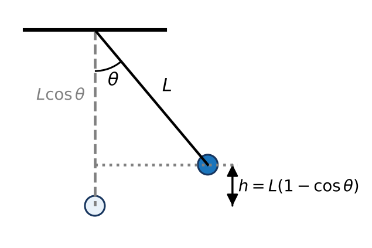{width=44%}

::: {.contoh}
**Contoh 4.33 · Bandul**

Bandul sepanjang 1,2 m dengan beban 0,50 kg ditarik sampai talinya membentuk sudut 40° terhadap garis tegak, lalu dilepas. (a) Berapa kelajuan beban di titik terendah? (b) Berapa tegangan tali di titik itu?

**Gambaran fisis.** Tegangan tali selalu tegak lurus lintasan, jadi tidak melakukan usaha. Energi mekanik kekal. Dari Gambar 4.6, beban turun setinggi $h = L(1 - \cos\theta)$.

**Penyelesaian.**

(a) $mgh = \tfrac12mv^2$:

$$
v = \sqrt{2gL(1 - \cos\theta)} = \sqrt{2(9{,}80)(1{,}2)(1 - 0{,}766)} = 2{,}3\ \text{m/s}.
$$

(b) Energi tidak dapat memberi tegangan. Kembali ke hukum Newton untuk gerak melingkar (subbab 3.12). Di titik terendah, gaya ke pusat adalah $T - mg$:

$$
T = mg + \frac{mv^2}{L} = (0{,}50)(9{,}80) + \frac{(0{,}50)(2{,}35)^2}{1{,}2} = 4{,}9 + 2{,}3 = 7{,}2\ \text{N}.
$$

**Memahami hasil.** Tegangan di titik terendah lebih besar daripada berat beban, karena tali juga harus membelokkan beban. Pola ini sangat umum: **energi untuk kelajuan, lalu hukum Newton untuk gaya**.
:::

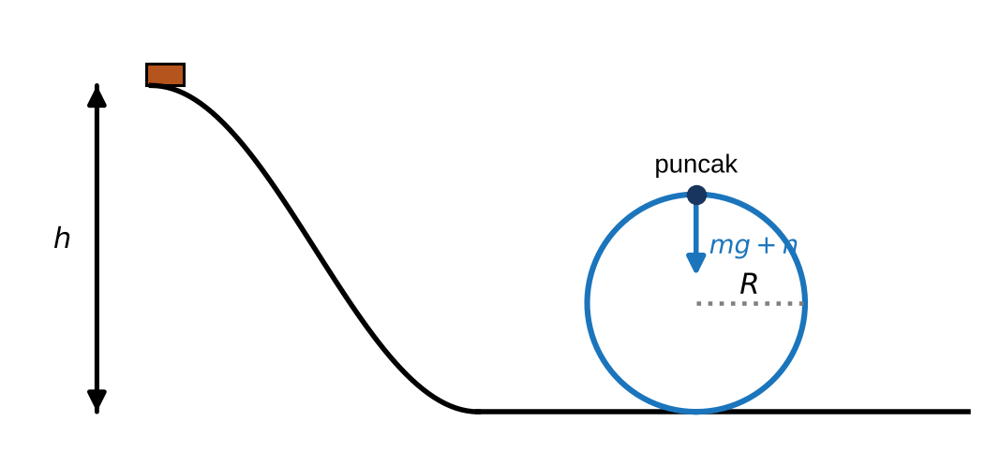{width=72%}

::: {.contoh}
**Contoh 4.34 · Halilintar: pertanyaan pembuka bab**

Kereta halilintar dilepas dari diam di ketinggian $h$ dan memasuki lingkaran tegak berjari-jari $R = 8{,}0$ m (Gambar 4.7). Anggap lintasannya licin. (a) Berapa $h$ paling kecil agar kereta tetap menempel pada lintasan di puncak lingkaran? (b) Jika $h = 30$ m, berapa kelajuan kereta di puncak lingkaran dan berapa gaya normal lintasan pada penumpang 60 kg di sana?

**Rencana.** Syarat "tetap menempel" adalah syarat gaya, jadi berasal dari hukum Newton. Hubungan antara ketinggian dan kelajuan berasal dari energi.

**Penyelesaian.**

(a) Di puncak lingkaran, $mg + n = mv^2/R$. Kereta tetap menempel selama $n \ge 0$, jadi $v_\text{puncak}^2 \ge gR$. Puncak lingkaran berada di ketinggian $2R$. Kekekalan energi:

$$
mgh = \tfrac12mv_\text{puncak}^2 + mg(2R) \ge \tfrac12mgR + 2mgR ,
$$

$$
\boxed{h \ge \tfrac52R} \qquad\text{sehingga}\qquad h_\text{min} = 2{,}5(8{,}0) = 20\ \text{m}.
$$

(b) $v^2 = 2g(h - 2R) = 2(9{,}80)(30 - 16) = 274\ \text{m}^2/\text{s}^2$, jadi $v = 17$ m/s.

$$
n = m\Big(\frac{v^2}{R} - g\Big) = 60(34{,}3 - 9{,}80) = 1{,}5 \times 10^3\ \text{N}.
$$

**Memahami hasil.** Hasil (a) tidak bergantung pada massa kereta maupun bentuk lintasan sebelum lingkaran. Banyak orang menduga $h = 2R$ sudah cukup, karena itu ketinggian puncak lingkaran. Tetapi dengan $h = 2R$ kereta tiba di puncak dengan kelajuan nol dan akan jatuh jauh sebelum sampai di sana. Kereta harus masih bergerak cukup cepat di puncak. Pada (b), gaya normal 1470 N adalah 2,5 kali berat penumpang: ia terdorong kuat ke kursinya walaupun sedang terbalik. Wahana sungguhan memakai $h$ lebih besar dari $2{,}5R$ karena ada gesekan.
:::

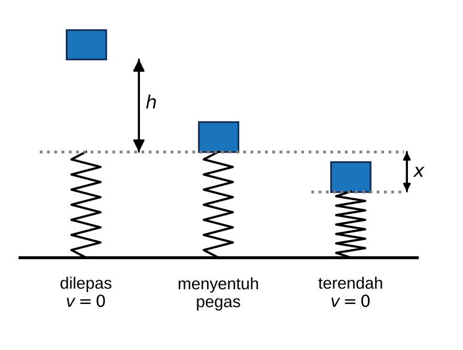{width=62%}

::: {.contoh}
**Contoh 4.35 · Balok jatuh ke pegas tegak**

Balok 2,0 kg dijatuhkan dari diam, 0,40 m di atas ujung pegas tegak dengan $k = 1960$ N/m (Gambar 4.8). Berapa penekanan terbesar pegas?

**Gambaran fisis.** Dua energi potensial terlibat: gravitasi dan pegas. Ambil $y = 0$ di titik terendah balok. Di keadaan awal dan akhir, kelajuan balok nol.

**Penyelesaian.** Balok turun total sejauh $h + x$:

$$
mg(h + x) = \tfrac12kx^2 .
$$

Dengan angka: $19{,}6(0{,}40 + x) = 980x^2$, atau $980x^2 - 19{,}6x - 7{,}84 = 0$.

$$
x = \frac{19{,}6 + \sqrt{19{,}6^2 + 4(980)(7{,}84)}}{2(980)} = \frac{19{,}6 + 176{,}4}{1960} = 0{,}10\ \text{m}.
$$

**Memahami hasil.** Akar yang negatif dibuang karena tidak bermakna di sini. Kesalahan yang paling umum adalah menulis $mgh = \tfrac12kx^2$, melupakan bahwa balok masih turun sejauh $x$ selama menekan pegas. Rumus keliru itu memberi 0,089 m. Perhatikan pula bahwa kelajuan terbesar balok **bukan** saat menyentuh pegas, melainkan sedikit di bawahnya, di titik tempat gaya pegas sama dengan berat ($x = mg/k = 1{,}0$ cm).
:::

::: {.contoh}
**Contoh 4.36 · Mesin Atwood dengan energi**

Beban 3,0 kg dan 5,0 kg dihubungkan tali melalui katrol ideal, lalu dilepas dari diam. Berapa kelajuan keduanya setelah beban berat turun 1,0 m?

**Gambaran fisis.** Ambil kedua beban sebagai satu sistem. Tegangan tali melakukan usaha positif pada satu beban dan usaha negatif yang sama besar pada beban lain, jadi jumlahnya nol. Energi mekanik sistem kekal.

**Penyelesaian.** Beban berat turun $h$ dan beban ringan naik $h$:

$$
0 = \tfrac12(m_1 + m_2)v^2 + m_1gh - m_2gh \quad\Longrightarrow\quad v = \sqrt{\frac{2(m_2 - m_1)gh}{m_1 + m_2}} = \sqrt{\frac{2(2{,}0)(9{,}80)(1{,}0)}{8{,}0}} = 2{,}2\ \text{m/s}.
$$

**Memahami hasil.** Di Bab 3 percepatan sistem ini $2{,}45\ \text{m/s}^2$, dan $v = \sqrt{2(2{,}45)(1{,}0)} = 2{,}2$ m/s. Cocok. Dengan energi, tegangan tali tidak perlu dicari sama sekali.
:::

::: {.contoh}
**Contoh 4.37 · Meluncur dari kubah es**

Seorang anak duduk di puncak kubah es licin berbentuk setengah bola berjari-jari $R = 3{,}0$ m, lalu mulai meluncur dari keadaan hampir diam. Pada ketinggian berapa (diukur dari dasar kubah) ia lepas dari permukaan es?

**Rencana.** Anak lepas ketika gaya normal menjadi nol. Itu syarat gaya. Kelajuannya di titik itu berasal dari energi.

**Penyelesaian.** Misalkan anak berada pada sudut $\theta$ dari garis tegak. Ketinggiannya $R\cos\theta$, jadi ia sudah turun $R(1 - \cos\theta)$:

$$
v^2 = 2gR(1 - \cos\theta).
$$

Gaya ke arah pusat kubah: $mg\cos\theta - n = mv^2/R$. Dengan $n = 0$:

$$
g\cos\theta = \frac{v^2}{R} = 2g(1 - \cos\theta) \quad\Longrightarrow\quad \cos\theta = \tfrac23 .
$$

Ketinggian saat lepas: $R\cos\theta = \tfrac23(3{,}0) = 2{,}0$ m.

**Memahami hasil.** Jawaban $\tfrac23R$ tidak bergantung pada massa anak maupun nilai $g$. Di Bulan pun anak itu lepas di ketinggian yang sama. Sudutnya 48° dari tegak.
:::

::: {.kuis}
**Kuis cepat 4.6**

Tiga bola identik dilepas dari ketinggian yang sama: A jatuh bebas, B meluncur di bidang miring licin, C meluncur di lintasan licin yang melengkung. Urutkan (a) kelajuan ketiganya di dasar, (b) waktu tempuhnya, sebisa yang dapat disimpulkan.
:::

### Kelajuan dari energi, gaya dari Newton

Empat contoh berikut memakai pola yang sama dengan Contoh 4.33 dan 4.34, pada keadaan yang berbeda-beda.

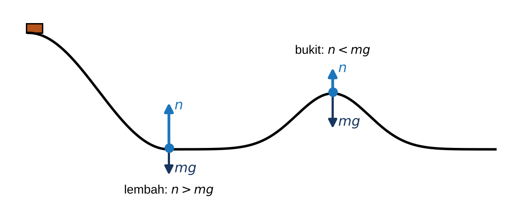{width=78%}

::: {.contoh}
**Contoh 4.38 · Lembah dan bukit pada lintasan halilintar**

Kereta halilintar mulai dari diam di ketinggian 25 m pada lintasan licin (Gambar 4.9). (a) Lintasan turun ke lembah di ketinggian nol dengan jari-jari kelengkungan 15 m. Berapa gaya normal pada penumpang 60 kg di dasar lembah? (b) Setelah itu ada bukit setinggi 12 m dengan jari-jari kelengkungan 20 m. Apa yang terjadi di puncaknya? (c) Berapa tinggi bukit paling rendah agar kereta tetap menempel?

**Penyelesaian.**

(a) $v^2 = 2g(25) = 490\ \text{m}^2/\text{s}^2$. Di dasar lembah pusat kelengkungan ada di atas: $n - mg = mv^2/R$.

$$
n = m\Big(g + \frac{v^2}{R}\Big) = 60(9{,}80 + 32{,}7) = 2{,}5 \times 10^3\ \text{N}.
$$

Itu 4,3 kali berat penumpang.

(b) Di puncak bukit, $v^2 = 2g(25 - 12) = 255\ \text{m}^2/\text{s}^2$. Pusat kelengkungan ada di bawah: $mg - n = mv^2/R$, sehingga

$$
n = m\Big(g - \frac{v^2}{R}\Big) = 60(9{,}80 - 12{,}7) < 0 .
$$

Gaya normal tidak dapat negatif. Artinya kereta sudah **lepas dari lintasan** sebelum sampai di puncak.

(c) Syaratnya $v^2 \le gR = 196\ \text{m}^2/\text{s}^2$, yaitu $2g(25 - h) \le 196$, sehingga $h \ge 15$ m.

**Memahami hasil.** Bukit yang lebih tinggi justru lebih aman, karena kereta tiba di puncaknya lebih lambat. Pilihan lain bagi perancang adalah memperbesar jari-jari kelengkungan bukit menjadi paling sedikit $255/9{,}80 = 26$ m, atau memasang roda penahan di bawah rel, seperti pada wahana sungguhan.
:::

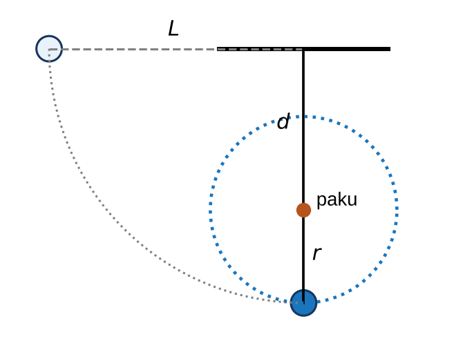{width=46%}

::: {.contoh}
**Contoh 4.39 · Bandul dan paku**

Beban bandul dengan tali sepanjang $L = 1{,}0$ m dilepas dari posisi tali mendatar. Tepat di bawah titik gantung, pada jarak $d$, terdapat paku (Gambar 4.10). Berapa $d$ paling kecil agar beban dapat berputar satu lingkaran penuh mengelilingi paku?

**Rencana.** Setelah tali tersangkut, beban bergerak pada lingkaran berjari-jari $r = L - d$. Syarat lingkaran penuh dengan tali sama dengan syarat pada Contoh 4.34: di puncak lingkaran, $v^2 \ge gr$.

**Penyelesaian.** Ambil $y = 0$ di titik terendah. Ketinggian awal beban $L$, dan puncak lingkaran kecil berada di ketinggian $2r$:

$$
mgL = \tfrac12mv^2 + mg(2r) \ge \tfrac12mgr + 2mgr = \tfrac52mgr .
$$

Jadi $r \le \tfrac25L$, atau $d = L - r \ge \tfrac35L = 0{,}60$ m.

**Memahami hasil.** Hasil $h = \tfrac52r$ muncul lagi, karena fisikanya sama dengan lingkaran halilintar. Jika pakunya lebih tinggi dari 0,60 m di bawah titik gantung, tali akan kendur sebelum beban mencapai puncak, dan beban jatuh sebagai peluru.
:::

::: {.contoh}
**Contoh 4.40 · Lompat ski: energi lalu gerak peluru**

Peski meluncur dari diam menuruni lereng licin. Ujung lereng mendatar, 25 m lebih rendah daripada titik awal dan 5,0 m di atas bidang pendaratan yang datar. Berapa jauh peski mendarat dari kaki ujung lereng, diukur mendatar?

**Penyelesaian.** *Tahap 1, energi.* Kelajuan di ujung lereng: $v = \sqrt{2g(25)} = 22{,}1$ m/s, mendatar.

*Tahap 2, gerak peluru* (subbab 2.12). Waktu jatuh 5,0 m: $t = \sqrt{2(5{,}0)/9{,}80} = 1{,}01$ s. Jarak mendatar: $x = (22{,}1)(1{,}01) = 22$ m.

**Memahami hasil.** Energi memberi kelajuan di ujung lereng tanpa perlu tahu bentuk lerengnya. Tetapi energi tidak dapat memberi **jarak** pendaratan, karena itu menyangkut waktu dan arah. Di situ kinematika mengambil alih.
:::

::: {.contoh}
**Contoh 4.41 · Pegas tegak sebagai pelontar**

Bola 0,25 kg diletakkan di atas pegas tegak ($k = 800$ N/m) yang ditekan 0,10 m, lalu dilepas. (a) Berapa kelajuan bola saat meninggalkan pegas? (b) Berapa tinggi terbesar bola di atas posisi awalnya?

**Penyelesaian.** Ambil $y = 0$ di posisi awal. Energi awal: $\tfrac12kx^2 = \tfrac12(800)(0{,}10)^2 = 4{,}0$ J.

(a) Bola meninggalkan pegas ketika pegas kembali ke panjang alaminya, 0,10 m di atas posisi awal:

$$
4{,}0 = \tfrac12mv^2 + mg(0{,}10) \quad\Longrightarrow\quad v = \sqrt{\frac{2(4{,}0 - 0{,}245)}{0{,}25}} = 5{,}5\ \text{m/s}.
$$

(b) Di titik tertinggi seluruh energi berupa energi potensial gravitasi: $h = \dfrac{4{,}0}{(0{,}25)(9{,}80)} = 1{,}6$ m.

**Memahami hasil.** Pada (b) keadaan antara (saat lepas dari pegas) dilompati. Itu sah, karena energi mekanik kekal di sepanjang jalan.
:::

### Tegangan tali bandul di titik terendah

Untuk bandul yang dilepas dari sudut $\theta_0$, gabungkan $v^2 = 2gL(1 - \cos\theta_0)$ dengan $T - mg = mv^2/L$:

$$
T_\text{bawah} = mg(3 - 2\cos\theta_0). \qquad \text{(4.23)}
$$

Hasil ini tidak bergantung pada panjang tali. Dilepas dari 60°, tegangannya $2mg$. Dilepas dari posisi mendatar (90°), tegangannya $3mg$. Tali ayunan harus dirancang menahan jauh lebih besar daripada berat penggunanya.

## 4.7 Gesekan, gaya luar, dan neraca energi

Di dunia nyata, bandul akhirnya berhenti dan bola yang memantul makin rendah. Energi mekaniknya berkurang. Apakah energi musnah?

Tidak. Gosokkan kedua telapak tanganmu dan rasakan: gesekan menghangatkan. Energi mekanik yang hilang berubah menjadi **energi termal**, yaitu energi gerak acak atom-atom di kedua permukaan. Jika semua bentuk energi dihitung, jumlahnya tetap. Inilah **hukum kekekalan energi**, salah satu hukum paling kokoh dalam sains:

> Energi tidak dapat diciptakan atau dimusnahkan. Energi hanya berpindah dari satu benda ke benda lain atau berubah dari satu bentuk ke bentuk lain.

Di kimia, hukum yang sama disebut **hukum pertama termodinamika** (Bab 11).

### Neraca energi

Pisahkan usaha total menjadi usaha gaya konservatif ($-\Delta U$) dan usaha gaya takkonservatif ($W_\text{nk}$). Teorema usaha–energi menjadi

$$
\boxed{K_i + U_i + W_\text{nk} = K_f + U_f} \qquad \text{(4.24)}
$$

Usaha takkonservatif yang positif (dorongan tangan, mesin) menambah energi mekanik. Yang negatif (gesekan, hambatan udara) menguranginya.

Untuk gesekan kinetis sebesar $f_k$ di sepanjang lintasan $d$, $W_\text{nk} = -f_kd$, dan energi termal yang timbul adalah

$$
\boxed{\Delta E_\text{term} = f_kd} \qquad \text{(4.25)}
$$

dengan $d$ **panjang lintasan** yang ditempuh, bukan perpindahan. Maka neraca energi dapat ditulis:

$$
K_i + U_i + W_\text{luar} = K_f + U_f + \Delta E_\text{term}.
$$

Bacalah seperti pembukuan: energi awal, ditambah yang dimasukkan dari luar, sama dengan energi akhir, ditambah yang berubah menjadi panas.

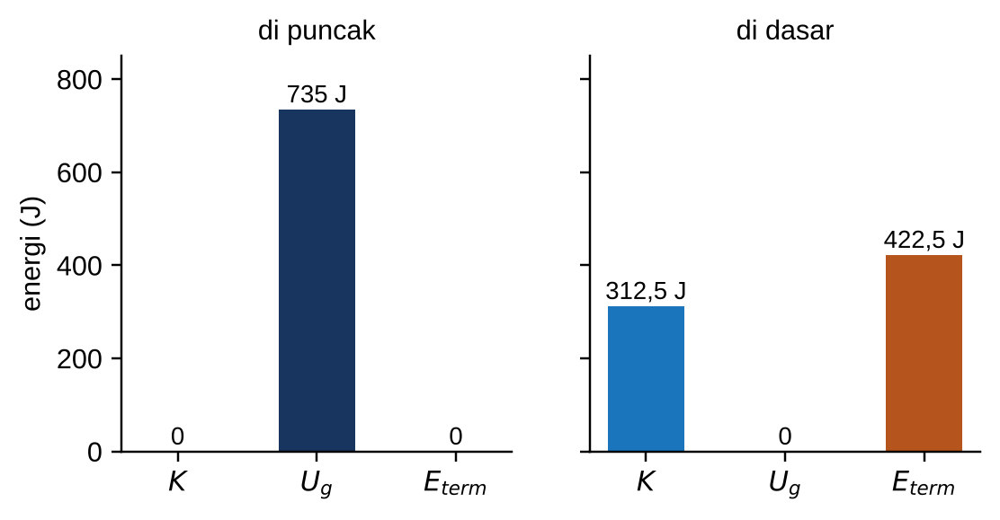{width=62%}

::: {.contoh}
**Contoh 4.42 · Perosotan**

Seorang anak 25 kg meluncur dari diam di puncak perosotan setinggi 3,0 m dan tiba di dasar dengan kelajuan 5,0 m/s. (a) Berapa energi yang berubah menjadi energi termal? (b) Jika panjang perosotan 6,0 m, berapa gaya gesek rata-ratanya?

**Penyelesaian.**

(a) Awal: $U = mgh = (25)(9{,}80)(3{,}0) = 735$ J, $K = 0$. Akhir: $K = \tfrac12(25)(5{,}0)^2 = 312{,}5$ J, $U = 0$.

$$
\Delta E_\text{term} = 735 - 312{,}5 = 423\ \text{J}.
$$

(b) $f = \dfrac{\Delta E_\text{term}}{d} = \dfrac{422{,}5}{6{,}0} = 70$ N.

**Memahami hasil.** Tanpa gesekan, anak itu tiba dengan $\sqrt{2gh} = 7{,}7$ m/s. Lebih dari separuh energi awalnya (57%) berubah menjadi panas, yang menghangatkan perosotan dan celananya. Gambar 4.11 menunjukkan pembukuannya.
:::

::: {.contoh}
**Contoh 4.43 · Naik, berhenti, turun lagi: cara energi**

Balok disentil naik di bidang miring 30° dengan kelajuan awal 6,0 m/s ($\mu_k = 0{,}30$). Di Bab 3 (subbab 3.10) soal ini diselesaikan dengan hukum Newton. Selesaikan ulang dengan energi: (a) seberapa jauh balok naik, (b) berapa kelajuannya saat kembali ke titik awal.

**Penyelesaian.** Gaya gesek $f_k = \mu_kmg\cos\theta$. Ambil $y = 0$ di titik awal.

(a) Naik sejauh $d$, ketinggian bertambah $d\sin\theta$:

$$
\tfrac12mv_0^2 = mgd\sin\theta + \mu_kmg\cos\theta\,d \quad\Longrightarrow\quad d = \frac{v_0^2}{2g(\sin\theta + \mu_k\cos\theta)} = \frac{36}{2(9{,}80)(0{,}760)} = 2{,}4\ \text{m}.
$$

(b) Untuk seluruh perjalanan bolak-balik, energi potensial kembali ke nilai awal, dan gesekan bekerja sepanjang $2d$:

$$
\tfrac12mv_0^2 - 2\mu_kmg\cos\theta\,d = \tfrac12mv^2 ,
$$

$$
v = \sqrt{v_0^2 - 4\mu_kg\cos\theta\,d} = \sqrt{36 - 4(0{,}30)(9{,}80)(0{,}866)(2{,}42)} = \sqrt{11{,}4} = 3{,}4\ \text{m/s}.
$$

**Memahami hasil.** Hasilnya sama dengan Bab 3, tanpa menghitung percepatan dua kali. Pada (b) terlihat jelas mengapa gesekan takkonservatif: usahanya bergantung pada panjang lintasan $2d$, sedangkan gravitasi pada lintasan tertutup itu usahanya nol. Massa tercoret, jadi energi termalnya hanya dapat dinyatakan per kilogram: 6,2 J untuk tiap kilogram balok pada tiap arah.
:::

::: {.contoh}
**Contoh 4.44 · Pegas melontarkan balok di lantai kasar**

Balok 2,0 kg ditekankan pada pegas mendatar ($k = 800$ N/m) sehingga pegas tertekan 0,15 m, lalu dilepas. Lantainya kasar dengan $\mu_k = 0{,}35$. Berapa jarak total yang ditempuh balok sejak dilepas sampai berhenti?

**Gambaran fisis.** Awal: energi tersimpan di pegas, balok diam. Akhir: balok diam, pegas kendur. Seluruh energi pegas berubah menjadi energi termal.

**Penyelesaian.**

$$
\tfrac12kx^2 = \mu_kmg\,d \quad\Longrightarrow\quad d = \frac{kx^2}{2\mu_kmg} = \frac{(800)(0{,}15)^2}{2(0{,}35)(2{,}0)(9{,}80)} = \frac{9{,}0}{6{,}86} = 1{,}3\ \text{m}.
$$

**Memahami hasil.** Kita tidak perlu tahu kelajuan balok saat lepas dari pegas. Itulah kekuatan cara energi: keadaan antara boleh dilompati. Kalau penasaran, kelajuan saat lepas diperoleh dari $\tfrac12kx^2 - \mu_kmg(0{,}15) = \tfrac12mv^2$, yaitu $v = 2{,}8$ m/s.
:::

::: {.contoh}
**Contoh 4.45 · Mobil mendaki bukit**

Mobil 1200 kg mendaki bukit setinggi 50 m. Kelajuannya 20 m/s di kaki bukit dan 15 m/s di puncak. Selama itu mesin memberi usaha $6{,}0 \times 10^5$ J kepada mobil melalui roda. Berapa energi yang terbuang karena hambatan udara dan gesekan?

**Penyelesaian.** Neraca energi, dengan $y = 0$ di kaki bukit:

$$
K_i + W_\text{mesin} = K_f + U_f + \Delta E_\text{term}.
$$

$K_i = \tfrac12(1200)(20)^2 = 2{,}40 \times 10^5$ J, $K_f = \tfrac12(1200)(15)^2 = 1{,}35 \times 10^5$ J, dan $U_f = (1200)(9{,}80)(50) = 5{,}88 \times 10^5$ J.

$$
\Delta E_\text{term} = 2{,}40 \times 10^5 + 6{,}0 \times 10^5 - 1{,}35 \times 10^5 - 5{,}88 \times 10^5 = 1{,}2 \times 10^5\ \text{J}.
$$

**Memahami hasil.** Dari 600 kJ usaha mesin, 588 kJ dibutuhkan hanya untuk menaikkan mobil. Sisanya, ditambah 105 kJ yang diambil dari energi kinetik, terbuang sebagai panas. Energi yang tersimpan sebagai $U_f$ dapat diperoleh kembali saat turun; yang 117 kJ tidak.
:::

::: {.awas}
**Awas · Tiga kesalahan pada soal gesekan**

- **Memakai perpindahan, bukan panjang lintasan.** Pada gerak bolak-balik, gesekan bekerja di sepanjang seluruh lintasan.
- **Memakai $n = mg$ di bidang miring.** Di sana $n = mg\cos\theta$, sehingga $f_k = \mu_kmg\cos\theta$.
- **Menaruh energi termal di sisi yang salah.** Energi termal selalu bertambah. Jika hasil hitunganmu memberi $\Delta E_\text{term}$ negatif, ada tanda yang terbalik.
:::

::: {.kuis}
**Kuis cepat 4.7**

Sebuah balok meluncur di lantai kasar dan berhenti setelah menempuh jarak $d$. Jika kelajuan awalnya dilipatduakan, berapa jarak tempuhnya? Berapa kali lipat energi termal yang timbul?
:::

### Ke mana energi termal itu pergi: kenaikan suhu

Energi termal yang timbul karena gesekan menaikkan suhu benda. Untuk benda bermassa $m$ dengan **kalor jenis** $c$, energi $Q$ menaikkan suhu sebesar

$$
\Delta T = \frac{Q}{mc} . \qquad \text{(4.26)}
$$

Hubungan ini dibahas lengkap di Bab 10. Di sini kita memakainya untuk melihat bahwa energi mekanik yang "hilang" benar-benar dapat dilacak.

::: {.contoh}
**Contoh 4.46 · Rem yang memanas**

Mobil 1200 kg direm dari 25 m/s sampai berhenti. Hampir seluruh energi kinetiknya menjadi energi termal di empat cakram rem dari besi, masing-masing 6,0 kg. Kalor jenis besi 450 J/(kg·K). Berapa kenaikan suhu cakram?

**Penyelesaian.** $K = \tfrac12(1200)(25)^2 = 3{,}75 \times 10^5$ J.

$$
\Delta T = \frac{3{,}75 \times 10^5}{(24)(450)} = 35\ \text{K}.
$$

**Memahami hasil.** Satu kali pengereman keras menaikkan suhu cakram 35 °C. Menuruni jalan pegunungan sambil terus mengerem dapat memanaskan cakram ratusan derajat sampai rem kehilangan dayanya. Itu sebabnya pengemudi dianjurkan memakai gigi rendah: mesin ikut menyerap energi.
:::

::: {.contoh}
**Contoh 4.47 · Air terjun dan percobaan Joule**

Air jatuh dari ketinggian 50 m. Jika seluruh energi potensialnya menjadi energi termal air itu sendiri, berapa kenaikan suhunya? Kalor jenis air 4186 J/(kg·K).

**Penyelesaian.** Untuk air bermassa $m$: $mgh = mc\,\Delta T$, sehingga

$$
\Delta T = \frac{gh}{c} = \frac{(9{,}80)(50)}{4186} = 0{,}12\ \text{K}.
$$

**Memahami hasil.** Hanya sepersepuluh derajat. Pada tahun 1847 James Joule, saat berbulan madu di Pegunungan Alpen, mencoba mengukur selisih suhu sekecil ini di sebuah air terjun. Percobaan-percobaan Joule itulah yang meyakinkan dunia bahwa kalor adalah bentuk energi, dan namanya diabadikan sebagai satuan energi. Hasil ini juga menunjukkan betapa besar energi yang diperlukan untuk memanaskan air dibandingkan energi mekanik sehari-hari.
:::

### Gaya dalam dan energi kimia

Ketika kamu melompat tegak, apa yang memberi energi kinetik kepada tubuhmu? Bukan lantai. Gaya lantai memang mendorongmu ke atas, tetapi titik tangkap gaya itu (telapak kaki) **tidak berpindah** selama kamu menekan lantai, sehingga usahanya nol. Energinya berasal dari dalam: energi kimia di otot berubah menjadi energi kinetik dan energi potensial tubuh.

Hal yang sama berlaku untuk mobil. Gesekan statis jalan pada ban adalah gaya luar yang mempercepat mobil, tetapi titik sentuh ban tidak bergeser terhadap jalan. Energinya berasal dari bahan bakar. Neraca energi untuk sistem seperti ini perlu satu suku lagi:

$$
\Delta K + \Delta U + \Delta E_\text{term} + \Delta E_\text{kimia} = W_\text{luar}. \qquad \text{(4.27)}
$$

Dengan $\Delta E_\text{kimia}$ negatif ketika bahan bakar atau cadangan tubuh terpakai. Pelajarannya: **gaya** yang mempercepat sebuah sistem dan **sumber energinya** adalah dua hal yang berbeda.

::: {.contoh}
**Contoh 4.48 · Lompat tegak**

Seorang atlet 60 kg berjongkok, lalu melompat. Selama mendorong lantai, pusat massanya naik 0,30 m. Setelah kakinya lepas dari lantai, pusat massanya naik 0,50 m lagi. (a) Berapa energi kimia paling sedikit yang dipakai ototnya? (b) Berapa gaya rata-rata kakinya pada lantai selama mendorong?

**Penyelesaian.**

(a) Dari jongkok sampai titik tertinggi, pusat massa naik 0,80 m, dan kelajuan di awal dan akhir nol. Energi mekanik yang harus disediakan otot: $mg(0{,}80) = (588)(0{,}80) = 470$ J.

(b) Kelajuan saat lepas landas memenuhi $\tfrac12mv^2 = mg(0{,}50) = 294$ J. Selama mendorong sejauh $d = 0{,}30$ m, gaya total ke atas adalah $F - mg$:

$$
(F - mg)d = 294 \quad\Longrightarrow\quad F = 588 + \frac{294}{0{,}30} = 1{,}6 \times 10^3\ \text{N}.
$$

**Memahami hasil.** Gaya itu 2,7 kali berat badan. Karena efisiensi otot sekitar 25%, energi kimia yang sebenarnya terpakai mendekati 1900 J, dan tiga perempatnya menjadi panas. Itu sebabnya kamu merasa hangat setelah melompat-lompat.
:::

::: {.contoh}
**Contoh 4.49 · Mengukur gesekan pada wahana sungguhan**

Kereta halilintar 500 kg dilepas dari diam di ketinggian 30 m. Kelajuannya di puncak lingkaran tegak (ketinggian 16 m) terukur 14 m/s. Berapa energi yang telah berubah menjadi energi termal? Berapa kelajuannya di titik itu seandainya tidak ada gesekan?

**Penyelesaian.**

$$
\Delta E_\text{term} = mg(30 - 16) - \tfrac12mv^2 = (500)(9{,}80)(14) - \tfrac12(500)(14)^2 = 68\,600 - 49\,000 = 2{,}0 \times 10^4\ \text{J}.
$$

Tanpa gesekan: $v = \sqrt{2g(14)} = 16{,}6$ m/s (Contoh 4.34).

**Memahami hasil.** Sekitar 29% energi yang tersedia hilang. Kelajuan 14 m/s masih di atas batas $\sqrt{gR} = 8{,}9$ m/s untuk $R = 8{,}0$ m, jadi kereta tetap menempel. Perancang harus memastikan hal itu tetap benar pada hari hujan, ketika gesekan berubah.
:::

## 4.8 Diagram energi, gaya, dan kesetimbangan

Energi potensial sebagai fungsi posisi, $U(x)$, memuat seluruh informasi tentang gaya konservatifnya. Grafik $U$ terhadap $x$, yang disebut **diagram energi**, adalah alat berpikir yang dipakai terus di kimia: kurva energi ikatan, profil energi reaksi, dan sumur potensial elektron semuanya diagram energi.

### Gaya adalah kemiringan

Untuk perpindahan kecil $dx$, usaha gaya konservatif adalah $F_x\,dx = -dU$. Jadi

$$
\boxed{F_x = -\frac{dU}{dx}} \qquad \text{(4.28)}
$$

Gaya adalah **negatif dari kemiringan** kurva energi potensial. Bayangkan kurva $U(x)$ sebagai bukit dan lembah, dan benda sebagai kelereng di atasnya: gaya selalu mendorong ke arah **turun**, dan makin curam lerengnya, makin besar gayanya.

Periksa dengan dua energi potensial yang sudah kita kenal:

- $U_g = mgy$ memberi $F_y = -mg$: berat, ke bawah.
- $U_s = \tfrac12kx^2$ memberi $F_x = -kx$: hukum Hooke.

### Kesetimbangan

Di titik tempat kurva mendatar, $dU/dx = 0$, gayanya nol. Titik itu disebut titik **kesetimbangan**. Ada dua jenis yang penting:

- **Kesetimbangan stabil**: dasar lembah (minimum $U$). Jika benda digeser sedikit, gaya mendorongnya **kembali**. Molekul berada di sini: jarak ikatan adalah posisi minimum energi potensial.
- **Kesetimbangan takstabil**: puncak bukit (maksimum $U$). Jika benda digeser sedikit, gaya mendorongnya **makin jauh**. Keadaan transisi dalam reaksi kimia adalah kesetimbangan takstabil.

### Titik balik

Gambarkan energi mekanik total $E$ sebagai garis mendatar pada diagram. Karena $K = E - U$ tidak mungkin negatif, benda hanya dapat berada di daerah dengan $U(x) \le E$. Di titik tempat garis $E$ memotong kurva, $K = 0$: benda berhenti sesaat dan berbalik. Itulah **titik balik**. Jarak tegak antara garis $E$ dan kurva $U$ di suatu posisi adalah energi kinetik benda di sana.

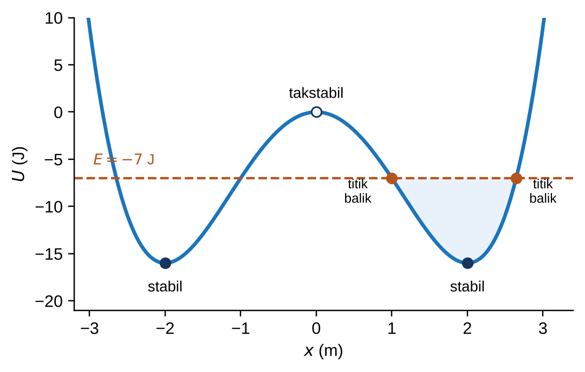{width=66%}

::: {.contoh}
**Contoh 4.50 · Membaca diagram energi**

Partikel 2,0 kg bergerak sepanjang sumbu $x$ dengan energi potensial $U(x) = x^4 - 8x^2$ ($U$ dalam joule, $x$ dalam meter), seperti Gambar 4.12. (a) Tentukan gaya sebagai fungsi posisi. (b) Di mana titik-titik kesetimbangannya, dan mana yang stabil? (c) Partikel berada di lembah kanan dengan energi total $-7{,}0$ J. Di mana titik baliknya? (d) Berapa kelajuan terbesarnya? (e) Berapa energi paling kecil agar partikel dapat berpindah dari lembah kanan ke lembah kiri?

**Penyelesaian.**

(a) $F_x = -\dfrac{dU}{dx} = -(4x^3 - 16x) = 16x - 4x^3$.

(b) $F_x = 0$ ketika $4x(4 - x^2) = 0$, yaitu $x = 0$ dan $x = \pm 2{,}0$ m. Nilainya: $U(0) = 0$ dan $U(\pm 2) = 16 - 32 = -16$ J. Jadi $x = \pm 2$ m adalah dasar lembah (stabil), dan $x = 0$ puncak bukit (takstabil).

(c) Titik balik: $U(x) = E$, atau $x^4 - 8x^2 + 7 = 0$. Ini persamaan kuadrat dalam $x^2$: $(x^2 - 1)(x^2 - 7) = 0$. Di lembah kanan, $x = 1{,}0$ m dan $x = \sqrt7 = 2{,}6$ m.

(d) Kelajuan terbesar terjadi di dasar lembah, tempat $U$ paling kecil: $K = E - U = -7 - (-16) = 9{,}0$ J, sehingga $v = \sqrt{2(9{,}0)/2{,}0} = 3{,}0$ m/s.

(e) Partikel harus melewati puncak di $x = 0$, tempat $U = 0$. Jadi diperlukan $E > 0$. Dari dasar lembah, itu berarti tambahan energi 16 J.

**Memahami hasil.** Uji arah gaya di $x = 1$ m: $F = 16 - 4 = +12$ N, ke kanan, menuju dasar lembah di $x = 2$. Di $x = 2{,}6$ m: $F = 16(2{,}65) - 4(2{,}65)^3 = -32$ N, ke kiri. Keduanya mendorong partikel kembali ke dasar lembah, sesuai dengan kesetimbangan stabil. Bagian (e) adalah gambaran sederhana **energi aktivasi**: tinggi penghalang yang harus dilewati agar sistem berpindah dari satu keadaan stabil ke keadaan stabil lain.
:::

### Ikatan kimia sebagai lembah energi

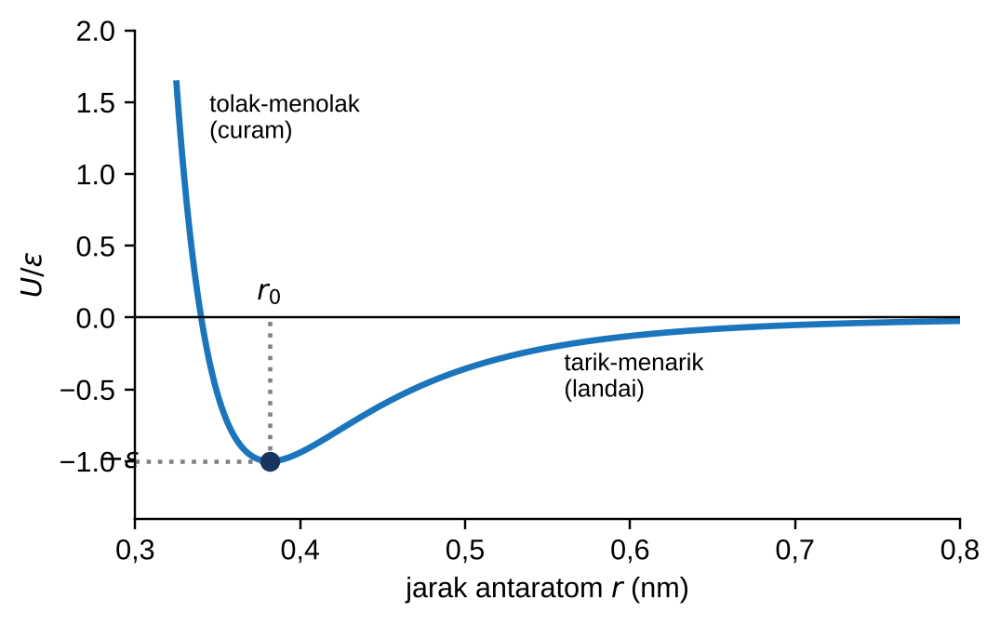{width=64%}

Dua atom netral yang berjauhan saling menarik lemah. Jika terlalu dekat, awan elektronnya bertumpang-tindih dan keduanya saling menolak kuat. Di antaranya ada jarak dengan energi potensial paling rendah. Model sederhana yang sering dipakai adalah **potensial Lennard-Jones**:

$$
U(r) = 4\varepsilon\left[\Big(\frac{\sigma}{r}\Big)^{12} - \Big(\frac{\sigma}{r}\Big)^{6}\right] \qquad \text{(4.29)}
$$

Suku pangkat 12 menggambarkan tolakan jarak dekat, dan suku pangkat 6 tarikan jarak jauh. Kurvanya (Gambar 4.13) dapat dibaca dengan semua alat di subbab ini:

- Di kiri lembah kurvanya turun curam: gaya besar dan mendorong ke luar (tolak-menolak).
- Di kanan lembah kurvanya naik landai: gaya kecil dan menarik ke dalam.
- Dasar lembah di $r_0$ adalah kesetimbangan stabil, yaitu **jarak setimbang** antara dua atom.
- Kedalaman lembah $\varepsilon$ adalah **energi ikat**: energi yang harus diberikan agar kedua atom terpisah jauh.
- Di dekat dasar lembah, kurvanya mirip parabola $\tfrac12kx^2$. Itulah sebabnya ikatan berperilaku seperti pegas, dan molekul bergetar (Bab 8).

::: {.contoh}
**Contoh 4.51 · Dua atom argon**

Untuk dua atom argon, $\varepsilon = 1{,}65 \times 10^{-21}$ J dan $\sigma = 0{,}340$ nm. (a) Tentukan jarak setimbangnya. (b) Nyatakan energi ikatnya dalam eV per pasang atom dan dalam kJ/mol.

**Penyelesaian.**

(a) Kesetimbangan terjadi saat $dU/dr = 0$:

$$
\frac{dU}{dr} = 4\varepsilon\left[-\frac{12\sigma^{12}}{r^{13}} + \frac{6\sigma^{6}}{r^{7}}\right] = 0 \quad\Longrightarrow\quad r_0^6 = 2\sigma^6 \quad\Longrightarrow\quad r_0 = 2^{1/6}\sigma = 1{,}122(0{,}340) = 0{,}382\ \text{nm}.
$$

Masukkan kembali: $U(r_0) = 4\varepsilon(\tfrac14 - \tfrac12) = -\varepsilon$. Kedalaman lembah memang $\varepsilon$.

(b) $\varepsilon = \dfrac{1{,}65 \times 10^{-21}}{1{,}602 \times 10^{-19}} = 0{,}0103$ eV. Untuk satu mol pasangan: $(1{,}65 \times 10^{-21})(6{,}022 \times 10^{23}) = 994$ J/mol $\approx 0{,}99$ kJ/mol.

**Memahami hasil.** Energi ini sangat kecil dibandingkan ikatan kovalen (ratusan kJ/mol). Itu sebabnya argon tetap berupa gas sampai suhu sangat rendah: titik didihnya 87 K. Energi termal rata-rata per molekul pada suhu kamar, sekitar $4 \times 10^{-21}$ J, sudah melebihi kedalaman lembah.
:::

### Getaran kecil di dasar lembah

Di dekat titik minimumnya, hampir setiap kurva energi potensial mirip parabola. Jika $x_0$ titik minimum dan $s = x - x_0$ simpangan kecil dari sana, maka

$$
U(x) \approx U(x_0) + \tfrac12k_\text{ef}\,s^2, \qquad\text{dengan}\qquad k_\text{ef} = \frac{d^2U}{dx^2}\bigg|_{x_0}. \qquad \text{(4.30)}
$$

Turunan kedua, yaitu **kelengkungan** dasar lembah, berperan sebagai konstanta pegas. Lembah yang sempit dan tajam berarti pegas yang kaku; lembah yang lebar berarti pegas yang lunak. Inilah alasan mendasar mengapa hukum Hooke muncul di mana-mana: semua sistem yang stabil berperilaku seperti pegas untuk simpangan kecil.

::: {.contoh}
**Contoh 4.52 · Konstanta pegas dari kurva energi**

(a) Tentukan $k_\text{ef}$ di lembah $x = 2{,}0$ m untuk $U = x^4 - 8x^2$ pada Contoh 4.50. (b) Untuk potensial Lennard-Jones, turunan kedua di $r_0$ adalah $k_\text{ef} = 57{,}1\,\varepsilon/\sigma^2$. Hitung nilainya untuk argon.

**Penyelesaian.**

(a) $\dfrac{d^2U}{dx^2} = 12x^2 - 16$. Di $x = 2{,}0$ m: $k_\text{ef} = 48 - 16 = 32$ N/m.

(b) $k_\text{ef} = \dfrac{57{,}1(1{,}65 \times 10^{-21})}{(0{,}340 \times 10^{-9})^2} = 0{,}82$ N/m.

**Memahami hasil.** Di puncak bukit $x = 0$, turunan keduanya $-16$ N/m. Tanda negatif menandai kesetimbangan takstabil. "Pegas" antara dua atom argon ternyata sangat lunak, kurang dari 1 N/m. Bandingkan dengan ikatan kovalen pada contoh berikut.
:::

### Potensial Morse untuk ikatan kovalen

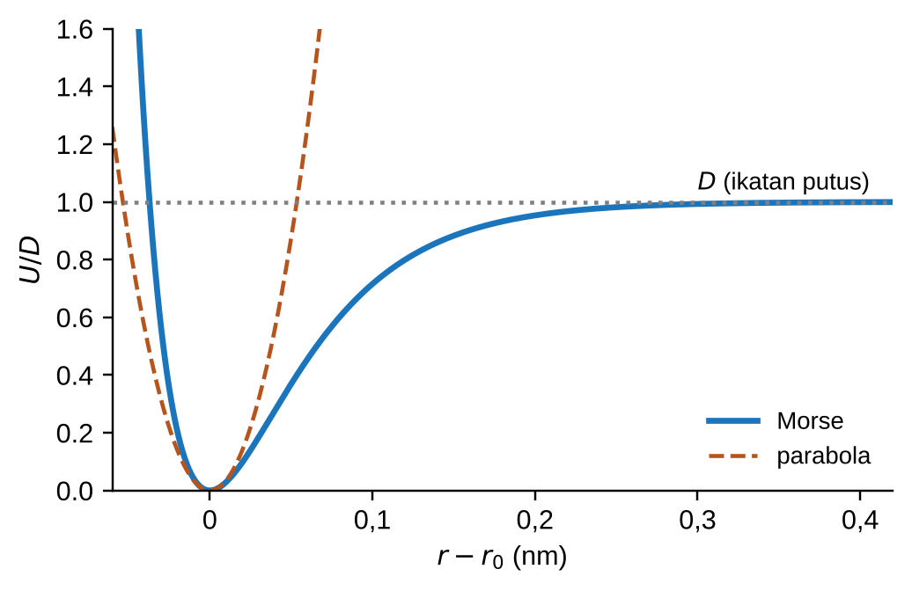{width=64%}

Untuk ikatan kovalen dalam molekul dwiatom, model yang lebih cocok adalah **potensial Morse**:

$$
U(r) = D\big(1 - e^{-a(r - r_0)}\big)^2 . \qquad \text{(4.31)}
$$

Di sini $U = 0$ di dasar lembah ($r = r_0$), dan $U \to D$ ketika atom-atom terpisah jauh. Jadi $D$ adalah **energi disosiasi** diukur dari dasar lembah, dan $a$ mengatur lebar lembah. Kelengkungan di dasarnya memberi

$$
k_\text{ef} = 2Da^2 .
$$

Gambar 4.14 memperlihatkan perbedaan pentingnya dari pegas ideal. Pegas ideal tidak pernah putus. Ikatan sungguhan putus jika diberi energi sebesar $D$.

::: {.contoh}
**Contoh 4.53 · Ikatan H–Cl sebagai pegas**

Untuk HCl, $D = 4{,}62$ eV dan $a = 18{,}7\ \text{nm}^{-1}$. (a) Berapa konstanta pegas ikatan itu? (b) Berapa energi untuk meregangkan ikatan sejauh 0,010 nm dari jarak setimbangnya, menurut pendekatan pegas dan menurut potensial Morse?

**Penyelesaian.**

(a) $D = (4{,}62)(1{,}602 \times 10^{-19}) = 7{,}40 \times 10^{-19}$ J dan $a = 1{,}87 \times 10^{10}\ \text{m}^{-1}$.

$$
k_\text{ef} = 2(7{,}40 \times 10^{-19})(1{,}87 \times 10^{10})^2 = 518\ \text{N/m}.
$$

(b) Pendekatan pegas: $\tfrac12k_\text{ef}s^2 = \tfrac12(518)(1{,}0 \times 10^{-11})^2 = 2{,}59 \times 10^{-20}$ J $= 0{,}16$ eV.

Morse: $a s = (18{,}7)(0{,}010) = 0{,}187$, sehingga $U = 4{,}62(1 - e^{-0{,}187})^2 = 4{,}62(0{,}1706)^2 = 0{,}13$ eV.

**Memahami hasil.** Ikatan H–Cl sekitar 600 kali lebih kaku daripada "pegas" antara dua atom argon, dan sekaku pegas pada suspensi sepeda. Padahal ia hanya menghubungkan dua atom. Pada regangan 0,010 nm (sekitar 8% panjang ikatan), pendekatan pegas sudah meleset 20%. Perbedaan antara kurva sebenarnya dan parabola inilah yang disebut **ketakharmonikan**, dan pengaruhnya terlihat pada spektrum inframerah molekul.
:::

### Profil energi reaksi

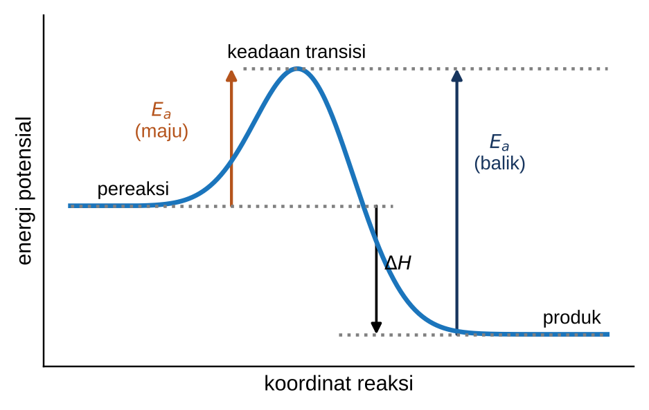{width=62%}

Diagram energi yang paling sering kamu gambar di kimia adalah **profil energi reaksi** (Gambar 4.15). Sumbu mendatarnya, "koordinat reaksi", mengukur seberapa jauh susunan atom telah berubah dari pereaksi menuju produk. Semua gagasan di subbab ini terpakai:

- Pereaksi dan produk berada di **lembah**: kesetimbangan stabil.
- Puncak di antaranya adalah **keadaan transisi**: kesetimbangan takstabil. Dari sana sistem dapat menggelinding ke lembah mana pun.
- Tinggi puncak di atas lembah pereaksi adalah **energi aktivasi** $E_a$. Hanya tumbukan dengan energi paling sedikit sebesar itu yang dapat menghasilkan reaksi.
- Selisih tinggi kedua lembah adalah perubahan energi reaksi, yang pada tekanan tetap hampir sama dengan $\Delta H$.

Dari gambar itu langsung terbaca hubungan

$$
E_a(\text{balik}) = E_a(\text{maju}) - \Delta H . \qquad \text{(4.32)}
$$

::: {.contoh}
**Contoh 4.54 · Energi aktivasi reaksi balik**

Sebuah reaksi memiliki energi aktivasi 180 kJ/mol dan $\Delta H = -120$ kJ/mol. (a) Berapa energi aktivasi reaksi baliknya? (b) Nyatakan kedua energi aktivasi itu dalam eV per molekul.

**Penyelesaian.**

(a) $E_a(\text{balik}) = 180 - (-120) = 300$ kJ/mol.

(b) Dengan 1 eV per partikel = 96,5 kJ/mol: $180/96{,}5 = 1{,}87$ eV dan $300/96{,}5 = 3{,}11$ eV.

**Memahami hasil.** Reaksi eksoterm selalu memiliki penghalang lebih rendah pada arah maju daripada arah balik. Katalis menurunkan puncaknya untuk kedua arah sekaligus, tetapi tidak mengubah tinggi kedua lembah. Karena itu katalis mempercepat reaksi tanpa mengubah $\Delta H$ atau letak kesetimbangan.
:::

::: {.terapan}
**Kaitan kimia · Dari joule ke kJ/mol ke elektronvolt**

Kimia jarang memakai joule untuk satu molekul, karena angkanya terlalu kecil. Ada dua cara menyatakannya:

- **per mol:** kalikan dengan bilangan Avogadro. Energi ikatan H–H adalah 436 kJ/mol.
- **per partikel dalam elektronvolt:** $1\ \text{eV} = 1{,}602 \times 10^{-19}$ J.

Jembatan antara keduanya sangat berguna untuk dihafal:

$$
1\ \text{eV per partikel} = 96{,}5\ \text{kJ/mol}.
$$

Jadi ikatan H–H setara dengan $436/96{,}5 = 4{,}52$ eV per molekul, atau $7{,}24 \times 10^{-19}$ J. Energi sebesar itulah yang harus dibawa satu foton untuk memutus satu ikatan H–H (Bab 15).

Entalpi reaksi yang kamu hitung dari energi ikatan pada dasarnya adalah neraca energi potensial: energi untuk mendaki keluar dari lembah ikatan pereaksi, dikurangi energi yang dilepas ketika atom-atom jatuh ke lembah ikatan produk.
:::

::: {.kuis}
**Kuis cepat 4.8**

Pada Gambar 4.13, sebuah pasangan atom memiliki energi total sedikit di bawah nol. Apakah titik balik kirinya dan titik balik kanannya berjarak sama dari $r_0$? Apa akibatnya bagi jarak rata-rata antaratom ketika energinya dinaikkan (zat dipanaskan)?
:::

## 4.9 Energi potensial gravitasi jarak jauh dan laju lepas

Rumus $U_g = mgy$ menganggap gaya gravitasi tetap. Itu benar hanya di dekat permukaan Bumi. Untuk roket, satelit, dan molekul gas yang lepas dari atmosfer, kita memerlukan rumus yang lebih umum. Subbab ini juga menjadi latihan yang bagus untuk seluruh perangkat energi yang sudah dibangun.

### Hukum gravitasi Newton

Dua benda bermassa $M$ dan $m$ yang pusatnya berjarak $r$ saling menarik dengan gaya

$$
F = \frac{GMm}{r^2}, \qquad G = 6{,}674 \times 10^{-11}\ \text{N·m}^2/\text{kg}^2 . \qquad \text{(4.33)}
$$

Gaya ini melemah dengan kuadrat jarak. Di permukaan Bumi ($r = R$) gaya ini adalah berat $mg$, sehingga $g = GM/R^2$. Untuk Bumi, $M = 5{,}97 \times 10^{24}$ kg dan $R = 6{,}37 \times 10^6$ m, dan hasil kali $GM = 3{,}986 \times 10^{14}\ \text{m}^3/\text{s}^2$ akan sering dipakai.

### Energi potensialnya

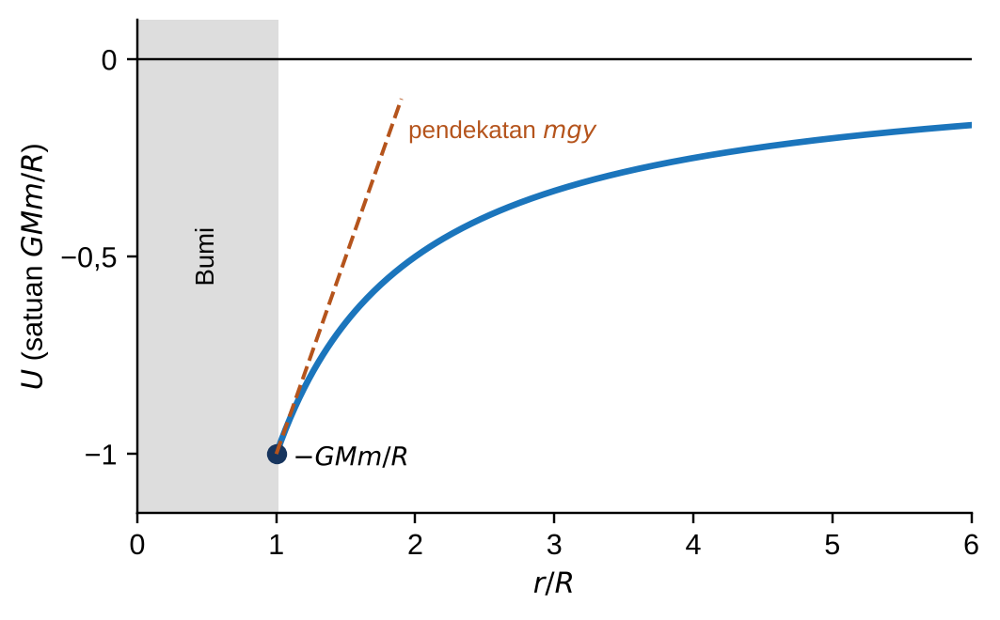{width=62%}

Gaya gravitasi konservatif. Terapkan (4.20) dengan titik acuan di jarak tak hingga, tempat kedua benda tidak lagi saling memengaruhi:

$$
\boxed{U(r) = -\frac{GMm}{r}} \qquad \text{(4.34)}
$$

::: {.mat}
**Matematika · Penurunan (4.34)**

Gaya pada $m$ berarah ke pusat, $F_r = -GMm/r^2$. Dengan $U(\infty) = 0$:

$$
U(r) = -\int_\infty^r\Big(-\frac{GMm}{r'^2}\Big)dr' = GMm\Big[-\frac{1}{r'}\Big]_\infty^r = -\frac{GMm}{r}.
$$

Dipakai $\int r^{-2}\,dr = -r^{-1}$, yaitu aturan pangkat dengan $n = -2$.
:::

**Mengapa negatif?** Karena acuannya di tak hingga dan gravitasi bersifat menarik. Benda yang terikat pada Bumi berada "di dalam sumur", dan diperlukan energi positif untuk mengeluarkannya. Nilai negatif energi potensial adalah ciri semua sistem terikat, termasuk elektron dalam atom (Bab 15) dan dua atom dalam molekul (Gambar 4.13).

**Apakah ini bertentangan dengan $mgy$?** Tidak. Untuk kenaikan kecil $y$ di atas permukaan,

$$
\Delta U = -\frac{GMm}{R + y} + \frac{GMm}{R} = \frac{GMm\,y}{R(R + y)} \approx \frac{GM}{R^2}\,my = mgy .
$$

Rumus $mgy$ adalah pendekatan dari rumus umum, berlaku selama $y$ jauh lebih kecil daripada $R$.

### Laju lepas

Berapa kelajuan paling kecil agar benda yang dilontarkan dari permukaan tidak pernah kembali? Benda itu harus dapat mencapai jarak tak hingga, tempat $U = 0$, dengan energi kinetik paling sedikit nol. Kekekalan energi:

$$
\tfrac12mv_\text{lepas}^2 - \frac{GMm}{R} = 0 \quad\Longrightarrow\quad \boxed{v_\text{lepas} = \sqrt{\frac{2GM}{R}}} \qquad \text{(4.35)}
$$

Laju lepas tidak bergantung pada massa benda maupun arah lontaran (asalkan tidak menabrak planet).

::: {.contoh}
**Contoh 4.55 · Laju lepas Bumi dan Bulan**

Hitung laju lepas dari permukaan (a) Bumi; (b) Bulan ($M = 7{,}35 \times 10^{22}$ kg, $R = 1{,}74 \times 10^6$ m).

**Penyelesaian.**

(a) $v = \sqrt{\dfrac{2(3{,}986 \times 10^{14})}{6{,}37 \times 10^6}} = 1{,}12 \times 10^4$ m/s $= 11{,}2$ km/s.

(b) $v = \sqrt{\dfrac{2(6{,}674 \times 10^{-11})(7{,}35 \times 10^{22})}{1{,}74 \times 10^6}} = 2{,}38$ km/s.

**Memahami hasil.** Laju lepas Bumi sekitar 40 000 km/jam. Energi kinetik per kilogram pada laju itu adalah $\tfrac12v^2 = 63$ MJ/kg, lebih besar daripada energi kimia per kilogram bahan bakar roket mana pun. Itu sebabnya roket harus bertingkat dan sebagian besar massanya berupa bahan bakar.
:::

::: {.contoh}
**Contoh 4.56 · Seberapa tinggi sebenarnya?**

Sebuah proyektil ditembakkan tegak ke atas dari permukaan Bumi dengan kelajuan 8,0 km/s. Abaikan hambatan udara dan rotasi Bumi. Berapa ketinggian terbesarnya? Bandingkan dengan hasil rumus $mgy$.

**Penyelesaian.** Kekekalan energi antara permukaan dan titik tertinggi (jarak $r$ dari pusat Bumi, kelajuan nol):

$$
\tfrac12v^2 - \frac{GM}{R} = -\frac{GM}{r}.
$$

$\tfrac12v^2 = 3{,}20 \times 10^7\ \text{J/kg}$ dan $GM/R = 6{,}26 \times 10^7\ \text{J/kg}$, sehingga $GM/r = 3{,}06 \times 10^7\ \text{J/kg}$ dan

$$
r = \frac{3{,}986 \times 10^{14}}{3{,}06 \times 10^7} = 1{,}30 \times 10^7\ \text{m}, \qquad h = r - R = 6{,}7 \times 10^6\ \text{m} = 6700\ \text{km}.
$$

Rumus $mgy$ memberi $h = v^2/(2g) = 3300$ km.

**Memahami hasil.** Rumus sederhana meleset dua kali lipat. Gravitasi melemah di ketinggian, jadi proyektil naik jauh lebih tinggi daripada perkiraan dengan $g$ tetap. Untuk ketinggian yang sebanding dengan jari-jari Bumi, hanya $-GMm/r$ yang benar.
:::

::: {.contoh}
**Contoh 4.57 · Energi untuk menempatkan satelit**

Satelit 1000 kg ditempatkan pada orbit lingkaran 400 km di atas permukaan Bumi. (a) Berapa kelajuan orbitnya? (b) Berapa energi mekanik totalnya di orbit? (c) Berapa energi paling sedikit yang harus diberikan kepadanya dari keadaan diam di permukaan?

**Penyelesaian.** $r = 6{,}37 \times 10^6 + 0{,}40 \times 10^6 = 6{,}77 \times 10^6$ m.

(a) Gravitasi menyediakan gaya ke pusat: $\dfrac{GMm}{r^2} = \dfrac{mv^2}{r}$, sehingga $v = \sqrt{GM/r} = 7{,}67$ km/s.

(b) Dari (a), $K = \tfrac12mv^2 = \dfrac{GMm}{2r}$. Maka

$$
E = K + U = \frac{GMm}{2r} - \frac{GMm}{r} = -\frac{GMm}{2r} = -2{,}94 \times 10^{10}\ \text{J}.
$$

(c) Di permukaan, $E_0 = -GMm/R = -6{,}26 \times 10^{10}$ J. Energi yang diperlukan: $-2{,}94 \times 10^{10} - (-6{,}26 \times 10^{10}) = 3{,}3 \times 10^{10}$ J.

**Memahami hasil.** Energi itu setara dengan 9200 kWh. Sebagian besar dipakai untuk memberi **kelajuan** orbit, bukan ketinggian: menaikkan 1000 kg setinggi 400 km hanya perlu sekitar $0{,}37 \times 10^{10}$ J. Hasil $E = -GMm/(2r)$ berlaku untuk semua orbit lingkaran: energi totalnya negatif, tanda bahwa satelit terikat.
:::

::: {.terapan}
**Kaitan kimia · Mengapa atmosfer Bumi hampir tidak mengandung hidrogen**

Molekul gas bergerak acak dengan kelajuan khas $v_\text{rms} = \sqrt{3k_BT/m}$ (Bab 10). Pada 300 K:

| Gas | Massa molar | $v_\text{rms}$ pada 300 K |
|---|---|---|
| H₂ | 2 g/mol | 1,9 km/s |
| He | 4 g/mol | 1,4 km/s |
| N₂ | 28 g/mol | 0,52 km/s |
| O₂ | 32 g/mol | 0,48 km/s |

Semua lebih kecil daripada laju lepas 11,2 km/s. Tetapi kelajuan molekul tersebar: selalu ada sebagian kecil molekul yang jauh lebih cepat daripada rata-rata. Patokan kasarnya, sebuah planet kehilangan suatu gas dalam waktu geologis jika $v_\text{rms}$ gas itu melebihi kira-kira seperenam laju lepas, yaitu 1,9 km/s untuk Bumi. Hidrogen dan helium berada tepat di batas itu dan perlahan bocor ke angkasa. Nitrogen dan oksigen aman. Bulan, dengan laju lepas hanya 2,4 km/s, tidak dapat menahan gas apa pun, dan Jupiter yang masif menahan hidrogennya sampai sekarang.
:::

::: {.kuis}
**Kuis cepat 4.9**

Dua benda dilepas dari diam, satu di ketinggian $R$ di atas permukaan Bumi dan satu lagi dari jarak yang sangat jauh. Abaikan udara. Apakah kelajuan benda kedua saat tiba di permukaan jauh lebih besar daripada benda pertama? Berapa kelajuan terbesar yang mungkin?
:::

## 4.10 Gambaran besar: bentuk-bentuk energi

Bab ini dimulai dengan dua bentuk energi mekanik. Sepanjang jalan, daftarnya bertambah. Sekarang kita rangkum.

| Bentuk energi | Tersimpan sebagai | Dibahas di |
|---|---|---|
| Kinetik | gerak benda | subbab 4.3 |
| Potensial gravitasi | posisi dalam medan gravitasi | subbab 4.5 dan 4.9 |
| Potensial elastis | perubahan bentuk pegas atau bahan | subbab 4.5 |
| Termal | gerak acak atom dan molekul | subbab 4.7, Bab 10 |
| Kimia | susunan elektron dalam ikatan | subbab 4.8, Bab 15 |
| Listrik | posisi muatan dalam medan listrik | Bab 12 |
| Cahaya (radiasi) | gelombang elektromagnetik, foton | Bab 15 |
| Inti | susunan proton dan neutron dalam inti | Bab 15 |

Pada tingkat atom, daftar ini menyusut. Energi termal adalah energi kinetik dan potensial atom-atom. Energi kimia adalah energi kinetik elektron ditambah energi potensial listrik antara elektron dan inti. Sebagian besar "bentuk energi" yang berbeda di skala sehari-hari ternyata energi kinetik dan energi potensial di skala yang lebih kecil.

### Kerapatan energi

| Penyimpan energi | Energi per kilogram |
|---|---|
| Air di bendungan setinggi 100 m | 0,001 MJ |
| Pegas baja yang ditekan | 0,0003 MJ |
| Baterai litium-ion | 0,9 MJ |
| Bahan peledak TNT | 4,6 MJ |
| Karbohidrat | 17 MJ |
| Lemak | 37 MJ |
| Bensin | 44 MJ |
| Hidrogen (dibakar) | 142 MJ |
| Uranium-235 (fisi) | $8 \times 10^7$ MJ |

Energi kimia ribuan kali lebih rapat daripada energi mekanik, dan energi inti jutaan kali lebih rapat daripada energi kimia. Urutan ini mencerminkan kekuatan gaya yang terlibat: gravitasi, gaya listrik antara elektron dan inti, lalu gaya inti.

::: {.contoh}
**Contoh 4.58 · Baterai ponsel dan anak tangga**

Baterai sebuah ponsel menyimpan 15 Wh. Jika seluruh energi itu dapat dipakai untuk mengangkat seseorang bermassa 70 kg, seberapa tinggi ia terangkat?

**Penyelesaian.** $15\ \text{Wh} = (15)(3600) = 5{,}4 \times 10^4$ J.

$$
h = \frac{5{,}4 \times 10^4}{(70)(9{,}80)} = 79\ \text{m}.
$$

**Memahami hasil.** Baterai seberat 50 gram menyimpan energi yang cukup untuk mengangkat orang dewasa setinggi gedung 25 lantai. Energi potensial gravitasi sehari-hari memang sangat kecil dibandingkan energi kimia.
:::

### Massa adalah energi

Einstein menunjukkan pada tahun 1905 bahwa massa sendiri adalah bentuk energi (Bab 15):

$$
E_0 = mc^2, \qquad c = 3{,}00 \times 10^8\ \text{m/s}. \qquad \text{(4.36)}
$$

Setiap kali sebuah sistem melepas energi $\Delta E$, massanya berkurang sebesar $\Delta E/c^2$. Karena $c^2$ sangat besar, perubahan massa ini tidak terukur dalam reaksi kimia, tetapi nyata dan terukur dalam reaksi inti.

::: {.contoh}
**Contoh 4.59 · Apakah massa kekal dalam reaksi kimia?**

Pembakaran 1 mol hidrogen (2,0 g H₂ dengan 16,0 g O₂) melepas 286 kJ. Berapa massa yang hilang? Bandingkan dengan massa pereaksi.

**Penyelesaian.**

$$
\Delta m = \frac{\Delta E}{c^2} = \frac{2{,}86 \times 10^5}{(3{,}00 \times 10^8)^2} = 3{,}2 \times 10^{-12}\ \text{kg}.
$$

Dibandingkan 18 g pereaksi, itu $1{,}8 \times 10^{-10}$, atau kurang dari dua bagian per sepuluh miliar.

**Memahami hasil.** Neraca analitik terbaik membaca sampai sekitar satu bagian per sepuluh juta. Jadi hukum kekekalan massa Lavoisier tetap benar untuk semua keperluan kimia, walaupun secara prinsip hanya pendekatan. Dalam reaksi inti, energi yang dilepas per kilogram jutaan kali lebih besar, dan selisih massanya mudah diukur.
:::

::: {.kuis}
**Kuis cepat 4.10**

Sebuah pegas ditekan dan diikat, lalu ditimbang dengan neraca yang ketelitiannya tak terbatas. Apakah massanya berbeda dari pegas yang sama dalam keadaan kendur?
:::

