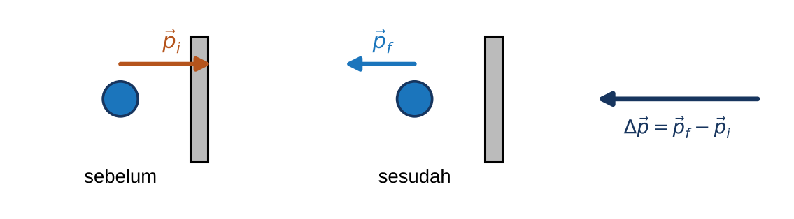
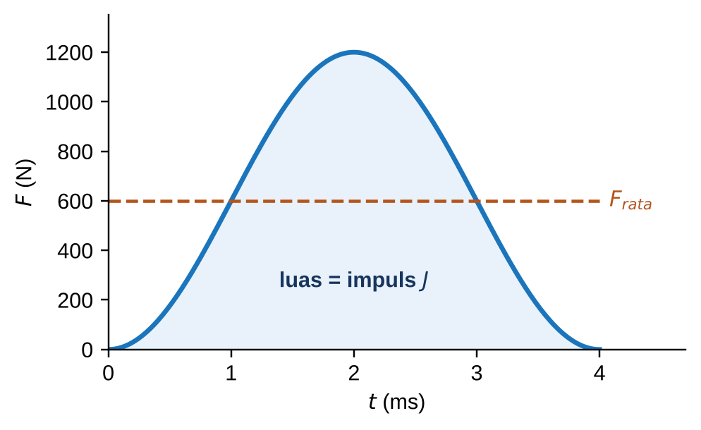
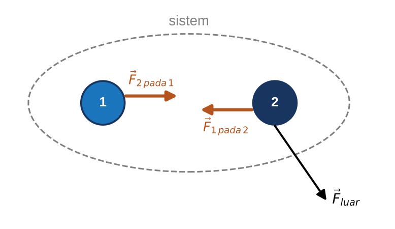
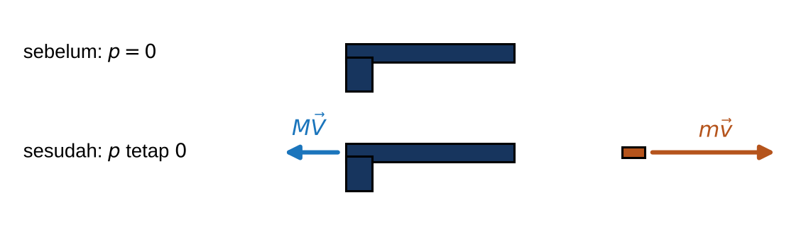
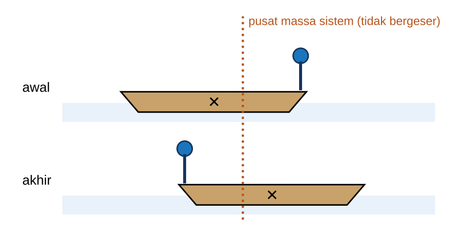
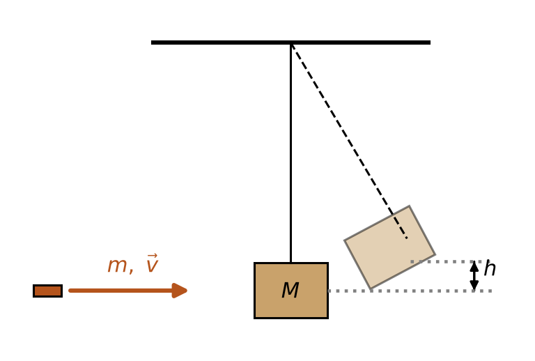

# Bab 5 Momentum dan Tumbukan

Pada tahun 1909, Ernest Rutherford meminta dua asistennya menembakkan partikel alfa ke lembaran emas yang sangat tipis. Menurut model atom saat itu, partikel alfa seharusnya menembus dengan sedikit pembelokan saja. Hampir semuanya memang begitu. Tetapi kira-kira satu dari delapan ribu partikel **terpental balik**, hampir ke arah datangnya. Rutherford kemudian berkata bahwa itu sama mengejutkannya dengan menembakkan peluru meriam ke selembar kertas tisu dan melihat pelurunya memantul kembali.

Apa yang dapat memantulkan partikel alfa yang melaju belasan ribu kilometer per sekon? Jawabannya bergantung pada satu hukum yang menjadi pokok bab ini: **kekekalan momentum**. Hukum itu berkata bahwa benda yang bergerak hanya dapat dipantulkan balik oleh sesuatu yang **jauh lebih berat** daripadanya. Elektron terlalu ringan. Jadi di dalam atom emas pasti ada sesuatu yang kecil, sangat berat, dan memuat hampir seluruh massa atom. Begitulah inti atom ditemukan. Hitungannya ada di Contoh 5.57.

Di Bab 4 kita melihat gaya yang bekerja sepanjang **jarak** mengubah energi kinetik. Di bab ini kita melihat gaya yang bekerja selama selang **waktu** mengubah momentum. Kedua sudut pandang itu saling melengkapi, dan soal tumbukan hampir selalu memerlukan keduanya.

::: {.tujuan}
**Tujuan belajar**

Setelah mempelajari bab ini, kamu mampu:

1. Menghitung momentum benda dan sistem benda sebagai vektor, serta menghubungkannya dengan energi kinetik.
2. Memakai teorema impuls–momentum untuk menghitung gaya rata-rata pada tumbukan.
3. Menentukan kapan momentum sebuah sistem kekal, dan menerapkannya pada rekoil, ledakan, dan peluruhan.
4. Menganalisis tumbukan tak lenting, lenting, dan sebagian lenting dalam satu dimensi.
5. Menganalisis tumbukan dan ledakan dalam dua dimensi dengan komponen.
6. Menentukan pusat massa sistem partikel dan benda sederhana, dan memakai gerak pusat massa.
7. Menghitung energi yang tersedia dalam tumbukan dan massa tereduksi dua benda.
8. Menganalisis sistem yang massanya berubah, terutama roket.
9. Menjelaskan tekanan gas dan hamburan partikel dengan momentum.
:::

::: {.mat}
**Prasyarat**

Dari Bab 1: penjumlahan vektor dengan komponen (subbab 1.14). Dari Bab 3: hukum kedua dan ketiga Newton (subbab 3.4 dan 3.6). Dari Bab 4: energi kinetik, kekekalan energi mekanik, dan energi potensial pegas (subbab 4.3, 4.5, dan 4.6).
:::

## 5.1 Momentum linear

Sebuah bola pingpong dan sebuah bola boling menggelinding ke arahmu dengan kelajuan yang sama. Kamu tahu mana yang lebih sulit dihentikan. Sekarang bandingkan bola boling yang menggelinding pelan dengan bola boling yang dilempar kencang. "Kesulitan menghentikan" bergantung pada massa **dan** kecepatan. Besaran yang menangkap keduanya adalah **momentum**:

$$
\boxed{\vec p = m\vec v} \qquad \text{(5.1)}
$$

Momentum adalah **vektor**, searah dengan kecepatan. Satuannya kg·m/s, yang sama dengan N·s. Tidak ada nama khusus untuk satuan ini.

| Benda | Momentum (kira-kira) |
|---|---|
| Molekul N₂ di udara | $2 \times 10^{-23}$ kg·m/s |
| Bola pingpong yang dipukul | 0,05 kg·m/s |
| Bola sepak yang ditendang | 10 kg·m/s |
| Pelari cepat | 700 kg·m/s |
| Mobil di jalan tol | $3 \times 10^4$ kg·m/s |
| Kapal tanker yang berlayar pelan | $10^9$ kg·m/s |

### Hukum kedua Newton dalam bentuk aslinya

Newton sendiri tidak menulis $F = ma$. Ia menulis bahwa gaya total sama dengan **laju perubahan momentum**:

$$
\boxed{\sum\vec F = \frac{d\vec p}{dt}} \qquad \text{(5.2)}
$$

Jika massa tetap, $\dfrac{d\vec p}{dt} = m\dfrac{d\vec v}{dt} = m\vec a$, dan kita kembali ke bentuk yang biasa. Tetapi bentuk (5.2) lebih umum. Ia tetap berlaku untuk aliran air dari selang, roket yang massanya berkurang, dan partikel yang bergerak mendekati laju cahaya (Bab 15).

### Momentum dan energi kinetik

Keduanya memuat massa dan kecepatan, tetapi dengan cara berbeda:

$$
p = mv, \qquad K = \tfrac12mv^2 = \frac{p^2}{2m} . \qquad \text{(5.3)}
$$

| | Momentum | Energi kinetik |
|---|---|---|
| Jenis besaran | vektor | skalar |
| Bergantung pada kelajuan | sebanding dengan $v$ | sebanding dengan $v^2$ |
| Diubah oleh | gaya × **waktu** (impuls) | gaya × **jarak** (usaha) |
| Dapat bernilai nol untuk sistem yang bergerak? | ya, jika momentum anggotanya saling meniadakan | tidak |
| Kekal pada tumbukan? | selalu, untuk sistem terisolasi | hanya pada tumbukan lenting |

Baris terakhir adalah alasan momentum begitu berguna. Pada tumbukan, energi kinetik sering berubah menjadi panas, bunyi, dan perubahan bentuk dengan cara yang sulit dihitung. Momentum tidak dapat "bersembunyi" seperti itu.

::: {.contoh}
**Contoh 5.1 · Membandingkan momentum**

(a) Berapa momentum truk 8000 kg yang melaju 15 m/s? (b) Berapa kelajuan mobil 1200 kg agar momentumnya sama dengan truk itu? (c) Berapa momentum peluru 10 g yang melesat 600 m/s?

**Penyelesaian.**

(a) $p = (8000)(15) = 1{,}2 \times 10^5$ kg·m/s.

(b) $v = \dfrac{1{,}2 \times 10^5}{1200} = 100$ m/s, atau 360 km/jam.

(c) $p = (0{,}010)(600) = 6{,}0$ kg·m/s.

**Memahami hasil.** Momentum peluru itu sama dengan momentum bola sepak yang ditendang sedang. Tetapi energi kinetik peluru 1800 J, ratusan kali energi bola. Momentum dan energi kinetik mengukur dua hal yang berbeda, seperti terlihat pada contoh berikut.
:::

::: {.contoh}
**Contoh 5.2 · Momentum sama, energi berbeda**

Bola bisbol (0,145 kg) dan bola boling (7,0 kg) memiliki momentum yang sama, 5,8 kg·m/s. Bandingkan kelajuan dan energi kinetik keduanya.

**Penyelesaian.** Kelajuan: bisbol $5{,}8/0{,}145 = 40$ m/s; boling $5{,}8/7{,}0 = 0{,}83$ m/s.

Energi kinetik, dengan $K = p^2/(2m)$: bisbol $\dfrac{5{,}8^2}{2(0{,}145)} = 116$ J; boling $\dfrac{5{,}8^2}{2(7{,}0)} = 2{,}4$ J.

**Memahami hasil.** Dengan momentum yang sama, benda yang lebih **ringan** membawa energi kinetik lebih besar, karena $K = p^2/(2m)$. Perbandingannya di sini 48, sama dengan perbandingan massanya. Untuk menghentikan kedua bola dalam **waktu** yang sama diperlukan gaya yang sama. Untuk menghentikannya dalam **jarak** yang sama, bola bisbol memerlukan gaya 48 kali lebih besar.
:::

{width=86%}

::: {.contoh}
**Contoh 5.3 · Perubahan momentum saat memantul**

Bola tenis 0,058 kg menumbuk dinding dengan kelajuan 25 m/s dan memantul dengan kelajuan 20 m/s (Gambar 5.1). Berapa perubahan momentumnya?

**Penyelesaian.** Ambil arah menuju dinding sebagai positif. Maka $v_i = +25$ m/s dan $v_f = -20$ m/s.

$$
\Delta p = m(v_f - v_i) = (0{,}058)(-20 - 25) = -2{,}6\ \text{kg·m/s}.
$$

**Memahami hasil.** Besar perubahan momentumnya berasal dari $20 + 25 = 45$ m/s, bukan $25 - 20 = 5$ m/s. Kesalahan tanda di sini adalah kesalahan paling umum di seluruh bab ini. Benda yang **memantul** mengalami perubahan momentum lebih besar daripada benda yang sekadar **berhenti**.
:::

::: {.contoh}
**Contoh 5.4 · Semburan air pada dinding**

Selang menyemburkan 2,0 kg air setiap sekon dengan kelajuan 15 m/s tegak lurus ke dinding. Berapa gaya air pada dinding jika air (a) berhenti dan mengalir turun; (b) memantul balik dengan kelajuan yang sama?

**Rencana.** Tidak ada satu "benda" dengan percepatan tertentu. Yang ada adalah aliran yang terus-menerus kehilangan momentum. Bentuk $F = dp/dt$ langsung dapat dipakai.

**Penyelesaian.**

(a) Setiap sekon, 2,0 kg air kehilangan momentum $(2{,}0)(15) = 30$ kg·m/s. Gaya dinding pada air $-30$ N, jadi gaya air pada dinding $+30$ N.

(b) Sekarang kecepatan tiap kilogram air berubah dari $+15$ menjadi $-15$ m/s, yaitu 30 m/s. Gayanya $(2{,}0)(30) = 60$ N.

**Memahami hasil.** Memantul melipatduakan gaya. Turbin air jenis Pelton memanfaatkan hal ini: sudunya berbentuk mangkuk yang membalikkan arah air, sehingga gaya yang diperoleh hampir dua kali gaya pada sudu datar. Rumus umumnya, gaya oleh aliran sama dengan (massa per sekon) × (perubahan kecepatan), akan dipakai lagi untuk roket di subbab 5.8 dan untuk tekanan gas di subbab 5.9.
:::

::: {.kuis}
**Kuis cepat 5.1**

Dua benda memiliki energi kinetik yang sama. Benda A bermassa empat kali benda B. Mana yang momentumnya lebih besar, dan berapa perbandingannya?
:::

## 5.2 Impuls

Integralkan hukum kedua (5.2) terhadap waktu, dari sesaat sebelum sampai sesaat sesudah suatu gaya bekerja:

$$
\vec p_f - \vec p_i = \int_{t_i}^{t_f}\sum\vec F\,dt .
$$

Ruas kanan disebut **impuls** gaya total, dilambangkan $\vec J$:

$$
\boxed{\vec J = \int_{t_i}^{t_f}\vec F\,dt = \vec F_\text{rata}\,\Delta t} \qquad\qquad \boxed{\vec J_\text{total} = \Delta\vec p} \qquad \text{(5.4)}
$$

Persamaan kedua adalah **teorema impuls–momentum**. Bandingkan dengan teorema usaha–energi di Bab 4:

| | Teorema usaha–energi | Teorema impuls–momentum |
|---|---|---|
| Gaya dikalikan | jarak | waktu |
| Hasil kalinya | usaha $W$ (skalar) | impuls $\vec J$ (vektor) |
| Mengubah | energi kinetik | momentum |
| Dari grafik | luas di bawah $F$–$x$ | luas di bawah $F$–$t$ |

{width=58%}

Pada tumbukan, gaya naik sangat cepat lalu turun lagi dalam beberapa milisekon (Gambar 5.2). Bentuk rincinya jarang diketahui. Teorema impuls–momentum tidak memerlukannya: cukup momentum sebelum dan sesudah. Dari situ kita memperoleh **gaya rata-rata**,

$$
F_\text{rata} = \frac{\Delta p}{\Delta t} . \qquad \text{(5.5)}
$$

### Memperpanjang waktu, memperkecil gaya

Persamaan (5.5) adalah dasar hampir semua alat keselamatan. Perubahan momentum untuk menghentikan seseorang sudah tertentu. Yang dapat diatur adalah **waktunya**. Makin lama proses berhenti, makin kecil gayanya.

| Alat | Cara memperpanjang waktu berhenti |
|---|---|
| Kantong udara dan sabuk pengaman | menahan badan selama puluhan milisekon, bukan beberapa milisekon |
| Zona remuk mobil | bagian depan mobil sengaja dibuat mudah ringsek |
| Helm | lapisan busa memampat saat benturan |
| Matras senam, pasir lompat jauh | permukaan lunak yang melesak |
| Menangkap bola sambil menarik tangan ke belakang | tangan bergerak bersama bola |
| Kemasan telur dan busa pembungkus | bahan lunak di sekeliling barang |

Ini pandangan lain atas hal yang sama dengan "memperpanjang jarak berhenti" di subbab 4.3. Keduanya benar, dan keduanya berasal dari hukum kedua Newton.

::: {.strategi}
**Strategi · Soal impuls**

1. **Tetapkan arah positif**, dan gambar benda sesaat sebelum dan sesaat sesudah.
2. Tulis kecepatan **dengan tandanya**. Benda yang berbalik arah berganti tanda.
3. Hitung $\Delta p = m(v_f - v_i)$. Untuk dua dimensi, kerjakan tiap komponen.
4. $F_\text{rata} = \Delta p/\Delta t$ adalah gaya **total** rata-rata. Jika ada gaya lain yang berarti (biasanya berat), pisahkan.
5. Gaya pada benda lain (dinding, lantai, pemukul) sama besar dan berlawanan arah, menurut hukum ketiga.
:::

::: {.contoh}
**Contoh 5.5 · Pukulan golf**

Bola golf 0,045 kg yang diam dipukul sehingga melesat 60 m/s. Stik menyentuh bola selama 0,50 ms. Berapa impuls pada bola dan gaya rata-ratanya?

**Penyelesaian.**

$$
J = \Delta p = (0{,}045)(60 - 0) = 2{,}7\ \text{N·s}, \qquad F_\text{rata} = \frac{2{,}7}{0{,}50 \times 10^{-3}} = 5{,}4 \times 10^3\ \text{N}.
$$

**Memahami hasil.** Gaya 5400 N setara dengan berat benda 550 kg, bekerja pada bola 45 gram. Berat bola (0,44 N) sama sekali tidak berarti dibandingkan gaya ini, dan boleh diabaikan selama tumbukan. Itu berlaku umum: selama tumbukan singkat, gaya tumbukan jauh lebih besar daripada gaya-gaya lain.
:::

::: {.contoh}
**Contoh 5.6 · Impuls dari grafik**

Gaya pada bola 0,15 kg yang mula-mula diam naik linear dari nol sampai 1200 N dalam 2,0 ms, lalu turun linear ke nol dalam 2,0 ms berikutnya. Berapa kelajuan akhir bola?

**Penyelesaian.** Impuls adalah luas segitiga di bawah grafik $F$–$t$:

$$
J = \tfrac12(4{,}0 \times 10^{-3})(1200) = 2{,}4\ \text{N·s}, \qquad v = \frac{J}{m} = \frac{2{,}4}{0{,}15} = 16\ \text{m/s}.
$$

**Memahami hasil.** Gaya rata-ratanya $2{,}4/0{,}0040 = 600$ N, tepat setengah gaya puncak, seperti seharusnya untuk grafik segitiga.
:::

::: {.contoh}
**Contoh 5.7 · Kantong udara**

Penumpang 70 kg berada di mobil yang melaju 15 m/s (54 km/jam) dan menabrak tembok. Hitung gaya rata-rata pada penumpang jika ia dihentikan (a) oleh kantong udara dalam 0,20 s; (b) oleh dasbor dalam 0,010 s.

**Penyelesaian.** $\Delta p = (70)(0 - 15) = -1050$ kg·m/s pada kedua keadaan.

(a) $F = \dfrac{1050}{0{,}20} = 5{,}3 \times 10^3$ N.

(b) $F = \dfrac{1050}{0{,}010} = 1{,}1 \times 10^5$ N.

**Memahami hasil.** Gaya pada (b) adalah 150 kali berat badan dan mematikan. Kantong udara tidak mengurangi perubahan momentum sedikit pun. Ia hanya menyebarkannya pada waktu 20 kali lebih lama, dan juga pada luas permukaan badan yang lebih besar.
:::

::: {.contoh}
**Contoh 5.8 · Bola memantul di lantai**

Bola 0,50 kg dijatuhkan dari ketinggian 2,0 m dan memantul sampai ketinggian 1,5 m. Bola menyentuh lantai selama 15 ms. Berapa gaya rata-rata lantai pada bola?

**Rencana.** Tiga tahap: jatuh (energi), tumbukan (impuls), naik (energi). Kelajuan sesaat sebelum dan sesudah tumbukan diperoleh dari kekekalan energi.

**Penyelesaian.** Ambil arah ke atas positif.

Sesaat sebelum: $v_i = -\sqrt{2g(2{,}0)} = -6{,}26$ m/s. Sesaat sesudah: $v_f = +\sqrt{2g(1{,}5)} = +5{,}42$ m/s.

$$
\Delta p = (0{,}50)(5{,}42 - (-6{,}26)) = 5{,}84\ \text{kg·m/s}, \qquad F_\text{total} = \frac{5{,}84}{0{,}015} = 389\ \text{N}.
$$

Gaya total adalah gaya lantai dikurangi berat: $F_\text{lantai} - mg = 389$, sehingga $F_\text{lantai} = 389 + 4{,}9 = 394$ N.

**Memahami hasil.** Berat hanya menyumbang sekitar 1%, jadi mengabaikannya pun hampir tidak mengubah jawaban. Bola kehilangan 25% energinya pada pantulan ini, sesuai dengan perbandingan ketinggian $1{,}5/2{,}0$.
:::

::: {.contoh}
**Contoh 5.9 · Impuls dalam dua dimensi**

Bola bisbol 0,145 kg datang mendatar dengan kelajuan 40 m/s. Setelah dipukul, bola melesat 50 m/s ke arah berlawanan, pada sudut 30° di atas mendatar. Pemukul menyentuh bola 1,2 ms. Tentukan impuls pada bola dan gaya rata-ratanya.

**Penyelesaian.** Ambil sumbu $x$ searah gerak bola setelah dipukul (mendatar) dan $y$ ke atas. Maka

$$
\vec v_i = (-40,\ 0)\ \text{m/s}, \qquad \vec v_f = (50\cos 30°,\ 50\sin 30°) = (43{,}3,\ 25{,}0)\ \text{m/s}.
$$

$$
J_x = (0{,}145)(43{,}3 + 40) = 12{,}1\ \text{N·s}, \qquad J_y = (0{,}145)(25{,}0) = 3{,}6\ \text{N·s}.
$$

$J = \sqrt{12{,}1^2 + 3{,}6^2} = 12{,}6$ N·s, pada sudut $\tan^{-1}(3{,}6/12{,}1) = 17°$ di atas mendatar. Gaya rata-rata: $12{,}6/(1{,}2 \times 10^{-3}) = 1{,}1 \times 10^4$ N.

**Memahami hasil.** Arah gaya pemukul (17°) tidak sama dengan arah bola pergi (30°). Impuls searah dengan **perubahan** momentum, bukan dengan momentum akhir.
:::

::: {.contoh}
**Contoh 5.10 · Mendarat**

Seorang pesenam 60 kg mendarat di matras dengan kelajuan 5,0 m/s ke bawah dan berhenti dalam 0,50 s. Berapa gaya rata-rata matras padanya? Bagaimana jika ia mendarat di lantai keras dan berhenti dalam 0,050 s?

**Penyelesaian.** Ambil ke atas positif. $\Delta p = (60)(0 - (-5{,}0)) = +300$ kg·m/s.

Matras: $F_\text{total} = 300/0{,}50 = 600$ N, sehingga $F_\text{matras} = 600 + mg = 600 + 588 = 1{,}2 \times 10^3$ N.

Lantai keras: $F_\text{total} = 6000$ N, sehingga $F_\text{lantai} = 6{,}6 \times 10^3$ N.

**Memahami hasil.** Pada pendaratan di matras, berat menyumbang separuh gaya dan tidak boleh diabaikan. Berat hanya boleh diabaikan jika waktu tumbukannya sangat singkat sehingga gaya tumbukan jauh lebih besar.
:::

::: {.awas}
**Awas · Tiga kesalahan pada soal impuls**

- **Lupa tanda saat benda berbalik.** Bola yang datang 25 m/s dan memantul 20 m/s berubah kecepatan 45 m/s.
- **Menyamakan gaya total dengan gaya tumbukan.** $\Delta p/\Delta t$ memberi gaya **total**. Untuk tumbukan tegak yang tidak terlalu singkat, tambahkan berat.
- **Mengira gaya lebih besar berarti impuls lebih besar.** Impuls adalah gaya kali waktu. Gaya kecil yang bekerja lama dapat memberi impuls lebih besar daripada gaya besar yang sesaat.
:::

### Impuls gaya yang berubah halus

Jika bentuk gaya terhadap waktu diketahui, impulsnya dihitung dengan integral. Bentuk yang sering dipakai sebagai model pukulan adalah setengah gelombang sinus selama waktu sentuh $\tau$:

$$
F(t) = F_0\sin\frac{\pi t}{\tau}, \qquad J = \int_0^\tau F\,dt = \frac{2}{\pi}F_0\tau . \qquad \text{(5.6)}
$$

Gaya rata-ratanya $2F_0/\pi = 0{,}64F_0$, sedikit lebih besar daripada setengah gaya puncak.

::: {.contoh}
**Contoh 5.11 · Servis tenis**

Gaya raket pada bola tenis 0,057 kg yang mula-mula diam dimodelkan sebagai setengah gelombang sinus dengan gaya puncak 1500 N dan waktu sentuh 3,0 ms. Berapa kelajuan bola?

**Penyelesaian.**

$$
J = \frac{2}{\pi}(1500)(3{,}0 \times 10^{-3}) = 2{,}86\ \text{N·s}, \qquad v = \frac{2{,}86}{0{,}057} = 50\ \text{m/s}.
$$

**Memahami hasil.** Kelajuan 50 m/s adalah 180 km/jam, wajar untuk servis yang keras. Gaya puncaknya setara dengan berat 150 kg, bekerja pada bola 57 gram.
:::

### Dari jarak berhenti ke waktu berhenti

Sering kali yang diketahui adalah **jarak** berhentinya (dalamnya zona remuk, tebal busa helm), bukan waktunya. Jika perlambatan dianggap tetap, kelajuan rata-rata selama berhenti adalah setengah kelajuan awal, sehingga $\Delta t = 2d/v$.

::: {.contoh}
**Contoh 5.12 · Zona remuk**

Mobil yang melaju 15 m/s menabrak tembok. Bagian depannya ringsek sedalam 0,60 m sebelum kabin berhenti. Berapa gaya rata-rata pada penumpang 70 kg yang terikat sabuk pengaman?

**Penyelesaian.** Waktu berhenti: $\Delta t = \dfrac{2(0{,}60)}{15} = 0{,}080$ s.

$$
F = \frac{\Delta p}{\Delta t} = \frac{(70)(15)}{0{,}080} = 1{,}3 \times 10^4\ \text{N}.
$$

**Memahami hasil.** Dengan usaha–energi: $Fd = \tfrac12mv^2$ memberi $F = \dfrac{(70)(15)^2}{2(0{,}60)} = 1{,}3 \times 10^4$ N. Sama, karena kedua teorema berasal dari hukum yang sama. Gaya ini 19 kali berat badan: berat, tetapi masih dapat ditanggung jika tersebar pada sabuk yang lebar. Mobil yang "kokoh" dan tidak ringsek akan berhenti dalam jarak jauh lebih pendek, dan gayanya jauh lebih besar.
:::

::: {.kuis}
**Kuis cepat 5.2**

Sebuah bola lempung dan sebuah bola karet bermassa sama dilempar ke pintu dengan kelajuan sama. Lempung menempel, bola karet memantul. Mana yang lebih mungkin menutup pintu itu?
:::

## 5.3 Kekekalan momentum

{width=52%}

Ambil dua benda yang saling berinteraksi (Gambar 5.3). Menurut hukum ketiga Newton, gaya benda 2 pada benda 1 sama besar dan berlawanan arah dengan gaya benda 1 pada benda 2, dan keduanya bekerja selama waktu yang sama. Jadi impuls pada kedua benda sama besar dan berlawanan arah:

$$
\Delta\vec p_1 = -\Delta\vec p_2 \quad\Longrightarrow\quad \Delta(\vec p_1 + \vec p_2) = 0 .
$$

Apa pun yang diperoleh satu benda, hilang dari benda lain. Momentum total keduanya tidak berubah. Untuk sistem dengan banyak anggota, semua gaya dalam saling meniadakan berpasangan, dan yang tersisa hanya gaya luar:

$$
\frac{d\vec P_\text{total}}{dt} = \sum\vec F_\text{luar} . \qquad \text{(5.7)}
$$

::: {.inti}
**Hukum kekekalan momentum.** Jika gaya luar total pada sebuah sistem nol, momentum total sistem itu tidak berubah:

$$
\vec P_\text{awal} = \vec P_\text{akhir} .
$$
:::

Tiga hal membuat hukum ini sangat kuat:

1. **Tidak peduli pada jenis gaya dalam.** Gesekan, ledakan, pegas, gaya listrik, reaksi kimia, semuanya gaya dalam yang berpasangan. Energi mekanik boleh hilang; momentum tidak.
2. **Berlaku per komponen.** Karena momentum vektor, hukum ini adalah tiga persamaan sekaligus. Jika gaya luar hanya ada pada arah tegak, momentum **mendatar** tetap kekal.
3. **Berlaku di semua skala**, dari galaksi sampai partikel dalam inti atom, juga di tempat hukum Newton sendiri tidak lagi tepat.

### Kapan sebuah sistem boleh dianggap terisolasi?

Di Bumi selalu ada gravitasi dan gesekan. Momentum tetap boleh dianggap kekal jika salah satu dari keadaan ini terpenuhi:

- Gaya luar **saling meniadakan**: benda di permukaan datar yang licin (berat diimbangi gaya normal).
- Gaya luar **jauh lebih kecil** daripada gaya dalam selama selang waktu yang ditinjau. Inilah yang terjadi pada tumbukan dan ledakan: selama beberapa milisekon itu, impuls gesekan dan gravitasi dapat diabaikan. Bandingkan momentum **sesaat sebelum** dengan **sesaat sesudah**.
- Gaya luar tidak memiliki komponen pada **arah** yang kita tinjau.

::: {.strategi}
**Strategi · Soal kekekalan momentum**

1. **Pilih sistem** yang mencakup semua benda yang saling berinteraksi, sehingga gaya-gaya tumbukan menjadi gaya dalam.
2. **Periksa gaya luar.** Apakah nol, saling meniadakan, atau dapat diabaikan selama interaksi?
3. **Gambar keadaan sebelum dan sesudah**, lengkap dengan arah kecepatan dan sumbu koordinat.
4. Tulis $\vec P_\text{awal} = \vec P_\text{akhir}$, satu persamaan untuk tiap komponen, dengan tanda yang benar.
5. Jika masih kurang persamaan, tanyakan: apakah energi kinetik juga kekal (tumbukan lenting)? Apakah benda-bendanya menyatu?
6. Untuk tahap sebelum dan sesudah tumbukan (meluncur, naik, menekan pegas), pakai energi.
:::

{width=78%}

::: {.contoh}
**Contoh 5.13 · Rekoil senapan**

Senapan 4,0 kg menembakkan peluru 10 g dengan kelajuan 600 m/s (Gambar 5.4). (a) Berapa kecepatan rekoil senapan? (b) Bandingkan energi kinetik peluru dan senapan.

**Penyelesaian.**

(a) Momentum awal nol. Dengan arah peluru positif:

$$
0 = mv + MV \quad\Longrightarrow\quad V = -\frac{mv}{M} = -\frac{(0{,}010)(600)}{4{,}0} = -1{,}5\ \text{m/s}.
$$

(b) $K_\text{peluru} = \tfrac12(0{,}010)(600)^2 = 1800$ J. $K_\text{senapan} = \tfrac12(4{,}0)(1{,}5)^2 = 4{,}5$ J.

**Memahami hasil.** Momentum keduanya sama besar, tetapi peluru membawa 99,75% energinya. Ini akibat $K = p^2/(2m)$: dengan momentum sama, benda yang 400 kali lebih ringan membawa energi 400 kali lebih besar. Energi kinetik total bertambah dari nol menjadi 1804,5 J; sumbernya energi kimia mesiu. Momentum kekal, energi mekanik tidak.
:::

::: {.contoh}
**Contoh 5.14 · Dua peseluncur saling mendorong**

Dua peseluncur es, 50 kg dan 80 kg, berdiri diam berhadapan lalu saling mendorong. Peseluncur 50 kg meluncur dengan 2,0 m/s. (a) Berapa kecepatan peseluncur 80 kg? (b) Berapa energi yang diberikan otot mereka?

**Penyelesaian.**

(a) $0 = (50)(2{,}0) + (80)V$, sehingga $V = -1{,}25$ m/s, berlawanan arah.

(b) $K = \tfrac12(50)(2{,}0)^2 + \tfrac12(80)(1{,}25)^2 = 100 + 62{,}5 = 163$ J.

**Memahami hasil.** Tidak penting siapa yang mendorong lebih kuat atau siapa yang "aktif". Gaya pada keduanya selalu sama besar, jadi momentumnya selalu sama besar. Yang lebih ringan selalu memperoleh kelajuan dan energi lebih besar.
:::

{width=74%}

::: {.contoh}
**Contoh 5.15 · Berjalan di atas perahu**

Seseorang bermassa 60 kg berdiri di ujung perahu 120 kg yang diam di air tenang. Ia berjalan 3,0 m ke ujung lain, diukur terhadap perahu (Gambar 5.5). Abaikan hambatan air. Berapa jauh perahu bergeser, dan berapa jauh orang itu berpindah terhadap air?

**Gambaran fisis.** Tidak ada gaya luar mendatar, dan momentum awal nol. Jadi pada setiap saat $mv_\text{orang} + MV_\text{perahu} = 0$, dengan kecepatan diukur terhadap air.

**Penyelesaian.** Karena hubungan itu berlaku setiap saat, ia berlaku juga untuk perpindahan: $m\,\Delta x_\text{orang} + M\,\Delta x_\text{perahu} = 0$. Misalkan perahu bergeser $d$ ke kanan. Orang berpindah 3,0 m ke kiri terhadap perahu, jadi terhadap air ia berpindah $(3{,}0 - d)$ ke kiri:

$$
(60)(3{,}0 - d) = (120)d \quad\Longrightarrow\quad d = 1{,}0\ \text{m}.
$$

Perahu bergeser 1,0 m, dan orang hanya berpindah 2,0 m terhadap air.

**Memahami hasil.** Jawabannya tidak bergantung pada cepat atau lambatnya orang itu berjalan. Itulah sebabnya melompat dari perahu kecil ke dermaga sering berakhir di air: perahu mundur ketika kamu melompat maju. Subbab 5.7 akan menjelaskan hasil ini dengan cara lain: pusat massa sistem tidak bergerak.
:::

::: {.contoh}
**Contoh 5.16 · Ledakan menjadi tiga keping**

Benda 6,0 kg yang diam meledak menjadi tiga keping. Keping 2,0 kg melesat 10 m/s ke arah $+x$, dan keping 1,5 kg melesat 8,0 m/s ke arah $+y$. Tentukan kecepatan keping ketiga dan energi yang dilepas ledakan.

**Penyelesaian.** Massa keping ketiga $6{,}0 - 2{,}0 - 1{,}5 = 2{,}5$ kg. Momentum total harus tetap nol pada tiap komponen:

$$
x:\ (2{,}0)(10) + 2{,}5v_x = 0 \Rightarrow v_x = -8{,}0\ \text{m/s}, \qquad y:\ (1{,}5)(8{,}0) + 2{,}5v_y = 0 \Rightarrow v_y = -4{,}8\ \text{m/s}.
$$

$v = \sqrt{8{,}0^2 + 4{,}8^2} = 9{,}3$ m/s, pada arah 31° di bawah sumbu $-x$.

Energi yang dilepas: $\tfrac12(2{,}0)(10)^2 + \tfrac12(1{,}5)(8{,}0)^2 + \tfrac12(2{,}5)(9{,}3)^2 = 100 + 48 + 109 = 257$ J.

**Memahami hasil.** Jika ketiga vektor momentum digambar ujung ke pangkal, mereka membentuk segitiga tertutup. Itu arti geometris "momentum total nol".
:::

::: {.contoh}
**Contoh 5.17 · Peluruhan alfa**

Inti uranium-238 yang diam meluruh menjadi inti torium-234 dan partikel alfa (massa 4,0 u). Energi kinetik partikel alfa 4,20 MeV. Berapa energi kinetik inti torium, dan berapa kelajuan keduanya? ($1\ \text{u} = 1{,}66 \times 10^{-27}$ kg; $1\ \text{MeV} = 1{,}602 \times 10^{-13}$ J.)

**Penyelesaian.** Momentum awal nol, jadi kedua hasil peluruhan memiliki momentum sama besar. Dengan $K = p^2/(2m)$:

$$
\frac{K_\text{Th}}{K_\alpha} = \frac{m_\alpha}{m_\text{Th}} = \frac{4}{234} \quad\Longrightarrow\quad K_\text{Th} = (4{,}20)\frac{4}{234} = 0{,}072\ \text{MeV}.
$$

Kelajuan alfa: $v_\alpha = \sqrt{\dfrac{2K}{m}} = \sqrt{\dfrac{2(4{,}20)(1{,}602 \times 10^{-13})}{(4{,}0)(1{,}66 \times 10^{-27})}} = 1{,}4 \times 10^7$ m/s.

Kelajuan torium: $v_\text{Th} = v_\alpha\dfrac{4}{234} = 2{,}4 \times 10^5$ m/s.

**Memahami hasil.** Partikel alfa membawa 98,3% energi peluruhan. Karena hanya ada dua hasil dan momentumnya harus saling meniadakan, pembagian energinya tertentu, sehingga semua partikel alfa dari peluruhan ini berenergi sama. Pada peluruhan beta, energi elektronnya ternyata **tidak** tertentu. Kejanggalan itulah yang membuat Pauli pada tahun 1930 meramalkan adanya partikel ketiga yang tak terlihat, neutrino, demi menyelamatkan kekekalan momentum dan energi.
:::

::: {.contoh}
**Contoh 5.18 · Gerbong yang diisi pasir**

Gerbong terbuka 5000 kg meluncur tanpa gesekan dengan kelajuan 2,0 m/s. Dari corong di atasnya, 1000 kg pasir jatuh tegak ke dalam gerbong. (a) Berapa kelajuan gerbong sesudahnya? (b) Kemudian katup di lantai gerbong dibuka dan pasir mengalir keluar. Apakah kelajuan gerbong berubah?

**Penyelesaian.**

(a) Pasir jatuh tegak, jadi tidak membawa momentum mendatar. Momentum mendatar sistem gerbong + pasir kekal:

$$
(5000)(2{,}0) = (6000)v \quad\Longrightarrow\quad v = 1{,}7\ \text{m/s}.
$$

(b) Tidak. Pasir yang keluar masih bergerak mendatar dengan kelajuan gerbong. Ia membawa pergi momentumnya sendiri dan tidak memberi impuls mendatar kepada gerbong. Kelajuan gerbong tetap 1,7 m/s.

**Memahami hasil.** Pada (a), momentum tegak pasir **tidak** kekal; rel mengerjakan gaya luar tegak yang menyerapnya. Kekekalan hanya dipakai pada arah yang bebas dari gaya luar. Pada (a) gerbong melambat karena harus mempercepat pasir secara mendatar; pada (b) tidak ada yang perlu dipercepat atau diperlambat.
:::

### Kekekalan pada satu arah saja

Jika gaya luar hanya bekerja pada satu arah, momentum pada arah lain tetap kekal.

::: {.contoh}
**Contoh 5.19 · Meriam yang menembak miring**

Meriam 800 kg di atas rel mendatar yang licin menembakkan peluru 10 kg dengan kelajuan 300 m/s pada sudut 40° di atas mendatar (terhadap tanah). Berapa kelajuan rekoil meriam?

**Gambaran fisis.** Selama tembakan, rel mengerjakan gaya normal yang sangat besar ke atas pada meriam. Itu gaya luar pada arah tegak, jadi momentum tegak **tidak** kekal. Pada arah mendatar tidak ada gaya luar.

**Penyelesaian.**

$$
0 = (10)(300\cos 40°) - 800V \quad\Longrightarrow\quad V = \frac{2298}{800} = 2{,}9\ \text{m/s}.
$$

**Memahami hasil.** Momentum tegak peluru, $(10)(300\sin 40°) = 1930$ kg·m/s, diberikan oleh Bumi melalui rel. Bumi memperoleh momentum yang sama ke bawah, tetapi karena massanya luar biasa besar, kelajuannya tidak terukur.
:::

### Urutan kejadian berpengaruh

::: {.contoh}
**Contoh 5.20 · Melompat bersama atau bergantian?**

Dua orang, masing-masing 50 kg, berdiri di atas gerobak 100 kg yang diam di rel licin. Mereka melompat turun ke arah belakang dengan kelajuan 2,0 m/s **relatif terhadap gerobak**. Berapa kelajuan akhir gerobak jika (a) keduanya melompat bersamaan; (b) mereka melompat satu per satu?

**Penyelesaian.** Ambil arah maju gerobak positif. Jika gerobak bergerak $V$ setelah lompatan, pelompat bergerak $V - 2{,}0$ terhadap tanah.

(a) $0 = 100V + 100(V - 2{,}0)$, sehingga $V = 1{,}0$ m/s.

(b) Lompatan pertama (gerobak membawa satu orang, massa 150 kg):

$$
0 = 150V_1 + 50(V_1 - 2{,}0) \quad\Longrightarrow\quad V_1 = 0{,}50\ \text{m/s}.
$$

Lompatan kedua, dengan momentum awal $(150)(0{,}50) = 75$ kg·m/s:

$$
75 = 100V_2 + 50(V_2 - 2{,}0) \quad\Longrightarrow\quad V_2 = 1{,}17\ \text{m/s}.
$$

**Memahami hasil.** Melompat bergantian memberi gerobak kelajuan lebih besar. Pelompat kedua mendorong gerobak yang sudah lebih ringan, sehingga dorongannya lebih berhasil. Inilah gagasan di balik roket (subbab 5.8): massa dilempar sedikit demi sedikit, dan tiap lemparan berikutnya bekerja pada kendaraan yang makin ringan.
:::

::: {.kuis}
**Kuis cepat 5.3**

Seorang astronaut melayang diam di luar wahana, beberapa meter dari pintu, dan tali pengamannya putus. Ia membawa sebuah kunci inggris. Bagaimana ia dapat kembali ke wahana?
:::

## 5.4 Tumbukan tak lenting

Dalam setiap tumbukan antara benda-benda yang terisolasi, momentum total kekal. Energi kinetik total belum tentu. Berdasarkan apa yang terjadi pada energi kinetik, tumbukan digolongkan sebagai berikut.

| Jenis tumbukan | Momentum | Energi kinetik | Contoh |
|---|---|---|---|
| **Lenting sempurna** | kekal | kekal | tumbukan antaratom pada energi rendah, bola biliar (hampir) |
| **Tak lenting** | kekal | berkurang | hampir semua tumbukan sehari-hari |
| **Tak lenting sama sekali** | kekal | berkurang sebanyak-banyaknya | benda-benda menyatu setelah bertumbukan |
| **Ledakan** ("superlenting") | kekal | bertambah | ledakan, peluruhan, pegas yang dilepas |

Energi kinetik yang hilang berubah menjadi energi termal, bunyi, dan perubahan bentuk tetap. Pada tumbukan tak lenting sama sekali, kedua benda bergerak bersama sesudahnya, sehingga hanya ada **satu** kecepatan akhir. Untuk satu dimensi:

$$
m_1v_1 + m_2v_2 = (m_1 + m_2)V \quad\Longrightarrow\quad \boxed{V = \frac{m_1v_1 + m_2v_2}{m_1 + m_2}} \qquad \text{(5.8)}
$$

Jika benda kedua mula-mula diam, bagian energi kinetik yang tersisa adalah

$$
\frac{K_\text{akhir}}{K_\text{awal}} = \frac{m_1}{m_1 + m_2} . \qquad \text{(5.9)}
$$

Peluru yang menancap di balok besar kehilangan hampir seluruh energi kinetiknya. Truk yang menabrak sepeda diam hampir tidak kehilangan apa-apa.

::: {.contoh}
**Contoh 5.21 · Gerbong bersambung**

Gerbong 10 000 kg yang meluncur 3,0 m/s menumbuk gerbong 15 000 kg yang diam, dan keduanya tersambung. (a) Berapa kelajuan keduanya sesudahnya? (b) Berapa bagian energi kinetik yang hilang?

**Penyelesaian.**

(a) $V = \dfrac{(10\,000)(3{,}0)}{25\,000} = 1{,}2$ m/s.

(b) $K_i = \tfrac12(10\,000)(3{,}0)^2 = 45\,000$ J. $K_f = \tfrac12(25\,000)(1{,}2)^2 = 18\,000$ J. Yang hilang 27 000 J, yaitu 60%.

**Memahami hasil.** Rumus (5.9) memberi bagian yang tersisa $10\,000/25\,000 = 40\%$. Cocok.
:::

{width=62%}

::: {.contoh}
**Contoh 5.22 · Bandul balistik**

Peluru 12 g ditembakkan ke balok kayu 2,0 kg yang tergantung pada tali. Peluru menancap, dan balok berayun naik setinggi 8,0 cm (Gambar 5.6). Berapa kelajuan peluru?

**Rencana.** Ada dua tahap dengan hukum berbeda. **Tumbukan**: momentum kekal, energi mekanik tidak. **Ayunan**: energi mekanik kekal, momentum tidak (tali mengerjakan gaya luar).

**Penyelesaian.**

*Ayunan.* Kelajuan balok + peluru sesaat setelah tumbukan: $V = \sqrt{2gh} = \sqrt{2(9{,}80)(0{,}080)} = 1{,}25$ m/s.

*Tumbukan.* $mv = (m + M)V$:

$$
v = \frac{m + M}{m}\sqrt{2gh} = \frac{2{,}012}{0{,}012}(1{,}25) = 210\ \text{m/s}.
$$

**Memahami hasil.** Kesalahan klasik adalah memakai kekekalan energi untuk seluruh proses: $\tfrac12mv^2 = (m + M)gh$, yang memberi $v = 16$ m/s. Itu salah besar, karena hanya $m/(m + M) = 0{,}6\%$ energi kinetik peluru yang tersisa sebagai energi gerak. Sisanya, 99,4%, menjadi panas dan kerusakan kayu. Sebelum ada alat elektronik, bandul balistik adalah cara baku mengukur kelajuan peluru.
:::

::: {.contoh}
**Contoh 5.23 · Tabrakan berhadapan**

Mobil 1200 kg melaju 20 m/s ke timur dan mobil 1800 kg melaju 15 m/s ke barat. Keduanya bertabrakan berhadapan dan menyatu. (a) Berapa kecepatan rongsokannya? (b) Berapa energi kinetik yang hilang?

**Penyelesaian.** Ambil timur positif.

(a) $V = \dfrac{(1200)(20) + (1800)(-15)}{3000} = \dfrac{24\,000 - 27\,000}{3000} = -1{,}0$ m/s, yaitu 1,0 m/s ke barat.

(b) $K_i = \tfrac12(1200)(20)^2 + \tfrac12(1800)(15)^2 = 240\,000 + 202\,500 = 442\,500$ J. $K_f = \tfrac12(3000)(1{,}0)^2 = 1500$ J. Yang hilang $4{,}4 \times 10^5$ J.

**Memahami hasil.** Hampir seluruh energi (99,7%) hilang, karena momentum kedua mobil hampir saling meniadakan. Itulah sebabnya tabrakan berhadapan paling merusak: hampir tidak ada energi yang tersisa sebagai gerak, jadi hampir semuanya dipakai meremukkan mobil. Perubahan kecepatan mobil ringan adalah 21 m/s dan mobil berat 14 m/s. Penumpang mobil yang lebih ringan mengalami perubahan kecepatan lebih besar.
:::

::: {.contoh}
**Contoh 5.24 · Peluru menembus balok**

Peluru 10 g dengan kelajuan 400 m/s menembus balok 1,0 kg yang diam di meja licin dan keluar dengan kelajuan 150 m/s. (a) Berapa kelajuan balok? (b) Berapa energi kinetik yang hilang?

**Penyelesaian.**

(a) $(0{,}010)(400) = (0{,}010)(150) + (1{,}0)V$, sehingga $V = 2{,}5$ m/s.

(b) $K_i = 800$ J. $K_f = \tfrac12(0{,}010)(150)^2 + \tfrac12(1{,}0)(2{,}5)^2 = 112{,}5 + 3{,}1 = 115{,}6$ J. Yang hilang 684 J.

**Memahami hasil.** Ini tumbukan tak lenting, tetapi bukan tak lenting sama sekali, karena kedua benda tidak menyatu. Rumus (5.8) tidak berlaku; kita kembali ke kekekalan momentum dalam bentuk umumnya.
:::

::: {.contoh}
**Contoh 5.25 · Tumbukan lalu pegas**

Gumpalan lempung 0,50 kg dengan kelajuan 6,0 m/s menumbuk dan menempel pada balok 1,5 kg yang diam di meja licin. Balok terhubung ke pegas mendatar dengan $k = 200$ N/m. Berapa penekanan terbesar pegas?

**Penyelesaian.**

*Tumbukan* (momentum): $V = \dfrac{(0{,}50)(6{,}0)}{2{,}0} = 1{,}5$ m/s.

*Penekanan pegas* (energi): $\tfrac12(m + M)V^2 = \tfrac12kx^2$:

$$
x = V\sqrt{\frac{m + M}{k}} = 1{,}5\sqrt{\frac{2{,}0}{200}} = 0{,}15\ \text{m}.
$$

**Memahami hasil.** Jika energi dianggap kekal dari awal, $\tfrac12(0{,}50)(6{,}0)^2 = \tfrac12kx^2$ memberi 0,30 m, dua kali terlalu besar. Tiga perempat energi kinetik lempung hilang saat tumbukan. Pola dua tahap ini, **momentum untuk tumbukan, energi untuk yang terjadi sesudahnya**, muncul terus di soal-soal bab ini.
:::

::: {.awas}
**Awas · Energi tidak kekal pada tumbukan tak lenting**

Godaan terbesar di bab ini adalah menulis kekekalan energi mekanik dari awal sampai akhir, melewati sebuah tumbukan tak lenting. Jangan. Pecah soal menjadi tahap-tahap, dan tanyakan untuk tiap tahap: adakah tumbukan atau ledakan di sini? Jika ada, pakai momentum. Jika tidak ada dan hanya gaya konservatif yang bekerja, pakai energi.
:::

::: {.kuis}
**Kuis cepat 5.4**

Dua gumpalan lempung bermassa sama bergerak saling mendekat dengan kelajuan yang sama, bertumbukan, dan menempel. Berapa kecepatan akhirnya? Ke mana seluruh energi kinetiknya pergi? Apakah momentum "hilang"?
:::
