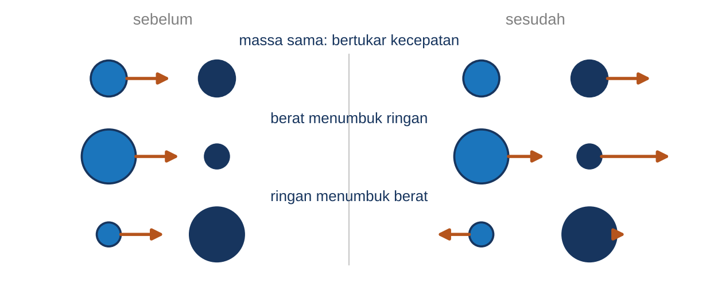
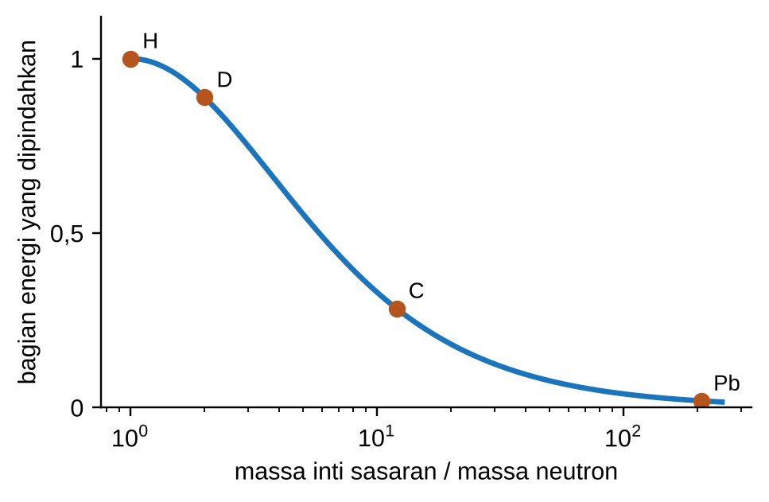
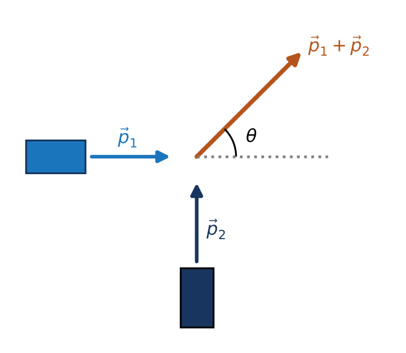
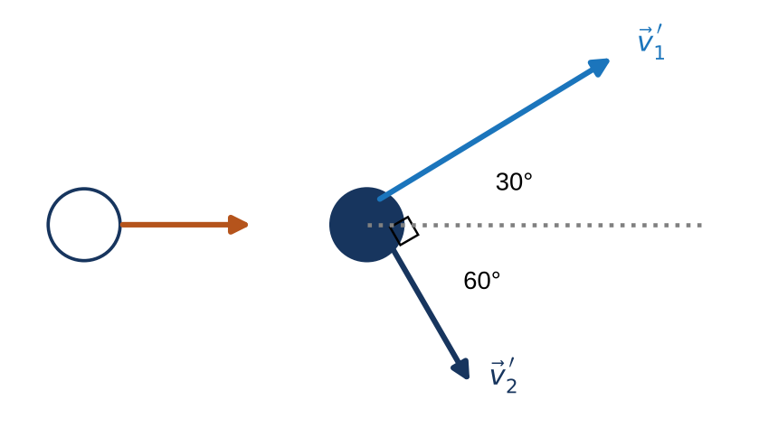
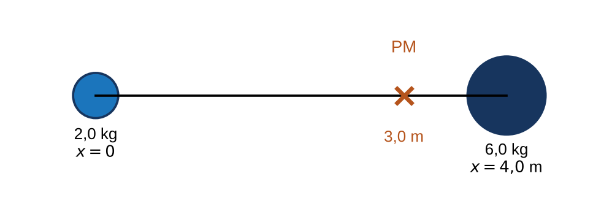
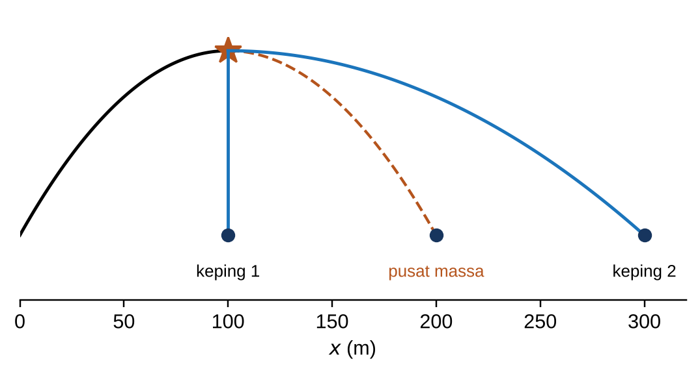
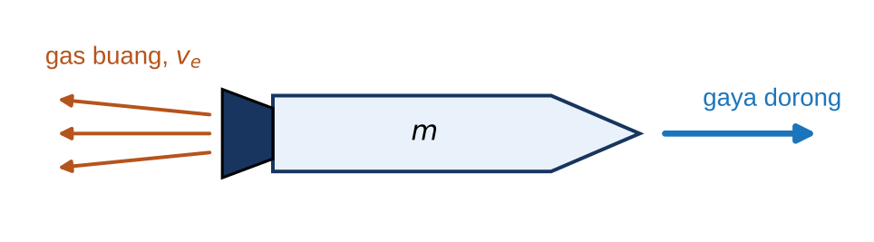
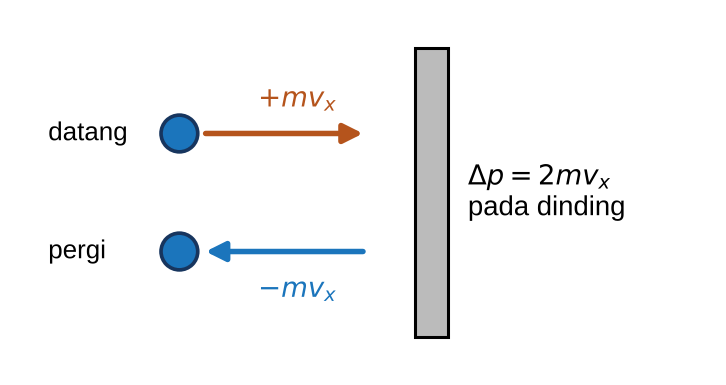
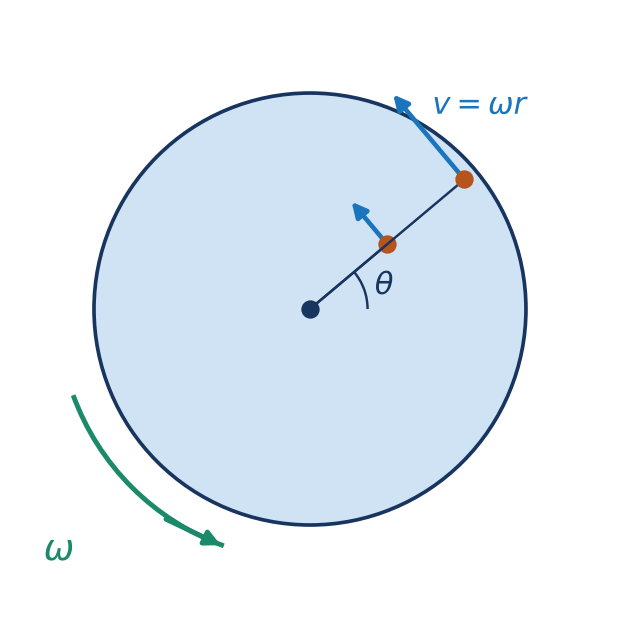
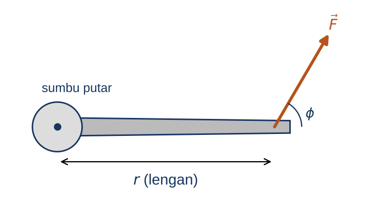

## 5.5 Tumbukan lenting

Pada **tumbukan lenting sempurna**, momentum dan energi kinetik sama-sama kekal. Benda sehari-hari tidak pernah benar-benar lenting, tetapi bola biliar dan bola baja cukup mendekati. Tumbukan antara atom, molekul, dan partikel pada energi rendah sering kali benar-benar lenting, karena tidak ada "panas" yang dapat timbul di dalam satu atom.

### Rumus kecepatan akhir

Untuk tumbukan lenting satu dimensi, ada dua persamaan:

$$
m_1v_1 + m_2v_2 = m_1v_1' + m_2v_2' , \qquad \tfrac12m_1v_1^2 + \tfrac12m_2v_2^2 = \tfrac12m_1v_1'^2 + \tfrac12m_2v_2'^2 .
$$

Tanda aksen menandai besaran sesudah tumbukan. Persamaan energi tampak sulit karena kuadratnya, tetapi ada jalan pintas.

::: {.mat}
**Matematika · Menghilangkan kuadrat**

Kumpulkan suku benda 1 di kiri dan benda 2 di kanan:

$$
m_1(v_1 - v_1') = m_2(v_2' - v_2), \qquad m_1(v_1^2 - v_1'^2) = m_2(v_2'^2 - v_2^2).
$$

Faktorkan persamaan kedua dengan $a^2 - b^2 = (a - b)(a + b)$, lalu bagi dengan persamaan pertama:

$$
v_1 + v_1' = v_2 + v_2' \quad\Longrightarrow\quad v_1 - v_2 = -(v_1' - v_2').
$$
:::

Hasil itu layak diingat tersendiri:

$$
\boxed{v_1 - v_2 = -(v_1' - v_2')} \qquad \text{(5.10)}
$$

**Pada tumbukan lenting, kecepatan relatif kedua benda berbalik arah tanpa berubah besarnya.** Kedua benda menjauh secepat mereka tadi mendekat. Persamaan (5.10) linear, jadi jauh lebih mudah dipakai bersama persamaan momentum daripada persamaan energi. Menyelesaikan keduanya memberi

$$
\boxed{v_1' = \frac{(m_1 - m_2)v_1 + 2m_2v_2}{m_1 + m_2}, \qquad v_2' = \frac{(m_2 - m_1)v_2 + 2m_1v_1}{m_1 + m_2}} \qquad \text{(5.11)}
$$

Untuk sasaran yang mula-mula diam ($v_2 = 0$):

$$
v_1' = \frac{m_1 - m_2}{m_1 + m_2}\,v_1, \qquad v_2' = \frac{2m_1}{m_1 + m_2}\,v_1 . \qquad \text{(5.12)}
$$

### Tiga kasus khusus

{width=86%}

Rumus (5.12) memuat tiga keadaan yang perlu dikuasai tanpa menghitung (Gambar 5.7):

| Keadaan | Hasil | Contoh |
|---|---|---|
| **Massa sama**, $m_1 = m_2$ | $v_1' = 0$, $v_2' = v_1$: bertukar kecepatan | bola biliar lurus; ayunan Newton |
| **Berat menumbuk ringan**, $m_1 \gg m_2$ | $v_1' \approx v_1$, $v_2' \approx 2v_1$ | pemukul golf dan bola; raket dan kok |
| **Ringan menumbuk berat**, $m_1 \ll m_2$ | $v_1' \approx -v_1$, $v_2' \approx 0$ | bola memantul dari dinding; elektron dari inti |

Kasus kedua mengejutkan: benda ringan terlempar dengan **dua kali** kelajuan penumbuknya, bukan sama. Cara memahaminya: lihat dari sudut pandang benda berat. Menurutnya, benda ringan datang dengan kelajuan $v_1$ dan memantul dengan kelajuan $v_1$. Kembali ke sudut pandang tanah, tambahkan kecepatan benda berat: $v_1 + v_1 = 2v_1$.

::: {.contoh}
**Contoh 5.26 · Tumbukan lenting, sasaran diam**

Bola 2,0 kg yang bergerak 4,0 m/s menumbuk lenting bola 1,0 kg yang diam, lurus di tengah. Tentukan kecepatan keduanya sesudah tumbukan.

**Penyelesaian.**

$$
v_1' = \frac{2{,}0 - 1{,}0}{3{,}0}(4{,}0) = 1{,}3\ \text{m/s}, \qquad v_2' = \frac{2(2{,}0)}{3{,}0}(4{,}0) = 5{,}3\ \text{m/s}.
$$

**Memahami hasil.** Momentum: sebelum $8{,}0$; sesudah $(2{,}0)(1{,}33) + (1{,}0)(5{,}33) = 8{,}0$ kg·m/s. Energi: sebelum $16$ J; sesudah $1{,}78 + 14{,}2 = 16$ J. Kecepatan relatif: sebelum $4{,}0$ m/s mendekat; sesudah $5{,}33 - 1{,}33 = 4{,}0$ m/s menjauh. Tiga pemeriksaan itu selalu dapat dilakukan.
:::

::: {.contoh}
**Contoh 5.27 · Massa sama, keduanya bergerak**

Dua kereta luncur bermassa sama di rel udara bergerak saling mendekat: kereta A dengan $+3{,}0$ m/s dan kereta B dengan $-1{,}0$ m/s. Tumbukannya lenting. Berapa kecepatan keduanya sesudahnya?

**Penyelesaian.** Dengan $m_1 = m_2$, rumus (5.11) menjadi $v_1' = v_2$ dan $v_2' = v_1$. Jadi A bergerak $-1{,}0$ m/s dan B bergerak $+3{,}0$ m/s.

**Memahami hasil.** Benda bermassa sama selalu **bertukar kecepatan** pada tumbukan lenting lurus. Jika kedua kereta tidak dapat dibedakan, hasilnya tampak seolah-olah mereka saling menembus. Fakta ini penting dalam teori kinetik gas: tumbukan antarmolekul sejenis tidak mengubah sebaran kelajuannya.
:::

::: {.contoh}
**Contoh 5.28 · Pukulan golf**

Kepala stik golf 0,20 kg bergerak 45 m/s ketika menumbuk bola 0,045 kg yang diam. Anggap tumbukannya lenting. Berapa kelajuan bola dan kepala stik sesudahnya?

**Penyelesaian.**

$$
v_\text{bola} = \frac{2(0{,}20)}{0{,}245}(45) = 73\ \text{m/s}, \qquad v_\text{stik} = \frac{0{,}20 - 0{,}045}{0{,}245}(45) = 28\ \text{m/s}.
$$

**Memahami hasil.** Bola melesat 1,6 kali lebih cepat daripada kepala stik semula, mendekati batas $2v_1$ untuk penumbuk yang sangat berat. Kepala stik yang lebih berat memberi bola kelajuan lebih tinggi, tetapi lebih sulit diayun cepat. Rancangan stik adalah kompromi antara keduanya.
:::

### Perpindahan energi dan moderator neutron

Seberapa banyak energi kinetik yang berpindah ke sasaran yang diam? Dari (5.12),

$$
\boxed{\frac{K_2'}{K_1} = \frac{4m_1m_2}{(m_1 + m_2)^2}} \qquad \text{(5.13)}
$$

{width=58%}

Rumus ini simetris terhadap $m_1$ dan $m_2$, dan bernilai paling besar (100%) jika massanya sama (Gambar 5.8). Jika massanya sangat berbeda, hampir tidak ada energi yang berpindah, ke arah mana pun.

::: {.contoh}
**Contoh 5.29 · Memperlambat neutron**

Reaktor nuklir menghasilkan neutron cepat (sekitar 2 MeV), tetapi reaksi fisi berlangsung paling baik dengan neutron lambat (sekitar 0,025 eV). Neutron diperlambat dengan menumbukkannya ke inti-inti **moderator**. (a) Berapa bagian energi yang dipindahkan pada satu tumbukan lurus dengan inti hidrogen (1 u), deuterium (2 u), karbon (12 u), dan timbal (207 u)? (b) Berapa tumbukan lurus dengan karbon yang diperlukan untuk memperlambat neutron dari 2 MeV ke 0,025 eV?

**Penyelesaian.**

(a) Dengan $m_1 = 1$ u pada (5.13):

| Inti | $4m_1m_2/(m_1 + m_2)^2$ |
|---|---|
| H | $4(1)/(2)^2 = 100\%$ |
| D | $4(2)/(3)^2 = 89\%$ |
| C | $4(12)/(13)^2 = 28\%$ |
| Pb | $4(207)/(208)^2 = 1{,}9\%$ |

(b) Setiap tumbukan dengan karbon menyisakan $1 - 0{,}284 = 0{,}716$ energi neutron. Setelah $n$ tumbukan: $(0{,}716)^n = \dfrac{0{,}025}{2 \times 10^6}$, sehingga

$$
n = \frac{\ln(1{,}25 \times 10^{-8})}{\ln 0{,}716} = \frac{-18{,}2}{-0{,}334} = 54 .
$$

**Memahami hasil.** Moderator yang baik harus berinti **ringan**. Itulah sebabnya reaktor memakai air (hidrogen), air berat (deuterium), atau grafit (karbon), dan tidak memakai timbal. Timbal justru dipakai sebagai perisai sinar gama, bukan penahan neutron. Tumbukan sungguhan jarang tepat lurus, jadi jumlah tumbukan yang diperlukan dengan karbon sekitar dua kali hitungan ini.
:::

::: {.contoh}
**Contoh 5.30 · Bola tenis di atas bola basket**

Bola tenis diletakkan tepat di atas bola basket, lalu keduanya dijatuhkan bersama dari ketinggian 1,0 m. Anggap semua tumbukan lenting dan massa bola tenis jauh lebih kecil. Sampai ketinggian berapa bola tenis memantul?

**Gambaran fisis.** Sesaat sebelum menyentuh lantai, kedua bola bergerak turun dengan kelajuan $v$. Bola basket menyentuh lantai lebih dulu dan berbalik naik dengan kelajuan $v$. Saat itu juga ia bertemu bola tenis yang masih turun dengan kelajuan $v$.

**Penyelesaian.** Lihat dari sudut pandang bola basket (benda berat). Bola tenis mendekat dengan kelajuan relatif $v + v = 2v$, dan memantul dengan kelajuan relatif $2v$. Terhadap tanah, kelajuan bola tenis menjadi $2v + v = 3v$ ke atas.

Ketinggian sebanding dengan kuadrat kelajuan: $h' = 3^2h = 9(1{,}0) = 9{,}0$ m.

**Memahami hasil.** Rumus (5.11) dengan $m_1 \gg m_2$, $v_1 = +v$, $v_2 = -v$ memberi $v_2' = 2v_1 - v_2 = 3v$. Sama. Dalam percobaan sungguhan bola tenis naik sekitar 4 sampai 5 m, karena tumbukannya tidak lenting sempurna dan massa bola tenis tidak dapat diabaikan. Gagasan yang sama dipakai wahana antariksa: dengan "memantul" dari planet yang sedang bergerak, wahana memperoleh tambahan kelajuan tanpa bahan bakar.
:::

### Koefisien restitusi

Tumbukan nyata berada di antara lenting sempurna dan tak lenting sama sekali. Ukurannya adalah **koefisien restitusi** $e$, yaitu perbandingan kelajuan relatif menjauh dengan kelajuan relatif mendekat:

$$
\boxed{e = -\frac{v_1' - v_2'}{v_1 - v_2}} \qquad \text{(5.14)}
$$

| Nilai $e$ | Jenis tumbukan |
|---|---|
| 1 | lenting sempurna |
| antara 0 dan 1 | sebagian lenting |
| 0 | tak lenting sama sekali (menyatu) |

Untuk bola yang dijatuhkan dari ketinggian $h$ ke lantai dan memantul sampai $h'$, kelajuan sebanding dengan akar ketinggian, sehingga $e = \sqrt{h'/h}$. Dengan sasaran diam, persamaan momentum dan (5.14) memberi

$$
v_1' = \frac{m_1 - em_2}{m_1 + m_2}\,v_1, \qquad v_2' = \frac{(1 + e)m_1}{m_1 + m_2}\,v_1 . \qquad \text{(5.15)}
$$

| Pasangan | $e$ (kira-kira) |
|---|---|
| Bola baja pada baja | 0,95 |
| Bola super pada lantai keras | 0,90 |
| Bola golf pada stik | 0,83 |
| Bola tenis pada lantai keras | 0,75 |
| Bola basket pada lantai kayu | 0,80 |
| Lempung basah pada lantai | 0 |

::: {.contoh}
**Contoh 5.31 · Memakai koefisien restitusi**

(a) Bola dijatuhkan dari 1,00 m dan memantul sampai 0,64 m. Berapa $e$, dan berapa tinggi pantulan ketiganya? (b) Balok 2,0 kg dengan kelajuan 4,0 m/s menumbuk balok 1,0 kg yang diam, dengan $e = 0{,}50$. Tentukan kecepatan akhir keduanya dan energi kinetik yang hilang.

**Penyelesaian.**

(a) $e = \sqrt{0{,}64/1{,}00} = 0{,}80$. Tiap pantulan mengalikan ketinggian dengan $e^2 = 0{,}64$, jadi pantulan ketiga mencapai $(0{,}64)^3 = 0{,}26$ m.

(b) Dari (5.15):

$$
v_1' = \frac{2{,}0 - (0{,}50)(1{,}0)}{3{,}0}(4{,}0) = 2{,}0\ \text{m/s}, \qquad v_2' = \frac{(1{,}50)(2{,}0)}{3{,}0}(4{,}0) = 4{,}0\ \text{m/s}.
$$

$K_i = 16$ J; $K_f = \tfrac12(2{,}0)(2{,}0)^2 + \tfrac12(1{,}0)(4{,}0)^2 = 12$ J. Yang hilang 4,0 J.

**Memahami hasil.** Kelajuan relatif menjauh $4{,}0 - 2{,}0 = 2{,}0$ m/s adalah setengah kelajuan mendekat 4,0 m/s, sesuai $e = 0{,}50$. Bandingkan dengan Contoh 5.26 ($e = 1$, tidak ada energi hilang) dan tumbukan menyatu ($e = 0$, hilang 5,3 J).
:::

### Tumbukan beruntun

::: {.contoh}
**Contoh 5.32 · Tiga bola berderet**

Tiga bola berada segaris di rel licin: 4,0 kg, 2,0 kg, dan 1,0 kg. Dua bola terakhir mula-mula diam. Bola 4,0 kg digerakkan 3,0 m/s menuju bola 2,0 kg. Semua tumbukan lenting. Berapa kelajuan bola 1,0 kg setelah ditumbuk?

**Penyelesaian.** Tumbukan pertama, bola 4,0 kg dengan bola 2,0 kg: $v_2' = \dfrac{2(4{,}0)}{6{,}0}(3{,}0) = 4{,}0$ m/s.

Tumbukan kedua, bola 2,0 kg dengan bola 1,0 kg: $v_3' = \dfrac{2(2{,}0)}{3{,}0}(4{,}0) = 5{,}3$ m/s.

**Memahami hasil.** Jika bola 4,0 kg langsung menumbuk bola 1,0 kg, hasilnya $\dfrac{2(4{,}0)}{5{,}0}(3{,}0) = 4{,}8$ m/s. Menyisipkan bola bermassa di antaranya justru **menaikkan** kelajuan akhir. Energi berpindah paling baik antara benda yang massanya berdekatan, jadi rantai massa yang menurun bertahap memindahkan energi lebih baik daripada satu loncatan besar. Cambuk bekerja dengan gagasan ini: massa per satuan panjangnya mengecil ke ujung, sehingga ujungnya dapat melebihi laju bunyi.
:::

### Menimbang partikel dengan tumbukan

::: {.contoh}
**Contoh 5.33 · Bagaimana massa neutron diukur**

Pada tahun 1932 James Chadwick menemukan radiasi netral yang tidak dapat ditimbang dengan medan listrik atau magnet. Ia membiarkan radiasi itu menumbuk inti hidrogen (1,0 u) dan inti nitrogen (14 u) yang diam, lalu mengukur kelajuan rekoil terbesar inti-inti itu: $3{,}3 \times 10^7$ m/s untuk hidrogen dan $4{,}7 \times 10^6$ m/s untuk nitrogen. Berapa massa partikel radiasi itu?

**Rencana.** Kelajuan rekoil terbesar terjadi pada tumbukan lenting lurus. Dari (5.12), $v_2' = \dfrac{2m}{m + M}v$. Kelajuan $v$ partikel tak dikenal sama pada kedua percobaan, jadi perbandingan kedua rekoil menghilangkannya.

**Penyelesaian.**

$$
\frac{v_\text{H}'}{v_\text{N}'} = \frac{m + 14}{m + 1{,}0} = \frac{3{,}3 \times 10^7}{4{,}7 \times 10^6} = 7{,}0 .
$$

$m + 14 = 7{,}0m + 7{,}0$, sehingga $m = \dfrac{7{,}0}{6{,}0} = 1{,}2$ u.

**Memahami hasil.** Dalam ketelitian pengukurannya, massa partikel itu sama dengan massa proton. Chadwick menyimpulkan adanya partikel netral bermassa hampir sama dengan proton: **neutron**. Nilai modernnya 1,0087 u. Dua pengukuran kelajuan dan kekekalan momentum cukup untuk "menimbang" partikel yang tidak dapat dilihat maupun dibelokkan.
:::

::: {.kuis}
**Kuis cepat 5.5**

Pada ayunan Newton (deretan bola baja yang tergantung berdampingan), satu bola ditarik dan dilepas, dan satu bola di ujung lain terpental. Mengapa tidak dua bola yang terpental dengan kelajuan masing-masing setengahnya? Bukankah momentumnya juga kekal?
:::

## 5.6 Tumbukan dalam dua dimensi

Momentum adalah vektor, jadi kekekalannya berlaku untuk tiap komponen secara terpisah:

$$
\sum p_x(\text{awal}) = \sum p_x(\text{akhir}), \qquad \sum p_y(\text{awal}) = \sum p_y(\text{akhir}). \qquad \text{(5.16)}
$$

Tidak ada fisika baru di sini, hanya pembukuan vektor. Kunci keberhasilannya adalah gambar yang jelas dan sumbu yang dipilih dengan baik, biasanya dengan sumbu $x$ searah salah satu benda yang datang.

{width=50%}

::: {.contoh}
**Contoh 5.34 · Tabrakan di persimpangan**

Mobil 1500 kg yang melaju 20 m/s ke timur bertabrakan di persimpangan dengan mobil 2000 kg yang melaju 15 m/s ke utara. Keduanya menyatu (Gambar 5.9). Tentukan kecepatan rongsokan sesaat setelah tabrakan.

**Penyelesaian.**

$$
p_x = (1500)(20) = 3{,}0 \times 10^4\ \text{kg·m/s}, \qquad p_y = (2000)(15) = 3{,}0 \times 10^4\ \text{kg·m/s}.
$$

Massa total 3500 kg, jadi $V_x = V_y = 8{,}57$ m/s.

$$
V = \sqrt{8{,}57^2 + 8{,}57^2} = 12\ \text{m/s}, \qquad \theta = \tan^{-1}\frac{p_y}{p_x} = 45°\ \text{di utara dari timur}.
$$

**Memahami hasil.** Arah rongsokan ditentukan oleh perbandingan **momentum**, bukan kecepatan. Mobil yang lebih lambat tetapi lebih berat membawa momentum yang sama. Penyelidik kecelakaan memakai cara ini terbalik: dari arah dan panjang jejak geseran rongsokan, mereka menghitung kelajuan tiap mobil sebelum tabrakan.
:::

{width=62%}

### Aturan 90 derajat

Untuk tumbukan **lenting** antara dua benda **bermassa sama** dengan salah satunya diam, ada hasil yang indah. Kekekalan momentum (massa tercoret) memberi $\vec v_1 = \vec v_1' + \vec v_2'$. Kekekalan energi memberi $v_1^2 = v_1'^2 + v_2'^2$. Persamaan pertama berkata ketiga vektor membentuk segitiga, dan persamaan kedua adalah teorema Pythagoras untuk segitiga itu. Jadi sudut antara $\vec v_1'$ dan $\vec v_2'$ pasti **90°** (Gambar 5.10).

::: {.contoh}
**Contoh 5.35 · Bola biliar**

Bola putih bergerak 3,0 m/s menumbuk bola lain yang diam dan bermassa sama. Setelah tumbukan lenting itu, bola putih bergerak pada sudut 30° dari arah semula. Tentukan arah bola kedua dan kelajuan keduanya.

**Penyelesaian.** Bola kedua bergerak pada $90° - 30° = 60°$ di sisi lain garis semula. Segitiga kecepatannya siku-siku dengan sisi miring 3,0 m/s:

$$
v_1' = 3{,}0\cos 30° = 2{,}6\ \text{m/s}, \qquad v_2' = 3{,}0\sin 30° = 1{,}5\ \text{m/s}.
$$

**Memahami hasil.** Komponen $y$: $2{,}6\sin 30° - 1{,}5\sin 60° = 1{,}30 - 1{,}30 = 0$. Komponen $x$: $2{,}6\cos 30° + 1{,}5\cos 60° = 2{,}25 + 0{,}75 = 3{,}0$ m/s. Energi: $2{,}6^2 + 1{,}5^2 = 9{,}0$. Semuanya cocok. Pemain biliar memakai aturan ini untuk meramalkan ke mana bola putih pergi. Aturan yang sama dipakai di fisika partikel: jejak proton yang menumbuk proton diam selalu bercabang tegak lurus.
:::

::: {.contoh}
**Contoh 5.36 · Tumbukan menyerong, massa berbeda**

Di meja udara, cakram 0,20 kg yang bergerak 2,0 m/s pada arah $+x$ menumbuk cakram 0,30 kg yang diam. Sesudahnya, cakram pertama bergerak 1,0 m/s pada sudut 53° di atas sumbu $x$. (a) Tentukan kecepatan cakram kedua. (b) Apakah tumbukannya lenting?

**Penyelesaian.**

(a) Komponen $x$: $(0{,}20)(2{,}0) = (0{,}20)(1{,}0)\cos 53° + 0{,}30v_{2x}'$, sehingga $v_{2x}' = \dfrac{0{,}40 - 0{,}120}{0{,}30} = 0{,}93$ m/s.

Komponen $y$: $0 = (0{,}20)(1{,}0)\sin 53° + 0{,}30v_{2y}'$, sehingga $v_{2y}' = -0{,}53$ m/s.

$v_2' = \sqrt{0{,}93^2 + 0{,}53^2} = 1{,}1$ m/s, pada 30° di bawah sumbu $x$.

(b) $K_i = \tfrac12(0{,}20)(2{,}0)^2 = 0{,}40$ J. $K_f = \tfrac12(0{,}20)(1{,}0)^2 + \tfrac12(0{,}30)(1{,}07)^2 = 0{,}10 + 0{,}17 = 0{,}27$ J. Energi kinetik berkurang 0,13 J, jadi tumbukannya tidak lenting.

**Memahami hasil.** Dalam dua dimensi ada empat besaran akhir yang tidak diketahui (dua komponen untuk tiap benda) tetapi hanya dua persamaan momentum. Itu sebabnya soal harus memberi keterangan tambahan: sudut, kelajuan, atau pernyataan bahwa tumbukannya lenting.
:::

### Memantul dari permukaan

Bola yang menumbuk lantai licin secara miring hanya menerima gaya tegak lurus lantai. Komponen kecepatannya yang **sejajar** lantai tidak berubah, dan komponen yang **tegak lurus** lantai berbalik dan dikalikan $e$.

::: {.contoh}
**Contoh 5.37 · Pantulan miring**

Bola menumbuk lantai licin dengan kelajuan 10 m/s pada sudut 45° terhadap garis normal. Koefisien restitusinya 0,50. Tentukan kelajuan dan arah bola sesudah memantul.

**Penyelesaian.** Sebelum: komponen sejajar $10\sin 45° = 7{,}07$ m/s, komponen tegak lurus $7{,}07$ m/s.

Sesudah: komponen sejajar tetap 7,07 m/s; komponen tegak lurus $(0{,}50)(7{,}07) = 3{,}54$ m/s.

$$
v' = \sqrt{7{,}07^2 + 3{,}54^2} = 7{,}9\ \text{m/s}, \qquad \theta' = \tan^{-1}\frac{7{,}07}{3{,}54} = 63°\ \text{dari garis normal}.
$$

**Memahami hasil.** Bola memantul lebih "rebah" daripada datangnya. Umumnya $\tan\theta' = \tan\theta/e$. Hanya untuk $e = 1$ sudut pantul sama dengan sudut datang, seperti pemantulan cahaya.
:::

::: {.kuis}
**Kuis cepat 5.6**

Dua mobil bermassa sama bertabrakan di persimpangan dan menyatu. Rongsokannya meluncur tepat pada arah 45° di antara arah semula kedua mobil. Apa yang dapat disimpulkan tentang kelajuan kedua mobil sebelum tabrakan?
:::

## 5.7 Pusat massa

Lemparkan sebuah kunci inggris sambil diputar. Ujung-ujungnya bergerak rumit, tetapi ada satu titik pada kunci itu yang menempuh parabola yang mulus, seolah-olah seluruh massa terkumpul di sana. Titik itu adalah **pusat massa**.

### Letak pusat massa

Untuk sistem partikel, pusat massa adalah rata-rata posisi yang ditimbang dengan massa:

$$
\boxed{x_\text{pm} = \frac{m_1x_1 + m_2x_2 + \dots}{m_1 + m_2 + \dots} = \frac{\sum m_ix_i}{M}} \qquad \text{(5.17)}
$$

dengan rumus serupa untuk $y_\text{pm}$ dan $z_\text{pm}$. Pusat massa selalu lebih dekat ke benda yang lebih berat.

{width=70%}

Untuk dua partikel, rumus itu menyederhana menjadi aturan yang mudah diingat: pusat massa terletak pada garis penghubung, dan jaraknya dari tiap partikel **berbanding terbalik dengan massa** partikel itu, $m_1d_1 = m_2d_2$ (Gambar 5.11).

::: {.contoh}
**Contoh 5.38 · Pusat massa dua benda**

(a) Partikel 2,0 kg berada di $x = 0$ dan partikel 6,0 kg di $x = 4{,}0$ m. Di mana pusat massanya? (b) Massa Bumi 81,3 kali massa Bulan, dan jarak pusat keduanya 384 400 km. Di mana pusat massa sistem Bumi–Bulan?

**Penyelesaian.**

(a) $x_\text{pm} = \dfrac{(2{,}0)(0) + (6{,}0)(4{,}0)}{8{,}0} = 3{,}0$ m.

(b) Dari pusat Bumi: $x_\text{pm} = \dfrac{(1)(384\,400)}{81{,}3 + 1} = 4670$ km.

**Memahami hasil.** Pada (a), pusat massa berjarak 3,0 m dari benda ringan dan 1,0 m dari benda berat: perbandingan 3 : 1, kebalikan dari perbandingan massa 1 : 3. Pada (b), jari-jari Bumi 6370 km, jadi pusat massa sistem Bumi–Bulan berada **di dalam** Bumi, sekitar 1700 km di bawah permukaan. Bumi dan Bulan sama-sama mengelilingi titik itu.
:::

::: {.contoh}
**Contoh 5.39 · Tiga partikel dalam bidang**

Tiga partikel: 1,0 kg di $(0, 0)$, 2,0 kg di $(3{,}0;\ 0)$ m, dan 3,0 kg di $(0;\ 4{,}0)$ m. Tentukan pusat massanya.

**Penyelesaian.**

$$
x_\text{pm} = \frac{(1{,}0)(0) + (2{,}0)(3{,}0) + (3{,}0)(0)}{6{,}0} = 1{,}0\ \text{m}, \qquad y_\text{pm} = \frac{(1{,}0)(0) + (2{,}0)(0) + (3{,}0)(4{,}0)}{6{,}0} = 2{,}0\ \text{m}.
$$

**Memahami hasil.** Pusat massa $(1{,}0;\ 2{,}0)$ m berada di dalam segitiga dan paling dekat ke partikel terberat.
:::

::: {.contoh}
**Contoh 5.40 · Pusat massa molekul**

(a) Panjang ikatan dalam molekul CO adalah 0,1128 nm. Massa C 12,0 u dan O 16,0 u. Di mana pusat massanya? (b) Dalam molekul air, tiap ikatan O–H panjangnya 0,0958 nm dan sudut H–O–H adalah 104,5°. Massa H 1,008 u dan O 16,00 u. Seberapa jauh pusat massa dari atom oksigen?

**Penyelesaian.**

(a) Dari atom C: $x_\text{pm} = \dfrac{(16{,}0)(0{,}1128)}{28{,}0} = 0{,}0645$ nm. Jadi 0,0645 nm dari C dan 0,0483 nm dari O.

(b) Taruh O di titik asal dan sumbu $y$ di garis bagi sudut. Kedua atom H berada di $y = 0{,}0958\cos 52{,}25° = 0{,}0587$ nm, dengan koordinat $x$ yang berlawanan. Karena simetri, $x_\text{pm} = 0$.

$$
y_\text{pm} = \frac{2(1{,}008)(0{,}0587)}{18{,}02} = 0{,}0066\ \text{nm}.
$$

**Memahami hasil.** Pusat massa molekul air hanya 0,0066 nm dari inti oksigen, karena oksigen memuat 89% massa molekul. Letak pusat massa menentukan cara molekul berputar: molekul berotasi mengelilingi pusat massanya, dan jarak atom-atom dari titik itu menentukan spektrum gelombang mikro molekul.
:::

### Benda pejal dan benda gabungan

Untuk benda pejal yang serbasama, dua aturan sudah cukup untuk hampir semua keperluan:

1. **Simetri.** Pusat massa berada pada setiap sumbu atau bidang simetri. Jadi pusat massa bola, kubus, cakram, cincin, dan batang serbasama berada di pusat geometrinya.
2. **Gabungan.** Benda yang tersusun dari beberapa bagian sederhana dapat diganti dengan partikel-partikel di pusat massa tiap bagian. Bagian yang dilubangi dihitung sebagai **massa negatif**.

Pusat massa tidak harus berada di dalam bahan bendanya. Pusat massa cincin, bumerang, dan kursi berada di ruang kosong. Pelompat tinggi yang melengkungkan badan di atas mistar dapat meloloskan seluruh tubuhnya sementara pusat massanya lewat **di bawah** mistar.

::: {.contoh}
**Contoh 5.41 · Pelat berbentuk L**

Pelat tipis serbasama berbentuk L terdiri atas persegi panjang mendatar $6{,}0 \times 2{,}0$ cm dengan pojok kiri bawah di titik asal, dan persegi panjang tegak $2{,}0 \times 4{,}0$ cm di atas ujung kirinya (menempati $0 \le x \le 2$, $2 \le y \le 6$). Tentukan pusat massanya.

**Penyelesaian.** Massa sebanding dengan luas.

| Bagian | Luas (cm²) | Pusat (cm) |
|---|---|---|
| Mendatar | 12 | (3,0; 1,0) |
| Tegak | 8,0 | (1,0; 4,0) |

$$
x_\text{pm} = \frac{(12)(3{,}0) + (8{,}0)(1{,}0)}{20} = 2{,}2\ \text{cm}, \qquad y_\text{pm} = \frac{(12)(1{,}0) + (8{,}0)(4{,}0)}{20} = 2{,}2\ \text{cm}.
$$

**Memahami hasil.** Titik $(2{,}2;\ 2{,}2)$ cm berada **di luar** pelat, di lekukan huruf L. Bentuk L simetris terhadap garis $y = x$ jika lengannya sama panjang, dan hasil $x_\text{pm} = y_\text{pm}$ sesuai dengan itu.
:::

### Gerak pusat massa

Turunkan (5.17) terhadap waktu: $M\vec v_\text{pm} = \sum m_i\vec v_i = \vec P_\text{total}$. Momentum total sistem sama dengan massa total kali kecepatan pusat massa. Gabungkan dengan (5.7):

$$
\boxed{\sum\vec F_\text{luar} = M\vec a_\text{pm}} \qquad \text{(5.18)}
$$

**Pusat massa bergerak seperti satu partikel bermassa $M$ yang dikenai seluruh gaya luar.** Gaya dalam, sekuat apa pun, tidak dapat mengubah gerak pusat massa. Inilah pembenaran untuk memperlakukan mobil, planet, dan manusia sebagai "partikel" di Bab 2 dan 3.

Akibat langsungnya: jika gaya luar total nol, kecepatan pusat massa tetap. Ini pernyataan lain dari kekekalan momentum. Perahu pada Contoh 5.15 bergeser justru supaya pusat massa sistem orang–perahu tetap di tempatnya.

{width=74%}

::: {.contoh}
**Contoh 5.42 · Kembang api yang pecah di puncak**

Sebuah proyektil ditembakkan sehingga, jika utuh, akan jatuh 200 m dari tempat peluncuran. Di titik tertinggi lintasannya proyektil itu meledak menjadi dua keping bermassa sama. Keping pertama berhenti sesaat lalu jatuh tegak. Di mana keping kedua jatuh?

**Rencana.** Ledakan adalah gaya dalam. Pusat massa kedua keping meneruskan parabola semula dan jatuh di 200 m (Gambar 5.12). Kedua keping mulai jatuh dari ketinggian yang sama tanpa kecepatan tegak, jadi tiba di tanah bersamaan.

**Penyelesaian.** Keping pertama jatuh tepat di bawah titik tertinggi, di $x_1 = 100$ m. Dengan massa sama, pusat massa berada di tengah-tengah:

$$
\frac{x_1 + x_2}{2} = 200 \quad\Longrightarrow\quad x_2 = 400 - 100 = 300\ \text{m}.
$$

**Memahami hasil.** Dengan momentum: di puncak kelajuannya $v$ mendatar. Keping pertama berhenti, jadi keping kedua harus membawa seluruh momentum: $(m/2)v_2 = mv$, $v_2 = 2v$. Ia menempuh jarak mendatar dua kali lipat selama jatuh, yaitu 200 m dari titik ledakan. Hasilnya 300 m, sama. Cara pusat massa lebih cepat.
:::

### Kerangka pusat massa dan energi yang tersedia

Energi kinetik total sebuah sistem dapat dipecah menjadi dua bagian:

$$
K_\text{total} = \tfrac12Mv_\text{pm}^2 + K_\text{relatif} . \qquad \text{(5.19)}
$$

Suku pertama adalah energi gerak pusat massa. Suku kedua adalah energi gerak anggota sistem **relatif terhadap pusat massa**. Selama tumbukan, $v_\text{pm}$ tidak dapat berubah, jadi suku pertama terkunci. Hanya $K_\text{relatif}$ yang **tersedia** untuk diubah menjadi panas, perubahan bentuk, atau untuk memutus ikatan kimia.

Untuk dua benda, energi relatif itu berbentuk sederhana:

$$
\boxed{K_\text{relatif} = \tfrac12\mu v_\text{rel}^2, \qquad \mu = \frac{m_1m_2}{m_1 + m_2}} \qquad \text{(5.20)}
$$

dengan $v_\text{rel}$ kelajuan relatif kedua benda dan $\mu$ **massa tereduksi**. Massa tereduksi selalu lebih kecil daripada massa yang lebih ringan. Jika salah satu benda jauh lebih berat, $\mu$ hampir sama dengan massa benda yang ringan.

Jika sasaran diam, $v_\text{rel} = v_1$, dan bagian energi yang tersedia adalah

$$
\frac{K_\text{relatif}}{K_1} = \frac{m_2}{m_1 + m_2} . \qquad \text{(5.21)}
$$

Bandingkan dengan (5.9): bagian yang **tersedia** tepat sama dengan bagian yang **hilang** pada tumbukan tak lenting sama sekali. Memang begitulah seharusnya, karena pada tumbukan itu seluruh energi relatif habis.

::: {.contoh}
**Contoh 5.43 · Energi yang tersedia untuk reaksi**

Sebuah reaksi antara atom H (1,0 u) dan molekul Cl₂ (71 u) memerlukan energi tumbukan paling sedikit 0,50 eV agar ikatannya dapat ditata ulang. Berapa energi kinetik paling kecil yang diperlukan jika (a) atom H ditembakkan ke Cl₂ yang diam; (b) molekul Cl₂ ditembakkan ke atom H yang diam?

**Penyelesaian.** Yang harus mencapai 0,50 eV adalah $K_\text{relatif}$.

(a) Penumbuk H, sasaran Cl₂: $K_\text{relatif} = K\dfrac{71}{72}$, sehingga $K = 0{,}50 \times \dfrac{72}{71} = 0{,}51$ eV.

(b) Penumbuk Cl₂, sasaran H: $K_\text{relatif} = K\dfrac{1{,}0}{72}$, sehingga $K = 0{,}50 \times 72 = 36$ eV.

**Memahami hasil.** Untuk reaksi yang sama, menembakkan benda berat ke benda ringan memerlukan energi 70 kali lebih besar. Hampir seluruh energi Cl₂ tetap menjadi energi gerak pusat massa, karena atom H yang ringan tidak mampu "menahan" Cl₂. Dalam kinetika kimia, yang masuk ke teori tumbukan dan persamaan Arrhenius adalah energi relatif ini, bukan energi masing-masing molekul. Alasan yang sama membuat pemercepat partikel modern menabrakkan dua berkas berlawanan arah: seluruh energinya tersedia.
:::

::: {.contoh}
**Contoh 5.44 · Massa tereduksi molekul dwiatom**

Hitung massa tereduksi (a) H³⁵Cl, (b) H₂, (c) ¹²C¹⁶O. Massa atom: H 1,008 u; ³⁵Cl 34,97 u; ¹²C 12,00 u; ¹⁶O 15,99 u.

**Penyelesaian.**

(a) $\mu = \dfrac{(1{,}008)(34{,}97)}{35{,}98} = 0{,}980$ u $= 1{,}63 \times 10^{-27}$ kg.

(b) $\mu = \dfrac{(1{,}008)(1{,}008)}{2{,}016} = 0{,}504$ u.

(c) $\mu = \dfrac{(12{,}00)(15{,}99)}{27{,}99} = 6{,}86$ u.

**Memahami hasil.** Untuk HCl, $\mu$ hampir sama dengan massa atom H: dalam getaran molekul itu, hampir hanya hidrogen yang bergerak, sedangkan klorin nyaris diam. Untuk dua atom sama, $\mu$ adalah setengah massa atom. Massa tereduksi adalah massa yang muncul dalam rumus frekuensi getaran molekul, $f = \dfrac{1}{2\pi}\sqrt{k/\mu}$ (Bab 8), dan dalam rumus energi rotasi. Itu sebabnya mengganti H dengan D (deuterium) menggeser garis spektrum inframerah secara nyata: $\mu$ hampir berlipat dua.
:::

::: {.terapan}
**Kaitan kimia · Massa tereduksi mengubah soal dua benda menjadi soal satu benda**

Dua atom yang terikat saling bergerak terhadap satu sama lain. Mengikuti keduanya sekaligus merepotkan. Fisika memberi jalan keluar yang rapi: gerak dua benda yang saling berinteraksi dapat dipisah menjadi (1) gerak pusat massa, yang lurus beraturan dan tidak menarik, dan (2) gerak relatif, yang berperilaku persis seperti **satu** benda bermassa $\mu$ yang bergerak dalam energi potensial $U(r)$.

Semua kurva energi di subbab 4.8, yaitu Lennard-Jones dan Morse, adalah $U(r)$ untuk gerak relatif ini. Getaran molekul adalah benda bermassa $\mu$ yang bergetar di dasar lembah. Rotasi molekul adalah benda bermassa $\mu$ yang berputar pada jarak $r_0$. Bahkan atom hidrogen diperlakukan begini: elektron dan proton sama-sama mengelilingi pusat massa, dan massa yang masuk ke rumus tingkat energinya adalah massa tereduksi elektron–proton, yang 0,05% lebih kecil daripada massa elektron.
:::

### Energi yang hilang pada tumbukan, secara umum

Karena hanya $K_\text{relatif}$ yang dapat berubah, dan koefisien restitusi mengalikan kelajuan relatif dengan $e$, energi kinetik yang hilang pada tumbukan apa pun adalah

$$
\Delta K_\text{hilang} = \tfrac12\mu v_\text{rel}^2\,(1 - e^2). \qquad \text{(5.22)}
$$

::: {.contoh}
**Contoh 5.45 · Memeriksa ulang tabrakan berhadapan**

Hitung ulang energi yang hilang pada Contoh 5.23 (mobil 1200 kg dengan 20 m/s dan mobil 1800 kg dengan 15 m/s, berhadapan, menyatu) dengan rumus (5.22).

**Penyelesaian.** $\mu = \dfrac{(1200)(1800)}{3000} = 720$ kg. Kelajuan relatif: $20 + 15 = 35$ m/s. Menyatu berarti $e = 0$.

$$
\Delta K = \tfrac12(720)(35)^2 = 4{,}4 \times 10^5\ \text{J}.
$$

**Memahami hasil.** Sama dengan hasil Contoh 5.23, dalam satu baris. Rumus ini juga menunjukkan bahwa kerusakan pada tabrakan hanya bergantung pada kelajuan **relatif**. Mobil yang menabrak mobil sejenis dari belakang dengan selisih kelajuan 35 m/s sama rusaknya dengan tabrakan berhadapan di atas.
:::

::: {.contoh}
**Contoh 5.46 · Dua balok yang dihubungkan pegas**

Dua balok, masing-masing 2,0 kg, dihubungkan pegas ($k = 900$ N/m) dan diam di lantai licin. Salah satu balok dipukul sehingga tiba-tiba bergerak 3,0 m/s menuju balok lain. (a) Berapa kecepatan pusat massa sistem sesudahnya? (b) Berapa penekanan terbesar pegas?

**Penyelesaian.**

(a) $v_\text{pm} = \dfrac{(2{,}0)(3{,}0)}{4{,}0} = 1{,}5$ m/s, dan nilainya tetap selamanya.

(b) Energi kinetik total 9,0 J. Energi gerak pusat massa $\tfrac12(4{,}0)(1{,}5)^2 = 4{,}5$ J terkunci. Sisanya, 4,5 J, adalah energi relatif. Periksa: $\tfrac12\mu v_\text{rel}^2 = \tfrac12(1{,}0)(3{,}0)^2 = 4{,}5$ J. Saat pegas tertekan paling jauh, seluruh energi relatif tersimpan di pegas:

$$
\tfrac12kx^2 = 4{,}5 \quad\Longrightarrow\quad x = 0{,}10\ \text{m}.
$$

**Memahami hasil.** Sistem ini lalu melaju dengan pusat massa bergerak tetap 1,5 m/s, sementara kedua balok bergetar maju-mundur terhadap pusat massa. Ini model mekanik sebuah molekul dwiatom yang ditumbuk: sebagian energi tumbukan menjadi gerak molekul secara utuh (translasi), sebagian menjadi getaran.
:::

### Pusat massa dengan integral

Untuk benda yang massanya tersebar tidak merata, jumlah pada (5.17) menjadi integral:

$$
x_\text{pm} = \frac1M\int x\,dm . \qquad \text{(5.23)}
$$

::: {.contoh}
**Contoh 5.47 · Batang yang tidak serbasama**

Massa per satuan panjang sebuah batang sepanjang $L$ bertambah sebanding dengan jarak dari ujung kirinya: $\lambda = ax$. Di mana pusat massanya?

**Penyelesaian.** Potongan sepanjang $dx$ di posisi $x$ bermassa $dm = ax\,dx$.

$$
M = \int_0^L ax\,dx = \tfrac12aL^2, \qquad \int_0^L x\,(ax\,dx) = \tfrac13aL^3 .
$$

$$
x_\text{pm} = \frac{\tfrac13aL^3}{\tfrac12aL^2} = \tfrac23L .
$$

**Memahami hasil.** Pusat massa berada di dua pertiga panjang, lebih dekat ke ujung yang berat. Untuk batang serbasama hasilnya $\tfrac12L$. Hasil $\tfrac23$ ini sama dengan letak pusat massa segitiga dari puncaknya, karena sebaran massanya serupa.
:::

::: {.kuis}
**Kuis cepat 5.7**

Seorang astronaut yang melayang bebas di dalam stasiun antariksa meronta-ronta, mengayunkan tangan dan kakinya. Dapatkah ia memindahkan pusat massa tubuhnya dengan cara itu? Dapatkah ia mengubah arah hadapnya?
:::

## 5.8 Sistem yang massanya berubah: roket

Mobil maju dengan mendorong jalan ke belakang. Perahu mendorong air, dan pesawat mendorong udara. Di ruang hampa tidak ada yang dapat didorong. Roket membawa sendiri "benda yang didorong": ia melemparkan massanya sendiri ke belakang dengan kelajuan tinggi, dan kekekalan momentum mendorongnya ke depan. Roket adalah rekoil senapan yang berlangsung terus-menerus.

{width=70%}

### Gaya dorong

Misalkan roket menyemburkan gas dengan laju massa $R = |dm/dt|$ (kilogram per sekon) dan kelajuan $v_e$ relatif terhadap roket (Gambar 5.13). Setiap sekon, gas memperoleh momentum $Rv_e$ ke belakang. Menurut hukum ketiga, roket memperoleh gaya ke depan sebesar

$$
\boxed{F_\text{dorong} = Rv_e} \qquad \text{(5.24)}
$$

Ini sama dengan rumus gaya aliran pada Contoh 5.4.

### Persamaan roket

Di ruang bebas, tanpa gaya luar, hukum kedua untuk roket bermassa sesaat $m$ adalah $m\,\dfrac{dv}{dt} = v_e\left|\dfrac{dm}{dt}\right|$. Mengintegralkannya dari massa awal $m_0$ sampai massa akhir $m_f$ memberi

$$
\boxed{\Delta v = v_e\ln\frac{m_0}{m_f}} \qquad \text{(5.25)}
$$

Ini **persamaan roket**, diturunkan oleh Konstantin Tsiolkovsky pada tahun 1903.

::: {.mat}
**Matematika · Penurunan persamaan roket**

Karena $dm$ negatif (massa berkurang), $m\,dv = -v_e\,dm$, atau $dv = -v_e\,\dfrac{dm}{m}$. Integralkan dengan $\displaystyle\int\frac{dm}{m} = \ln m$:

$$
\Delta v = -v_e\big[\ln m\big]_{m_0}^{m_f} = v_e\ln\frac{m_0}{m_f}.
$$

Logaritma alami $\ln$ adalah kebalikan dari fungsi eksponen: $\ln(e^x) = x$, dengan $e = 2{,}718$. Beberapa nilai yang berguna: $\ln 2 = 0{,}693$, $\ln 5 = 1{,}61$, $\ln 10 = 2{,}30$.
:::

Dua pelajaran dari (5.25):

- Yang menentukan adalah **perbandingan massa** $m_0/m_f$ dan **kelajuan gas buang** $v_e$, bukan seberapa cepat bahan bakar dibakar.
- Logaritma tumbuh sangat lambat. Untuk melipatduakan $\Delta v$, perbandingan massa harus **dikuadratkan**. Itulah yang membuat perjalanan antariksa begitu mahal.

::: {.contoh}
**Contoh 5.48 · Gaya dorong dan percepatan awal**

Sebuah roket bermassa awal 20 000 kg membakar bahan bakar 120 kg/s dan menyemburkan gas dengan kelajuan 2500 m/s. (a) Berapa gaya dorongnya? (b) Berapa percepatannya sesaat setelah lepas landas tegak?

**Penyelesaian.**

(a) $F = Rv_e = (120)(2500) = 3{,}0 \times 10^5$ N.

(b) Gaya total ke atas: $F - mg = 3{,}0 \times 10^5 - (20\,000)(9{,}80) = 1{,}04 \times 10^5$ N. Percepatan: $a = 5{,}2\ \text{m/s}^2$.

**Memahami hasil.** Gaya dorong hanya 1,5 kali berat roket, jadi roket naik perlahan pada awalnya. Ketika bahan bakar berkurang, massanya turun sedangkan gaya dorong tetap, sehingga percepatannya terus bertambah.
:::

::: {.contoh}
**Contoh 5.49 · Seberapa banyak bahan bakar?**

(a) Sebuah roket di ruang bebas memiliki $v_e = 2500$ m/s dan perbandingan massa $m_0/m_f = 5$. Berapa pertambahan kelajuannya? (b) Untuk mencapai kelajuan orbit 7,8 km/s dengan satu tingkat dan $v_e = 3000$ m/s (abaikan gravitasi dan udara), berapa bagian massa awal yang harus berupa bahan bakar?

**Penyelesaian.**

(a) $\Delta v = (2500)\ln 5 = (2500)(1{,}61) = 4{,}0 \times 10^3$ m/s.

(b) $\ln\dfrac{m_0}{m_f} = \dfrac{7800}{3000} = 2{,}6$, sehingga $\dfrac{m_0}{m_f} = e^{2{,}6} = 13{,}5$. Bagian bahan bakar: $1 - \dfrac{1}{13{,}5} = 93\%$.

**Memahami hasil.** Hanya 7% massa awal yang boleh berupa mesin, tangki, struktur, dan muatan. Sebutir telur memiliki 90% isi dan 10% cangkang; roket satu tingkat ke orbit harus "lebih tipis daripada cangkang telur". Dengan memperhitungkan gravitasi dan udara, keadaannya lebih sulit lagi. Jalan keluarnya adalah roket **bertingkat**: tangki kosong dibuang supaya tidak perlu ikut dipercepat.
:::

### Sistem lain yang massanya berubah

Gagasan "gaya = laju massa × perubahan kecepatan" berlaku juga untuk benda yang **mengumpulkan** massa.

::: {.contoh}
**Contoh 5.50 · Ban berjalan**

Pasir jatuh tegak dari corong ke ban berjalan mendatar dengan laju 5,0 kg/s. Ban bergerak 2,0 m/s. (a) Berapa gaya mendatar yang diperlukan agar ban tetap bergerak dengan kelajuan itu? (b) Berapa daya motornya untuk keperluan itu? (c) Berapa laju pertambahan energi kinetik pasir?

**Penyelesaian.**

(a) Setiap sekon, 5,0 kg pasir dipercepat mendatar dari 0 ke 2,0 m/s: $F = (5{,}0)(2{,}0) = 10$ N.

(b) $P = Fv = (10)(2{,}0) = 20$ W.

(c) $\dfrac{dK}{dt} = \tfrac12(5{,}0)(2{,}0)^2 = 10$ W.

**Memahami hasil.** Motor memberi 20 W, tetapi pasir hanya memperoleh energi kinetik 10 W. Setengahnya hilang. Pasir yang mendarat di ban bergeser dulu sebelum ikut bergerak, dan gesekan selama geseran itu mengubah 10 W menjadi panas. Perbandingan setengah-setengah ini tidak bergantung pada koefisien geseknya. Pasir yang mendarat di ban adalah tumbukan tak lenting sama sekali.
:::

::: {.contoh}
**Contoh 5.51 · Selang pemadam kebakaran**

Selang pemadam menyemburkan 20 kg air per sekon dengan kelajuan 30 m/s. Berapa gaya yang harus ditahan petugas?

**Penyelesaian.** Air di dalam selang bergerak pelan dan keluar dengan 30 m/s, jadi setiap sekon air memperoleh momentum $(20)(30) = 600$ kg·m/s. Gaya reaksinya pada selang 600 N ke belakang.

**Memahami hasil.** Gaya 600 N setara dengan berat 61 kg. Karena itu selang besar dipegang dua atau tiga orang. Selang yang terlepas akan meliuk tak terkendali, digerakkan oleh "mesin roket" airnya sendiri.
:::

### Mengapa roket dibuat bertingkat

::: {.contoh}
**Contoh 5.52 · Satu tingkat melawan dua tingkat**

Dua rancangan roket bermassa awal 100 ton dengan $v_e = 3000$ m/s, masing-masing membawa muatan 2,0 ton. Rancangan A satu tingkat: 90 ton bahan bakar dan 8,0 ton struktur. Rancangan B dua tingkat: tingkat pertama 72 ton bahan bakar dan 8,0 ton struktur; tingkat kedua 16,2 ton bahan bakar dan 1,8 ton struktur. Bandingkan $\Delta v$ keduanya di ruang bebas.

**Penyelesaian.**

*Rancangan A.* Massa akhir $100 - 90 = 10$ ton: $\Delta v = 3000\ln\dfrac{100}{10} = 6{,}9$ km/s.

*Rancangan B.* Tingkat pertama: massa turun dari 100 ton ke 28 ton, $\Delta v_1 = 3000\ln\dfrac{100}{28} = 3{,}8$ km/s. Struktur 8,0 ton dibuang, tersisa 20 ton. Tingkat kedua: massa turun dari 20 ton ke 3,8 ton, $\Delta v_2 = 3000\ln\dfrac{20}{3{,}8} = 5{,}0$ km/s.

Total: $\Delta v = 8{,}8$ km/s.

**Memahami hasil.** Rancangan B membawa bahan bakar **lebih sedikit** (88,2 ton dibanding 90 ton) dan struktur lebih banyak, tetapi memperoleh $\Delta v$ 27% lebih besar. Kuncinya adalah membuang 8 ton tangki kosong, sehingga tingkat kedua tidak perlu ikut mempercepatnya. Rancangan A tidak mencapai kelajuan orbit; rancangan B mencapainya.
:::

::: {.contoh}
**Contoh 5.53 · Mesin ion**

Mesin ion menyemburkan ion xenon dengan $v_e = 30$ km/s, sepuluh kali mesin kimia, tetapi hanya 3,0 mg per sekon. (a) Berapa gaya dorongnya? (b) Untuk memperoleh $\Delta v = 5{,}0$ km/s, berapa bagian massa awal yang harus berupa bahan bakar, dibandingkan dengan mesin kimia ber-$v_e$ 3,0 km/s?

**Penyelesaian.**

(a) $F = Rv_e = (3{,}0 \times 10^{-6})(3{,}0 \times 10^4) = 0{,}090$ N.

(b) Bagian bahan bakar adalah $1 - e^{-\Delta v/v_e}$. Mesin ion: $1 - e^{-0{,}167} = 15\%$. Mesin kimia: $1 - e^{-1{,}67} = 81\%$.

**Memahami hasil.** Gaya dorong mesin ion setara dengan berat selembar kertas, jadi tidak mungkin dipakai untuk lepas landas. Tetapi di ruang bebas ia dapat menyala berbulan-bulan dan sangat hemat bahan bakar. Wahana penjelajah asteroid memakai mesin jenis ini. Dalam persamaan roket, menaikkan $v_e$ jauh lebih berharga daripada menambah bahan bakar.
:::

### Rantai yang jatuh

::: {.contoh}
**Contoh 5.54 · Rantai jatuh ke timbangan**

Rantai sepanjang 1,0 m bermassa 2,0 kg dipegang tegak dengan ujung bawahnya tepat menyentuh timbangan, lalu dilepas. Berapa gaya yang ditunjukkan timbangan tepat ketika mata rantai terakhir mendarat?

**Rencana.** Timbangan menahan dua hal: berat bagian rantai yang sudah mendarat, dan gaya untuk **menghentikan** mata rantai yang sedang mendarat. Yang kedua adalah gaya aliran, (massa per sekon) × (kelajuan).

**Penyelesaian.** Massa per satuan panjang $\lambda = 2{,}0$ kg/m. Ketika panjang $x$ sudah mendarat, mata rantai yang sedang jatuh memiliki kelajuan $v = \sqrt{2gx}$.

- Berat bagian yang sudah mendarat: $\lambda xg$.
- Massa yang mendarat per sekon: $\lambda v$. Gaya untuk menghentikannya: $(\lambda v)v = \lambda v^2 = 2\lambda xg$.

Total: $F = 3\lambda xg$. Tepat ketika seluruh rantai mendarat ($x = 1{,}0$ m):

$$
F = 3Mg = 3(2{,}0)(9{,}80) = 59\ \text{N}.
$$

**Memahami hasil.** Timbangan sesaat menunjukkan **tiga kali** berat rantai, lalu turun ke $Mg = 19{,}6$ N begitu semuanya diam. Gaya penghenti selalu dua kali berat bagian yang sudah mendarat, berapa pun panjang rantainya.
:::

::: {.kuis}
**Kuis cepat 5.8**

Sebuah roket di ruang bebas sudah bergerak lebih cepat daripada kelajuan gas buangnya. Dilihat dari tanah, gas yang disemburkan sekarang bergerak **ke depan**. Apakah roket masih bertambah cepat?
:::

## 5.9 Momentum di skala atom

### Tekanan gas

Udara di dalam ban menekan dinding ban ke luar. Dari mana gaya itu? Dari miliaran molekul yang menumbuk dinding setiap saat.

{width=52%}

Tinjau satu molekul bermassa $m$ yang menumbuk dinding secara lenting dengan komponen kecepatan $v_x$ tegak lurus dinding (Gambar 5.14). Momentumnya berubah dari $+mv_x$ menjadi $-mv_x$, jadi dinding menerima impuls $2mv_x$. Jumlahkan impuls dari semua molekul yang menumbuk dinding per sekon per satuan luas, lalu rata-ratakan atas semua arah gerak. Hasilnya (penurunan lengkap di Bab 10):

$$
\boxed{p = \tfrac13\rho\,v_\text{rms}^2} \qquad \text{(5.26)}
$$

dengan $\rho$ massa jenis gas dan $v_\text{rms}$ kelajuan khas molekulnya (akar rata-rata kuadrat kelajuan). Tekanan gas adalah gaya rata-rata akibat hujan tumbukan molekul, persis seperti gaya air pada dinding di Contoh 5.4.

::: {.contoh}
**Contoh 5.55 · Tekanan udara dari tumbukan molekul**

Udara di permukaan laut memiliki massa jenis $1{,}2\ \text{kg/m}^3$ dan molekulnya bergerak dengan $v_\text{rms}$ sekitar 500 m/s. Berapa tekanannya?

**Penyelesaian.**

$$
p = \tfrac13(1{,}2)(500)^2 = 1{,}0 \times 10^5\ \text{Pa}.
$$

**Memahami hasil.** Itu tepat tekanan atmosfer, 1 atm. Rumus sederhana dari mekanika tumbukan ini mengaitkan besaran yang terukur di laboratorium (tekanan, massa jenis) dengan kelajuan molekul yang tidak terlihat. Dari sinilah orang pertama kali mengetahui bahwa molekul udara bergerak lebih cepat daripada bunyi.
:::

::: {.contoh}
**Contoh 5.56 · Hujan es di atap**

Butiran es bermassa 5,0 g jatuh tegak dengan kelajuan 20 m/s. Setiap sekon, 100 butir menimpa tiap meter persegi atap datar. Berapa tekanan rata-rata pada atap jika butiran (a) berhenti; (b) memantul lenting?

**Penyelesaian.**

(a) Momentum yang diserahkan per sekon per meter persegi: $(100)(0{,}0050)(20) = 10$ N/m², jadi $p = 10$ Pa.

(b) Tiap butir menyerahkan momentum dua kali lipat: $p = 20$ Pa.

**Memahami hasil.** Ini model besar dari tekanan gas: banyak tumbukan kecil terasa sebagai gaya yang tetap. Untuk gas, jumlah tumbukan per sekon begitu besar (sekitar $10^{27}$ per meter persegi di udara) sehingga gayanya terasa benar-benar halus.
:::

### Hamburan: melihat yang tak terlihat

Kita tidak dapat melihat inti atom. Yang dapat dilakukan adalah menembakkan sesuatu ke arahnya dan mengamati bagaimana proyektil itu terpental. Hampir semua yang kita ketahui tentang susunan atom, inti, dan partikel dasar berasal dari percobaan **hamburan** seperti itu, dan alat tafsirnya adalah kekekalan momentum dan energi.

::: {.contoh}
**Contoh 5.57 · Percobaan Rutherford: pertanyaan pembuka bab**

Partikel alfa (massa 4,0 u) menumbuk lenting dan lurus sebuah sasaran yang diam. Tentukan kecepatan partikel alfa sesudahnya, sebagai kelipatan kecepatan awalnya, jika sasarannya (a) elektron (massa 0,00055 u); (b) inti emas (197 u).

**Penyelesaian.** Dari (5.12), $\dfrac{v_1'}{v_1} = \dfrac{m_1 - m_2}{m_1 + m_2}$.

(a) $\dfrac{4{,}0 - 0{,}00055}{4{,}0 + 0{,}00055} = +0{,}9997$. Partikel alfa terus melaju, kehilangan 0,03% kelajuannya.

(b) $\dfrac{4{,}0 - 197}{4{,}0 + 197} = -0{,}96$. Partikel alfa **berbalik arah** dengan 96% kelajuannya, masih membawa 92% energinya.

**Memahami hasil.** Tanda minus hanya muncul jika $m_2 > m_1$. Proyektil hanya dapat terpental balik oleh sasaran yang **lebih berat** daripada dirinya. Elektron, yang 7300 kali lebih ringan daripada partikel alfa, tidak mungkin membalikkannya, sebanyak apa pun elektronnya; menabrak elektron bagi partikel alfa seperti truk menabrak lalat. Jadi partikel alfa yang terpental balik di laboratorium Rutherford pasti menabrak sesuatu yang berat. Karena hanya satu dari ribuan yang terpental, benda berat itu pasti sangat kecil. Atom ternyata hampir seluruhnya ruang kosong, dengan **inti** kecil yang memuat hampir seluruh massanya.
:::

::: {.terapan}
**Kaitan kimia · Momentum dalam alat-alat kimia**

- **Spektrometer massa waktu-terbang.** Ion-ion diberi energi kinetik yang sama, lalu dibiarkan melayang ke detektor. Karena $v = \sqrt{2K/m}$, ion ringan tiba lebih dulu. Waktu tiba memberi massa.
- **Efusi dan hukum Graham.** Laju gas menembus lubang kecil sebanding dengan kelajuan molekulnya, yaitu $1/\sqrt{M}$. Pemisahan isotop uranium memanfaatkan selisih kecil ini.
- **Tekanan parsial.** Tiap jenis molekul menyumbang tekanan lewat tumbukannya sendiri, tanpa terpengaruh jenis lain. Itulah hukum Dalton.
- **Foton juga membawa momentum** (Bab 15). Atom yang memancarkan foton mengalami rekoil, seperti senapan. Rekoil kecil ini dimanfaatkan untuk mendinginkan atom dengan laser sampai sepersejuta kelvin.
:::

### Alat-alat yang bekerja dengan momentum

::: {.contoh}
**Contoh 5.58 · Spektrometer massa waktu-terbang**

Dalam spektrometer waktu-terbang, ion bermuatan tunggal dipercepat sehingga semuanya memiliki energi kinetik 2000 eV, lalu melayang bebas sejauh 1,0 m ke detektor. Berapa waktu terbang ion bermassa 100 u dan 101 u? ($1\ \text{u} = 1{,}6605 \times 10^{-27}$ kg.)

**Penyelesaian.** $v = \sqrt{2K/m}$ dan $t = L/v$.

Untuk 100 u: $v = \sqrt{\dfrac{2(2000)(1{,}602 \times 10^{-19})}{(100)(1{,}6605 \times 10^{-27})}} = 6{,}21 \times 10^4$ m/s, sehingga $t = 16{,}10\ \mu$s.

Untuk 101 u: $t$ sebanding dengan $\sqrt m$, jadi $t = 16{,}10\sqrt{1{,}01} = 16{,}18\ \mu$s.

**Memahami hasil.** Selisihnya 0,08 mikrosekon, 80 nanosekon, yang mudah dibedakan elektronika modern. Karena $t \propto \sqrt m$, satu denyut ion menghasilkan seluruh spektrum massa sekaligus: ion ringan tiba dulu, ion berat belakangan.
:::

::: {.contoh}
**Contoh 5.59 · Efusi dan pemisahan isotop**

Laju efusi gas melalui lubang kecil sebanding dengan kelajuan rata-rata molekulnya, yaitu sebanding dengan $1/\sqrt M$ (hukum Graham). Bandingkan laju efusi (a) H₂ dan O₂; (b) ²³⁵UF₆ (349 g/mol) dan ²³⁸UF₆ (352 g/mol).

**Penyelesaian.**

(a) $\sqrt{32/2} = 4{,}0$. Hidrogen keluar empat kali lebih cepat.

(b) $\sqrt{352/349} = 1{,}0043$. Molekul yang lebih ringan keluar 0,43% lebih cepat.

**Memahami hasil.** Pada suhu yang sama, semua molekul memiliki energi kinetik rata-rata yang sama, sehingga yang lebih ringan bergerak lebih cepat dan lebih sering menumbuk lubang. Selisih 0,43% pada (b) sangat kecil. Untuk menaikkan kadar uranium-235 dari 0,7% menjadi beberapa persen, proses efusi harus diulang lebih dari seribu tahap.
:::

::: {.contoh}
**Contoh 5.60 · Rekoil atom oleh cahaya**

Foton berpanjang gelombang $\lambda$ membawa momentum $p = h/\lambda$, dengan $h = 6{,}626 \times 10^{-34}$ J·s (Bab 15). Atom natrium (23,0 u) menyerap foton cahaya kuning, $\lambda = 589$ nm. (a) Berapa perubahan kelajuan atom? (b) Berapa foton yang harus diserap dari depan untuk menghentikan atom yang melaju 600 m/s?

**Penyelesaian.**

(a) $p = \dfrac{6{,}626 \times 10^{-34}}{589 \times 10^{-9}} = 1{,}12 \times 10^{-27}$ kg·m/s.

$$
\Delta v = \frac{p}{m} = \frac{1{,}12 \times 10^{-27}}{(23{,}0)(1{,}6605 \times 10^{-27})} = 0{,}029\ \text{m/s} = 2{,}9\ \text{cm/s}.
$$

(b) $\dfrac{600}{0{,}029} = 2{,}0 \times 10^4$ foton.

**Memahami hasil.** Satu foton hampir tidak terasa, tetapi atom dapat menyerap puluhan juta foton per sekon dari laser. Dua puluh ribu serapan hanya memerlukan sekitar satu milisekon. Begitulah **pendinginan laser** memperlambat atom dari kelajuan suhu kamar sampai hampir diam. Tekniknya memperoleh Hadiah Nobel Fisika 1997 dan menjadi dasar jam atom paling teliti.
:::

::: {.kuis}
**Kuis cepat 5.9**

Suhu gas dalam wadah tertutup dinaikkan sehingga $v_\text{rms}$ molekulnya menjadi dua kali. Volume wadah tetap. Tekanannya menjadi berapa kali? Sebutkan dua alasan mengapa tekanan naik.
:::

## 5.10 Gerak rotasi

Sejauh ini semua benda diperlakukan sebagai titik: yang dipedulikan hanya gerak pusat massanya. Tetapi roda berputar, Bumi berputar, dan molekul berputar. Gerak rotasi memiliki bahasanya sendiri, yang ternyata sejajar hampir kata demi kata dengan bahasa gerak lurus.

### Besaran sudut

{width=40%}

Sebuah **benda tegar** adalah benda yang jarak antartitiknya tidak berubah. Ketika benda tegar berputar terhadap sumbu tetap, semua titiknya menyapu **sudut yang sama** dalam waktu yang sama (Gambar 5.15). Karena itu gerak seluruh benda dapat diperikan dengan satu sudut $\theta$, yang diukur dalam **radian**: sudut yang busurnya sama panjang dengan jari-jarinya. Satu putaran penuh adalah $2\pi$ rad.

| Gerak lurus | Gerak rotasi | Hubungan untuk titik berjarak $r$ dari sumbu |
|---|---|---|
| posisi $x$ | sudut $\theta$ (rad) | $s = r\theta$ |
| kecepatan $v = dx/dt$ | kecepatan sudut $\omega = d\theta/dt$ (rad/s) | $v = r\omega$ |
| percepatan $a = dv/dt$ | percepatan sudut $\alpha = d\omega/dt$ (rad/s²) | $a_t = r\alpha$, $\ a_c = \omega^2r$ |

Karena hubungannya sejajar, semua rumus percepatan tetap dari Bab 2 berlaku untuk rotasi dengan $\alpha$ tetap, cukup dengan mengganti huruf: $\omega = \omega_0 + \alpha t$, $\ \theta = \omega_0t + \tfrac12\alpha t^2$, $\ \omega^2 = \omega_0^2 + 2\alpha\theta$. Dalam teknik, kecepatan sudut sering dinyatakan dalam putaran per menit (rpm): $1\ \text{rpm} = 2\pi/60\ \text{rad/s}$.

### Energi kinetik rotasi dan momen inersia

Benda yang berputar memiliki energi kinetik walaupun pusat massanya diam. Jumlahkan energi kinetik semua bagiannya, $\tfrac12m_iv_i^2$ dengan $v_i = r_i\omega$:

$$
K = \sum\tfrac12m_ir_i^2\omega^2 = \tfrac12\Big(\sum m_ir_i^2\Big)\omega^2 = \boxed{\tfrac12I\omega^2} \qquad \text{(5.27)}
$$

Besaran

$$
\boxed{I = \sum m_ir_i^2} \qquad \text{(5.28)}
$$

disebut **momen inersia**. Ia memainkan peran massa dalam gerak rotasi: makin besar $I$, makin sukar benda itu diputar atau dihentikan. Tetapi berbeda dengan massa, momen inersia bergantung pada **cara massa itu tersebar**: massa yang jauh dari sumbu menyumbang jauh lebih banyak, karena jaraknya dikuadratkan.

| Benda (massa $M$) | Sumbu | $I$ |
|---|---|---|
| Titik pada jarak $r$ | | $Mr^2$ |
| Cincin tipis, jari-jari $R$ | melalui pusat, tegak lurus bidang | $MR^2$ |
| Silinder pejal atau cakram | sumbu silinder | $\tfrac12MR^2$ |
| Bola pejal | melalui pusat | $\tfrac25MR^2$ |
| Kulit bola tipis | melalui pusat | $\tfrac23MR^2$ |
| Batang tipis, panjang $L$ | melalui pusat, tegak lurus batang | $\tfrac1{12}ML^2$ |
| Batang tipis, panjang $L$ | melalui ujung | $\tfrac13ML^2$ |
| Molekul diatomik, jarak ikatan $r$ | melalui pusat massa | $\mu r^2$, $\ \mu = \dfrac{m_1m_2}{m_1 + m_2}$ |

Baris terakhir memakai **massa tereduksi** $\mu$, yang sudah muncul pada getaran molekul (subbab 8.7). Dengan besaran itu, molekul berputar seperti satu titik bermassa $\mu$ pada jarak $r$ dari sumbu.

### Menggelinding

Roda atau bola yang menggelinding tanpa tergelincir bergerak lurus **sekaligus** berputar, dengan $v_\text{pm} = R\omega$. Energi kinetiknya adalah jumlah keduanya:

$$
K = \tfrac12Mv_\text{pm}^2 + \tfrac12I_\text{pm}\omega^2 . \qquad \text{(5.29)}
$$

::: {.contoh}
**Contoh 5.61 · Kipas angin**

Bilah kipas sepanjang 50 cm berputar 1200 rpm. Berapa kecepatan sudutnya, kelajuan ujung bilah, dan percepatan sentripetal ujung bilah?

**Penyelesaian.** $\omega = 1200 \times \dfrac{2\pi}{60} = 126$ rad/s. Ujung bilah: $v = r\omega = (0{,}50)(126) = 63$ m/s. $a_c = \omega^2r = (126)^2(0{,}50) = 7{,}9 \times 10^3\ \text{m/s}^2$.

**Memahami hasil.** Ujung bilah melaju 226 km/jam dan mengalami percepatan 800 kali $g$. Itu sebabnya bilah harus kuat dan seimbang, dan sebabnya kipas dipasangi pelindung.
:::

::: {.contoh}
**Contoh 5.62 · Roda gerinda berhenti**

Roda gerinda berputar 3000 rpm. Setelah motor dimatikan, roda berhenti dalam 20 s dengan perlambatan tetap. Berapa percepatan sudutnya, dan berapa putaran yang ditempuhnya sampai berhenti?

**Penyelesaian.** $\omega_0 = 3000 \times \dfrac{2\pi}{60} = 314$ rad/s. $\alpha = \dfrac{0 - 314}{20} = -15{,}7\ \text{rad/s}^2$.

Sudut yang ditempuh: $\theta = \tfrac12(\omega_0 + \omega)t = \tfrac12(314)(20) = 3{,}14 \times 10^3$ rad, yaitu $\dfrac{3140}{2\pi} = 500$ putaran.

**Memahami hasil.** Persis seperti mobil yang mengerem (Bab 2): jarak = kecepatan rata-rata × waktu. Hanya hurufnya yang berubah.
:::

::: {.contoh}
**Contoh 5.63 · Momen inersia molekul CO**

Panjang ikatan C≡O adalah 112,8 pm. Massa atom ¹²C 12,000 u dan ¹⁶O 15,995 u. Hitung massa tereduksi dan momen inersia molekul itu terhadap sumbu yang melalui pusat massanya dan tegak lurus ikatan.

**Penyelesaian.** $\mu = \dfrac{(12{,}000)(15{,}995)}{27{,}995} = 6{,}856$ u $= 1{,}138 \times 10^{-26}$ kg.

$$
I = \mu r^2 = (1{,}138 \times 10^{-26})(1{,}128 \times 10^{-10})^2 = 1{,}449 \times 10^{-46}\ \text{kg·m}^2 .
$$

**Memahami hasil.** Momen inersia molekul sangat kecil karena massanya kecil **dan** jaraknya kecil, dua kali. Akibat besarnya muncul di subbab 5.12: tingkat energi rotasinya cukup renggang untuk diukur dengan gelombang mikro.
:::

::: {.contoh}
**Contoh 5.64 · Roda gila sebagai penyimpan energi**

Roda gila baja berbentuk silinder pejal bermassa 500 kg dan berjari-jari 1,0 m berputar 3000 rpm. Berapa energi yang disimpannya?

**Penyelesaian.** $I = \tfrac12MR^2 = \tfrac12(500)(1{,}0)^2 = 250\ \text{kg·m}^2$. $\omega = 314$ rad/s.

$$
K = \tfrac12I\omega^2 = \tfrac12(250)(314)^2 = 1{,}23 \times 10^7\ \text{J} = 3{,}4\ \text{kW·h}.
$$

**Memahami hasil.** Cukup untuk menyalakan rumah beberapa jam. Roda gila dipakai untuk meredam lonjakan daya di jaringan listrik dan menyimpan energi pengereman pada beberapa kendaraan. Karena $K \propto \omega^2$, putaran lebih cepat jauh lebih menguntungkan daripada massa lebih besar; batasnya adalah kekuatan bahan terhadap percepatan sentripetal.
:::

::: {.contoh}
**Contoh 5.65 · Lomba menggelinding**

Bola pejal, silinder pejal, dan cincin dilepas dari diam di puncak bidang miring setinggi 1,0 m, dan menggelinding tanpa tergelincir. Berapa kelajuan masing-masing di dasar? Bandingkan dengan balok yang meluncur tanpa gesekan.

**Penyelesaian.** Kekekalan energi: $Mgh = \tfrac12Mv^2 + \tfrac12I\omega^2$. Tulis $I = kMR^2$ dan $\omega = v/R$:

$$
Mgh = \tfrac12Mv^2(1 + k) \quad\Longrightarrow\quad v = \sqrt{\frac{2gh}{1 + k}} .
$$

| Benda | $k$ | $v$ (m/s) |
|---|---|---|
| Balok licin (tidak berputar) | 0 | 4,43 |
| Bola pejal | 2/5 | 3,74 |
| Silinder pejal | 1/2 | 3,61 |
| Cincin | 1 | 3,13 |

**Memahami hasil.** Massa dan jari-jari tercoret: semua bola pejal tiba bersamaan, besar atau kecil. Yang menentukan hanya **bentuk**, lewat $k$. Cincin kalah karena seluruh massanya jauh dari sumbu, sehingga separuh energinya habis untuk berputar. Gesekan statis yang membuat benda menggelinding tidak melakukan usaha, karena titik sentuhnya sesaat diam.
:::

::: {.kuis}
**Kuis cepat 5.10**

Dua titik pada piringan yang berputar berjarak 5 cm dan 10 cm dari sumbu. Bandingkan kecepatan sudut dan kelajuan keduanya.
:::

## 5.11 Torsi, dinamika rotasi, dan kesetimbangan

### Torsi

{width=52%}

Untuk membuka mur yang macet, kita memegang kunci pas di ujungnya, bukan di dekat mur, dan menariknya tegak lurus gagangnya. Kemampuan gaya untuk memutar disebut **torsi** (atau momen gaya):

$$
\boxed{\tau = rF\sin\phi} \qquad \text{(5.30)}
$$

dengan $r$ jarak dari sumbu ke titik tangkap gaya dan $\phi$ sudut antara $\vec r$ dan $\vec F$ (Gambar 5.16). Satuannya N·m. Hanya komponen gaya yang tegak lurus lengan, $F\sin\phi$, yang memutar; gaya yang segaris dengan lengan tidak memutar sama sekali. Sebagai vektor, $\vec\tau = \vec r \times \vec F$ (perkalian silang, subbab 1.16), dengan arah menurut kaidah tangan kanan. Torsi yang memutar berlawanan arah jarum jam biasanya diberi tanda positif.

### Hukum kedua untuk rotasi

Gaya total menghasilkan percepatan; torsi total menghasilkan percepatan sudut:

$$
\boxed{\sum\tau = I\alpha} \qquad \text{(5.31)}
$$

Bandingkan dengan $\sum F = ma$: torsi menggantikan gaya, momen inersia menggantikan massa, percepatan sudut menggantikan percepatan.

### Kesetimbangan benda tegar

Titik bermassa setimbang jika gaya totalnya nol. Benda tegar memerlukan **dua** syarat, karena ia dapat bergeser dan dapat berputar:

::: {.inti}
**Syarat kesetimbangan benda tegar.**

$$
\sum\vec F = 0 \qquad \text{dan} \qquad \sum\tau = 0 \ \ \text{(terhadap titik mana pun)} .
$$
:::

Karena torsi total nol terhadap **titik mana pun** jika benda setimbang, kita bebas memilih titik putar. Pilihlah titik tempat bekerja gaya yang tidak diketahui: torsi gaya itu nol, dan ia hilang dari persamaan.

::: {.strategi}
**Strategi · Soal kesetimbangan benda tegar**

1. Gambar diagram benda bebas, dengan setiap gaya digambar **di titik tangkapnya**. Berat bekerja di pusat massa.
2. Pilih titik putar di tempat gaya yang tidak diketahui paling banyak.
3. Tulis $\sum\tau = 0$ terhadap titik itu, lalu $\sum F_x = 0$ dan $\sum F_y = 0$.
4. Selesaikan, lalu periksa dengan menghitung torsi terhadap titik lain.
:::

::: {.contoh}
**Contoh 5.66 · Kunci pas**

Gaya 80 N diberikan di ujung kunci pas sepanjang 25 cm. Berapa torsinya jika gaya itu (a) tegak lurus gagang; (b) membentuk sudut 60° dengan gagang; (c) sejajar gagang?

**Penyelesaian.**

(a) $\tau = (0{,}25)(80)\sin 90° = 20$ N·m. (b) $(0{,}25)(80)\sin 60° = 17$ N·m. (c) Nol.

**Memahami hasil.** Pada (c), sekuat apa pun menarik, mur tidak berputar. Itu sebabnya kunci pas yang lebih panjang lebih ampuh: torsi yang sama memerlukan gaya yang lebih kecil.
:::

::: {.contoh}
**Contoh 5.67 · Papan di atas dua penyangga**

Papan homogen sepanjang 4,0 m bermassa 20 kg ditopang di kedua ujungnya. Seorang bermassa 60 kg berdiri 1,0 m dari ujung kiri. Berapa gaya pada tiap penyangga?

**Penyelesaian.** Pilih titik putar di ujung kanan, agar gaya penyangga kanan hilang. Berat papan (196 N) bekerja di tengah, 2,0 m dari ujung kanan; berat orang (588 N) bekerja 3,0 m dari ujung kanan.

$$
\sum\tau = N_L(4{,}0) - (196)(2{,}0) - (588)(3{,}0) = 0 \quad\Longrightarrow\quad N_L = 539\ \text{N}.
$$

Dari $\sum F_y = 0$: $N_R = 196 + 588 - 539 = 245$ N.

**Memahami hasil.** Penyangga yang lebih dekat dengan orang memikul lebih banyak. Periksa dengan torsi terhadap ujung kiri: $N_R(4{,}0) - (196)(2{,}0) - (588)(1{,}0) = 980 - 392 - 588 = 0$. Cocok.
:::

::: {.contoh}
**Contoh 5.68 · Beban yang menggulung tali dari katrol bermassa**

Beban 2,0 kg digantung pada tali yang dililitkan pada katrol berbentuk silinder pejal bermassa 4,0 kg dan berjari-jari 10 cm. Katrol berputar tanpa gesekan. Berapa percepatan beban dan tegangan tali?

**Penyelesaian.** Beban: $mg - T = ma$. Katrol: $TR = I\alpha = \tfrac12MR^2(a/R)$, sehingga $T = \tfrac12Ma$. Jumlahkan:

$$
mg = \left(m + \tfrac12M\right)a \quad\Longrightarrow\quad a = \frac{(2{,}0)(9{,}8)}{2{,}0 + 2{,}0} = 4{,}9\ \text{m/s}^2, \qquad T = \tfrac12(4{,}0)(4{,}9) = 9{,}8\ \text{N}.
$$

**Memahami hasil.** Jika katrol tak bermassa ($M = 0$), beban jatuh bebas dengan $a = g$. Katrol yang bermassa "menambah" kelembaman sebesar $\tfrac12M$. Di Bab 3, katrol selalu dianggap tak bermassa; inilah koreksinya.
:::

::: {.kuis}
**Kuis cepat 5.11**

Mengapa gagang pintu dipasang di sisi yang jauh dari engsel?
:::

## 5.12 Momentum sudut

### Definisi dan kekekalan

Momentum linear $\vec p = m\vec v$ memiliki pasangan rotasi. Untuk benda tegar yang berputar terhadap sumbu tetap, **momentum sudut** adalah

$$
\boxed{L = I\omega} \qquad \text{(5.32)}
$$

dan untuk partikel bermomentum $p$ yang bergerak pada jarak tegak lurus $r$ dari sebuah titik, $L = rp\sin\phi$, atau $\vec L = \vec r \times \vec p$. Satuannya kg·m²/s, sama dengan J·s.

Hukum kedua untuk rotasi dapat ditulis seperti bentuk asli hukum kedua Newton:

$$
\sum\tau = \frac{dL}{dt} . \qquad \text{(5.33)}
$$

::: {.inti}
**Kekekalan momentum sudut.** Jika torsi luar total pada suatu sistem nol, momentum sudut sistem itu tetap.
:::

Hukum ini berdiri sejajar dengan kekekalan energi dan kekekalan momentum linear, dan sama mendasarnya. Ia menjelaskan mengapa penari es berputar makin cepat ketika menarik lengannya: $I$ mengecil, sehingga $\omega$ harus membesar. Ia menjelaskan mengapa planet bergerak lebih cepat ketika dekat Matahari (hukum kedua Kepler), mengapa bintang yang runtuh menjadi bintang neutron berputar ratusan kali per detik, dan mengapa gasing dan sepeda yang berputar sukar ditumbangkan.

### Momentum sudut di dalam atom dan molekul

Di skala atom, momentum sudut **terkuantisasi**: ia hanya boleh bernilai tertentu, yang ditentukan oleh tetapan Planck tereduksi $\hbar = h/2\pi = 1{,}055 \times 10^{-34}$ J·s. Bohr memakai gagasan itu untuk atom hidrogen (subbab 15.7), dan bilangan kuantum $\ell$ yang menentukan bentuk orbital s, p, d, f (subbab 15.9) adalah ukuran momentum sudut elektron.

Untuk molekul diatomik yang berputar, besar momentum sudutnya $L = \sqrt{J(J+1)}\,\hbar$ dengan $J = 0, 1, 2, \dots$ Energi rotasinya $L^2/(2I)$, sehingga

$$
\boxed{E_J = J(J+1)\frac{\hbar^2}{2I} = J(J+1)\,B, \qquad J = 0, 1, 2, \dots} \qquad \text{(5.34)}
$$

$B = \hbar^2/(2I)$ disebut **tetapan rotasi**. Molekul polar dapat menyerap foton yang menaikkan $J$ satu tingkat, dengan energi $\Delta E = 2B(J+1)$. Spektrum rotasi karena itu berupa deretan garis yang **berjarak sama**, $2B$ (Gambar 5.17). Dari jarak itu diperoleh $I$, dan dari $I$ diperoleh panjang ikatan dengan ketelitian sepersejuta nanometer.

{width=78%}

::: {.contoh}
**Contoh 5.69 · Penari es**

Seorang penari es berputar 1,0 putaran per detik dengan lengan terentang; momen inersianya 4,0 kg·m². Ia menarik lengannya sehingga momen inersianya menjadi 1,5 kg·m². (a) Berapa kecepatan putarnya sekarang? (b) Berapa kali energi kinetik rotasinya berubah? Dari mana tambahan energinya?

**Penyelesaian.**

(a) $I_1\omega_1 = I_2\omega_2$: $\omega_2 = \dfrac{4{,}0}{1{,}5}(1{,}0) = 2{,}7$ putaran per detik.

(b) $K = \dfrac{L^2}{2I}$ dengan $L$ tetap, jadi $K$ naik $\dfrac{4{,}0}{1{,}5} = 2{,}7$ kali.

**Memahami hasil.** Momentum sudut kekal, energi tidak. Tambahan energi berasal dari usaha otot penari ketika menarik lengannya ke dalam melawan "kecenderungan" lengan untuk terlempar ke luar.
:::

::: {.contoh}
**Contoh 5.70 · Bintang neutron**

Matahari berjari-jari $7 \times 10^8$ m dan berputar sekali dalam 25 hari. Bayangkan bintang seperti itu runtuh menjadi bola berjari-jari 10 km tanpa kehilangan massa dan momentum sudut. Berapa periode putarnya?

**Penyelesaian.** Untuk bola, $I \propto MR^2$. Dengan $L$ tetap, $\omega \propto 1/R^2$, jadi periode $\propto R^2$:

$$
T_2 = T_1\left(\frac{R_2}{R_1}\right)^2 = (25 \times 86\,400\ \text{s})\left(\frac{1{,}0 \times 10^4}{7 \times 10^8}\right)^2 = 4{,}4 \times 10^{-4}\ \text{s}.
$$

**Memahami hasil.** Lebih dari dua ribu putaran per detik. Bintang neutron yang teramati (pulsar) berputar dari sekali tiap beberapa detik sampai 716 kali per detik; bintang aslinya kehilangan banyak massa dan momentum sudut ketika meledak. Tetapi kekekalan momentum sudut menjelaskan mengapa bintang mati itu berputar begitu cepat.
:::

::: {.contoh}
**Contoh 5.71 · Spektrum rotasi karbon monoksida**

Dengan momen inersia CO dari Contoh 5.63, hitung (a) tetapan rotasi $B$ dalam joule dan dalam cm⁻¹; (b) frekuensi foton yang menaikkan molekul dari $J = 0$ ke $J = 1$; (c) perbandingan $k_BT/B$ pada 298 K.

**Penyelesaian.**

(a) $B = \dfrac{\hbar^2}{2I} = \dfrac{(1{,}055 \times 10^{-34})^2}{2(1{,}449 \times 10^{-46})} = 3{,}84 \times 10^{-23}$ J. Dibagi $hc$: $1{,}93\ \text{cm}^{-1}$.

(b) $\Delta E = 2B$: $f = \dfrac{2B}{h} = \dfrac{2(3{,}84 \times 10^{-23})}{6{,}626 \times 10^{-34}} = 1{,}16 \times 10^{11}$ Hz $= 116$ GHz, panjang gelombang 2,6 mm.

(c) $\dfrac{k_BT}{B} = \dfrac{4{,}11 \times 10^{-21}}{3{,}84 \times 10^{-23}} = 107$.

**Memahami hasil.** Garis yang terukur ada di 115,27 GHz: astronom memakainya untuk memetakan awan gas antarbintang tempat bintang lahir. Hasil (c) menjelaskan dua hal di Bab 10: tingkat-tingkat rotasi jauh lebih rapat daripada $k_BT$, sehingga banyak yang terisi dan rotasi menyumbang penuh $R$ pada kapasitas kalor gas diatomik; sedangkan tingkat getaran, yang jaraknya puluhan kali $k_BT$, membeku.
:::

::: {.contoh}
**Contoh 5.72 · Panjang ikatan dari spektrum**

Garis $J = 0 \to 1$ molekul ¹²C¹⁶O terukur pada 115,271 GHz. Hitung panjang ikatannya.

**Penyelesaian.** $2B = hf$, sehingga $B = \tfrac12(6{,}626 \times 10^{-34})(1{,}15271 \times 10^{11}) = 3{,}819 \times 10^{-23}$ J. Dari $B = \hbar^2/(2\mu r^2)$:

$$
r = \sqrt{\frac{\hbar^2}{2\mu B}} = \sqrt{\frac{(1{,}0546 \times 10^{-34})^2}{2(1{,}1385 \times 10^{-26})(3{,}819 \times 10^{-23})}} = 1{,}131 \times 10^{-10}\ \text{m}.
$$

**Memahami hasil.** 113,1 pm, sangat dekat dengan 112,8 pm yang dipakai di Contoh 5.63 (selisihnya karena molekul juga bergetar, sehingga jarak rata-ratanya sedikit lebih panjang). Banyak panjang ikatan dalam tabel data kimia diperoleh dengan cara ini.
:::

::: {.terapan}
**Kaitan kimia · Tiga jenis gerak molekul, tiga daerah spektrum**

| Gerak | Jarak tingkat energi | Daerah spektrum | Teknik |
|---|---|---|---|
| Rotasi | $10^{-4}$–$10^{-3}$ eV | gelombang mikro | spektroskopi rotasi |
| Getaran | 0,1–0,5 eV | inframerah | spektroskopi IR (subbab 8.7) |
| Elektron | 2–10 eV | tampak dan ultraviolet | spektroskopi UV–Vis (Bab 15) |

Pada spektrum inframerah resolusi tinggi, setiap pita getaran gas tampak terpecah menjadi deretan garis rotasi: molekul berganti tingkat getaran dan tingkat rotasi sekaligus.
:::

::: {.kuis}
**Kuis cepat 5.12**

Molekul H₂ dan HCl: mana yang garis-garis spektrum rotasinya lebih renggang? Mengapa?
:::
