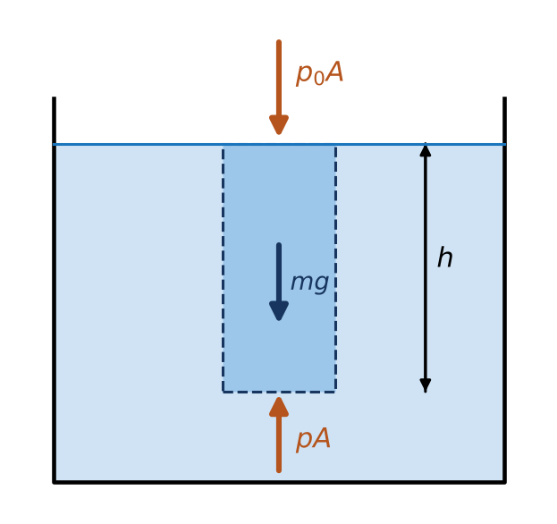
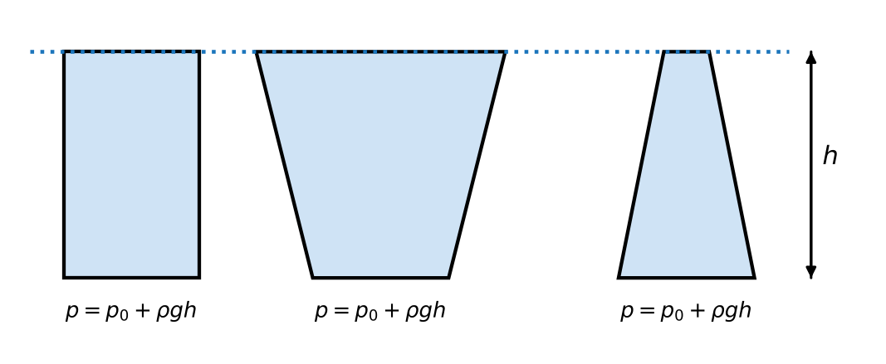
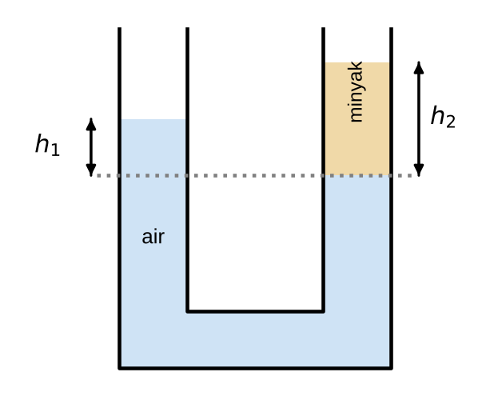
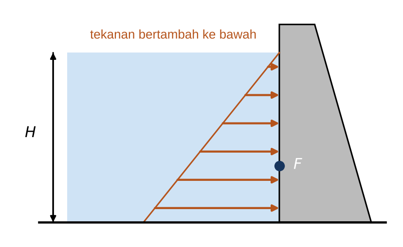
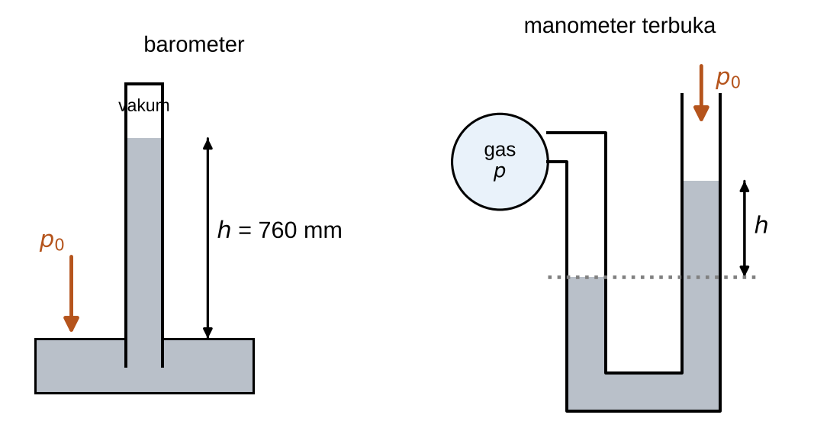
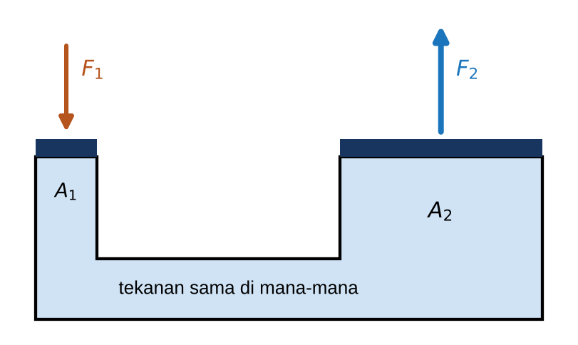
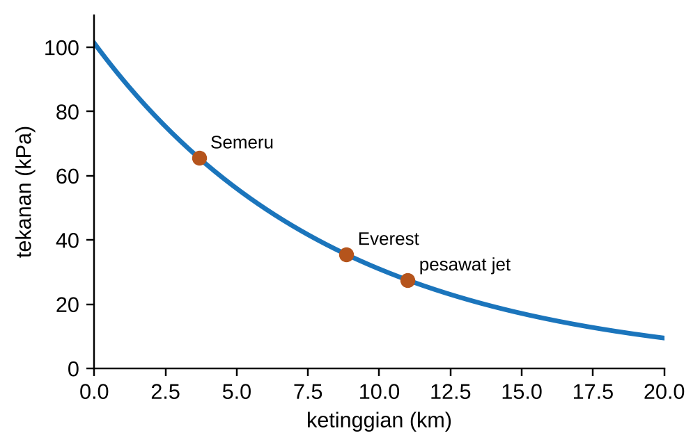

# Bab 6 Fluida Statis

Kapal peti kemas terbesar bermassa lebih dari 200 000 ton dan terbuat dari baja, bahan yang delapan kali lebih rapat daripada air. Kapal itu terapung. Sebutir kerikil bermassa beberapa gram, dari bahan yang jauh kurang rapat daripada baja, tenggelam seketika.

Di laboratorium kimia ada teka-teki yang lebih halus. Kamu menimbang tepat 100,00 g air dengan neraca analitik yang baru dikalibrasi. Massa air itu sebenarnya **bukan** 100,00 g, melainkan sekitar 100,11 g. Neracanya tidak rusak. Selisih sepersepuluh gram itu disebabkan oleh sesuatu yang selalu ada di sekitar kita dan hampir selalu dilupakan: udara.

Kedua hal itu dijelaskan oleh satu gagasan yang ditemukan Archimedes dua puluh dua abad lalu. Bab ini membangun gagasan itu dari dasar: apa itu tekanan, bagaimana tekanan berubah terhadap kedalaman, dan bagaimana selisih tekanan menghasilkan gaya apung. Jawaban teka-teki kapal ada di Contoh 6.29, dan teka-teki neraca di Contoh 6.32.

::: {.tujuan}
**Tujuan belajar**

Setelah mempelajari bab ini, kamu mampu:

1. Menghitung massa jenis dan tekanan, serta mengonversi satuan-satuan tekanan.
2. Menghitung tekanan dalam zat cair diam, termasuk zat cair berlapis, dan gaya pada dinding wadah.
3. Membaca barometer dan manometer, serta membedakan tekanan mutlak dari tekanan terukur.
4. Menerapkan hukum Pascal pada sistem hidraulik.
5. Menghitung perubahan tekanan atmosfer terhadap ketinggian dan akibatnya pada titik didih.
6. Menerapkan hukum Archimedes pada benda terapung, melayang, dan tenggelam, termasuk koreksi gaya apung udara pada penimbangan.
7. Menghitung gaya tegangan permukaan, tekanan dalam tetes dan gelembung, serta kenaikan kapiler.
8. Menganalisis zat cair dalam wadah yang dipercepat atau berputar.
9. Memakai semua itu pada pengukuran di laboratorium kimia.
:::

::: {.mat}
**Prasyarat**

Dari Bab 3: hukum Newton, kesetimbangan gaya, dan gerak melingkar (subbab 3.4, 3.7, dan 3.11). Dari Bab 4: energi potensial dan integral sederhana (subbab 4.2 dan 4.5).
:::

## 6.1 Zat alir, massa jenis, dan tekanan

**Fluida**, atau zat alir, adalah zat yang dapat mengalir: zat cair dan gas. Ciri penentunya: fluida yang diam tidak dapat menahan gaya geser. Jika kamu mendorong permukaan meja ke samping, meja melawan. Jika kamu mendorong permukaan air ke samping, airnya mengalir. Akibatnya, **fluida diam hanya dapat mengerjakan gaya yang tegak lurus permukaan** benda yang disentuhnya.

| | Zat padat | Zat cair | Gas |
|---|---|---|---|
| Bentuk | tetap | mengikuti wadah | mengikuti wadah |
| Volume | tetap | tetap | memenuhi wadah |
| Dapat dimampatkan? | hampir tidak | hampir tidak | mudah |
| Jarak antarmolekul | rapat, teratur | rapat, tidak teratur | renggang |

### Massa jenis

**Massa jenis** adalah massa per satuan volume:

$$
\boxed{\rho = \frac mV} \qquad \text{(6.1)}
$$

Satuan SI-nya kg/m³. Di laboratorium lebih sering dipakai g/cm³, yang sama dengan g/mL: $1\ \text{g/cm}^3 = 1000\ \text{kg/m}^3$.

| Zat | $\rho$ (kg/m³) | Zat | $\rho$ (kg/m³) |
|---|---|---|---|
| Udara (20 °C, 1 atm) | 1,20 | Es | 917 |
| Helium (20 °C, 1 atm) | 0,166 | Aluminium | 2700 |
| Etanol | 789 | Besi, baja | 7870 |
| Minyak goreng | 920 | Tembaga | 8960 |
| Air (4 °C) | 1000 | Perak | 10 500 |
| Air (25 °C) | 997 | Timbal | 11 300 |
| Air laut | 1025 | Raksa | 13 600 |
| Darah | 1060 | Emas | 19 300 |
| Gliserol | 1260 | Osmium | 22 600 |

Dua hal perlu dicatat. Zat cair dan zat padat memiliki massa jenis berorde 1000 kg/m³ atau lebih, sedangkan gas sekitar seribu kali lebih kecil. Dan massa jenis bergantung pada suhu: hampir semua zat memuai ketika dipanaskan. Air menyimpang dari aturan itu di antara 0 °C dan 4 °C, dan es lebih renggang daripada air. Itu sebabnya es terapung dan danau membeku dari atas.

::: {.contoh}
**Contoh 6.1 · Berapa massa udara di kamarmu?**

Sebuah kamar berukuran 4,0 m × 5,0 m dengan tinggi 3,0 m. Berapa massa udara di dalamnya?

**Penyelesaian.** $V = 60\ \text{m}^3$, sehingga $m = \rho V = (1{,}20)(60) = 72$ kg.

**Memahami hasil.** Udara di sebuah kamar ternyata seberat orang dewasa. Kita tidak merasakannya karena udara itu ditopang oleh udara di sekelilingnya, sama seperti air di tengah kolam ditopang oleh air di sekitarnya.
:::

::: {.contoh}
**Contoh 6.2 · Volume tidak selalu dapat dijumlahkan**

Sebanyak 100,0 mL etanol ($\rho = 0{,}789$ g/mL) dicampur dengan 100,0 mL air ($\rho = 1{,}000$ g/mL). Volume campurannya terukur 192 mL. Berapa massa jenis campuran itu?

**Penyelesaian.** Massa selalu dapat dijumlahkan: $m = 78{,}9 + 100{,}0 = 178{,}9$ g.

$$
\rho = \frac{178{,}9\ \text{g}}{192\ \text{mL}} = 0{,}932\ \text{g/mL}.
$$

**Memahami hasil.** Jika volume dianggap berjumlah 200 mL, hasilnya 0,895 g/mL, meleset 4%. Molekul etanol dan air saling menarik lewat ikatan hidrogen dan tersusun lebih rapat daripada dalam cairan murninya. **Massa kekal, volume tidak.** Itulah alasan konsentrasi yang teliti dinyatakan per massa (molalitas, persen massa), dan alasan larutan dibuat dengan menambahkan pelarut "sampai tanda batas", bukan dengan menjumlahkan volume.
:::

### Tekanan

Gaya yang sama dapat berakibat sangat berbeda bergantung pada luas tempat gaya itu bekerja. Paku menembus kayu karena ujungnya runcing. **Tekanan** adalah besar gaya tegak lurus per satuan luas:

$$
\boxed{p = \frac{F_\perp}{A}} \qquad \text{(6.2)}
$$

Satuannya N/m², yang diberi nama **pascal** (Pa). Satu pascal sangat kecil, kira-kira tekanan selembar kertas di atas meja, sehingga kilopascal lebih sering dipakai.

Tekanan adalah **skalar**. Di satu titik dalam fluida diam, tekanan sama besar ke segala arah. Yang memiliki arah adalah gaya yang ditimbulkannya pada suatu permukaan, dan gaya itu selalu tegak lurus permukaan tersebut.

| Satuan | Nilai dalam pascal | Dipakai untuk |
|---|---|---|
| 1 atm | 101 325 Pa | kimia, tekanan baku lama |
| 1 bar | 100 000 Pa | kimia (tekanan baku sekarang), cuaca |
| 1 mmHg = 1 torr | 133,3 Pa | tekanan darah, vakum |
| 1 psi | 6895 Pa | tekanan ban |
| 1 cmH₂O | 98,1 Pa | pernapasan |

Jadi 1 atm = 760 mmHg = 1,013 bar = 101,3 kPa = 14,7 psi.

::: {.contoh}
**Contoh 6.3 · Hak tinggi dan gajah**

(a) Seorang perempuan 60 kg berdiri bertumpu pada kedua hak sepatunya; tiap hak memiliki luas 1,0 cm². Berapa tekanan hak pada lantai? (b) Seekor gajah 5000 kg berdiri dengan empat kaki, masing-masing seluas 0,10 m². Berapa tekanan kakinya?

**Penyelesaian.**

(a) Tiap hak menahan setengah berat: $p = \dfrac{(60)(9{,}80)/2}{1{,}0 \times 10^{-4}} = 2{,}9 \times 10^6$ Pa.

(b) $p = \dfrac{(5000)(9{,}80)}{0{,}40} = 1{,}2 \times 10^5$ Pa.

**Memahami hasil.** Tekanan hak sepatu 24 kali tekanan kaki gajah, hampir 30 atm. Itulah sebabnya hak runcing merusak lantai kayu, sedangkan gajah tidak.
:::

::: {.contoh}
**Contoh 6.4 · Mengonversi tekanan**

(a) Nyatakan tekanan darah 120 mmHg dalam kPa. (b) Tekanan ban tertulis 32 psi. Nyatakan dalam kPa.

**Penyelesaian.**

(a) $(120)(0{,}1333) = 16{,}0$ kPa.

(b) $(32)(6{,}895) = 221$ kPa.

**Memahami hasil.** Kedua angka itu adalah tekanan **di atas tekanan atmosfer**, bukan tekanan sebenarnya. Tekanan mutlak di dalam ban adalah $221 + 101 = 322$ kPa. Perbedaan ini dibahas di subbab 6.3 dan sering menjadi sumber kesalahan dalam hitungan gas.
:::

::: {.contoh}
**Contoh 6.5 · Gaya atmosfer**

(a) Berapa gaya atmosfer pada permukaan meja berukuran 1,0 m × 2,0 m? (b) Pada tahun 1654 Otto von Guericke menangkupkan dua belahan bola tembaga berjari-jari 0,25 m dan memompa keluar udaranya. Berapa gaya yang diperlukan untuk memisahkannya?

**Penyelesaian.**

(a) $F = pA = (1{,}013 \times 10^5)(2{,}0) = 2{,}0 \times 10^5$ N.

(b) Gaya atmosfer yang menekan tiap belahan sama dengan tekanan kali luas **penampang** bola, $\pi r^2$:

$$
F = (1{,}013 \times 10^5)\,\pi(0{,}25)^2 = 2{,}0 \times 10^4\ \text{N}.
$$

**Memahami hasil.** Pada (a), gayanya setara dengan berat 20 ton. Meja tidak remuk karena udara di bawahnya menekan ke atas dengan gaya yang hampir sama. Pada (b), gayanya setara dengan berat 2 ton; dalam peragaan aslinya dua regu kuda gagal memisahkan kedua belahan itu. Gaya pada permukaan melengkung dihitung dari luas **bayangannya** pada bidang datar, karena komponen-komponen gaya yang menyamping saling meniadakan.
:::

::: {.kuis}
**Kuis cepat 6.1**

Mengapa berbaring di atas ratusan paku tidak melukai, sedangkan menginjak satu paku melukai?
:::

## 6.2 Tekanan dalam zat cair diam

Penyelam merasakan telinganya tertekan ketika turun. Makin dalam, makin besar tekanannya. Mari kita cari hubungan tepatnya.

{width=42%}

Bayangkan sebuah kolom zat cair berpenampang $A$ dari permukaan sampai kedalaman $h$ (Gambar 6.1). Kolom itu diam, jadi gaya totalnya nol. Tiga gaya tegak bekerja padanya: gaya $p_0A$ ke bawah dari udara di atas, beratnya $mg = \rho Ahg$ ke bawah, dan gaya $pA$ ke atas dari zat cair di bawahnya.

$$
pA = p_0A + \rho Ahg \quad\Longrightarrow\quad \boxed{p = p_0 + \rho gh} \qquad \text{(6.3)}
$$

Tekanan pada kedalaman $h$ sama dengan tekanan di permukaan ditambah $\rho gh$, yaitu berat kolom zat cair per satuan luas. Persamaan ini menganggap $\rho$ tetap, anggapan yang sangat baik untuk zat cair.

Tiga akibat yang penting:

1. **Tekanan hanya bergantung pada kedalaman**, tidak pada bentuk wadah atau banyaknya zat cair. Semua titik pada kedalaman yang sama dalam zat cair yang bersambung memiliki tekanan sama.
2. **Permukaan zat cair diam selalu mendatar**, dan zat cair dalam bejana berhubungan naik sama tinggi di semua cabang.
3. **Tekanan di permukaan diteruskan ke seluruh zat cair.** Jika $p_0$ dinaikkan, tekanan di semua kedalaman naik sebesar itu juga (subbab 6.4).

Untuk air, $\rho g = 9800$ Pa/m. Setiap turun 10 m, tekanan bertambah 98 kPa, hampir tepat 1 atm.

{width=76%}

### Paradoks hidrostatis

Pada Gambar 6.2, ketiga bejana berisi zat cair setinggi $h$ dan memiliki luas dasar sama. Tekanan di dasarnya sama, jadi **gaya pada dasarnya juga sama**, padahal berat zat cair di dalamnya jelas berbeda. Ini tampak mustahil, dan dikenal sebagai paradoks hidrostatis.

Kuncinya ada pada dinding. Pada bejana yang melebar, dinding miringnya ikut menopang sebagian berat zat cair. Pada bejana yang menyempit, dinding miringnya menekan zat cair **ke bawah** (reaksi dari zat cair yang menekan dinding ke atas), sehingga dasar menerima gaya lebih besar daripada berat zat cairnya. Jika seluruh bejana ditimbang, timbangan tetap membaca berat zat cair yang sebenarnya, karena gaya dinding tadi adalah gaya dalam bagi sistem bejana dan isinya.

::: {.strategi}
**Strategi · Soal tekanan hidrostatis**

1. **Gambar** wadah dan tandai titik-titik yang ditanya serta permukaan bebasnya.
2. Mulai dari titik yang tekanannya diketahui (biasanya permukaan terbuka, $p_0$).
3. Bergerak **turun** menambah $\rho gh$; bergerak **naik** mengurangi $\rho gh$. Bergerak mendatar dalam zat cair yang sama tidak mengubah tekanan.
4. Untuk zat cair berlapis, jumlahkan $\rho gh$ tiap lapisan dengan massa jenisnya masing-masing.
5. Perhatikan apakah yang ditanya tekanan **mutlak** atau tekanan **terukur** (selisih dari atmosfer).
6. Ubah semua satuan ke SI: meter, kg/m³, pascal.
:::

::: {.contoh}
**Contoh 6.6 · Dasar kolam renang**

Berapa tekanan terukur dan tekanan mutlak di dasar kolam renang sedalam 3,0 m?

**Penyelesaian.** Tekanan terukur: $\rho gh = (1000)(9{,}80)(3{,}0) = 29{,}4$ kPa. Tekanan mutlak: $101{,}3 + 29{,}4 = 130{,}7$ kPa.

**Memahami hasil.** Tekanan bertambah sekitar 29% di dasar kolam. Gendang telinga merasakan selisih 29 kPa itu, dan itu sudah cukup untuk terasa sakit jika tidak disamakan lewat saluran telinga.
:::

::: {.contoh}
**Contoh 6.7 · Penyelam di laut**

Berapa tekanan mutlak pada penyelam di kedalaman 30 m di laut ($\rho = 1025\ \text{kg/m}^3$)? Nyatakan juga dalam atm.

**Penyelesaian.**

$$
p = 1{,}013 \times 10^5 + (1025)(9{,}80)(30) = 1{,}013 \times 10^5 + 3{,}01 \times 10^5 = 4{,}03 \times 10^5\ \text{Pa} = 3{,}97\ \text{atm}.
$$

**Memahami hasil.** Aturan praktis penyelam: tiap 10 m air menambah 1 atm. Di 30 m tekanannya 4 atm. Udara yang dihirup penyelam harus bertekanan sama dengan sekelilingnya, sehingga tiap tarikan napas memuat molekul empat kali lebih banyak, dan gas terlarut dalam darah empat kali lebih banyak (hukum Henry). Jika penyelam naik terlalu cepat, gas itu keluar dari larutan sebagai gelembung, seperti soda yang dibuka. Itulah penyakit dekompresi.
:::

::: {.contoh}
**Contoh 6.8 · Zat cair berlapis**

Sebuah tangki terbuka berisi lapisan minyak ($\rho = 850\ \text{kg/m}^3$) setebal 0,20 m di atas air setebal 0,30 m. Berapa tekanan terukur di dasar tangki?

**Penyelesaian.** Jumlahkan tiap lapisan:

$$
p - p_0 = (850)(9{,}80)(0{,}20) + (1000)(9{,}80)(0{,}30) = 1666 + 2940 = 4{,}6 \times 10^3\ \text{Pa}.
$$

**Memahami hasil.** Lapisan minyak menyumbang tekanan sama seperti lapisan air setebal 0,17 m. Tiap lapisan dapat diganti dengan "tinggi air setara" $h\rho/\rho_\text{air}$.
:::

{width=40%}

::: {.contoh}
**Contoh 6.9 · Mengukur massa jenis dengan tabung U**

Tabung U berisi air. Minyak dituangkan ke salah satu cabang sampai kolom minyaknya 12,0 cm. Permukaan air di cabang lain ternyata 10,2 cm di atas bidang batas minyak–air (Gambar 6.3). Berapa massa jenis minyak itu?

**Rencana.** Pilih garis mendatar setinggi bidang batas minyak–air. Di bawah garis itu hanya ada air yang bersambung, jadi tekanan di kedua cabang pada garis itu sama.

**Penyelesaian.**

$$
p_0 + \rho_\text{air}g(0{,}102) = p_0 + \rho_\text{minyak}g(0{,}120) \quad\Longrightarrow\quad \rho_\text{minyak} = 1000 \times \frac{10{,}2}{12{,}0} = 850\ \text{kg/m}^3 .
$$

**Memahami hasil.** Zat cair yang lebih ringan memerlukan kolom lebih tinggi untuk mengimbangi tekanan yang sama. Tekanan atmosfer dan $g$ tercoret, jadi cara ini hanya memerlukan penggaris.
:::

### Gaya pada dinding

Tekanan di dasar wadah sama di semua titik, jadi gaya pada dasar adalah $pA$. Pada dinding tegak, tekanan berubah terhadap kedalaman, dari nol (terukur) di permukaan sampai $\rho gH$ di dasar. Gaya totalnya harus dijumlahkan dengan integral.

{width=58%}

Untuk dinding tegak selebar $w$ yang menahan air sedalam $H$ (Gambar 6.4), ambil pita mendatar setebal $dy$ pada kedalaman $y$. Gaya padanya $dF = (\rho gy)(w\,dy)$.

$$
F = \int_0^H \rho gyw\,dy = \tfrac12\rho gwH^2 . \qquad \text{(6.4)}
$$

Cara lain mengingatnya: gaya = **tekanan rata-rata** × luas, dengan tekanan rata-rata $\tfrac12\rho gH$, yaitu tekanan di **titik tengah** bidang. Aturan itu berlaku untuk bidang datar berbentuk apa pun yang terendam:

$$
\boxed{F = \rho g\,h_\text{pusat}\,A} \qquad \text{(6.5)}
$$

dengan $h_\text{pusat}$ kedalaman titik pusat bidang.

::: {.contoh}
**Contoh 6.10 · Gaya air pada bendungan**

Sebuah bendungan selebar 100 m menahan air sedalam 20 m. (a) Berapa gaya air padanya? (b) Bagaimana gaya itu berubah jika waduk di belakangnya sepuluh kali lebih panjang?

**Penyelesaian.**

(a) $F = \tfrac12(1000)(9{,}80)(100)(20)^2 = 1{,}96 \times 10^8$ N.

(b) Tidak berubah. Rumusnya hanya memuat kedalaman dan lebar bendungan.

**Memahami hasil.** Gaya 196 MN setara dengan berat 20 000 ton. Gaya itu sebanding dengan **kuadrat** kedalaman, sehingga bendungan dibuat makin tebal ke bawah. Hasil (b) adalah paradoks hidrostatis lagi: bendungan yang menahan danau raksasa menerima gaya yang sama dengan bendungan yang menahan parit sempit sedalam itu.
:::

::: {.contoh}
**Contoh 6.11 · Jendela akuarium**

Jendela kaca sebuah akuarium raksasa berukuran lebar 2,0 m dan tinggi 1,0 m. Tepi atasnya 1,0 m di bawah permukaan air. Berapa gaya total air pada jendela itu (di atas gaya atmosfer)?

**Penyelesaian.** Pusat jendela berada pada kedalaman $1{,}0 + 0{,}5 = 1{,}5$ m.

$$
F = \rho g\,h_\text{pusat}A = (1000)(9{,}80)(1{,}5)(2{,}0) = 2{,}9 \times 10^4\ \text{N}.
$$

**Memahami hasil.** Dengan integral: $\displaystyle\int_{1}^{2}\rho gy(2{,}0)\,dy = (9800)(2{,}0)\tfrac12(4 - 1) = 2{,}94 \times 10^4$ N. Sama. Tekanan atmosfer tidak dihitung karena bekerja pada kedua sisi kaca.
:::

::: {.contoh}
**Contoh 6.12 · Bejana yang menyempit**

Sebuah vas dengan dasar seluas 0,010 m² menyempit ke atas, dan diisi air setinggi 0,30 m. Airnya hanya 1,5 kg. (a) Berapa gaya air pada dasar vas (tekanan terukur)? (b) Bandingkan dengan berat air.

**Penyelesaian.**

(a) $F = \rho ghA = (1000)(9{,}80)(0{,}30)(0{,}010) = 29$ N.

(b) Berat air: $(1{,}5)(9{,}80) = 14{,}7$ N.

**Memahami hasil.** Gaya pada dasar dua kali berat airnya. Selisihnya, 14,7 N, adalah gaya dinding miring vas yang menekan air ke bawah. Vas beserta airnya di atas timbangan tetap terbaca sesuai massanya, karena air juga mendorong dinding miring itu ke atas dengan 14,7 N.
:::

::: {.contoh}
**Contoh 6.13 · Menara air dan botol infus**

(a) Permukaan air di tangki sebuah gedung berada 20 m di atas tanah. Berapa tekanan terukur air di keran lantai tiga, 8,0 m di atas tanah? (b) Kantong infus digantung 1,2 m di atas lengan pasien. Massa jenis cairannya $1020\ \text{kg/m}^3$. Berapa tekanan terukur cairan di jarum, dalam kPa dan mmHg?

**Penyelesaian.**

(a) Beda ketinggian 12 m: $p = (1000)(9{,}80)(12) = 118$ kPa.

(b) $p = (1020)(9{,}80)(1{,}2) = 12{,}0$ kPa $= 90$ mmHg.

**Memahami hasil.** Pada (a), keran di lantai bawah mengalir lebih deras daripada di lantai atas, karena tekanannya lebih besar. Pada (b), tekanan di pembuluh vena lengan hanya sekitar 2 kPa, jadi cairan mengalir masuk dengan mudah. Jika kantong diturunkan sampai di bawah 0,20 m, cairan berhenti mengalir, dan di bawah itu darah justru mengalir balik ke selang.
:::

::: {.awas}
**Awas · Tiga kesalahan pada tekanan hidrostatis**

- **Mengira tekanan bergantung pada banyaknya air.** Tekanan di kedalaman 2 m sama besar di bak mandi, di danau, dan di laut (dengan massa jenis yang sama).
- **Lupa tekanan atmosfer**, atau menambahkannya dua kali. Tentukan dulu: yang ditanya tekanan mutlak atau terukur?
- **Memakai sentimeter dan g/cm³ dalam $\rho gh$.** Rumus itu memberi pascal hanya jika $\rho$ dalam kg/m³ dan $h$ dalam meter.
:::

::: {.kuis}
**Kuis cepat 6.2**

Sebuah tong kayu yang penuh air ditutup rapat, lalu pipa tipis yang sangat panjang dipasang tegak di tutupnya. Hanya dengan menuangkan beberapa gelas air ke dalam pipa itu, tong dapat pecah. Bagaimana mungkin?
:::

## 6.3 Mengukur tekanan

### Tekanan mutlak dan tekanan terukur

Hampir semua alat ukur tekanan sebenarnya mengukur **selisih** tekanan dari atmosfer di sekitarnya:

$$
\boxed{p_\text{terukur} = p_\text{mutlak} - p_\text{atm}} \qquad \text{(6.6)}
$$

Ban yang "kempes" memiliki tekanan terukur nol, tetapi tekanan mutlaknya masih 1 atm. Tekanan terukur dapat negatif (vakum sebagian). Tekanan mutlak tidak pernah negatif.

Dalam persamaan gas $pV = nRT$ dan semua rumus termodinamika, yang dipakai **selalu tekanan mutlak**.

{width=78%}

### Barometer

Pada tahun 1643 Evangelista Torricelli mengisi penuh sebuah tabung kaca panjang dengan raksa, menutup ujungnya, lalu membalikkannya ke dalam mangkuk raksa. Raksa dalam tabung turun, tetapi berhenti pada ketinggian sekitar 76 cm di atas permukaan mangkuk (Gambar 6.5). Ruang di atas kolom itu hampa. Terapkan (6.3) dari puncak kolom ($p \approx 0$) turun ke permukaan mangkuk:

$$
p_\text{atm} = \rho_\text{raksa}\,g\,h . \qquad \text{(6.7)}
$$

Tekanan atmosferlah yang menopang kolom raksa itu. Dari sinilah satuan mmHg berasal: 1 atm menopang 760 mm raksa.

### Manometer

Manometer tabung terbuka adalah tabung U berisi zat cair, satu ujung dihubungkan ke gas yang diukur dan ujung lain terbuka ke udara (Gambar 6.5). Jika permukaan di sisi terbuka lebih tinggi sebesar $h$,

$$
p_\text{gas} = p_\text{atm} + \rho gh . \qquad \text{(6.8)}
$$

Jika permukaan di sisi terbuka lebih **rendah**, tandanya berbalik dan tekanan gas lebih kecil daripada atmosfer.

::: {.contoh}
**Contoh 6.14 · Mengapa raksa?**

Hitung tinggi kolom yang ditopang tekanan 1 atm jika barometer diisi (a) raksa ($13\,595\ \text{kg/m}^3$), (b) air.

**Penyelesaian.**

(a) $h = \dfrac{101\,325}{(13\,595)(9{,}807)} = 0{,}760$ m.

(b) $h = \dfrac{101\,325}{(1000)(9{,}807)} = 10{,}3$ m.

**Memahami hasil.** Barometer air harus setinggi gedung tiga lantai. Raksa dipilih karena sangat rapat dan hampir tidak menguap pada suhu kamar. Angka 10,3 m itu juga batas keras bagi **pompa hisap**: pompa tidak "menarik" air, melainkan mengurangi tekanan di atasnya dan membiarkan atmosfer mendorong air naik. Atmosfer tidak sanggup mendorong lebih tinggi dari 10,3 m, sebaik apa pun pompanya. Sumur yang lebih dalam memerlukan pompa yang dipasang di bawah dan **mendorong** air ke atas.
:::

::: {.contoh}
**Contoh 6.15 · Membaca manometer**

Sebuah labu berisi gas dihubungkan ke manometer raksa tabung terbuka. Permukaan raksa di sisi terbuka 18,0 cm lebih tinggi daripada di sisi gas. Tekanan atmosfer 101,3 kPa. Berapa tekanan gas?

**Penyelesaian.**

$$
p = 101{,}3\ \text{kPa} + (13\,600)(9{,}80)(0{,}180)\ \text{Pa} = 101{,}3 + 24{,}0 = 125{,}3\ \text{kPa}.
$$

**Memahami hasil.** Dalam mmHg hitungannya langsung: $760 + 180 = 940$ mmHg. Itulah kenyamanan satuan mmHg untuk manometer raksa. Gas mendorong raksa ke arah sisi terbuka, jadi tekanannya memang harus lebih besar daripada atmosfer.
:::

::: {.contoh}
**Contoh 6.16 · Sedotan**

Paru-paru dapat menurunkan tekanan di mulut paling banyak sekitar 8,0 kPa di bawah tekanan atmosfer. Berapa panjang sedotan tegak paling panjang yang masih dapat dipakai untuk minum air?

**Penyelesaian.** Atmosfer mendorong air naik sampai $\rho gh$ sama dengan selisih tekanan:

$$
h = \frac{8{,}0 \times 10^3}{(1000)(9{,}80)} = 0{,}82\ \text{m}.
$$

**Memahami hasil.** Kita tidak menyedot air ke atas. Kita mengurangi tekanan di dalam sedotan, dan atmosferlah yang mendorong air. Di Bulan, tanpa atmosfer, sedotan tidak berguna.
:::

::: {.contoh}
**Contoh 6.17 · Tekanan darah dari kepala sampai kaki**

Tekanan darah rata-rata di jantung seseorang yang berdiri adalah 100 mmHg (13,3 kPa, terukur). Kepalanya 0,45 m di atas jantung dan telapak kakinya 1,30 m di bawah jantung. Berapa tekanan darah di kepala dan di kaki? ($\rho_\text{darah} = 1060\ \text{kg/m}^3$; abaikan pengaruh aliran.)

**Penyelesaian.**

Kepala: $p = 13{,}3 - (1060)(9{,}80)(0{,}45)/1000 = 13{,}3 - 4{,}7 = 8{,}7$ kPa $= 65$ mmHg.

Kaki: $p = 13{,}3 + (1060)(9{,}80)(1{,}30)/1000 = 13{,}3 + 13{,}5 = 26{,}8$ kPa $= 201$ mmHg.

**Memahami hasil.** Tekanan darah di kaki dua kali tekanan di jantung, dan di kepala hanya dua pertiganya. Itulah sebabnya tekanan darah selalu diukur di lengan atas, **setinggi jantung**; kaki membengkak setelah berdiri lama; dan orang yang bangun terlalu cepat dapat pusing sesaat. Ketika berbaring, ketiga tekanan itu hampir sama.
:::

::: {.contoh}
**Contoh 6.18 · Menampung gas di atas air**

Gas hidrogen dari reaksi logam dengan asam ditampung dalam tabung terbalik di atas air pada 25 °C. Setelah reaksi selesai, permukaan air di dalam tabung 15,0 cm **lebih tinggi** daripada permukaan air di bak. Tekanan atmosfer 100,0 kPa dan tekanan uap air pada 25 °C adalah 3,17 kPa. Berapa tekanan hidrogen kering?

**Rencana.** Di permukaan air bak, tekanannya $p_\text{atm}$. Naik 15,0 cm di dalam tabung, tekanan berkurang $\rho gh$. Itu tekanan gas total di dalam tabung, yang terdiri atas hidrogen dan uap air.

**Penyelesaian.**

$$
p_\text{total} = 100{,}0 - \frac{(1000)(9{,}80)(0{,}150)}{1000} = 100{,}0 - 1{,}47 = 98{,}53\ \text{kPa}.
$$

$$
p_{\text{H}_2} = 98{,}53 - 3{,}17 = 95{,}4\ \text{kPa}.
$$

**Memahami hasil.** Dua koreksi diperlukan: beda tinggi kolom air (1,5%) dan uap air (3,2%). Tanpa keduanya, jumlah mol hidrogen akan terhitung hampir 5% terlalu besar. Di praktikum, koreksi pertama dihilangkan dengan menaik-turunkan tabung sampai permukaan air di dalam dan di luar **sama tinggi** sebelum membaca volume.
:::

::: {.kuis}
**Kuis cepat 6.3**

Sebuah barometer raksa dibawa dari tepi pantai ke puncak gunung. Apakah kolom raksanya naik atau turun? Bagaimana jika tabungnya dimiringkan?
:::

## 6.4 Hukum Pascal dan hidraulik

Persamaan $p = p_0 + \rho gh$ menyatakan sesuatu yang penting. Jika tekanan di permukaan dinaikkan sebesar $\Delta p$, tekanan di **setiap** titik dalam zat cair naik sebesar $\Delta p$ juga.

::: {.inti}
**Hukum Pascal.** Perubahan tekanan pada zat cair dalam wadah tertutup diteruskan sama besar ke setiap bagian zat cair dan ke dinding wadahnya.
:::

{width=64%}

Pada pengangkat hidraulik (Gambar 6.6), gaya $F_1$ pada piston kecil berluas $A_1$ menimbulkan tambahan tekanan $F_1/A_1$. Tekanan itu sampai di piston besar berluas $A_2$ dan menghasilkan gaya

$$
\boxed{\frac{F_1}{A_1} = \frac{F_2}{A_2}} \quad\Longrightarrow\quad F_2 = F_1\,\frac{A_2}{A_1} . \qquad \text{(6.9)}
$$

Gaya diperbesar dengan perbandingan luas. Tetapi tidak ada yang gratis. Zat cair hampir tidak dapat dimampatkan, jadi volume yang didorong piston kecil sama dengan volume yang mengangkat piston besar: $A_1d_1 = A_2d_2$. Piston besar hanya bergerak sejauh $d_2 = d_1A_1/A_2$. Usahanya sama:

$$
F_1d_1 = F_2d_2 .
$$

Hidraulik adalah "tuas zat cair": gaya diperbesar, jarak diperkecil, energi kekal. Rem mobil, dongkrak, ekskavator, kursi dokter gigi, dan kemudi pesawat memakai asas ini. Minyak dipakai sebagai zat cairnya karena hampir tidak termampatkan dan sekaligus melumasi. Gelembung udara dalam minyak rem berbahaya justru karena udara **dapat** dimampatkan: pedal terasa empuk dan gayanya tidak sampai ke roda.

::: {.contoh}
**Contoh 6.19 · Dongkrak hidraulik**

Sebuah dongkrak hidraulik memiliki piston kecil seluas 2,0 cm² dan piston besar seluas 200 cm². (a) Berapa gaya pada piston kecil untuk mengangkat mobil 1200 kg? (b) Berapa jauh piston kecil harus digerakkan (secara keseluruhan) untuk menaikkan mobil 10 cm?

**Penyelesaian.**

(a) $F_1 = F_2\dfrac{A_1}{A_2} = (1200)(9{,}80)\dfrac{2{,}0}{200} = 118$ N.

(b) $d_1 = d_2\dfrac{A_2}{A_1} = (0{,}10)(100) = 10$ m.

**Memahami hasil.** Gaya 118 N setara dengan mengangkat 12 kg, cukup dengan satu tangan. Tetapi piston kecil harus menempuh 10 m. Tentu tidak ada tuas sepanjang itu: dongkrak memakai katup satu arah, sehingga tuasnya dapat dipompa berulang-ulang dengan langkah pendek. Usaha masukan $(118)(10) = 1180$ J sama dengan usaha keluaran $(11\,760)(0{,}10) = 1176$ J.
:::

::: {.contoh}
**Contoh 6.20 · Rem mobil**

Pengemudi menekan pedal rem dengan gaya 80 N. Tuas pedal melipatgandakan gaya itu lima kali sebelum mendorong piston silinder utama seluas 1,2 cm². Piston pada kaliper rem roda memiliki luas 15 cm². (a) Berapa tekanan minyak rem? (b) Berapa gaya jepit piston kaliper?

**Penyelesaian.**

(a) Gaya pada piston utama: 400 N. $p = \dfrac{400}{1{,}2 \times 10^{-4}} = 3{,}3 \times 10^6$ Pa, sekitar 33 atm.

(b) $F = pA = (3{,}3 \times 10^6)(15 \times 10^{-4}) = 5{,}0 \times 10^3$ N.

**Memahami hasil.** Injakan 80 N (berat 8 kg) menjadi gaya jepit 5000 N pada tiap roda, perbesaran lebih dari 60 kali. Dan karena tekanan diteruskan sama besar ke semua roda, keempat rem bekerja serentak dengan gaya seimbang.
:::

::: {.kuis}
**Kuis cepat 6.4**

Pada pengangkat hidraulik, gaya pada piston besar lebih besar daripada gaya pada piston kecil. Apakah ini berarti tekanan di bawah piston besar lebih besar?
:::

## 6.5 Atmosfer

Kita hidup di dasar lautan udara. Tekanan atmosfer di permukaan laut adalah berat seluruh kolom udara di atas tiap meter persegi.

Rumus $p = p_0 + \rho gh$ tidak dapat dipakai begitu saja untuk udara pada beda ketinggian yang besar, karena udara mudah dimampatkan. Udara di bawah tertekan oleh udara di atasnya, sehingga lebih rapat. Massa jenis udara sebanding dengan tekanannya.

Untuk lapisan tipis setebal $dy$, tekanan berkurang $dp = -\rho g\,dy$ ketika kita naik. Dari persamaan gas ideal, $\rho = pM/(RT)$, dengan $M$ massa molar udara. Maka

$$
\frac{dp}{dy} = -\frac{Mg}{RT}\,p .
$$

Laju berkurangnya tekanan sebanding dengan tekanan itu sendiri. Itu ciri peluruhan eksponensial. Jika suhu dianggap tetap,

$$
\boxed{p = p_0\,e^{-y/H}, \qquad H = \frac{RT}{Mg}} \qquad \text{(6.10)}
$$

Ini **rumus barometrik**. Besaran $H$ disebut **tinggi skala**: setiap naik setinggi $H$, tekanan turun menjadi $1/e = 37\%$ nilai semula. Setiap naik $H\ln 2$, tekanan menjadi setengahnya.

::: {.mat}
**Matematika · Fungsi eksponen**

Fungsi $e^{x}$, dengan $e = 2{,}718\ldots$, adalah satu-satunya fungsi yang turunannya sama dengan dirinya sendiri. Akibatnya, penyelesaian persamaan "laju perubahan sebanding dengan nilainya", $\dfrac{dp}{dy} = -kp$, selalu $p = p_0e^{-ky}$. Kebalikan fungsi eksponen adalah logaritma alami: jika $p/p_0 = e^{-y/H}$, maka $y = -H\ln(p/p_0)$.

Bentuk yang sama akan muncul berulang kali: peluruhan radioaktif, pengosongan kapasitor (Bab 13), kinetika reaksi orde satu, dan faktor Boltzmann $e^{-E/k_BT}$ (Bab 10).
:::

{width=58%}

::: {.contoh}
**Contoh 6.21 · Tekanan di puncak gunung**

(a) Hitung tinggi skala atmosfer untuk suhu rata-rata 288 K ($M = 0{,}02896$ kg/mol). (b) Berapa tekanan udara di puncak Semeru (3676 m) dan di puncak Everest (8849 m)?

**Penyelesaian.**

(a) $H = \dfrac{(8{,}314)(288)}{(0{,}02896)(9{,}80)} = 8{,}44 \times 10^3$ m.

(b) Semeru: $p = 101{,}3\,e^{-3676/8440} = 101{,}3(0{,}647) = 65{,}5$ kPa. Everest: $p = 101{,}3\,e^{-8849/8440} = 101{,}3(0{,}350) = 35{,}5$ kPa.

**Memahami hasil.** Di puncak Semeru hanya ada 65% udara permukaan laut, dan di puncak Everest 35% (Gambar 6.7). Tekanan parsial oksigen turun dengan perbandingan yang sama, sehingga tiap tarikan napas di Everest hanya membawa sepertiga oksigen. Suhu atmosfer sebenarnya turun terhadap ketinggian, jadi tekanan nyata sedikit lebih rendah daripada hitungan ini, tetapi rumus barometrik sudah benar sampai beberapa persen.
:::

::: {.contoh}
**Contoh 6.22 · Massa atmosfer**

Tekanan atmosfer di permukaan laut 101,3 kPa, dan jari-jari Bumi 6370 km. Perkirakan massa seluruh atmosfer.

**Penyelesaian.** Tekanan adalah berat kolom udara per satuan luas. Jadi massa udara di atas tiap meter persegi adalah $p_0/g = 1{,}034 \times 10^4$ kg. Kalikan dengan luas permukaan Bumi:

$$
m = \frac{p_0}{g}\,4\pi R^2 = (1{,}034 \times 10^4)(4\pi)(6{,}37 \times 10^6)^2 = 5{,}3 \times 10^{18}\ \text{kg}.
$$

**Memahami hasil.** Di atas tiap meter persegi ada sepuluh ton udara, sama dengan massa kolom air setinggi 10,3 m (Contoh 6.14). Massa atmosfer kira-kira sepersejuta massa Bumi.
:::

::: {.contoh}
**Contoh 6.23 · Titik didih air di gunung**

Air mendidih ketika tekanan uapnya sama dengan tekanan sekitarnya. Perkirakan titik didih air di puncak Semeru, tempat tekanannya 65,5 kPa. Gunakan persamaan Clausius–Clapeyron,

$$
\ln\frac{p_2}{p_1} = -\frac{\Delta H_\text{uap}}{R}\Big(\frac{1}{T_2} - \frac{1}{T_1}\Big),
$$

dengan $\Delta H_\text{uap} = 40{,}7$ kJ/mol dan titik didih 373,15 K pada 101,3 kPa.

**Penyelesaian.**

$$
\frac{1}{T_2} = \frac{1}{373{,}15} - \frac{(8{,}314)\ln(0{,}647)}{40\,700} = 0{,}002680 + 0{,}000089 = 0{,}002769\ \text{K}^{-1}.
$$

$T_2 = 361{,}2$ K $= 88$ °C.

**Memahami hasil.** Air mendidih 12 °C lebih rendah di puncak Semeru. Makanan lebih lama matang, karena yang mematangkan adalah suhu, bukan gelembungnya. Panci bertekanan bekerja dengan arah sebaliknya: tekanannya dinaikkan menjadi sekitar 2 atm, sehingga air baru mendidih pada 120 °C. Titik didih yang tercantum di tabel selalu berlaku untuk tekanan tertentu, dan laporan praktikum yang baik mencatat tekanan udara pada hari pengukuran.
:::

::: {.contoh}
**Contoh 6.24 · Telinga di lift**

Untuk beda ketinggian yang kecil, massa jenis udara hampir tetap dan $\Delta p = \rho g\,\Delta y$ boleh dipakai. Berapa perubahan tekanan udara ketika lift naik 300 m?

**Penyelesaian.** $\Delta p = (1{,}20)(9{,}80)(300) = 3{,}5 \times 10^3$ Pa, yaitu 3,5% dari 1 atm.

**Memahami hasil.** Rumus eksponen memberi $101{,}3(1 - e^{-300/8440}) = 3{,}5$ kPa, sama. Selisih 3,5 kPa pada gendang telinga sudah cukup untuk terasa "pengang" sampai tekanan di telinga tengah disamakan dengan menelan. Pendaki memakai hubungan ini terbalik: altimeter tekanan mengubah bacaan tekanan menjadi ketinggian.
:::

::: {.terapan}
**Kaitan kimia · Rumus barometrik adalah sebaran Boltzmann**

Tulis ulang $H = RT/(Mg)$ untuk satu molekul bermassa $m$: karena $M = mN_A$ dan $R = k_BN_A$,

$$
\frac{p}{p_0} = e^{-mgy/k_BT} .
$$

Pembilang pada pangkat, $mgy$, adalah **energi potensial** molekul pada ketinggian $y$. Jadi banyaknya molekul pada energi $E$ sebanding dengan $e^{-E/k_BT}$. Itu **faktor Boltzmann**, salah satu rumus terpenting dalam kimia fisika. Ia menentukan populasi tingkat energi dalam spektroskopi, bagian molekul yang mampu melewati energi aktivasi (persamaan Arrhenius), dan letak kesetimbangan kimia. Atmosfer adalah contoh yang dapat dilihat langsung: molekul lebih jarang ditemukan di tempat yang energinya lebih tinggi, dan suhulah yang menentukan seberapa cepat kelangkaan itu bertambah.

Rumus yang sama meramalkan bahwa gas yang lebih berat lebih terpusat di bawah. Pada tahun 1908 Jean Perrin mengukur sebaran butir-butir getah halus terhadap ketinggian dalam air, memakai rumus ini untuk memperoleh bilangan Avogadro, dan dengan itu meyakinkan dunia ilmu bahwa atom benar-benar ada.
:::

::: {.kuis}
**Kuis cepat 6.5**

Sebuah planet memiliki gravitasi permukaan dua kali Bumi, dengan suhu dan susunan atmosfer yang sama. Apakah tinggi skala atmosfernya lebih besar atau lebih kecil? Apakah atmosfernya lebih "tebal" atau lebih "tipis" terhadap ketinggian?
:::
