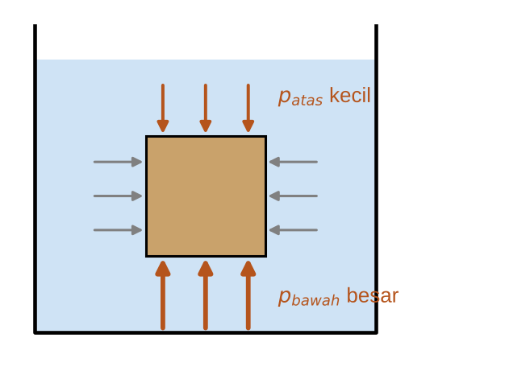
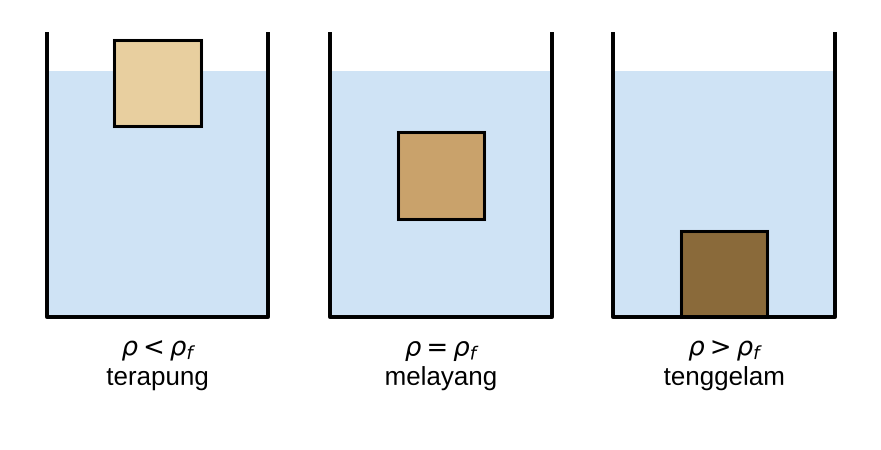
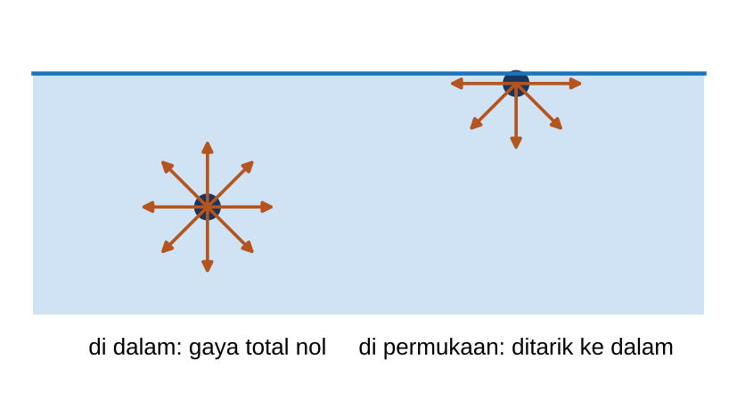
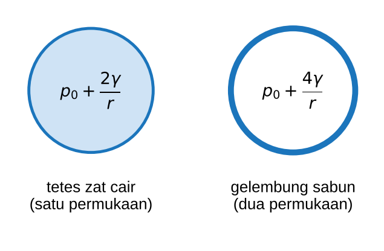
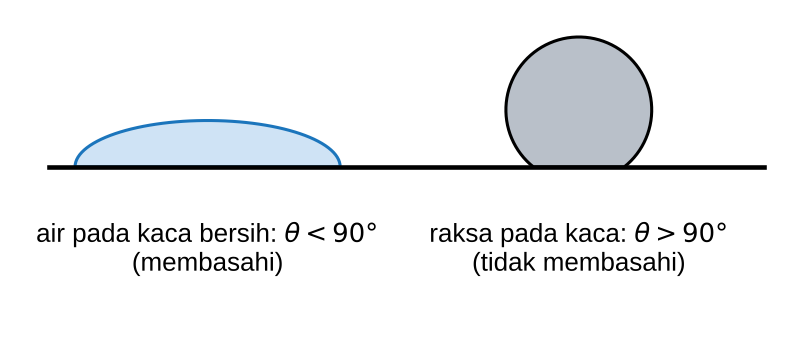
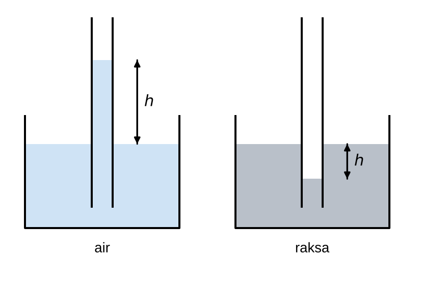
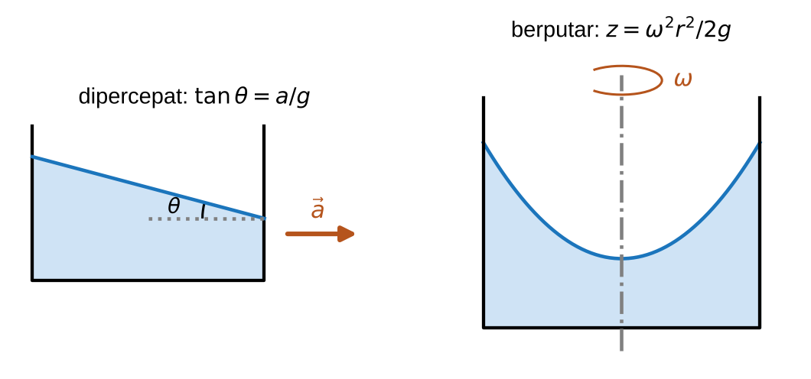
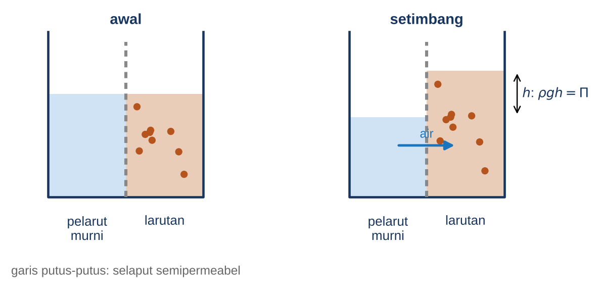

## 6.6 Hukum Archimedes

Benda yang dicelupkan ke air terasa lebih ringan. Batu yang berat di darat dapat diangkat dengan mudah di dasar kolam. Zat cair mengerjakan gaya ke atas pada benda itu. Gaya ini disebut **gaya apung**.

{width=46%}

### Dari mana gaya apung berasal

Gaya apung bukan gaya jenis baru. Ia akibat langsung dari bertambahnya tekanan terhadap kedalaman (Gambar 6.8). Ambil balok berluas alas $A$ dan tinggi $\ell$ yang terbenam seluruhnya, dengan sisi atas pada kedalaman $h$:

$$
F_\text{apung} = p_\text{bawah}A - p_\text{atas}A = \rho_fg(h + \ell)A - \rho_fghA = \rho_fg\,(A\ell) = \rho_fgV .
$$

Besaran $\rho_fV$ adalah massa fluida yang menempati volume $V$, yaitu massa fluida yang **dipindahkan** benda.

Untuk bentuk sembarang ada penalaran yang lebih cerdik. Bayangkan benda itu diganti dengan fluida yang sama, berbentuk persis sama. Gumpalan fluida itu diam, jadi fluida di sekitarnya pasti menopangnya dengan gaya ke atas sebesar beratnya. Fluida di sekitar tidak "tahu" apa isi ruang itu. Jadi benda apa pun yang menempati ruang tersebut menerima gaya ke atas yang sama.

::: {.inti}
**Hukum Archimedes.** Benda yang terbenam sebagian atau seluruhnya dalam fluida mengalami gaya ke atas sebesar berat fluida yang dipindahkannya:

$$
F_\text{apung} = \rho_f\,g\,V_\text{terbenam} .
$$
:::

Perhatikan apa yang **tidak** muncul dalam rumus itu: massa benda, massa jenis benda, bentuk benda, dan kedalamannya. Gaya apung hanya bergantung pada massa jenis **fluida** dan volume benda yang **terbenam**. Sebuah bola timbal dan bola gabus berukuran sama yang terbenam seluruhnya menerima gaya apung yang sama.

### Tenggelam, melayang, terapung

{width=78%}

Benda bermassa jenis rata-rata $\rho$ dan volume $V$ yang terbenam seluruhnya memiliki berat $\rho gV$ dan menerima gaya apung $\rho_fgV$. Yang menentukan nasibnya adalah perbandingan kedua massa jenis itu (Gambar 6.9):

| Keadaan | Akibat |
|---|---|
| $\rho > \rho_f$ | berat lebih besar: benda **tenggelam** |
| $\rho = \rho_f$ | setimbang di mana pun: benda **melayang** |
| $\rho < \rho_f$ | gaya apung lebih besar: benda naik, lalu **terapung** |

Benda yang terapung naik sampai hanya sebagian volumenya terbenam, tepat cukup agar gaya apung sama dengan beratnya:

$$
\rho_fgV_\text{terbenam} = \rho gV \quad\Longrightarrow\quad \boxed{\frac{V_\text{terbenam}}{V} = \frac{\rho}{\rho_f}} \qquad \text{(6.11)}
$$

Bagian yang terbenam sama dengan perbandingan massa jenis.

### Berat semu

Benda yang tenggelam dan digantung pada neraca pegas terbaca lebih ringan:

$$
W_\text{semu} = W - F_\text{apung} = (\rho - \rho_f)\,gV . \qquad \text{(6.12)}
$$

Selisih bacaan di udara dan di dalam zat cair langsung memberi gaya apung, dan dari situ volume benda. Inilah cara mengukur volume benda berbentuk tak beraturan dengan sangat teliti, hanya dengan neraca.

::: {.strategi}
**Strategi · Soal gaya apung**

1. **Gambar diagram benda bebas.** Gaya yang mungkin ada: berat (ke bawah), gaya apung (ke atas), tegangan tali, gaya normal dasar wadah.
2. Tulis berat dengan massa jenis **benda** dan volume **seluruh** benda: $\rho gV$.
3. Tulis gaya apung dengan massa jenis **fluida** dan volume **terbenam**: $\rho_fgV_\text{terbenam}$.
4. Terapkan kesetimbangan (atau hukum kedua jika benda dipercepat).
5. Banyak soal menjadi lebih mudah dengan perbandingan, karena $g$ dan sering kali $V$ tercoret.
:::

::: {.contoh}
**Contoh 6.25 · Gaya apung dan berat semu**

Sebuah batu bermassa 5,0 kg dan bervolume 2,0 liter terbenam seluruhnya dalam air. Berapa gaya apung padanya, dan berapa berat semunya?

**Penyelesaian.**

$$
F_\text{apung} = (1000)(9{,}80)(2{,}0 \times 10^{-3}) = 19{,}6\ \text{N}, \qquad W_\text{semu} = (5{,}0)(9{,}80) - 19{,}6 = 29{,}4\ \text{N}.
$$

**Memahami hasil.** Batu itu terasa 40% lebih ringan di dalam air. Massa jenisnya $5{,}0/0{,}0020 = 2500\ \text{kg/m}^3$, dan bagian berat yang "hilang" adalah $\rho_f/\rho = 1000/2500 = 40\%$.
:::

::: {.contoh}
**Contoh 6.26 · Mahkota Raja Hieron**

Menurut cerita, Archimedes diminta memeriksa apakah mahkota raja terbuat dari emas murni tanpa merusaknya. Misalkan mahkota itu bermassa 1,000 kg. Beratnya di udara 9,80 N, dan berat semunya di dalam air 9,19 N. (a) Berapa massa jenisnya? (b) Jika mahkota itu campuran emas ($19\,300\ \text{kg/m}^3$) dan perak ($10\,500\ \text{kg/m}^3$), berapa bagian massanya yang emas?

**Penyelesaian.**

(a) Gaya apung: $9{,}80 - 9{,}19 = 0{,}61$ N. Volume: $V = \dfrac{0{,}61}{(1000)(9{,}80)} = 6{,}22 \times 10^{-5}\ \text{m}^3$.

$$
\rho = \frac{1{,}000}{6{,}22 \times 10^{-5}} = 1{,}61 \times 10^4\ \text{kg/m}^3 .
$$

(b) Misalkan bagian volume emas $x$: $19\,300x + 10\,500(1 - x) = 16\,100$, sehingga $x = 0{,}63$. Bagian massanya: $\dfrac{(0{,}63)(19\,300)}{16\,100} = 0{,}76$.

**Memahami hasil.** Massa jenisnya jelas di bawah emas murni, jadi mahkota itu campuran: 76% emas dan 24% perak menurut massa. Rumus ringkasnya, $\rho = \rho_\text{air}\dfrac{W}{W - W_\text{semu}}$, hanya memerlukan dua penimbangan. Cara ini masih dipakai untuk menguji logam mulia dan menentukan kadar lemak tubuh.
:::

::: {.contoh}
**Contoh 6.27 · Gunung es**

Es memiliki massa jenis $917\ \text{kg/m}^3$. Berapa bagian gunung es yang muncul di atas permukaan (a) air laut ($1025\ \text{kg/m}^3$); (b) air tawar?

**Penyelesaian.**

(a) Bagian terbenam: $917/1025 = 0{,}895$. Yang muncul: 10,5%.

(b) Bagian terbenam: $917/1000 = 0{,}917$. Yang muncul: 8,3%.

**Memahami hasil.** Hampir sembilan persepuluh gunung es tersembunyi di bawah air; dari sinilah ungkapan "puncak gunung es". Es terapung lebih tinggi di air laut karena air laut lebih rapat. Kenyataan bahwa es terapung sama sekali adalah keanehan air: hampir semua zat lain lebih rapat ketika padat. Tanpa keanehan itu, danau akan membeku dari dasar ke atas dan kehidupan di dalamnya tidak akan bertahan.
:::

::: {.contoh}
**Contoh 6.28 · Es mencair dalam gelas**

Segelas air berisi es batu yang terapung, dan permukaan airnya tepat di bibir gelas. Ketika es mencair, apakah air tumpah?

**Penyelesaian.** Es bermassa $m$ yang terapung memindahkan air seberat dirinya, jadi volume air yang dipindahkannya $V_\text{terbenam} = m/\rho_\text{air}$. Setelah mencair, es itu menjadi air bermassa $m$ dengan volume $m/\rho_\text{air}$. Kedua volume itu **sama persis**. Air hasil lelehan tepat mengisi "lubang" yang tadinya ditempati bagian es yang terbenam.

Permukaan air tidak naik dan tidak turun.

**Memahami hasil.** Karena itu, mencairnya es yang **terapung** di laut (es Kutub Utara) hampir tidak menaikkan permukaan laut. Yang menaikkannya adalah mencairnya es yang berada **di daratan** (Greenland, Antarktika), serta pemuaian air laut yang menghangat.
:::

::: {.contoh}
**Contoh 6.29 · Mengapa kapal baja terapung: pertanyaan pembuka bab**

(a) Sebuah kapal bermassa 5000 ton terapung di sungai. Berapa volume air yang dipindahkannya? (b) Kapal itu berlayar ke laut. Apakah ia terapung lebih tinggi atau lebih rendah, dan seberapa banyak jika luas penampangnya di garis air 800 m²? (c) Berapa massa jenis rata-rata kapal jika volume lambungnya seluruhnya 15 000 m³?

**Penyelesaian.**

(a) Benda terapung memindahkan fluida seberat dirinya: $V = \dfrac{5{,}0 \times 10^6\ \text{kg}}{1000\ \text{kg/m}^3} = 5000\ \text{m}^3$.

(b) Di laut: $V = \dfrac{5{,}0 \times 10^6}{1025} = 4878\ \text{m}^3$. Volume terbenam berkurang $122\ \text{m}^3$, jadi kapal naik $\dfrac{122}{800} = 0{,}15$ m.

(c) $\rho_\text{rata} = \dfrac{5{,}0 \times 10^6}{15\,000} = 333\ \text{kg/m}^3$.

**Memahami hasil.** Jawaban teka-tekinya ada pada (c). Yang menentukan terapung atau tenggelam adalah massa jenis **rata-rata** benda, termasuk seluruh ruang berisi udara di dalamnya. Baja memang delapan kali lebih rapat daripada air, tetapi kapal sebagian besar berisi udara, dan massa jenis rata-ratanya hanya sepertiga massa jenis air. Kerikil tidak berongga, jadi ia tenggelam. Jika lambung kapal bocor dan air menggantikan udara, massa jenis rata-ratanya naik melampaui air, dan kapal karam. Garis-garis muat di lambung kapal menandai batas benam yang aman di air tawar, air laut, musim panas, dan musim dingin.
:::

::: {.contoh}
**Contoh 6.30 · Daya angkut rakit**

Sebuah rakit dibuat dari kayu bermassa jenis $600\ \text{kg/m}^3$ dengan volume total 0,50 m³. Berapa beban terbesar yang dapat dibawanya di air tawar sebelum tenggelam?

**Penyelesaian.** Beban terbesar tercapai ketika rakit tepat terbenam seluruhnya:

$$
(m_\text{rakit} + m_\text{beban})g = \rho_\text{air}gV \quad\Longrightarrow\quad m_\text{beban} = (\rho_\text{air} - \rho_\text{kayu})V = (1000 - 600)(0{,}50) = 200\ \text{kg}.
$$

**Memahami hasil.** Daya angkut bergantung pada **selisih** massa jenis. Rakit yang sama dari kayu balsa ($150\ \text{kg/m}^3$) dapat membawa 425 kg.
:::

::: {.contoh}
**Contoh 6.31 · Balon helium dan balon udara panas**

Udara luar bermassa jenis $1{,}20\ \text{kg/m}^3$ pada 20 °C. (a) Balon berisi 4,0 m³ helium ($0{,}179\ \text{kg/m}^3$). Berapa massa terbesar selubung dan muatannya? (b) Balon udara panas bervolume 2800 m³ dengan udara di dalamnya dipanaskan sampai 100 °C. Berapa massa total selubung, keranjang, dan penumpang yang dapat diangkatnya?

**Penyelesaian.** Gaya apung berlaku juga untuk gas: balon menerima gaya ke atas sebesar berat udara yang dipindahkannya.

(a) $m = (\rho_\text{udara} - \rho_\text{He})V = (1{,}20 - 0{,}179)(4{,}0) = 4{,}1$ kg.

(b) Pada tekanan tetap, massa jenis gas berbanding terbalik dengan suhu mutlak: $\rho_\text{panas} = 1{,}20 \times \dfrac{293}{373} = 0{,}943\ \text{kg/m}^3$.

$$
m = (1{,}20 - 0{,}943)(2800) = 720\ \text{kg}.
$$

**Memahami hasil.** Tiap meter kubik helium mengangkat sekitar 1 kg, sedangkan tiap meter kubik udara panas hanya mengangkat seperempat kilogram. Itu sebabnya balon udara panas harus sangat besar. Hidrogen ($0{,}084\ \text{kg/m}^3$) hanya 9% lebih baik daripada helium, walaupun dua kali lebih ringan, karena yang menentukan adalah selisih dari udara, bukan massa jenis gasnya sendiri.
:::

::: {.contoh}
**Contoh 6.32 · Koreksi gaya apung udara: teka-teki neraca**

Neraca analitik dikalibrasi dengan anak timbang baja ($\rho = 8{,}0$ g/cm³). Sejumlah air ($\rho = 0{,}998$ g/cm³) ditimbang di udara ($\rho = 0{,}0012$ g/cm³) dan neraca membaca 100,00 g. Berapa massa air yang sebenarnya?

**Gambaran fisis.** Neraca membandingkan **gaya**, bukan massa. Udara mengangkat sedikit benda yang ditimbang, dan juga anak timbang pembandingnya. Air jauh lebih renggang daripada baja, jadi volumenya lebih besar dan ia terangkat lebih banyak. Akibatnya air tampak lebih ringan daripada sebenarnya.

**Penyelesaian.** Neraca seimbang ketika gaya bersih pada benda sama dengan gaya bersih pada anak timbang setara bacaannya:

$$
m\Big(1 - \frac{\rho_\text{udara}}{\rho_\text{benda}}\Big) = m_\text{baca}\Big(1 - \frac{\rho_\text{udara}}{\rho_\text{baja}}\Big).
$$

$$
m = 100{,}00 \times \frac{1 - 0{,}0012/8{,}0}{1 - 0{,}0012/0{,}998} = 100{,}00 \times \frac{0{,}99985}{0{,}99880} = 100{,}11\ \text{g}.
$$

**Memahami hasil.** Selisihnya 0,11 g, atau 0,1%. Itu seribu kali lebih besar daripada ketelitian neraca analitik (0,1 mg). Koreksi ini wajib dalam kalibrasi alat gelas volumetri, yang dilakukan justru dengan menimbang air. Koreksinya hampir nol jika benda yang ditimbang memiliki massa jenis dekat dengan baja, dan makin besar untuk zat yang makin renggang.
:::

::: {.contoh}
**Contoh 6.33 · Hidrometer**

Hidrometer adalah tabung kaca berpemberat yang terapung tegak. Sebuah hidrometer bermassa 20 g dengan batang berpenampang 1,0 cm² (anggap seragam sepanjang bagian yang terbenam). Berapa panjang yang terbenam di (a) air, (b) larutan bermassa jenis 1,20 g/cm³, (c) etanol, 0,789 g/cm³?

**Penyelesaian.** Terapung: $\rho_fAL = m$, sehingga $L = \dfrac{m}{\rho_fA}$.

(a) $L = \dfrac{20}{(1{,}00)(1{,}0)} = 20$ cm. (b) $L = \dfrac{20}{1{,}20} = 16{,}7$ cm. (c) $L = \dfrac{20}{0{,}789} = 25{,}3$ cm.

**Memahami hasil.** Makin rapat zat cairnya, makin tinggi hidrometer terapung. Skala pada batangnya langsung dibaca sebagai massa jenis, dengan angka besar di **bawah**. Alat sederhana ini dipakai untuk mengukur kadar asam aki, kadar gula pada sirop dan nira, kadar alkohol, dan kadar garam akuarium.
:::

::: {.contoh}
**Contoh 6.34 · Terapung di batas dua zat cair**

Sebuah balok bermassa jenis $900\ \text{kg/m}^3$ berada dalam bejana berisi minyak ($800\ \text{kg/m}^3$) di atas air. Balok itu melayang di bidang batas, sebagian di air dan sebagian di minyak. Berapa bagian volumenya yang berada di air?

**Penyelesaian.** Kedua zat cair menyumbang gaya apung. Dengan $x$ bagian volume di air:

$$
\rho_\text{air}xV + \rho_\text{minyak}(1 - x)V = \rho V \quad\Longrightarrow\quad x = \frac{\rho - \rho_\text{minyak}}{\rho_\text{air} - \rho_\text{minyak}} = \frac{900 - 800}{1000 - 800} = 0{,}50 .
$$

**Memahami hasil.** Balok terlalu rapat untuk terapung di minyak dan terlalu renggang untuk tenggelam di air, jadi ia berhenti di batasnya. Massa jenis balok tepat di tengah-tengah kedua zat cair, dan posisinya pun tepat di tengah. Corong pisah di laboratorium memanfaatkan pelapisan seperti ini.
:::

::: {.contoh}
**Contoh 6.35 · Benda yang ditahan di bawah air**

Bola kayu bermassa jenis $600\ \text{kg/m}^3$ dan volume 2,0 liter diikat dengan tali ke dasar kolam sehingga terbenam seluruhnya. (a) Berapa tegangan talinya? (b) Jika tali putus, berapa percepatan awal bola? Abaikan hambatan air.

**Penyelesaian.**

(a) Gaya ke atas: gaya apung. Gaya ke bawah: berat dan tegangan tali.

$$
T = (\rho_\text{air} - \rho_\text{kayu})gV = (400)(9{,}80)(2{,}0 \times 10^{-3}) = 7{,}8\ \text{N}.
$$

(b) $ma = F_\text{apung} - mg$, sehingga

$$
a = g\Big(\frac{\rho_\text{air}}{\rho_\text{kayu}} - 1\Big) = 9{,}80\Big(\frac{1000}{600} - 1\Big) = 6{,}5\ \text{m/s}^2 .
$$

**Memahami hasil.** Percepatan sebenarnya lebih kecil, karena bola harus menyingkirkan air di jalannya (seolah-olah massanya bertambah) dan air menghambatnya. Tetapi arah dan orde besarnya benar: benda ringan yang dilepas di bawah air melesat ke atas.
:::

::: {.contoh}
**Contoh 6.36 · Gelembung renang ikan**

Jaringan tubuh seekor ikan laut bermassa 2,0 kg memiliki massa jenis $1080\ \text{kg/m}^3$, lebih rapat daripada air laut ($1025\ \text{kg/m}^3$). Berapa volume gas yang harus ada di gelembung renangnya agar ikan melayang tanpa usaha?

**Penyelesaian.** Melayang berarti massa jenis rata-rata sama dengan air laut. Volume total yang diperlukan: $\dfrac{2{,}0}{1025} = 1{,}951 \times 10^{-3}\ \text{m}^3$. Volume jaringan: $\dfrac{2{,}0}{1080} = 1{,}852 \times 10^{-3}\ \text{m}^3$. Massa gas diabaikan.

$$
V_\text{gas} = 1{,}951 \times 10^{-3} - 1{,}852 \times 10^{-3} = 9{,}9 \times 10^{-5}\ \text{m}^3 \approx 99\ \text{mL}.
$$

**Memahami hasil.** Gelembung itu sekitar 5% volume ikan. Ketika ikan turun, tekanan naik dan gelembungnya mengecil, sehingga ikan harus menambah gas untuk tetap melayang. Kapal selam bekerja dengan cara sebaliknya: volumenya tetap, dan massanya diubah dengan mengisi atau mengosongkan tangki pemberat.
:::

::: {.contoh}
**Contoh 6.37 · Timbangan di bawah gelas**

Segelas air diletakkan di atas timbangan. Sebuah batu bervolume 200 cm³ yang tergantung pada benang dicelupkan seluruhnya ke air tanpa menyentuh dasar gelas. Berapa perubahan bacaan timbangan?

**Penyelesaian.** Air mengerjakan gaya apung ke atas pada batu: $(1000)(9{,}80)(2{,}0 \times 10^{-4}) = 1{,}96$ N. Menurut hukum ketiga Newton, batu mengerjakan gaya 1,96 N ke bawah pada air. Gaya itu diteruskan ke timbangan.

Bacaan timbangan naik 1,96 N, setara dengan 200 g.

**Memahami hasil.** Kenaikan bacaan sama dengan massa air yang dipindahkan dan tidak bergantung pada massa batu. Benang menanggung sisa berat batu. Ini cara lain mengukur volume: celupkan benda yang digantung ke dalam gelas di atas neraca, dan kenaikan bacaan dalam gram sama dengan volume benda dalam mililiter.
:::

::: {.contoh}
**Contoh 6.38 · Batu yang dibuang dari perahu**

Sebuah perahu di kolam seluas 10 m² membawa batu 30 kg bermassa jenis $2500\ \text{kg/m}^3$. Batu itu dibuang ke kolam dan tenggelam. Apakah permukaan kolam naik, turun, atau tetap? Seberapa banyak?

**Penyelesaian.**

*Batu di perahu.* Batu ikut terapung, jadi memindahkan air **seberat dirinya**: $\dfrac{30}{1000} = 0{,}030\ \text{m}^3 = 30$ liter.

*Batu di dasar.* Batu hanya memindahkan air **sebesar volumenya**: $\dfrac{30}{2500} = 0{,}012\ \text{m}^3 = 12$ liter.

Air yang dipindahkan berkurang 18 liter, jadi permukaan kolam **turun** $\dfrac{0{,}018}{10} = 1{,}8$ mm.

**Memahami hasil.** Benda yang terapung memindahkan air menurut **massanya**; benda yang tenggelam memindahkan air menurut **volumenya**. Untuk benda yang lebih rapat daripada air, cara pertama selalu memindahkan lebih banyak.
:::

::: {.contoh}
**Contoh 6.39 · Mengukur massa jenis zat cair dengan benda celup**

Sebuah benda pejal memiliki berat 4,90 N di udara, berat semu 4,31 N di dalam air, dan 4,43 N di dalam zat cair yang tidak dikenal. Berapa massa jenis zat cair itu?

**Penyelesaian.** Volume benda sama pada kedua pencelupan, jadi gaya apung sebanding dengan massa jenis zat cair:

$$
\frac{\rho_x}{\rho_\text{air}} = \frac{4{,}90 - 4{,}43}{4{,}90 - 4{,}31} = \frac{0{,}47}{0{,}59} \quad\Longrightarrow\quad \rho_x = 797\ \text{kg/m}^3 .
$$

**Memahami hasil.** Hasilnya dekat dengan etanol (789). Volume dan massa benda tidak perlu diketahui. Neraca Westphal dan neraca Mohr di laboratorium memakai cara ini, dengan benda celup dari kaca.
:::

::: {.awas}
**Awas · Empat salah paham tentang gaya apung**

- **"Benda berat tenggelam, benda ringan terapung."** Yang menentukan adalah massa **jenis**, bukan massa. Kapal 200 000 ton terapung; kerikil tenggelam.
- **"Makin dalam, gaya apung makin besar."** Tidak, selama benda sudah terbenam seluruhnya dan volumenya tetap. Tekanan di atas dan di bawah benda sama-sama bertambah.
- **"Gaya apung bergantung pada massa jenis benda."** Rumusnya memuat massa jenis **fluida**.
- **"Benda yang tenggelam tidak menerima gaya apung."** Menerima. Gaya apungnya saja yang lebih kecil daripada beratnya.
:::

::: {.kuis}
**Kuis cepat 6.6**

Sebutir telur tenggelam di air tawar tetapi terapung di air yang sangat asin. Bandingkan gaya apung pada telur itu dalam kedua keadaan.
:::

## 6.7 Tegangan permukaan

Jarum baja dapat diletakkan di permukaan air tanpa tenggelam. Serangga berjalan di atas kolam. Tetes air berbentuk bulat. Air naik sendiri di dalam pipa kaca yang sempit. Tidak satu pun dari gejala ini dapat dijelaskan dengan tekanan dan gaya apung saja. Semuanya berasal dari sifat khusus **permukaan** zat cair.

{width=62%}

### Asal tegangan permukaan

Molekul-molekul zat cair saling menarik. Molekul di tengah ditarik tetangganya dari semua arah, dan tarikan itu saling meniadakan (Gambar 6.10). Molekul di permukaan hanya memiliki tetangga di samping dan di bawah. Ia kehilangan sebagian ikatannya, jadi energinya **lebih tinggi** daripada molekul di dalam.

Karena itu, membuat permukaan baru memerlukan energi: molekul harus dibawa dari dalam ke permukaan. Zat cair cenderung memperkecil luas permukaannya, dan berperilaku seolah-olah diselimuti kulit yang teregang. Ukurannya adalah **tegangan permukaan** $\gamma$, yang dapat didefinisikan dengan dua cara yang setara:

$$
\boxed{\gamma = \frac{F}{L} = \frac{\Delta E}{\Delta A}} \qquad \text{(6.13)}
$$

yaitu gaya per satuan panjang garis pada permukaan (N/m), atau energi per satuan luas permukaan (J/m²). Kedua satuan itu sama.

| Zat cair (20 °C) | $\gamma$ (N/m) |
|---|---|
| Raksa | 0,48 |
| Air | 0,072 |
| Air pada 100 °C | 0,059 |
| Gliserol | 0,063 |
| Air sabun | sekitar 0,025 |
| Etanol | 0,022 |
| Heksana | 0,018 |

Urutan dalam tabel mengikuti kekuatan gaya antarmolekul: ikatan logam pada raksa, ikatan hidrogen pada air dan gliserol, dan gaya dispersi yang lemah pada heksana. Tegangan permukaan turun ketika suhu naik, dan menjadi nol di titik kritis.

Selaput tipis, seperti selaput sabun pada bingkai kawat, memiliki **dua** permukaan. Gaya yang dikerjakannya pada kawat sepanjang $L$ adalah $F = 2\gamma L$.

::: {.contoh}
**Contoh 6.40 · Selaput sabun dan jarum terapung**

(a) Selaput sabun ($\gamma = 0{,}025$ N/m) terbentang pada bingkai dengan satu sisi berupa kawat geser sepanjang 5,0 cm. Berapa gaya untuk menahan kawat itu? (b) Jarum baja sepanjang 4,0 cm bermassa 0,10 g diletakkan hati-hati mendatar di permukaan air. Dapatkah tegangan permukaan menopangnya?

**Penyelesaian.**

(a) $F = 2\gamma L = 2(0{,}025)(0{,}050) = 2{,}5 \times 10^{-3}$ N.

(b) Permukaan air menyentuh jarum di kedua sisinya, sepanjang total $2L$. Gaya ke atas terbesar: $2\gamma L = 2(0{,}072)(0{,}040) = 5{,}8 \times 10^{-3}$ N. Berat jarum: $(1{,}0 \times 10^{-4})(9{,}80) = 0{,}98 \times 10^{-3}$ N.

Gaya tegangan permukaan yang tersedia hampir enam kali berat jarum, jadi jarum tertopang.

**Memahami hasil.** Jarum itu tidak terapung dalam arti Archimedes; baja delapan kali lebih rapat daripada air. Ia ditopang oleh "kulit" air yang melendut seperti trampolin. Setetes detergen menurunkan $\gamma$, dan jarum langsung tenggelam. Jarum yang dimasukkan dengan ujungnya lebih dulu juga tenggelam, karena panjang garis sentuhnya terlalu kecil.
:::

### Tekanan di dalam tetes dan gelembung

Permukaan yang melengkung menekan ke arah dalam, seperti karet balon. Tekanan di dalam tetes lebih besar daripada di luar.

{width=58%}

Belah sebuah tetes berjari-jari $r$ menjadi dua belahan. Tegangan permukaan di sepanjang keliling belahan menarik kedua belahan dengan gaya $\gamma(2\pi r)$. Kelebihan tekanan $\Delta p$ mendorongnya dengan gaya $\Delta p\,(\pi r^2)$. Dalam kesetimbangan keduanya sama (Gambar 6.11):

$$
\boxed{\Delta p = \frac{2\gamma}{r}}\ \ \text{(tetes, gelembung gas dalam zat cair)} \qquad\qquad \boxed{\Delta p = \frac{4\gamma}{r}}\ \ \text{(gelembung sabun)} \qquad \text{(6.14)}
$$

Ini **persamaan Laplace**. Kelebihan tekanan berbanding **terbalik** dengan jari-jari: makin kecil tetes atau gelembungnya, makin besar tekanannya.

::: {.contoh}
**Contoh 6.41 · Tetes kabut dan gelembung sabun**

Hitung kelebihan tekanan di dalam (a) tetes air berjari-jari 1,0 μm; (b) gelembung sabun berjari-jari 2,0 cm ($\gamma = 0{,}025$ N/m).

**Penyelesaian.**

(a) $\Delta p = \dfrac{2(0{,}072)}{1{,}0 \times 10^{-6}} = 1{,}4 \times 10^5$ Pa, sekitar 1,4 atm.

(b) $\Delta p = \dfrac{4(0{,}025)}{0{,}020} = 5{,}0$ Pa.

**Memahami hasil.** Tetes sekecil satu mikrometer memiliki tekanan dalam lebih dari dua kali tekanan atmosfer. Tekanan tinggi itu membuat tetes sangat kecil lebih mudah menguap daripada permukaan datar. Itu sebabnya uap air yang bersih sulit mengembun: tetes pertama yang terbentuk terlalu kecil untuk bertahan. Awan dan kabut memerlukan butir debu atau garam sebagai inti pengembunan. Hal yang sama menjelaskan mengapa zat cair murni dapat **lewat didih**: gelembung uap pertama terlalu kecil untuk tumbuh. Batu didih menyediakan rongga udara sebagai tempat gelembung mulai.
:::

::: {.contoh}
**Contoh 6.42 · Alveolus dan surfaktan paru**

Kantong udara paru-paru (alveolus) berjari-jari sekitar 0,10 mm dan dilapisi cairan. Hitung tekanan untuk mengatasi tegangan permukaannya jika (a) cairannya seperti air jaringan, $\gamma = 0{,}050$ N/m; (b) ada surfaktan paru yang menurunkan $\gamma$ menjadi 0,005 N/m.

**Penyelesaian.**

(a) $\Delta p = \dfrac{2(0{,}050)}{1{,}0 \times 10^{-4}} = 1000$ Pa. (b) $\Delta p = \dfrac{2(0{,}005)}{1{,}0 \times 10^{-4}} = 100$ Pa.

**Memahami hasil.** Otot pernapasan hanya menghasilkan selisih tekanan sekitar 100 sampai 300 Pa saat bernapas biasa. Tanpa surfaktan, alveolus akan menguncup dan paru-paru tidak dapat dikembangkan. Bayi yang lahir sangat prematur belum menghasilkan surfaktan ini dan mengalami gangguan napas berat; pemberian surfaktan buatan menyelamatkan mereka. Surfaktan paru adalah molekul fosfolipid, kerabat dekat sabun.
:::

### Membasahi atau tidak: sudut kontak

{width=74%}

Ketika zat cair menyentuh zat padat, ada dua tarikan yang bersaing: **kohesi** (antara molekul zat cair) dan **adhesi** (antara zat cair dan zat padat). Hasil persaingan itu tampak pada **sudut kontak** $\theta$, sudut antara permukaan zat cair dan permukaan zat padat, diukur melalui zat cair (Gambar 6.12).

| Sudut kontak | Arti | Contoh |
|---|---|---|
| $\theta \approx 0°$ | adhesi menang telak: membasahi sempurna | air pada kaca bersih |
| $\theta < 90°$ | membasahi | air pada kebanyakan logam |
| $\theta > 90°$ | kohesi menang: tidak membasahi | air pada lilin (sekitar 110°), raksa pada kaca (140°) |
| $\theta > 150°$ | sangat menolak air | daun talas dan teratai |

Detergen bekerja dengan menurunkan tegangan permukaan dan sudut kontak, sehingga air melebar dan meresap ke serat kain. Sebaliknya, lapisan anti-air memperbesar sudut kontak sehingga air menggumpal dan menggelinding.

### Kapilaritas

{width=62%}

Celupkan pipa kaca sempit ke air. Air naik di dalamnya, lebih tinggi daripada permukaan di luar (Gambar 6.13). Air membasahi kaca, jadi permukaannya di dalam pipa melengkung cekung dan menarik dirinya naik sepanjang dinding. Kolom air terus naik sampai beratnya diimbangi gaya tegangan permukaan di sepanjang keliling pipa:

$$
\gamma\,(2\pi r)\cos\theta = \rho g h\,(\pi r^2) \quad\Longrightarrow\quad \boxed{h = \frac{2\gamma\cos\theta}{\rho gr}} \qquad \text{(6.15)}
$$

Makin sempit pipanya, makin tinggi kenaikannya. Untuk zat cair yang tidak membasahi ($\theta > 90°$), $\cos\theta$ negatif dan $h$ negatif: permukaan di dalam pipa **turun**.

Permukaan melengkung zat cair di dalam pipa disebut **meniskus**. Meniskus air cekung, meniskus raksa cembung. Itulah alasan aturan membaca buret dan pipet: baca di **dasar** meniskus air, dengan mata sejajar permukaan.

::: {.contoh}
**Contoh 6.43 · Kenaikan kapiler**

Sebuah pipa kaca berjari-jari dalam 0,25 mm dicelupkan tegak. Hitung kenaikan atau penurunan permukaan di dalamnya untuk (a) air ($\gamma = 0{,}072$ N/m, $\theta = 0°$); (b) raksa ($\gamma = 0{,}48$ N/m, $\theta = 140°$, $\rho = 13\,600\ \text{kg/m}^3$).

**Penyelesaian.**

(a) $h = \dfrac{2(0{,}072)(1)}{(1000)(9{,}80)(2{,}5 \times 10^{-4})} = 0{,}059$ m $= 5{,}9$ cm.

(b) $h = \dfrac{2(0{,}48)\cos 140°}{(13\,600)(9{,}80)(2{,}5 \times 10^{-4})} = -0{,}022$ m. Raksa turun 2,2 cm.

**Memahami hasil.** Air naik hampir 6 cm dalam pipa setengah milimeter. Kapilaritas menggerakkan minyak naik di sumbu lampu, air meresap di tisu dan tanah, dan pelarut merambat di kertas atau pelat pada **kromatografi**. Penurunan raksa adalah sumber kesalahan pada barometer berpipa sempit, sehingga barometer teliti memakai pipa lebar.
:::

::: {.contoh}
**Contoh 6.44 · Bagaimana air mencapai puncak pohon?**

Pembuluh kayu (xilem) pohon berjari-jari sekitar 20 μm. (a) Seberapa tinggi kapilaritas dapat menaikkan air di dalamnya? (b) Berapa jari-jari pori yang diperlukan agar kapilaritas saja menopang kolom air setinggi 100 m?

**Penyelesaian.**

(a) $h = \dfrac{2(0{,}072)}{(1000)(9{,}80)(2{,}0 \times 10^{-5})} = 0{,}73$ m.

(b) $r = \dfrac{2\gamma}{\rho gh} = \dfrac{2(0{,}072)}{(1000)(9{,}80)(100)} = 1{,}5 \times 10^{-7}$ m $= 0{,}15$ μm.

**Memahami hasil.** Kapilaritas di pembuluh kayu hanya menaikkan air kurang dari satu meter, padahal pohon tertinggi melampaui 100 m. Pompa hisap pun tidak dapat melewati 10,3 m. Jawabannya ada di daun. Air menguap dari pori-pori dinding sel daun yang sangat halus, berorde seperti pada (b). Meniskus di pori-pori itu menopang seluruh kolom air di bawahnya, dan kolom itu tidak putus karena **kohesi** antarmolekul air sangat kuat. Air di dalam pohon berada dalam keadaan **tertarik**, dengan tekanan negatif sampai puluhan atmosfer. Ikatan hidrogenlah yang membuat pohon tinggi mungkin ada.
:::

::: {.contoh}
**Contoh 6.45 · Energi untuk membuat kabut**

Berapa energi paling sedikit untuk memecah 1,0 cm³ air menjadi tetes-tetes berjari-jari 1,0 μm?

**Penyelesaian.** Volume satu tetes: $\tfrac43\pi(1{,}0 \times 10^{-6})^3 = 4{,}19 \times 10^{-18}\ \text{m}^3$. Banyaknya tetes: $N = \dfrac{1{,}0 \times 10^{-6}}{4{,}19 \times 10^{-18}} = 2{,}4 \times 10^{11}$.

Luas permukaan total: $N(4\pi r^2) = (2{,}4 \times 10^{11})(1{,}26 \times 10^{-11}) = 3{,}0\ \text{m}^2$. Luas semula (beberapa cm²) dapat diabaikan.

$$
E = \gamma\,\Delta A = (0{,}072)(3{,}0) = 0{,}22\ \text{J}.
$$

**Memahami hasil.** Satu sentimeter kubik air memperoleh luas permukaan tiga meter persegi. Rumus umumnya: luas total $= 3V/r$, berbanding terbalik dengan ukuran butir. Itu sama dengan rumus pada kotak Terapan subbab 1.9. Emulsi seperti santan dan mayones menyimpan energi permukaan ini dan cenderung memisah kembali untuk melepaskannya; pengemulsi menurunkan $\gamma$ sehingga dorongan untuk memisah mengecil.
:::

::: {.contoh}
**Contoh 6.46 · Menghitung tetes dari pipet**

Tetes yang menggantung di ujung pipet lepas ketika beratnya melampaui gaya tegangan permukaan di sekeliling ujung pipet: $mg = 2\pi r\gamma$. Ujung sebuah pipet berjari-jari luar 1,0 mm. (a) Berapa massa satu tetes air? (b) Berapa tetes dalam 1 mL?

**Penyelesaian.**

(a) $m = \dfrac{2\pi r\gamma}{g} = \dfrac{2\pi(1{,}0 \times 10^{-3})(0{,}072)}{9{,}80} = 4{,}6 \times 10^{-5}$ kg $= 46$ mg.

(b) Volume satu tetes 0,046 mL, jadi sekitar 22 tetes per mililiter.

**Memahami hasil.** Angka "sekitar 20 tetes per mL" yang dipakai di laboratorium dan pada obat tetes berasal dari sini. Tetes sungguhan sedikit lebih kecil, karena sebagian zat cair tertinggal di ujung pipet. Untuk zat cair dengan $\gamma$ lebih kecil, tetesnya lebih kecil dan lebih banyak: etanol memberi sekitar 55 tetes per mL dari pipet yang sama. Menghitung tetes adalah cara lama mengukur tegangan permukaan (stalagmometri).
:::

::: {.kuis}
**Kuis cepat 6.7**

Dua gelembung sabun, satu besar dan satu kecil, dihubungkan dengan pipa. Apakah udara mengalir dari yang besar ke yang kecil sampai keduanya sama, atau sebaliknya?
:::

## 6.8 Zat cair yang dipercepat dan berputar

Permukaan zat cair diam selalu mendatar, tegak lurus arah gravitasi. Apa yang terjadi jika wadahnya dipercepat?

{width=78%}

### Percepatan mendatar

Dalam kerangka wadah yang dipercepat dengan $a$ ke kanan, muncul gaya fiktif ke kiri pada tiap bagian zat cair (subbab 3.14). "Gravitasi efektif" yang dirasakan zat cair adalah gabungan $g$ ke bawah dan $a$ ke belakang. Permukaan zat cair menyesuaikan diri tegak lurus terhadap gravitasi efektif itu, sehingga miring dengan sudut

$$
\boxed{\tan\theta = \frac ag} \qquad \text{(6.16)}
$$

Zat cair menumpuk di bagian **belakang** wadah (Gambar 6.14).

### Percepatan tegak

Dalam lift yang dipercepat ke atas dengan $a$, gravitasi efektifnya $g + a$, dan tekanan hidrostatisnya menjadi $p = p_0 + \rho(g + a)h$. Dalam jatuh bebas, $a = -g$: tekanan hidrostatis lenyap, gaya apung lenyap, dan zat cair membentuk bola-bola yang hanya diatur tegangan permukaan, seperti di stasiun antariksa.

### Perputaran

Dalam wadah yang berputar dengan kecepatan sudut $\omega$, tiap bagian zat cair memerlukan gaya ke pusat. Gaya itu berasal dari selisih tekanan: zat cair harus lebih tinggi di tepi daripada di tengah. Permukaannya membentuk paraboloid,

$$
\boxed{z = \frac{\omega^2r^2}{2g}} \qquad \text{(6.17)}
$$

dengan $z$ ketinggian permukaan di jarak $r$ dari sumbu, diukur dari titik terendahnya.

::: {.contoh}
**Contoh 6.47 · Truk tangki yang dipercepat**

Truk membawa tangki terbuka sepanjang 2,0 m berisi air, lalu dipercepat $2{,}0\ \text{m/s}^2$. (a) Berapa sudut kemiringan permukaan air? (b) Berapa beda tinggi air antara ujung depan dan belakang tangki?

**Penyelesaian.**

(a) $\tan\theta = \dfrac{2{,}0}{9{,}80} = 0{,}204$, sehingga $\theta = 11{,}5°$.

(b) Beda tinggi $= L\tan\theta = (2{,}0)(0{,}204) = 0{,}41$ m.

**Memahami hasil.** Air naik 20 cm di belakang dan turun 20 cm di depan. Ketika truk mengerem, arahnya berbalik dan air menghantam ke depan. Truk tangki sungguhan diberi sekat-sekat di dalamnya untuk meredam gerakan ini, karena air yang bergoyang dapat menggulingkan truk.
:::

::: {.contoh}
**Contoh 6.48 · Ember yang diputar**

Sebuah ember silinder berjari-jari 0,15 m berisi air diputar pada sumbunya dengan 2,0 putaran per sekon. Berapa beda tinggi permukaan air antara tepi dan tengah?

**Penyelesaian.** $\omega = 2\pi(2{,}0) = 12{,}6$ rad/s.

$$
z = \frac{(12{,}6)^2(0{,}15)^2}{2(9{,}80)} = 0{,}18\ \text{m}.
$$

**Memahami hasil.** Bentuk paraboloid adalah bentuk yang tepat untuk cermin teleskop. Beberapa teleskop besar memakai cermin dari raksa cair yang diputar perlahan, dan cermin kaca raksasa dibuat dengan memutar tungku selagi kacanya masih cair sehingga mengeras dalam bentuk yang sudah hampir benar.
:::

::: {.contoh}
**Contoh 6.49 · Sentrifus**

Sebuah sentrifus laboratorium berputar 10 000 putaran per menit. Tabung contohnya berjarak 8,0 cm dari sumbu. Berapa kali $g$ percepatan yang dialami isi tabung?

**Penyelesaian.** $\omega = \dfrac{10\,000 \times 2\pi}{60} = 1047$ rad/s.

$$
\frac{a}{g} = \frac{\omega^2r}{g} = \frac{(1047)^2(0{,}080)}{9{,}80} = 8{,}9 \times 10^3 .
$$

**Memahami hasil.** Di dalam sentrifus, "gravitasi efektif" hampir sembilan ribu kali gravitasi Bumi. Selisih tekanan, gaya apung, dan kecepatan mengendap semuanya ikut membesar sembilan ribu kali. Endapan yang memerlukan berhari-hari untuk turun sendiri akan mengendap dalam beberapa menit. Ultrasentrifus mencapai ratusan ribu $g$ dan dapat memisahkan protein dan DNA menurut massa dan massa jenisnya.
:::

::: {.kuis}
**Kuis cepat 6.8**

Balon helium diikat pada lantai sebuah mobil yang tertutup. Ketika mobil dipercepat ke depan, ke arah mana balon itu condong?
:::

## 6.9 Fluida statis di laboratorium kimia

Hampir setiap pengukuran dasar di laboratorium kimia bersandar pada isi bab ini.

| Kegiatan | Fisika yang bekerja |
|---|---|
| Menimbang dengan neraca analitik | gaya apung udara (Contoh 6.32) |
| Mengukur massa jenis dengan piknometer, hidrometer, benda celup | definisi $\rho$, hukum Archimedes |
| Membaca buret, pipet, labu ukur | meniskus dan sudut kontak |
| Menampung gas di atas air | tekanan hidrostatis dan tekanan uap (Contoh 6.18) |
| Membaca manometer dan barometer | $p = \rho gh$ |
| Menyaring dengan vakum, distilasi vakum | selisih tekanan dan titik didih |
| Memisahkan dengan corong pisah | perbedaan massa jenis |
| Sentrifugasi | gravitasi efektif $\omega^2r$ |
| Kromatografi kertas dan lapis tipis | kapilaritas |
| Mengukur tekanan osmotik | tinggi kolom zat cair |

::: {.contoh}
**Contoh 6.50 · Piknometer**

Piknometer adalah labu kecil bertutup yang volumenya tetap dengan sangat teliti. Sebuah piknometer kosong bermassa 25,000 g. Berisi penuh air pada 20 °C ($\rho = 0{,}998$ g/mL), massanya 50,000 g. Berisi penuh zat cair yang tidak dikenal, massanya 44,725 g. Berapa massa jenis zat cair itu?

**Penyelesaian.** Volume piknometer: $V = \dfrac{25{,}000\ \text{g}}{0{,}998\ \text{g/mL}} = 25{,}05$ mL. Massa zat cair: $44{,}725 - 25{,}000 = 19{,}725$ g.

$$
\rho = \frac{19{,}725}{25{,}05} = 0{,}787\ \text{g/mL}.
$$

**Memahami hasil.** Nilai ini cocok dengan etanol. Cara ini memberi empat angka penting hanya dengan neraca. Untuk ketelitian lebih tinggi, ketiga penimbangan harus dikoreksi terhadap gaya apung udara, dan suhunya dijaga tetap, karena massa jenis zat cair berubah sekitar 0,1% tiap derajat.
:::

### Tekanan osmotik sebagai tinggi kolom

Selaput semipermeabel meloloskan molekul pelarut tetapi menahan zat terlarut. Jika larutan dan pelarut murni dipisahkan selaput seperti itu, pelarut mengalir ke sisi larutan sampai tekanan di sisi larutan lebih tinggi sebesar **tekanan osmotik**:

$$
\boxed{\Pi = cRT} \qquad \text{(6.18)}
$$

dengan $c$ konsentrasi zat terlarut (mol/m³). Jika sisi larutan berupa pipa terbuka, zat cair naik di dalamnya sampai $\rho gh = \Pi$. Tekanan osmotik dapat **dilihat** sebagai tinggi kolom.

::: {.contoh}
**Contoh 6.51 · Seberapa besar tekanan osmotik?**

Larutan gula 0,10 mol/L pada 25 °C dipisahkan dari air murni oleh selaput semipermeabel. Berapa tekanan osmotiknya, dan setinggi apa kolom larutan yang dapat ditopangnya?

**Penyelesaian.** $c = 0{,}10\ \text{mol/L} = 100\ \text{mol/m}^3$.

$$
\Pi = (100)(8{,}314)(298) = 2{,}5 \times 10^5\ \text{Pa} = 2{,}4\ \text{atm}, \qquad h = \frac{\Pi}{\rho g} = \frac{2{,}5 \times 10^5}{(1000)(9{,}80)} = 25\ \text{m}.
$$

**Memahami hasil.** Larutan gula yang encer saja menopang kolom setinggi gedung delapan lantai. Tekanan osmotik sangat besar dibandingkan tekanan hidrostatis sehari-hari. Itu sebabnya sel darah merah pecah dalam air murni dan mengerut dalam air garam pekat; cairan infus harus **isotonik**; dan desalinasi dengan osmosis balik memerlukan pompa bertekanan puluhan atmosfer.
:::

::: {.contoh}
**Contoh 6.52 · Menimbang molekul raksasa dengan penggaris**

Sebanyak 2,0 g suatu polimer dilarutkan menjadi 100 mL larutan. Pada 25 °C, larutan itu naik 5,0 cm dalam osmometer (massa jenis larutan $1000\ \text{kg/m}^3$). Berapa massa molar polimer itu?

**Penyelesaian.**

$\Pi = \rho gh = (1000)(9{,}80)(0{,}050) = 490$ Pa.

$c = \dfrac{\Pi}{RT} = \dfrac{490}{(8{,}314)(298)} = 0{,}198\ \text{mol/m}^3$.

Dalam 100 mL ($1{,}0 \times 10^{-4}\ \text{m}^3$) terdapat $1{,}98 \times 10^{-5}$ mol.

$$
M = \frac{2{,}0\ \text{g}}{1{,}98 \times 10^{-5}\ \text{mol}} = 1{,}0 \times 10^5\ \text{g/mol}.
$$

**Memahami hasil.** Molekul dengan massa molar seratus ribu, jauh terlalu besar untuk cara titik beku atau titik didih, dapat "ditimbang" dengan mengukur kenaikan 5 cm. Penurunan titik beku larutan yang sama hanya 0,0004 °C, tidak terukur. Osmometri adalah salah satu cara baku menentukan massa molar polimer dan protein.
:::

::: {.kuis}
**Kuis cepat 6.9**

Sebuah buret kaca yang berminyak di bagian dalamnya memberi bacaan volume yang tidak dapat dipercaya. Jelaskan dengan sudut kontak.
:::

## 6.10 Kemampatan dan modulus limbak

Di subbab 6.1 zat cair dianggap **tak termampatkan**: volumenya tidak berubah, berapa pun tekanannya. Anggapan itu sangat baik untuk kebanyakan soal, tetapi tidak sepenuhnya benar. Di dasar palung laut terdalam, tekanannya lebih dari seribu atmosfer, dan air di sana memang sedikit lebih rapat.

### Modulus limbak

Jika tekanan pada suatu bahan naik sebesar $\Delta p$, volumenya menyusut sebesar $\Delta V$. Untuk perubahan kecil, susutnya sebanding dengan kenaikan tekanan:

$$
\boxed{\Delta p = -B\,\frac{\Delta V}{V}} \qquad \text{(6.19)}
$$

Tetapan $B$ disebut **modulus limbak** (Pa). Tanda minus menyatakan bahwa tekanan yang naik membuat volume berkurang. Kebalikannya, $\kappa = 1/B$, disebut **kemampatan** (kompresibilitas); kimiawan biasanya memakai kemampatan.

| Bahan | $B$ (Pa) | Kemampatan $\kappa$ (Pa⁻¹) |
|---|---|---|
| Udara (1 atm, suhu tetap) | $1{,}0 \times 10^5$ | $1 \times 10^{-5}$ |
| Etanol | $0{,}9 \times 10^9$ | $1{,}1 \times 10^{-9}$ |
| Air | $2{,}2 \times 10^9$ | $4{,}6 \times 10^{-10}$ |
| Raksa | $2{,}85 \times 10^{10}$ | $3{,}5 \times 10^{-11}$ |
| Kaca | $3{,}7 \times 10^{10}$ | $2{,}7 \times 10^{-11}$ |
| Baja | $1{,}6 \times 10^{11}$ | $6{,}3 \times 10^{-12}$ |
| Intan | $4{,}4 \times 10^{11}$ | $2{,}3 \times 10^{-12}$ |

Untuk gas ideal yang dimampatkan pada suhu tetap, $pV$ tetap, sehingga $B = p$: gas pada 1 atm **dua puluh ribu kali** lebih mudah dimampatkan daripada air. Inilah perbedaan mendasar antara gas dan zat cair. Di dalam zat cair, molekul-molekul sudah bersentuhan, dan memampatkannya berarti mendesak awan elektron mereka satu sama lain, di bagian curam kurva energi potensial antarmolekul (subbab 4.8). Di dalam gas, molekul-molekul berjauhan, dan memampatkannya hanya mengurangi ruang kosong.

::: {.dalam}
**Lebih dalam · Modulus limbak dan laju bunyi**

Bunyi adalah gelombang pemampatan: lapisan-lapisan fluida yang dimampatkan dan direnggangkan bergantian. Makin sukar fluida dimampatkan, makin cepat gangguan itu diteruskan, dan makin berat fluidanya, makin lambat ia bergerak. Di Bab 9 akan diturunkan $v = \sqrt{B/\rho}$. Untuk air: $\sqrt{2{,}2 \times 10^9/1000} = 1480$ m/s, empat kali laju bunyi di udara. Pengukuran laju bunyi adalah cara paling teliti untuk mengukur kemampatan zat cair.
:::

::: {.contoh}
**Contoh 6.53 · Air di dasar Palung Mariana**

Dasar Palung Mariana berada 10 994 m di bawah permukaan laut. (a) Berapa tekanan terukur di sana (massa jenis air laut 1025 kg/m³)? (b) Berapa persen air tertekan? (c) Berapa massa jenis air di sana?

**Penyelesaian.**

(a) $p = \rho gh = (1025)(9{,}8)(10\,994) = 1{,}10 \times 10^8$ Pa, sekitar 1090 atm.

(b) $\dfrac{\Delta V}{V} = -\dfrac{\Delta p}{B} = -\dfrac{1{,}10 \times 10^8}{2{,}2 \times 10^9} = -0{,}050$, susut 5%.

(c) Massa tetap, volume 5% lebih kecil: $\rho = \dfrac{1025}{0{,}950} = 1080\ \text{kg/m}^3$.

**Memahami hasil.** Lima persen pada tekanan sebesar itu: air memang hampir tak termampatkan. Jika air sama sekali tidak dapat dimampatkan, permukaan laut akan sekitar 40 m lebih tinggi daripada sekarang. Pada (a), kenaikan massa jenis dengan kedalaman diabaikan; koreksinya hanya sekitar 2%.
:::

::: {.contoh}
**Contoh 6.54 · Memampatkan air dan udara satu persen**

Berapa kenaikan tekanan yang diperlukan untuk memperkecil volume (a) air sebanyak 1%; (b) udara pada 1 atm sebanyak 1% pada suhu tetap?

**Penyelesaian.**

(a) $\Delta p = B\,\dfrac{\Delta V}{V} = (2{,}2 \times 10^9)(0{,}01) = 2{,}2 \times 10^7$ Pa, sekitar 220 atm.

(b) $\Delta p = (1{,}0 \times 10^5)(0{,}01) = 1{,}0 \times 10^3$ Pa, sekitar 0,01 atm.

**Memahami hasil.** Perbandingan keduanya, 22 000, adalah alasan sistem rem dan dongkrak hidraulik memakai zat cair: gaya diteruskan hampir tanpa "pegas". Gelembung udara di dalam pipa rem membuat rem terasa empuk dan berbahaya, karena udara menyerap gerak pedal dengan termampatkan.
:::

::: {.contoh}
**Contoh 6.55 · Bola baja di dasar laut**

Bola baja bervolume 1,000 L diturunkan ke dasar Palung Mariana. Berapa susut volumenya?

**Penyelesaian.** $\Delta V = -V\dfrac{\Delta p}{B} = -(1000\ \text{cm}^3)\dfrac{1{,}10 \times 10^8}{1{,}6 \times 10^{11}} = -0{,}69\ \text{cm}^3$.

**Memahami hasil.** Kurang dari satu sendok teh, 0,07%. Baja 70 kali lebih sukar dimampatkan daripada air. Pada tekanan seperti ini yang merusak kapal selam bukan pemampatan bahannya, melainkan perbedaan tekanan antara ruang berudara 1 atm di dalam dan air di luar, yang menimbulkan gaya raksasa pada dinding.
:::

::: {.kuis}
**Kuis cepat 6.10**

Mengapa gas jauh lebih mudah dimampatkan daripada zat cair? Jelaskan dengan gambaran molekul.
:::

## 6.11 Tekanan osmotik

### Osmosis

{width=72%}

Sebuah **selaput semipermeabel** melewatkan molekul pelarut tetapi menahan molekul zat terlarut. Contohnya membran sel, kulit telur yang cangkangnya sudah dilarutkan, dan selaput selofan. Jika selaput itu memisahkan air murni dari larutan, air mengalir ke dalam larutan, dan permukaan larutan naik (Gambar 6.15). Aliran itu disebut **osmosis**. Ia berhenti ketika tekanan hidrostatis kolom yang naik cukup besar untuk mengimbanginya. Tekanan yang diperlukan untuk menghentikan osmosis disebut **tekanan osmotik**, $\Pi$.

Untuk larutan encer, Jacobus van 't Hoff menemukan pada tahun 1886 rumus yang mengejutkan:

$$
\boxed{\Pi = cRT} \qquad \text{(6.20)}
$$

dengan $c$ konsentrasi molar **partikel** terlarut (mol/m³). Untuk elektrolit, tiap satuan rumus menghasilkan beberapa partikel: NaCl memberi dua (faktor van 't Hoff $i = 2$), CaCl₂ tiga. Konsentrasi partikel total, $ic$, disebut **osmolaritas**.

Rumus ini **sama persis** dengan persamaan gas ideal, $p = nRT/V$. Zat terlarut berperilaku seolah-olah gas yang mengisi volume larutan. Kesamaan ini bukan kebetulan: keduanya berasal dari entropi. Molekul zat terlarut, seperti molekul gas, "ingin" menyebar ke ruang yang lebih besar (subbab 11.9); karena mereka tidak dapat menembus selaput, airlah yang masuk untuk mengencerkan mereka.

::: {.awas}
**Awas · Osmosis bukan difusi zat terlarut**

Dalam osmosis yang bergerak adalah **pelarut**, dari larutan yang lebih encer (atau pelarut murni) ke larutan yang lebih pekat. Zat terlarut tidak dapat menyeberang. Tekanan osmotik adalah tekanan yang harus diberikan **pada larutan** untuk menghentikan aliran itu.
:::

::: {.contoh}
**Contoh 6.56 · Tekanan osmotik larutan gula**

Berapa tekanan osmotik larutan sukrosa 0,10 mol/L pada 25 °C? Setinggi berapa kolom air yang tekanannya sebesar itu?

**Penyelesaian.** $c = 0{,}10\ \text{mol/L} = 100\ \text{mol/m}^3$.

$$
\Pi = (100)(8{,}314)(298) = 2{,}48 \times 10^5\ \text{Pa} = 2{,}45\ \text{atm}.
$$

Tinggi kolom: $h = \dfrac{\Pi}{\rho g} = \dfrac{2{,}48 \times 10^5}{(1000)(9{,}8)} = 25$ m.

**Memahami hasil.** Larutan gula yang encer dapat mengangkat air setinggi gedung delapan lantai. Tekanan osmotik adalah salah satu cara alam memompa air di dalam tumbuhan: sel-sel akar memuat larutan yang lebih pekat daripada air tanah, sehingga air terhisap masuk.
:::

::: {.contoh}
**Contoh 6.57 · Massa molar protein**

Larutan 1,00 g suatu protein dalam air sampai volumenya 100 mL memiliki tekanan osmotik 2,00 mmHg pada 25 °C. Berapa massa molar protein itu? Mengapa cara ini lebih baik daripada penurunan titik beku?

**Penyelesaian.** $\Pi = 2{,}00 \times 133{,}3 = 266{,}6$ Pa.

$$
c = \frac{\Pi}{RT} = \frac{266{,}6}{(8{,}314)(298)} = 0{,}108\ \text{mol/m}^3 .
$$

Konsentrasi massanya $10{,}0\ \text{g/L} = 1{,}00 \times 10^4\ \text{g/m}^3$. Massa molar: $M = \dfrac{1{,}00 \times 10^4}{0{,}108} = 9{,}3 \times 10^4$ g/mol.

Penurunan titik beku larutan yang sama: $\Delta T_f = K_fm = (1{,}86)(1{,}08 \times 10^{-4}) = 2 \times 10^{-4}$ K, terlalu kecil untuk diukur.

**Memahami hasil.** Tekanan 2 mmHg setara kolom air 2,7 cm, mudah diukur. Untuk molekul besar yang konsentrasi molarnya sangat kecil, osmometri jauh lebih peka daripada sifat koligatif lainnya, sehingga dipakai untuk menentukan massa molar protein dan polimer.
:::

::: {.contoh}
**Contoh 6.58 · Cairan infus dan sel darah**

Tekanan osmotik darah sekitar 7,7 atm pada 37 °C. (a) Berapa osmolaritasnya? (b) Berapa konsentrasi NaCl (dalam persen massa per volume) yang isotonik dengan darah? (c) Apa yang terjadi pada sel darah merah yang dimasukkan ke dalam air murni?

**Penyelesaian.**

(a) $c = \dfrac{\Pi}{RT} = \dfrac{(7{,}7)(101\,325)}{(8{,}314)(310)} = 303\ \text{mol/m}^3 = 0{,}30$ osmol/L.

(b) NaCl memberi dua partikel: $\dfrac{0{,}30}{2} = 0{,}15$ mol/L, yaitu $(0{,}15)(58{,}4) = 8{,}8$ g/L, sekitar 0,9%.

(c) Air mengalir **masuk** ke dalam sel, yang lebih pekat. Sel menggembung dan pecah (hemolisis).

**Memahami hasil.** Itu sebabnya cairan infus "garam fisiologis" berkadar 0,9% NaCl: isotonik, sehingga tidak ada aliran bersih. Larutan yang lebih pekat (hipertonik) mengerutkan sel; yang lebih encer (hipotonik) memecahkannya. Glukosa isotonik berkadar sekitar 5%.
:::

::: {.contoh}
**Contoh 6.59 · Osmosis balik untuk air minum**

Air laut berosmolaritas sekitar 1,1 osmol/L. (a) Berapa tekanan osmotiknya pada 25 °C? (b) Berapa energi paling sedikit untuk menghasilkan 1 m³ air tawar dari air laut dengan osmosis balik?

**Penyelesaian.**

(a) $\Pi = (1100)(8{,}314)(298) = 2{,}7 \times 10^6$ Pa, sekitar 27 atm.

(b) Mendorong volume $V$ air melewati selaput melawan tekanan $\Pi$ memerlukan usaha $W = \Pi V = (2{,}7 \times 10^6)(1) = 2{,}7 \times 10^6$ J $= 0{,}76$ kW·h.

**Memahami hasil.** Dalam **osmosis balik**, tekanan yang lebih besar daripada $\Pi$ diberikan pada larutan, sehingga air mengalir ke arah sebaliknya, keluar dari air laut. Instalasi nyata bekerja pada 55–80 atm (karena air laut makin pekat selama diproses) dan memakai sekitar 3 kW·h tiap meter kubik. Batas termodinamika (b) tidak dapat dikalahkan dengan rekayasa apa pun: itu adalah energi untuk "membatalkan" entropi pencampuran garam dengan air.
:::

::: {.terapan}
**Kaitan kimia · Sifat koligatif**

Tekanan osmotik adalah satu dari empat **sifat koligatif**: sifat larutan yang hanya bergantung pada **banyaknya** partikel terlarut, bukan jenisnya. Tiga lainnya adalah penurunan tekanan uap, kenaikan titik didih, dan penurunan titik beku. Keempatnya berasal dari sebab yang sama: zat terlarut menurunkan energi bebas pelarut dalam larutan, karena menaikkan entropinya (subbab 11.9 dan 11.10). Di antara keempatnya, tekanan osmotik memberi efek yang paling besar dan paling mudah diukur untuk larutan encer.
:::

::: {.kuis}
**Kuis cepat 6.11**

Larutan glukosa 0,10 mol/L dan larutan NaCl 0,10 mol/L dipisahkan selaput semipermeabel. Ke arah mana air mengalir?
:::
