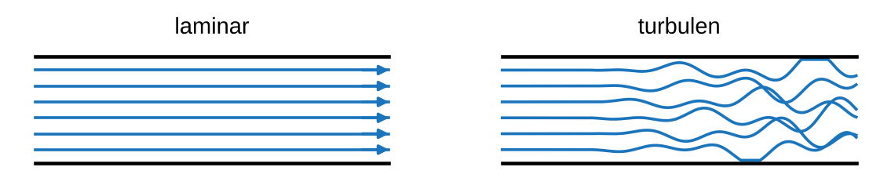
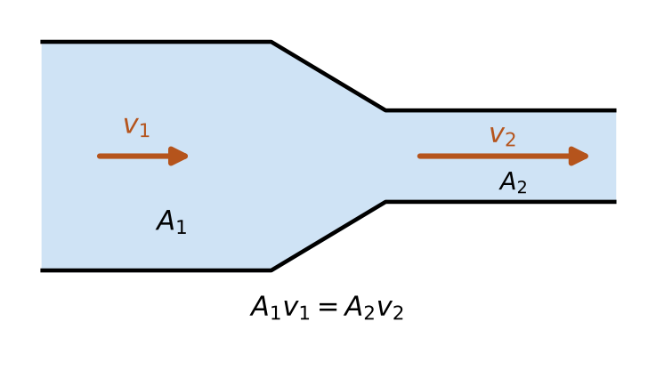
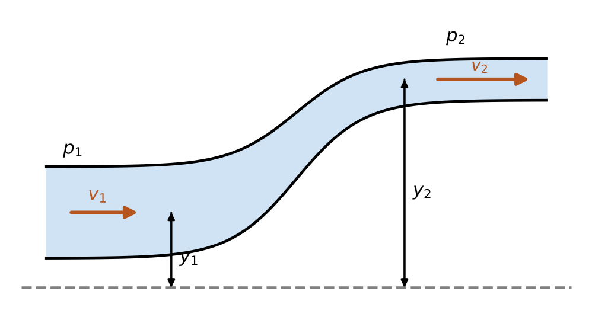
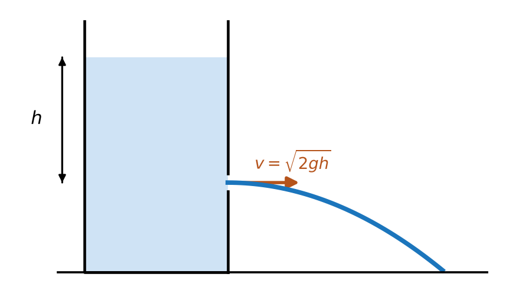
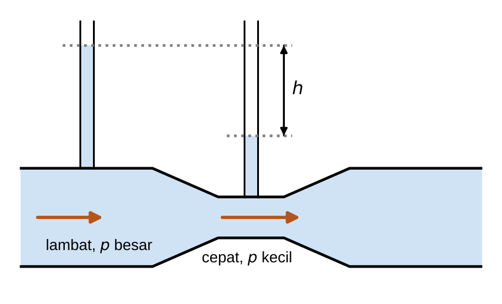
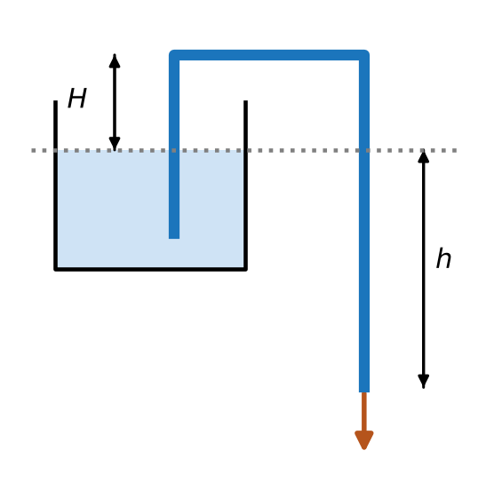
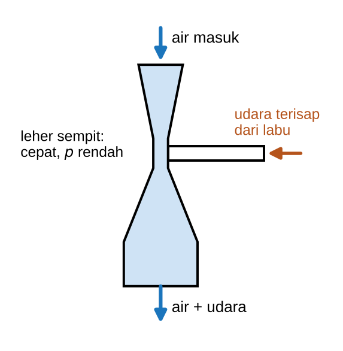
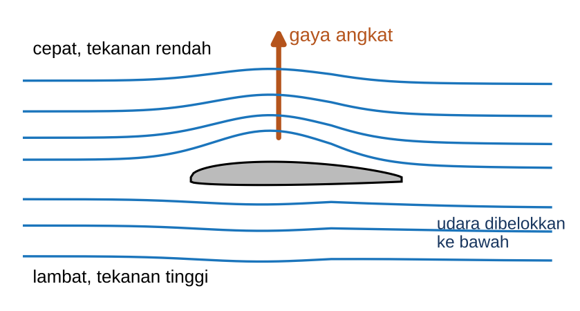

# Bab 7 Fluida Dinamis

Di hampir setiap laboratorium kimia ada alat kecil dari kaca atau plastik yang dipasang di keran air: **pompa isap air**, atau aspirator. Buka kerannya, dan selang di sisinya mengisap udara dengan kuat. Penyaringan dengan corong Büchner yang tadinya butuh setengah jam selesai dalam satu menit. Alat itu tidak memiliki bagian yang bergerak, tidak memakai listrik, dan hanya dialiri air.

Bagaimana air yang mengalir **turun** dapat mengisap udara dari **samping**? Jawabannya terdengar terbalik dari akal sehat: di tempat air mengalir paling cepat, tekanannya paling rendah. Gagasan itu, persamaan Bernoulli, adalah inti bab ini. Ia juga menjelaskan mengapa atap rumah terangkat saat badai, mengapa pesawat dapat terbang, dan mengapa penyempitan pembuluh darah berbahaya. Hitungan untuk pompa isap ada di Contoh 7.16.

Separuh kedua bab ini membahas apa yang diabaikan Bernoulli: kekentalan. Di sana kita menemukan bahwa debit dalam pipa sempit sebanding dengan pangkat **empat** jari-jarinya, hukum yang mengatur peredaran darah, infus, dan kromatografi.

::: {.tujuan}
**Tujuan belajar**

Setelah mempelajari bab ini, kamu mampu:

1. Menghitung debit dan menerapkan persamaan kontinuitas.
2. Menerapkan persamaan Bernoulli pada aliran dalam pipa dan aliran bebas.
3. Menganalisis tangki bocor, venturimeter, tabung pitot, sifon, pompa isap air, dan gaya angkat.
4. Menghitung gaya kental dan debit aliran kental dengan hukum Poiseuille.
5. Menentukan apakah aliran laminar atau turbulen dengan bilangan Reynolds.
6. Menghitung kecepatan terminal benda kecil dengan hukum Stokes, dan memakainya pada pengendapan dan percobaan Millikan.
7. Menghitung daya pompa, turbin air, dan turbin angin.
8. Memperkirakan waktu difusi dan laju difusi.
:::

::: {.mat}
**Prasyarat**

Dari Bab 4: usaha, energi kinetik, energi potensial, dan daya (subbab 4.1 sampai 4.6). Dari Bab 6: massa jenis, tekanan hidrostatis, tekanan terukur, dan gaya apung (subbab 6.1, 6.2, 6.3, dan 6.6).
:::

## 7.1 Aliran fluida dan debit

Gerak fluida dapat sangat rumit. Asap rokok naik lurus beberapa sentimeter, lalu tiba-tiba bergulung-gulung tak beraturan. Untuk memulai, kita memakai model yang disederhanakan.

{width=82%}

**Fluida ideal** memiliki empat sifat:

| Anggapan | Arti | Kapan cukup baik |
|---|---|---|
| **Tak termampatkan** | massa jenis tetap | zat cair; gas pada kelajuan jauh di bawah laju bunyi |
| **Tak kental** | tidak ada gesekan dalam | aliran cepat dalam pipa lebar dan pendek |
| **Tunak** | kecepatan di tiap titik tidak berubah terhadap waktu | aliran yang sudah mapan |
| **Laminar** | lapisan fluida tidak bercampur | kelajuan rendah (subbab 7.6) |

Lintasan yang ditempuh sebutir fluida dalam aliran tunak disebut **garis arus** (Gambar 7.1). Kecepatan fluida selalu menyinggung garis arus. Garis arus tidak pernah berpotongan, dan di tempat garis-garis arus merapat, fluida bergerak lebih cepat.

### Debit

**Debit** adalah volume fluida yang melewati suatu penampang tiap satuan waktu. Dalam waktu $\Delta t$, fluida berkelajuan $v$ maju sejauh $v\,\Delta t$, sehingga volume yang lewat penampang seluas $A$ adalah $Av\,\Delta t$:

$$
\boxed{Q = \frac{\Delta V}{\Delta t} = Av} \qquad \text{(7.1)}
$$

Satuan SI-nya m³/s. Satuan sehari-hari: liter per sekon dan liter per menit. $1\ \text{L/s} = 10^{-3}\ \text{m}^3/\text{s}$, dan $1\ \text{L/menit} = 1{,}67 \times 10^{-5}\ \text{m}^3/\text{s}$. Laju aliran **massa** adalah $\rho Q$, dalam kg/s.

::: {.contoh}
**Contoh 7.1 · Debit keran**

Sebuah keran mengisi ember 10 liter dalam 40 s. Pipa di belakang keran berdiameter dalam 1,6 cm. Berapa debitnya, dan berapa kelajuan air di dalam pipa?

**Penyelesaian.**

$$
Q = \frac{10 \times 10^{-3}\ \text{m}^3}{40\ \text{s}} = 2{,}5 \times 10^{-4}\ \text{m}^3/\text{s}.
$$

Luas penampang pipa: $A = \pi(0{,}0080)^2 = 2{,}01 \times 10^{-4}\ \text{m}^2$. Maka $v = Q/A = 1{,}2$ m/s.

**Memahami hasil.** Air di pipa rumah bergerak sekitar satu meter per sekon, secepat orang berjalan. Angka ini berguna sebagai patokan.
:::

## 7.2 Persamaan kontinuitas

{width=60%}

Fluida tidak dapat menumpuk atau lenyap di dalam pipa. Jika fluidanya tak termampatkan, volume yang masuk tiap sekon di satu ujung harus sama dengan volume yang keluar di ujung lain (Gambar 7.2):

$$
\boxed{A_1v_1 = A_2v_2} \qquad \text{(7.2)}
$$

Ini **persamaan kontinuitas**, pernyataan kekekalan massa untuk aliran. **Di tempat pipa menyempit, fluida mengalir lebih cepat.** Kamu memakainya setiap kali menjepit ujung selang agar airnya menyemprot jauh. Sungai mengalir deras di jeram yang sempit dan tenang di bagian yang lebar.

Untuk penampang lingkaran, luas sebanding dengan kuadrat diameter, sehingga $v_2 = v_1(d_1/d_2)^2$. Diameter setengah berarti kelajuan empat kali.

Jika pipa bercabang, debit yang masuk sama dengan **jumlah** debit di semua cabang:

$$
Q_\text{masuk} = Q_1 + Q_2 + Q_3 + \dots \qquad \text{(7.3)}
$$

Untuk gas yang massa jenisnya berubah, yang kekal adalah laju aliran massa: $\rho_1A_1v_1 = \rho_2A_2v_2$.

::: {.contoh}
**Contoh 7.2 · Ujung selang**

Air mengalir 1,5 m/s dalam selang berdiameter 2,0 cm, lalu keluar melalui ujung semprot berdiameter 0,50 cm. Berapa kelajuan air yang keluar?

**Penyelesaian.**

$$
v_2 = v_1\Big(\frac{d_1}{d_2}\Big)^2 = 1{,}5\Big(\frac{2{,}0}{0{,}50}\Big)^2 = 1{,}5(16) = 24\ \text{m/s}.
$$

**Memahami hasil.** Diameter menyusut empat kali, luas menyusut enam belas kali, dan kelajuan naik enam belas kali. Debitnya tidak berubah; menjepit selang tidak menambah banyaknya air yang keluar tiap sekon.
:::

::: {.contoh}
**Contoh 7.3 · Dari aorta ke kapiler**

Darah keluar dari jantung melalui aorta berjari-jari 1,0 cm dengan kelajuan rata-rata 0,30 m/s. Aorta bercabang-cabang sampai menjadi pembuluh kapiler berjari-jari 4,0 μm, yang luas penampang **totalnya** sekitar 0,25 m². (a) Berapa debit jantung, dalam L/menit? (b) Berapa kelajuan darah di kapiler? (c) Berapa banyak kapilernya?

**Penyelesaian.**

(a) $Q = \pi(0{,}010)^2(0{,}30) = 9{,}4 \times 10^{-5}\ \text{m}^3/\text{s} = 5{,}7$ L/menit.

(b) $v = \dfrac{Q}{A_\text{total}} = \dfrac{9{,}4 \times 10^{-5}}{0{,}25} = 3{,}8 \times 10^{-4}$ m/s, yaitu 0,38 mm/s.

(c) Luas satu kapiler: $\pi(4{,}0 \times 10^{-6})^2 = 5{,}0 \times 10^{-11}\ \text{m}^2$. Banyaknya: $\dfrac{0{,}25}{5{,}0 \times 10^{-11}} = 5 \times 10^9$.

**Memahami hasil.** Tiap kapiler jauh lebih sempit daripada aorta, tetapi darah di dalamnya mengalir hampir **seribu kali lebih lambat**, bukan lebih cepat. Yang menentukan adalah luas penampang **total** semua cabang, dan lima miliar kapiler bersama-sama jauh lebih lebar daripada aorta. Kelambatan itu penting: darah memerlukan sekitar satu sekon untuk melewati sebuah kapiler, cukup lama bagi oksigen untuk berdifusi ke jaringan (subbab 7.9).
:::

::: {.contoh}
**Contoh 7.4 · Air keran yang menyempit**

Air keluar dari keran berdiameter 1,2 cm dengan kelajuan 0,40 m/s dan jatuh tegak. Berapa diameter pancaran air 15 cm di bawah mulut keran?

**Rencana.** Air yang jatuh bertambah cepat karena gravitasi. Menurut kontinuitas, pancarannya harus menyempit.

**Penyelesaian.** Kelajuan setelah jatuh 15 cm: $v = \sqrt{v_0^2 + 2gh} = \sqrt{0{,}16 + 2(9{,}80)(0{,}15)} = 1{,}76$ m/s.

$$
d = d_0\sqrt{\frac{v_0}{v}} = 1{,}2\sqrt{\frac{0{,}40}{1{,}76}} = 0{,}57\ \text{cm}.
$$

**Memahami hasil.** Pancaran air menyempit menjadi kurang dari setengah lebar semula. Lebih jauh ke bawah, pancaran menjadi begitu tipis sehingga tegangan permukaan memecahnya menjadi tetes-tetes.
:::

::: {.contoh}
**Contoh 7.5 · Percabangan yang tidak sama**

Air mengalir 2,0 m/s dalam pipa berdiameter 4,0 cm, yang lalu bercabang menjadi pipa berdiameter 3,0 cm dan pipa berdiameter 2,0 cm. Di cabang 3,0 cm air mengalir 1,5 m/s. Berapa kelajuan air di cabang 2,0 cm?

**Penyelesaian.** Debit masuk: $Q = \pi(0{,}020)^2(2{,}0) = 2{,}51 \times 10^{-3}\ \text{m}^3/\text{s}$. Debit cabang pertama: $Q_1 = \pi(0{,}015)^2(1{,}5) = 1{,}06 \times 10^{-3}\ \text{m}^3/\text{s}$.

$$
Q_2 = Q - Q_1 = 1{,}45 \times 10^{-3}\ \text{m}^3/\text{s}, \qquad v_2 = \frac{1{,}45 \times 10^{-3}}{\pi(0{,}010)^2} = 4{,}6\ \text{m/s}.
$$

**Memahami hasil.** Yang dijumlahkan di percabangan adalah **debit**, bukan kelajuan. Kelajuan di tiap cabang boleh lebih besar atau lebih kecil daripada di pipa induk, bergantung pada luasnya.
:::

::: {.contoh}
**Contoh 7.6 · Gas yang dimampatkan**

Udara masuk ke sebuah kompresor dengan massa jenis $1{,}2\ \text{kg/m}^3$ dan kelajuan 10 m/s melalui saluran seluas 0,050 m². Udara keluar dengan massa jenis $3{,}6\ \text{kg/m}^3$ melalui pipa seluas 0,010 m². Berapa kelajuan keluarnya?

**Penyelesaian.** Untuk gas, yang kekal adalah laju aliran massa: $\rho_1A_1v_1 = \rho_2A_2v_2$.

$$
v_2 = \frac{(1{,}2)(0{,}050)(10)}{(3{,}6)(0{,}010)} = 17\ \text{m/s}.
$$

**Memahami hasil.** Jika udara dianggap tak termampatkan, hasilnya 50 m/s, tiga kali terlalu besar. Persamaan $A_1v_1 = A_2v_2$ hanya boleh dipakai untuk gas jika massa jenisnya hampir tidak berubah, yaitu pada kelajuan jauh di bawah laju bunyi dan tanpa pemampatan.
:::

::: {.kuis}
**Kuis cepat 7.1**

Sebuah pipa bercabang menjadi dua pipa yang masing-masing berdiameter setengah diameter pipa semula. Apakah air di cabang mengalir lebih cepat, lebih lambat, atau sama cepat dengan di pipa semula?
:::

## 7.3 Persamaan Bernoulli

Persamaan kontinuitas berkata fluida bertambah cepat ketika masuk ke bagian yang sempit. Menurut hukum Newton, sesuatu harus mempercepatnya. Gaya itu berasal dari **selisih tekanan**: tekanan di bagian lebar di belakang harus lebih besar daripada tekanan di bagian sempit di depan. Jadi di tempat fluida mengalir cepat, tekanannya rendah. Daniel Bernoulli merumuskan hal ini pada tahun 1738.

{width=66%}

### Penurunan dari usaha dan energi

Tinjau fluida ideal yang mengalir dalam pipa pada Gambar 7.3. Dalam selang waktu singkat, volume $\Delta V$ masuk di titik 1 dan volume yang sama keluar di titik 2. Akibat bersihnya, seolah-olah segumpal fluida bermassa $\Delta m = \rho\,\Delta V$ dipindahkan dari titik 1 ke titik 2.

**Usaha oleh tekanan.** Fluida di belakang mendorong dengan gaya $p_1A_1$ sejauh $\Delta x_1$, melakukan usaha $p_1A_1\Delta x_1 = p_1\Delta V$. Fluida di depan melawan dengan gaya $p_2A_2$, melakukan usaha $-p_2\Delta V$. Usaha bersih tekanan: $(p_1 - p_2)\Delta V$.

**Perubahan energi.** Energi kinetik berubah $\tfrac12\Delta m(v_2^2 - v_1^2)$ dan energi potensial berubah $\Delta m\,g(y_2 - y_1)$.

Menurut neraca energi di Bab 4, usaha bersih tekanan sama dengan perubahan energi mekanik:

$$
(p_1 - p_2)\Delta V = \tfrac12\rho\,\Delta V(v_2^2 - v_1^2) + \rho\,\Delta V\,g(y_2 - y_1).
$$

Bagi dengan $\Delta V$ dan kumpulkan suku berindeks sama:

$$
\boxed{p_1 + \tfrac12\rho v_1^2 + \rho gy_1 = p_2 + \tfrac12\rho v_2^2 + \rho gy_2} \qquad \text{(7.4)}
$$

Ini **persamaan Bernoulli**. Jumlah $p + \tfrac12\rho v^2 + \rho gy$ bernilai sama di semua titik sepanjang satu garis arus.

### Membaca ketiga sukunya

Persamaan Bernoulli adalah **kekekalan energi untuk tiap satuan volume fluida**:

| Suku | Nama | Arti |
|---|---|---|
| $p$ | tekanan statis | usaha yang dapat dilakukan tekanan, per satuan volume |
| $\tfrac12\rho v^2$ | tekanan dinamis | energi kinetik per satuan volume |
| $\rho gy$ | tekanan hidrostatis | energi potensial gravitasi per satuan volume |

Ketiga suku bersatuan pascal, dan 1 Pa = 1 J/m³. Dua kasus khusus langsung terlihat:

- **Fluida diam** ($v_1 = v_2 = 0$): $p_1 + \rho gy_1 = p_2 + \rho gy_2$. Ini rumus tekanan hidrostatis dari Bab 6.
- **Aliran mendatar** ($y_1 = y_2$): $p + \tfrac12\rho v^2 =$ tetap. Kelajuan naik, tekanan turun.

### Batas berlakunya

Persamaan Bernoulli diturunkan untuk fluida ideal. Ia **tidak** berlaku begitu saja jika:

- kekentalan berarti (pipa sempit dan panjang, zat cair kental): ada energi yang hilang menjadi panas (subbab 7.5);
- alirannya turbulen;
- ada pompa atau turbin di antara kedua titik, yang menambah atau mengambil energi (subbab 7.8);
- kedua titik tidak berada pada garis arus yang sama, misalnya di dua pipa yang tidak berhubungan.

::: {.strategi}
**Strategi · Soal Bernoulli**

1. **Gambar** sistemnya dan pilih **dua titik** pada satu garis arus: satu tempat semua besaran diketahui, satu tempat ada yang ditanya.
2. **Pilih acuan ketinggian** $y = 0$, biasanya di titik yang lebih rendah.
3. Kenali **penyederhanaan**:
   - permukaan terbuka ke udara: $p = p_\text{atm}$;
   - pancaran bebas yang keluar ke udara: $p = p_\text{atm}$;
   - permukaan tangki yang lebar: $v \approx 0$;
   - pipa mendatar: suku $\rho gy$ tercoret.
4. Pakai **kontinuitas** $A_1v_1 = A_2v_2$ untuk menghubungkan kedua kelajuan.
5. Tulis persamaan Bernoulli dan selesaikan. Tekanan boleh mutlak atau terukur, asal **sama** di kedua ruas.
:::

::: {.contoh}
**Contoh 7.7 · Pipa mendatar yang menyempit**

Air mengalir dalam pipa mendatar dengan kelajuan 2,0 m/s dan tekanan 180 kPa. Pipa lalu menyempit sehingga luas penampangnya menjadi setengah. Berapa kelajuan dan tekanan air di bagian sempit?

**Penyelesaian.** Kontinuitas: $v_2 = 2v_1 = 4{,}0$ m/s. Bernoulli untuk pipa mendatar:

$$
p_2 = p_1 - \tfrac12\rho(v_2^2 - v_1^2) = 180\,000 - \tfrac12(1000)(16 - 4{,}0) = 174\,000\ \text{Pa} = 174\ \text{kPa}.
$$

**Memahami hasil.** Tekanan turun 6 kPa di bagian sempit. Banyak orang menduga sebaliknya, karena membayangkan fluida "terjepit". Tetapi fluida harus dipercepat untuk masuk ke bagian sempit, dan yang mempercepatnya adalah tekanan lebih besar di belakangnya.
:::

::: {.contoh}
**Contoh 7.8 · Pipa yang naik dan menyempit**

Di lantai dasar sebuah gedung, air mengalir 1,0 m/s dalam pipa berdiameter 4,0 cm pada tekanan terukur 300 kPa. Pipa naik 6,0 m ke lantai atas, tempat diameternya 2,0 cm. Berapa kelajuan dan tekanan terukur air di lantai atas?

**Penyelesaian.** Kontinuitas: $v_2 = v_1(4{,}0/2{,}0)^2 = 4{,}0$ m/s. Bernoulli, dengan $y_1 = 0$:

$$
p_2 = p_1 - \rho gy_2 - \tfrac12\rho(v_2^2 - v_1^2) = 300\,000 - (1000)(9{,}80)(6{,}0) - \tfrac12(1000)(16 - 1{,}0)
$$

$$
p_2 = 300\,000 - 58\,800 - 7500 = 2{,}34 \times 10^5\ \text{Pa} = 234\ \text{kPa}.
$$

**Memahami hasil.** Dari penurunan 66 kPa, hampir 90% disebabkan kenaikan ketinggian dan hanya 10% oleh pertambahan kelajuan. Untuk air di gedung, suku ketinggian biasanya yang paling besar.
:::

### Tinggi tekan

Jika tiap suku persamaan Bernoulli dibagi $\rho g$, semuanya bersatuan **meter**:

$$
\frac{p}{\rho g} + \frac{v^2}{2g} + y = \text{tetap}. \qquad \text{(7.5)}
$$

Para insinyur menyebut ketiganya **tinggi tekan** (*head*): tinggi tekan tekanan, tinggi tekan kecepatan, dan tinggi tekan elevasi. Cara pandang ini praktis: tekanan terukur 100 kPa setara dengan kolom air 10,2 m, jadi pompa yang "bertinggi tekan 30 m" dapat menaikkan air setinggi 30 m atau menghasilkan tekanan 294 kPa.

::: {.contoh}
**Contoh 7.9 · Air mancur**

Pipa berdiameter 5,0 cm di permukaan tanah memasok air mancur dengan tekanan terukur 150 kPa. Ujung semprotnya, 0,50 m di atas pipa, berdiameter 1,5 cm dan mengarah tegak ke atas. Dalam keadaan ideal, (a) berapa kelajuan air keluar; (b) seberapa tinggi air memancar di atas ujung semprot; (c) berapa debitnya?

**Penyelesaian.**

(a) Kontinuitas: $v_1 = v_2(1{,}5/5{,}0)^2 = 0{,}090v_2$. Bernoulli antara pipa (titik 1) dan pancaran di ujung semprot (titik 2, tekanan terukur nol):

$$
p_1 + \tfrac12\rho v_1^2 = \tfrac12\rho v_2^2 + \rho g(0{,}50) \quad\Longrightarrow\quad v_2^2(1 - 0{,}0081) = \frac{2(150\,000 - 4900)}{1000} = 290 .
$$

$v_2 = 17$ m/s.

(b) $h = \dfrac{v_2^2}{2g} = \dfrac{292}{19{,}6} = 15$ m.

(c) $Q = \pi(0{,}0075)^2(17{,}1) = 3{,}0 \times 10^{-3}\ \text{m}^3/\text{s}$.

**Memahami hasil.** Dengan tinggi tekan: tekanan 150 kPa setara dengan 15,3 m air. Dikurangi 0,5 m untuk naik ke ujung semprot, tersisa hampir 15 m, sama dengan hasil (b). Kelajuan di pipa hanya 1,5 m/s dan hampir tidak berpengaruh. Air mancur sungguhan lebih rendah, karena gesekan di pipa dan hambatan udara.
:::

::: {.kuis}
**Kuis cepat 7.2**

Dua lembar kertas digantung berdampingan, sejajar, berjarak beberapa sentimeter. Jika kamu meniup di **antara** keduanya, apakah kedua kertas itu saling menjauh atau saling mendekat?
:::

## 7.4 Penerapan persamaan Bernoulli

### Tangki bocor: hukum Torricelli

{width=58%}

Sebuah tangki besar yang terbuka memiliki lubang kecil pada kedalaman $h$ di bawah permukaan (Gambar 7.4). Ambil titik 1 di permukaan dan titik 2 di pancaran tepat di luar lubang. Di kedua titik tekanannya $p_\text{atm}$. Permukaan tangki turun sangat pelan, jadi $v_1 \approx 0$.

$$
p_\text{atm} + \rho gh = p_\text{atm} + \tfrac12\rho v^2 \quad\Longrightarrow\quad \boxed{v = \sqrt{2gh}} \qquad \text{(7.6)}
$$

Ini **hukum Torricelli**. Kelajuan pancarannya sama dengan kelajuan benda yang jatuh bebas dari ketinggian $h$, dan tidak bergantung pada massa jenis zat cair maupun arah lubang. Jika lubangnya menghadap ke atas, pancaran naik (dalam keadaan ideal) tepat sampai setinggi permukaan tangki.

::: {.contoh}
**Contoh 7.10 · Tangki bocor**

Sebuah tangki air terbuka memiliki lubang berdiameter 1,0 cm di dindingnya, 2,0 m di bawah permukaan air dan 1,0 m di atas tanah. (a) Berapa kelajuan air yang keluar? (b) Berapa debitnya? (c) Seberapa jauh dari kaki tangki air itu jatuh?

**Penyelesaian.**

(a) $v = \sqrt{2(9{,}80)(2{,}0)} = 6{,}3$ m/s.

(b) $Q = Av = \pi(0{,}0050)^2(6{,}26) = 4{,}9 \times 10^{-4}\ \text{m}^3/\text{s}$, sekitar 0,5 liter per sekon.

(c) Pancaran keluar mendatar dan jatuh 1,0 m: $t = \sqrt{2(1{,}0)/9{,}80} = 0{,}45$ s. Jarak: $x = (6{,}26)(0{,}45) = 2{,}8$ m.

**Memahami hasil.** Lubang sekecil jari kelingking membuang 30 liter per menit. Debit sungguhan sekitar 60% dari hitungan ini, karena garis-garis arus masih menyempit sesaat setelah melewati tepi lubang, sehingga penampang pancaran lebih kecil daripada lubangnya.
:::

::: {.contoh}
**Contoh 7.11 · Di mana lubang harus dibuat agar pancarannya paling jauh?**

Sebuah tangki berdiri di lantai dan berisi air setinggi $H$. Pada kedalaman $h$ berapa (diukur dari permukaan) lubang harus dibuat agar air jatuh paling jauh dari kaki tangki?

**Penyelesaian.** Kelajuan keluar $v = \sqrt{2gh}$. Lubang berada $H - h$ di atas lantai, jadi waktu jatuhnya $t = \sqrt{2(H - h)/g}$.

$$
x = vt = \sqrt{2gh}\sqrt{\frac{2(H - h)}{g}} = 2\sqrt{h(H - h)} .
$$

Hasil kali $h(H - h)$ paling besar ketika $h = H/2$. Jarak terjauhnya $x_\text{maks} = H$.

**Memahami hasil.** Lubang tepat di tengah memberi pancaran terjauh, sejauh tinggi air. Lubang di dekat dasar memancar kencang tetapi segera menyentuh lantai. Lubang di dekat permukaan jatuh lama tetapi memancar pelan. Rumus itu juga simetris: lubang pada kedalaman $h$ dan pada kedalaman $H - h$ memancar sama jauh.
:::

::: {.contoh}
**Contoh 7.12 · Berapa lama tangki kosong?**

Tangki silinder berdiameter 1,0 m berisi air setinggi 1,5 m. Di dasarnya ada lubang berdiameter 2,0 cm. Berapa lama sampai tangki kosong?

**Rencana.** Kelajuan keluar berkurang ketika permukaan turun, jadi debitnya tidak tetap. Kita perlu integral.

**Penyelesaian.** Ketika tinggi air $h$, air keluar dengan debit $a\sqrt{2gh}$, dengan $a$ luas lubang. Permukaan seluas $A$ turun dengan laju $-\dfrac{dh}{dt}$:

$$
-A\frac{dh}{dt} = a\sqrt{2gh} \quad\Longrightarrow\quad dt = -\frac{A}{a\sqrt{2g}}\,h^{-1/2}\,dh .
$$

Integralkan dari $h = H$ sampai $h = 0$, dengan $\displaystyle\int h^{-1/2}dh = 2h^{1/2}$:

$$
t = \frac{A}{a}\sqrt{\frac{2H}{g}} .
$$

$\dfrac Aa = \Big(\dfrac{1{,}0}{0{,}020}\Big)^2 = 2500$, sehingga $t = 2500\sqrt{\dfrac{2(1{,}5)}{9{,}80}} = 1{,}4 \times 10^3$ s, sekitar 23 menit.

**Memahami hasil.** Jika debit tetap seperti di awal, tangki akan kosong dalam setengah waktu itu. Pengosongan makin lambat menjelang akhir, karena tekanan pendorongnya makin kecil. Buret pun begitu: tetesannya melambat ketika isinya berkurang.
:::

### Venturimeter

{width=64%}

Pipa yang menyempit lalu melebar lagi dapat dipakai untuk **mengukur** kelajuan aliran (Gambar 7.5). Gabungkan Bernoulli untuk pipa mendatar dengan kontinuitas, $v_2 = v_1A_1/A_2$:

$$
p_1 - p_2 = \tfrac12\rho v_1^2\left[\Big(\frac{A_1}{A_2}\Big)^2 - 1\right] \quad\Longrightarrow\quad v_1 = \sqrt{\frac{2(p_1 - p_2)}{\rho\big[(A_1/A_2)^2 - 1\big]}} . \qquad \text{(7.7)}
$$

Cukup ukur selisih tekanan, dan kelajuannya diperoleh tanpa mengganggu aliran.

::: {.contoh}
**Contoh 7.13 · Mengukur debit dengan venturimeter**

Air mengalir melalui venturimeter berdiameter 6,0 cm dengan leher berdiameter 3,0 cm. Selisih tekanan antara pipa dan leher 12 kPa. Berapa kelajuan air di pipa dan debitnya?

**Penyelesaian.** $\dfrac{A_1}{A_2} = \Big(\dfrac{6{,}0}{3{,}0}\Big)^2 = 4$, sehingga $(A_1/A_2)^2 - 1 = 15$.

$$
v_1 = \sqrt{\frac{2(12\,000)}{(1000)(15)}} = 1{,}26\ \text{m/s}, \qquad Q = \pi(0{,}030)^2(1{,}26) = 3{,}6 \times 10^{-3}\ \text{m}^3/\text{s}.
$$

**Memahami hasil.** Di leher kelajuannya 5,1 m/s. Venturimeter tidak memiliki bagian bergerak, sehingga awet dan dipakai luas di industri kimia untuk mengukur aliran zat cair dan gas.
:::

### Tabung pitot

Di titik tempat aliran **berhenti** karena menabrak benda (titik stagnasi), seluruh tekanan dinamis berubah menjadi tekanan statis:

$$
p_\text{stagnasi} = p + \tfrac12\rho v^2 . \qquad \text{(7.8)}
$$

Tabung pitot mengukur selisih antara tekanan stagnasi (lubang menghadap aliran) dan tekanan statis (lubang di samping). Selisih itu memberi kelajuan: $v = \sqrt{2\,\Delta p/\rho}$.

::: {.contoh}
**Contoh 7.14 · Penunjuk kelajuan pesawat**

Tabung pitot sebuah pesawat menunjukkan selisih tekanan 3,0 kPa pada ketinggian tempat massa jenis udara $1{,}0\ \text{kg/m}^3$. Berapa kelajuan pesawat terhadap udara?

**Penyelesaian.**

$$
v = \sqrt{\frac{2(3000)}{1{,}0}} = 77\ \text{m/s} = 280\ \text{km/jam}.
$$

**Memahami hasil.** Hampir semua pesawat mengukur kelajuannya dengan cara ini. Yang terukur adalah kelajuan terhadap **udara**, bukan terhadap tanah. Lubang pitot yang tersumbat es memberi bacaan salah dan pernah menyebabkan kecelakaan, sehingga tabung pitot dilengkapi pemanas.
:::

### Sifon

{width=46%}

Selang yang sudah terisi penuh dapat mengalirkan zat cair naik melewati bibir wadah lalu turun ke tempat yang lebih rendah (Gambar 7.6). Terapkan Bernoulli antara permukaan wadah dan ujung keluar, yang $h$ lebih rendah: hasilnya sama dengan Torricelli, $v = \sqrt{2gh}$. Yang menentukan kelajuan adalah beda tinggi antara permukaan dan ujung keluar, bukan tinggi lengkungan selang.

Tekanan di puncak selang lebih rendah daripada atmosfer. Jika puncaknya terlalu tinggi, tekanan di sana turun sampai tekanan uap zat cair, zat cair mendidih, dan kolomnya putus. Untuk air, batasnya sedikit di bawah 10 m.

::: {.contoh}
**Contoh 7.15 · Menguras akuarium dengan sifon**

Selang sifon dipakai menguras akuarium. Ujung keluarnya 0,80 m di bawah permukaan air, dan puncak selang 1,5 m di atas permukaan air. (a) Berapa kelajuan air di selang? (b) Berapa tekanan mutlak air di puncak selang?

**Penyelesaian.**

(a) $v = \sqrt{2(9{,}80)(0{,}80)} = 4{,}0$ m/s.

(b) Bernoulli antara permukaan ($v = 0$, $p = p_\text{atm}$, $y = 0$) dan puncak ($y = 1{,}5$ m, kelajuan sama dengan di seluruh selang):

$$
p = p_\text{atm} - \rho gy - \tfrac12\rho v^2 = 101\,300 - 14\,700 - 7840 = 7{,}9 \times 10^4\ \text{Pa}.
$$

**Memahami hasil.** Tekanan di puncak 79 kPa, masih jauh di atas tekanan uap air (2,3 kPa pada 20 °C), jadi sifon bekerja. Sifon dipakai di laboratorium untuk memindahkan zat cair tanpa mengaduk endapan di dasarnya.
:::

### Pompa isap air dan penyemprot

{width=40%}

::: {.contoh}
**Contoh 7.16 · Pompa isap air: pertanyaan pembuka bab**

Dalam pompa isap air (Gambar 7.7), air masuk dengan kelajuan 2,0 m/s pada tekanan mutlak 200 kPa, lalu melewati leher sempit yang membuat kelajuannya 20 m/s. (a) Berapa tekanan mutlak di leher? (b) Berapa tekanan terendah yang dapat dicapai pompa seperti ini?

**Penyelesaian.**

(a) Beda ketinggiannya kecil, jadi diabaikan:

$$
p_2 = p_1 - \tfrac12\rho(v_2^2 - v_1^2) = 200\,000 - \tfrac12(1000)(400 - 4{,}0) = 2{,}0 \times 10^3\ \text{Pa} = 2\ \text{kPa}.
$$

(b) Tekanan zat cair tidak dapat turun di bawah **tekanan uapnya**; di bawah itu air mendidih. Pada 20 °C tekanan uap air 2,3 kPa.

**Memahami hasil.** Tekanan di leher hanya 2% tekanan atmosfer. Udara dari labu yang terhubung ke cabang samping mengalir ke daerah bertekanan rendah itu dan terbawa air. Batas pada (b) menjelaskan mengapa pompa isap air hanya mencapai sekitar 2 sampai 3 kPa, dan bekerja lebih baik dengan air dingin: tekanan uap air 1,2 kPa pada 10 °C tetapi 4,2 kPa pada 30 °C. Untuk vakum yang lebih baik diperlukan pompa mekanik. Botol pengaman selalu dipasang di antara pompa dan labu, karena jika tekanan air keran tiba-tiba turun, air dapat tersedot balik ke dalam labu.
:::

::: {.contoh}
**Contoh 7.17 · Penyemprot**

Dalam penyemprot parfum, udara ditiup dengan kelajuan 25 m/s melintasi ujung atas sebuah pipa kecil yang ujung bawahnya tercelup ke zat cair. Seberapa tinggi zat cair (massa jenis seperti air) dapat terisap naik?

**Penyelesaian.** Tekanan di atas pipa turun sebesar $\tfrac12\rho_\text{udara}v^2 = \tfrac12(1{,}2)(25)^2 = 375$ Pa. Tekanan atmosfer pada permukaan zat cair di botol mendorongnya naik sampai

$$
h = \frac{375}{(1000)(9{,}80)} = 0{,}038\ \text{m} = 3{,}8\ \text{cm}.
$$

**Memahami hasil.** Jika pipanya lebih pendek dari 3,8 cm, zat cair mencapai ujung atas dan terbawa aliran udara sebagai butir-butir halus. Karburator, penyemprot cat, dan pembakar Bunsen memakai asas ini: aliran gas yang cepat pada pembakar Bunsen mengisap udara melalui lubang di dasarnya.
:::

### Atap, sayap, dan bola yang melengkung

::: {.contoh}
**Contoh 7.18 · Atap saat badai**

Angin berkelajuan 30 m/s (108 km/jam) bertiup di atas atap datar seluas 100 m². Udara di dalam rumah diam. Berapa gaya angkat pada atap?

**Penyelesaian.** Selisih tekanan antara bawah dan atas atap:

$$
\Delta p = \tfrac12\rho v^2 = \tfrac12(1{,}2)(30)^2 = 540\ \text{Pa}, \qquad F = (540)(100) = 5{,}4 \times 10^4\ \text{N}.
$$

**Memahami hasil.** Gayanya setara dengan berat 5,5 ton, mengarah ke **atas**. Atap tidak ditekan roboh oleh badai, melainkan diangkat lepas oleh tekanan udara di dalam rumah. Gaya ini sebanding dengan kuadrat kelajuan angin, sehingga badai dua kali lebih kencang empat kali lebih merusak. Membuka sedikit jendela di sisi yang terlindung membantu menyamakan tekanan.
:::

{width=70%}

Sayap pesawat dibentuk dan dimiringkan sehingga udara di atasnya mengalir lebih cepat daripada di bawahnya (Gambar 7.8). Tekanan di atas lebih rendah, dan selisih tekanan kali luas sayap adalah **gaya angkat**.

::: {.contoh}
**Contoh 7.19 · Gaya angkat sayap**

Udara mengalir 70 m/s di atas sayap sebuah pesawat kecil dan 60 m/s di bawahnya. Luas sayapnya 16 m² dan massa jenis udara $1{,}2\ \text{kg/m}^3$. Berapa gaya angkatnya, dan berapa massa pesawat yang dapat ditopangnya?

**Penyelesaian.**

$$
\Delta p = \tfrac12\rho(v_\text{atas}^2 - v_\text{bawah}^2) = \tfrac12(1{,}2)(4900 - 3600) = 780\ \text{Pa}.
$$

$F = (780)(16) = 1{,}25 \times 10^4$ N, cukup untuk menopang $\dfrac{1{,}25 \times 10^4}{9{,}80} = 1{,}3 \times 10^3$ kg.

**Memahami hasil.** Selisih tekanan 780 Pa kurang dari 1% tekanan atmosfer, tetapi bekerja pada 16 m² dan mengangkat lebih dari satu ton. Gaya angkat sebanding dengan $v^2$, sehingga pesawat harus mencapai kelajuan tertentu sebelum dapat lepas landas.
:::

::: {.awas}
**Awas · Penjelasan populer yang keliru tentang sayap**

Sering dikatakan bahwa udara di atas sayap "harus menempuh jarak lebih panjang dalam waktu yang sama, sehingga bergerak lebih cepat". Itu keliru: tidak ada hukum yang mengharuskan dua bagian udara yang terpisah di depan sayap bertemu lagi di belakangnya, dan kenyataannya udara di atas tiba **lebih dulu**. Pesawat juga dapat terbang terbalik, dan sayap datar yang dimiringkan tetap menghasilkan gaya angkat.

Penjelasan yang benar ada dua, dan keduanya setara. **Dengan tekanan:** bentuk dan kemiringan sayap membuat udara di atasnya lebih cepat, sehingga tekanannya lebih rendah (Bernoulli). **Dengan momentum:** sayap membelokkan udara ke bawah, dan menurut hukum ketiga Newton udara mendorong sayap ke atas. Kelajuan udara harus diukur atau dihitung dari bentuk sayap; ia tidak dapat ditebak dari panjang lintasan.
:::

Bola yang **berputar** sambil melaju menyeret lapisan udara di permukaannya. Di satu sisi udara bergerak lebih cepat terhadap bola daripada di sisi lain, sehingga muncul selisih tekanan dan bola dibelokkan ke samping. Ini **efek Magnus**, yang membuat tendangan bebas melengkung, bola tenis berputar-atas menukik, dan bola pingpong berputar-bawah melayang.

::: {.contoh}
**Contoh 7.20 · Penyempitan pembuluh darah**

Darah ($\rho = 1060\ \text{kg/m}^3$) mengalir 0,40 m/s dalam sebuah arteri. (a) Di satu tempat, timbunan lemak mempersempit penampang arteri menjadi seperempatnya. Berapa penurunan tekanan di sana? (b) Di tempat lain, dinding arteri melemah dan menggelembung sehingga penampangnya 1,7 kali semula. Bagaimana tekanan di sana?

**Penyelesaian.**

(a) $v = 4(0{,}40) = 1{,}6$ m/s. $\Delta p = \tfrac12(1060)(1{,}6^2 - 0{,}40^2) = 1{,}27 \times 10^3$ Pa $= 9{,}5$ mmHg, **turun**.

(b) $v = 0{,}40/1{,}7 = 0{,}235$ m/s. $\Delta p = \tfrac12(1060)(0{,}40^2 - 0{,}235^2) = 55$ Pa, **naik**.

**Memahami hasil.** Pada penyempitan, tekanan darah di dalam turun. Jika tekanan dari jaringan di luar lebih besar, pembuluh dapat terjepit menutup, aliran berhenti, tekanan pulih, pembuluh terbuka lagi, dan seterusnya. Getaran itu terdengar lewat stetoskop sebagai desir. Pada penggelembungan (aneurisma), tekanan justru **naik**, mendorong dinding yang sudah lemah makin ke luar. Itulah yang membuat aneurisma cenderung memburuk dengan sendirinya.
:::

### Kavitasi

Jika zat cair mengalir begitu cepat sehingga tekanannya turun sampai tekanan uapnya, zat cair mendidih pada suhu biasa dan terbentuk gelembung uap. Ketika gelembung itu terbawa ke daerah bertekanan lebih tinggi, ia runtuh dengan sangat keras. Peristiwa ini, **kavitasi**, mengikis baling-baling kapal dan sudu pompa. Dalam pembersih ultrasonik di laboratorium, kavitasi sengaja dibangkitkan dengan bunyi berfrekuensi tinggi untuk merontokkan kotoran dari alat gelas.

### Tekanan angin pada permukaan

::: {.contoh}
**Contoh 7.21 · Gaya angin pada dinding**

Angin 40 m/s (144 km/jam) menerpa tegak lurus sebuah papan reklame berukuran 3,0 m × 10 m. Perkirakan gaya angin padanya.

**Penyelesaian.** Di muka papan, udara hampir berhenti, jadi tekanannya naik sebesar tekanan dinamis:

$$
\Delta p = \tfrac12\rho v^2 = \tfrac12(1{,}2)(40)^2 = 960\ \text{Pa}, \qquad F \approx (960)(30) = 2{,}9 \times 10^4\ \text{N}.
$$

**Memahami hasil.** Gayanya setara dengan berat hampir 3 ton. Gaya sebenarnya sedikit lebih besar, karena di belakang papan terbentuk daerah bertekanan rendah yang ikut menarik. Perancang bangunan memakai rumus yang sama dengan faktor koreksi bentuk. Karena gaya sebanding dengan $v^2$, angin 20 m/s hanya memberi seperempatnya.
:::

::: {.kuis}
**Kuis cepat 7.3**

Ketika sebuah truk besar melaju kencang melewati pengendara sepeda motor dari samping, pengendara merasa tertarik **ke arah** truk. Jelaskan.
:::
