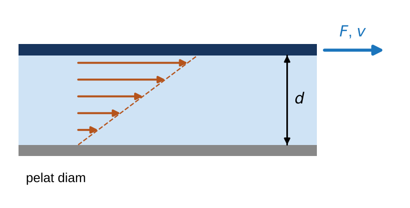
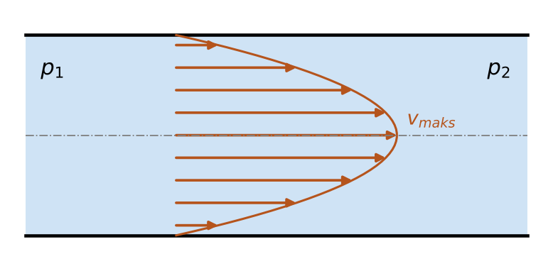
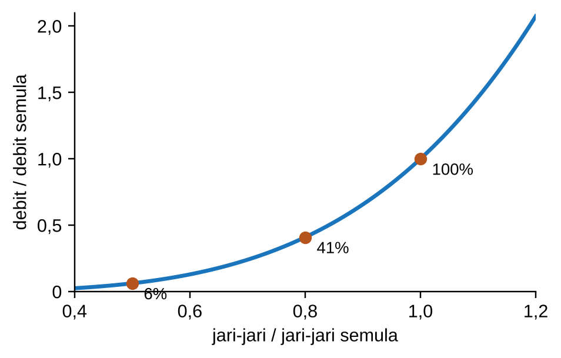
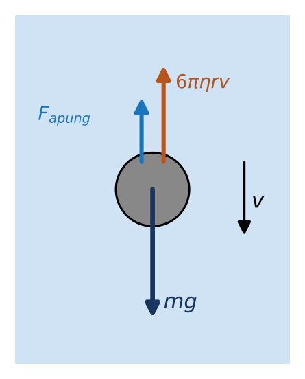
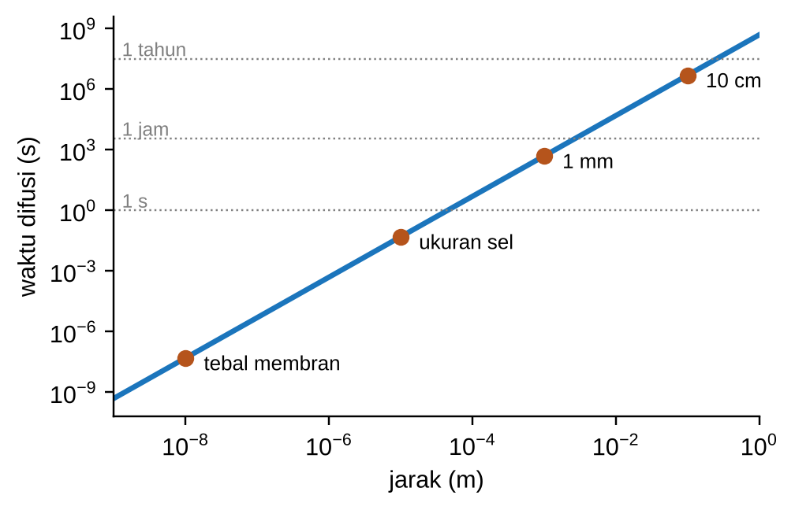

## 7.5 Kekentalan dan hukum Poiseuille

Menurut persamaan Bernoulli, air dalam pipa mendatar berpenampang tetap mengalir tanpa memerlukan selisih tekanan sama sekali. Kenyataannya tidak begitu. Pompa harus bekerja terus hanya untuk menjaga zat cair tetap mengalir, dan madu jelas lebih sulit dituang daripada air. Yang diabaikan Bernoulli adalah gesekan di dalam fluida: **kekentalan**, atau viskositas.

### Koefisien kekentalan

{width=60%}

Bayangkan lapisan fluida setebal $d$ di antara dua pelat (Gambar 7.9). Pelat bawah diam, dan pelat atas seluas $A$ ditarik dengan kelajuan $v$. Fluida yang bersentuhan dengan tiap pelat **menempel** padanya. Di antaranya, tiap lapisan fluida meluncur di atas lapisan di bawahnya dan saling menggesek. Gaya yang diperlukan untuk menjaga pelat atas tetap bergerak adalah

$$
\boxed{F = \eta A\,\frac{v}{d}} \qquad \text{(7.9)}
$$

Tetapan $\eta$ (eta) adalah **koefisien kekentalan** fluida itu. Satuannya Pa·s. Satuan lama yang masih sering dipakai adalah poise (P): $1\ \text{Pa·s} = 10$ P, sehingga $1\ \text{mPa·s} = 1$ cP. Kekentalan air pada suhu kamar hampir tepat 1 cP.

| Fluida | $\eta$ (mPa·s) | Fluida | $\eta$ (mPa·s) |
|---|---|---|---|
| Udara (20 °C) | 0,018 | Darah (37 °C) | 3 sampai 4 |
| Aseton | 0,31 | Minyak zaitun | 80 |
| Air (100 °C) | 0,28 | Minyak mesin | 100 sampai 300 |
| Air (60 °C) | 0,47 | Gliserol (20 °C) | 1410 |
| Air (20 °C) | 1,00 | Madu | sekitar 10 000 |
| Etanol | 1,20 | Aspal | $10^{11}$ |
| Raksa | 1,55 | Kaca (suhu kamar) | lebih dari $10^{20}$ |

Dua hal menarik dari tabel itu:

- **Kekentalan zat cair turun tajam ketika suhu naik.** Molekul yang lebih berenergi lebih mudah melepaskan diri dari tarikan tetangganya. Minyak goreng yang dipanaskan menjadi encer.
- **Kekentalan gas justru naik** ketika suhu naik, karena dalam gas kekentalan berasal dari tumbukan molekul yang memindahkan momentum antarlapisan.

Kekentalan zat cair mencerminkan kuatnya gaya antarmolekul. Gliserol, dengan tiga gugus –OH per molekul, membentuk banyak ikatan hidrogen dan seribu kali lebih kental daripada air.

::: {.contoh}
**Contoh 7.22 · Gaya kental**

Sebuah pelat seluas 0,20 m² meluncur di atas lapisan minyak setebal 1,0 mm ($\eta = 0{,}25$ Pa·s) dengan kelajuan 0,50 m/s. Berapa gaya yang diperlukan?

**Penyelesaian.**

$$
F = \eta A\frac vd = (0{,}25)(0{,}20)\frac{0{,}50}{1{,}0 \times 10^{-3}} = 25\ \text{N}.
$$

**Memahami hasil.** Tanpa minyak, logam menggesek logam dengan gaya jauh lebih besar dan cepat aus. Pelumas mengganti gesekan zat padat dengan gesekan kental yang jauh lebih kecil. Gaya itu berbanding terbalik dengan tebal lapisan, sehingga lapisan minyak yang terlalu tipis kurang melindungi.
:::

### Aliran kental dalam pipa

{width=64%}

Dalam pipa, fluida yang bersentuhan dengan dinding diam. Lapisan demi lapisan ke arah tengah bergerak makin cepat, dan kelajuan terbesar ada di sumbu pipa. Profil kecepatannya berbentuk parabola (Gambar 7.10). Untuk menjaga aliran ini melawan gesekan kental diperlukan selisih tekanan $\Delta p = p_1 - p_2$ antara kedua ujung pipa. Debitnya diberikan oleh **hukum Poiseuille**:

$$
\boxed{Q = \frac{\pi r^4\,\Delta p}{8\eta L}} \qquad \text{(7.10)}
$$

dengan $r$ jari-jari dalam pipa dan $L$ panjangnya. Tiap faktornya masuk akal: debit lebih besar jika selisih tekanan lebih besar, dan lebih kecil jika zat cairnya lebih kental atau pipanya lebih panjang. Yang mengejutkan adalah **pangkat empat** pada jari-jari.

::: {.mat}
**Matematika · Dari mana pangkat empat itu?**

Tinjau silinder fluida berjari-jari $s$ di dalam pipa. Selisih tekanan mendorongnya dengan gaya $\Delta p\,\pi s^2$. Gesekan kental pada permukaan sisinya, seluas $2\pi sL$, menahannya dengan gaya $-\eta(2\pi sL)\dfrac{dv}{ds}$. Dalam aliran tunak kedua gaya itu sama, sehingga $\dfrac{dv}{ds} = -\dfrac{\Delta p}{2\eta L}s$. Integralkan, dengan $v = 0$ di dinding ($s = r$):

$$
v(s) = \frac{\Delta p}{4\eta L}(r^2 - s^2).
$$

Itulah profil parabola. Debitnya adalah jumlah atas cincin-cincin tipis seluas $2\pi s\,ds$:

$$
Q = \int_0^r v(s)\,2\pi s\,ds = \frac{\pi\,\Delta p}{2\eta L}\int_0^r (r^2s - s^3)\,ds = \frac{\pi\,\Delta p}{2\eta L}\cdot\frac{r^4}{4} = \frac{\pi r^4\Delta p}{8\eta L}.
$$

Dua pangkat berasal dari **luas** penampang, dan dua pangkat lagi dari **kelajuan**, yang juga tumbuh dengan $r^2$ karena fluida di tengah pipa yang lebar berada lebih jauh dari dinding yang menahannya.
:::

{width=56%}

### Akibat pangkat empat

Karena $Q \propto r^4$ (Gambar 7.11):

- jari-jari **dua kali** memberi debit **enam belas kali**;
- jari-jari yang berkurang **10%** memangkas debit **34%**;
- jari-jari yang berkurang **setengah** menyisakan debit hanya **6%**.

Tubuh memanfaatkan kepekaan ini. Pembuluh arteri kecil (arteriol) dilingkari otot polos. Dengan mengubah jari-jarinya sedikit saja, tubuh mengatur aliran darah ke tiap organ dalam rentang yang sangat lebar. Kepekaan yang sama membuat penyempitan pembuluh oleh timbunan lemak berbahaya: jantung harus menaikkan tekanan sangat besar untuk mempertahankan aliran.

::: {.contoh}
**Contoh 7.23 · Debit dalam pipa kapiler**

Air ($\eta = 1{,}0 \times 10^{-3}$ Pa·s) mengalir melalui pipa kapiler berjari-jari 1,0 mm sepanjang 1,0 m karena selisih tekanan 1000 Pa. Berapa debitnya, kelajuan rata-ratanya, dan kelajuan di sumbu pipa?

**Penyelesaian.**

$$
Q = \frac{\pi(1{,}0 \times 10^{-3})^4(1000)}{8(1{,}0 \times 10^{-3})(1{,}0)} = 3{,}9 \times 10^{-7}\ \text{m}^3/\text{s} = 0{,}39\ \text{mL/s}.
$$

$v_\text{rata} = \dfrac{Q}{\pi r^2} = 0{,}125$ m/s. Kelajuan di sumbu dua kali rata-ratanya: 0,25 m/s.

**Memahami hasil.** Selisih tekanan 1000 Pa setara dengan kolom air setinggi 10 cm. Menurut Torricelli, beda tinggi itu memberi 1,4 m/s. Kelajuan sebenarnya sepuluh kali lebih kecil: dalam pipa sempit dan panjang, kekentalan menguasai aliran dan persamaan Bernoulli tidak dapat dipakai.
:::

::: {.contoh}
**Contoh 7.24 · Arteri yang menyempit**

Timbunan lemak mengurangi jari-jari sebuah arteri 20%. (a) Jika selisih tekanannya tetap, menjadi berapa debit darahnya? (b) Berapa kali selisih tekanan harus dinaikkan agar debitnya tetap?

**Penyelesaian.**

(a) $\dfrac{Q'}{Q} = (0{,}80)^4 = 0{,}41$. Debit turun menjadi 41%.

(b) $\dfrac{\Delta p'}{\Delta p} = \dfrac{1}{(0{,}80)^4} = 2{,}4$.

**Memahami hasil.** Penyempitan yang tampak ringan, hanya seperlima jari-jari, memangkas aliran lebih dari setengahnya. Untuk mengimbanginya, tekanan harus naik hampir dua setengah kali. Itu sebabnya penyempitan pembuluh berkaitan erat dengan tekanan darah tinggi dan beban kerja jantung.
:::

::: {.contoh}
**Contoh 7.25 · Menyuntik**

Sebanyak 2,0 mL larutan encer ($\eta = 1{,}0 \times 10^{-3}$ Pa·s) disuntikkan dalam 5,0 s melalui jarum berjari-jari dalam 0,20 mm sepanjang 3,0 cm. Luas penampang pendorong alat suntik 1,0 cm². Berapa selisih tekanan sepanjang jarum, dan berapa gaya pada pendorong untuk mengatasinya?

**Penyelesaian.** $Q = \dfrac{2{,}0 \times 10^{-6}}{5{,}0} = 4{,}0 \times 10^{-7}\ \text{m}^3/\text{s}$.

$$
\Delta p = \frac{8\eta LQ}{\pi r^4} = \frac{8(1{,}0 \times 10^{-3})(0{,}030)(4{,}0 \times 10^{-7})}{\pi(2{,}0 \times 10^{-4})^4} = 1{,}9 \times 10^4\ \text{Pa}.
$$

$F = \Delta p\,A = (1{,}9 \times 10^4)(1{,}0 \times 10^{-4}) = 1{,}9$ N.

**Memahami hasil.** Hampir seluruh selisih tekanan terjadi di jarum, bukan di tabung suntik yang lebar. Jarum dengan jari-jari setengahnya akan memerlukan gaya 16 kali lebih besar, 30 N. Itu sebabnya obat yang kental diberikan dengan jarum yang lebih besar, dan menyuntik terlalu cepat terasa berat.
:::

::: {.contoh}
**Contoh 7.26 · Laju infus**

Kantong infus digantung 1,0 m di atas lengan pasien. Cairannya ($\rho = 1020\ \text{kg/m}^3$, $\eta = 1{,}0 \times 10^{-3}$ Pa·s) mengalir melalui jarum berjari-jari dalam 0,25 mm sepanjang 4,0 cm ke pembuluh vena yang tekanan terukurnya 2,4 kPa. Anggap hambatan selang jauh lebih kecil daripada hambatan jarum. Berapa laju alirannya dalam mL/menit?

**Penyelesaian.** Tekanan terukur di pangkal jarum: $\rho gh = (1020)(9{,}80)(1{,}0) = 1{,}00 \times 10^4$ Pa. Selisih tekanan sepanjang jarum: $1{,}00 \times 10^4 - 2400 = 7600$ Pa.

$$
Q = \frac{\pi(2{,}5 \times 10^{-4})^4(7600)}{8(1{,}0 \times 10^{-3})(0{,}040)} = 2{,}9 \times 10^{-7}\ \text{m}^3/\text{s} = 17\ \text{mL/menit}.
$$

**Memahami hasil.** Laju ini dapat diatur dengan tiga cara, sesuai hukum Poiseuille: menaik-turunkan kantong (mengubah $\Delta p$), mengganti jarum (mengubah $r$), atau menjepit selang dengan pengatur tetes. Darah untuk transfusi tiga sampai empat kali lebih kental daripada larutan garam, sehingga dipakai jarum yang lebih besar.
:::

### Viskometer Ostwald

Hukum Poiseuille memberi cara sederhana untuk **mengukur** kekentalan. Dalam viskometer Ostwald, sejumlah tertentu zat cair dibiarkan mengalir turun melalui pipa kapiler karena beratnya sendiri, dan waktu alirnya dicatat. Tekanan pendorongnya sebanding dengan $\rho g$, sehingga waktu alir sebanding dengan $\eta/\rho$. Dengan membandingkan terhadap zat cair yang kekentalannya diketahui:

$$
\boxed{\frac{\eta_1}{\eta_2} = \frac{\rho_1t_1}{\rho_2t_2}} \qquad \text{(7.11)}
$$

Ukuran kapiler tidak perlu diketahui.

::: {.contoh}
**Contoh 7.27 · Mengukur kekentalan etanol**

Dalam sebuah viskometer Ostwald pada 20 °C, air ($\rho = 0{,}998$ g/mL, $\eta = 1{,}002$ mPa·s) memerlukan 50,0 s untuk mengalir di antara dua tanda. Etanol ($\rho = 0{,}789$ g/mL) memerlukan 76,3 s. Berapa kekentalan etanol?

**Penyelesaian.**

$$
\eta = 1{,}002 \times \frac{(0{,}789)(76{,}3)}{(0{,}998)(50{,}0)} = 1{,}002 \times 1{,}206 = 1{,}21\ \text{mPa·s}.
$$

**Memahami hasil.** Etanol 20% lebih kental daripada air, tetapi waktu alirnya 53% lebih lama, karena etanol juga lebih ringan sehingga tekanan pendorongnya lebih kecil. Kekentalan sangat peka terhadap suhu (sekitar 2% tiap derajat untuk air), jadi viskometer selalu direndam dalam penangas bersuhu tetap. Dalam kimia polimer, cara ini dipakai untuk menentukan massa molar: makin panjang rantai polimer, makin kental larutannya.
:::

### Hambatan aliran

Hukum Poiseuille dapat ditulis dalam bentuk yang mengingatkan pada hukum Ohm:

$$
\Delta p = QR, \qquad R = \frac{8\eta L}{\pi r^4} . \qquad \text{(7.12)}
$$

Selisih tekanan berperan sebagai tegangan, debit sebagai arus, dan $R$ sebagai **hambatan aliran**. Aturan gabungannya sama seperti hambatan listrik (Bab 13):

- **Seri** (pipa bersambung): $R = R_1 + R_2 + \dots$
- **Paralel** (pipa bercabang lalu bertemu): $\dfrac1R = \dfrac1{R_1} + \dfrac1{R_2} + \dots$

Daya yang hilang menjadi panas karena kekentalan adalah $P = \Delta p\,Q$, seperti $P = VI$ pada rangkaian listrik.

::: {.contoh}
**Contoh 7.28 · Hambatan lima miliar kapiler**

Sebuah pembuluh kapiler berjari-jari 4,0 μm dan panjang 1,0 mm. Kekentalan darah $3{,}5 \times 10^{-3}$ Pa·s. (a) Berapa hambatan aliran satu kapiler? (b) Berapa hambatan gabungan $5{,}0 \times 10^9$ kapiler yang tersusun paralel? (c) Berapa penurunan tekanan pada jaringan kapiler itu untuk debit jantung $9{,}4 \times 10^{-5}\ \text{m}^3/\text{s}$?

**Penyelesaian.**

(a) $R = \dfrac{8(3{,}5 \times 10^{-3})(1{,}0 \times 10^{-3})}{\pi(4{,}0 \times 10^{-6})^4} = 3{,}5 \times 10^{16}\ \text{Pa·s/m}^3$.

(b) Untuk $N$ hambatan sama yang paralel, $R_\text{total} = R/N = \dfrac{3{,}5 \times 10^{16}}{5{,}0 \times 10^9} = 7{,}0 \times 10^6\ \text{Pa·s/m}^3$.

(c) $\Delta p = QR = (9{,}4 \times 10^{-5})(7{,}0 \times 10^6) = 660$ Pa, sekitar 5 mmHg.

**Memahami hasil.** Satu kapiler memiliki hambatan yang luar biasa besar. Tetapi miliaran kapiler yang paralel menurunkan hambatan totalnya sampai penurunan tekanannya hanya beberapa mmHg. Nilai terukur di tubuh lebih besar, sekitar 20 mmHg, antara lain karena sel darah merah harus berubah bentuk untuk melewati kapiler yang lebih sempit daripada dirinya. Model sederhana ini sudah memberi orde besaran yang benar.
:::

### Pipa bersambung dan media berpori

::: {.contoh}
**Contoh 7.29 · Bagian sempit menentukan segalanya**

Air mengalir melalui dua pipa yang disambung seri: pipa pertama berjari-jari 2,0 mm sepanjang 1,0 m, dan pipa kedua berjari-jari 1,0 mm sepanjang 0,20 m. Selisih tekanan totalnya 1000 Pa. (a) Berapa debitnya? (b) Berapa bagian penurunan tekanan yang terjadi di pipa sempit?

**Penyelesaian.** Hambatan aliran, $R = 8\eta L/(\pi r^4)$:

$$
R_1 = \frac{8(1{,}0 \times 10^{-3})(1{,}0)}{\pi(2{,}0 \times 10^{-3})^4} = 1{,}6 \times 10^8, \qquad R_2 = \frac{8(1{,}0 \times 10^{-3})(0{,}20)}{\pi(1{,}0 \times 10^{-3})^4} = 5{,}1 \times 10^8\ \text{Pa·s/m}^3 .
$$

(a) $Q = \dfrac{\Delta p}{R_1 + R_2} = \dfrac{1000}{6{,}7 \times 10^8} = 1{,}5 \times 10^{-6}\ \text{m}^3/\text{s}$.

(b) $\dfrac{R_2}{R_1 + R_2} = 0{,}76$. Penurunan tekanan di pipa sempit: 760 Pa.

**Memahami hasil.** Pipa sempit hanya seperlima panjang pipa lebar, tetapi menanggung tiga perempat penurunan tekanan. Dalam rangkaian seri, bagian tersempit hampir selalu menentukan aliran. Itu sebabnya satu penyempitan pendek di pembuluh darah atau satu sambungan yang tersumbat sudah cukup untuk mencekik aliran seluruh sistem.
:::

::: {.contoh}
**Contoh 7.30 · Mengapa HPLC memerlukan tekanan sangat tinggi**

Kolom kromatografi berisi butir-butir halus, dan zat cair mengalir melalui celah-celah di antaranya, yang ukurannya sebanding dengan ukuran butir. Sebuah kolom berisi butir 10 μm memerlukan tekanan 20 bar untuk debit tertentu. Berapa tekanan yang diperlukan untuk debit yang sama jika butirnya diganti dengan ukuran 2 μm?

**Rencana.** Modelkan kolom sebagai banyak saluran sejajar berjari-jari $r$, sebanding dengan ukuran butir. Pada luas penampang kolom yang sama, banyaknya saluran sebanding dengan $1/r^2$. Debit tiap saluran sebanding dengan $r^4\Delta p$.

**Penyelesaian.** Debit total $\propto \dfrac{1}{r^2} \times r^4\,\Delta p = r^2\,\Delta p$. Untuk debit yang sama, $\Delta p \propto 1/r^2$:

$$
\Delta p = 20\ \text{bar} \times \Big(\frac{10}{2}\Big)^2 = 500\ \text{bar}.
$$

**Memahami hasil.** Butir lima kali lebih halus memerlukan tekanan dua puluh lima kali lebih besar. Butir halus memisahkan campuran jauh lebih baik, karena molekul lebih cepat berdifusi keluar-masuk butir (subbab 7.9), tetapi harganya adalah tekanan ratusan atmosfer. Itulah asal nama lama HPLC, *high-pressure liquid chromatography*. Kromatografi kolom biasa di praktikum memakai butir kasar dan cukup dialiri dengan gravitasi.
:::

::: {.kuis}
**Kuis cepat 7.4**

Kamu ingin melipatduakan debit air melalui sebuah pipa kapiler tanpa mengubah selisih tekanan. Mana yang lebih berhasil: memotong pipa menjadi setengah panjangnya, atau mengganti dengan pipa yang jari-jarinya 20% lebih besar?
:::

## 7.6 Laminar atau turbulen: bilangan Reynolds

Buka keran sedikit: airnya mengalir halus dan bening seperti batang kaca. Buka lebih besar: pancarannya menjadi keruh, kasar, dan bergolak. Aliran berubah dari **laminar** menjadi **turbulen**.

Apa yang menentukan perubahan itu? Osborne Reynolds menemukan pada tahun 1883 bahwa jawabannya tidak bergantung pada kelajuan saja, ukuran pipa saja, atau kekentalan saja, melainkan pada satu gabungan tanpa satuan:

$$
\boxed{\text{Re} = \frac{\rho vD}{\eta}} \qquad \text{(7.13)}
$$

dengan $v$ kelajuan rata-rata dan $D$ ukuran khas, yaitu diameter pipa untuk aliran dalam pipa, atau ukuran benda untuk aliran di sekitar benda. **Bilangan Reynolds** adalah perbandingan antara kelembaman fluida (yang cenderung meneruskan dan memperbesar gangguan) dengan kekentalan (yang cenderung meredamnya).

| Bilangan Reynolds (aliran dalam pipa) | Sifat aliran |
|---|---|
| di bawah kira-kira 2000 | laminar |
| 2000 sampai 4000 | peralihan, tidak stabil |
| di atas kira-kira 4000 | turbulen |

Dalam aliran turbulen, energi terbuang ke pusaran-pusaran, sehingga hambatannya jauh lebih besar daripada ramalan Poiseuille. Hukum Poiseuille **hanya berlaku untuk aliran laminar**.

Bilangan Reynolds adalah contoh gagasan yang sudah kita jumpai di Bab 1: besaran tanpa dimensi yang merangkum fisika suatu keadaan. Dua aliran dengan bilangan Reynolds sama berperilaku serupa, walaupun ukurannya sangat berbeda. Itu yang memungkinkan model kecil pesawat diuji di terowongan angin.

::: {.contoh}
**Contoh 7.31 · Tiga aliran**

Hitung bilangan Reynolds dan tentukan sifat alirannya untuk (a) air di pipa rumah: $v = 1{,}24$ m/s, $D = 1{,}6$ cm; (b) darah di aorta: $v = 0{,}30$ m/s, $D = 2{,}0$ cm, $\rho = 1060\ \text{kg/m}^3$, $\eta = 3{,}5 \times 10^{-3}$ Pa·s; (c) darah di kapiler: $v = 3{,}8 \times 10^{-4}$ m/s, $D = 8{,}0$ μm.

**Penyelesaian.**

(a) $\text{Re} = \dfrac{(1000)(1{,}24)(0{,}016)}{1{,}0 \times 10^{-3}} = 2{,}0 \times 10^4$: turbulen.

(b) $\text{Re} = \dfrac{(1060)(0{,}30)(0{,}020)}{3{,}5 \times 10^{-3}} = 1{,}8 \times 10^3$: laminar, tetapi dekat batas.

(c) $\text{Re} = \dfrac{(1060)(3{,}8 \times 10^{-4})(8{,}0 \times 10^{-6})}{3{,}5 \times 10^{-3}} = 9 \times 10^{-4}$: sangat laminar.

**Memahami hasil.** Air di pipa rumah hampir selalu turbulen; desis keran adalah bunyinya. Aliran di aorta berada di tepi batas, dan saat berolahraga atau pada katup jantung yang menyempit ia menjadi turbulen, terdengar sebagai bising jantung lewat stetoskop. Bunyi yang didengarkan saat mengukur tekanan darah juga bunyi turbulensi di arteri yang terjepit manset. Di kapiler, kekentalan menguasai segalanya.
:::

::: {.contoh}
**Contoh 7.32 · Kelajuan kritis**

Berapa kelajuan terbesar air agar alirannya masih laminar dalam pipa berdiameter 1,0 cm?

**Penyelesaian.**

$$
v = \frac{\text{Re}\,\eta}{\rho D} = \frac{(2000)(1{,}0 \times 10^{-3})}{(1000)(0{,}010)} = 0{,}20\ \text{m/s}.
$$

**Memahami hasil.** Hanya 20 cm/s. Untuk air, aliran laminar dalam pipa biasa terjadi hanya pada kelajuan rendah. Dalam pipa kapiler berdiameter 1 mm, batasnya 2 m/s, sehingga aliran dalam kapiler hampir selalu laminar.
:::

::: {.contoh}
**Contoh 7.33 · Dunia perenang dan dunia bakteri**

Bandingkan bilangan Reynolds (a) seorang perenang berukuran 1,8 m yang melaju 1,0 m/s; (b) bakteri berukuran 2,0 μm yang berenang 30 μm/s. Keduanya di dalam air.

**Penyelesaian.**

(a) $\text{Re} = \dfrac{(1000)(1{,}0)(1{,}8)}{1{,}0 \times 10^{-3}} = 1{,}8 \times 10^6$.

(b) $\text{Re} = \dfrac{(1000)(30 \times 10^{-6})(2{,}0 \times 10^{-6})}{1{,}0 \times 10^{-3}} = 6 \times 10^{-5}$.

**Memahami hasil.** Selisihnya sepuluh orde besaran. Perenang yang berhenti mengayuh masih meluncur beberapa meter karena kelembamannya. Bakteri yang berhenti menggerakkan ekornya berhenti dalam jarak yang lebih kecil daripada ukuran atom. Bagi bakteri, air terasa seperti aspal bagi kita, dan kelembaman tidak ada artinya. Molekul dan partikel koloid dalam larutan hidup di dunia ini juga: geraknya ditentukan oleh kekentalan dan tumbukan acak, bukan oleh kelembaman.
:::

::: {.contoh}
**Contoh 7.34 · Bernapas dan batuk**

Batang tenggorok berdiameter sekitar 1,8 cm. Hitung bilangan Reynolds aliran udara di dalamnya (a) saat bernapas tenang, 1,0 m/s; (b) saat batuk, 30 m/s. ($\rho = 1{,}2\ \text{kg/m}^3$, $\eta = 1{,}8 \times 10^{-5}$ Pa·s.)

**Penyelesaian.**

(a) $\text{Re} = \dfrac{(1{,}2)(1{,}0)(0{,}018)}{1{,}8 \times 10^{-5}} = 1200$: laminar.

(b) $\text{Re} = \dfrac{(1{,}2)(30)(0{,}018)}{1{,}8 \times 10^{-5}} = 3{,}6 \times 10^4$: turbulen.

**Memahami hasil.** Napas tenang tidak bersuara karena alirannya laminar. Batuk sengaja dibuat turbulen: pusaran-pusaran udara merontokkan lendir dari dinding saluran napas. Bunyi mengi pada penderita asma adalah turbulensi di saluran yang menyempit.
:::

::: {.kuis}
**Kuis cepat 7.5**

Asap dari sebatang dupa naik lurus dan halus beberapa sentimeter, lalu tiba-tiba bergulung-gulung. Mengapa perubahan itu terjadi pada ketinggian tertentu?
:::

## 7.7 Benda yang bergerak dalam fluida kental

### Hukum Stokes

Benda yang bergerak dalam fluida mengalami gaya hambat. Di subbab 3.13 kita membahas dua rezim: hambatan yang sebanding dengan $v^2$ untuk benda besar dan cepat, dan hambatan yang sebanding dengan $v$ untuk benda kecil dan lambat. Sekarang kita dapat menyebut batasnya dengan tepat: rezim linear berlaku jika bilangan Reynolds benda itu lebih kecil daripada kira-kira 1.

Untuk **bola** berjari-jari $r$ yang bergerak lambat dengan kelajuan $v$ dalam fluida berkekentalan $\eta$, George Stokes memperoleh

$$
\boxed{F = 6\pi\eta rv} \qquad \text{(7.14)}
$$

{width=34%}

### Kecepatan terminal

Bola bermassa jenis $\rho$ yang jatuh dalam fluida bermassa jenis $\rho_f$ mengalami tiga gaya (Gambar 7.12): berat ke bawah, gaya apung ke atas, dan gaya hambat ke atas. Kelajuannya naik sampai ketiga gaya itu setimbang:

$$
\tfrac43\pi r^3\rho g = \tfrac43\pi r^3\rho_fg + 6\pi\eta rv_t \quad\Longrightarrow\quad \boxed{v_t = \frac{2r^2(\rho - \rho_f)g}{9\eta}} \qquad \text{(7.15)}
$$

Kecepatan terminal sebanding dengan **kuadrat** jari-jari. Butir yang sepuluh kali lebih kecil mengendap seratus kali lebih lambat. Jika $\rho < \rho_f$, hasilnya negatif: benda **naik**, seperti gelembung udara dalam air atau krim dalam susu.

Benda mencapai kecepatan terminalnya dalam waktu berorde

$$
\tau = \frac{m}{6\pi\eta r} = \frac{2r^2\rho}{9\eta} , \qquad \text{(7.16)}
$$

yang untuk butir halus sangat singkat.

::: {.contoh}
**Contoh 7.35 · Bola baja dalam gliserol**

Bola baja ($7800\ \text{kg/m}^3$) berjari-jari 1,0 mm dijatuhkan ke dalam gliserol ($\rho = 1260\ \text{kg/m}^3$, $\eta = 1{,}41$ Pa·s). Berapa kecepatan terminalnya?

**Penyelesaian.**

$$
v_t = \frac{2(1{,}0 \times 10^{-3})^2(7800 - 1260)(9{,}80)}{9(1{,}41)} = 1{,}0 \times 10^{-2}\ \text{m/s} = 1{,}0\ \text{cm/s}.
$$

**Memahami hasil.** Bilangan Reynoldsnya $\dfrac{(1260)(0{,}010)(0{,}0020)}{1{,}41} = 0{,}018$, jauh di bawah 1, jadi hukum Stokes berlaku. Di air, bola yang sama akan jatuh ribuan kali lebih cepat menurut rumus ini, dengan Re yang sangat besar. Di sana hukum Stokes **tidak** berlaku. Selalu periksa Re setelah menghitung.
:::

::: {.contoh}
**Contoh 7.36 · Mengapa awan tidak jatuh**

Tetes air dalam awan berjari-jari sekitar 10 μm. Berapa kecepatan terminalnya di udara ($\eta = 1{,}8 \times 10^{-5}$ Pa·s)? Berapa lama ia mencapai kecepatan itu?

**Penyelesaian.** Massa jenis udara dapat diabaikan terhadap air.

$$
v_t = \frac{2(1{,}0 \times 10^{-5})^2(1000)(9{,}80)}{9(1{,}8 \times 10^{-5})} = 1{,}2 \times 10^{-2}\ \text{m/s}, \qquad \tau = \frac{2(1{,}0 \times 10^{-5})^2(1000)}{9(1{,}8 \times 10^{-5})} = 1{,}2 \times 10^{-3}\ \text{s}.
$$

**Memahami hasil.** Tetes awan jatuh hanya 1,2 cm tiap sekon, dan arus udara naik yang lemah pun cukup untuk menahannya. Awan memang jatuh, tetapi sangat pelan. Tetes hujan, dengan jari-jari seratus kali lebih besar, akan jatuh sepuluh ribu kali lebih cepat menurut rumus Stokes; kenyataannya sekitar 7 m/s, karena pada ukuran itu hambatannya sudah berbanding dengan $v^2$.
:::

::: {.contoh}
**Contoh 7.37 · Viskometer bola jatuh**

Bola kaca ($2500\ \text{kg/m}^3$) berjari-jari 1,5 mm jatuh sejauh 20 cm dalam 8,0 s dengan kelajuan tetap di dalam minyak bermassa jenis $900\ \text{kg/m}^3$. Berapa kekentalan minyak itu?

**Penyelesaian.** $v_t = 0{,}20/8{,}0 = 0{,}025$ m/s.

$$
\eta = \frac{2r^2(\rho - \rho_f)g}{9v_t} = \frac{2(1{,}5 \times 10^{-3})^2(1600)(9{,}80)}{9(0{,}025)} = 0{,}31\ \text{Pa·s}.
$$

**Memahami hasil.** $\text{Re} = \dfrac{(900)(0{,}025)(0{,}0030)}{0{,}31} = 0{,}2$, masih dalam batas hukum Stokes. Cara ini cocok untuk zat cair kental seperti minyak, sirop, dan gliserol. Untuk zat cair encer dipakai viskometer Ostwald.
:::

::: {.contoh}
**Contoh 7.38 · Mengendapkan lempung**

Butir lempung ($2600\ \text{kg/m}^3$) berjari-jari 1,0 μm tersuspensi dalam air. (a) Berapa kecepatan mengendapnya? (b) Berapa lama untuk turun 10 cm? (c) Berapa lama jika dimasukkan ke sentrifus yang memberi 2000 kali $g$?

**Penyelesaian.**

(a) $v_t = \dfrac{2(1{,}0 \times 10^{-6})^2(1600)(9{,}80)}{9(1{,}0 \times 10^{-3})} = 3{,}5 \times 10^{-6}$ m/s.

(b) $t = \dfrac{0{,}10}{3{,}5 \times 10^{-6}} = 2{,}9 \times 10^4$ s, sekitar 8 jam.

(c) Dalam sentrifus, $g$ diganti $2000g$, jadi kecepatannya 2000 kali lebih besar: $t = 14$ s.

**Memahami hasil.** Inilah alasan endapan halus disentrifugasi dan tidak ditunggu mengendap sendiri. Butir yang sepuluh kali lebih kecil lagi (0,1 μm, ukuran koloid) memerlukan sebulan untuk turun 10 cm, dan pada ukuran itu tumbukan acak molekul air (gerak Brown) sudah cukup untuk menahannya tersuspensi selamanya. Dalam analisis gravimetri, endapan "dimatangkan" dengan pemanasan agar butirnya membesar dan mudah disaring.
:::

::: {.contoh}
**Contoh 7.39 · Percobaan tetes minyak Millikan**

Pada tahun 1909 Robert Millikan mengukur muatan elektron dengan mengamati tetes-tetes minyak halus di antara dua pelat logam. Sebuah tetes minyak ($900\ \text{kg/m}^3$) jatuh di udara ($\eta = 1{,}8 \times 10^{-5}$ Pa·s) dengan kecepatan terminal $1{,}2 \times 10^{-4}$ m/s. Ketika medan listrik $8{,}9 \times 10^4$ V/m dipasang, tetes itu berhenti melayang. Gaya listrik pada muatan $q$ dalam medan $E$ adalah $qE$. (a) Berapa jari-jari dan massa tetes? (b) Berapa muatannya?

**Penyelesaian.**

(a) Dari (7.15), dengan mengabaikan massa jenis udara:

$$
r = \sqrt{\frac{9\eta v_t}{2\rho g}} = \sqrt{\frac{9(1{,}8 \times 10^{-5})(1{,}2 \times 10^{-4})}{2(900)(9{,}80)}} = 1{,}05 \times 10^{-6}\ \text{m}.
$$

$m = \tfrac43\pi r^3\rho = \tfrac43\pi(1{,}05 \times 10^{-6})^3(900) = 4{,}4 \times 10^{-15}$ kg.

(b) Tetes melayang ketika $qE = mg$:

$$
q = \frac{mg}{E} = \frac{(4{,}36 \times 10^{-15})(9{,}80)}{8{,}9 \times 10^4} = 4{,}8 \times 10^{-19}\ \text{C}.
$$

**Memahami hasil.** Hasilnya tepat tiga kali $1{,}60 \times 10^{-19}$ C. Millikan mengukur ribuan tetes dan menemukan bahwa muatannya selalu kelipatan bulat dari satu nilai terkecil: muatan elementer $e$. Tetes semikron itu terlalu kecil untuk diukur dengan mikroskop, tetapi hukum Stokes mengubah kelajuan jatuhnya menjadi jari-jari dan massa. Digabung dengan perbandingan muatan terhadap massa yang diukur Thomson, percobaan ini memberi massa elektron.
:::

::: {.contoh}
**Contoh 7.40 · Gelembung yang naik**

Gelembung udara berjari-jari 0,10 mm terbentuk di dalam air. Berapa kelajuan naiknya?

**Penyelesaian.** Massa jenis udara dapat diabaikan, jadi $\rho - \rho_f = -1000\ \text{kg/m}^3$. Besarnya:

$$
v = \frac{2(1{,}0 \times 10^{-4})^2(1000)(9{,}80)}{9(1{,}0 \times 10^{-3})} = 2{,}2 \times 10^{-2}\ \text{m/s}.
$$

**Memahami hasil.** $\text{Re} = \dfrac{(1000)(0{,}022)(2{,}0 \times 10^{-4})}{1{,}0 \times 10^{-3}} = 4$, sedikit di atas batas, jadi kelajuan sebenarnya agak lebih kecil. Gelembung yang lebih halus naik jauh lebih lambat, sehingga zat cair kental seperti resin sulit dibebaskan dari gelembung; orang memakai vakum atau sentrifus untuk mempercepatnya.
:::

::: {.contoh}
**Contoh 7.41 · Sampai ukuran berapa hukum Stokes berlaku?**

Sampai jari-jari berapa hukum Stokes masih berlaku (Re = 1) untuk tetes air yang jatuh di udara? ($\rho_\text{udara} = 1{,}2\ \text{kg/m}^3$, $\eta = 1{,}8 \times 10^{-5}$ Pa·s.)

**Penyelesaian.** Masukkan $v_t = \dfrac{2r^2\rho g}{9\eta}$ ke $\text{Re} = \dfrac{\rho_\text{udara}v_t(2r)}{\eta}$:

$$
\text{Re} = \frac{4r^3\rho\,\rho_\text{udara}\,g}{9\eta^2} = 1 \quad\Longrightarrow\quad r = \left[\frac{9(1{,}8 \times 10^{-5})^2}{4(1000)(1{,}2)(9{,}80)}\right]^{1/3} = 4{,}0 \times 10^{-5}\ \text{m}.
$$

**Memahami hasil.** Batasnya sekitar 40 μm. Tetes awan (10 μm) berada di rezim Stokes; gerimis (100 μm) dan hujan (1 mm) tidak. Karena Re sebanding dengan $r^3$, peralihannya tajam: tetes dua kali lebih besar memiliki Re delapan kali lebih besar.
:::

::: {.kuis}
**Kuis cepat 7.6**

Dua butir pasir dari bahan yang sama dijatuhkan ke dalam minyak kental. Butir A berdiameter dua kali butir B. Berapa perbandingan kecepatan terminalnya?
:::

## 7.8 Energi dan daya dalam aliran

Pompa menambahkan energi ke fluida, turbin mengambilnya, dan kekentalan membuangnya sebagai panas. Persamaan Bernoulli dapat diperluas untuk mencatat semuanya, sebagai neraca energi tiap satuan volume:

$$
p_1 + \tfrac12\rho v_1^2 + \rho gy_1 + \Delta p_\text{pompa} = p_2 + \tfrac12\rho v_2^2 + \rho gy_2 + \Delta p_\text{hilang} . \qquad \text{(7.17)}
$$

Daya yang berkaitan dengan selisih tekanan $\Delta p$ pada debit $Q$ adalah

$$
\boxed{P = \Delta p\,Q} \qquad \text{(7.18)}
$$

karena tekanan adalah energi per volume dan debit adalah volume per waktu. Rumus ini sudah muncul di subbab 4.4 untuk daya jantung.

::: {.contoh}
**Contoh 7.42 · Daya pompa air**

Sebuah pompa menaikkan air 2,0 liter per sekon dari sumur ke tangki 15 m di atasnya, dan air keluar dari pipa dengan kelajuan 5,0 m/s. (a) Berapa daya yang diberikan pompa kepada air, jika kerugian gesekan diabaikan? (b) Jika efisiensi pompa 60%, berapa daya listriknya?

**Penyelesaian.**

(a) Tiap sekon, 2,0 kg air memperoleh energi potensial dan energi kinetik:

$$
P = \rho Qgh + \tfrac12\rho Qv^2 = (2{,}0)(9{,}80)(15) + \tfrac12(2{,}0)(5{,}0)^2 = 294 + 25 = 319\ \text{W}.
$$

(b) $P_\text{listrik} = \dfrac{319}{0{,}60} = 530$ W.

**Memahami hasil.** Hampir seluruh daya dipakai untuk mengangkat air, dan hanya 8% untuk memberinya kelajuan. Pompa rumah tangga berdaya beberapa ratus watt memang cocok untuk tugas ini.
:::

### Tenaga air dan tenaga angin

Air yang jatuh dari ketinggian $h$ dengan debit $Q$ menyerahkan daya $\rho gQh$. Fluida yang mengalir dengan kelajuan $v$ melalui penampang $A$ membawa energi kinetik dengan laju

$$
\boxed{P = \tfrac12\rho Av^3} \qquad \text{(7.19)}
$$

Pangkat tiga muncul karena energi kinetik tiap kilogram sebanding dengan $v^2$, dan massa yang lewat tiap sekon sebanding dengan $v$.

::: {.contoh}
**Contoh 7.43 · Turbin angin**

Sebuah turbin angin memiliki baling-baling berdiameter 80 m. Angin bertiup 10 m/s. (a) Berapa daya yang dibawa angin melalui lingkaran sapuan baling-baling? (b) Menurut batas Betz, paling banyak 59% daya itu dapat diambil. Berapa daya terbesar yang mungkin? (c) Turbin sungguhan mengambil sekitar 45%. Berapa dayanya, dan berapa jika angin hanya 5,0 m/s?

**Penyelesaian.**

(a) $A = \pi(40)^2 = 5027\ \text{m}^2$. $P = \tfrac12(1{,}2)(5027)(10)^3 = 3{,}0 \times 10^6$ W.

(b) $(0{,}593)(3{,}0\ \text{MW}) = 1{,}8$ MW.

(c) $(0{,}45)(3{,}0\ \text{MW}) = 1{,}4$ MW. Pada 5,0 m/s dayanya $\tfrac18$ dari itu: 0,17 MW.

**Memahami hasil.** Daya turbin sebanding dengan **pangkat tiga** kelajuan angin dan **kuadrat** panjang baling-baling. Angin setengah kali lebih pelan berarti daya tinggal seperdelapan, sehingga letak turbin sangat menentukan. Batas Betz ada karena turbin tidak mungkin menghentikan angin sepenuhnya: udara yang sudah berhenti akan menumpuk dan menghalangi udara berikutnya.
:::

::: {.contoh}
**Contoh 7.44 · Pembangkit mikrohidro**

Sebuah sungai kecil menyediakan debit 0,20 m³/s dengan beda tinggi 12 m. Turbin dan generatornya berefisiensi 70%. Berapa daya listrik yang dihasilkan?

**Penyelesaian.**

$$
P = \eta_\text{ef}\,\rho gQh = (0{,}70)(1000)(9{,}80)(0{,}20)(12) = 1{,}6 \times 10^4\ \text{W} = 16\ \text{kW}.
$$

**Memahami hasil.** Daya 16 kW cukup untuk beberapa puluh rumah di desa. Tenaga air bergantung pada hasil kali debit dan beda tinggi: sungai kecil di pegunungan dapat menyamai sungai besar yang landai.
:::

::: {.contoh}
**Contoh 7.45 · Memompa minyak melalui pipa panjang**

Minyak ($\eta = 0{,}10$ Pa·s, $\rho = 900\ \text{kg/m}^3$) dipompa 0,010 m³/s melalui pipa mendatar berjari-jari 5,0 cm sepanjang 1,0 km. (a) Berapa selisih tekanan yang diperlukan? (b) Berapa daya pompanya? (c) Apakah alirannya laminar?

**Penyelesaian.**

(a) $\Delta p = \dfrac{8\eta LQ}{\pi r^4} = \dfrac{8(0{,}10)(1000)(0{,}010)}{\pi(0{,}050)^4} = 4{,}1 \times 10^5$ Pa, sekitar 4 atm.

(b) $P = \Delta p\,Q = (4{,}1 \times 10^5)(0{,}010) = 4{,}1 \times 10^3$ W.

(c) $v = \dfrac{Q}{\pi r^2} = 1{,}27$ m/s. $\text{Re} = \dfrac{(900)(1{,}27)(0{,}10)}{0{,}10} = 1{,}1 \times 10^3$: laminar, jadi hukum Poiseuille sah.

**Memahami hasil.** Seluruh daya 4,1 kW berubah menjadi panas di dalam minyak. Minyak mentah yang kental sering **dipanaskan** sebelum dipompa: kekentalannya turun tajam, dan daya pompa turun sebanding. Tetapi jika kekentalan turun terlalu jauh, Re melewati 2000, aliran menjadi turbulen, dan kerugiannya naik lagi.
:::

::: {.kuis}
**Kuis cepat 7.7**

Kelajuan angin naik 26%. Kira-kira berapa kali daya turbin angin bertambah?
:::

## 7.9 Difusi

Teteskan tinta ke dalam segelas air yang tenang. Tanpa diaduk pun, lama-kelamaan warnanya menyebar merata. Tidak ada aliran yang membawanya. Molekul-molekul tinta berpindah karena gerak acaknya sendiri, terus-menerus ditumbuk molekul air ke arah yang berubah-ubah. Perpindahan ini disebut **difusi**. Di skala sel dan molekul, difusi, bukan aliran, adalah cara utama zat berpindah.

### Jalan acak dan waktu difusi

Molekul yang berdifusi menempuh "jalan acak". Jarak bersih yang ditempuhnya tidak sebanding dengan waktu, melainkan dengan **akar** waktu. Untuk difusi sepanjang satu arah:

$$
\boxed{x_\text{rms} = \sqrt{2Dt} \qquad\text{atau}\qquad t = \frac{x^2}{2D}} \qquad \text{(7.20)}
$$

dengan $D$ **koefisien difusi** (m²/s).

| Zat yang berdifusi | $D$ (m²/s) |
|---|---|
| Gas dalam udara (O₂, CO₂) | sekitar $2 \times 10^{-5}$ |
| Molekul kecil dalam air (O₂, gula, ion) | sekitar $10^{-9}$ |
| Protein dalam air | sekitar $10^{-10}$ |
| Molekul kecil dalam zat padat | $10^{-15}$ atau lebih kecil |

{width=60%}

::: {.contoh}
**Contoh 7.46 · Cepat untuk jarak pendek, sangat lambat untuk jarak jauh**

Berapa lama molekul kecil ($D = 1{,}0 \times 10^{-9}\ \text{m}^2/\text{s}$) berdifusi dalam air sejauh (a) 1,0 μm; (b) 1,0 mm; (c) 1,0 cm; (d) 1,0 m?

**Penyelesaian.** $t = x^2/(2D)$.

| Jarak | Waktu |
|---|---|
| 1,0 μm | $5{,}0 \times 10^{-4}$ s |
| 1,0 mm | 500 s (8 menit) |
| 1,0 cm | $5{,}0 \times 10^4$ s (14 jam) |
| 1,0 m | $5{,}0 \times 10^8$ s (16 tahun) |

**Memahami hasil.** Jarak sejuta kali lebih jauh memerlukan waktu sejuta juta kali lebih lama (Gambar 7.13). Akibatnya luas. Sel dapat mengandalkan difusi karena ukurannya mikrometer; itu pula sebabnya sel berukuran kecil. Makhluk yang lebih besar dari beberapa milimeter memerlukan sistem peredaran untuk **mengalirkan** zat. Di laboratorium, larutan harus **diaduk**: menunggu gula berdifusi merata dalam segelas teh akan memakan waktu berhari-hari. Dan kapiler darah harus sangat rapat, sehingga tidak ada sel yang berjarak lebih dari beberapa puluh mikrometer dari kapiler terdekat.
:::

### Hukum Fick

Zat berdifusi dari tempat berkonsentrasi tinggi ke tempat berkonsentrasi rendah. Lajunya sebanding dengan curamnya perubahan konsentrasi. Jika konsentrasi berbeda sebesar $\Delta c$ pada jarak $\Delta x$, banyaknya zat yang melintas tiap satuan luas tiap satuan waktu (fluks) adalah

$$
\boxed{J = D\,\frac{\Delta c}{\Delta x}} \qquad \text{(7.21)}
$$

Ini **hukum Fick**. Bentuknya sama dengan hukum Poiseuille dan hukum Ohm: aliran sebanding dengan "selisih pendorong". Hantaran kalor (Bab 10) juga berbentuk begini.

::: {.contoh}
**Contoh 7.47 · Laju difusi melalui lapisan diam**

Glukosa ($D = 6{,}7 \times 10^{-10}\ \text{m}^2/\text{s}$) berdifusi melintasi lapisan air diam setebal 0,10 mm. Konsentrasinya 50 mol/m³ di satu sisi dan hampir nol di sisi lain. Berapa mol glukosa yang melintasi luas 2,0 cm² tiap sekon?

**Penyelesaian.**

$$
J = (6{,}7 \times 10^{-10})\frac{50}{1{,}0 \times 10^{-4}} = 3{,}4 \times 10^{-4}\ \text{mol/(m}^2\text{·s)}.
$$

Laju: $(3{,}4 \times 10^{-4})(2{,}0 \times 10^{-4}) = 6{,}7 \times 10^{-8}$ mol/s.

**Memahami hasil.** Lajunya berbanding terbalik dengan tebal lapisan. Di dekat permukaan zat padat yang sedang melarut atau elektrode yang sedang bereaksi selalu ada lapisan zat cair yang hampir diam, dan difusi melintasi lapisan itulah yang sering membatasi laju keseluruhan. Mengaduk menipiskan lapisan itu, sehingga gula larut lebih cepat dan reaksi di permukaan berjalan lebih cepat.
:::

### Hubungan Stokes–Einstein

Kekentalan dan difusi adalah dua sisi dari hal yang sama: gesekan antara sebuah partikel dan zat cair di sekitarnya. Einstein menunjukkan pada tahun 1905 bahwa untuk partikel bulat berjari-jari $r$,

$$
\boxed{D = \frac{k_BT}{6\pi\eta r}} \qquad \text{(7.22)}
$$

Penyebutnya adalah koefisien gesek Stokes. Makin besar partikel atau makin kental zat cairnya, makin lambat difusinya.

::: {.contoh}
**Contoh 7.48 · Ukuran molekul dari koefisien difusi**

(a) Perkirakan koefisien difusi dalam air pada 298 K untuk molekul berjari-jari 0,20 nm. (b) Koefisien difusi sebuah protein terukur $7{,}3 \times 10^{-11}\ \text{m}^2/\text{s}$. Berapa jari-jarinya? ($k_B = 1{,}381 \times 10^{-23}$ J/K.)

**Penyelesaian.**

(a) $D = \dfrac{(1{,}381 \times 10^{-23})(298)}{6\pi(1{,}0 \times 10^{-3})(2{,}0 \times 10^{-10})} = 1{,}1 \times 10^{-9}\ \text{m}^2/\text{s}$.

(b) $r = \dfrac{k_BT}{6\pi\eta D} = \dfrac{(1{,}381 \times 10^{-23})(298)}{6\pi(1{,}0 \times 10^{-3})(7{,}3 \times 10^{-11})} = 3{,}0 \times 10^{-9}$ m $= 3{,}0$ nm.

**Memahami hasil.** Hasil (a) cocok dengan nilai terukur untuk molekul kecil dalam air. Hasil (b) adalah cara nyata menentukan ukuran protein dan butir nano: hamburan cahaya dinamis mengukur $D$, dan hubungan Stokes–Einstein mengubahnya menjadi jari-jari. Rumus ini juga menjelaskan mengapa reaksi dalam pelarut kental berjalan lebih lambat: molekul-molekul pereaksi lebih jarang bertemu.
:::

::: {.terapan}
**Kaitan kimia · Bab ini di laboratorium**

| Kegiatan | Fisika yang bekerja |
|---|---|
| Menyaring dengan pompa isap air | Bernoulli: aliran cepat, tekanan rendah |
| Pembakar Bunsen mengisap udara | aliran gas cepat menurunkan tekanan |
| Viskometer Ostwald, massa molar polimer | hukum Poiseuille |
| Kromatografi kolom, HPLC | aliran kental melalui celah sempit; pompa bertekanan ratusan atmosfer karena $\Delta p \propto 1/r^4$ |
| Sentrifugasi endapan | hukum Stokes dengan $g$ efektif yang besar |
| Mematangkan endapan sebelum disaring | $v_t \propto r^2$: butir besar cepat mengendap |
| Mengaduk larutan | menipiskan lapisan difusi |
| Laju reaksi dalam larutan | pertemuan pereaksi dibatasi difusi, $D \propto 1/\eta$ |
| Ukuran butir nano | Stokes–Einstein |
:::

::: {.contoh}
**Contoh 7.49 · Pertukaran gas di paru-paru**

Dinding antara udara di alveolus dan darah di kapiler tebalnya sekitar 0,50 μm. Koefisien difusi oksigen di jaringan sekitar $1{,}0 \times 10^{-9}\ \text{m}^2/\text{s}$. (a) Berapa lama oksigen melintasinya? (b) Darah berada di kapiler paru sekitar 0,75 s. Cukupkah waktunya?

**Penyelesaian.**

(a) $t = \dfrac{x^2}{2D} = \dfrac{(5{,}0 \times 10^{-7})^2}{2(1{,}0 \times 10^{-9})} = 1{,}3 \times 10^{-4}$ s.

(b) Waktu difusi ribuan kali lebih singkat daripada waktu yang tersedia. Cukup, dengan cadangan besar.

**Memahami hasil.** Dinding setipis itu membuat pertukaran gas hampir seketika. Pada radang paru atau penumpukan cairan, dinding menebal. Karena waktu difusi sebanding dengan **kuadrat** tebal, dinding sepuluh kali lebih tebal berarti difusi seratus kali lebih lambat, dan cadangan itu cepat habis.
:::

::: {.contoh}
**Contoh 7.50 · Apakah bau menyebar dengan difusi?**

Sebotol parfum dibuka di sudut ruangan. Berapa lama molekulnya berdifusi sejauh 5,0 m melalui udara yang benar-benar tenang? ($D = 2{,}0 \times 10^{-5}\ \text{m}^2/\text{s}$.)

**Penyelesaian.**

$$
t = \frac{(5{,}0)^2}{2(2{,}0 \times 10^{-5})} = 6{,}3 \times 10^5\ \text{s} \approx 7\ \text{hari}.
$$

**Memahami hasil.** Padahal baunya tercium dalam beberapa detik. Yang membawanya bukan difusi, melainkan **aliran** udara: arus konveksi kecil yang selalu ada di ruangan. Untuk jarak makroskopik, aliran selalu mengalahkan difusi, bahkan dalam gas. Difusi baru mengambil alih pada langkah terakhir, di lapisan tipis dekat permukaan.
:::

::: {.kuis}
**Kuis cepat 7.8**

Sebuah molekul berdifusi sejauh 1 mm dalam kira-kira 8 menit. Berapa lama untuk berdifusi sejauh 3 mm?
:::

## 7.10 Sedimentasi dan sentrifugasi

### Mengendap dalam medan gravitasi

Partikel yang lebih rapat daripada cairan di sekitarnya mengendap. Tiga gaya bekerja padanya: berat, gaya apung, dan gaya hambat kental. Untuk partikel kecil yang lambat, gaya hambatnya mengikuti hukum Stokes (subbab 7.7), dan partikel segera mencapai kecepatan terminal:

$$
v_t = \frac{2r^2(\rho_p - \rho_f)g}{9\eta} . \qquad \text{(7.23)}
$$

Karena $v_t \propto r^2$, partikel besar mengendap jauh lebih cepat. Lumpur kasar mengendap dalam beberapa menit, lempung halus dalam berhari-hari, dan protein serta virus praktis tidak pernah, karena gerak acak Brown mengaduknya kembali lebih cepat daripada ia turun.

### Sentrifus: memperbesar g

Sebuah **sentrifus** memutar tabung cuplikan dengan kecepatan sudut $\omega$. Di dalam kerangka tabung yang berputar, partikel merasakan percepatan **ke luar** sebesar $\omega^2r$ (gaya sentrifugal, subbab 3.14), yang menggantikan $g$ (Gambar 7.14(a)). Perbandingan $\omega^2r/g$ disebut **gaya sentrifugal relatif** (RCF), dinyatakan dalam "× $g$":

| Alat | Kecepatan | RCF |
|---|---|---|
| Sentrifus meja | 3000 rpm | ~1000 $g$ |
| Sentrifus mikro | 15 000 rpm | ~20 000 $g$ |
| Ultrasentrifus | 60 000–100 000 rpm | 300 000–1 000 000 $g$ |

{width=80%}

### Koefisien sedimentasi

Dalam sentrifus, kelajuan mengendap sebanding dengan $\omega^2r$. Perbandingan keduanya hanya bergantung pada partikel dan pelarut, dan disebut **koefisien sedimentasi**:

$$
\boxed{s = \frac{v}{\omega^2r}} \qquad \text{(7.24)}
$$

Satuannya sekon; untuk makromolekul dipakai satuan **svedberg**, 1 S $= 10^{-13}$ s, untuk menghormati Theodor Svedberg, penemu ultrasentrifus. Ribosom bakteri disebut "ribosom 70S" justru karena koefisien sedimentasinya.

Dengan memadukan koefisien sedimentasi dan koefisien difusi $D$ (subbab 7.9), gesekan yang tidak diketahui tercoret, dan diperoleh **persamaan Svedberg** untuk massa molar:

$$
M = \frac{sRT}{D\,(1 - \bar v\rho_f)} , \qquad \text{(7.25)}
$$

dengan $\bar v$ volume jenis parsial molekul itu (volume tiap gram, sekitar 0,73–0,75 mL/g untuk protein). Faktor $(1 - \bar v\rho_f)$ adalah koreksi gaya apung.

::: {.contoh}
**Contoh 7.51 · Laju endap darah**

Sel darah merah dapat dianggap bola berjari-jari 3,5 μm dan bermassa jenis 1100 kg/m³, dalam plasma bermassa jenis 1025 kg/m³ dan berkekentalan $1{,}2 \times 10^{-3}$ Pa·s. (a) Berapa kelajuan endapnya karena gravitasi, dalam mm/jam? (b) Berapa lama sel itu turun 5 cm dalam sentrifus 3000 $g$?

**Penyelesaian.**

(a) $v_t = \dfrac{2(3{,}5 \times 10^{-6})^2(75)(9{,}8)}{9(1{,}2 \times 10^{-3})} = 1{,}7 \times 10^{-6}$ m/s $= 6{,}0$ mm/jam.

(b) Dalam sentrifus, $g$ diganti $3000g$: $v = 5{,}0 \times 10^{-3}$ m/s. Waktu: $\dfrac{0{,}05}{5{,}0 \times 10^{-3}} = 10$ s.

**Memahami hasil.** Hasil (a) tepat di rentang normal **laju endap darah** (LED), pemeriksaan laboratorium klinik yang sangat umum. Pada peradangan, sel-sel darah merah saling menempel membentuk gumpalan; jari-jari efektifnya membesar dan LED naik tajam, karena $v \propto r^2$. Pada (b), pemisahan sel darah dari plasma yang memerlukan berjam-jam di rak selesai dalam beberapa detik.
:::

::: {.contoh}
**Contoh 7.52 · Ultrasentrifus dan hemoglobin**

Rotor ultrasentrifus berputar 60 000 rpm; cuplikan berada 7,0 cm dari sumbu. (a) Berapa RCF-nya? (b) Hemoglobin memiliki $s = 4{,}46$ S. Berapa kelajuan mengendapnya, dan berapa lama ia bergerak 1,0 cm?

**Penyelesaian.** $\omega = 60\,000 \times \dfrac{2\pi}{60} = 6283$ rad/s.

(a) $\dfrac{\omega^2r}{g} = \dfrac{(6283)^2(0{,}070)}{9{,}8} = 2{,}8 \times 10^5$.

(b) $v = s\omega^2r = (4{,}46 \times 10^{-13})(6283)^2(0{,}070) = 1{,}2 \times 10^{-6}$ m/s. Waktu: $\dfrac{0{,}010}{1{,}2 \times 10^{-6}} = 8{,}1 \times 10^3$ s, sekitar 2,3 jam.

**Memahami hasil.** Bahkan pada 280 000 kali gravitasi, protein bergerak hanya 1,2 μm/s. Dalam gravitasi biasa ia akan memerlukan 70 tahun untuk turun satu sentimeter. Itu sebabnya ultrasentrifus harus berputar di dalam ruang hampa (untuk mengurangi pemanasan oleh gesekan udara) dan dilindungi baja tebal.
:::

::: {.contoh}
**Contoh 7.53 · Massa molar dari sedimentasi dan difusi**

Untuk hemoglobin pada 20 °C: $s = 4{,}46$ S, $D = 6{,}9 \times 10^{-11}\ \text{m}^2/\text{s}$, $\bar v = 0{,}749$ mL/g, massa jenis air 0,998 g/mL. Hitung massa molarnya.

**Penyelesaian.** $1 - \bar v\rho_f = 1 - (0{,}749)(0{,}998) = 0{,}2525$.

$$
M = \frac{(4{,}46 \times 10^{-13})(8{,}314)(293)}{(6{,}9 \times 10^{-11})(0{,}2525)} = 62\ \text{kg/mol} = 6{,}2 \times 10^4\ \text{g/mol}.
$$

**Memahami hasil.** Nilai yang diketahui dari urutan asam aminonya 64 500 g/mol: cocok dalam 4%. Sebelum ada spektrometri massa untuk molekul besar, persamaan Svedberg adalah cara utama menimbang protein. Perhatikan betapa kecilnya faktor apung: protein hanya sedikit lebih rapat daripada air, sehingga tiga perempat beratnya diimbangi gaya apung.
:::

::: {.kuis}
**Kuis cepat 7.9**

Dua partikel sejenis berjari-jari 1 μm dan 3 μm diputar dalam sentrifus yang sama. Berapa perbandingan kelajuan mengendapnya?
:::

## 7.11 Gaya hambat dan gaya angkat: sudut pandang momentum

### Hambatan pada kelajuan tinggi

Hukum Stokes berlaku hanya untuk bilangan Reynolds kecil (subbab 7.6). Benda sehari-hari yang bergerak di udara, mobil, bola, penerjun payung, berada pada bilangan Reynolds ribuan sampai jutaan. Di sana gaya hambat sebanding dengan **kuadrat** kelajuan:

$$
\boxed{F_D = \tfrac12C_D\rho Av^2} \qquad \text{(7.26)}
$$

$A$ adalah luas penampang benda yang menghadap aliran, dan $C_D$ **koefisien hambat** yang bergantung pada bentuk: sekitar 1,2–1,3 untuk pelat datar dan payung, 0,5 untuk bola, 0,3 untuk mobil, dan 0,04 untuk bentuk tetes air yang ramping.

Bentuk $\tfrac12\rho v^2$ sudah kita kenal dari persamaan Bernoulli: itu adalah **tekanan dinamis**. Asal rumusnya dapat dipahami dengan momentum. Benda yang bergerak menyapu volume udara $Av$ tiap sekon, bermassa $\rho Av$, dan memberinya kecepatan sebesar orde $v$. Laju pemberian momentum, yaitu gayanya, karena itu berorde $\rho Av^2$. Koefisien $C_D$ menyatakan seberapa efisien bentuk benda "mendorong" udara.

### Gaya angkat sebagai hukum ketiga Newton

Di subbab 7.4, gaya angkat sayap dijelaskan dengan beda tekanan menurut Bernoulli. Penjelasan itu benar, tetapi ada cara pandang yang lebih langsung. Sayap pesawat (dan rotor helikopter) **membelokkan arus udara ke bawah**. Menurut hukum kedua dalam bentuk momentum (subbab 3.4), sayap harus mengerjakan gaya ke bawah pada udara; menurut hukum ketiga, udara mengerjakan gaya yang sama ke atas pada sayap (Gambar 7.14(b)).

::: {.dalam}
**Lebih dalam · Dua penjelasan, satu gejala**

Penjelasan Bernoulli (tekanan di atas sayap lebih rendah) dan penjelasan Newton (udara dibelokkan ke bawah) **bukan** dua teori yang bersaing. Keduanya adalah dua sisi dari satu gejala: beda tekanan di sekitar sayap itulah yang membelokkan udara, dan udara yang dibelokkan itulah yang menimbulkan beda tekanan. Yang **keliru** adalah penjelasan populer bahwa udara di atas sayap "harus menempuh jarak lebih jauh dalam waktu yang sama"; tidak ada hukum yang memaksanya, dan pengukuran menunjukkan udara di atas sayap justru tiba lebih dulu di tepi belakang.
:::

::: {.contoh}
**Contoh 7.54 · Hambatan udara pada mobil**

Mobil dengan $C_D = 0{,}30$ dan luas depan 2,2 m² melaju di udara bermassa jenis 1,2 kg/m³. Hitung gaya hambat dan daya untuk melawannya pada 100 km/jam dan 120 km/jam.

**Penyelesaian.** 100 km/jam = 27,8 m/s: $F_D = \tfrac12(0{,}30)(1{,}2)(2{,}2)(27{,}8)^2 = 306$ N, daya $F_Dv = 8{,}5$ kW.

120 km/jam = 33,3 m/s: daya $= \tfrac12C_D\rho Av^3 = 14{,}7$ kW.

**Memahami hasil.** Kelajuan naik 20%, daya untuk melawan udara naik 73%, karena daya sebanding dengan $v^3$. Itu sebabnya pemakaian bahan bakar di jalan tol naik tajam di atas 100 km/jam. Bilangan Reynolds mobil itu sekitar $3 \times 10^6$, jauh di wilayah hambatan kuadrat.
:::

::: {.contoh}
**Contoh 7.55 · Kelajuan terminal penerjun payung**

Penerjun bermassa 80 kg (bersama perlengkapan) memakai payung berluas 30 m² dengan $C_D = 1{,}3$. Berapa kelajuan terminalnya? Bandingkan dengan bola tenis (57 g; diameter 6,7 cm; $C_D = 0{,}55$).

**Penyelesaian.** Pada kelajuan terminal, $\tfrac12C_D\rho Av^2 = mg$:

$$
v_t = \sqrt{\frac{2mg}{C_D\rho A}} = \sqrt{\frac{2(80)(9{,}8)}{(1{,}3)(1{,}2)(30)}} = 5{,}8\ \text{m/s}.
$$

Bola tenis: $A = \pi(0{,}0335)^2 = 3{,}53 \times 10^{-3}\ \text{m}^2$, $v_t = \sqrt{\dfrac{2(0{,}057)(9{,}8)}{(0{,}55)(1{,}2)(3{,}53 \times 10^{-3})}} = 22$ m/s.

**Memahami hasil.** Penerjun mendarat seperti melompat dari ketinggian 1,7 m. Kelajuan terminal bergantung pada perbandingan berat terhadap luas penampang; karena berat sebanding dengan $r^3$ dan luas dengan $r^2$, benda kecil yang sejenis jatuh lebih lambat. Rumus kuadrat di sini, dan rumus Stokes di subbab 7.7, adalah dua ujung dari satu kurva yang dipisahkan oleh bilangan Reynolds.
:::

::: {.contoh}
**Contoh 7.56 · Helikopter yang melayang**

Helikopter bermassa 1500 kg melayang diam. Rotornya berjari-jari 5,0 m. Menurut teori momentum sederhana, rotor mendorong udara ke bawah dengan kelajuan $v$ sehingga gaya angkatnya $T = 2\rho Av^2$, dengan $A$ luas lingkaran rotor. Hitung kelajuan udara itu dan daya paling sedikit yang diperlukan untuk melayang.

**Penyelesaian.** $A = \pi(5{,}0)^2 = 78{,}5\ \text{m}^2$; $T = mg = 14\,700$ N.

$$
v = \sqrt{\frac{T}{2\rho A}} = \sqrt{\frac{14\,700}{2(1{,}2)(78{,}5)}} = 8{,}8\ \text{m/s}, \qquad P = Tv = (14\,700)(8{,}8) = 1{,}3 \times 10^5\ \text{W}.
$$

**Memahami hasil.** Sekitar 130 kW hanya untuk diam di udara. Helikopter nyata memerlukan sekitar 1,5 kali itu karena ketidaksempurnaan rotor. Hasilnya mengandung pelajaran penting: daya sebanding dengan $T^{3/2}/\sqrt{A}$, jadi rotor yang **lebih besar** lebih hemat. Mendorong banyak udara dengan pelan lebih murah daripada mendorong sedikit udara dengan cepat: momentum yang sama, energi kinetik lebih kecil. Itu pula alasan pesawat jet modern memakai kipas yang sangat besar.
:::

::: {.kuis}
**Kuis cepat 7.10**

Pada kelajuan yang sama, mengapa bersepeda melawan angin terasa jauh lebih berat daripada bersepeda searah angin?
:::
