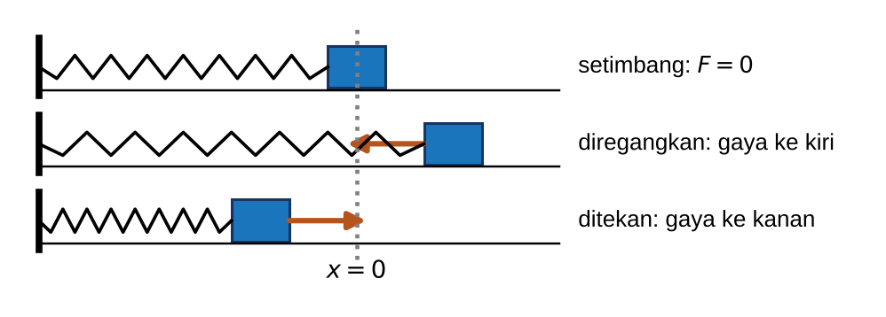
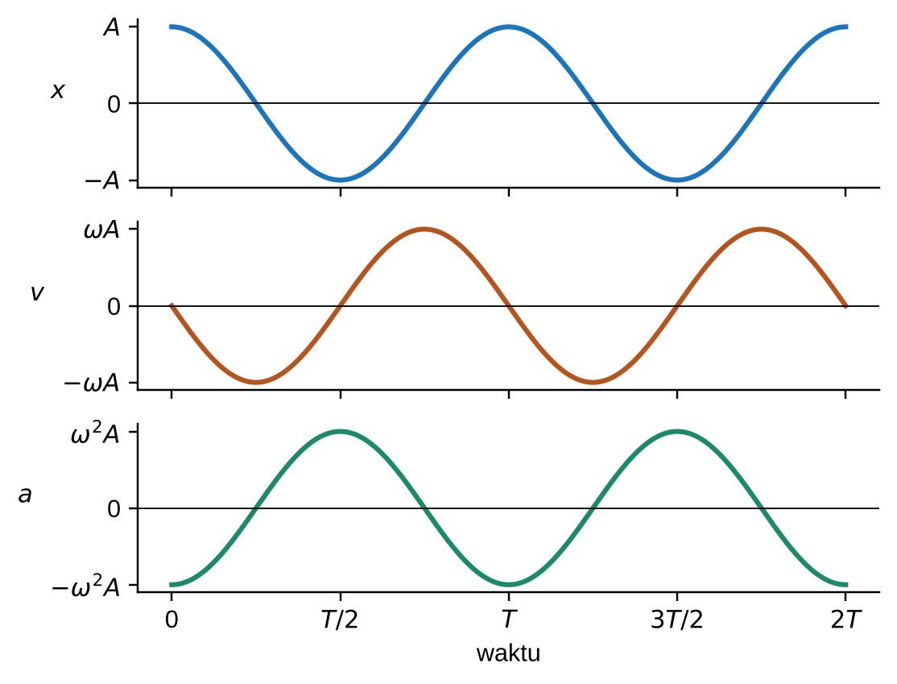
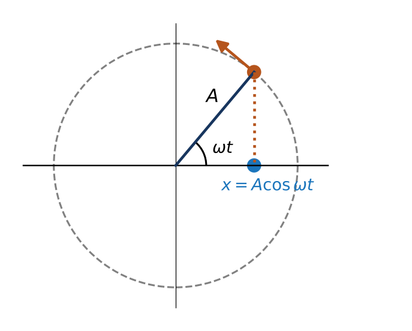
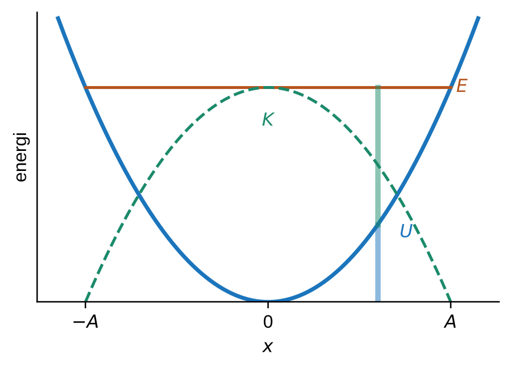
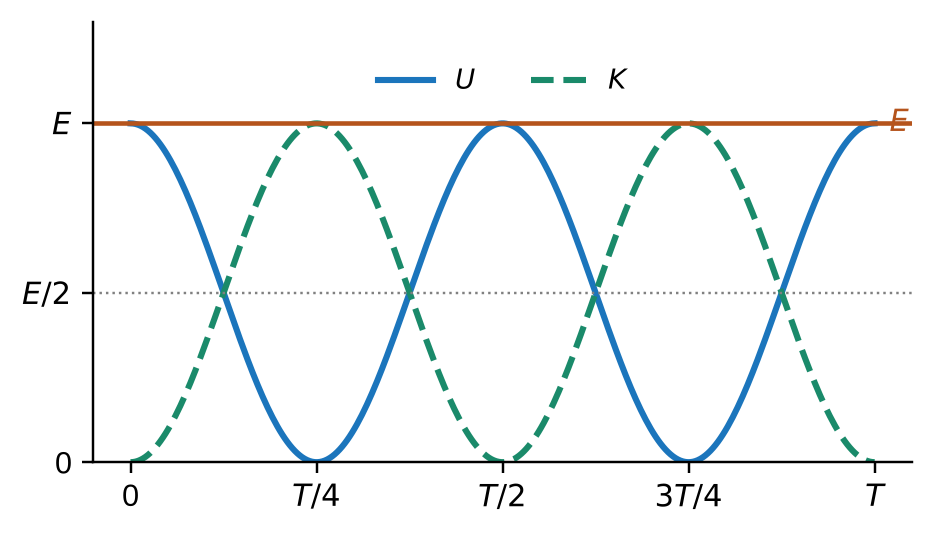
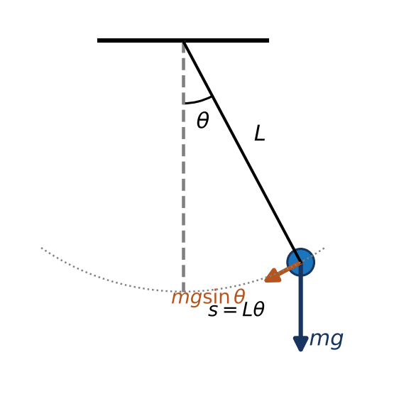

# Bab 8 Osilasi

Karbon dioksida hanya 0,04% dari udara, tetapi cukup untuk menghangatkan seluruh planet. Nitrogen dan oksigen, yang bersama-sama menyusun 99% udara, hampir tidak berperan sama sekali dalam efek rumah kaca. Ketiganya gas tak berwarna yang tembus cahaya. Apa bedanya?

Jawabannya ada pada cara molekul-molekul itu **bergetar**. Ikatan kimia berperilaku seperti pegas, dan setiap molekul memiliki frekuensi getar alaminya sendiri. Cahaya inframerah yang frekuensinya cocok dengan frekuensi itu diserap, dengan cara yang sama seperti ayunan menyerap dorongan yang diberikan pada irama yang tepat. Molekul CO₂ memiliki getaran yang dapat "ditangkap" oleh inframerah yang dipancarkan permukaan Bumi. N₂ dan O₂ tidak. Rinciannya ada di subbab 8.10.

Bab ini membahas gerak bolak-balik di sekitar titik setimbang: pegas, bandul, dan molekul. Hampir semua yang stabil di alam bergetar ketika diganggu, dan hampir semua getaran kecil mengikuti satu pola yang sama, **gerak harmonik sederhana**. Gagasan di bab ini menjadi dasar spektroskopi inframerah, dan menjadi pintu masuk ke gelombang di Bab 9.

::: {.tujuan}
**Tujuan belajar**

Setelah mempelajari bab ini, kamu mampu:

1. Memakai periode, frekuensi, frekuensi sudut, amplitudo, dan fase untuk memerikan gerak periodik.
2. Menuliskan posisi, kecepatan, dan percepatan gerak harmonik sederhana, dan menentukan tetapannya dari keadaan awal.
3. Menghitung periode sistem pegas–massa, termasuk pegas tegak dan pegas gabungan.
4. Memakai kekekalan energi pada gerak harmonik.
5. Menghitung periode bandul sederhana dan bandul fisis.
6. Menghitung frekuensi getaran molekul dwiatom dari konstanta gaya dan massa tereduksi, dan sebaliknya.
7. Menganalisis osilasi teredam dengan tetapan redaman dan faktor kualitas.
8. Menjelaskan resonansi dan memakainya untuk memahami serapan inframerah.
:::

::: {.mat}
**Prasyarat**

Dari Bab 2: gerak melingkar beraturan (subbab 2.14). Dari Bab 4: hukum Hooke, energi potensial pegas, diagram energi, dan getaran kecil di dasar lembah (subbab 4.2, 4.5, dan 4.8). Dari Bab 5: massa tereduksi (subbab 5.7). Fungsi sinus dan kosinus dengan sudut dalam **radian**.
:::

## 8.1 Gerak periodik

Gerak yang berulang dalam selang waktu yang sama disebut **gerak periodik**: detak jantung, ayunan bandul, getaran senar gitar, getaran atom dalam kristal. Jika geraknya bolak-balik melalui satu titik setimbang, ia disebut **osilasi** atau getaran.

| Besaran | Lambang | Arti | Satuan |
|---|---|---|---|
| Periode | $T$ | waktu untuk satu getaran penuh | s |
| Frekuensi | $f$ | banyaknya getaran tiap sekon | Hz = 1/s |
| Frekuensi sudut | $\omega$ | $2\pi$ kali frekuensi | rad/s |
| Amplitudo | $A$ | simpangan terbesar dari titik setimbang | m |

Ketiganya saling terkait:

$$
\boxed{f = \frac1T, \qquad \omega = 2\pi f = \frac{2\pi}{T}} \qquad \text{(8.1)}
$$

Satu "getaran penuh" berarti kembali ke posisi **dan arah gerak** semula: dari ujung kanan, ke ujung kiri, dan kembali ke ujung kanan. Dalam satu periode, benda menempuh jarak $4A$.

| Getaran | Frekuensi (kira-kira) |
|---|---|
| Pasang surut laut | $2 \times 10^{-5}$ Hz |
| Detak jantung | 1 Hz |
| Listrik PLN | 50 Hz |
| Nada A pada piano | 440 Hz |
| Kristal kuarsa pada jam tangan | 32 768 Hz |
| Radio FM | $10^8$ Hz |
| Oven gelombang mikro | $2{,}45 \times 10^9$ Hz |
| Getaran ikatan kimia | $10^{13}$ sampai $10^{14}$ Hz |
| Cahaya tampak | $5 \times 10^{14}$ Hz |

::: {.contoh}
**Contoh 8.1 · Periode dan frekuensi**

(a) Sebuah beban pada pegas menyelesaikan satu getaran dalam 0,80 s. Berapa frekuensi dan frekuensi sudutnya? (b) Jantung berdetak 72 kali per menit. Berapa frekuensi dan periodenya?

**Penyelesaian.**

(a) $f = \dfrac{1}{0{,}80} = 1{,}25$ Hz dan $\omega = 2\pi(1{,}25) = 7{,}9$ rad/s.

(b) $f = \dfrac{72}{60} = 1{,}2$ Hz dan $T = \dfrac{1}{1{,}2} = 0{,}83$ s.

**Memahami hasil.** Frekuensi dan frekuensi sudut mengukur hal yang sama dalam satuan berbeda: $f$ menghitung putaran, $\omega$ menghitung radian. Selalu periksa mana yang dimaksud; tertukarnya keduanya menghasilkan kesalahan sebesar faktor $2\pi \approx 6{,}3$.
:::

## 8.2 Gerak harmonik sederhana

{width=84%}

### Gaya pemulih

Ambil balok bermassa $m$ di lantai licin, terhubung ke pegas berkonstanta $k$ (Gambar 8.1). Ukur posisi $x$ dari titik setimbang. Menurut hukum Hooke, gaya pegas pada balok adalah

$$
F = -kx . \qquad \text{(8.2)}
$$

Gaya ini selalu berlawanan arah dengan simpangan, jadi selalu menarik balok kembali ke titik setimbang. Gaya seperti itu disebut **gaya pemulih**. Dengan hukum kedua Newton, $ma = -kx$, atau

$$
\boxed{a = -\frac km\,x = -\omega^2x} \qquad \text{(8.3)}
$$

Persamaan ini adalah ciri penentu **gerak harmonik sederhana** (GHS): **percepatan sebanding dengan simpangan dan berlawanan arah dengannya.** Setiap sistem yang memenuhi hubungan ini, apa pun wujudnya, bergerak dengan cara yang sama.

### Penyelesaiannya

Kita mencari fungsi $x(t)$ yang turunan keduanya sama dengan negatif fungsi itu sendiri, dikalikan suatu tetapan. Sinus dan kosinus memiliki sifat itu:

$$
\boxed{x(t) = A\cos(\omega t + \phi)} \qquad \text{(8.4)}
$$

Kecepatan dan percepatan diperoleh dengan menurunkannya:

$$
v(t) = -\omega A\sin(\omega t + \phi), \qquad a(t) = -\omega^2A\cos(\omega t + \phi) = -\omega^2x . \qquad \text{(8.5)}
$$

Percepatannya memang $-\omega^2x$, asalkan

$$
\boxed{\omega = \sqrt{\frac km}, \qquad T = 2\pi\sqrt{\frac mk}, \qquad f = \frac{1}{2\pi}\sqrt{\frac km}} \qquad \text{(8.6)}
$$

::: {.mat}
**Matematika · Turunan sinus dan kosinus**

Dengan sudut dalam radian:

$$
\frac{d}{dt}\sin(\omega t) = \omega\cos(\omega t), \qquad \frac{d}{dt}\cos(\omega t) = -\omega\sin(\omega t).
$$

Tiap kali diturunkan, muncul satu faktor $\omega$. Setelah dua kali, fungsi kembali ke bentuk semula dengan tanda berlawanan dan faktor $\omega^2$. Rumus ini **hanya benar untuk radian**, dan itulah alasan frekuensi sudut $\omega$ dipakai. Saat menghitung $\cos(\omega t)$ dengan kalkulator, pastikan kalkulator dalam mode radian.
:::

### Membaca rumusnya

{width=66%}

- **Amplitudo $A$** adalah simpangan terbesar. Nilainya ditentukan oleh cara getaran dimulai, bukan oleh sistemnya.
- **Frekuensi sudut $\omega$** ditentukan oleh sistem ($k$ dan $m$), **tidak oleh amplitudo**. Getaran besar dan getaran kecil memiliki periode yang sama. Sifat ini, yang disebut *isokronisme*, membuat osilator harmonik cocok menjadi penunjuk waktu.
- **Tetapan fase $\phi$** menyatakan di titik mana dalam siklusnya getaran berada pada $t = 0$. Jika benda dilepas dari diam di $x = A$, maka $\phi = 0$.
- Massa yang lebih besar bergetar lebih lambat; pegas yang lebih kaku bergetar lebih cepat.

Nilai terbesar kecepatan dan percepatan langsung terbaca dari (8.5):

$$
\boxed{v_\text{maks} = \omega A, \qquad a_\text{maks} = \omega^2A} \qquad \text{(8.7)}
$$

| Posisi | Kecepatan | Percepatan | Gaya |
|---|---|---|---|
| titik setimbang, $x = 0$ | terbesar, $\omega A$ | nol | nol |
| titik balik, $x = \pm A$ | nol | terbesar, $\omega^2A$ | terbesar, $kA$ |

Kecepatan dan percepatan tidak pernah terbesar bersamaan (Gambar 8.2). Kecepatan "mendahului" posisi seperempat siklus, dan percepatan berlawanan fase dengan posisi.

### Menentukan $A$ dan $\phi$ dari keadaan awal

Jika posisi awal $x_0$ dan kecepatan awal $v_0$ diketahui, masukkan $t = 0$ ke (8.4) dan (8.5): $x_0 = A\cos\phi$ dan $v_0 = -\omega A\sin\phi$. Maka

$$
\boxed{A = \sqrt{x_0^2 + \Big(\frac{v_0}{\omega}\Big)^2}, \qquad \tan\phi = -\frac{v_0}{\omega x_0}} \qquad \text{(8.8)}
$$

Karena tangen bernilai sama untuk dua sudut yang berbeda 180°, kuadran $\phi$ harus dipastikan dari tanda $\cos\phi = x_0/A$ dan $\sin\phi = -v_0/(\omega A)$.

::: {.strategi}
**Strategi · Soal gerak harmonik sederhana**

1. **Pastikan geraknya harmonik**: gaya pemulih sebanding dengan simpangan.
2. Hitung $\omega$ dari sistemnya: $\sqrt{k/m}$ untuk pegas, $\sqrt{g/L}$ untuk bandul.
3. Tentukan $A$ dan $\phi$ dari keadaan awal. Dua kasus yang paling sering:
   - dilepas dari diam di $x_0$: $x = x_0\cos\omega t$;
   - diberi kecepatan $v_0$ dari titik setimbang: $x = (v_0/\omega)\sin\omega t$.
4. Untuk pertanyaan tentang **waktu**, pakai $x(t)$. Untuk pertanyaan tentang **kelajuan di posisi tertentu**, pakai energi (subbab 8.4); biasanya jauh lebih cepat.
5. Kalkulator dalam mode **radian**.
:::

::: {.contoh}
**Contoh 8.2 · Balok pada pegas**

Balok 0,50 kg di lantai licin terhubung ke pegas dengan $k = 200$ N/m. Balok ditarik 0,10 m dari titik setimbang dan dilepas dari diam. Tentukan (a) frekuensi sudut, periode, dan frekuensinya; (b) kelajuan dan percepatan terbesarnya; (c) posisi, kecepatan, dan percepatannya 0,10 s setelah dilepas.

**Penyelesaian.**

(a) $\omega = \sqrt{\dfrac{200}{0{,}50}} = 20$ rad/s; $T = \dfrac{2\pi}{20} = 0{,}314$ s; $f = 3{,}2$ Hz.

(b) $v_\text{maks} = \omega A = (20)(0{,}10) = 2{,}0$ m/s; $a_\text{maks} = \omega^2A = (400)(0{,}10) = 40\ \text{m/s}^2$.

(c) Dilepas dari diam di $x = A$, jadi $x = 0{,}10\cos(20t)$. Pada $t = 0{,}10$ s, $\omega t = 2{,}0$ rad:

$$
x = 0{,}10\cos 2{,}0 = -0{,}042\ \text{m}, \qquad v = -(20)(0{,}10)\sin 2{,}0 = -1{,}8\ \text{m/s}, \qquad a = -\omega^2x = +17\ \text{m/s}^2 .
$$

**Memahami hasil.** Waktu 0,10 s adalah sedikit kurang dari sepertiga periode, jadi balok sudah melewati titik setimbang dan sedang bergerak menuju sisi lain: posisi negatif dan kecepatan negatif, sesuai. Percepatan terbesarnya empat kali $g$, padahal amplitudonya hanya 10 cm. Dengan kalkulator dalam mode derajat, $\cos 2{,}0$ akan memberi 0,999, kesalahan yang sangat umum.
:::

::: {.contoh}
**Contoh 8.3 · Dari keadaan awal ke persamaan gerak**

Pada sistem di Contoh 8.2, stopwatch dijalankan saat balok berada di $x = +0{,}060$ m dan sedang bergerak dengan kecepatan $-0{,}90$ m/s. Tuliskan persamaan geraknya.

**Penyelesaian.**

$$
A = \sqrt{0{,}060^2 + \Big(\frac{0{,}90}{20}\Big)^2} = \sqrt{0{,}0036 + 0{,}0020} = 0{,}075\ \text{m}.
$$

$\cos\phi = \dfrac{x_0}{A} = 0{,}80$ dan $\sin\phi = -\dfrac{v_0}{\omega A} = \dfrac{0{,}90}{(20)(0{,}075)} = 0{,}60$. Keduanya positif, jadi $\phi$ di kuadran pertama: $\phi = 0{,}64$ rad.

$$
x(t) = 0{,}075\cos(20t + 0{,}64)\ \text{m}.
$$

**Memahami hasil.** Pada $t = 0$: $x = 0{,}075\cos 0{,}64 = 0{,}060$ m, dan $v = -(20)(0{,}075)\sin 0{,}64 = -0{,}90$ m/s. Cocok. Tetapan fase positif berarti getaran ini "lebih dulu" daripada $\cos\omega t$: ia sudah melewati titik baliknya sebelum stopwatch dijalankan.
:::

::: {.contoh}
**Contoh 8.4 · Waktu tempuh yang tidak sebanding dengan jarak**

Sebuah benda bergetar harmonik dengan periode $T$ dan amplitudo $A$. Berapa lama ia bergerak (a) dari titik setimbang ke $x = A/2$; (b) dari $x = A/2$ ke $x = A$?

**Penyelesaian.** Mulai dari titik setimbang, $x = A\sin\omega t$.

(a) $\sin\omega t = \tfrac12$ memberi $\omega t = \dfrac{\pi}{6}$, sehingga $t = \dfrac{\pi/6}{2\pi/T} = \dfrac{T}{12}$.

(b) Dari titik setimbang ke $x = A$ diperlukan seperempat periode. Jadi sisanya: $\dfrac T4 - \dfrac{T}{12} = \dfrac T6$.

**Memahami hasil.** Dua jarak yang sama ditempuh dalam waktu berbeda dua kali lipat. Benda melaju kencang di dekat titik setimbang dan lambat di dekat titik balik. Akibatnya, benda yang bergetar **lebih sering ditemukan di dekat ujung-ujungnya** daripada di tengah. Fakta ini akan kontras dengan osilator kuantum, yang pada keadaan dasarnya justru paling mungkin ditemukan di tengah.
:::

::: {.contoh}
**Contoh 8.5 · Menimbang astronaut**

Di stasiun antariksa timbangan biasa tidak bekerja. Massa astronaut diukur dengan kursi yang dipasang pada pegas. Kursi kosong (massa 12,0 kg) bergetar dengan periode 0,90 s. Dengan seorang astronaut terikat di kursi, periodenya 2,10 s. Berapa massa astronaut itu?

**Penyelesaian.** Dari $T = 2\pi\sqrt{m/k}$, $k = \dfrac{4\pi^2m}{T^2} = \dfrac{4\pi^2(12{,}0)}{(0{,}90)^2} = 585$ N/m.

Massa total dengan astronaut: $m = \dfrac{kT^2}{4\pi^2} = \dfrac{(585)(2{,}10)^2}{4\pi^2} = 65{,}3$ kg. Massa astronaut: $65{,}3 - 12{,}0 = 53{,}3$ kg.

**Memahami hasil.** Cara cepat: massa sebanding dengan $T^2$, jadi $m = 12{,}0 \times (2{,}10/0{,}90)^2 = 65{,}3$ kg. Alat ini mengukur **massa** secara langsung, tanpa gravitasi. Neraca kuarsa di laboratorium memakai gagasan yang sama pada skala nanogram: lapisan tipis yang menempel pada kristal kuarsa menurunkan frekuensi getarnya, dan dari pergeseran frekuensi itu massanya dihitung.
:::

::: {.contoh}
**Contoh 8.6 · Menambah beban**

Beban 0,30 kg pada sebuah pegas bergetar dengan periode 0,50 s. (a) Berapa konstanta pegasnya? (b) Berapa periodenya jika ditambahkan beban 0,10 kg?

**Penyelesaian.**

(a) $k = \dfrac{4\pi^2m}{T^2} = \dfrac{4\pi^2(0{,}30)}{(0{,}50)^2} = 47$ N/m.

(b) Periode sebanding dengan $\sqrt m$: $T' = 0{,}50\sqrt{\dfrac{0{,}40}{0{,}30}} = 0{,}58$ s.

**Memahami hasil.** Massa bertambah sepertiga, tetapi periode hanya bertambah 15%, karena akar. Cara perbandingan pada (b) tidak memerlukan nilai $k$ sama sekali.
:::

::: {.contoh}
**Contoh 8.7 · Mulai dari titik setimbang**

Balok pada pegas, dengan $\omega = 20$ rad/s, mula-mula diam di titik setimbang, lalu dipukul sehingga bergerak dengan kecepatan 1,5 m/s. (a) Tuliskan persamaan geraknya. (b) Kapan balok pertama kali berada 0,050 m dari titik setimbang?

**Penyelesaian.**

(a) Mulai dari $x = 0$ dengan kecepatan positif, bentuk sinus paling cocok: $x = A\sin\omega t$, dengan $A = \dfrac{v_0}{\omega} = \dfrac{1{,}5}{20} = 0{,}075$ m.

$$
x(t) = 0{,}075\sin(20t)\ \text{m}.
$$

(b) $\sin(20t) = \dfrac{0{,}050}{0{,}075} = 0{,}667$, sehingga $20t = 0{,}730$ rad dan $t = 0{,}036$ s.

**Memahami hasil.** Bentuk sinus sama dengan bentuk kosinus bertetapan fase $-\pi/2$: $\sin\omega t = \cos(\omega t - \pi/2)$. Pilih bentuk yang membuat keadaan awal paling sederhana. Persamaan pada (b) memiliki penyelesaian lain, $20t = \pi - 0{,}730$; itu saat balok melewati titik yang sama dalam perjalanan pulang.
:::

::: {.contoh}
**Contoh 8.8 · Percepatan pada getaran cepat**

Kerucut sebuah pengeras suara bergetar dengan amplitudo 1,0 mm pada 1000 Hz. Berapa kelajuan dan percepatan terbesarnya?

**Penyelesaian.** $\omega = 2\pi(1000) = 6283$ rad/s.

$$
v_\text{maks} = \omega A = (6283)(1{,}0 \times 10^{-3}) = 6{,}3\ \text{m/s}, \qquad a_\text{maks} = \omega^2A = 3{,}9 \times 10^4\ \text{m/s}^2 .
$$

**Memahami hasil.** Percepatannya 4000 kali $g$, padahal simpangannya hanya satu milimeter. Karena $a_\text{maks} = \omega^2A$, percepatan tumbuh dengan **kuadrat** frekuensi. Itu sebabnya kerucut pengeras suara harus ringan dan kaku, dan sebabnya getaran berfrekuensi tinggi cepat merusak mesin walaupun amplitudonya kecil.
:::

::: {.contoh}
**Contoh 8.9 · Berat semu di perahu**

Sebuah perahu naik-turun mengikuti ombak secara harmonik dengan amplitudo 0,50 m dan periode 4,0 s. Berapa berat semu terbesar dan terkecil penumpang 70 kg?

**Penyelesaian.** $\omega = \dfrac{2\pi}{4{,}0} = 1{,}57$ rad/s, sehingga $a_\text{maks} = \omega^2A = 1{,}23\ \text{m/s}^2$.

Di titik terendah percepatannya ke atas: $n = m(g + a) = 70(11{,}03) = 772$ N. Di titik tertinggi percepatannya ke bawah: $n = m(g - a) = 70(8{,}57) = 600$ N.

**Memahami hasil.** Berat semu berayun 13% di sekitar berat sebenarnya, 686 N. Penumpang merasa paling berat di **lembah** ombak dan paling ringan di **puncak**. Ayunan berat semu inilah yang menyebabkan mabuk laut.
:::

::: {.kuis}
**Kuis cepat 8.1**

Amplitudo sebuah osilator pegas–massa dilipatduakan. Apa yang terjadi pada (a) periodenya, (b) kelajuan terbesarnya, (c) percepatan terbesarnya?
:::

## 8.3 Gerak harmonik dan gerak melingkar

{width=54%}

Ada cara sederhana untuk "melihat" gerak harmonik. Sebuah titik bergerak melingkar beraturan dengan jari-jari $A$ dan kecepatan sudut $\omega$ (Gambar 8.3). Sudutnya terhadap sumbu $x$ pada waktu $t$ adalah $\omega t + \phi$, dan koordinat $x$-nya

$$
x = A\cos(\omega t + \phi).
$$

Itu persis persamaan (8.4). **Gerak harmonik sederhana adalah proyeksi gerak melingkar beraturan pada satu garis.** Dari gambaran ini semua besaran memperoleh makna geometris:

| Besaran GHS | Maknanya pada lingkaran |
|---|---|
| amplitudo $A$ | jari-jari |
| frekuensi sudut $\omega$ | kecepatan sudut |
| fase $\omega t + \phi$ | sudut saat itu |
| tetapan fase $\phi$ | sudut pada $t = 0$ |
| $v_\text{maks} = \omega A$ | kelajuan titik pada lingkaran |
| $a_\text{maks} = \omega^2A$ | percepatan sentripetal |

Itulah alasan $\omega$ disebut frekuensi **sudut** walaupun pada pegas tidak ada yang berputar. Gambaran ini juga memudahkan soal waktu: waktu yang diperlukan sama dengan sudut yang disapu dibagi $\omega$.

::: {.contoh}
**Contoh 8.10 · Waktu dari sudut**

Sebuah benda bergetar harmonik dengan periode 1,2 s. Berapa lama ia bergerak dari $x = +A$ ke $x = -A/2$ untuk pertama kalinya?

**Penyelesaian.** Di lingkaran acuan, $x = A$ berada pada sudut 0°. $x = -A/2$ berarti $\cos\theta = -\tfrac12$, yaitu $\theta = 120°$. Sudut yang disapu 120°, sepertiga lingkaran:

$$
t = \frac{120°}{360°}\,T = \frac{1{,}2}{3} = 0{,}40\ \text{s}.
$$

**Memahami hasil.** Dari $+A$ ke titik setimbang diperlukan $T/4 = 0{,}30$ s, lalu $T/12 = 0{,}10$ s lagi ke $-A/2$ (Contoh 8.4). Jumlahnya 0,40 s.
:::

::: {.kuis}
**Kuis cepat 8.2**

Dua osilator identik bergetar dengan amplitudo sama. Pada suatu saat, osilator pertama berada di $x = +A$ dan osilator kedua berada di titik setimbang, bergerak ke arah positif. Berapa beda fase keduanya?
:::

## 8.4 Energi gerak harmonik

Gaya pegas konservatif, jadi energi mekanik osilator kekal:

$$
E = \tfrac12mv^2 + \tfrac12kx^2 = \text{tetap}. \qquad \text{(8.9)}
$$

Di titik balik, seluruh energi berupa energi potensial; di titik setimbang, seluruhnya energi kinetik:

$$
\boxed{E = \tfrac12kA^2 = \tfrac12mv_\text{maks}^2} \qquad \text{(8.10)}
$$

**Energi osilator sebanding dengan kuadrat amplitudonya.** Amplitudo dua kali berarti energi empat kali.

{width=54%}

Menyelesaikan (8.9) untuk kelajuan di posisi $x$:

$$
\boxed{v = \pm\,\omega\sqrt{A^2 - x^2}} \qquad \text{(8.11)}
$$

{width=58%}

Energi berpindah bolak-balik antara bentuk kinetik dan potensial **dua kali** tiap periode (Gambar 8.5). Rata-rata terhadap waktu, keduanya sama besar:

$$
\langle K\rangle = \langle U\rangle = \tfrac12E . \qquad \text{(8.12)}
$$

Hasil sederhana ini menjadi dasar teorema ekuipartisi di Bab 10: tiap getaran dalam molekul atau zat padat menyimpan energi termal dalam dua "wadah" yang sama besar, kinetik dan potensial.

::: {.contoh}
**Contoh 8.11 · Energi osilator**

Untuk sistem di Contoh 8.2 ($m = 0{,}50$ kg, $k = 200$ N/m, $A = 0{,}10$ m), tentukan (a) energi totalnya; (b) kelajuan balok ketika berada 0,060 m dari titik setimbang; (c) bagian energi yang berupa energi kinetik di posisi itu; (d) posisi tempat energi kinetik sama dengan energi potensial.

**Penyelesaian.**

(a) $E = \tfrac12(200)(0{,}10)^2 = 1{,}0$ J.

(b) $v = \omega\sqrt{A^2 - x^2} = 20\sqrt{0{,}010 - 0{,}0036} = 1{,}6$ m/s.

(c) $U = \tfrac12(200)(0{,}060)^2 = 0{,}36$ J, jadi $K = 0{,}64$ J: 64%.

(d) $U = \tfrac12E$ berarti $\tfrac12kx^2 = \tfrac14kA^2$, sehingga $x = \pm\dfrac{A}{\sqrt2} = \pm0{,}071$ m.

**Memahami hasil.** Bagian energi potensial adalah $(x/A)^2 = 0{,}36$, langsung dari perbandingan simpangan. Titik bagi-rata energi bukan di tengah-tengah ($A/2$), melainkan di $0{,}71A$, karena energi potensial tumbuh dengan kuadrat simpangan.
:::

::: {.contoh}
**Contoh 8.12 · Tumbukan yang memulai getaran**

Balok 0,50 kg meluncur di lantai licin dengan 3,0 m/s, lalu menumbuk dan terkait pada ujung pegas mendatar ($k = 450$ N/m) yang ujung lainnya terpasang di dinding. Berapa amplitudo dan periode getaran yang terjadi?

**Penyelesaian.** Saat menyentuh pegas, balok berada di titik setimbang dengan kelajuan $v_\text{maks} = 3{,}0$ m/s.

$$
\omega = \sqrt{\frac{450}{0{,}50}} = 30\ \text{rad/s}, \qquad A = \frac{v_\text{maks}}{\omega} = \frac{3{,}0}{30} = 0{,}10\ \text{m}, \qquad T = \frac{2\pi}{30} = 0{,}21\ \text{s}.
$$

**Memahami hasil.** Dengan energi: $\tfrac12mv^2 = \tfrac12kA^2$ memberi $A = v\sqrt{m/k} = 0{,}10$ m, sama dengan Contoh 4.18 di Bab 4. Sekarang kita juga tahu **waktunya**: pegas tertekan paling jauh seperempat periode setelah sentuhan, yaitu 0,052 s.
:::

::: {.contoh}
**Contoh 8.13 · Menambah massa di tengah getaran**

Balok 0,50 kg pada pegas ($k = 200$ N/m) bergetar dengan amplitudo 0,10 m di lantai licin. Segumpal lempung 0,30 kg dijatuhkan tegak dan menempel pada balok. Tentukan amplitudo dan periode yang baru jika lempung itu mendarat ketika balok (a) melewati titik setimbang; (b) berada di titik balik.

**Penyelesaian.** Periode baru sama untuk kedua keadaan: $T' = 2\pi\sqrt{\dfrac{0{,}80}{200}} = 0{,}40$ s (semula 0,31 s).

(a) Di titik setimbang balok bergerak 2,0 m/s. Lempung tidak membawa momentum mendatar, jadi ini tumbukan tak lenting: $v' = \dfrac{(0{,}50)(2{,}0)}{0{,}80} = 1{,}25$ m/s. Dengan $\omega' = \sqrt{200/0{,}80} = 15{,}8$ rad/s:

$$
A' = \frac{v'}{\omega'} = \frac{1{,}25}{15{,}8} = 0{,}079\ \text{m}.
$$

(b) Di titik balik balok diam, jadi tidak ada momentum yang berubah. Simpangannya tetap 0,10 m, dan itu tetap titik balik: $A' = 0{,}10$ m.

**Memahami hasil.** Pada (a) energi turun dari 1,0 J menjadi $\tfrac12(0{,}80)(1{,}25)^2 = 0{,}63$ J; sisanya hilang dalam tumbukan. Pada (b) seluruh energi sedang tersimpan di pegas, sehingga tidak ada yang hilang. Saat massa ditambahkan menentukan hasilnya, walaupun periode barunya sama.
:::

::: {.contoh}
**Contoh 8.14 · Kelajuan di berbagai posisi**

Untuk osilator dengan $A = 0{,}10$ m dan $\omega = 20$ rad/s, hitung kelajuannya pada simpangan 0; 0,050; 0,080; dan 0,10 m.

**Penyelesaian.** $v = \omega\sqrt{A^2 - x^2}$.

| $x$ (m) | 0 | 0,050 | 0,080 | 0,10 |
|---|---|---|---|---|
| $x/A$ | 0 | 0,50 | 0,80 | 1,0 |
| $v$ (m/s) | 2,0 | 1,7 | 1,2 | 0 |
| $v/v_\text{maks}$ | 1,0 | 0,87 | 0,60 | 0 |

**Memahami hasil.** Di setengah amplitudo, kelajuannya masih 87% nilai terbesarnya. Kelajuan baru turun tajam di dekat titik balik. Pasangan $(x/A,\ v/v_\text{maks})$ selalu memenuhi $(x/A)^2 + (v/v_\text{maks})^2 = 1$: di bidang posisi–kecepatan, osilator bergerak mengelilingi sebuah lingkaran. Itulah lingkaran acuan pada subbab 8.3.
:::

::: {.kuis}
**Kuis cepat 8.3**

Di posisi mana, dinyatakan dengan $A$, kelajuan osilator tepat setengah kelajuan terbesarnya?
:::

## 8.5 Pegas tegak dan pegas gabungan

### Beban yang tergantung

Beban bermassa $m$ yang digantungkan pada pegas tegak meregangkan pegas sejauh $x_0 = mg/k$ sampai setimbang. Jika beban itu disimpangkan dari posisi setimbang **baru** tersebut, gaya totalnya adalah $-ky$, dengan $y$ simpangan dari posisi setimbang (subbab 4.5). Gravitasi hanya menggeser titik setimbang dan tidak mengubah getarannya:

$$
T = 2\pi\sqrt{\frac mk} = 2\pi\sqrt{\frac{x_0}{g}} . \qquad \text{(8.13)}
$$

Bentuk kedua sangat praktis: periode dapat diketahui hanya dari **regangan pegas saat setimbang**, tanpa perlu tahu $m$ dan $k$.

::: {.contoh}
**Contoh 8.15 · Pegas tegak**

Beban 0,20 kg digantungkan pada pegas dengan $k = 40$ N/m. (a) Berapa regangan pegas saat setimbang? (b) Berapa periode getarannya? (c) Hitung ulang periodenya hanya dari regangan itu.

**Penyelesaian.**

(a) $x_0 = \dfrac{mg}{k} = \dfrac{(0{,}20)(9{,}80)}{40} = 0{,}049$ m.

(b) $T = 2\pi\sqrt{\dfrac{0{,}20}{40}} = 0{,}44$ s.

(c) $T = 2\pi\sqrt{\dfrac{0{,}049}{9{,}80}} = 0{,}44$ s.

**Memahami hasil.** Rumus (c) sama bentuknya dengan periode bandul sepanjang $x_0$ (subbab 8.6). Suspensi mobil dapat dianalisis begini: jika badan mobil turun 10 cm ketika dibebani beratnya sendiri, periode goyangannya $2\pi\sqrt{0{,}10/9{,}80} = 0{,}63$ s, tanpa perlu tahu massa mobil.
:::

### Pegas gabungan

Dari subbab 4.2: pegas **paralel** berkonstanta efektif $k_1 + k_2$; pegas **seri** berkonstanta efektif $\dfrac{k_1k_2}{k_1 + k_2}$. Periode dihitung dengan konstanta efektif itu.

Massa yang diapit dua pegas di kiri dan kanannya termasuk susunan **paralel**: ketika massa bergeser sejauh $x$, kedua pegas sama-sama mengerjakan gaya pemulih.

::: {.contoh}
**Contoh 8.16 · Paralel dan seri**

Balok 1,0 kg dihubungkan ke dua pegas, $k_1 = 300$ N/m dan $k_2 = 600$ N/m. Berapa periodenya jika kedua pegas dipasang (a) paralel; (b) seri?

**Penyelesaian.**

(a) $k = 900$ N/m: $T = 2\pi\sqrt{\dfrac{1{,}0}{900}} = 0{,}21$ s.

(b) $k = \dfrac{(300)(600)}{900} = 200$ N/m: $T = 2\pi\sqrt{\dfrac{1{,}0}{200}} = 0{,}44$ s.

**Memahami hasil.** Susunan seri lebih lunak, jadi getarannya lebih lambat. Perbandingan periodenya $\sqrt{900/200} = 2{,}1$.
:::

## 8.6 Bandul

{width=42%}

### Bandul sederhana

**Bandul sederhana** adalah beban kecil bermassa $m$ pada tali ringan sepanjang $L$ (Gambar 8.6). Ketika tali menyimpang sebesar $\theta$, komponen berat yang menyinggung lintasan adalah gaya pemulih:

$$
F = -mg\sin\theta .
$$

Ini **bukan** gerak harmonik, karena gayanya sebanding dengan $\sin\theta$, bukan dengan $\theta$. Tetapi untuk sudut kecil dalam radian, $\sin\theta \approx \theta$:

| $\theta$ (derajat) | $\theta$ (radian) | $\sin\theta$ | selisih |
|---|---|---|---|
| 5° | 0,0873 | 0,0872 | 0,1% |
| 10° | 0,1745 | 0,1736 | 0,5% |
| 20° | 0,3491 | 0,3420 | 2,0% |
| 30° | 0,5236 | 0,5000 | 4,5% |

Dengan pendekatan itu, dan dengan panjang busur $s = L\theta$:

$$
F \approx -mg\theta = -\frac{mg}{L}\,s .
$$

Gaya pemulih sebanding dengan simpangan $s$, dengan "konstanta pegas" $mg/L$. Maka $\omega = \sqrt{(mg/L)/m}$:

$$
\boxed{\omega = \sqrt{\frac gL}, \qquad T = 2\pi\sqrt{\frac Lg}} \qquad \text{(8.14)}
$$

Tiga hal patut dicatat:

- **Massa beban tidak berpengaruh.** Gaya pemulih dan kelembaman sama-sama sebanding dengan $m$, sehingga tercoret, sama seperti pada jatuh bebas.
- **Amplitudo tidak berpengaruh**, selama sudutnya kecil. Menurut cerita, Galileo menyadari hal ini saat mengamati lampu gantung yang berayun di katedral Pisa, dengan denyut nadinya sebagai pengukur waktu.
- Periode hanya bergantung pada $L$ dan $g$. Bandul adalah alat sederhana untuk mengukur $g$.

Untuk amplitudo sudut $\theta_0$ yang tidak kecil, periodenya sedikit lebih panjang:

$$
T \approx 2\pi\sqrt{\frac Lg}\Big(1 + \frac{\theta_0^2}{16}\Big), \qquad \theta_0\ \text{dalam radian}. \qquad \text{(8.15)}
$$

::: {.contoh}
**Contoh 8.17 · Periode bandul**

(a) Berapa periode bandul sepanjang 1,00 m? (b) Berapa panjang bandul yang periodenya tepat 1,00 s? (c) Berapa periode bandul 1,00 m di Bulan, tempat $g = 1{,}62\ \text{m/s}^2$?

**Penyelesaian.**

(a) $T = 2\pi\sqrt{\dfrac{1{,}00}{9{,}80}} = 2{,}01$ s.

(b) $L = \dfrac{gT^2}{4\pi^2} = \dfrac{(9{,}80)(1{,}00)^2}{4\pi^2} = 0{,}248$ m.

(c) $T = 2\pi\sqrt{\dfrac{1{,}00}{1{,}62}} = 4{,}94$ s.

**Memahami hasil.** Bandul satu meter memiliki periode hampir tepat dua sekon, sehingga tiap ayunan (setengah periode) memakan satu sekon. Kebetulan ini hampir dijadikan dasar definisi meter pada abad ke-18. Jam bandul besar memakai bandul sekitar satu meter karena alasan ini.
:::

::: {.contoh}
**Contoh 8.18 · Mengukur $g$ dengan bandul**

Seorang mahasiswa mengukur 20 ayunan penuh bandul sepanjang 1,200 m dan memperoleh 44,0 s. (a) Berapa nilai $g$ yang diperolehnya? (b) Jika waktu 20 ayunan itu salah baca 0,04 s, berapa perubahan hasilnya?

**Penyelesaian.**

(a) $T = \dfrac{44{,}0}{20} = 2{,}200$ s. $g = \dfrac{4\pi^2L}{T^2} = \dfrac{4\pi^2(1{,}200)}{(2{,}200)^2} = 9{,}79\ \text{m/s}^2$.

(b) Dengan waktu 43,96 s, $T = 2{,}198$ s dan $g = 9{,}81\ \text{m/s}^2$. Selisihnya $0{,}02\ \text{m/s}^2$, atau 0,2%.

**Memahami hasil.** Kesalahan waktu sebesar 0,09% menghasilkan kesalahan $g$ dua kali lipatnya, 0,18%, karena $g$ sebanding dengan $1/T^2$ (aturan rambat ketidakpastian, subbab 1.7). Mengukur banyak ayunan sekaligus menyebar kesalahan menekan stopwatch ke banyak periode; itulah kunci ketelitiannya.
:::

::: {.contoh}
**Contoh 8.19 · Seberapa "kecil" sudut kecil?**

Berapa persen periode bandul bertambah, dibandingkan rumus sudut kecil, jika amplitudonya (a) 10°, (b) 30°, (c) 60°?

**Penyelesaian.** Dengan (8.15), pertambahannya $\theta_0^2/16$:

(a) $\dfrac{(0{,}1745)^2}{16} = 0{,}19\%$. (b) $\dfrac{(0{,}5236)^2}{16} = 1{,}7\%$. (c) $\dfrac{(1{,}047)^2}{16} = 6{,}9\%$.

**Memahami hasil.** Sampai 10°, kesalahannya di bawah 0,2%, lebih kecil daripada ketelitian stopwatch tangan. Pada 30° kesalahannya sudah terukur. Dalam praktikum bandul, simpangan awal dijaga di bawah 10°.
:::

### Bandul dalam kerangka yang dipercepat

Yang masuk ke rumus bandul sebenarnya adalah **gravitasi efektif**. Dalam lift yang dipercepat ke atas dengan $a$, $g_\text{ef} = g + a$. Dalam kendaraan yang dipercepat mendatar, $g_\text{ef} = \sqrt{g^2 + a^2}$ dan titik setimbang bandul miring ke belakang. Dalam jatuh bebas, $g_\text{ef} = 0$: bandul tidak berayun sama sekali.

### Bandul fisis

Benda tegar apa pun yang digantung dan dapat berayun adalah **bandul fisis**. Periodenya bergantung pada bagaimana massanya tersebar terhadap poros:

$$
T = 2\pi\sqrt{\frac{I}{mgd}} , \qquad \text{(8.16)}
$$

dengan $d$ jarak dari poros ke pusat massa dan $I$ **momen inersia** terhadap poros. Momen inersia adalah ukuran kelembaman untuk gerak berputar: jumlah $mr^2$ atas semua bagian benda, dengan $r$ jarak tiap bagian dari poros. Massa yang jauh dari poros menyumbang jauh lebih besar.

| Benda dan poros | $I$ | Periode |
|---|---|---|
| Beban titik pada tali sepanjang $L$ | $mL^2$ | $2\pi\sqrt{L/g}$ |
| Batang serbasama sepanjang $L$, poros di ujung | $\tfrac13mL^2$ | $2\pi\sqrt{2L/(3g)}$ |
| Cincin tipis berjari-jari $R$, poros di tepi | $2mR^2$ | $2\pi\sqrt{2R/g}$ |
| Cakram berjari-jari $R$, poros di tepi | $\tfrac32mR^2$ | $2\pi\sqrt{3R/(2g)}$ |

Momen inersia muncul lagi untuk molekul di Bab 15: energi **rotasi** molekul ditentukan oleh $I = \mu r^2$, dan dari spektrum rotasi orang memperoleh panjang ikatan.

::: {.contoh}
**Contoh 8.20 · Batang yang berayun**

Batang meteran serbasama sepanjang 1,00 m digantung pada salah satu ujungnya dan diayunkan. (a) Berapa periodenya? (b) Bandul sederhana sepanjang berapa yang berperiode sama?

**Penyelesaian.**

(a) $T = 2\pi\sqrt{\dfrac{2L}{3g}} = 2\pi\sqrt{\dfrac{2(1{,}00)}{3(9{,}80)}} = 1{,}64$ s.

(b) Samakan dengan $2\pi\sqrt{L'/g}$: $L' = \tfrac23L = 0{,}667$ m.

**Memahami hasil.** Batang berayun lebih cepat daripada bandul sederhana sepanjang batang itu (2,01 s), karena sebagian massanya berada dekat poros. Kaki manusia berayun seperti bandul fisis; periode alaminya, sekitar 1,5 s untuk kaki 0,9 m, menentukan irama berjalan yang paling hemat tenaga. Orang berkaki panjang melangkah lebih lambat tetapi lebih jauh.
:::

::: {.awas}
**Awas · Empat kesalahan pada soal osilasi**

- **Kalkulator dalam mode derajat.** Argumen $\omega t$ selalu dalam radian.
- **Menukar $f$ dan $\omega$.** $\omega = 2\pi f$; keduanya berbeda faktor 6,28.
- **Mengira periode bergantung pada amplitudo.** Untuk gerak harmonik tidak. Menarik pegas lebih jauh membuat getarannya lebih besar dan lebih cepat, tetapi tidak lebih lama.
- **Memakai persamaan percepatan tetap.** Pada osilasi percepatan berubah terus. Rumus seperti $v = v_0 + at$ tidak berlaku.
:::

::: {.contoh}
**Contoh 8.21 · Bandul di lift dan di mobil**

Bandul sepanjang 1,0 m digantung (a) di lift yang dipercepat ke atas $2{,}0\ \text{m/s}^2$; (b) di mobil yang dipercepat mendatar $3{,}0\ \text{m/s}^2$. Berapa periode ayunan kecilnya, dan pada (b) berapa sudut setimbang talinya?

**Penyelesaian.**

(a) $g_\text{ef} = 9{,}80 + 2{,}0 = 11{,}8\ \text{m/s}^2$: $T = 2\pi\sqrt{\dfrac{1{,}0}{11{,}8}} = 1{,}83$ s.

(b) $g_\text{ef} = \sqrt{9{,}80^2 + 3{,}0^2} = 10{,}2\ \text{m/s}^2$: $T = 2\pi\sqrt{\dfrac{1{,}0}{10{,}2}} = 1{,}96$ s. Tali setimbang miring ke belakang dengan sudut $\tan^{-1}\dfrac{3{,}0}{9{,}80} = 17°$ dari garis tegak, dan bandul berayun di sekitar arah itu.

**Memahami hasil.** Tanpa percepatan periodenya 2,01 s. Pada kedua keadaan gravitasi efektifnya lebih besar, sehingga bandul berayun lebih cepat.
:::

::: {.contoh}
**Contoh 8.22 · Tegangan tali pada ayunan kecil**

Bandul sepanjang 1,2 m dengan beban 0,20 kg berayun dengan amplitudo sudut 8,0°. Berapa kelajuan terbesar beban dan tegangan tali di titik terendah?

**Penyelesaian.** $\omega = \sqrt{9{,}80/1{,}2} = 2{,}86$ rad/s. Amplitudo sepanjang busur: $A = L\theta_0 = (1{,}2)(0{,}1396) = 0{,}168$ m.

$$
v_\text{maks} = \omega A = (2{,}86)(0{,}168) = 0{,}48\ \text{m/s}.
$$

Di titik terendah: $T_\text{tali} = mg + \dfrac{mv^2}{L} = mg(1 + \theta_0^2) = (1{,}96)(1 + 0{,}0195) = 2{,}00$ N.

**Memahami hasil.** Untuk ayunan kecil, tegangan tali hanya 2% lebih besar daripada berat. Rumus $mg(1 + \theta_0^2)$ adalah bentuk sudut-kecil dari hasil umum $mg(3 - 2\cos\theta_0)$ di subbab 4.6.
:::

::: {.contoh}
**Contoh 8.23 · Jam bandul dan suhu**

Batang bandul sebuah jam terbuat dari kuningan, yang panjangnya bertambah $19 \times 10^{-6}$ bagian tiap kenaikan suhu 1 K. Jam itu tepat pada 20 °C. Berapa sekon per hari kesalahannya pada 30 °C, dan ke arah mana?

**Penyelesaian.** Pertambahan panjang relatif: $(19 \times 10^{-6})(10) = 1{,}9 \times 10^{-4}$. Karena $T \propto \sqrt L$, pertambahan periode relatif setengahnya: $9{,}5 \times 10^{-5}$.

Dalam sehari (86 400 s): $(9{,}5 \times 10^{-5})(86\,400) = 8{,}2$ s. Jam **terlambat** 8,2 s tiap hari.

**Memahami hasil.** Delapan sekon sehari berarti empat menit sebulan. Pembuat jam abad ke-18 mengatasinya dengan bandul berkisi dari dua logam yang pemuaiannya saling meniadakan, dan kemudian dengan paduan invar yang hampir tidak memuai.
:::

::: {.kuis}
**Kuis cepat 8.4**

Sebuah jam bandul berjalan tepat di permukaan laut. Jam itu dibawa ke puncak gunung yang tinggi. Apakah ia berjalan terlalu cepat atau terlalu lambat? Bagaimana memperbaikinya?
:::
