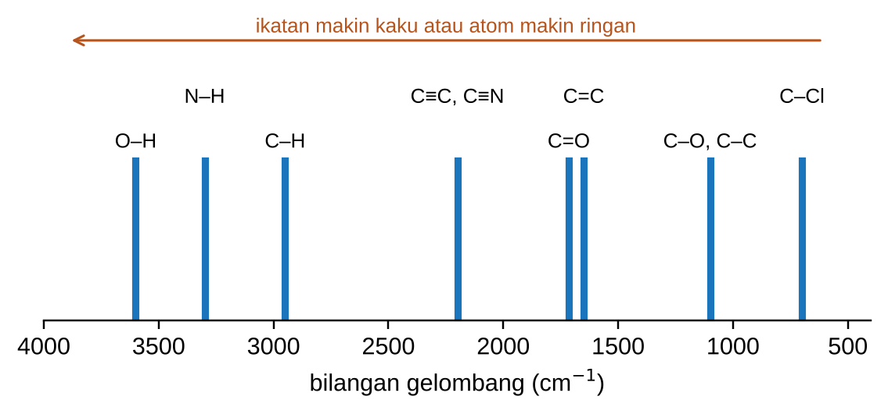
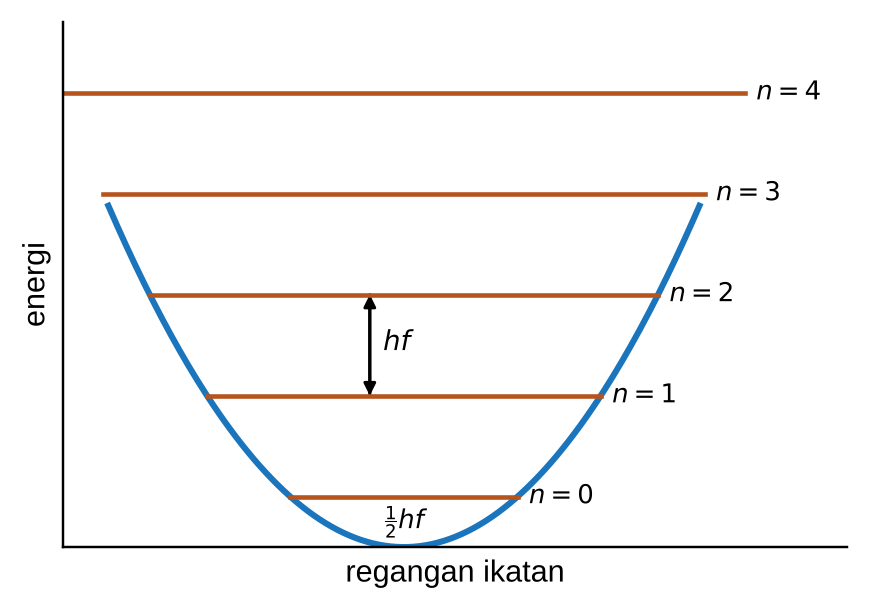
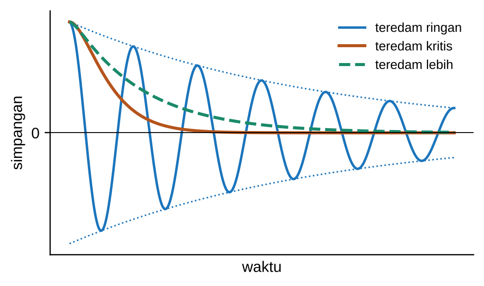
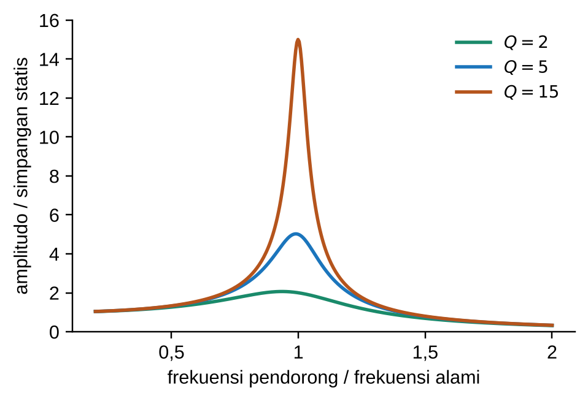
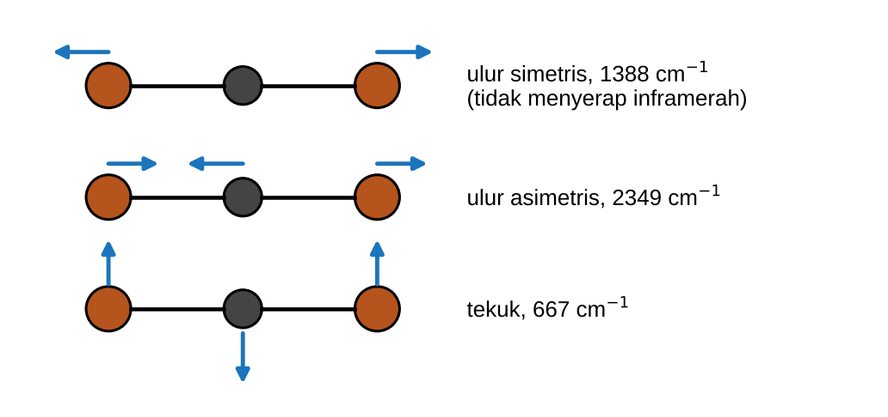
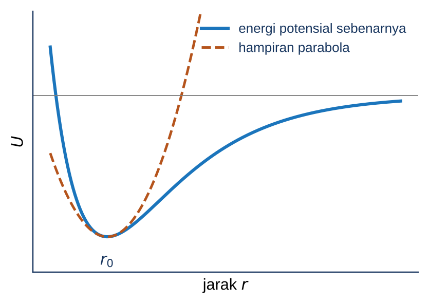
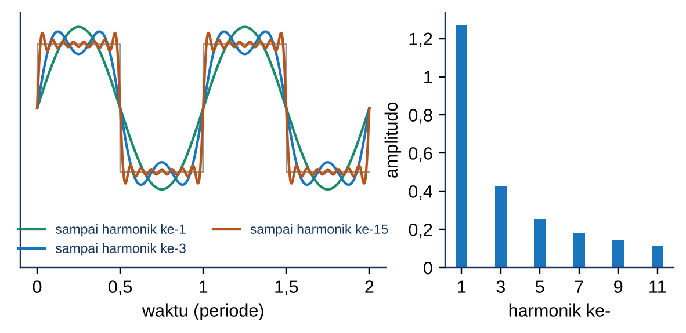

## 8.7 Getaran molekul

Di subbab 4.8 kita melihat bahwa dasar setiap lembah energi potensial mirip parabola, dengan kelengkungan yang berperan sebagai konstanta pegas, $k = d^2U/dx^2$. Dua atom yang terikat berada di dasar lembah seperti itu. Jika diganggu, mereka bergetar. Subbab ini menghitung seberapa cepat.

### Dua benda, satu getaran

Pada pegas–massa, salah satu ujung pegas terpasang di dinding. Pada molekul dwiatom, **kedua** atom bergerak. Di subbab 5.7 kita melihat bahwa gerak relatif dua benda yang saling berinteraksi setara dengan gerak **satu** benda bermassa tereduksi

$$
\mu = \frac{m_1m_2}{m_1 + m_2} .
$$

Jadi rumus pegas–massa berlaku dengan $m$ diganti $\mu$:

$$
\boxed{f = \frac{1}{2\pi}\sqrt{\frac{k}{\mu}}} \qquad \text{(8.17)}
$$

Di sini $k$ adalah **konstanta gaya** ikatan, ukuran kekakuannya.

### Bilangan gelombang

Frekuensi getaran molekul berorde $10^{13}$ sampai $10^{14}$ Hz, dan tepat berada di daerah **inframerah**. Ahli spektroskopi tidak menyatakannya dalam hertz, melainkan dalam **bilangan gelombang** $\tilde\nu$, yaitu banyaknya gelombang cahaya tiap sentimeter:

$$
\boxed{\tilde\nu = \frac{f}{c} = \frac{1}{2\pi c}\sqrt{\frac{k}{\mu}}} \qquad \text{(8.18)}
$$

dengan $c = 2{,}998 \times 10^{10}$ cm/s agar hasilnya bersatuan cm⁻¹. Bilangan gelombang sebanding dengan frekuensi dan dengan energi. Konversi yang sering dipakai:

| Dari $\tilde\nu$ (cm⁻¹) ke | Kalikan dengan |
|---|---|
| frekuensi (Hz) | $2{,}998 \times 10^{10}$ |
| energi per foton (J) | $1{,}986 \times 10^{-23}$ |
| energi per foton (eV) | $1{,}240 \times 10^{-4}$ |
| energi per mol (kJ/mol) | 0,01196 |
| panjang gelombang (μm) | $\lambda = 10\,000/\tilde\nu$ |

::: {.contoh}
**Contoh 8.24 · Getaran H–Cl**

Konstanta gaya ikatan dalam H³⁵Cl adalah 516 N/m. Massa atom: H 1,008 u; ³⁵Cl 34,97 u ($1\ \text{u} = 1{,}6605 \times 10^{-27}$ kg). Hitung frekuensi getaran dan bilangan gelombangnya.

**Penyelesaian.**

$$
\mu = \frac{(1{,}008)(34{,}97)}{35{,}98} = 0{,}980\ \text{u} = 1{,}627 \times 10^{-27}\ \text{kg}.
$$

$$
f = \frac{1}{2\pi}\sqrt{\frac{516}{1{,}627 \times 10^{-27}}} = 8{,}96 \times 10^{13}\ \text{Hz}, \qquad \tilde\nu = \frac{8{,}96 \times 10^{13}}{2{,}998 \times 10^{10}} = 2990\ \text{cm}^{-1}.
$$

**Memahami hasil.** Nilai terukurnya 2991 cm⁻¹. Molekul ini bergetar hampir 90 triliun kali tiap sekon; satu getaran memakan 11 femtosekon. Konstanta gaya 516 N/m sebanding dengan pegas suspensi sepeda, tetapi karena massanya hanya $10^{-27}$ kg, frekuensinya luar biasa tinggi. Karena $\mu$ hampir sama dengan massa hidrogen, getaran ini pada dasarnya gerak atom H; atom Cl yang berat hampir diam.
:::

::: {.contoh}
**Contoh 8.25 · Efek isotop: mengganti H dengan D**

Berapa bilangan gelombang getaran D³⁵Cl, dengan D adalah deuterium (2,014 u)? Konstanta gayanya sama dengan HCl.

**Rencana.** Isotop memiliki susunan elektron yang sama, jadi ikatan dan konstanta gayanya sama. Yang berubah hanya massa tereduksi.

**Penyelesaian.** $\mu_\text{DCl} = \dfrac{(2{,}014)(34{,}97)}{36{,}98} = 1{,}904$ u. Karena $\tilde\nu \propto 1/\sqrt\mu$:

$$
\tilde\nu_\text{DCl} = 2991\sqrt{\frac{0{,}980}{1{,}904}} = 2991(0{,}717) = 2145\ \text{cm}^{-1}.
$$

**Memahami hasil.** Nilai terukurnya 2145 cm⁻¹. Pergeseran sebesar faktor hampir $1/\sqrt2$ adalah ciri khas penggantian H dengan D. Ahli kimia memanfaatkannya untuk menandai pita serapan: jika sebuah pita bergeser dengan faktor sekitar 0,72 setelah senyawa dideuterasi, pita itu berasal dari getaran yang melibatkan atom hidrogen tersebut.
:::

::: {.contoh}
**Contoh 8.26 · Dari spektrum ke kekakuan ikatan**

Karbon monoksida (¹²C¹⁶O) menyerap inframerah pada 2170 cm⁻¹. Massa atom: C 12,00 u; O 15,99 u. Berapa konstanta gaya ikatannya?

**Penyelesaian.** $\mu = \dfrac{(12{,}00)(15{,}99)}{27{,}99} = 6{,}856$ u $= 1{,}138 \times 10^{-26}$ kg. Balik rumus (8.18):

$$
k = \mu(2\pi c\tilde\nu)^2 = (1{,}138 \times 10^{-26})\big[2\pi(2{,}998 \times 10^{10})(2170)\big]^2 = 1{,}90 \times 10^3\ \text{N/m}.
$$

**Memahami hasil.** Ikatan dalam CO hampir empat kali lebih kaku daripada ikatan dalam HCl, sesuai dengan ikatan rangkap tiganya. Bilangan gelombang HCl lebih **besar** daripada CO walaupun ikatannya lebih lunak, karena massa tereduksinya tujuh kali lebih kecil. Frekuensi ditentukan oleh **perbandingan** $k/\mu$, bukan oleh $k$ saja.
:::

### Apa yang menentukan konstanta gaya

| Molekul | $\tilde\nu$ (cm⁻¹) | $\mu$ (u) | $k$ (N/m) | Orde ikatan |
|---|---|---|---|---|
| H₂ | 4401 | 0,504 | 575 | 1 |
| HF | 4138 | 0,957 | 966 | 1 |
| HCl | 2991 | 0,980 | 516 | 1 |
| HBr | 2649 | 0,995 | 412 | 1 |
| HI | 2309 | 1,000 | 314 | 1 |
| N₂ | 2359 | 7,00 | 2296 | 3 |
| CO | 2170 | 6,86 | 1902 | 3 |
| NO | 1904 | 7,47 | 1595 | 2,5 |
| O₂ | 1580 | 8,00 | 1176 | 2 |
| Cl₂ | 560 | 17,5 | 323 | 1 |
| I₂ | 215 | 63,5 | 173 | 1 |

Tabel ini memuat banyak kimia:

- **Orde ikatan.** Ikatan rangkap tiga (N₂, CO) lebih kaku daripada rangkap dua (O₂), yang lebih kaku daripada tunggal (Cl₂). Konstanta gaya adalah ukuran langsung kekuatan ikatan.
- **Deret halogen.** Dari HF ke HI, massa tereduksi hampir tidak berubah (selalu mendekati 1 u), tetapi $k$ turun dari 966 menjadi 314 N/m. Ikatan melemah ketika atom halogen makin besar dan tumpang-tindih orbitalnya makin buruk.
- **Molekul berat.** I₂ bergetar dua puluh kali lebih lambat daripada H₂, terutama karena massanya.

{width=84%}

Dalam molekul besar, tiap jenis ikatan bergetar pada frekuensi yang hampir sama di senyawa mana pun (Gambar 8.7). Itulah dasar **spektroskopi inframerah**: pita di sekitar 1715 cm⁻¹ menandakan gugus karbonil, pita lebar di sekitar 3300 cm⁻¹ menandakan O–H, dan seterusnya. Dua aturan dari rumus (8.18) cukup untuk memahami peta itu:

1. **Ikatan lebih kaku, frekuensi lebih tinggi:** C≡C (2100) > C=C (1650) > C–C (1100).
2. **Atom lebih ringan, frekuensi lebih tinggi:** semua ikatan dengan hidrogen berada di atas 2800 cm⁻¹.

::: {.contoh}
**Contoh 8.27 · Meramalkan urutan pita**

Konstanta gaya ikatan karbon–karbon kira-kira 450 N/m (tunggal), 960 N/m (rangkap dua), dan 1560 N/m (rangkap tiga). Dengan menganggap tiap ikatan sebagai osilator dwiatom ($\mu = 6{,}00$ u), perkirakan bilangan gelombangnya.

**Penyelesaian.** $\mu = 9{,}96 \times 10^{-27}$ kg. Dengan $\tilde\nu = \dfrac{1}{2\pi c}\sqrt{k/\mu}$:

| Ikatan | $k$ (N/m) | $\tilde\nu$ (cm⁻¹) |
|---|---|---|
| C–C | 450 | 1130 |
| C=C | 960 | 1650 |
| C≡C | 1560 | 2100 |

**Memahami hasil.** Nilai-nilai ini cocok dengan daerah serapan pada tabel korelasi inframerah. Perbandingan frekuensinya, 1 : 1,46 : 1,86, mengikuti akar perbandingan konstanta gaya. Model "dua bola dan satu pegas" sudah cukup untuk menjelaskan letak pita-pita utama spektrum inframerah.
:::

### Energi getaran terkuantisasi

{width=54%}

Di sinilah fisika klasik berhenti. Osilator klasik boleh memiliki energi berapa saja. Osilator seukuran molekul tidak: energinya hanya boleh bernilai tertentu (Bab 15),

$$
\boxed{E_n = \big(n + \tfrac12\big)hf, \qquad n = 0, 1, 2, \dots} \qquad \text{(8.19)}
$$

dengan $h = 6{,}626 \times 10^{-34}$ J·s tetapan Planck dan $f$ frekuensi klasik dari (8.17). Dua hal yang perlu diingat (Gambar 8.8):

- Tingkat-tingkatnya **berjarak sama**, $hf$. Molekul naik satu tingkat dengan menyerap satu foton berfrekuensi $f$, tepat frekuensi getaran klasiknya. Itulah sebabnya rumus klasik (8.18) memberi letak pita serapan.
- Tingkat terendah bukan nol, melainkan $\tfrac12hf$. Molekul **tidak pernah diam**, bahkan pada suhu nol mutlak. Ini disebut energi titik nol.

::: {.contoh}
**Contoh 8.28 · Seberapa besar satu kuantum getaran?**

Untuk HCl ($\tilde\nu = 2991$ cm⁻¹): (a) berapa jarak antartingkat energi getarannya, dalam J, eV, dan kJ/mol? (b) Bandingkan dengan energi termal $k_BT$ pada 298 K. (c) Berapa bagian molekul yang berada di tingkat getaran pertama pada suhu itu?

**Penyelesaian.**

(a) $hf = hc\tilde\nu = (1{,}986 \times 10^{-23})(2991) = 5{,}94 \times 10^{-20}$ J $= 0{,}371$ eV $= 35{,}8$ kJ/mol.

(b) $k_BT = (1{,}381 \times 10^{-23})(298) = 4{,}11 \times 10^{-21}$ J $= 0{,}0257$ eV. Jadi $hf \approx 14\,k_BT$.

(c) Menurut faktor Boltzmann (subbab 6.5): $e^{-hf/k_BT} = e^{-14{,}4} = 5 \times 10^{-7}$.

**Memahami hasil.** Pada suhu kamar, hanya satu dari dua juta molekul HCl yang berada di tingkat getaran pertama. Hampir semuanya berada di keadaan dasar: getarannya "membeku". Karena itu getaran ikatan yang kaku hampir tidak menyumbang pada kapasitas kalor gas pada suhu kamar (Bab 10). Untuk molekul berat seperti I₂ ($\tilde\nu = 215$ cm⁻¹), $hf \approx k_BT$, dan getarannya ikut menyimpan energi termal.
:::

::: {.contoh}
**Contoh 8.29 · Seberapa jauh atom-atom itu bergerak?**

Perkirakan amplitudo getaran HCl pada keadaan dasarnya, dengan menyamakan energi osilator klasik $\tfrac12kA^2$ dengan energi titik nol $\tfrac12hf$. Bandingkan dengan panjang ikatan, 0,1275 nm.

**Penyelesaian.**

$$
A = \sqrt{\frac{hf}{k}} = \sqrt{\frac{5{,}94 \times 10^{-20}}{516}} = 1{,}07 \times 10^{-11}\ \text{m} = 0{,}0107\ \text{nm}.
$$

Itu 8% dari panjang ikatan.

**Memahami hasil.** Bahkan pada keadaan terendahnya, panjang ikatan H–Cl berubah-ubah sekitar 8%. Simpangan sebesar itu sudah cukup untuk merasakan bahwa lembah potensialnya tidak tepat parabola (Contoh 4.53 di Bab 4). Akibatnya jarak antartingkat menyempit sedikit ke atas, dan muncul pita lemah di dekat dua kali frekuensi dasar, yang disebut pita nada atas.
:::

::: {.contoh}
**Contoh 8.30 · Satu pita, empat cara menyatakannya**

Gugus karbonil menyerap inframerah di sekitar 1715 cm⁻¹. Nyatakan pita itu sebagai frekuensi, panjang gelombang, dan energi per foton (dalam J, eV, dan kJ/mol).

**Penyelesaian.**

$f = c\tilde\nu = (2{,}998 \times 10^{10})(1715) = 5{,}14 \times 10^{13}$ Hz.

$\lambda = \dfrac{10\,000}{1715} = 5{,}83$ μm.

$E = hf = (6{,}626 \times 10^{-34})(5{,}14 \times 10^{13}) = 3{,}41 \times 10^{-20}$ J $= 0{,}213$ eV $= 20{,}5$ kJ/mol.

**Memahami hasil.** Energi 20,5 kJ/mol jauh di bawah energi ikatan C=O (sekitar 750 kJ/mol). Menyerap satu foton inframerah hanya membuat ikatan bergetar lebih kuat, tidak memutusnya. Untuk memutus ikatan diperlukan foton ultraungu, yang energinya ratusan kJ/mol.
:::

::: {.contoh}
**Contoh 8.31 · Getaran yang membeku**

Sebuah getaran baru menyimpan energi termal secara berarti jika $k_BT$ sebanding dengan atau lebih besar daripada $hf$. Suhu $\theta = hc\tilde\nu/k_B$ disebut **suhu karakteristik getaran**. Hitung $\theta$ untuk HCl (2991 cm⁻¹), N₂ (2359 cm⁻¹), ragam tekuk CO₂ (667 cm⁻¹), dan I₂ (215 cm⁻¹).

**Penyelesaian.** $\theta = \dfrac{hc}{k_B}\tilde\nu = (1{,}439\ \text{K·cm})\,\tilde\nu$.

| Getaran | $\tilde\nu$ (cm⁻¹) | $\theta$ (K) |
|---|---|---|
| HCl | 2991 | 4300 |
| N₂ | 2359 | 3390 |
| CO₂, tekuk | 667 | 960 |
| I₂ | 215 | 310 |

**Memahami hasil.** Pada suhu kamar (298 K), getaran HCl dan N₂ membeku hampir sepenuhnya, ragam tekuk CO₂ sedikit tereksitasi, dan getaran I₂ hampir aktif penuh. Urutan ini tampak langsung pada kapasitas kalor gas-gas itu (Bab 10): N₂ berperilaku seperti dua bola kaku yang terhubung batang, sedangkan uap iodin berperilaku seperti dua bola pada pegas.
:::

::: {.contoh}
**Contoh 8.32 · Ikatan hidrogen melunakkan O–H**

Dalam fase gas, getaran ulur O–H sebuah alkohol berada di 3650 cm⁻¹. Dalam zat cair, tempat molekul-molekulnya saling berikatan hidrogen, pitanya bergeser ke sekitar 3350 cm⁻¹. Berapa persen konstanta gaya ikatan O–H berkurang?

**Penyelesaian.** Massa tereduksi tidak berubah, jadi $k \propto \tilde\nu^2$:

$$
\frac{k'}{k} = \Big(\frac{3350}{3650}\Big)^2 = 0{,}84 .
$$

Konstanta gayanya berkurang 16%.

**Memahami hasil.** Ketika atom H ditarik oleh oksigen molekul tetangga, ikatan O–H aslinya memanjang dan melemah. Kekuatan ikatan hidrogen berbeda-beda dari satu molekul ke molekul lain di dalam zat cair, jadi pitanya juga **melebar**. Pita O–H yang lebar dan bergeser ke bawah adalah tanda khas ikatan hidrogen pada spektrum inframerah.
:::

::: {.kuis}
**Kuis cepat 8.5**

Tanpa menghitung, urutkan dari bilangan gelombang terbesar ke terkecil: getaran ulur C–H, C–D, dan C–Cl.
:::

## 8.8 Osilasi teredam

Bandul yang diayun akhirnya berhenti. Garpu tala yang dipukul makin lama makin lemah bunyinya. Energi mekaniknya terkuras oleh gesekan dan hambatan fluida. Osilasi yang amplitudonya menyusut seperti ini disebut **osilasi teredam**.

### Model redaman

Untuk kelajuan rendah, gaya hambat sebanding dengan kecepatan (subbab 7.7): $F_\text{hambat} = -bv$, dengan $b$ **tetapan redaman** (kg/s). Hukum kedua menjadi

$$
ma = -kx - bv . \qquad \text{(8.20)}
$$

Jika redamannya ringan, penyelesaiannya adalah getaran yang amplitudonya meluruh secara eksponen:

$$
\boxed{x(t) = A_0\,e^{-\gamma t}\cos(\omega't + \phi), \qquad \gamma = \frac{b}{2m}} \qquad \text{(8.21)}
$$

Frekuensi sudutnya sedikit lebih kecil daripada tanpa redaman:

$$
\omega' = \sqrt{\omega_0^2 - \gamma^2}, \qquad \omega_0 = \sqrt{\frac km} . \qquad \text{(8.22)}
$$

{width=62%}

### Tiga rezim

Bergantung pada besarnya $b$ dibandingkan nilai kritis $b_\text{kritis} = 2\sqrt{mk}$, ada tiga perilaku (Gambar 8.9):

| Rezim | Syarat | Perilaku | Contoh |
|---|---|---|---|
| **Teredam ringan** | $b < 2\sqrt{mk}$ | bergetar dengan amplitudo meluruh | bandul, garpu tala, senar gitar |
| **Teredam kritis** | $b = 2\sqrt{mk}$ | kembali ke setimbang secepat mungkin tanpa bergetar | peredam kejut mobil, jarum alat ukur, penutup pintu |
| **Teredam lebih** | $b > 2\sqrt{mk}$ | kembali ke setimbang dengan lambat tanpa bergetar | pintu berpegas yang terlalu seret |

Peredam kejut mobil dirancang mendekati redaman kritis: setelah melindas lubang, badan mobil kembali ke posisinya tanpa terus bergoyang. Peredam yang aus membuat mobil berayun beberapa kali.

### Energi dan faktor kualitas

Energi sebanding dengan kuadrat amplitudo, jadi meluruh dua kali lebih cepat:

$$
E(t) = E_0\,e^{-2\gamma t} = E_0\,e^{-t/\tau}, \qquad \tau = \frac{1}{2\gamma} = \frac mb . \qquad \text{(8.23)}
$$

$\tau$ adalah waktu yang diperlukan energi untuk turun menjadi $1/e$ (37%) nilai semula. Ukuran yang lebih umum, tanpa satuan, adalah **faktor kualitas**:

$$
\boxed{Q = \omega_0\tau = \frac{\sqrt{mk}}{b} = 2\pi\,\frac{\text{energi tersimpan}}{\text{energi yang hilang tiap siklus}}} \qquad \text{(8.24)}
$$

Osilator ber-$Q$ tinggi bergetar lama sebelum berhenti. Amplitudonya turun menjadi $1/e$ setelah $Q/\pi$ getaran.

| Osilator | $Q$ (kira-kira) |
|---|---|
| Peredam kejut mobil | 0,5 sampai 1 |
| Bandul di udara | $10^2$ sampai $10^3$ |
| Senar gitar | $10^3$ |
| Garpu tala | $10^4$ |
| Kristal kuarsa jam | $10^5$ |
| Atom yang memancarkan cahaya | $10^7$ sampai $10^8$ |

::: {.contoh}
**Contoh 8.33 · Osilator teredam**

Balok 0,50 kg pada pegas ($k = 200$ N/m) bergetar dalam zat cair yang memberi redaman $b = 0{,}40$ kg/s. Tentukan (a) tetapan $\gamma$ dan frekuensi sudut getarannya; (b) waktu sampai amplitudonya tinggal setengah; (c) waktu sampai energinya tinggal setengah; (d) faktor kualitasnya.

**Penyelesaian.**

(a) $\gamma = \dfrac{0{,}40}{2(0{,}50)} = 0{,}40\ \text{s}^{-1}$. $\omega_0 = 20$ rad/s, sehingga $\omega' = \sqrt{400 - 0{,}16} = 20{,}0$ rad/s.

(b) $e^{-\gamma t} = \tfrac12$ memberi $t = \dfrac{\ln 2}{\gamma} = \dfrac{0{,}693}{0{,}40} = 1{,}7$ s.

(c) $e^{-2\gamma t} = \tfrac12$ memberi $t = \dfrac{\ln 2}{2\gamma} = 0{,}87$ s.

(d) $Q = \dfrac{\sqrt{mk}}{b} = \dfrac{\sqrt{(0{,}50)(200)}}{0{,}40} = 25$.

**Memahami hasil.** Redaman ini hampir tidak mengubah frekuensi (selisihnya 0,02%), tetapi jelas mengecilkan amplitudo. Itu ciri redaman ringan: frekuensi ditentukan pegas dan massa, sedangkan redaman hanya menentukan berapa lama getaran bertahan. Redaman kritis baru tercapai pada $b = 2\sqrt{mk} = 20$ kg/s, lima puluh kali lebih besar.
:::

::: {.contoh}
**Contoh 8.34 · Merancang peredam kejut**

Seperempat massa sebuah mobil, 300 kg, ditopang satu pegas roda. Tanpa peredam, bagian itu bergoyang dengan frekuensi 1,2 Hz. (a) Berapa konstanta pegasnya? (b) Berapa tetapan redaman peredam kejut agar redamannya kritis?

**Penyelesaian.**

(a) $k = m(2\pi f)^2 = (300)(2\pi \times 1{,}2)^2 = 1{,}7 \times 10^4$ N/m.

(b) $b = 2\sqrt{mk} = 2\sqrt{(300)(1{,}7 \times 10^4)} = 4{,}5 \times 10^3$ kg/s.

**Memahami hasil.** Rumus lain yang setara: $b_\text{kritis} = 2m\omega_0 = 2(300)(7{,}54) = 4{,}5 \times 10^3$ kg/s. Mobil yang dimuati penuh memiliki massa lebih besar, sehingga peredam yang sama menjadi kurang dari kritis dan mobil sedikit bergoyang. Perancang biasanya memilih redaman sedikit di bawah kritis agar suspensi tidak terasa keras.
:::

::: {.contoh}
**Contoh 8.35 · Mengukur $Q$ dengan menghitung ayunan**

Amplitudo sebuah bandul turun menjadi setengah nilai awalnya setelah 110 ayunan penuh. Berapa faktor kualitasnya?

**Penyelesaian.** Setelah $N$ ayunan, $t = NT = 2\pi N/\omega_0$, dan amplitudonya $e^{-\gamma t} = e^{-\pi N/Q}$, karena $\gamma = \omega_0/(2Q)$.

$$
e^{-\pi N/Q} = \tfrac12 \quad\Longrightarrow\quad Q = \frac{\pi N}{\ln 2} = \frac{\pi(110)}{0{,}693} = 500 .
$$

**Memahami hasil.** Aturan praktis: $Q \approx 4{,}5 \times$ (banyaknya ayunan sampai amplitudo tinggal setengah). Bandul ini kehilangan $2\pi/Q = 1{,}3\%$ energinya tiap ayunan.
:::

::: {.contoh}
**Contoh 8.36 · Daya untuk menjaga jam tetap berjalan**

Bandul sebuah jam memiliki beban 0,50 kg, panjang 1,0 m, amplitudo 5,0°, dan faktor kualitas 500. (a) Berapa energi getarannya? (b) Berapa energi yang hilang tiap ayunan? (c) Berapa daya rata-rata yang harus diberikan agar amplitudonya tetap?

**Penyelesaian.**

(a) $E = mgL(1 - \cos\theta_0) = (0{,}50)(9{,}80)(1{,}0)(1 - \cos 5{,}0°) = 0{,}0187$ J.

(b) Tiap siklus hilang $\dfrac{2\pi}{Q}E = \dfrac{2\pi}{500}(0{,}0187) = 2{,}3 \times 10^{-4}$ J.

(c) Periodenya 2,01 s, jadi $P = \dfrac{2{,}3 \times 10^{-4}}{2{,}01} = 1{,}2 \times 10^{-4}$ W.

**Memahami hasil.** Hanya sepersepuluh miliwatt. Energi itu berasal dari beban pemberat yang turun perlahan. Beban 2 kg yang turun 1 m menyimpan 19,6 J, cukup untuk dua hari. Mekanisme jam memberi dorongan kecil kepada bandul tepat pada irama alaminya, contoh osilator yang didorong di resonansi.
:::

::: {.contoh}
**Contoh 8.37 · Berapa lama garpu tala berbunyi?**

Sebuah garpu tala 440 Hz memiliki faktor kualitas $1{,}0 \times 10^4$. Berapa lama sampai energinya, dan sampai amplitudonya, turun menjadi $1/e$?

**Penyelesaian.** Waktu peluruhan energi: $\tau = \dfrac{Q}{\omega_0} = \dfrac{1{,}0 \times 10^4}{2\pi(440)} = 3{,}6$ s. Amplitudo meluruh dua kali lebih lambat: 7,2 s.

**Memahami hasil.** Dalam 3,6 s garpu tala itu bergetar 1600 kali. Lebar puncak resonansinya hanya $440/10^4 = 0{,}044$ Hz, sangat tajam. Itu sebabnya garpu tala menjadi patokan nada yang baik: frekuensinya sangat pasti, justru karena redamannya kecil.
:::

::: {.kuis}
**Kuis cepat 8.6**

Dua garpu tala berfrekuensi sama dipukul sama keras. Yang pertama dibiarkan di udara, yang kedua ditempelkan gagangnya ke meja. Mana yang berbunyi lebih keras? Mana yang berbunyi lebih lama? Mengapa?
:::

## 8.9 Osilasi paksa dan resonansi

Anak di ayunan dapat dibuat berayun tinggi dengan dorongan-dorongan kecil, asalkan dorongannya diberikan pada **irama yang tepat**. Dorongan yang sama pada irama lain hampir tidak berpengaruh. Gejala ini, **resonansi**, adalah salah satu gagasan paling penting dalam fisika dan kimia.

### Osilator yang didorong

Osilator yang dibiarkan bergetar pada frekuensinya sendiri, $f_0$, disebut bergetar pada **frekuensi alami**. Sekarang dorong osilator itu dengan gaya periodik berfrekuensi $f$, yang boleh berbeda dari $f_0$. Setelah beberapa saat, osilator akan bergetar **pada frekuensi pendorongnya**, dengan amplitudo

$$
A = \frac{F_0/m}{\sqrt{(\omega_0^2 - \omega^2)^2 + (2\gamma\omega)^2}} . \qquad \text{(8.25)}
$$

{width=58%}

Rumusnya tampak rumit, tetapi kelakuannya sederhana (Gambar 8.10):

| Frekuensi pendorong | Tanggapan osilator |
|---|---|
| jauh di bawah $f_0$ | mengikuti pendorong dengan amplitudo kecil, $F_0/k$ |
| sama dengan $f_0$ | amplitudo **terbesar**: resonansi |
| jauh di atas $f_0$ | hampir tidak bergerak; pendorong berganti arah sebelum osilator sempat menanggapi |

Dua besaran merangkum sebuah resonansi, dan keduanya ditentukan oleh faktor kualitas:

$$
\boxed{A_\text{resonansi} = Q\,\frac{F_0}{k}, \qquad \Delta f = \frac{f_0}{Q}} \qquad \text{(8.26)}
$$

- **Tinggi puncak.** Di resonansi, amplitudonya $Q$ kali simpangan yang dihasilkan gaya yang sama jika bekerja secara tetap. Osilator ber-$Q$ tinggi memberi tanggapan sangat besar terhadap dorongan sangat kecil.
- **Lebar puncak.** $\Delta f$ adalah lebar kurva pada setengah daya puncaknya. Osilator ber-$Q$ tinggi sangat **pemilih**: ia hanya menanggapi frekuensi yang sangat dekat dengan $f_0$.

Tinggi dan lebar puncak saling berkaitan: osilator yang berdering lama (redaman kecil) memiliki puncak resonansi yang tajam.

### Mengapa resonansi terjadi

Lihat dari sisi energi. Daya yang diberikan pendorong adalah $P = Fv$. Di resonansi, gaya pendorong selalu **searah** dengan kecepatan osilator, sehingga usahanya selalu positif dan energi masuk terus-menerus. Di frekuensi lain, gaya kadang searah dan kadang berlawanan dengan kecepatan; energi yang masuk pada satu bagian siklus diambil kembali pada bagian lain. Amplitudo berhenti tumbuh ketika energi yang masuk tiap siklus sama dengan energi yang dibuang redaman.

::: {.contoh}
**Contoh 8.38 · Frekuensi alami dan polisi tidur**

Sebuah mobil 1000 kg ditopang pegas dengan konstanta total $2{,}0 \times 10^4$ N/m. (a) Berapa frekuensi alami goyangan tegaknya? (b) Mobil melintasi jalan bergelombang dengan jarak antarpuncak 8,0 m. Pada kelajuan berapa goyangannya paling parah?

**Penyelesaian.**

(a) $f_0 = \dfrac{1}{2\pi}\sqrt{\dfrac{2{,}0 \times 10^4}{1000}} = 0{,}71$ Hz.

(b) Mobil yang melaju $v$ melewati satu puncak tiap $8{,}0/v$ sekon, jadi frekuensi dorongannya $v/8{,}0$. Resonansi terjadi jika $v/8{,}0 = 0{,}71$: $v = 5{,}7$ m/s, sekitar 20 km/jam.

**Memahami hasil.** Pengemudi mengenal ini dari pengalaman: di jalan bergelombang ada satu kelajuan yang paling tidak nyaman, dan melaju lebih cepat justru lebih halus. Di atas resonansi, roda naik-turun mengikuti jalan sementara badan mobil hampir tidak bergerak.
:::

::: {.contoh}
**Contoh 8.39 · Tajamnya sebuah resonansi**

Sebuah senar bergetar pada 440 Hz dengan faktor kualitas 50. (a) Berapa lebar puncak resonansinya? (b) Berapa lama getarannya bertahan (waktu peluruhan energi $\tau$)? (c) Jika gaya pendorong tetap sebesar itu menyimpangkan senar 0,020 mm, berapa amplitudonya di resonansi?

**Penyelesaian.**

(a) $\Delta f = \dfrac{f_0}{Q} = \dfrac{440}{50} = 8{,}8$ Hz.

(b) $\tau = \dfrac{Q}{\omega_0} = \dfrac{50}{2\pi(440)} = 0{,}018$ s.

(c) $A = Q\,\dfrac{F_0}{k} = (50)(0{,}020) = 1{,}0$ mm.

**Memahami hasil.** Perhatikan hubungan (a) dan (b): $\Delta f \times \tau = \dfrac{1}{2\pi}$. Getaran yang berumur pendek memiliki frekuensi yang "kabur". Hubungan antara lebar garis dan waktu hidup ini berlaku umum, dan di spektroskopi dipakai untuk mengukur umur keadaan molekul dari lebar garis spektrumnya.
:::

### Resonansi di sekitar kita

| Gejala | Yang beresonansi | Pendorong |
|---|---|---|
| Ayunan anak | bandul | dorongan berkala |
| Gelas pecah oleh suara penyanyi | dinding gelas | gelombang bunyi |
| Jembatan gantung bergoyang | bentang jembatan | langkah kaki atau pusaran angin |
| Menala radio | rangkaian listrik | gelombang radio |
| Serapan inframerah | getaran ikatan molekul | cahaya inframerah |
| NMR dan MRI | putaran inti dalam medan magnet | gelombang radio |
| Warna zat | elektron dalam molekul | cahaya tampak |

Empat baris terakhir adalah spektroskopi. **Setiap garis spektrum adalah sebuah puncak resonansi.** Molekul menyerap cahaya hanya jika frekuensi cahaya itu cocok dengan salah satu frekuensi alaminya. Spektrum sebuah zat adalah daftar frekuensi alaminya, dan karena itulah spektrum menjadi "sidik jari" zat.

::: {.contoh}
**Contoh 8.40 · Gedung dan gempa**

Gedung tinggi berperilaku seperti osilator dengan frekuensi alami kira-kira $f_0 \approx 10/N$ Hz, dengan $N$ banyaknya lantai. Gempa bumi mengguncang tanah terutama pada frekuensi 0,5 sampai 2 Hz. Gedung setinggi berapa lantai yang paling terancam?

**Penyelesaian.** $f_0 = 0{,}5$ Hz berarti $N = 20$ lantai; $f_0 = 2$ Hz berarti $N = 5$ lantai.

Gedung 5 sampai 20 lantai memiliki frekuensi alami dalam rentang guncangan gempa, jadi paling terancam resonansi.

**Memahami hasil.** Dalam gempa Kota Meksiko tahun 1985, gedung-gedung berlantai 6 sampai 15 runtuh paling banyak, sementara rumah-rumah rendah dan gedung-gedung sangat tinggi di sekitarnya banyak yang selamat. Tanah lunak di kota itu bergetar pada sekitar 0,5 Hz. Gedung modern di daerah gempa diberi peredam, yang menurunkan $Q$, atau diletakkan di atas bantalan yang menggeser frekuensi alaminya keluar dari rentang berbahaya.
:::

::: {.awas}
**Awas · Resonansi bukan sekadar "getaran besar"**

Resonansi adalah tanggapan besar yang terjadi **karena kecocokan frekuensi**. Dorongan kuat pada frekuensi yang salah tidak menghasilkan resonansi. Sebaliknya, dorongan sangat lemah pada frekuensi yang tepat dapat membangun amplitudo besar, asalkan redamannya kecil dan waktunya cukup. Dua syarat itu, kecocokan frekuensi dan redaman kecil, selalu harus ada.
:::

::: {.contoh}
**Contoh 8.41 · Di bawah, di, dan di atas resonansi**

Sebuah osilator dengan $Q = 20$ didorong gaya periodik beramplitudo tetap. Dinyatakan sebagai kelipatan simpangan statis $F_0/k$, berapa amplitudonya jika frekuensi pendorong (a) setengah frekuensi alami; (b) sama dengan frekuensi alami; (c) dua kali frekuensi alami?

**Penyelesaian.** Dari (8.25), dengan $r = f/f_0$: $\dfrac{A}{F_0/k} = \dfrac{1}{\sqrt{(1 - r^2)^2 + (r/Q)^2}}$.

(a) $r = 0{,}5$: $\dfrac{1}{\sqrt{0{,}75^2 + 0{,}025^2}} = 1{,}33$.

(b) $r = 1$: $Q = 20$.

(c) $r = 2$: $\dfrac{1}{\sqrt{3^2 + 0{,}1^2}} = 0{,}33$.

**Memahami hasil.** Jauh dari resonansi, redaman hampir tidak berpengaruh; suku $r/Q$ dapat diabaikan pada (a) dan (c). Redaman hanya menentukan tinggi puncak. Di atas resonansi, amplitudo jatuh di bawah simpangan statis: begitulah peredam getaran bekerja. Mesin dipasang pada bantalan lunak agar frekuensi alaminya jauh **di bawah** frekuensi putarnya.
:::

::: {.contoh}
**Contoh 8.42 · Dari lebar pita ke umur getaran**

Sebuah pita serapan inframerah dalam zat cair memiliki lebar 10 cm⁻¹. Jika seluruh pelebaran itu disebabkan oleh redaman, berapa umur getarannya?

**Penyelesaian.** Lebar dalam frekuensi: $\Delta f = c\,\Delta\tilde\nu = (2{,}998 \times 10^{10})(10) = 3{,}0 \times 10^{11}$ Hz. Dari $\Delta f\,\tau = \dfrac{1}{2\pi}$:

$$
\tau = \frac{1}{2\pi(3{,}0 \times 10^{11})} = 5{,}3 \times 10^{-13}\ \text{s}.
$$

**Memahami hasil.** Setengah pikosekon, kira-kira lima puluh getaran untuk pita di 3000 cm⁻¹. Dalam zat cair, tumbukan dengan molekul tetangga menguras energi getaran dengan sangat cepat. Dalam gas bertekanan rendah, tumbukan jarang terjadi, umur getarannya jauh lebih panjang, dan garis spektrumnya ribuan kali lebih tajam.
:::

::: {.contoh}
**Contoh 8.43 · Memecahkan gelas dengan suara**

Sebuah gelas kristal berdering pada 550 Hz dengan faktor kualitas 2000. Seberapa tepat nada penyanyi harus mengenai frekuensi itu agar gelas bergetar kuat?

**Penyelesaian.** Lebar puncak resonansi: $\Delta f = \dfrac{550}{2000} = 0{,}28$ Hz. Nada penyanyi harus berada dalam kira-kira $\pm 0{,}14$ Hz dari 550 Hz, yaitu tepat sampai 0,03%.

**Memahami hasil.** Itu jauh lebih halus daripada selisih antarnada yang berdekatan (beberapa persen). Di resonansi, amplitudo getaran dinding gelas 2000 kali simpangan statis yang dihasilkan tekanan bunyi yang sama. Gelas murah, dengan $Q$ kecil, tidak dapat dipecahkan dengan cara ini: resonansinya lebar dan lemah.
:::

::: {.kuis}
**Kuis cepat 8.7**

Oven gelombang mikro memanaskan makanan dengan gelombang 2,45 GHz. Sering dikatakan bahwa frekuensi itu adalah "frekuensi resonansi molekul air". Getaran ulur O–H berada di sekitar $10^{14}$ Hz. Benarkah pernyataan itu?
:::

## 8.10 Molekul beratom banyak dan efek rumah kaca

### Ragam getaran normal

Molekul dwiatom hanya dapat bergetar dengan satu cara. Molekul dengan $N$ atom memiliki $3N$ cara bergerak. Tiga di antaranya adalah gerak molekul secara utuh (translasi), dan tiga lagi perputaran (dua untuk molekul lurus). Sisanya adalah getaran:

$$
\boxed{\text{banyaknya ragam getaran} = 3N - 6 \quad(\text{molekul tak lurus}), \qquad 3N - 5 \quad(\text{molekul lurus})} \qquad \text{(8.27)}
$$

Tiap **ragam normal** adalah pola getaran tempat semua atom bergerak harmonik dengan frekuensi yang sama. Getaran molekul yang tampak rumit selalu dapat diurai menjadi jumlah ragam-ragam normalnya.

| Molekul | $N$ | Ragam getaran |
|---|---|---|
| HCl, CO, N₂ | 2 | 1 |
| CO₂ (lurus) | 3 | 4 |
| H₂O (bengkok) | 3 | 3 |
| CH₄ | 5 | 9 |
| Benzena, C₆H₆ | 12 | 30 |

{width=78%}

### Kapan sebuah getaran menyerap inframerah?

Cahaya adalah gelombang elektromagnetik: medan listrik yang berayun. Agar medan itu dapat "mendorong" sebuah getaran, getaran tersebut harus mengubah **sebaran muatan** molekul. Syaratnya:

::: {.inti}
Sebuah ragam getaran menyerap inframerah hanya jika getaran itu mengubah **momen dipol** molekul.
:::

- **N₂ dan O₂**: kedua atomnya sama, jadi momen dipolnya nol dan tetap nol ketika ikatannya meregang. Tidak ada serapan inframerah.
- **HCl, CO**: atomnya berbeda, dan momen dipolnya berubah ketika ikatan meregang. Menyerap.
- **CO₂** (Gambar 8.11): molekulnya lurus dan simetris, jadi momen dipol tetapnya nol. Pada ulur **simetris** kedua oksigen bergerak berlawanan dan momen dipol tetap nol: tidak menyerap. Pada ulur **asimetris** dan pada **tekuk**, simetrinya rusak dan muncul momen dipol yang berayun: menyerap kuat.

::: {.contoh}
**Contoh 8.44 · Mengapa CO₂ gas rumah kaca: pertanyaan pembuka bab**

Permukaan Bumi, pada suhu sekitar 288 K, memancarkan inframerah paling kuat pada panjang gelombang sekitar 10 μm, dengan sebaran dari kira-kira 5 sampai 50 μm. Ragam getaran CO₂ yang menyerap inframerah berada pada 2349 cm⁻¹ dan 667 cm⁻¹. (a) Berapa panjang gelombangnya? (b) Ragam mana yang lebih berperan dalam efek rumah kaca? (c) Mengapa N₂ dan O₂ tidak berperan?

**Penyelesaian.**

(a) $\lambda = \dfrac{10\,000}{2349} = 4{,}3$ μm dan $\lambda = \dfrac{10\,000}{667} = 15$ μm.

(b) Pita 15 μm berada tepat di tengah pancaran Bumi. Pita 4,3 μm berada di tepi, tempat Bumi hampir tidak memancar. Jadi ragam **tekuk** yang paling berperan.

(c) Getaran N₂ dan O₂ tidak mengubah momen dipol, jadi cahaya inframerah tidak dapat mendorongnya. Kedua gas itu tembus pandang bagi inframerah.

**Memahami hasil.** Cahaya Matahari, yang sebagian besar berupa cahaya tampak, menembus atmosfer dan menghangatkan permukaan. Permukaan memancarkan kembali energinya sebagai inframerah. Molekul CO₂ menyerap inframerah di sekitar 15 μm melalui resonansi dengan ragam tekuknya, lalu memancarkannya lagi ke segala arah, sebagian kembali ke bawah. Uap air (tiga ragam, semuanya aktif) dan metana bekerja dengan cara sama pada panjang gelombang lain. Gas dengan kadar hanya 0,04% dapat berpengaruh besar karena resonansinya sangat kuat dan tepat di panjang gelombang yang menentukan.
:::

::: {.contoh}
**Contoh 8.45 · Menguji model bola dan pegas pada CO₂**

Pada ulur simetris CO₂ (1388 cm⁻¹), atom karbon diam dan tiap oksigen bergetar seperti benda bermassa 15,99 u pada pegas berkonstanta $k$. (a) Hitung $k$. (b) Untuk ulur asimetris, model bola-dan-pegas memberi $\omega^2 = k\left(\dfrac{1}{m_\text{O}} + \dfrac{2}{m_\text{C}}\right)$. Ramalkan bilangan gelombangnya dan bandingkan dengan nilai terukur, 2349 cm⁻¹.

**Penyelesaian.**

(a) $k = m_\text{O}(2\pi c\tilde\nu)^2 = (2{,}655 \times 10^{-26})\big[2\pi(2{,}998 \times 10^{10})(1388)\big]^2 = 1{,}82 \times 10^3$ N/m.

(b) $\dfrac{1}{m_\text{O}} + \dfrac{2}{m_\text{C}} = \dfrac{1}{15{,}99} + \dfrac{2}{12{,}00} = 0{,}2292\ \text{u}^{-1}$. Perbandingan dengan ulur simetris:

$$
\frac{\tilde\nu_\text{asim}}{\tilde\nu_\text{sim}} = \sqrt{\frac{0{,}2292}{1/15{,}99}} = 1{,}915 \quad\Longrightarrow\quad \tilde\nu_\text{asim} = 2660\ \text{cm}^{-1}.
$$

**Memahami hasil.** Ramalannya 13% di atas nilai terukur. Model yang paling sederhana ini mengabaikan pengaruh satu ikatan terhadap ikatan yang lain: ketika satu ikatan C=O meregang, ikatan di sebelahnya ikut berubah kekakuannya. Dengan memasukkan satu tetapan tambahan untuk interaksi itu, kedua frekuensi cocok. Urutan dan besaran kasarnya sudah benar: ulur asimetris lebih tinggi karena atom karbon yang ringan ikut bergerak. Konstanta gaya 1820 N/m, lebih dari tiga kali ikatan tunggal, sesuai dengan ikatan rangkap dua.
:::

::: {.terapan}
**Kaitan kimia · Membaca spektrum inframerah dengan fisika bab ini**

| Yang terlihat di spektrum | Fisika di baliknya |
|---|---|
| Letak pita | $\tilde\nu = \dfrac{1}{2\pi c}\sqrt{k/\mu}$: kekakuan ikatan dan massa atom |
| Pita bergeser saat H diganti D | $\mu$ berlipat dua, $\tilde\nu$ turun dengan faktor 0,72 |
| Pita C=O bergeser ke bawah karena konjugasi | ikatan melemah, $k$ turun |
| Pita O–H melebar dan turun karena ikatan hidrogen | $k$ turun, dan nilainya beragam dari molekul ke molekul |
| Ada tidaknya pita | getaran mengubah momen dipol atau tidak |
| Lebar pita | redaman: makin pendek umur getaran, makin lebar |
| Pita lemah di dekat $2\tilde\nu$ | lembah potensial tidak tepat parabola |

Spektroskopi Raman melengkapi inframerah: getaran yang tidak mengubah momen dipol, seperti getaran N₂ atau ulur simetris CO₂, sering justru tampak kuat di spektrum Raman.
:::

::: {.contoh}
**Contoh 8.46 · Uap air dan metana**

(a) Ragam getaran H₂O berada pada 3657, 1595, dan 3756 cm⁻¹. Hitung panjang gelombangnya. (b) Metana memiliki sembilan ragam getaran, tetapi karena simetrinya hanya dua frekuensi yang menyerap inframerah: 3019 dan 1306 cm⁻¹. Hitung panjang gelombangnya. (c) Mana yang berada dalam rentang pancaran Bumi (kira-kira 5 sampai 50 μm)?

**Penyelesaian.**

(a) $\lambda = 10\,000/\tilde\nu$: 2,73 μm; 6,27 μm; 2,66 μm.

(b) 3,31 μm dan 7,66 μm.

(c) Pita tekuk air (6,27 μm) dan pita metana 7,66 μm.

**Memahami hasil.** Bersama pita tekuk CO₂ di 15 μm, pita-pita ini menutup sebagian besar "jendela" pancaran Bumi. Daerah antara 8 dan 13 μm relatif terbuka, dan melalui jendela itulah Bumi membuang sebagian besar kalornya ke angkasa. Gas yang menyerap di dalam jendela itu, seperti metana di tepinya dan gas-gas terfluorinasi di tengahnya, sangat kuat pengaruhnya untuk tiap molekulnya, karena menutup celah yang tadinya terbuka.
:::

::: {.kuis}
**Kuis cepat 8.8**

Berapa ragam getaran yang dimiliki molekul air? Apakah semuanya menyerap inframerah?
:::

## 8.11 Osilasi kecil di sekitar setiap kesetimbangan

Pegas, bandul, molekul, gedung, dan atom dalam kristal semuanya bergetar secara harmonik, padahal gaya pemulihnya berasal dari hal yang sangat berbeda. Kebetulan? Bukan. Subbab ini menunjukkan bahwa **hampir setiap** sistem yang diganggu sedikit dari kesetimbangan mantap akan bergetar secara harmonik, dan memberi cara menghitung frekuensinya dari kurva energi potensialnya.

### Setiap lembah adalah parabola jika dilihat cukup dekat

{width=56%}

Misalkan energi potensial sebuah sistem $U(x)$ memiliki minimum di $x_0$, yaitu kesetimbangan mantap (subbab 4.8). Di dekat titik itu, kurva apa pun dapat dihampiri dengan deret Taylor:

$$
U(x) \approx U(x_0) + U'(x_0)(x - x_0) + \tfrac12U''(x_0)(x - x_0)^2 + \dots
$$

Di titik minimum kemiringannya nol, $U'(x_0) = 0$. Jadi, untuk simpangan kecil,

$$
U(x) \approx U(x_0) + \tfrac12k_\text{ef}(x - x_0)^2, \qquad \boxed{k_\text{ef} = \frac{d^2U}{dx^2}\bigg|_{x_0}} \qquad \text{(8.28)}
$$

Bentuk itu persis energi potensial pegas (Gambar 8.12). Gayanya $F = -dU/dx = -k_\text{ef}(x - x_0)$, gaya pemulih yang sebanding dengan simpangan. Akibatnya, getarannya harmonik dengan

$$
\omega = \sqrt{\frac{k_\text{ef}}{m}} . \qquad \text{(8.29)}
$$

::: {.inti}
**Konstanta pegas efektif sama dengan kelengkungan kurva energi potensial di titik kesetimbangan.** Lembah yang sempit dan curam berarti pegas yang kaku dan getaran yang cepat; lembah yang lebar dan landai berarti pegas yang lunak dan getaran yang lambat.
:::

Untuk simpangan yang lebih besar, suku-suku berpangkat tiga dan seterusnya mulai terasa, dan getaran menjadi **tak harmonik**: periodenya bergantung pada amplitudo. Bandul yang berayun jauh (Contoh 8.19) dan molekul yang bergetar dengan energi besar adalah contohnya.

::: {.contoh}
**Contoh 8.47 · Bandul dari energi potensial**

Turunkan periode bandul sederhana dari energi potensialnya, $U = mgL(1 - \cos\theta)$, dengan $s = L\theta$ sebagai koordinat.

**Penyelesaian.** Untuk sudut kecil, $\cos\theta \approx 1 - \theta^2/2$, sehingga $U \approx \tfrac12mgL\theta^2 = \tfrac12\dfrac{mg}{L}s^2$. Jadi $k_\text{ef} = mg/L$, dan

$$
\omega = \sqrt{\frac{k_\text{ef}}{m}} = \sqrt{\frac gL}, \qquad T = 2\pi\sqrt{\frac Lg} .
$$

**Memahami hasil.** Hasil yang sama dengan subbab 8.6, tanpa menguraikan gaya sama sekali. Cara energi sering lebih mudah, terutama untuk sistem yang geometrinya rumit.
:::

::: {.contoh}
**Contoh 8.48 · Pelampung yang naik turun**

Pelampung silinder tegak bermassa 200 kg dengan luas penampang 0,50 m² terapung di laut (massa jenis 1025 kg/m³). Jika ditekan sedikit lalu dilepas, berapa periode naik turunnya?

**Penyelesaian.** Jika pelampung turun sejauh $y$ dari letak setimbangnya, volume yang tercelup bertambah $Ay$, dan gaya apung bertambah $\rho gAy$, ke atas. Itu gaya pemulih dengan $k_\text{ef} = \rho gA = (1025)(9{,}8)(0{,}50) = 5{,}0 \times 10^3$ N/m.

$$
T = 2\pi\sqrt{\frac{m}{k_\text{ef}}} = 2\pi\sqrt{\frac{200}{5022}} = 1{,}25\ \text{s}.
$$

**Memahami hasil.** Pegasnya adalah hukum Archimedes (subbab 6.6). Kapal juga berayun naik turun dan oleng dengan cara ini; perancang kapal menjaga agar periode alaminya jauh dari periode ombak yang biasa, untuk menghindari resonansi (subbab 8.9).
:::

::: {.contoh}
**Contoh 8.49 · Zat cair dalam pipa U**

Air dalam pipa U berpenampang seragam memiliki panjang kolom total 60 cm. Permukaan di satu kaki ditekan sedikit lalu dilepas. Berapa periode ayunannya?

**Penyelesaian.** Jika permukaan di satu kaki naik $y$ dan di kaki lain turun $y$, beda tingginya $2y$. Gaya pemulih pada seluruh kolom: $\rho gA(2y)$, jadi $k_\text{ef} = 2\rho gA$. Massa yang bergerak: $\rho AL$.

$$
T = 2\pi\sqrt{\frac{\rho AL}{2\rho gA}} = 2\pi\sqrt{\frac{L}{2g}} = 2\pi\sqrt{\frac{0{,}60}{2(9{,}8)}} = 1{,}10\ \text{s}.
$$

**Memahami hasil.** Massa jenis dan luas penampang tercoret: raksa dan air dalam pipa U yang sama berayun dengan periode yang sama. Ayunan seperti ini mengganggu pembacaan manometer (subbab 6.3) ketika tekanan berubah tiba-tiba.
:::

::: {.contoh}
**Contoh 8.50 · Getaran dari potensial Lennard-Jones: dimer argon**

Dua atom argon saling tarik dengan potensial Lennard-Jones, $U = 4\varepsilon[(\sigma/r)^{12} - (\sigma/r)^6]$, dengan $\varepsilon = 0{,}0104$ eV dan $\sigma = 0{,}340$ nm (subbab 4.8). (a) Tunjukkan bahwa kelengkungan di minimumnya $k = 72\varepsilon/(2^{1/3}\sigma^2)$, lalu hitung nilainya. (b) Berapa bilangan gelombang getaran molekul Ar₂? (c) Mengapa molekul itu hampir tidak pernah ada pada suhu kamar?

**Penyelesaian.**

(a) Turunkan dua kali dan masukkan $r_0 = 2^{1/6}\sigma$: $U''(r_0) = \dfrac{4\varepsilon}{\sigma^2}\left[156\left(\dfrac{\sigma}{r_0}\right)^{14} - 42\left(\dfrac{\sigma}{r_0}\right)^8\right] = \dfrac{72\varepsilon}{2^{1/3}\sigma^2}$.

$$
k = \frac{72(0{,}0104)(1{,}602 \times 10^{-19})}{(1{,}260)(0{,}340 \times 10^{-9})^2} = 0{,}82\ \text{N/m}.
$$

(b) Massa tereduksi $\mu = 19{,}97$ u $= 3{,}32 \times 10^{-26}$ kg. $f = \dfrac{1}{2\pi}\sqrt{\dfrac{k}{\mu}} = 7{,}9 \times 10^{11}$ Hz, yaitu $26\ \text{cm}^{-1}$, dengan $hf = 0{,}0033$ eV.

(c) Kedalaman lembahnya hanya 0,0104 eV, sedangkan $k_BT$ pada 298 K adalah 0,0257 eV. Tumbukan termal biasa sudah cukup untuk memisahkan kedua atom.

**Memahami hasil.** Bandingkan dengan HCl ($k = 516$ N/m): "pegas" gaya van der Waals enam ratus kali lebih lunak daripada ikatan kovalen. Dimer argon memang ada, tetapi hanya dalam berkas gas yang didinginkan sampai beberapa kelvin; di sana spektroskopis mengukur getarannya dan mendapatkan nilai yang dekat dengan hasil (b).
:::

::: {.contoh}
**Contoh 8.51 · Dari kurva Morse ke konstanta gaya HCl**

Ikatan HCl dapat diperikan dengan **potensial Morse**, $U = D_e[1 - e^{-a(r - r_e)}]^2$, dengan $D_e = 4{,}62$ eV dan $a = 1{,}87 \times 10^{10}\ \text{m}^{-1}$. (a) Hitung konstanta gayanya. (b) Taksir banyaknya tingkat getaran terikat dari perbandingan $2D_e/hf$.

**Penyelesaian.**

(a) Turunan kedua di $r_e$: $k = 2D_ea^2 = 2(4{,}62)(1{,}602 \times 10^{-19})(1{,}87 \times 10^{10})^2 = 518$ N/m.

(b) Dengan $\mu = 1{,}63 \times 10^{-27}$ kg, $f = \dfrac{1}{2\pi}\sqrt{k/\mu} = 8{,}98 \times 10^{13}$ Hz, $hf = 0{,}371$ eV. Jika tingkat-tingkatnya berjarak sama, banyaknya kira-kira $D_e/hf = 12$. Tetapi karena kurvanya melebar ke atas, tingkat-tingkat itu makin rapat, dan perhitungan teliti dengan potensial Morse memberi kira-kira $2D_e/hf \approx 25$.

**Memahami hasil.** Hasil (a) cocok dengan nilai dari spektrum (Contoh 8.24). Potensial Morse menangkap dua hal yang gagal ditangkap parabola: ikatan dapat **putus** (kurva mendatar pada $r$ besar), dan tingkat-tingkat getaran makin rapat ke atas, sehingga spektrum overtone tidak tepat berada di kelipatan frekuensi dasar.
:::

::: {.kuis}
**Kuis cepat 8.9**

Dua lembah energi potensial sama dalamnya, tetapi lembah A dua kali lebih sempit daripada lembah B. Pada lembah mana partikel yang sama bergetar lebih cepat, dan berapa kali?
:::

## 8.12 Superposisi getaran dan analisis Fourier

### Menjumlahkan getaran

Jika sebuah sistem dipengaruhi dua sebab sekaligus, simpangannya adalah jumlah simpangan yang ditimbulkan masing-masing. Asas **superposisi** ini berlaku setiap kali gaya pemulihnya sebanding dengan simpangan, yaitu untuk semua osilator harmonik. Dua getaran berfrekuensi sama menghasilkan getaran berfrekuensi itu juga, dengan amplitudo yang bergantung pada beda fasenya. Dua getaran berfrekuensi sedikit berbeda menghasilkan **pelayangan**, yang dibahas di subbab 9.7.

### Teorema Fourier

Pada tahun 1807 Joseph Fourier mengajukan gagasan yang kemudian mengubah sains dan teknik: **setiap** getaran periodik, betapa pun rumit bentuknya, dapat ditulis sebagai jumlah getaran sinus yang frekuensinya kelipatan bulat frekuensi dasar:

$$
x(t) = \sum_{n=1}^{\infty}A_n\sin(2\pi nft + \phi_n) . \qquad \text{(8.30)}
$$

Suku $n = 1$ disebut **nada dasar** atau harmonik pertama; suku-suku berikutnya **harmonik** (atau nada atas). Daftar amplitudo $A_n$ terhadap frekuensi disebut **spektrum** getaran itu.

{width=86%}

Sebagai contoh, gelombang kotak tersusun atas harmonik ganjil saja (Gambar 8.13):

$$
x(t) = \frac4\pi\left[\sin\omega t + \tfrac13\sin3\omega t + \tfrac15\sin5\omega t + \dots\right] .
$$

Teorema Fourier punya arti yang lebih dalam daripada sekadar trik matematika. Ia menyatakan bahwa **waktu** dan **frekuensi** adalah dua cara yang setara untuk memerikan sinyal yang sama. Sinyal yang berubah tajam dalam waktu (seperti tepi gelombang kotak) memerlukan banyak frekuensi tinggi; sinyal yang berlangsung singkat memiliki spektrum yang lebar. Inilah asal hubungan $\Delta f \cdot \Delta t \approx 1$ yang sudah kita jumpai pada lebar pita resonansi (Contoh 8.42), dan yang di Bab 15 menjelma menjadi asas ketidakpastian.

### Warna bunyi

Gitar dan piano yang memainkan nada A yang sama (440 Hz) terdengar berbeda. Frekuensi dasarnya sama; yang berbeda adalah **campuran harmoniknya**. Telinga, yang bekerja seperti penganalisis Fourier, membedakannya sebagai **warna bunyi** (timbre). Seruling menghasilkan bunyi yang hampir sinus murni; biola kaya harmonik tinggi.

### Spektroskopi transformasi Fourier

Spektrometer inframerah modern (FT-IR) memakai teorema Fourier secara langsung. Alih-alih memisahkan cahaya menurut panjang gelombang dengan prisma atau kisi, alat itu memakai **interferometer Michelson**: berkas cahaya dibelah dua, satu dipantulkan cermin tetap dan satu dipantulkan cermin yang bergerak, lalu keduanya digabungkan kembali. Detektor mencatat intensitas sebagai fungsi selisih lintasan, yang disebut **interferogram**. Setiap panjang gelombang menyumbang satu sinus pada interferogram itu. Komputer lalu melakukan **transformasi Fourier**, mengubah interferogram menjadi spektrum dalam sekejap.

Keuntungannya besar: semua panjang gelombang diukur sekaligus, sehingga spektrum lengkap diperoleh dalam satu detik dengan sinyal jauh lebih kuat. Resolusinya ditentukan oleh jarak gerak cermin: untuk memisahkan dua garis yang berbeda $\Delta\tilde\nu$, selisih lintasan terbesar harus kira-kira $1/\Delta\tilde\nu$.

::: {.contoh}
**Contoh 8.52 · Harmonik gelombang kotak**

Sebuah osilator elektronik menghasilkan gelombang kotak 1,0 kHz beramplitudo 1,0 V. (a) Berapa frekuensi dan amplitudo tiga komponen sinus pertamanya? (b) Jika sinyal itu dilewatkan melalui saringan yang hanya meloloskan frekuensi di bawah 2,5 kHz, seperti apa bentuk keluarannya?

**Penyelesaian.**

(a) Hanya harmonik ganjil: 1,0 kHz dengan amplitudo $4/\pi = 1{,}27$ V; 3,0 kHz dengan 0,42 V; 5,0 kHz dengan 0,25 V.

(b) Hanya nada dasar 1,0 kHz yang lolos: keluarannya sinus murni beramplitudo 1,27 V.

**Memahami hasil.** Amplitudo nada dasar lebih besar daripada amplitudo gelombang kotaknya sendiri; harmonik-harmonik lain "memangkas" puncaknya hingga rata. Inilah cara kerja penyaring nada pada alat musik elektronik dan pengeras suara: mengubah campuran harmonik berarti mengubah warna bunyi.
:::

::: {.contoh}
**Contoh 8.53 · Resolusi spektrometer FT-IR**

(a) Seberapa jauh selisih lintasan terbesar dalam interferometer FT-IR untuk resolusi 0,50 cm⁻¹? Berapa jauh cermin harus bergerak? (b) Untuk mencatat spektrum sampai 4000 cm⁻¹, interferogram harus dicuplik setidaknya dua kali tiap panjang gelombang terpendek. Berapa jarak antarcuplikan?

**Penyelesaian.**

(a) Selisih lintasan $\approx 1/\Delta\tilde\nu = 1/(0{,}50\ \text{cm}^{-1}) = 2{,}0$ cm. Cahaya berjalan bolak-balik ke cermin, jadi cermin cukup bergerak 1,0 cm.

(b) Panjang gelombang terpendek $1/4000\ \text{cm} = 2{,}5$ μm. Dua cuplikan tiap panjang gelombang: tiap 1,25 μm selisih lintasan.

**Memahami hasil.** Untuk memisahkan garis-garis rotasi dalam pita getaran gas (berjarak beberapa cm⁻¹, subbab 5.12), resolusi 0,5 cm⁻¹ sudah memadai. Posisi cermin diukur dengan ketelitian sepersekian mikrometer memakai berkas laser helium-neon yang ikut melewati interferometer: alat ini adalah penggaris optik yang sangat halus.
:::

::: {.contoh}
**Contoh 8.54 · Sinyal yang meluruh dan lebar spektrumnya**

Dalam spektroskopi NMR modern, inti-inti dibuat bergetar serempak oleh denyut gelombang radio, lalu sinyalnya dicatat ketika getaran itu meluruh, dengan tetapan waktu $\tau = 0{,}50$ s. Taksir lebar garis dalam spektrum hasil transformasi Fourier.

**Penyelesaian.** Sinyal yang meluruh dengan tetapan waktu $\tau$ memberi garis spektrum selebar $\Delta f \approx \dfrac{1}{\pi\tau} = \dfrac{1}{\pi(0{,}50)} = 0{,}64$ Hz.

**Memahami hasil.** Makin lama sinyal bertahan, makin tajam garisnya. Garis NMR yang lebarnya kurang dari satu hertz pada frekuensi ratusan megahertz memungkinkan pemisahan geseran kimia yang sangat halus (subbab 14.6). Hubungan yang sama, antara umur keadaan dan lebar garis, muncul lagi di subbab 15.8 sebagai ketidakpastian energi–waktu.
:::

::: {.kuis}
**Kuis cepat 8.10**

Nada 200 Hz dari biola memuat harmonik. Pada frekuensi berapa saja harmonik itu berada?
:::
