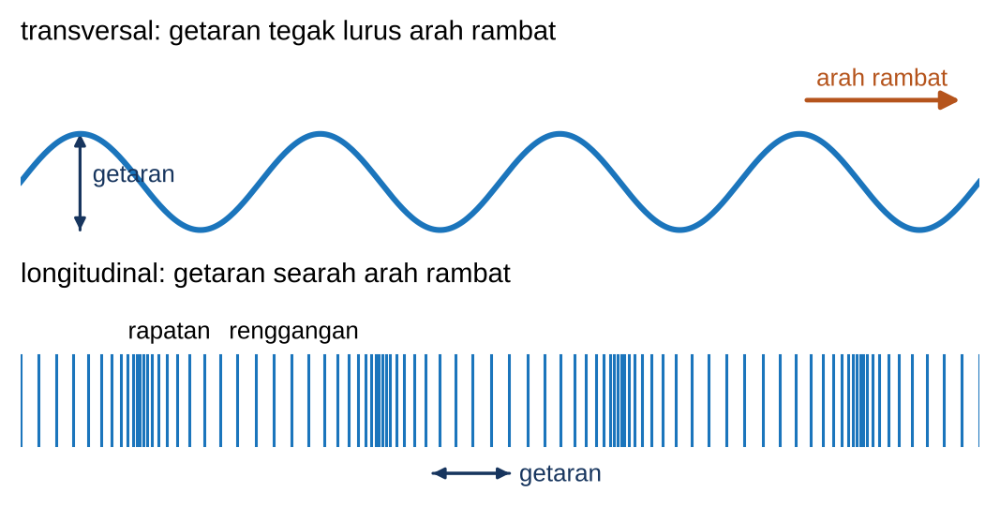
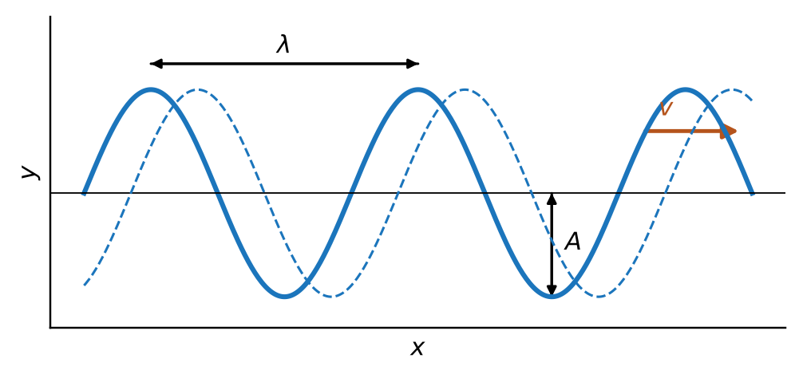
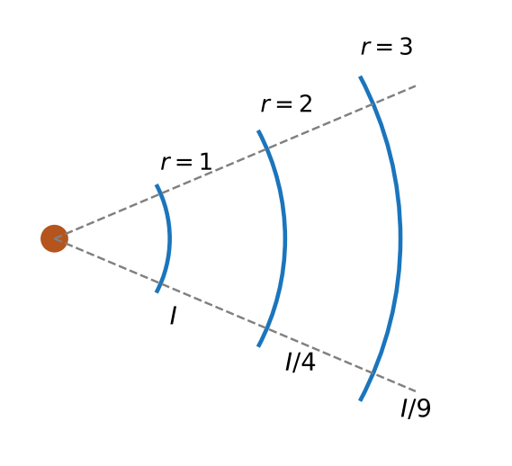
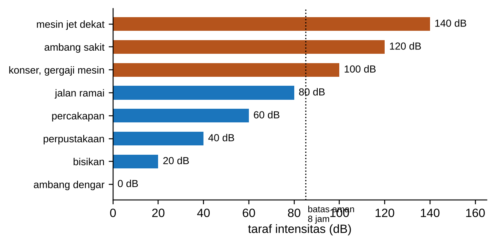
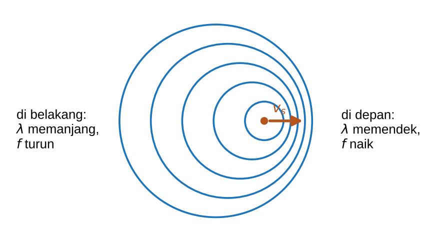

# Bab 9 Gelombang dan Bunyi

Petik senar gitar. Ia menghasilkan satu nada tertentu. Tekan senar itu di salah satu sekat, dan nadanya naik ke nada tertentu yang lain. Senar yang sama tidak pernah mau berbunyi pada nada di antara nada-nada yang diizinkannya. Panjang senar, tegangannya, dan massanya menentukan sederet frekuensi, dan hanya frekuensi-frekuensi itu yang dapat hidup di sana.

Elektron dalam atom berperilaku sama. Atom hidrogen hanya memancarkan cahaya dengan warna-warna tertentu, karena elektronnya hanya boleh memiliki energi-energi tertentu. Selama puluhan tahun hal itu menjadi teka-teki terbesar fisika. Jawabannya, yang ditemukan pada tahun 1920-an, ternyata sama dengan jawaban untuk senar gitar: **gelombang yang terkurung hanya dapat bergetar dengan pola-pola tertentu.** Elektron berperilaku sebagai gelombang, dan atom adalah tempat gelombang itu terkurung.

Bab ini membangun gagasan itu dari awal: apa itu gelombang, seberapa cepat ia merambat, bagaimana dua gelombang bergabung, dan mengapa gelombang yang terkurung menjadi "terkuantisasi". Sepanjang jalan kita membahas bunyi: kenyaringan, nada, dan efek Doppler. Hubungan antara senar gitar dan atom ada di subbab 9.10.

::: {.tujuan}
**Tujuan belajar**

Setelah mempelajari bab ini, kamu mampu:

1. Membedakan gelombang transversal dan longitudinal, dan memakai hubungan $v = f\lambda$.
2. Menuliskan dan membaca fungsi gelombang sinus.
3. Menghitung laju gelombang pada tali dan laju bunyi dalam zat padat, zat cair, dan gas.
4. Menghitung daya, intensitas, dan taraf intensitas bunyi dalam desibel.
5. Menerapkan efek Doppler untuk bunyi dan cahaya.
6. Menerapkan asas superposisi pada interferensi dan pelayangan.
7. Menentukan frekuensi gelombang berdiri pada tali dan dalam kolom udara.
8. Menjelaskan bagaimana gelombang yang terkurung menghasilkan tingkat-tingkat energi yang terpisah-pisah.
:::

::: {.mat}
**Prasyarat**

Dari Bab 8: gerak harmonik sederhana, frekuensi, frekuensi sudut, fase, dan resonansi (subbab 8.1, 8.2, dan 8.9). Dari Bab 4: energi dan daya (subbab 4.3 dan 4.4). Logaritma berbasis 10.
:::

## 9.1 Apa itu gelombang

Jatuhkan kerikil ke kolam yang tenang. Riak menyebar ke segala arah, dan daun yang terapung beberapa meter dari sana ikut naik-turun ketika riak itu lewat. Daunnya tidak ikut pergi bersama riak. Yang berpindah dari kerikil ke daun adalah **energi**, bukan air.

**Gelombang** adalah gangguan yang merambat dan memindahkan energi tanpa memindahkan zat. Tiap bagian zat perantara hanya bergetar di sekitar tempatnya sendiri, lalu meneruskan getaran itu ke tetangganya.

{width=82%}

### Dua cara menggolongkan gelombang

**Menurut arah getarnya** (Gambar 9.1):

- **Transversal**: getaran tegak lurus arah rambat. Contoh: gelombang pada tali, riak air (kira-kira), dan cahaya.
- **Longitudinal**: getaran searah arah rambat. Zat perantara bergantian merapat dan merenggang. Contoh: bunyi.

**Menurut perlu tidaknya zat perantara:**

- **Gelombang mekanik** memerlukan zat perantara: bunyi, gelombang air, gelombang gempa.
- **Gelombang elektromagnetik** tidak memerlukannya dan dapat merambat di ruang hampa: cahaya, gelombang radio, sinar X.

Fluida tidak dapat menahan gaya geser (subbab 6.1), sehingga gelombang transversal tidak dapat merambat di dalam zat cair atau gas. Di udara dan air, bunyi selalu longitudinal. Zat padat dapat meneruskan keduanya. Para ahli gempa memanfaatkan hal ini: gelombang gempa transversal tidak menembus inti luar Bumi, dan dari situ diketahui bahwa inti luar itu cair.

{width=62%}

### Panjang gelombang, frekuensi, dan laju

Jika sumbernya bergetar harmonik, gelombangnya berbentuk sinus (Gambar 9.2). **Panjang gelombang** $\lambda$ adalah jarak antara dua puncak berurutan, atau antara dua titik mana pun yang bergetar sefase. Frekuensi $f$ gelombang sama dengan frekuensi sumbernya.

Dalam satu periode $T$, sumber menyelesaikan satu getaran, dan pola gelombang maju tepat satu panjang gelombang. Jadi lajunya $v = \lambda/T$, atau

$$
\boxed{v = f\lambda} \qquad \text{(9.1)}
$$

Persamaan ini berlaku untuk semua gelombang. Tiga hal yang sering tertukar:

- **Frekuensi** ditentukan oleh **sumber**. Ia tidak berubah ketika gelombang berpindah dari satu zat ke zat lain.
- **Laju** ditentukan oleh **zat perantara** (subbab 9.3), bukan oleh sumbernya. Berteriak lebih keras atau lebih tinggi tidak membuat bunyi sampai lebih cepat.
- **Panjang gelombang** menyesuaikan diri: $\lambda = v/f$.

::: {.contoh}
**Contoh 9.1 · Panjang gelombang berbagai gelombang**

Hitung panjang gelombang (a) nada A, 440 Hz, di udara ($v = 340$ m/s); (b) bunyi terendah dan tertinggi yang terdengar manusia, 20 Hz dan 20 kHz; (c) gelombang ultrasonik 2,0 MHz di jaringan tubuh ($v = 1500$ m/s); (d) cahaya jingga berfrekuensi $5{,}0 \times 10^{14}$ Hz ($c = 3{,}00 \times 10^8$ m/s).

**Penyelesaian.** $\lambda = v/f$.

(a) $\dfrac{340}{440} = 0{,}77$ m. (b) $\dfrac{340}{20} = 17$ m dan $\dfrac{340}{20\,000} = 1{,}7$ cm. (c) $\dfrac{1500}{2{,}0 \times 10^6} = 0{,}75$ mm. (d) $\dfrac{3{,}00 \times 10^8}{5{,}0 \times 10^{14}} = 600$ nm.

**Memahami hasil.** Panjang gelombang bunyi yang terdengar membentang dari ukuran rumah sampai ukuran jari. Itu sebabnya bunyi mudah membelok melewati tepi pintu, sedangkan cahaya, dengan panjang gelombang seperseribu milimeter, membentuk bayangan tajam. Alat USG memakai frekuensi tinggi justru agar panjang gelombangnya pendek: rincian yang lebih kecil daripada panjang gelombang tidak dapat dibedakan.
:::

::: {.contoh}
**Contoh 9.2 · Mencari pusat gempa**

Gempa bumi memancarkan dua jenis gelombang: gelombang P (longitudinal) berlaju 8,0 km/s dan gelombang S (transversal) berlaju 4,5 km/s. Sebuah stasiun mencatat gelombang S tiba 30 s setelah gelombang P. Seberapa jauh pusat gempa itu?

**Penyelesaian.** Kedua gelombang menempuh jarak $d$ yang sama:

$$
\frac{d}{4{,}5} - \frac{d}{8{,}0} = 30\ \text{s} \quad\Longrightarrow\quad d = \frac{30}{0{,}2222 - 0{,}1250} = 309\ \text{km}.
$$

**Memahami hasil.** Satu stasiun hanya memberi jarak, bukan arah. Dengan tiga stasiun, tiga lingkaran jarak berpotongan di satu titik: pusat gempa. Peringatan dini gempa memanfaatkan selisih waktu yang sama: gelombang P yang cepat tetapi lemah tiba lebih dulu dan memberi beberapa detik sebelum gelombang S yang merusak datang.
:::

::: {.contoh}
**Contoh 9.3 · Mengukur laju cahaya dengan oven gelombang mikro**

Dalam oven gelombang mikro yang piring putarnya dilepas, sepotong cokelat meleleh di titik-titik yang berjarak 6,1 cm. Titik-titik itu adalah perut gelombang berdiri, yang berjarak setengah panjang gelombang. Frekuensi oven 2,45 GHz. Berapa laju gelombangnya?

**Penyelesaian.** $\lambda = 2(0{,}061) = 0{,}122$ m.

$$
v = f\lambda = (2{,}45 \times 10^9)(0{,}122) = 3{,}0 \times 10^8\ \text{m/s}.
$$

**Memahami hasil.** Laju cahaya, diukur dengan cokelat dan penggaris. Gelombang mikro adalah gelombang elektromagnetik, sekerabat dengan cahaya, dan merambat dengan laju yang sama. Titik-titik panas dan dingin itu juga alasan oven diberi piring putar.
:::

::: {.kuis}
**Kuis cepat 9.1**

Bunyi berfrekuensi 500 Hz merambat dari udara masuk ke air. Mana yang berubah: frekuensi, laju, atau panjang gelombangnya?
:::

## 9.2 Fungsi gelombang

Gerak harmonik diperikan oleh $y(t)$, fungsi waktu saja. Gelombang memerlukan fungsi dua peubah, $y(x, t)$: simpangan zat perantara **di posisi** $x$ **pada waktu** $t$. Untuk gelombang sinus yang merambat ke arah $+x$:

$$
\boxed{y(x, t) = A\sin(kx - \omega t)} \qquad \text{(9.2)}
$$

Dua tetapan baru muncul:

$$
\boxed{k = \frac{2\pi}{\lambda}, \qquad \omega = 2\pi f = \frac{2\pi}{T}} \qquad \text{(9.3)}
$$

$k$ disebut **bilangan gelombang sudut** (rad/m). Ia berperan terhadap ruang seperti $\omega$ terhadap waktu: $\omega$ menyatakan seberapa cepat fase berubah tiap sekon, dan $k$ seberapa cepat fase berubah tiap meter. Laju gelombang dalam kedua tetapan itu adalah

$$
v = f\lambda = \frac{\omega}{k} . \qquad \text{(9.4)}
$$

Untuk gelombang yang merambat ke arah $-x$, tandanya menjadi plus: $y = A\sin(kx + \omega t)$.

::: {.mat}
**Matematika · Mengapa $kx - \omega t$ berarti merambat ke kanan**

Ikuti satu puncak gelombang. Di puncak, fasenya tetap, misalnya $kx - \omega t = \pi/2$. Ketika $t$ bertambah, $x$ harus bertambah juga agar fasenya tetap: $x = (\pi/2 + \omega t)/k$. Puncak itu bergerak dengan kelajuan $dx/dt = \omega/k$ ke arah $+x$. Dengan tanda plus, $x$ harus **berkurang** ketika $t$ bertambah, jadi puncaknya bergerak ke kiri.
:::

Fungsi gelombang dapat "dipotret" dengan dua cara:

- **Tahan waktunya** ($t$ tetap): $y$ terhadap $x$ adalah foto bentuk gelombang, berulang tiap $\lambda$.
- **Tahan posisinya** ($x$ tetap): $y$ terhadap $t$ adalah gerak harmonik satu titik pada zat perantara, berulang tiap $T$.

### Kelajuan gelombang dan kelajuan zat perantara

Ada dua kelajuan yang sama sekali berbeda. **Laju gelombang** $v = \omega/k$ adalah laju pola merambat. **Kelajuan partikel** zat perantara adalah laju tiap titik bergetar naik-turun:

$$
v_y = \frac{\partial y}{\partial t} = -\omega A\cos(kx - \omega t), \qquad v_{y,\text{maks}} = \omega A . \qquad \text{(9.5)}
$$

Laju gelombang ditentukan zat perantara; kelajuan partikel bergantung pada amplitudo dan frekuensi. Keduanya biasanya sangat berbeda.

::: {.contoh}
**Contoh 9.4 · Membaca fungsi gelombang**

Sebuah gelombang pada tali diperikan oleh $y = 0{,}020\sin(12{,}6x - 25{,}1t)$, dengan $x$ dan $y$ dalam meter dan $t$ dalam sekon. Tentukan (a) amplitudo, panjang gelombang, frekuensi, dan lajunya; (b) arah rambatnya; (c) kelajuan dan percepatan terbesar sebuah titik pada tali.

**Penyelesaian.**

(a) $A = 0{,}020$ m. $\lambda = \dfrac{2\pi}{12{,}6} = 0{,}50$ m. $f = \dfrac{25{,}1}{2\pi} = 4{,}0$ Hz. $v = \dfrac{\omega}{k} = \dfrac{25{,}1}{12{,}6} = 2{,}0$ m/s.

(b) Tanda minus di antara $kx$ dan $\omega t$: gelombang merambat ke arah $+x$.

(c) $v_{y,\text{maks}} = \omega A = (25{,}1)(0{,}020) = 0{,}50$ m/s. $a_\text{maks} = \omega^2A = 12{,}6\ \text{m/s}^2$.

**Memahami hasil.** Gelombang merambat 2,0 m/s, sedangkan titik pada tali paling cepat bergerak 0,50 m/s, dan arahnya melintang. Jika amplitudo dilipatduakan, kelajuan titik menjadi dua kali, tetapi laju gelombangnya tetap.
:::

::: {.contoh}
**Contoh 9.5 · Menyusun fungsi gelombang**

Sebuah gelombang sinus merambat ke arah $+x$ pada tali dengan amplitudo 3,0 cm, panjang gelombang 1,5 m, dan laju 12 m/s. Tuliskan fungsi gelombangnya.

**Penyelesaian.**

$k = \dfrac{2\pi}{1{,}5} = 4{,}19$ rad/m. $f = \dfrac{v}{\lambda} = \dfrac{12}{1{,}5} = 8{,}0$ Hz, sehingga $\omega = 2\pi(8{,}0) = 50{,}3$ rad/s.

$$
y(x, t) = 0{,}030\sin(4{,}19x - 50{,}3t)\ \text{m}.
$$

**Memahami hasil.** $\omega/k = 50{,}3/4{,}19 = 12$ m/s, sesuai. Fungsi ini menganggap $y = 0$ di $x = 0$ pada $t = 0$; keadaan awal lain ditampung dengan menambahkan tetapan fase.
:::

::: {.contoh}
**Contoh 9.6 · Beda fase dua titik**

Gelombang dengan panjang gelombang 1,2 m merambat pada tali. Berapa beda fase getaran dua titik yang berjarak 0,30 m? Berapa jarak dua titik yang getarannya berlawanan fase?

**Penyelesaian.** Beda fase sebanding dengan jarak: $\Delta\phi = k\,\Delta x = \dfrac{2\pi}{\lambda}\Delta x$.

$$
\Delta\phi = 2\pi\,\frac{0{,}30}{1{,}2} = \frac{\pi}{2}\ \text{rad} = 90°.
$$

Berlawanan fase berarti $\Delta\phi = \pi$, yaitu jarak setengah panjang gelombang: 0,60 m.

**Memahami hasil.** Dua titik yang berjarak $\lambda$ sefase; yang berjarak $\lambda/2$ berlawanan fase; yang berjarak $\lambda/4$ berbeda seperempat siklus. Hubungan antara **beda jarak** dan **beda fase** ini menjadi kunci interferensi di subbab 9.7.
:::

::: {.contoh}
**Contoh 9.7 · Potret dan riwayat**

Untuk gelombang $y = 0{,}020\sin(12{,}6x - 25{,}1t)$ (SI): (a) berapa simpangan titik $x = 0{,}10$ m pada $t = 0$? (b) Berapa simpangan titik $x = 0$ pada $t = 0{,}050$ s?

**Penyelesaian.**

(a) $y = 0{,}020\sin(1{,}26) = 0{,}019$ m.

(b) $y = 0{,}020\sin(-1{,}26) = -0{,}019$ m.

**Memahami hasil.** Kedua jawaban sama besar dan berlawanan tanda, dan itu bukan kebetulan. Gelombang ini merambat 2,0 m/s, jadi dalam 0,050 s polanya bergeser 0,10 m. Simpangan di $x = 0$ pada $t = 0{,}050$ s adalah simpangan yang pada $t = 0$ berada di $x = -0{,}10$ m. Begitulah arti "merambat": bentuk yang sama, bergeser.
:::

::: {.kuis}
**Kuis cepat 9.2**

Frekuensi sebuah gelombang pada tali dilipatduakan tanpa mengubah tali maupun tegangannya. Apa yang terjadi pada laju gelombang dan panjang gelombangnya?
:::

## 9.3 Laju gelombang

Laju gelombang mekanik ditentukan oleh dua sifat zat perantaranya: seberapa kuat ia **melawan perubahan bentuk** (kekakuan, tegangan), dan seberapa besar **kelembamannya** (massa jenis). Polanya selalu sama:

$$
v = \sqrt{\frac{\text{sifat pemulih}}{\text{sifat kelembaman}}} .
$$

Bandingkan dengan $\omega = \sqrt{k/m}$ untuk osilator. Zat yang kaku meneruskan gangguan dengan cepat; zat yang berat lamban menanggapinya.

### Gelombang pada tali

Untuk tali bertegangan $F$ dengan massa per satuan panjang $\mu$ (kg/m):

$$
\boxed{v = \sqrt{\frac{F}{\mu}}} \qquad \text{(9.6)}
$$

Senar yang dikencangkan meneruskan gelombang lebih cepat; senar yang tebal dan berat lebih lambat.

::: {.contoh}
**Contoh 9.8 · Gelombang pada tali**

Tali bermassa 5,0 g tiap meter ditegangkan dengan gaya 80 N. (a) Berapa laju gelombang padanya? (b) Jika ujungnya digetarkan sehingga panjang gelombangnya 1,2 m, berapa frekuensinya? (c) Berapa tegangan yang diperlukan agar lajunya 200 m/s?

**Penyelesaian.**

(a) $v = \sqrt{\dfrac{80}{0{,}0050}} = 126$ m/s.

(b) $f = \dfrac{v}{\lambda} = \dfrac{126}{1{,}2} = 105$ Hz.

(c) $F = \mu v^2 = (0{,}0050)(200)^2 = 200$ N.

**Memahami hasil.** Laju sebanding dengan akar tegangan: untuk menaikkan laju 58% (dari 126 ke 200 m/s), tegangan harus naik 2,5 kali. Itulah yang terjadi saat senar gitar disetel: memutar pasak mengubah tegangan, yang mengubah laju gelombang, yang mengubah nada.
:::

### Laju bunyi

Bunyi adalah gelombang rapatan dan renggangan. Untuk fluida, sifat pemulihnya adalah **modulus limbak** $B$, ukuran ketahanan terhadap pemampatan; untuk batang zat padat, **modulus Young** $Y$:

$$
v = \sqrt{\frac{B}{\rho}}\ \ \text{(fluida)}, \qquad v = \sqrt{\frac{Y}{\rho}}\ \ \text{(batang padat)}. \qquad \text{(9.7)}
$$

Untuk gas ideal, modulus limbaknya pada pemampatan yang sangat cepat adalah $B = \gamma p$, dengan $\gamma = C_p/C_V$ perbandingan kapasitas kalor (Bab 11). Dengan $\rho = pM/(RT)$:

$$
\boxed{v = \sqrt{\frac{\gamma RT}{M}}} \qquad \text{(9.8)}
$$

**Laju bunyi dalam gas hanya bergantung pada suhu dan jenis gasnya**, tidak pada tekanan. Untuk udara di sekitar suhu kamar, pendekatan praktisnya

$$
v \approx (331 + 0{,}6\,T_C)\ \text{m/s}, \qquad T_C\ \text{dalam °C}.
$$

| Zat | Laju bunyi (m/s) | Zat | Laju bunyi (m/s) |
|---|---|---|---|
| Udara (0 °C) | 331 | Air (20 °C) | 1480 |
| Udara (20 °C) | 343 | Air laut | 1530 |
| Helium (20 °C) | 1010 | Jaringan lunak | 1540 |
| Hidrogen (20 °C) | 1320 | Kaca | 5600 |
| Karbon dioksida (20 °C) | 267 | Baja | 5100 sampai 5900 |
| Etanol | 1160 | Intan | 12 000 |

Bunyi merambat lebih cepat dalam zat cair dan zat padat daripada dalam gas. Zat-zat itu memang lebih rapat, tetapi jauh lebih sulit dimampatkan, dan kekakuan menang atas kelembaman.

::: {.contoh}
**Contoh 9.9 · Laju bunyi dari rumus**

Hitung laju bunyi dalam (a) udara pada 20 °C ($\gamma = 1{,}40$; $M = 0{,}02896$ kg/mol); (b) helium pada 20 °C ($\gamma = 1{,}667$; $M = 0{,}00400$ kg/mol); (c) air ($B = 2{,}2 \times 10^9$ Pa).

**Penyelesaian.**

(a) $v = \sqrt{\dfrac{(1{,}40)(8{,}314)(293)}{0{,}02896}} = 343$ m/s.

(b) $v = \sqrt{\dfrac{(1{,}667)(8{,}314)(293)}{0{,}00400}} = 1{,}01 \times 10^3$ m/s.

(c) $v = \sqrt{\dfrac{2{,}2 \times 10^9}{1000}} = 1{,}5 \times 10^3$ m/s.

**Memahami hasil.** Bunyi dalam helium tiga kali lebih cepat daripada dalam udara, karena atomnya tujuh kali lebih ringan. Itulah penyebab suara "bebek" setelah menghirup helium: rongga mulut tetap sama ukurannya, tetapi gelombang di dalamnya merambat tiga kali lebih cepat, sehingga frekuensi resonansinya naik (subbab 9.9). Laju bunyi dalam gas selalu sedikit di bawah kelajuan rata-rata molekulnya, karena molekul itulah yang membawa gangguannya.
:::

::: {.contoh}
**Contoh 9.10 · Mengukur $\gamma$ dengan bunyi**

Laju bunyi dalam gas argon ($M = 0{,}03995$ kg/mol) pada 293 K terukur 319 m/s. Berapa $\gamma$ gas itu, dan apa artinya?

**Penyelesaian.**

$$
\gamma = \frac{v^2M}{RT} = \frac{(319)^2(0{,}03995)}{(8{,}314)(293)} = 1{,}67 .
$$

**Memahami hasil.** Nilai $\gamma = 5/3$ adalah ciri gas **monoatomik**: molekulnya hanya menyimpan energi sebagai gerak translasi. Gas dwiatomik seperti N₂ dan O₂ memberi 1,40, dan gas beratom banyak mendekati 1,3 atau kurang (Bab 11). Pada abad ke-19, pengukuran laju bunyi seperti ini menunjukkan bahwa argon dan helium beratom tunggal dan bahwa hidrogen, nitrogen, dan oksigen beratom dua. Stopwatch dan pipa resonansi sudah cukup untuk menyelidiki susunan molekul.
:::

::: {.contoh}
**Contoh 9.11 · Gema dan petir**

(a) Seorang pendaki berteriak ke arah tebing dan mendengar gemanya 2,0 s kemudian. Seberapa jauh tebing itu? (b) Kilat terlihat, dan gunturnya terdengar 5,0 s kemudian. Seberapa jauh petir itu? Gunakan $v = 343$ m/s.

**Penyelesaian.**

(a) Bunyi menempuh jarak pergi-pulang: $d = \dfrac{(343)(2{,}0)}{2} = 343$ m.

(b) Cahaya tiba hampir seketika: $d = (343)(5{,}0) = 1{,}7 \times 10^3$ m.

**Memahami hasil.** Aturan praktis: tiap tiga sekon antara kilat dan guntur berarti satu kilometer. Sonar kapal, pengukur jarak ultrasonik, kelelawar, dan pemeriksaan USG semuanya memakai cara pada (a): kirim denyut, ukur waktu gema, kalikan dengan laju bunyi.
:::

::: {.contoh}
**Contoh 9.12 · Denyut pada tali berbeban**

Tali sepanjang 2,0 m bermassa 0,10 kg tergantung tegak dengan beban 5,0 kg di ujung bawahnya. Berapa lama sebuah denyut merambat dari bawah ke atas? Abaikan berat tali terhadap berat beban.

**Penyelesaian.** $\mu = \dfrac{0{,}10}{2{,}0} = 0{,}050$ kg/m dan $F = (5{,}0)(9{,}80) = 49$ N.

$$
v = \sqrt{\frac{49}{0{,}050}} = 31\ \text{m/s}, \qquad t = \frac{2{,}0}{31} = 0{,}064\ \text{s}.
$$

**Memahami hasil.** Jika berat tali diperhitungkan, tegangan di bagian atas sedikit lebih besar (50 N), dan denyut sedikit bertambah cepat ketika naik. Pada tali berat yang tergantung tanpa beban, pengaruh ini besar: denyut merambat paling lambat di ujung bawah.
:::

::: {.contoh}
**Contoh 9.13 · Sedalam apa sumur itu?**

Sebuah batu dijatuhkan ke dalam sumur, dan bunyi ceburannya terdengar 3,0 s kemudian. Berapa kedalaman sumur itu? ($v = 343$ m/s.)

**Rencana.** Waktu 3,0 s terdiri atas dua bagian: waktu batu jatuh, $t_1$, dan waktu bunyi naik, $t_2$.

**Penyelesaian.** $d = \tfrac12gt_1^2$ dan $d = 343t_2$, dengan $t_1 + t_2 = 3{,}0$ s:

$$
4{,}9t_1^2 = 343(3{,}0 - t_1) \quad\Longrightarrow\quad 4{,}9t_1^2 + 343t_1 - 1029 = 0 .
$$

$$
t_1 = \frac{-343 + \sqrt{343^2 + 4(4{,}9)(1029)}}{9{,}8} = 2{,}88\ \text{s}, \qquad d = 4{,}9(2{,}88)^2 = 41\ \text{m}.
$$

**Memahami hasil.** Jika waktu rambat bunyi diabaikan, hasilnya $4{,}9(3{,}0)^2 = 44$ m, terlalu dalam 8%. Bunyi memerlukan 0,12 s untuk naik, dan pada sumur yang lebih dalam koreksinya makin besar.
:::

::: {.kuis}
**Kuis cepat 9.3**

Pada hari yang panas, apakah bunyi merambat lebih cepat atau lebih lambat daripada pada hari yang dingin? Apakah tekanan udara berpengaruh?
:::

## 9.4 Energi dan intensitas gelombang

Gelombang membawa energi. Tiap bagian zat perantara bergetar harmonik, dan energi osilator sebanding dengan kuadrat amplitudo dan kuadrat frekuensi. Untuk gelombang sinus pada tali, daya rata-rata yang diangkutnya adalah

$$
P = \tfrac12\mu\omega^2A^2v . \qquad \text{(9.9)}
$$

Yang penting adalah kebergantungannya, yang berlaku untuk semua gelombang:

$$
\boxed{\text{daya} \propto A^2f^2}
$$

Amplitudo dua kali berarti energi empat kali.

### Intensitas

Untuk gelombang yang menyebar dalam ruang, seperti bunyi dan cahaya, besaran yang berguna adalah **intensitas**: daya yang menembus tiap satuan luas yang tegak lurus arah rambat.

$$
\boxed{I = \frac PA} \qquad \text{(9.10)}
$$

Satuannya W/m². Sumber kecil yang memancar sama rata ke segala arah menyebarkan dayanya pada permukaan bola seluas $4\pi r^2$:

$$
\boxed{I = \frac{P}{4\pi r^2}} \qquad \text{(9.11)}
$$

{width=48%}

Ini **hukum kuadrat terbalik** (Gambar 9.3). Jarak dua kali berarti intensitas seperempat. Karena intensitas sebanding dengan kuadrat amplitudo, **amplitudo** gelombang bola turun sebanding dengan $1/r$.

::: {.contoh}
**Contoh 9.14 · Daya gelombang pada tali**

Tali pada Contoh 9.8 ($\mu = 5{,}0$ g/m, $v = 126$ m/s) digetarkan dengan frekuensi 60 Hz dan amplitudo 1,0 cm. Berapa daya rata-rata yang diangkut gelombangnya?

**Penyelesaian.** $\omega = 2\pi(60) = 377$ rad/s.

$$
P = \tfrac12(0{,}0050)(377)^2(0{,}010)^2(126) = 4{,}5\ \text{W}.
$$

**Memahami hasil.** Untuk melipatduakan daya dengan frekuensi yang sama, amplitudo cukup dinaikkan 41%. Untuk melipatduakan daya dengan amplitudo yang sama, frekuensi cukup dinaikkan 41%.
:::

::: {.contoh}
**Contoh 9.15 · Intensitas dari pengeras suara**

Sebuah pengeras suara memancarkan daya bunyi 50 W sama rata ke segala arah. Berapa intensitas bunyinya pada jarak (a) 10 m; (b) 20 m?

**Penyelesaian.**

(a) $I = \dfrac{50}{4\pi(10)^2} = 0{,}040\ \text{W/m}^2$.

(b) Jarak dua kali, intensitas seperempat: $0{,}010\ \text{W/m}^2$.

**Memahami hasil.** Daya bunyi 50 W sangat besar: penguat "500 watt" biasanya hanya mengubah beberapa persen daya listriknya menjadi bunyi. Hukum kuadrat terbalik berlaku jika bunyi menyebar bebas. Di dalam ruangan, pantulan dari dinding membuat intensitas turun lebih lambat.
:::

## 9.5 Bunyi: kenyaringan dan desibel

Telinga manusia menanggapi rentang intensitas yang luar biasa lebar. Bunyi paling lemah yang terdengar, pada 1000 Hz, berintensitas sekitar $10^{-12}\ \text{W/m}^2$. Bunyi yang mulai terasa sakit berintensitas sekitar $1\ \text{W/m}^2$, sejuta juta kali lebih besar. Telinga juga tidak merasakan intensitas secara sebanding: bunyi yang intensitasnya sepuluh kali lipat hanya terasa kira-kira dua kali lebih nyaring. Skala yang cocok untuk keduanya adalah skala **logaritma**.

### Taraf intensitas

$$
\boxed{\beta = 10\log\frac{I}{I_0}, \qquad I_0 = 1{,}0 \times 10^{-12}\ \text{W/m}^2} \qquad \text{(9.12)}
$$

$\beta$ disebut **taraf intensitas**, dengan satuan **desibel** (dB). $I_0$ adalah ambang pendengaran, yang ditetapkan sebagai 0 dB.

{width=70%}

::: {.mat}
**Matematika · Logaritma dan desibel**

$\log x$ adalah pangkat yang harus diberikan kepada 10 untuk memperoleh $x$: $\log 100 = 2$, $\log 2 = 0{,}301$. Sifat yang dipakai: $\log(ab) = \log a + \log b$ dan $\log(a/b) = \log a - \log b$. Akibatnya, **perkalian** intensitas menjadi **penjumlahan** desibel:

| Intensitas dikalikan | Taraf bertambah |
|---|---|
| 2 | 3 dB |
| 4 | 6 dB |
| 10 | 10 dB |
| 100 | 20 dB |
| 1000 | 30 dB |

Selisih taraf antara dua bunyi: $\beta_2 - \beta_1 = 10\log\dfrac{I_2}{I_1}$. Kebalikannya: $I = I_0 \times 10^{\beta/10}$.
:::

Dua akibat yang sering mengejutkan:

- **Desibel tidak dijumlahkan.** Dua mesin yang masing-masing 80 dB bersama-sama menghasilkan 83 dB, bukan 160 dB. Yang dijumlahkan adalah intensitasnya.
- **Jarak dua kali berarti turun 6 dB**, karena intensitasnya menjadi seperempat.

::: {.contoh}
**Contoh 9.16 · Dari intensitas ke desibel dan sebaliknya**

(a) Berapa taraf intensitas bunyi berintensitas $1{,}0 \times 10^{-5}\ \text{W/m}^2$? (b) Berapa intensitas bunyi bertaraf 120 dB? (c) Berapa taraf intensitas pada jarak 10 m dan 20 m dari pengeras suara di Contoh 9.15?

**Penyelesaian.**

(a) $\beta = 10\log\dfrac{1{,}0 \times 10^{-5}}{1{,}0 \times 10^{-12}} = 10\log 10^7 = 70$ dB.

(b) $I = 10^{-12} \times 10^{12} = 1{,}0\ \text{W/m}^2$.

(c) Pada 10 m: $\beta = 10\log\dfrac{0{,}040}{10^{-12}} = 106$ dB. Pada 20 m, intensitasnya seperempat, jadi 6 dB lebih rendah: 100 dB.

**Memahami hasil.** Pada 10 m dari pengeras suara 50 W, tarafnya sudah di atas batas aman. Untuk turun ke 85 dB, selisih 21 dB, intensitas harus turun 126 kali, yaitu jarak $\sqrt{126} = 11$ kali lebih jauh: sekitar 110 m.
:::

::: {.contoh}
**Contoh 9.17 · Seratus biola**

Sebuah biola menghasilkan taraf intensitas 70 dB di tempat duduk penonton. Berapa taraf intensitasnya jika seratus biola yang sama dimainkan bersama?

**Penyelesaian.** Intensitas seratus kali lebih besar: tambahannya $10\log 100 = 20$ dB. Tarafnya 90 dB.

**Memahami hasil.** Seratus biola tidak seratus kali lebih nyaring bagi telinga; rasanya kira-kira empat kali lebih nyaring. Sebaliknya, untuk meredam kebisingan 20 dB, 99% energi bunyinya harus dihilangkan. Itu sebabnya peredaman bunyi sulit, dan sebabnya penyumbat telinga yang "hanya" meredam 25 dB sudah sangat berarti.
:::

### Seberapa kecil gelombang bunyi itu

Bunyi adalah getaran tekanan di sekitar tekanan atmosfer. Intensitasnya berkaitan dengan amplitudo tekanan $p_0$ dan amplitudo simpangan molekul $s_0$:

$$
I = \frac{p_0^2}{2\rho v} = \tfrac12\rho v\,\omega^2s_0^2 . \qquad \text{(9.13)}
$$

::: {.contoh}
**Contoh 9.18 · Kepekaan telinga**

Untuk bunyi 1000 Hz di udara ($\rho = 1{,}2\ \text{kg/m}^3$, $v = 343$ m/s), hitung amplitudo tekanan dan amplitudo simpangan molekul udara (a) di ambang pendengaran, $10^{-12}\ \text{W/m}^2$; (b) di ambang sakit, $1{,}0\ \text{W/m}^2$.

**Penyelesaian.** $p_0 = \sqrt{2\rho vI}$ dan $s_0 = \dfrac{p_0}{\rho v\omega}$, dengan $\rho v = 412$ dan $\omega = 6283$ rad/s.

(a) $p_0 = \sqrt{2(412)(10^{-12})} = 2{,}9 \times 10^{-5}$ Pa. $s_0 = \dfrac{2{,}9 \times 10^{-5}}{(412)(6283)} = 1{,}1 \times 10^{-11}$ m.

(b) $p_0 = \sqrt{2(412)(1{,}0)} = 29$ Pa. $s_0 = 1{,}1 \times 10^{-5}$ m.

**Memahami hasil.** Di ambang pendengaran, molekul udara bergeser hanya 0,011 nm, sepersepuluh ukuran atom, dan tekanannya berubah kurang dari sepersemiliar atmosfer. Telinga yang sedikit lebih peka lagi akan mendengar desis tumbukan acak molekul udara pada gendangnya. Bahkan di ambang sakit, tekanan hanya berayun 0,03% dari tekanan atmosfer. Rentang amplitudo tekanan yang ditangani telinga adalah sejuta kali.
:::

### Nada dan warna bunyi

| Yang kita dengar | Besaran fisikanya |
|---|---|
| **kenyaringan** | intensitas (dan kepekaan telinga pada frekuensi itu) |
| **tinggi nada** | frekuensi |
| **warna bunyi** | campuran harmonik, yaitu bentuk gelombangnya |

Manusia mendengar kira-kira dari 20 Hz sampai 20 kHz, dan batas atas itu turun dengan usia. Di bawah 20 Hz disebut **infrasonik**; di atas 20 kHz disebut **ultrasonik**. Nada yang frekuensinya dua kali nada lain terdengar "sama tetapi lebih tinggi"; selang itu disebut satu **oktaf**. Piano dan seruling yang memainkan nada yang sama terdengar berbeda karena campuran harmoniknya berbeda (subbab 9.8).

::: {.contoh}
**Contoh 9.19 · Berapa lama boleh terpapar bising?**

Pedoman keselamatan kerja mengizinkan paparan 85 dB selama 8 jam sehari, dan waktu itu dipotong setengah untuk tiap kenaikan 3 dB. Berapa lama paparan yang diizinkan pada 100 dB?

**Penyelesaian.** Selisihnya 15 dB, yaitu lima kali 3 dB. Waktunya dipotong setengah lima kali:

$$
t = \frac{8\ \text{jam}}{2^5} = \frac{480\ \text{menit}}{32} = 15\ \text{menit}.
$$

**Memahami hasil.** Tiap 3 dB berarti intensitas dua kali, jadi aturan ini menjaga **energi bunyi total** yang diterima telinga tetap sama. Konser pada 100 dB melampaui jatah harian dalam seperempat jam. Kerusakan pendengaran karena bising bersifat tetap: sel-sel rambut di telinga dalam tidak tumbuh kembali.
:::

::: {.contoh}
**Contoh 9.20 · Dinding peredam**

Sebuah dinding meredam bunyi 30 dB. Di satu sisi, tarafnya 95 dB. (a) Berapa taraf di sisi lain? (b) Berapa bagian energi bunyi yang lolos?

**Penyelesaian.**

(a) $95 - 30 = 65$ dB.

(b) Turun 30 dB berarti intensitas dibagi $10^3$. Yang lolos 0,1%.

**Memahami hasil.** Dinding yang menahan 99,9% energi bunyi masih membiarkan percakapan terdengar. Itu akibat skala logaritma telinga. Sebaliknya, celah kecil yang membocorkan 1% energi bunyi sudah membatasi peredaman pada 20 dB, sebaik apa pun dindingnya. Dalam peredaman bunyi, celah lebih menentukan daripada tebal dinding.
:::

::: {.kuis}
**Kuis cepat 9.4**

Kamu menjauh dari sebuah sumber bunyi sampai jaraknya sepuluh kali semula. Berapa desibel taraf intensitasnya turun?
:::

## 9.6 Efek Doppler

Sirene ambulans terdengar tinggi ketika mendekat dan mendadak turun ketika lewat. Frekuensi sirenenya tidak berubah. Yang berubah adalah frekuensi yang **sampai** ke telinga, karena sumbernya bergerak. Gejala ini disebut **efek Doppler**.

{width=62%}

### Sumber bergerak, pengamat bergerak

**Sumber bergerak** (Gambar 9.5). Sumber memancarkan satu muka gelombang tiap periode, tetapi di antara dua pancaran ia sudah maju sejauh $v_sT$. Di depannya panjang gelombang memendek menjadi $\lambda - v_sT$; di belakangnya memanjang. Laju bunyi di udara tidak berubah, jadi frekuensi yang terdengar berubah.

**Pengamat bergerak.** Panjang gelombang di udara tidak berubah, tetapi pengamat yang mendekat menjumpai muka gelombang lebih sering: laju bunyi relatif terhadapnya menjadi $v + v_o$.

Kedua pengaruh itu terangkum dalam satu rumus:

$$
\boxed{f' = f\,\frac{v \pm v_o}{v \mp v_s}} \qquad \text{(9.14)}
$$

dengan $v$ laju bunyi, $v_o$ kelajuan pengamat, dan $v_s$ kelajuan sumber, semuanya terhadap udara. Aturan tandanya: **tanda atas untuk saling mendekat, tanda bawah untuk saling menjauh.** Cara memeriksa yang paling aman: mendekat selalu menaikkan frekuensi, menjauh selalu menurunkannya.

::: {.contoh}
**Contoh 9.21 · Sirene ambulans**

Sirene ambulans berfrekuensi 700 Hz. Laju bunyi 343 m/s. Berapa frekuensi yang terdengar jika (a) ambulans mendekati pengamat diam dengan 30 m/s; (b) ambulans menjauh dengan 30 m/s; (c) ambulans diam dan pengamat mendekatinya dengan 30 m/s?

**Penyelesaian.**

(a) $f' = 700\,\dfrac{343}{343 - 30} = 767$ Hz.

(b) $f' = 700\,\dfrac{343}{343 + 30} = 644$ Hz.

(c) $f' = 700\,\dfrac{343 + 30}{343} = 761$ Hz.

**Memahami hasil.** Ketika ambulans lewat, nadanya jatuh dari 767 ke 644 Hz, turun 16%, kira-kira tiga nada. Hasil (a) dan (c) berbeda walaupun kelajuan relatifnya sama. Untuk bunyi, **siapa** yang bergerak terhadap udara itu penting, karena udara adalah zat perantaranya. Untuk cahaya, yang tidak memerlukan zat perantara, hanya kelajuan relatif yang berarti.
:::

### Pantulan dari benda bergerak

Jika gelombang dipantulkan benda yang bergerak, pergeseran Doppler terjadi **dua kali**: benda itu menerima gelombang sebagai pengamat yang bergerak, lalu memancarkannya kembali sebagai sumber yang bergerak. Untuk kelajuan $u$ yang jauh lebih kecil daripada laju gelombang $v$:

$$
\Delta f \approx \frac{2u}{v}\,f . \qquad \text{(9.15)}
$$

::: {.contoh}
**Contoh 9.22 · Radar kelajuan dan USG Doppler**

(a) Radar polisi memancarkan gelombang mikro 24 GHz ke mobil yang mendekat dengan 25 m/s. Berapa pergeseran frekuensi gelombang pantulnya? ($c = 3{,}00 \times 10^8$ m/s.) (b) Alat USG memancarkan gelombang 5,0 MHz ke pembuluh darah, tempat darah mengalir 0,50 m/s searah berkas. Laju bunyi di jaringan 1540 m/s. Berapa pergeseran frekuensinya?

**Penyelesaian.**

(a) $\Delta f = \dfrac{2(25)}{3{,}00 \times 10^8}(24 \times 10^9) = 4{,}0 \times 10^3$ Hz.

(b) $\Delta f = \dfrac{2(0{,}50)}{1540}(5{,}0 \times 10^6) = 3{,}2 \times 10^3$ Hz.

**Memahami hasil.** Kedua pergeseran itu beberapa kilohertz, dalam rentang pendengaran. Alat USG Doppler memang memperdengarkannya langsung lewat pengeras suara: desir yang terdengar saat memeriksa aliran darah atau detak jantung janin adalah frekuensi Doppler itu sendiri. Pergeseran 4 kHz dari 24 GHz hanya dua bagian per sepuluh juta, tetapi mudah diukur dengan mencampurkan gelombang pantul dengan gelombang asalnya dan mendengarkan pelayangannya (subbab 9.7).
:::

### Efek Doppler untuk cahaya

Cahaya juga mengalami efek Doppler. Untuk kelajuan $u$ yang jauh lebih kecil daripada $c$:

$$
\frac{\Delta\lambda}{\lambda} \approx \frac uc . \qquad \text{(9.16)}
$$

Sumber yang menjauh memancarkan cahaya yang panjang gelombangnya membesar, bergeser ke arah merah (**pergeseran merah**). Sumber yang mendekat bergeser ke arah biru.

::: {.contoh}
**Contoh 9.23 · Pergeseran merah**

Garis merah hidrogen, yang di laboratorium berada di 656,3 nm, teramati pada 662,9 nm dalam cahaya sebuah galaksi. Seberapa cepat galaksi itu menjauh?

**Penyelesaian.**

$$
u = c\,\frac{\Delta\lambda}{\lambda} = (3{,}00 \times 10^8)\frac{662{,}9 - 656{,}3}{656{,}3} = 3{,}0 \times 10^6\ \text{m/s}.
$$

**Memahami hasil.** Galaksi itu menjauh dengan 1% laju cahaya. Hampir semua galaksi menunjukkan pergeseran merah, dan makin jauh galaksinya makin besar pergeserannya. Itulah bukti bahwa alam semesta memuai. Di laboratorium, efek yang sama melebarkan garis spektrum gas: molekul-molekul yang bergerak acak mendekati dan menjauhi detektor menggeser frekuensinya sedikit ke atas dan ke bawah. **Pelebaran Doppler** ini bertambah dengan suhu, dan menjadi cara mengukur suhu gas dan plasma dari jauh.
:::

### Lebih cepat daripada bunyi

Jika sumber bergerak lebih cepat daripada laju bunyi, ia mendahului muka-muka gelombangnya sendiri. Muka-muka gelombang itu menumpuk pada sebuah kerucut di belakang sumber, membentuk **gelombang kejut**. Setengah sudut puncak kerucut memenuhi

$$
\sin\theta = \frac{v}{v_s} = \frac{1}{\text{bilangan Mach}} . \qquad \text{(9.17)}
$$

Ketika kerucut itu menyapu pengamat, terdengar dentuman sonik. Lecutan cambuk adalah dentuman sonik kecil: ujung cambuk bergerak melebihi laju bunyi.

::: {.contoh}
**Contoh 9.24 · Pesawat supersonik**

Sebuah pesawat terbang 700 m/s di udara tempat laju bunyinya 343 m/s. Berapa bilangan Mach-nya dan setengah sudut kerucut gelombang kejutnya?

**Penyelesaian.** Bilangan Mach: $\dfrac{700}{343} = 2{,}0$. $\sin\theta = \dfrac{343}{700} = 0{,}49$, sehingga $\theta = 29°$.

**Memahami hasil.** Makin cepat pesawatnya, makin runcing kerucutnya. Pengamat di tanah tidak mendengar apa-apa sampai kerucut itu lewat, yaitu setelah pesawatnya sendiri sudah jauh melintas di atas kepala.
:::

::: {.contoh}
**Contoh 9.25 · Kelelawar**

Seekor kelelawar terbang 8,0 m/s menuju dinding gua sambil memancarkan ultrasonik 80,0 kHz. Berapa frekuensi gema yang didengarnya? ($v = 343$ m/s.)

**Penyelesaian.** Dua pergeseran berurutan. Dinding menerima bunyi dari sumber yang mendekat: $f_1 = f\,\dfrac{v}{v - u}$. Dinding lalu menjadi sumber diam, dan kelelawar menjadi pengamat yang mendekat: $f_2 = f_1\,\dfrac{v + u}{v}$.

$$
f_2 = f\,\frac{v + u}{v - u} = 80{,}0\,\frac{351}{335} = 83{,}8\ \text{kHz}.
$$

**Memahami hasil.** Pergeserannya 3,8 kHz. Rumus pendekatan $\Delta f \approx 2uf/v$ memberi 3,7 kHz, hampir sama. Dari pergeseran ini kelelawar mengetahui kelajuannya terhadap dinding, dan dari pergeseran gema seekor serangga, kelajuan serangga itu. Beberapa jenis kelelawar bahkan menurunkan frekuensi pancarannya saat terbang, agar gemanya tetap jatuh di frekuensi tempat telinganya paling peka.
:::

::: {.contoh}
**Contoh 9.26 · Pelebaran Doppler garis spektrum**

Atom natrium (23,0 u) dalam uap pada 500 K bergerak acak. Komponen kecepatannya sepanjang garis pandang berorde $\sqrt{k_BT/m}$. Perkirakan pelebaran garis kuning natrium, 589 nm, akibat efek Doppler. ($k_B = 1{,}381 \times 10^{-23}$ J/K; $1\ \text{u} = 1{,}6605 \times 10^{-27}$ kg.)

**Penyelesaian.**

$$
u = \sqrt{\frac{(1{,}381 \times 10^{-23})(500)}{(23{,}0)(1{,}6605 \times 10^{-27})}} = 425\ \text{m/s}.
$$

$$
\Delta\lambda = \lambda\,\frac uc = (589)\frac{425}{3{,}00 \times 10^8} = 8{,}3 \times 10^{-4}\ \text{nm}.
$$

**Memahami hasil.** Garisnya melebar kira-kira $\pm0{,}001$ nm, sekitar dua bagian per sejuta. Kecil, tetapi inilah yang biasanya membatasi ketajaman garis spektrum gas. Karena lebarnya sebanding dengan $\sqrt{T/m}$, lebar garis menjadi termometer: suhu nyala api, plasma, dan atmosfer bintang diukur dengan cara ini.
:::

::: {.kuis}
**Kuis cepat 9.5**

Kamu berdiri diam, dan sumber bunyi bergerak **mengelilingimu** pada lingkaran dengan kelajuan tetap. Apakah kamu mendengar pergeseran Doppler?
:::
