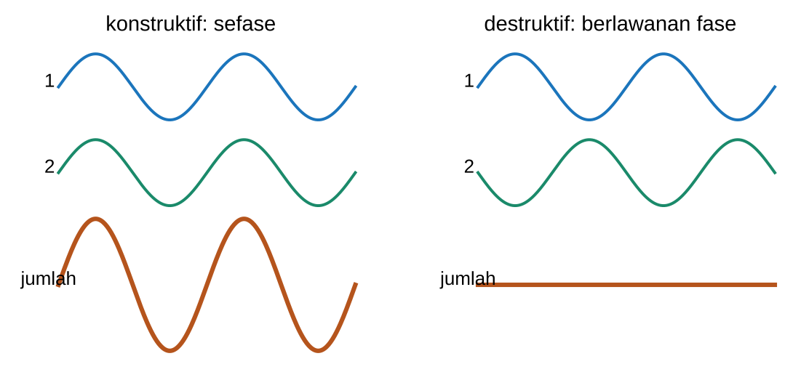
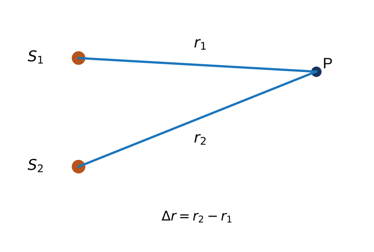
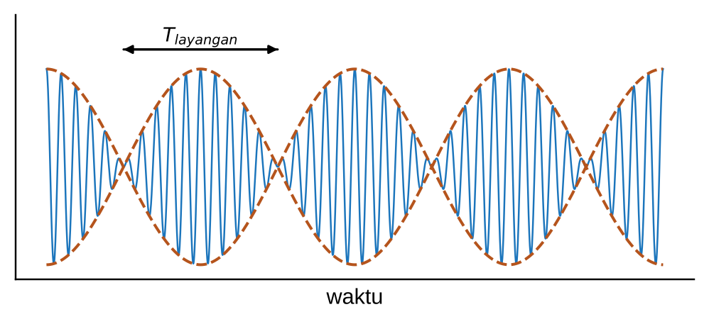
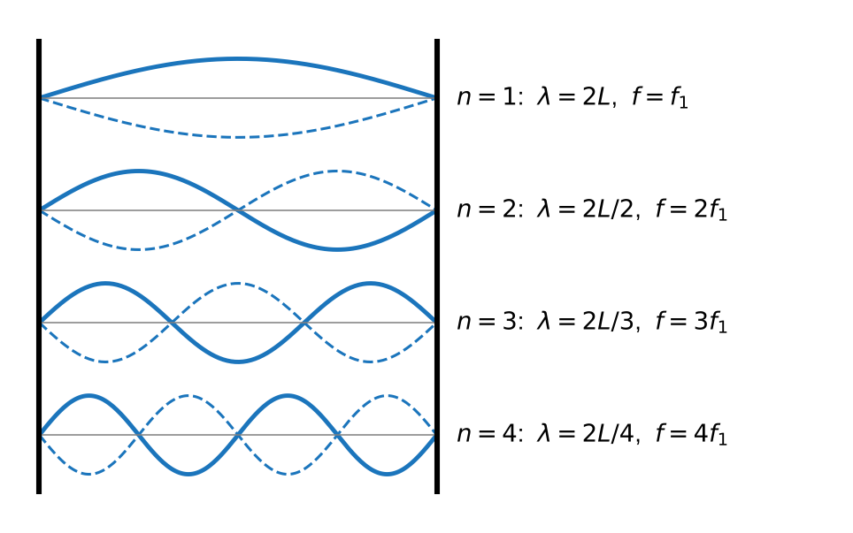
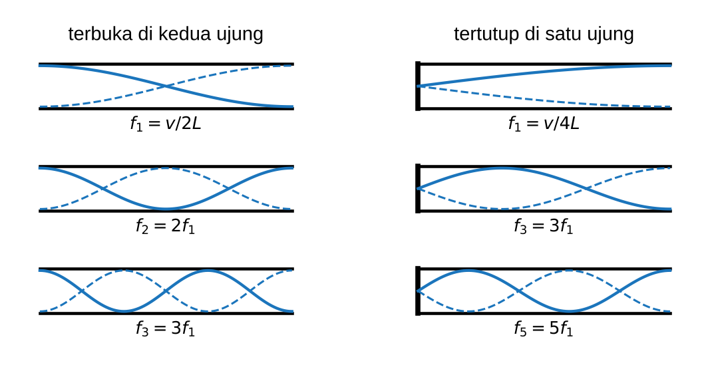
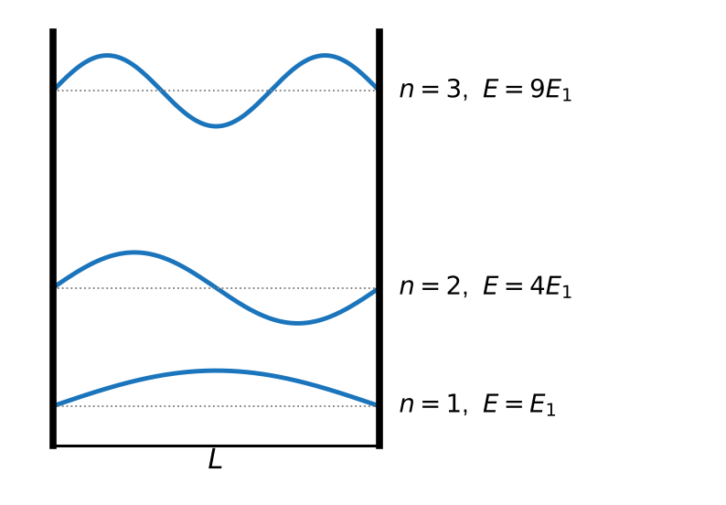
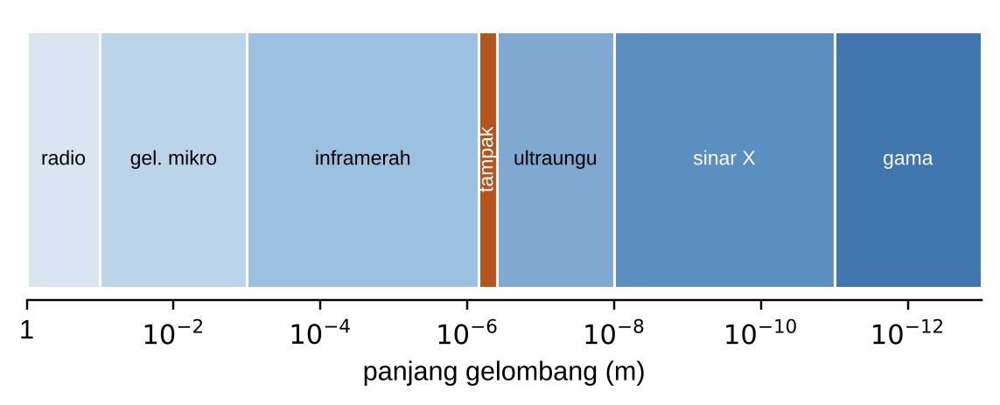
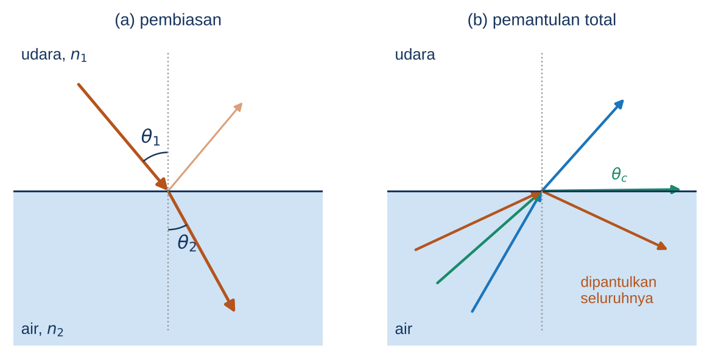
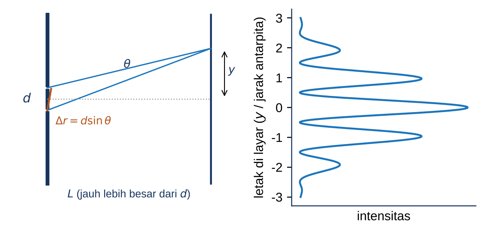
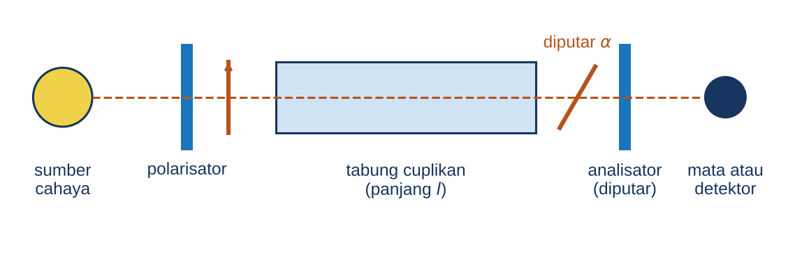

## 9.7 Superposisi dan interferensi

Dua bola yang bertemu saling memantul. Dua gelombang yang bertemu berperilaku lain sama sekali: mereka saling **menembus**, dan setelah berpapasan masing-masing melanjutkan perjalanan tanpa berubah. Di tempat mereka bertumpang-tindih, simpangannya dijumlahkan.

::: {.inti}
**Asas superposisi.** Jika dua gelombang atau lebih tiba di satu titik, simpangan total di titik itu adalah jumlah simpangan masing-masing gelombang.
:::

{width=82%}

Akibat penjumlahan itu disebut **interferensi** (Gambar 9.6):

- **Interferensi konstruktif**: kedua gelombang sefase, puncak bertemu puncak. Amplitudonya berjumlah.
- **Interferensi destruktif**: kedua gelombang berlawanan fase, puncak bertemu lembah. Amplitudonya saling mengurangi; jika sama besar, hasilnya nol.

Untuk dua gelombang beramplitudo $A$ dengan beda fase $\phi$, amplitudo gabungannya

$$
A_\text{total} = 2A\cos\frac{\phi}{2} . \qquad \text{(9.18)}
$$

Energi tidak hilang pada interferensi destruktif. Energi itu hanya **berpindah tempat**: yang lenyap di titik-titik destruktif muncul sebagai kelebihan di titik-titik konstruktif.

{width=50%}

### Interferensi dua sumber

Dua sumber yang bergetar sefase memancarkan gelombang berpanjang gelombang $\lambda$ (Gambar 9.7). Di titik P, kedua gelombang telah menempuh jarak berbeda, $r_1$ dan $r_2$. **Beda lintasan** $\Delta r = |r_2 - r_1|$ menentukan beda fasenya:

$$
\boxed{\Delta r = n\lambda\ \ \text{(konstruktif)}, \qquad \Delta r = \big(n + \tfrac12\big)\lambda\ \ \text{(destruktif)}, \qquad n = 0, 1, 2, \dots} \qquad \text{(9.19)}
$$

Syarat ini berlaku untuk semua gelombang: bunyi, riak air, cahaya, dan gelombang elektron. Di kimia, syarat yang sama menjadi **hukum Bragg** untuk difraksi sinar X oleh kristal, cara utama menentukan struktur molekul dan zat padat.

::: {.contoh}
**Contoh 9.27 · Titik nyaring dan titik senyap**

Dua pengeras suara yang sefase berjarak 4,0 m dan 4,5 m dari seorang pendengar. Laju bunyi 343 m/s. Apa yang didengar jika frekuensinya (a) 686 Hz; (b) 343 Hz?

**Penyelesaian.** Beda lintasan: 0,50 m.

(a) $\lambda = \dfrac{343}{686} = 0{,}50$ m. Beda lintasan tepat $\lambda$: konstruktif, bunyi nyaring.

(b) $\lambda = 1{,}00$ m. Beda lintasan $\tfrac12\lambda$: destruktif, bunyi sangat lemah.

**Memahami hasil.** Di ruangan dengan dua pengeras suara, nada tertentu terdengar lemah di tempat tertentu dan nyaring beberapa langkah dari sana. Peredam bising aktif pada penyuara telinga memakai interferensi destruktif dengan sengaja: mikrofon menangkap bising, dan pengeras suara memancarkan gelombang yang persis berlawanan fase.
:::

::: {.contoh}
**Contoh 9.28 · Amplitudo dan intensitas gabungan**

Dua gelombang beramplitudo sama, masing-masing berintensitas $I$, tiba di satu titik. Berapa intensitas gabungannya jika beda fasenya (a) 0°; (b) 90°; (c) 120°; (d) 180°?

**Penyelesaian.** $A_\text{total} = 2A\cos(\phi/2)$, dan intensitas sebanding dengan kuadrat amplitudo: $I_\text{total} = 4I\cos^2(\phi/2)$.

| Beda fase | $A_\text{total}$ | $I_\text{total}$ |
|---|---|---|
| 0° | $2A$ | $4I$ |
| 90° | $1{,}41A$ | $2I$ |
| 120° | $A$ | $I$ |
| 180° | 0 | 0 |

**Memahami hasil.** Di titik konstruktif intensitasnya **empat** kali, bukan dua kali. Rata-rata atas semua beda fase, hasilnya $2I$, seperti seharusnya menurut kekekalan energi. Dua sumber yang tidak saling terkait fasenya, seperti dua orang yang berbicara, memberi tepat rata-rata itu: intensitasnya dijumlahkan biasa.
:::

### Pelayangan

{width=70%}

Dua bunyi dengan frekuensi sedikit berbeda, $f_1$ dan $f_2$, bergantian sefase dan berlawanan fase. Yang terdengar adalah satu nada dengan kenyaringan yang naik-turun (Gambar 9.8). Gejala ini disebut **pelayangan**, dan frekuensinya

$$
\boxed{f_\text{layangan} = |f_1 - f_2|} \qquad \text{(9.20)}
$$

::: {.contoh}
**Contoh 9.29 · Menyetel dengan pelayangan**

Sebuah garpu tala 440 Hz dibunyikan bersama senar gitar, dan terdengar 3 layangan tiap sekon. (a) Berapa frekuensi senar itu? (b) Ketika senar dikencangkan sedikit, layangannya menjadi 5 tiap sekon. Berapa frekuensi senar semula?

**Penyelesaian.**

(a) $|f - 440| = 3$: senar bergetar 437 Hz atau 443 Hz. Pelayangan saja tidak membedakan keduanya.

(b) Mengencangkan senar menaikkan frekuensinya. Jika frekuensi layangan **bertambah**, senar itu makin jauh dari 440 Hz, jadi semula ia sudah di atasnya: 443 Hz.

**Memahami hasil.** Penyetel piano bekerja begini: senar diatur sampai layangannya melambat dan hilang. Telinga dapat mendengar layangan sepersekian hertz, sehingga dua frekuensi dapat disamakan sampai seperseribu. Mencampur dua frekuensi untuk memperoleh selisihnya juga dipakai pada radar Doppler (Contoh 9.22) dan penerima radio.
:::

::: {.contoh}
**Contoh 9.30 · Mencari titik senyap**

Dua pengeras suara sefase terpisah 2,0 m. Seorang pendengar berdiri 4,0 m tepat di depan salah satunya. Berapa frekuensi terendah yang (a) hampir tidak terdengar di tempatnya; (b) terdengar paling nyaring? ($v = 343$ m/s.)

**Penyelesaian.** Jarak ke pengeras suara pertama 4,0 m; ke yang kedua $\sqrt{4{,}0^2 + 2{,}0^2} = 4{,}47$ m. Beda lintasan: 0,47 m.

(a) Destruktif: $\Delta r = \tfrac12\lambda$, sehingga $\lambda = 0{,}94$ m dan $f = \dfrac{343}{0{,}94} = 363$ Hz.

(b) Konstruktif: $\Delta r = \lambda$, sehingga $f = \dfrac{343}{0{,}47} = 727$ Hz.

**Memahami hasil.** Frekuensi destruktif berikutnya adalah 1090 Hz ($\Delta r = \tfrac32\lambda$). Pendengar itu kehilangan nada-nada tertentu dan mendapat nada lain berlebih. Bergeser setengah meter saja mengubah semuanya, karena beda lintasannya berubah.
:::

::: {.contoh}
**Contoh 9.31 · Peredam bunyi dengan pipa cabang**

Dengung 120 Hz dari sebuah mesin merambat di dalam saluran udara. Sebuah pipa cabang buntu dipasang di sisi saluran. Gelombang yang masuk ke cabang, memantul di ujung buntunya, dan kembali ke saluran harus berlawanan fase dengan gelombang yang lewat. Berapa panjang pipa cabang itu?

**Penyelesaian.** Lintasan tambahan pergi-pulang $2L$ harus sama dengan setengah panjang gelombang: $2L = \tfrac12\lambda$, sehingga $L = \tfrac14\lambda$.

$$
\lambda = \frac{343}{120} = 2{,}86\ \text{m}, \qquad L = 0{,}71\ \text{m}.
$$

**Memahami hasil.** Peredam seperempat panjang gelombang ini hanya mematikan satu frekuensi dan kelipatan ganjilnya. Knalpot kendaraan memakai beberapa rongga dan pipa dengan ukuran berbeda untuk menutup rentang frekuensi yang lebar. Lapisan antipantul pada lensa kacamata bekerja dengan asas yang sama untuk cahaya.
:::

::: {.kuis}
**Kuis cepat 9.6**

Di sebuah titik, dua gelombang bunyi berinterferensi destruktif sempurna sehingga tidak terdengar apa-apa. Ke mana energinya?
:::

## 9.8 Gelombang berdiri pada tali

### Pemantulan

Gelombang yang tiba di ujung tali dipantulkan. Di **ujung terikat**, gelombang pantul terbalik: puncak kembali sebagai lembah. Di **ujung bebas**, gelombang pantul tidak terbalik.

### Dua gelombang berlawanan arah

Pada tali yang kedua ujungnya terikat, gelombang terus memantul bolak-balik dan bertumpang-tindih dengan dirinya sendiri. Jumlah dua gelombang sinus yang sama tetapi berlawanan arah adalah

$$
y = A\sin(kx - \omega t) + A\sin(kx + \omega t) = 2A\sin(kx)\cos(\omega t). \qquad \text{(9.21)}
$$

Hasilnya **tidak merambat**. Peubah ruang dan waktu terpisah: tiap titik bergetar harmonik dengan amplitudo $2A\sin(kx)$ yang bergantung pada letaknya. Pola ini disebut **gelombang berdiri**.

- **Simpul**: titik yang selalu diam, tempat $\sin(kx) = 0$. Jarak dua simpul berurutan adalah $\tfrac12\lambda$.
- **Perut**: titik yang bergetar dengan amplitudo terbesar, di tengah-tengah antara dua simpul.

{width=74%}

### Frekuensi yang diizinkan

Kedua ujung tali harus berupa simpul. Jadi panjang tali $L$ harus memuat setengah panjang gelombang sebanyak bilangan bulat (Gambar 9.9):

$$
L = n\,\frac{\lambda}{2} \quad\Longrightarrow\quad \boxed{\lambda_n = \frac{2L}{n}, \qquad f_n = \frac{nv}{2L} = \frac{n}{2L}\sqrt{\frac{F}{\mu}}, \qquad n = 1, 2, 3, \dots} \qquad \text{(9.22)}
$$

Inilah yang dijanjikan di pembuka bab. **Syarat batas** di kedua ujung hanya mengizinkan panjang gelombang tertentu, sehingga hanya frekuensi tertentu yang dapat hidup. Gelombang lain saling meniadakan setelah beberapa kali pantulan.

- $f_1 = v/(2L)$ adalah **frekuensi dasar**, nada yang kita dengar sebagai tinggi nada senar.
- $f_2 = 2f_1$, $f_3 = 3f_1$, dan seterusnya adalah **harmonik**. Senar yang dipetik bergetar dengan banyak harmonik sekaligus, dan campurannya menentukan warna bunyinya.

Rumus (9.22) merangkum cara kerja semua alat musik bersenar. Nada naik jika senar **dipendekkan** (menekan sekat), **dikencangkan** (memutar pasak), atau **lebih ringan** (senar tipis untuk nada tinggi).

::: {.contoh}
**Contoh 9.32 · Senar gitar**

Senar pertama sebuah gitar memiliki panjang getar 0,650 m dan massa per satuan panjang 0,40 g/m. Nada dasarnya harus 330 Hz. (a) Berapa tegangannya? (b) Berapa frekuensi dua harmonik berikutnya? (c) Di mana senar harus ditekan agar menghasilkan 440 Hz?

**Penyelesaian.**

(a) $v = 2Lf_1 = 2(0{,}650)(330) = 429$ m/s. $F = \mu v^2 = (4{,}0 \times 10^{-4})(429)^2 = 74$ N.

(b) $f_2 = 660$ Hz dan $f_3 = 990$ Hz.

(c) Tegangan dan senar tidak berubah, jadi $v$ tetap dan $f \propto 1/L$:

$$
L' = 0{,}650 \times \frac{330}{440} = 0{,}488\ \text{m}.
$$

Senar ditekan 16,2 cm dari ujung atas.

**Memahami hasil.** Tegangan 74 N setara dengan berat 7,5 kg, pada satu senar; enam senar bersama-sama menarik leher gitar dengan gaya sekitar 500 N. Perbandingan 440 : 330 = 4 : 3 adalah selang nada yang disebut kuart. Selang-selang yang terdengar selaras selalu berupa perbandingan bilangan bulat kecil, karena harmonik-harmonik kedua nadanya banyak yang berimpit.
:::

::: {.contoh}
**Contoh 9.33 · Percobaan Melde**

Tali bermassa 2,0 g/m dibentangkan sepanjang 1,0 m antara sebuah penggetar 50 Hz dan katrol, dengan beban tergantung di ujungnya. Berapa massa beban agar pada tali terbentuk (a) dua perut; (b) empat perut?

**Penyelesaian.** Dengan $n$ perut, $\lambda = 2L/n$ dan $v = f\lambda$. Tegangannya $F = \mu v^2 = mg$.

(a) $\lambda = 1{,}0$ m, $v = 50$ m/s, $F = (0{,}0020)(50)^2 = 5{,}0$ N, sehingga $m = 0{,}51$ kg.

(b) $\lambda = 0{,}50$ m, $v = 25$ m/s, $F = 1{,}25$ N, sehingga $m = 0{,}13$ kg.

**Memahami hasil.** Banyaknya perut dua kali lipat memerlukan beban **seperempat**. Di antara nilai-nilai beban itu, tali hanya bergetar lemah dan tidak teratur. Pola yang jelas dan beramplitudo besar muncul hanya ketika frekuensi penggetar cocok dengan salah satu frekuensi alami tali: itu resonansi.
:::

::: {.contoh}
**Contoh 9.34 · Membaca gelombang berdiri**

Tali sepanjang 1,2 m yang terikat di kedua ujungnya bergetar dengan tiga perut pada frekuensi 90 Hz. Berapa panjang gelombang, laju gelombang, dan frekuensi dasarnya?

**Penyelesaian.** Tiga perut berarti $n = 3$: $\lambda = \dfrac{2(1{,}2)}{3} = 0{,}80$ m. $v = f\lambda = (90)(0{,}80) = 72$ m/s. $f_1 = \dfrac{90}{3} = 30$ Hz.

**Memahami hasil.** Periksa dengan rumus: $f_1 = v/(2L) = 72/2{,}4 = 30$ Hz. Di antara kedua ujung ada dua simpul lagi, pada 0,40 m dan 0,80 m.
:::

::: {.contoh}
**Contoh 9.35 · Mengapa senar bas dililit kawat**

Senar piano untuk nada C rendah, 65,4 Hz, panjangnya 1,2 m dan ditegangkan 600 N. Berapa massa per satuan panjangnya?

**Penyelesaian.** $v = 2Lf_1 = 2(1{,}2)(65{,}4) = 157$ m/s.

$$
\mu = \frac{F}{v^2} = \frac{600}{(157)^2} = 0{,}024\ \text{kg/m} = 24\ \text{g/m}.
$$

**Memahami hasil.** Itu enam puluh kali lebih berat daripada senar gitar pada Contoh 9.32. Kawat baja polos seberat itu akan terlalu kaku untuk bergetar dengan baik, jadi senar bas dibuat dari inti baja yang dililit kawat tembaga: berat, tetapi tetap lentur. Tanpa cara ini, senar nada terendah piano harus beberapa meter lebih panjang.
:::

::: {.contoh}
**Contoh 9.36 · Simpul dan perut**

Senar sepanjang 0,650 m bergetar pada harmonik ketiganya. Di mana letak simpul dan perutnya?

**Penyelesaian.** $\lambda = \dfrac{2L}{3} = 0{,}433$ m. Simpul berjarak $\tfrac12\lambda = 0{,}217$ m satu sama lain.

Simpul: 0; 0,217; 0,433; dan 0,650 m. Perut: 0,108; 0,325; dan 0,542 m.

**Memahami hasil.** Pemain gitar menghasilkan nada "harmonik" dengan menyentuh senar ringan di salah satu simpul itu sambil memetik. Sentuhan itu memadamkan semua ragam yang tidak memiliki simpul di sana, dan menyisakan harmonik ketiga dan kelipatannya.
:::

::: {.kuis}
**Kuis cepat 9.7**

Senar gitar yang sedang bergetar disentuh ringan tepat di tengahnya. Harmonik mana yang padam dan mana yang bertahan?
:::

## 9.9 Gelombang berdiri dalam kolom udara

Seruling, terompet, pipa organ, dan botol yang ditiup menghasilkan nada dari gelombang berdiri bunyi di dalam kolom udara. Syarat batasnya ada dua jenis:

- **Ujung tertutup**: udara tidak dapat bergerak, jadi di sana ada **simpul** simpangan.
- **Ujung terbuka**: udara bebas bergerak, jadi di sana ada **perut** simpangan (tekanannya tetap sama dengan tekanan luar).

{width=80%}

### Pipa terbuka di kedua ujung

Kedua ujung adalah perut. Pipa memuat setengah panjang gelombang sebanyak bilangan bulat, seperti senar:

$$
\boxed{f_n = \frac{nv}{2L}, \qquad n = 1, 2, 3, \dots} \qquad \text{(9.23)}
$$

### Pipa tertutup di satu ujung

Satu ujung simpul dan ujung lain perut. Pola terpendek yang cocok adalah **seperempat** panjang gelombang, dan pola berikutnya tiga perempat, lima perempat, dan seterusnya (Gambar 9.10):

$$
\boxed{f_n = \frac{nv}{4L}, \qquad n = 1, 3, 5, \dots} \qquad \text{(9.24)}
$$

Dua akibatnya: pipa tertutup berbunyi **satu oktaf lebih rendah** daripada pipa terbuka yang sama panjang, dan ia **hanya memiliki harmonik ganjil**. Itu yang memberi klarinet warna bunyi yang khas.

Perut di ujung terbuka sebenarnya berada sedikit di luar pipa, kira-kira 0,6 kali jari-jari pipa. Tambahan panjang ini disebut **koreksi ujung**.

::: {.contoh}
**Contoh 9.37 · Pipa terbuka dan pipa tertutup**

Sebuah pipa panjangnya 0,60 m. Dengan $v = 343$ m/s, tentukan tiga frekuensi terendahnya jika pipa itu (a) terbuka di kedua ujung; (b) tertutup di satu ujung.

**Penyelesaian.**

(a) $f_1 = \dfrac{343}{2(0{,}60)} = 286$ Hz; lalu 572 Hz dan 858 Hz.

(b) $f_1 = \dfrac{343}{4(0{,}60)} = 143$ Hz; lalu $3f_1 = 429$ Hz dan $5f_1 = 715$ Hz.

**Memahami hasil.** Menutup satu ujung menurunkan nada dasar menjadi setengahnya. Pemain seruling mengubah nada dengan membuka lubang-lubang jari, yang secara efektif memendekkan kolom udaranya.
:::

::: {.contoh}
**Contoh 9.38 · Mengukur laju bunyi dengan tabung resonansi**

Garpu tala 440 Hz digetarkan di atas tabung tegak berisi air, dan permukaan airnya diturunkan perlahan. Bunyi terdengar paling keras ketika panjang kolom udaranya 18,5 cm, dan sekali lagi pada 57,5 cm. Berapa laju bunyi dan koreksi ujung tabung itu?

**Penyelesaian.** Kolom udara itu pipa tertutup di satu ujung. Dua resonansi berurutan berselisih setengah panjang gelombang:

$$
\frac{\lambda}{2} = 57{,}5 - 18{,}5 = 39{,}0\ \text{cm} \quad\Longrightarrow\quad \lambda = 0{,}780\ \text{m}, \qquad v = f\lambda = (440)(0{,}780) = 343\ \text{m/s}.
$$

Resonansi pertama seharusnya pada $\lambda/4 = 19{,}5$ cm. Panjang terukurnya 18,5 cm, jadi koreksi ujungnya 1,0 cm.

**Memahami hasil.** Dengan memakai **selisih** dua resonansi, koreksi ujung tercoret dengan sendirinya. Koreksi 1,0 cm sesuai untuk tabung berjari-jari sekitar 1,7 cm. Ini percobaan baku untuk mengukur laju bunyi, dan dengan mengisi tabung dengan gas lain, untuk mengukur $\gamma$ gas itu (Contoh 9.10).
:::

::: {.contoh}
**Contoh 9.39 · Liang telinga dan suara helium**

(a) Liang telinga manusia kira-kira pipa sepanjang 2,5 cm yang tertutup gendang telinga di satu ujung. Berapa frekuensi resonansi dasarnya? (b) Seseorang menghirup helium, yang laju bunyinya 1010 m/s. Dengan faktor berapa frekuensi resonansi rongga mulutnya berubah?

**Penyelesaian.**

(a) $f_1 = \dfrac{343}{4(0{,}025)} = 3{,}4 \times 10^3$ Hz.

(b) Ukuran rongga tidak berubah, jadi frekuensi resonansinya sebanding dengan laju bunyi: $\dfrac{1010}{343} = 2{,}9$ kali.

**Memahami hasil.** Telinga manusia paling peka di sekitar 3 sampai 4 kHz, tepat di resonansi liang telinganya. Pada (b), pita suara tetap bergetar dengan frekuensi yang sama; nada dasar suara hampir tidak berubah. Yang bergeser adalah resonansi rongga mulut, yang menguatkan harmonik-harmonik tertentu, sehingga **warna** suaranya menjadi tipis dan tinggi.
:::

::: {.contoh}
**Contoh 9.40 · Alat tiup dan suhu**

Sebuah pipa organ disetel pada 20 °C. Berapa persen frekuensinya berubah jika suhu ruangan naik menjadi 30 °C?

**Penyelesaian.** Panjang pipa hampir tidak berubah, jadi $f \propto v \propto \sqrt T$:

$$
\frac{f'}{f} = \sqrt{\frac{303}{293}} = 1{,}017 .
$$

Frekuensinya naik 1,7%.

**Memahami hasil.** Kenaikan 1,7% adalah hampir sepertiga jarak antara dua nada berdekatan, jelas terdengar sumbang. Alat tiup naik nadanya ketika hangat, sedangkan alat gesek turun nadanya, karena senarnya memuai dan mengendur. Itu sebabnya pemain orkes menyetel ulang setelah alatnya "panas".
:::

::: {.contoh}
**Contoh 9.41 · Pipa organ terbesar dan dengung kamar mandi**

(a) Nada terendah organ pipa adalah 16 Hz. Berapa panjang pipa terbuka yang menghasilkannya? Berapa jika pipanya tertutup? (b) Dua dinding sejajar di kamar mandi berjarak 2,4 m. Udara di antaranya berperilaku seperti pipa tertutup di kedua ujung, dengan $f_n = nv/(2L)$. Berapa tiga frekuensi resonansi terendahnya?

**Penyelesaian.**

(a) Terbuka: $L = \dfrac{v}{2f} = \dfrac{343}{32} = 10{,}7$ m. Tertutup: $L = \dfrac{v}{4f} = 5{,}4$ m.

(b) $f_1 = \dfrac{343}{2(2{,}4)} = 71$ Hz; lalu 143 Hz dan 214 Hz.

**Memahami hasil.** Pada (a), pembuat organ menghemat tempat dengan menutup pipa-pipa terbesar. Pada (b), frekuensi-frekuensi itu berada di rentang suara orang dewasa; dinding keramik yang keras hampir tidak menyerap bunyi, sehingga resonansinya kuat. Itu sebabnya menyanyi di kamar mandi terdengar lebih merdu.
:::

::: {.kuis}
**Kuis cepat 9.8**

Sebuah pipa terbuka dan sebuah pipa tertutup memiliki frekuensi dasar yang sama. Berapa perbandingan panjangnya?
:::

## 9.10 Dari senar ke atom

### Gelombang yang terkurung

Dua subbab terakhir memberi satu pelajaran yang sama:

> Gelombang yang terkurung di antara batas-batas hanya dapat bergetar dengan pola-pola tertentu. Tiap pola memiliki frekuensinya sendiri, dan pola-pola itu dinomori dengan bilangan bulat.

Pada tahun 1924 Louis de Broglie mengusulkan bahwa setiap partikel bermomentum $p$ berperilaku sebagai gelombang dengan panjang gelombang

$$
\boxed{\lambda = \frac hp} \qquad \text{(9.25)}
$$

dengan $h = 6{,}626 \times 10^{-34}$ J·s. Percobaan membenarkannya (Bab 15). Jika elektron adalah gelombang dan ia terkurung, ia harus mematuhi pelajaran di atas.

{width=54%}

### Partikel dalam kotak

Model paling sederhana: partikel bermassa $m$ terkurung pada ruas sepanjang $L$. Gelombangnya harus nol di kedua ujung, persis seperti senar (Gambar 9.11):

$$
\lambda_n = \frac{2L}{n}, \qquad n = 1, 2, 3, \dots
$$

Momentumnya $p_n = h/\lambda_n = nh/(2L)$, dan energi kinetiknya $p^2/(2m)$:

$$
\boxed{E_n = \frac{n^2h^2}{8mL^2}} \qquad \text{(9.26)}
$$

Energi partikel yang terkurung **terkuantisasi**. Tiga ciri rumus ini muncul di seluruh kimia:

- Bilangan bulat $n$ adalah **bilangan kuantum**. Ia hanyalah banyaknya perut gelombang berdiri.
- Energi terendah, $n = 1$, bukan nol. Partikel yang terkurung tidak pernah diam.
- Tingkat energi makin renggang jika kotaknya makin **sempit** atau partikelnya makin **ringan**. Elektron dalam atom (kotak 0,1 nm) memiliki jarak tingkat beberapa eV. Benda sehari-hari memiliki jarak tingkat yang terlalu kecil untuk diamati.

Orbital atom adalah gelombang berdiri elektron dalam tiga dimensi, dengan "simpul" berupa permukaan. Tiga bilangan kuantum $n$, $\ell$, dan $m_\ell$ menomori polanya, seperti $n$ menomori ragam getar senar.

::: {.contoh}
**Contoh 9.42 · Elektron dalam kotak**

Sebuah elektron ($m = 9{,}109 \times 10^{-31}$ kg) terkurung dalam kotak satu dimensi sepanjang 0,50 nm. (a) Berapa energi tingkat pertamanya, dalam eV? (b) Berapa panjang gelombang cahaya yang diserap untuk berpindah dari $n = 1$ ke $n = 2$?

**Penyelesaian.**

(a) $E_1 = \dfrac{(6{,}626 \times 10^{-34})^2}{8(9{,}109 \times 10^{-31})(0{,}50 \times 10^{-9})^2} = 2{,}41 \times 10^{-19}$ J $= 1{,}50$ eV.

(b) $\Delta E = E_2 - E_1 = (4 - 1)E_1 = 4{,}51$ eV $= 7{,}23 \times 10^{-19}$ J. Foton berenergi $hf = hc/\lambda$:

$$
\lambda = \frac{hc}{\Delta E} = \frac{(6{,}626 \times 10^{-34})(2{,}998 \times 10^8)}{7{,}23 \times 10^{-19}} = 2{,}75 \times 10^{-7}\ \text{m} = 275\ \text{nm}.
$$

**Memahami hasil.** Kotak seukuran molekul kecil memberi serapan di daerah ultraungu, dan memang di sanalah molekul kecil menyerap. Jika kotaknya dua kali lebih lebar, energinya menjadi seperempat dan serapannya bergeser ke 1100 nm.
:::

::: {.contoh}
**Contoh 9.43 · Mengapa wortel berwarna jingga**

Dalam molekul berikatan rangkap selang-seling, elektron $\pi$ bebas bergerak di sepanjang rantai, seperti partikel dalam kotak. Tiap tingkat menampung dua elektron. (a) Butadiena memiliki 4 elektron $\pi$ dalam kotak sepanjang kira-kira 0,58 nm. Pada panjang gelombang berapa ia menyerap? (b) β-karoten memiliki 22 elektron $\pi$ dalam kotak kira-kira 1,83 nm. Pada panjang gelombang berapa ia menyerap?

**Rencana.** Dengan $N$ elektron, tingkat 1 sampai $N/2$ terisi penuh. Serapan berenergi terendah adalah loncatan dari tingkat $N/2$ ke tingkat $N/2 + 1$.

**Penyelesaian.**

(a) Loncatan $n = 2 \to 3$: $\Delta E = (9 - 4)\dfrac{h^2}{8mL^2} = 5(1{,}79 \times 10^{-19}) = 8{,}96 \times 10^{-19}$ J. $\lambda = \dfrac{hc}{\Delta E} = 222$ nm.

(b) Loncatan $n = 11 \to 12$: $\Delta E = (144 - 121)\dfrac{h^2}{8mL^2} = 23(1{,}80 \times 10^{-20}) = 4{,}14 \times 10^{-19}$ J. $\lambda = 480$ nm.

**Memahami hasil.** Nilai terukur: 217 nm untuk butadiena dan sekitar 450 sampai 480 nm untuk β-karoten. Model yang hanya memakai gelombang berdiri pada "senar" sepanjang molekul memberi hasil yang benar dalam beberapa persen. Butadiena menyerap ultraungu dan tidak berwarna. β-karoten menyerap cahaya biru, sehingga yang sampai ke mata kita adalah sisanya: jingga. Makin panjang rantai terkonjugasinya, makin lebar kotaknya, makin rapat tingkat energinya, dan makin panjang gelombang serapannya. Itulah asas di balik hampir semua zat warna organik.
:::

### Ultrasonik

Bunyi di atas 20 kHz tidak terdengar, tetapi sangat berguna, karena panjang gelombangnya pendek.

| Penerapan | Frekuensi | Yang dimanfaatkan |
|---|---|---|
| Sonar, pengukur kedalaman | 10 sampai 200 kHz | gema dalam air |
| Kelelawar dan lumba-lumba | 20 sampai 150 kHz | gema dan efek Doppler |
| Pembersih ultrasonik | 20 sampai 40 kHz | kavitasi (subbab 7.4) |
| Sonokimia | 20 kHz sampai 1 MHz | kavitasi memicu reaksi |
| USG kedokteran | 2 sampai 15 MHz | gema dari batas jaringan |
| Uji bahan tanpa merusak | 1 sampai 10 MHz | gema dari retakan |

::: {.contoh}
**Contoh 9.44 · Pemeriksaan USG**

Alat USG bekerja pada 5,0 MHz. Laju bunyi di jaringan 1540 m/s. (a) Berapa panjang gelombangnya? (b) Gema dari suatu organ kembali 0,13 ms setelah denyut dikirim. Seberapa dalam organ itu?

**Penyelesaian.**

(a) $\lambda = \dfrac{1540}{5{,}0 \times 10^6} = 3{,}1 \times 10^{-4}$ m $= 0{,}31$ mm.

(b) $d = \dfrac{vt}{2} = \dfrac{(1540)(1{,}3 \times 10^{-4})}{2} = 0{,}10$ m.

**Memahami hasil.** Rincian terkecil yang dapat dibedakan kira-kira sebesar panjang gelombangnya, sepertiga milimeter. Frekuensi lebih tinggi memberi gambar lebih tajam, tetapi lebih cepat diserap jaringan sehingga tidak menembus dalam. Pemeriksaan organ dalam memakai 2 sampai 5 MHz; pemeriksaan dekat permukaan, seperti kelenjar gondok, memakai 10 MHz atau lebih.
:::

### Spektrum elektromagnetik

{width=84%}

Cahaya adalah gelombang transversal medan listrik dan medan magnet, yang merambat di ruang hampa dengan laju $c = 2{,}998 \times 10^8$ m/s (Bab 14). Semua yang dibahas di bab ini, yaitu $v = f\lambda$, superposisi, interferensi, dan efek Doppler, berlaku untuknya. Tiap daerah spektrum (Gambar 9.12) beresonansi dengan jenis gerak yang berbeda dalam zat, dan tiap daerah menjadi satu cabang spektroskopi:

| Daerah | Panjang gelombang | Yang beresonansi | Spektroskopi |
|---|---|---|---|
| Gelombang radio | lebih dari 0,1 m | putaran inti dalam medan magnet | NMR |
| Gelombang mikro | 1 mm sampai 0,1 m | rotasi molekul | gelombang mikro |
| Inframerah | 0,7 μm sampai 1 mm | getaran ikatan | inframerah |
| Tampak dan ultraungu | 10 sampai 700 nm | elektron valensi | UV–Vis |
| Sinar X | 0,01 sampai 10 nm | elektron dalam; jarak antaratom | difraksi sinar X |

::: {.terapan}
**Kaitan kimia · Tiga gagasan gelombang yang menopang kimia**

- **Kuantisasi berasal dari pengurungan.** Bilangan kuantum adalah banyaknya perut gelombang berdiri. Tingkat energi elektron, getaran, dan rotasi semuanya muncul dari syarat batas.
- **Interferensi menentukan ikatan.** Ketika dua orbital atom bertumpang-tindih sefase, gelombang elektronnya saling menguatkan di antara kedua inti: orbital **ikatan**. Jika berlawanan fase, keduanya saling meniadakan di sana dan terbentuk simpul: orbital **antiikatan**. Tanda plus dan minus pada gambar orbital adalah fase gelombang.
- **Difraksi mengungkap struktur.** Sinar X yang dipantulkan lapisan-lapisan atom dalam kristal saling menguatkan hanya jika beda lintasannya kelipatan panjang gelombang, $2d\sin\theta = n\lambda$. Hampir semua yang kita ketahui tentang bentuk molekul, dari garam dapur sampai DNA, berasal dari syarat interferensi konstruktif itu.
:::

::: {.contoh}
**Contoh 9.45 · Panjang gelombang elektron**

Sebuah elektron dipercepat sampai berenergi kinetik 100 eV. Berapa panjang gelombang de Broglie-nya?

**Penyelesaian.** $p = \sqrt{2mK} = \sqrt{2(9{,}109 \times 10^{-31})(100)(1{,}602 \times 10^{-19})} = 5{,}40 \times 10^{-24}$ kg·m/s.

$$
\lambda = \frac hp = \frac{6{,}626 \times 10^{-34}}{5{,}40 \times 10^{-24}} = 1{,}23 \times 10^{-10}\ \text{m} = 0{,}123\ \text{nm}.
$$

**Memahami hasil.** Panjang gelombang ini sebanding dengan jarak antaratom dalam kristal. Jadi berkas elektron seharusnya berinterferensi ketika dipantulkan kristal, seperti sinar X. Davisson dan Germer mengamatinya pada tahun 1927, dan dengan itu sifat gelombang elektron terbukti. Mikroskop elektron memanfaatkannya: panjang gelombangnya ribuan kali lebih pendek daripada cahaya tampak, sehingga dapat memperlihatkan rincian sampai ukuran atom.
:::

::: {.contoh}
**Contoh 9.46 · Hukum Bragg**

Sinar X berpanjang gelombang 0,154 nm dipantulkan sebuah kristal dan memberi puncak pertama ($n = 1$) pada sudut 22,5° terhadap bidang-bidang atomnya. Berapa jarak antarbidang atom itu?

**Penyelesaian.** Sinar yang dipantulkan dua bidang berurutan berbeda lintasan $2d\sin\theta$. Interferensi konstruktif: $2d\sin\theta = n\lambda$.

$$
d = \frac{\lambda}{2\sin\theta} = \frac{0{,}154}{2\sin 22{,}5°} = 0{,}201\ \text{nm}.
$$

**Memahami hasil.** Jarak 0,2 nm adalah jarak khas antaratom. Sinar X dipakai karena panjang gelombangnya sebanding dengan jarak itu; cahaya tampak, dengan panjang gelombang ribuan kali lebih besar, tidak akan menghasilkan puncak apa pun. Dari sudut dan kuat semua puncak, susunan atom dalam kristal dapat disusun kembali.
:::

::: {.contoh}
**Contoh 9.47 · Titik kuantum**

Butir semikonduktor berukuran beberapa nanometer mengurung elektronnya seperti kotak. Dengan $E_n = n^2h^2/(8mL^2)$, yaitu $E_1 = 0{,}376\ \text{eV}/L^2$ untuk $L$ dalam nanometer, hitung energi loncatan $n = 1 \to 2$ untuk elektron dalam kotak selebar (a) 5,0 nm; (b) 2,0 nm.

**Penyelesaian.** $\Delta E = 3E_1$.

(a) $\Delta E = \dfrac{3(0{,}376)}{25} = 0{,}045$ eV. (b) $\Delta E = \dfrac{3(0{,}376)}{4{,}0} = 0{,}28$ eV.

**Memahami hasil.** Butir yang 2,5 kali lebih kecil memiliki jarak tingkat energi 6 kali lebih besar. Pada titik kuantum sungguhan, energi pengurungan ini **ditambahkan** pada celah energi bahannya, sehingga butir yang lebih kecil memancarkan cahaya yang lebih biru. Bahan yang sama dapat dibuat berpendar merah, hijau, atau biru hanya dengan mengatur ukuran butirnya. Layar televisi "QLED" memakai asas ini.
:::

::: {.kuis}
**Kuis cepat 9.9**

Sebuah elektron dan sebuah proton terkurung dalam kotak yang sama lebarnya. Partikel mana yang jarak antartingkat energinya lebih besar?
:::

## 9.11 Pemantulan dan pembiasan

Sejauh ini gelombang dibahas pada tali dan di udara, dalam satu dimensi. Cahaya adalah gelombang elektromagnetik (subbab 14.10) yang merambat dalam tiga dimensi, dan dua sifat gelombang yang paling sehari-hari adalah pemantulan dan pembiasan. Keduanya penting di laboratorium kimia: refraktometer, serat optik, prisma, dan sel spektrofotometer bekerja dengan kedua sifat itu.

### Muka gelombang dan sinar

Gelombang yang menyebar dari sumber titik membentuk **muka gelombang** berbentuk bola: permukaan tempat semua titiknya berfase sama. Jauh dari sumber, muka gelombang itu hampir datar. Garis yang tegak lurus muka gelombang, menunjukkan arah rambat, disebut **sinar**. Christiaan Huygens (1678) mengusulkan cara meramalkan rambatan muka gelombang: setiap titik pada muka gelombang bertindak sebagai sumber gelombang kecil baru, dan muka gelombang berikutnya adalah selubung semua gelombang kecil itu. Dari asas ini, kedua hukum berikut dapat diturunkan.

### Hukum pemantulan dan hukum pembiasan

{width=82%}

Ketika gelombang tiba di batas dua medium, sebagian dipantulkan dan sebagian diteruskan. Sudut diukur dari **garis normal**, yaitu garis yang tegak lurus permukaan batas (Gambar 9.13(a)).

- **Pemantulan:** sudut pantul sama dengan sudut datang.
- **Pembiasan:** gelombang yang diteruskan dibelokkan, karena lajunya berubah.

Laju cahaya dalam suatu bahan lebih kecil daripada di ruang hampa. Perbandingannya disebut **indeks bias**:

$$
\boxed{n = \frac cv} \qquad \text{(9.27)}
$$

Ketika cahaya melintasi batas, **frekuensinya tetap** (ditentukan sumbernya), sedangkan laju dan panjang gelombangnya berubah: $\lambda_\text{bahan} = \lambda_0/n$. Bagian muka gelombang yang lebih dulu masuk ke medium lambat tertinggal, sehingga arah rambat berbelok. Hasilnya adalah **hukum Snell**:

$$
\boxed{n_1\sin\theta_1 = n_2\sin\theta_2} \qquad \text{(9.28)}
$$

Cahaya yang masuk ke medium berindeks lebih besar dibelokkan **mendekati** normal; yang keluar ke medium berindeks lebih kecil dibelokkan **menjauhi** normal.

| Bahan (589 nm) | $n$ | Bahan | $n$ |
|---|---|---|---|
| Udara | 1,0003 | Kaca kuarsa | 1,46 |
| Air | 1,333 | Kaca biasa | 1,50–1,52 |
| Etanol | 1,361 | Benzena | 1,501 |
| Gliserol | 1,473 | Intan | 2,42 |

### Pemantulan total

Jika cahaya bergerak dari medium berindeks besar ke medium berindeks kecil, sudut biasnya selalu lebih besar daripada sudut datangnya. Pada sudut datang tertentu, sudut biasnya mencapai 90°: sinar bias menyusur permukaan. Sudut itu disebut **sudut kritis**:

$$
\boxed{\sin\theta_c = \frac{n_2}{n_1}} \qquad \text{(9.29)}
$$

Di atas sudut kritis, tidak ada cahaya yang diteruskan; **seluruhnya dipantulkan** (Gambar 9.13(b)). Pemantulan ini sempurna, lebih baik daripada cermin perak mana pun. Serat optik membawa cahaya ribuan kilometer dengan memantulkannya bolak-balik di dinding dalamnya; intan berkilau karena sudut kritisnya kecil sekali, sehingga cahaya terperangkap dan dipantulkan berkali-kali sebelum keluar.

### Dispersi

Indeks bias sedikit bergantung pada panjang gelombang: untuk kaca dan air, cahaya biru dibiaskan sedikit lebih kuat daripada cahaya merah. Akibatnya, prisma memecah cahaya putih menjadi spektrum warna, dan tetes hujan menghasilkan pelangi. Gejala ini disebut **dispersi**. Spektroskop pertama, alat yang dipakai Bunsen dan Kirchhoff untuk menemukan unsur-unsur baru dari garis spektrumnya, memakai prisma.

::: {.contoh}
**Contoh 9.48 · Cahaya masuk ke air**

Cahaya kuning 600 nm dari udara jatuh pada permukaan air dengan sudut datang 30°. Tentukan sudut bias, laju cahaya di dalam air, serta panjang gelombang dan frekuensinya di dalam air.

**Penyelesaian.** $\sin\theta_2 = \dfrac{\sin 30°}{1{,}333} = 0{,}375$, jadi $\theta_2 = 22{,}0°$.

Laju: $v = \dfrac{c}{n} = \dfrac{3{,}00 \times 10^8}{1{,}333} = 2{,}25 \times 10^8$ m/s.

Panjang gelombang: $\dfrac{600}{1{,}333} = 450$ nm. Frekuensi tetap: $\dfrac{3{,}00 \times 10^8}{600 \times 10^{-9}} = 5{,}0 \times 10^{14}$ Hz.

**Memahami hasil.** Penyelam yang melihat cahaya berpanjang gelombang 450 nm di dalam air tetap melihatnya kuning, bukan biru: warna ditentukan frekuensi (energi foton, subbab 15.5), bukan panjang gelombang. Karena itu spektroskopis menyebut "panjang gelombang di udara" atau memakai bilangan gelombang di ruang hampa.
:::

::: {.contoh}
**Contoh 9.49 · Sudut kritis dan serat optik**

(a) Hitung sudut kritis untuk batas air–udara, kaca–udara, dan intan–udara. (b) Serat optik memiliki inti berindeks 1,48 yang diselubungi kaca berindeks 1,46. Berapa sudut kritis di batas inti–selubung?

**Penyelesaian.**

(a) Air: $\sin\theta_c = 1/1{,}333$, $\theta_c = 48{,}6°$. Kaca (1,50): 41,8°. Intan: 24,4°.

(b) $\sin\theta_c = \dfrac{1{,}46}{1{,}48} = 0{,}986$, $\theta_c = 80{,}6°$.

**Memahami hasil.** Pada (b), cahaya yang merambat hampir sejajar sumbu serat (menumbuk dinding pada sudut lebih dari 80,6° terhadap normal) terperangkap sepenuhnya. Selubung kaca diperlukan agar pemantulan tidak bergantung pada kebersihan permukaan luar serat. Sensor serat optik di laboratorium memanfaatkan perubahan pemantulan ini ketika lapisan zat kimia menempel di permukaan.
:::

::: {.contoh}
**Contoh 9.50 · Kedalaman semu kolam**

Dasar kolam sedalam 2,0 m dilihat tegak lurus dari atas. Berapa kedalaman yang tampak?

**Penyelesaian.** Untuk sinar yang hampir tegak, $\sin\theta \approx \tan\theta \approx \theta$, dan hukum Snell memberi kedalaman semu $d' = d/n = 2{,}0/1{,}333 = 1{,}5$ m.

**Memahami hasil.** Kolam tampak seperempat lebih dangkal daripada sebenarnya, penyebab banyak kecelakaan orang yang melompat ke air. Untuk alasan yang sama, sendok di dalam gelas tampak patah di permukaan.
:::

::: {.contoh}
**Contoh 9.51 · Refraktometer**

Sebuah refraktometer mengukur indeks bias larutan dengan menentukan sudut kritis antara prisma kaca berindeks 1,7500 dan larutan. Untuk suatu larutan gula, sudut kritisnya 50,30°. Berapa indeks bias larutan itu?

**Penyelesaian.** $n_\text{larutan} = n_\text{prisma}\sin\theta_c = (1{,}7500)\sin 50{,}30° = 1{,}3466$.

**Memahami hasil.** Indeks bias air 1,3330; larutan sukrosa 10% massa berindeks 1,3478 dan 9% sekitar 1,3464, jadi larutan itu berkadar sekitar 9% gula. Refraktometer seperti ini dipakai setiap hari untuk mengukur kadar gula buah dan minuman (skala Brix), kemurnian minyak, dan sebagai detektor dalam kromatografi cair. Pengukurannya cepat, hanya memerlukan setetes cuplikan, dan teliti sampai empat angka di belakang koma.
:::

::: {.kuis}
**Kuis cepat 9.10**

Cahaya merambat dari kaca ke air. Apakah ia dibelokkan mendekati atau menjauhi garis normal? Dapatkah terjadi pemantulan total?
:::

## 9.12 Interferensi dan difraksi cahaya

### Percobaan celah ganda Young

Pada tahun 1801, Thomas Young melewatkan cahaya melalui dua celah sempit yang berdekatan dan mendapati pola pita terang dan gelap pada layar di belakangnya. Itulah interferensi (subbab 9.7), bukti yang meyakinkan bahwa cahaya adalah gelombang.

{width=82%}

Kedua celah disinari muka gelombang yang sama, jadi keduanya bertindak sebagai dua sumber yang sefase. Ke arah yang membentuk sudut $\theta$ dengan sumbu, cahaya dari celah yang satu menempuh lintasan lebih panjang sebesar $d\sin\theta$ (Gambar 9.14). Pita terang muncul jika selisih itu kelipatan bulat panjang gelombang:

$$
\boxed{d\sin\theta = m\lambda, \qquad m = 0, \pm1, \pm2, \dots} \qquad \text{(9.30)}
$$

Untuk sudut kecil, pita-pita terang di layar sejauh $L$ berjarak sama:

$$
\Delta y = \frac{\lambda L}{d} . \qquad \text{(9.31)}
$$

Karena $\lambda$ sangat kecil, $d$ harus kecil dan $L$ besar agar pitanya dapat dilihat. Dengan cara inilah Young pertama kali mengukur panjang gelombang cahaya.

### Kisi difraksi

Jika dua celah diganti dengan ribuan celah sejajar yang berjarak sama, syarat terang tetap $d\sin\theta = m\lambda$, tetapi pita terangnya menjadi **sangat tajam**: sedikit saja di luar sudut itu, gelombang dari ribuan celah saling meniadakan. Susunan ini disebut **kisi difraksi**. Karena sudut terang bergantung pada $\lambda$, kisi memecah cahaya menjadi spektrum, jauh lebih baik daripada prisma. Hampir semua spektrometer UV–Vis, spektrometer emisi atom, dan monokromator modern memakai kisi.

Kemampuan kisi memisahkan dua panjang gelombang yang berdekatan disebut **daya pisah**:

$$
\boxed{R = \frac{\lambda}{\Delta\lambda} = Nm} \qquad \text{(9.32)}
$$

dengan $N$ banyaknya garis kisi yang disinari dan $m$ orde spektrumnya.

### Difraksi

Gelombang yang melewati celah atau tepi benda menyebar ke daerah "bayangan". Penyebaran ini, **difraksi**, terasa jika ukuran celah sebanding dengan panjang gelombang. Bunyi (panjang gelombang sekitar satu meter) membelok di sudut tembok; cahaya (setengah mikrometer) hampir tidak. Untuk celah tunggal selebar $a$, pita gelap pertama terletak pada

$$
a\sin\theta = \lambda . \qquad \text{(9.33)}
$$

Difraksi menetapkan batas ketajaman setiap alat optik: rincian yang lebih kecil daripada kira-kira setengah panjang gelombang tidak dapat dibedakan dengan mikroskop cahaya, betapa pun sempurna lensanya. Itu sebabnya virus tidak dapat dilihat dengan mikroskop cahaya, dan sebabnya mikroskop elektron (Contoh 15.35) dan difraksi sinar-X (subbab 15.6) diperlukan untuk melihat molekul dan atom.

::: {.contoh}
**Contoh 9.52 · Celah ganda dengan laser**

Laser helium-neon (633 nm) menyinari dua celah berjarak 0,20 mm. Layar berada 1,5 m dari celah. Berapa jarak antarpita terang?

**Penyelesaian.** $\Delta y = \dfrac{\lambda L}{d} = \dfrac{(633 \times 10^{-9})(1{,}5)}{0{,}20 \times 10^{-3}} = 4{,}7 \times 10^{-3}$ m $= 4{,}7$ mm.

**Memahami hasil.** Pita-pita selebar beberapa milimeter, mudah dilihat. Sudut terang pertama hanya $\lambda/d = 0{,}0032$ rad, 0,18°, sehingga hampiran sudut kecil sangat baik.
:::

::: {.contoh}
**Contoh 9.53 · Spektrum natrium dengan kisi**

Kisi difraksi memiliki 600 garis tiap milimeter. Cahaya lampu natrium (589 nm) jatuh tegak lurus padanya. (a) Pada sudut berapa orde pertama dan kedua muncul? (b) Berapa orde terbesar yang dapat teramati?

**Penyelesaian.** $d = \dfrac{1}{600}$ mm $= 1{,}667$ μm.

(a) $\sin\theta_1 = \dfrac{0{,}589}{1{,}667} = 0{,}353$, $\theta_1 = 20{,}7°$. $\sin\theta_2 = 0{,}707$, $\theta_2 = 45{,}0°$.

(b) Sinus tidak boleh melebihi 1: $m \le \dfrac{d}{\lambda} = 2{,}83$. Orde terbesar 2.

**Memahami hasil.** Sudutnya besar dan mudah diukur dengan teliti; itulah keunggulan kisi. Permukaan cakram CD, dengan alur berjarak 1,6 μm, bertindak sebagai kisi pantul dan menampilkan warna pelangi karena alasan yang sama.
:::

::: {.contoh}
**Contoh 9.54 · Memisahkan garis kembar natrium**

Cahaya kuning natrium sebenarnya terdiri atas dua garis, 589,0 nm dan 589,6 nm. (a) Berapa daya pisah yang diperlukan untuk memisahkannya? (b) Kisi 600 garis/mm selebar berapa yang cukup pada orde pertama? (c) Berapa beda sudut kedua garis pada orde pertama?

**Penyelesaian.**

(a) $R = \dfrac{589{,}3}{0{,}6} = 982$.

(b) $N = R/m = 982$ garis, yaitu kisi selebar $982/600 = 1{,}6$ mm.

(c) $\sin\theta = 0{,}5894/1{,}667$ dan $0{,}5890/1{,}667$: beda sudutnya 0,022°.

**Memahami hasil.** Kisi spektrometer laboratorium biasanya selebar beberapa sentimeter dengan puluhan ribu garis, sehingga daya pisahnya puluhan ribu. Untuk memisahkan garis-garis yang lebih rapat lagi, misalnya pemecahan Zeeman (subbab 14.6) atau struktur halus, dipakai orde tinggi dan kisi yang sangat lebar.
:::

::: {.contoh}
**Contoh 9.55 · Batas ketajaman mikroskop**

Mikroskop dengan lensa objektif terbaik memiliki daya pisah sekitar $0{,}61\lambda/\text{NA}$, dengan NA (bukaan numerik) paling besar sekitar 1,4. Berapa rincian terkecil yang dapat dibedakan dengan cahaya hijau 500 nm? Dapatkah mikroskop ini melihat virus influenza (100 nm) atau molekul protein (5 nm)?

**Penyelesaian.** $\dfrac{0{,}61(500)}{1{,}4} = 220$ nm.

**Memahami hasil.** Virus influenza dan protein jauh lebih kecil daripada 220 nm. Mereka dapat terdeteksi sebagai titik cahaya jika diberi penanda berpendar, tetapi bentuknya tidak dapat dilihat. Teknik mikroskopi resolusi super, yang menembus batas ini dengan menyalakan molekul satu per satu, dianugerahi Hadiah Nobel Kimia 2014.
:::

::: {.kuis}
**Kuis cepat 9.11**

Pada percobaan celah ganda, apa yang terjadi pada jarak antarpita jika (a) celahnya didekatkan; (b) cahaya merah diganti cahaya biru?
:::

## 9.13 Polarisasi

### Gelombang transversal dapat dipolarisasi

Pada gelombang transversal, simpangan tegak lurus arah rambat, tetapi masih bebas mengarah ke mana saja dalam bidang tegak lurus itu. Jika arahnya tetap, gelombang itu **terpolarisasi linear**. Gelombang longitudinal, seperti bunyi, tidak dapat dipolarisasi. Kenyataan bahwa cahaya dapat dipolarisasi adalah bukti bahwa cahaya gelombang transversal; yang berayun adalah medan listriknya (subbab 14.10).

Cahaya Matahari dan lampu biasa **tidak terpolarisasi**: arah medan listriknya berganti-ganti secara acak. Lembar **polaroid** hanya meloloskan komponen medan listrik yang searah sumbu transmisinya. Cahaya tak terpolarisasi yang melewatinya kehilangan setengah intensitasnya dan keluar terpolarisasi. Jika cahaya yang sudah terpolarisasi melewati polaroid kedua yang sumbunya membentuk sudut $\theta$, intensitasnya menjadi

$$
\boxed{I = I_0\cos^2\theta} \qquad \text{(9.34)}
$$

Ini **hukum Malus**. Dua polaroid yang bersilang ($\theta = 90°$) tidak meloloskan cahaya sama sekali.

Cahaya yang dipantulkan permukaan air atau kaca juga sebagian terpolarisasi, dan seluruhnya terpolarisasi pada **sudut Brewster**, $\tan\theta_B = n$. Kacamata hitam berpolaroid meredam silau dari permukaan jalan dan air karena alasan itu.

### Aktivitas optik dan polarimeter

{width=82%}

Larutan zat **kiral**, molekul yang tidak dapat ditumpangtindihkan dengan bayangan cerminnya (seperti gula, asam amino, dan banyak obat), memutar bidang polarisasi cahaya yang melewatinya. Sifat ini disebut **aktivitas optik**. Besar putarannya sebanding dengan panjang lintasan $l$ dan konsentrasi $c$:

$$
\boxed{\alpha = [\alpha]\,l\,c} \qquad \text{(9.35)}
$$

$[\alpha]$ adalah **rotasi jenis**, sifat zat itu (biasanya dengan $l$ dalam desimeter dan $c$ dalam g/mL). Dua enantiomer memutar dengan besar yang sama tetapi arah berlawanan: (+) atau *dekstro* ke kanan, (−) atau *levo* ke kiri. Campuran rasemik, berisi keduanya sama banyak, tidak memutar sama sekali.

::: {.contoh}
**Contoh 9.56 · Hukum Malus**

Cahaya tak terpolarisasi berintensitas 100 W/m² melewati dua polaroid. Berapa intensitas yang keluar jika sumbu keduanya membentuk sudut (a) 0°; (b) 30°; (c) 60°; (d) 90°?

**Penyelesaian.** Polaroid pertama meloloskan 50 W/m². Lalu $I = 50\cos^2\theta$:

(a) 50 W/m². (b) 37,5 W/m². (c) 12,5 W/m². (d) 0.

**Memahami hasil.** Sisipkan polaroid ketiga di antara dua polaroid yang bersilang, dengan sumbu 45° terhadap keduanya, dan cahaya muncul lagi: $50\cos^2 45°\cos^2 45° = 12{,}5$ W/m². Polaroid tidak sekadar "menyaring"; ia memproyeksikan medan listrik ke sumbunya, dan proyeksi baru membuka jalan yang tadinya tertutup.
:::

::: {.contoh}
**Contoh 9.57 · Mengukur kadar gula dengan polarimeter**

Rotasi jenis sukrosa $+66{,}5°$ dm⁻¹ (g/mL)⁻¹ pada 589 nm. (a) Berapa sudut putar larutan sukrosa 0,10 g/mL dalam tabung 2,0 dm? (b) Larutan glukosa ($[\alpha] = +52{,}7°$) dalam tabung 1,0 dm memutar 8,0°. Berapa konsentrasinya?

**Penyelesaian.**

(a) $\alpha = (66{,}5)(2{,}0)(0{,}10) = +13{,}3°$.

(b) $c = \dfrac{\alpha}{[\alpha]\,l} = \dfrac{8{,}0}{(52{,}7)(1{,}0)} = 0{,}15$ g/mL.

**Memahami hasil.** Polarimeter adalah salah satu alat analisis kimia tertua; industri gula memakainya sejak abad ke-19 untuk menentukan kadar sukrosa. Dalam reaksi **inversi** gula, sukrosa (+66,5°) terhidrolisis menjadi campuran glukosa (+52,7°) dan fruktosa (−92°), sehingga arah putaran berbalik menjadi negatif. Kinetika reaksi itu, salah satu yang pertama dipelajari (Wilhelmy, 1850), diikuti hanya dengan membaca sudut polarimeter.
:::

::: {.contoh}
**Contoh 9.58 · Sudut Brewster**

Pada sudut datang berapa cahaya yang dipantulkan permukaan air dan permukaan kaca (n = 1,50) terpolarisasi sempurna?

**Penyelesaian.** Air: $\theta_B = \tan^{-1}1{,}333 = 53{,}1°$. Kaca: $\tan^{-1}1{,}50 = 56{,}3°$.

**Memahami hasil.** Pada sudut Brewster, sinar pantul dan sinar bias tepat saling tegak lurus. Laser sering memakai "jendela Brewster" yang dimiringkan pada sudut ini: cahaya yang terpolarisasi ke arah tertentu lewat tanpa dipantulkan sedikit pun, sehingga laser hanya memancarkan cahaya terpolarisasi.
:::

::: {.kuis}
**Kuis cepat 9.12**

Mengapa bunyi tidak dapat dipolarisasi, sedangkan cahaya dapat?
:::
