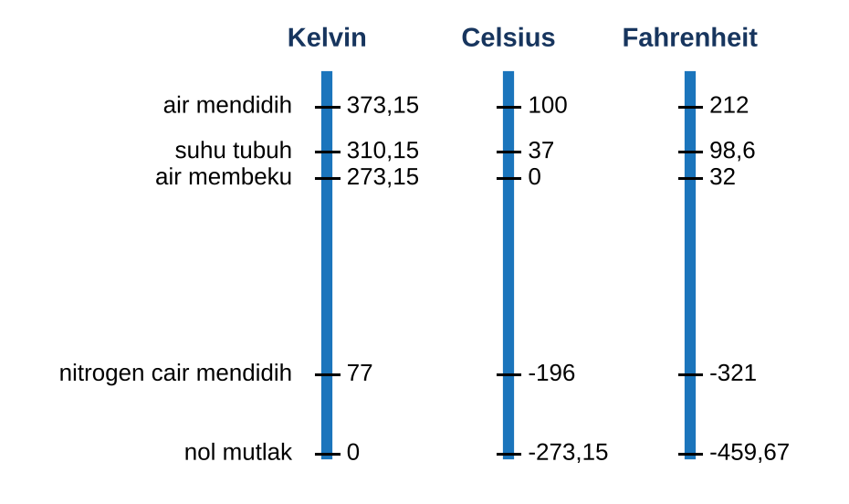
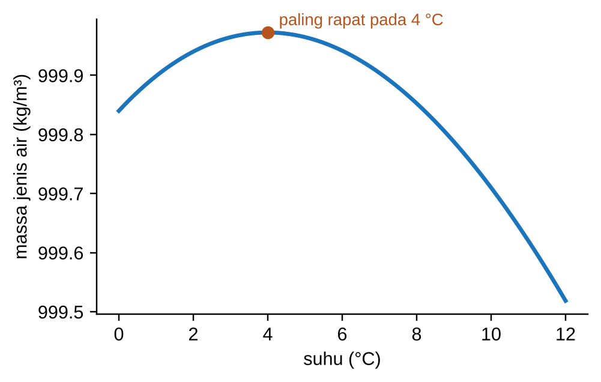
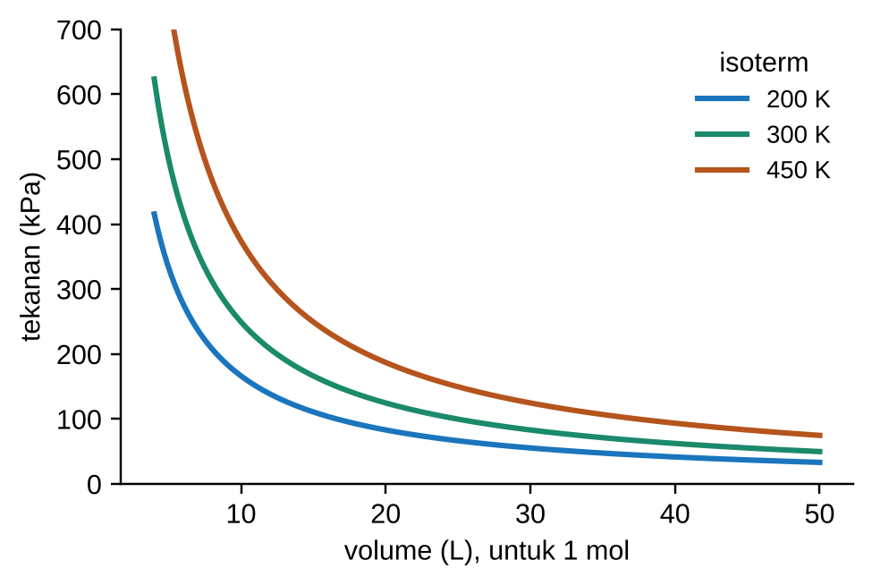
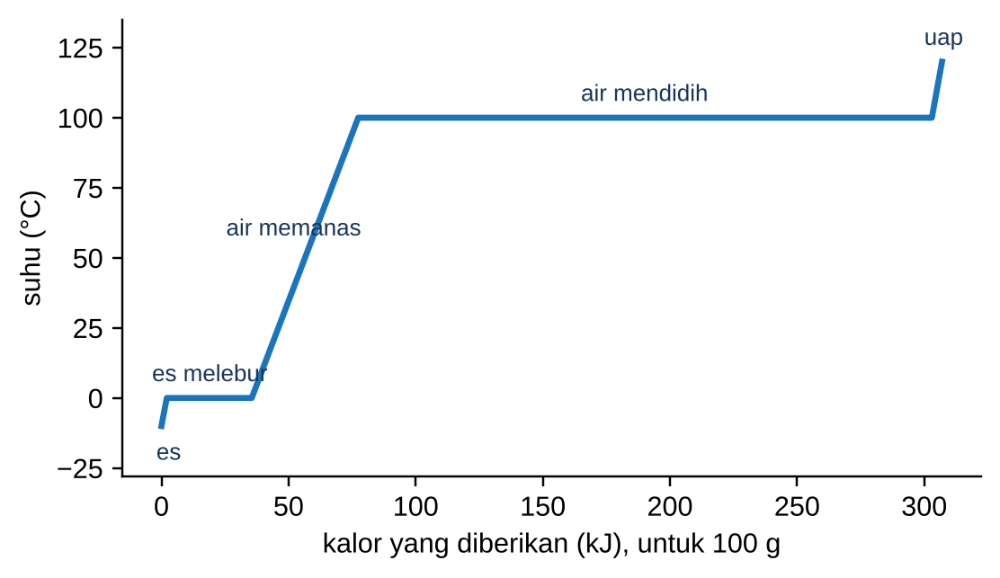
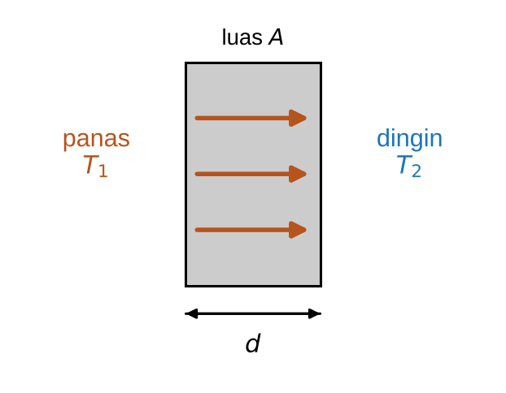
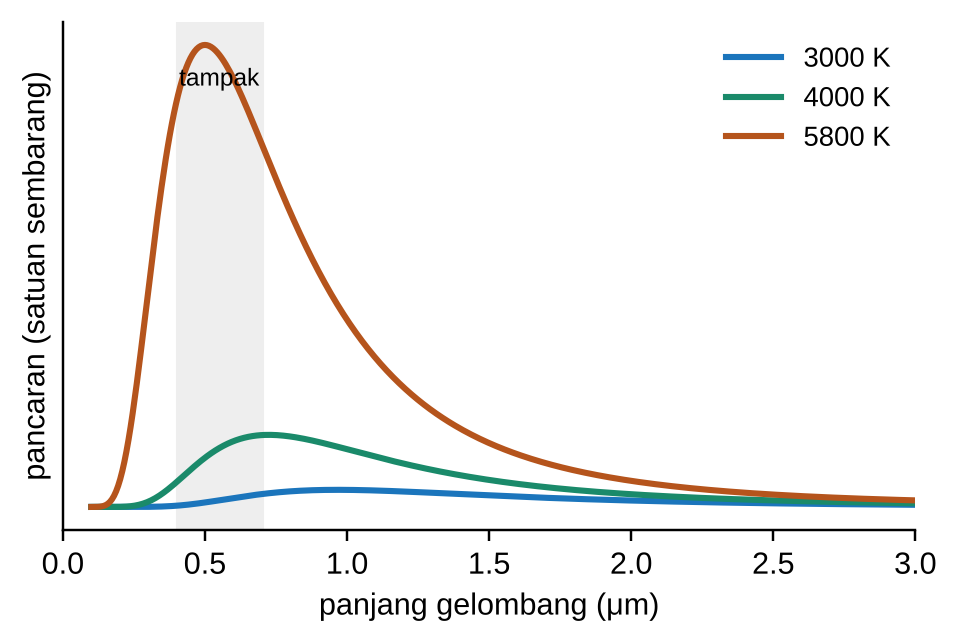

# Bab 10 Suhu, Kalor, dan Teori Kinetik Gas

Ada aturan praktis yang dikenal setiap mahasiswa kimia: menaikkan suhu 10 °C kira-kira melipatduakan laju reaksi. Aturan itu aneh jika dipikirkan. Dari 25 °C ke 35 °C, suhu mutlak hanya naik 3%, dan kelajuan rata-rata molekul hanya naik 1,7%. Molekul-molekulnya hampir tidak lebih cepat dan hampir tidak lebih sering bertumbukan. Bagaimana perubahan sekecil itu dapat melipatduakan laju reaksi?

Jawabannya tidak terletak pada molekul **rata-rata**. Molekul dalam gas atau zat cair tidak bergerak dengan kelajuan yang sama; kelajuannya tersebar lebar, dan selalu ada sebagian kecil yang jauh lebih cepat daripada rata-rata. Reaksi hanya terjadi pada tumbukan yang energinya melampaui energi aktivasi, dan hanya molekul-molekul di ekor sebaran itulah yang mampu. Kenaikan suhu sedikit saja hampir tidak mengubah rata-ratanya, tetapi **menggandakan isi ekornya**. Hitungannya ada di Contoh 10.36.

Bab ini membangun jembatan antara dunia yang terukur di laboratorium, yaitu suhu, tekanan, dan kalor, dengan dunia molekul yang tidak terlihat. Jembatan itu bernama teori kinetik. Di ujungnya kita akan tahu apa sebenarnya suhu itu.

::: {.tujuan}
**Tujuan belajar**

Setelah mempelajari bab ini, kamu mampu:

1. Mengonversi skala suhu dan menjelaskan makna nol mutlak.
2. Menghitung pemuaian zat padat dan zat cair, termasuk koreksi alat gelas volumetri.
3. Menerapkan persamaan gas ideal dan hukum Dalton.
4. Menghitung kalor pada perubahan suhu dan perubahan fasa, dan menyelesaikan soal kalorimetri.
5. Menghitung laju perpindahan kalor secara konduksi dan radiasi.
6. Menurunkan tekanan gas dari tumbukan molekul dan menghubungkan suhu dengan energi kinetik molekul.
7. Memakai sebaran Maxwell–Boltzmann untuk kelajuan molekul dan bagian molekul berenergi tinggi.
8. Meramalkan kapasitas kalor gas dan zat padat dengan teorema ekuipartisi.
9. Menghitung jalan bebas rata-rata dan memakai persamaan van der Waals.
:::

::: {.mat}
**Prasyarat**

Dari Bab 4: energi kinetik, usaha, dan daya (subbab 4.3 dan 4.4). Dari Bab 5: tekanan gas dari tumbukan molekul (subbab 5.9). Dari Bab 6: tekanan, massa jenis, dan faktor Boltzmann (subbab 6.1 dan 6.5). Dari Bab 8: getaran molekul dan energi rata-rata osilator (subbab 8.4 dan 8.7).
:::

## 10.1 Suhu

### Hukum ke-nol dan arti suhu

Sentuhkan benda panas dengan benda dingin. Yang panas mendingin, yang dingin memanas, dan akhirnya perubahan berhenti. Keduanya dikatakan berada dalam **kesetimbangan termal**. Besaran yang menjadi sama pada kedua benda itu kita sebut **suhu**.

::: {.inti}
**Hukum ke-nol termodinamika.** Jika benda A setimbang termal dengan benda C, dan benda B juga setimbang termal dengan C, maka A dan B setimbang termal satu sama lain.
:::

Hukum ini terdengar sepele, tetapi dialah yang membuat termometer bermakna. Termometer adalah benda C: jika ia menunjukkan angka yang sama untuk A dan B, kita tahu A dan B tidak akan saling bertukar energi ketika disentuhkan.

{width=70%}

### Skala suhu

| Skala | Titik beku air | Titik didih air | Dipakai untuk |
|---|---|---|---|
| Celsius (°C) | 0 | 100 | sehari-hari, laboratorium |
| Fahrenheit (°F) | 32 | 212 | sehari-hari di Amerika Serikat |
| Kelvin (K) | 273,15 | 373,15 | **semua rumus fisika dan kimia** |

$$
\boxed{T = T_C + 273{,}15} \qquad T_F = \tfrac95T_C + 32 . \qquad \text{(10.1)}
$$

Satu kelvin sama besar dengan satu derajat Celsius; yang berbeda hanya titik nolnya. **Selisih** suhu sama dalam kedua skala. Tetapi dalam rumus yang memuat suhu itu sendiri, seperti $pV = nRT$, $\tfrac32k_BT$, atau $e^{-E/k_BT}$, suhu **harus** dalam kelvin.

### Nol mutlak

Tekanan gas dalam wadah bervolume tetap turun secara linear ketika didinginkan. Jika garis itu diteruskan, tekanannya menjadi nol pada −273,15 °C, apa pun jenis gasnya. Suhu itu, 0 K, disebut **nol mutlak**. Di subbab 10.7 kita akan melihat artinya: di sana gerak termal molekul mencapai nilai terendah yang mungkin. Tidak ada suhu yang lebih rendah.

| Keadaan | Suhu (K) |
|---|---|
| Suhu terendah yang pernah dicapai di laboratorium | $10^{-10}$ |
| Helium mendidih | 4,2 |
| Nitrogen mendidih | 77 |
| Es kering menyublim | 195 |
| Air membeku | 273 |
| Suhu kamar | 298 |
| Air mendidih | 373 |
| Nyala pembakar Bunsen | 1800 |
| Permukaan Matahari | 5800 |
| Pusat Matahari | $1{,}5 \times 10^7$ |

::: {.contoh}
**Contoh 10.1 · Mengonversi suhu**

(a) Suhu tubuh 37,0 °C. Nyatakan dalam kelvin dan Fahrenheit. (b) Pada suhu berapa skala Celsius dan Fahrenheit menunjukkan angka yang sama? (c) Suhu sebuah larutan naik dari 22,0 °C menjadi 27,5 °C. Berapa kenaikannya dalam kelvin?

**Penyelesaian.**

(a) $T = 37{,}0 + 273{,}15 = 310{,}2$ K. $T_F = \tfrac95(37{,}0) + 32 = 98{,}6$ °F.

(b) $x = \tfrac95x + 32$ memberi $x = -40$. Pada −40°, kedua skala bertemu.

(c) 5,5 K. Selisih suhu sama dalam Celsius dan kelvin.

**Memahami hasil.** Kesalahan yang paling sering dalam hitungan gas adalah memasukkan suhu Celsius ke $pV = nRT$. Gas pada 20 °C dan 40 °C tidak berbeda dua kali lipat suhunya; suhu mutlaknya 293 K dan 313 K, berbeda 7%.
:::

::: {.kuis}
**Kuis cepat 10.1**

Dua gelas air masing-masing bersuhu 30 °C. Keduanya dituang ke satu wadah. Berapa suhu campurannya? Apa yang dapat disimpulkan tentang sifat besaran suhu?
:::

## 10.2 Pemuaian

Hampir semua zat memuai ketika dipanaskan. Rel kereta diberi celah, jembatan diberi sambungan muai, dan kabel listrik dibiarkan kendur pada musim kemarau. Di skala molekul, penyebabnya adalah bentuk kurva energi ikatan (subbab 4.8): lembahnya lebih landai di sisi luar, sehingga ketika atom-atom bergetar lebih kuat, jarak rata-ratanya bertambah.

### Pemuaian panjang dan volume

Untuk perubahan suhu yang tidak terlalu besar, pertambahan panjang sebanding dengan panjang semula dan dengan perubahan suhu:

$$
\boxed{\Delta L = \alpha L_0\,\Delta T} \qquad \text{(10.2)}
$$

$\alpha$ adalah **koefisien muai panjang** (K⁻¹). Untuk volume:

$$
\boxed{\Delta V = \beta V_0\,\Delta T}, \qquad \beta \approx 3\alpha\ \ \text{untuk zat padat}. \qquad \text{(10.3)}
$$

Faktor tiga muncul karena volume memuai pada tiga arah sekaligus.

| Zat padat | $\alpha$ ($10^{-6}$ K⁻¹) | Zat cair | $\beta$ ($10^{-4}$ K⁻¹) |
|---|---|---|---|
| Invar (paduan besi–nikel) | 1 | Raksa | 1,8 |
| Kaca borosilikat | 3,3 | Air (20 °C) | 2,1 |
| Kaca biasa | 9 | Gliserol | 5,0 |
| Baja | 12 | Bensin | 9,5 |
| Tembaga | 17 | Etanol | 11 |
| Aluminium | 23 | Aseton | 15 |

Dua hal terlihat dari tabel. Zat cair memuai jauh lebih besar daripada zat padat, sekitar sepuluh sampai seratus kali. Dan kaca borosilikat memuai tiga kali lebih kecil daripada kaca biasa; itulah sebabnya alat gelas laboratorium tahan dituangi air mendidih, sedangkan gelas biasa dapat retak.

Sebuah **lubang** pada benda memuai seolah-olah terisi bahan yang sama. Cincin logam yang dipanaskan membesar lubangnya. Tutup stoples logam yang macet dapat dilonggarkan dengan air panas.

::: {.contoh}
**Contoh 10.2 · Rel kereta api**

Rel baja sepanjang 25 m dipasang pada 20 °C. (a) Berapa pertambahan panjangnya pada 60 °C? (b) Jika kedua ujungnya dijepit sehingga tidak dapat memuai, berapa tegangan tekan yang timbul? Modulus Young baja $2{,}0 \times 10^{11}$ Pa.

**Penyelesaian.**

(a) $\Delta L = (12 \times 10^{-6})(25)(40) = 0{,}012$ m $= 1{,}2$ cm.

(b) Rel yang dijepit harus "ditekan balik" sebesar pemuaiannya. Regangannya $\alpha\,\Delta T$, dan tegangan = modulus Young × regangan:

$$
\frac FA = Y\alpha\,\Delta T = (2{,}0 \times 10^{11})(12 \times 10^{-6})(40) = 9{,}6 \times 10^7\ \text{Pa}.
$$

**Memahami hasil.** Pemuaian 1,2 cm tampak sepele, tetapi menahannya memerlukan tegangan hampir seribu atmosfer. Pada rel berpenampang 70 cm², itu gaya 670 kN, setara dengan berat 68 ton. Rel yang tidak diberi celah atau tidak dijangkar kuat akan melengkung ke samping pada hari panas.
:::

::: {.contoh}
**Contoh 10.3 · Bensin yang meluap**

Tangki baja berisi penuh 50,0 L bensin pada 15 °C. Mobil lalu diparkir di bawah terik sampai suhunya 35 °C. Berapa bensin yang meluap?

**Penyelesaian.** Bensin memuai: $\Delta V = (9{,}5 \times 10^{-4})(50{,}0)(20) = 0{,}95$ L. Tangki juga memuai, dengan $\beta = 3\alpha = 36 \times 10^{-6}$ K⁻¹: $\Delta V = (36 \times 10^{-6})(50{,}0)(20) = 0{,}04$ L.

Yang meluap: $0{,}95 - 0{,}04 = 0{,}91$ L.

**Memahami hasil.** Hampir satu liter. Itu sebabnya tangki tidak boleh diisi sampai bibir. Karena volume bensin bergantung pada suhu sedangkan massanya tidak, satu liter bensin yang dibeli saat dingin memuat sedikit lebih banyak energi daripada satu liter saat panas.
:::

::: {.contoh}
**Contoh 10.4 · Labu ukur pada suhu yang salah**

Labu ukur 100,00 mL dari kaca borosilikat dikalibrasi pada 20 °C. Larutan berair dibuat di dalamnya sampai tanda batas pada 20 °C, lalu labu dan isinya menghangat ke 30 °C. (a) Berapa pertambahan volume labu? (b) Berapa pertambahan volume larutan? (c) Berapa persen konsentrasi molarnya berubah?

**Penyelesaian.**

(a) $\beta_\text{kaca} = 3(3{,}3 \times 10^{-6}) = 9{,}9 \times 10^{-6}$ K⁻¹: $\Delta V = (9{,}9 \times 10^{-6})(100)(10) = 0{,}010$ mL.

(b) $\Delta V = (2{,}1 \times 10^{-4})(100)(10) = 0{,}21$ mL.

(c) Jumlah mol zat terlarut tetap, tetapi volume larutan naik 0,21%. Konsentrasinya **turun 0,21%**.

**Memahami hasil.** Labu hampir tidak berubah; yang berubah adalah zat cairnya. Kesalahan 0,2% sudah dua kali toleransi labu ukur kelas A. Itu alasan alat gelas volumetri dicap "20 °C", dan alasan **molaritas** bergantung pada suhu sedangkan **molalitas**, yang didasarkan pada massa, tidak.
:::

### Keanehan air

{width=58%}

Air tidak mengikuti aturan umum. Dari 0 °C sampai 4 °C, air justru **menyusut** ketika dipanaskan, dan massa jenisnya mencapai nilai terbesar pada 4 °C (Gambar 10.2). Di bawah suhu itu, molekul-molekul air mulai tersusun dalam jaringan ikatan hidrogen yang renggang, cikal bakal struktur es.

Akibatnya bagi kehidupan sangat besar. Ketika danau mendingin, air permukaan yang lebih dingin dan lebih rapat tenggelam, sampai seluruh danau bersuhu 4 °C. Pendinginan selanjutnya menghasilkan air yang **lebih ringan**, yang tetap di permukaan dan membeku di sana. Es yang terbentuk terapung dan menyekat air di bawahnya. Danau membeku dari atas, dan ikan bertahan hidup di dasarnya.

::: {.kuis}
**Kuis cepat 10.2**

Sebuah pelat logam memiliki lubang bundar. Ketika pelat dipanaskan, apakah lubangnya membesar atau mengecil?
:::

## 10.3 Gas ideal

Gas jauh lebih sederhana daripada zat cair dan zat padat. Molekulnya berjauhan dan hampir tidak saling memengaruhi, sehingga semua gas pada tekanan rendah berperilaku sama.

### Persamaan keadaan

Tiga pengamatan abad ke-17 dan ke-18, yaitu hukum Boyle ($pV$ tetap pada suhu tetap), hukum Charles ($V \propto T$ pada tekanan tetap), dan hukum Avogadro ($V \propto n$), terangkum dalam satu persamaan:

$$
\boxed{pV = nRT = Nk_BT} \qquad \text{(10.4)}
$$

| Tetapan | Nilai |
|---|---|
| Tetapan gas | $R = 8{,}314$ J/(mol·K) $= 0{,}08206$ L·atm/(mol·K) |
| Tetapan Boltzmann | $k_B = R/N_A = 1{,}381 \times 10^{-23}$ J/K |
| Bilangan Avogadro | $N_A = 6{,}022 \times 10^{23}$ mol⁻¹ |

Kedua bentuk itu setara: $n$ menghitung dalam mol, dan $N = nN_A$ menghitung molekul satu per satu. $R$ adalah tetapan gas **per mol**; $k_B$ adalah tetapan gas **per molekul**.

Dengan $R = 8{,}314$ J/(mol·K), tekanan harus dalam pascal dan volume dalam m³. Satu liter adalah $10^{-3}$ m³.

{width=58%}

Untuk sejumlah gas yang tetap, yang berpindah dari satu keadaan ke keadaan lain:

$$
\frac{p_1V_1}{T_1} = \frac{p_2V_2}{T_2} . \qquad \text{(10.5)}
$$

Massa jenis gas mengikuti dari (10.4), dengan $n = m/M$:

$$
\rho = \frac{pM}{RT} . \qquad \text{(10.6)}
$$

::: {.strategi}
**Strategi · Soal gas ideal**

1. **Suhu dalam kelvin.** Selalu.
2. **Tekanan mutlak**, bukan tekanan terukur (subbab 6.3).
3. Jika jumlah gas tetap dan keadaannya berubah, pakai perbandingan (10.5). Satuan $p$ dan $V$ bebas, asal sama di kedua ruas.
4. Jika jumlah gas ditanya atau diketahui, pakai $pV = nRT$ dengan satuan SI.
5. Periksa kewajaran dengan patokan: 1 mol gas menempati 22,4 L pada 0 °C dan 1 atm, atau 24,8 L pada 25 °C dan 1 bar.
:::

::: {.contoh}
**Contoh 10.5 · Volume molar**

Berapa volume 1 mol gas ideal pada (a) 0 °C dan 1 atm; (b) 25 °C dan 1 bar?

**Penyelesaian.**

(a) $V = \dfrac{nRT}{p} = \dfrac{(1)(8{,}314)(273{,}15)}{101\,325} = 0{,}02241\ \text{m}^3 = 22{,}4$ L.

(b) $V = \dfrac{(8{,}314)(298{,}15)}{1{,}00 \times 10^5} = 0{,}02479\ \text{m}^3 = 24{,}8$ L.

**Memahami hasil.** Kedua angka ini patut dihafal. Volume molar tidak bergantung pada jenis gas: satu mol hidrogen dan satu mol karbon dioksida menempati volume yang sama, walaupun massanya berbeda 22 kali.
:::

::: {.contoh}
**Contoh 10.6 · Tekanan ban yang memanas**

Tekanan terukur sebuah ban 220 kPa pada 20 °C. Setelah perjalanan jauh, suhu udara di dalam ban 45 °C. Berapa tekanan terukurnya sekarang, jika volume ban dianggap tetap? Tekanan atmosfer 101,3 kPa.

**Penyelesaian.** Ubah ke tekanan mutlak: $p_1 = 220 + 101{,}3 = 321{,}3$ kPa. Volume tetap, jadi $p \propto T$:

$$
p_2 = 321{,}3 \times \frac{318}{293} = 348{,}7\ \text{kPa}.
$$

Tekanan terukur: $348{,}7 - 101{,}3 = 247$ kPa.

**Memahami hasil.** Tekanan terukur naik 12%, padahal suhu mutlak hanya naik 8,5%. Jika tekanan terukur langsung dipakai dalam perbandingan, hasilnya 239 kPa, keliru. Jika suhu Celsius dipakai, hasilnya 495 kPa, sangat keliru. Karena itu tekanan ban diukur saat ban **dingin**.
:::

::: {.contoh}
**Contoh 10.7 · Balon cuaca**

Balon cuaca diisi 1,00 m³ helium di permukaan tanah, pada 101,3 kPa dan 15 °C. Berapa volumenya pada ketinggian 10 km, tempat tekanannya 26,5 kPa dan suhunya −50 °C?

**Penyelesaian.**

$$
V_2 = V_1\,\frac{p_1}{p_2}\,\frac{T_2}{T_1} = 1{,}00 \times \frac{101{,}3}{26{,}5} \times \frac{223}{288} = 2{,}96\ \text{m}^3 .
$$

**Memahami hasil.** Balon mengembang hampir tiga kali. Penurunan tekanan saja akan membuatnya 3,8 kali lebih besar; pendinginan mengurangi sebagiannya. Balon cuaca sengaja diisi hanya sebagian di tanah, dan akhirnya pecah ketika pemuaiannya melampaui kekuatan karetnya.
:::

::: {.contoh}
**Contoh 10.8 · Menentukan massa molar dari massa jenis**

Suatu gas memiliki massa jenis 2,86 g/L pada 0 °C dan 1 atm. Berapa massa molarnya, dan gas apakah itu kemungkinan besar?

**Penyelesaian.** Dari (10.6):

$$
M = \frac{\rho RT}{p} = \frac{(2{,}86)(8{,}314)(273{,}15)}{101\,325} = 0{,}0641\ \text{kg/mol} = 64{,}1\ \text{g/mol}.
$$

**Memahami hasil.** Cara cepat: pada 0 °C dan 1 atm, $M = \rho \times 22{,}4$ L/mol $= 64{,}1$ g/mol. Itu massa molar SO₂. Cara ini (metode Dumas) adalah salah satu cara tertua menentukan massa molar zat yang mudah menguap.
:::

::: {.contoh}
**Contoh 10.9 · Berapa banyak molekul?**

(a) Berapa molekul dalam 1,0 cm³ udara pada 0 °C dan 1 atm? (b) Berapa molekul dalam 1,0 cm³ ruang "hampa" bertekanan $1{,}0 \times 10^{-10}$ Pa pada 300 K, vakum terbaik yang biasa dicapai di laboratorium? (c) Berapa jarak rata-rata antarmolekul pada (a)?

**Penyelesaian.** $N = \dfrac{pV}{k_BT}$.

(a) $N = \dfrac{(101\,325)(1{,}0 \times 10^{-6})}{(1{,}381 \times 10^{-23})(273{,}15)} = 2{,}7 \times 10^{19}$.

(b) $N = \dfrac{(1{,}0 \times 10^{-10})(1{,}0 \times 10^{-6})}{(1{,}381 \times 10^{-23})(300)} = 2{,}4 \times 10^4$.

(c) Tiap molekul rata-rata menempati volume $\dfrac{k_BT}{p} = 3{,}7 \times 10^{-26}\ \text{m}^3$. Akar pangkat tiganya: 3,3 nm.

**Memahami hasil.** Bahkan dalam vakum terbaik masih ada puluhan ribu molekul tiap sentimeter kubik. Pada (c), jarak antarmolekul sekitar sepuluh kali ukuran molekulnya (0,3 nm). Gas sebagian besar adalah ruang kosong, dan itu sebabnya model gas ideal, yang mengabaikan ukuran molekul, bekerja begitu baik.
:::

### Campuran gas

Dalam campuran gas ideal, tiap gas berperilaku seolah-olah sendirian di dalam wadah. Tekanan yang disumbangkannya disebut **tekanan parsial**, dan tekanan total adalah jumlahnya:

$$
\boxed{p_\text{total} = p_1 + p_2 + \dots, \qquad p_i = x_ip_\text{total}} \qquad \text{(10.7)}
$$

dengan $x_i = n_i/n_\text{total}$ **fraksi mol** gas itu. Ini **hukum Dalton**.

::: {.contoh}
**Contoh 10.10 · Tekanan parsial oksigen**

Udara kering mengandung 78% N₂ dan 21% O₂ menurut jumlah mol. (a) Berapa tekanan parsial keduanya di permukaan laut (101,3 kPa)? (b) Berapa tekanan parsial oksigen di puncak Everest, tempat tekanan udaranya 35,5 kPa?

**Penyelesaian.**

(a) $p_{\text{N}_2} = (0{,}78)(101{,}3) = 79$ kPa; $p_{\text{O}_2} = (0{,}21)(101{,}3) = 21$ kPa.

(b) $p_{\text{O}_2} = (0{,}21)(35{,}5) = 7{,}5$ kPa.

**Memahami hasil.** Susunan udara di puncak Everest sama dengan di pantai; yang berkurang adalah tekanan totalnya. Yang menentukan seberapa banyak oksigen masuk ke darah adalah tekanan **parsial** oksigen, dan di puncak Everest nilainya hanya sepertiga nilai di permukaan laut. Sebaliknya, penyelam di kedalaman 30 m menghirup udara bertekanan 4 atm, dengan tekanan parsial oksigen 0,84 atm.
:::

::: {.contoh}
**Contoh 10.11 · Campuran dalam satu wadah**

Sebanyak 0,50 g H₂ dan 1,0 g CO dimasukkan ke wadah 5,0 L pada 25 °C. Berapa tekanan totalnya?

**Penyelesaian.** $n_{\text{H}_2} = \dfrac{0{,}50}{2{,}016} = 0{,}248$ mol. $n_\text{CO} = \dfrac{1{,}0}{28{,}01} = 0{,}036$ mol. Total 0,284 mol.

$$
p = \frac{nRT}{V} = \frac{(0{,}284)(8{,}314)(298)}{5{,}0 \times 10^{-3}} = 1{,}4 \times 10^5\ \text{Pa}.
$$

**Memahami hasil.** Hidrogen hanya sepertiga massa campuran, tetapi menyumbang 87% tekanannya. Tekanan gas ditentukan oleh **banyaknya molekul**, bukan massanya.
:::

::: {.kuis}
**Kuis cepat 10.3**

Dua tabung identik pada suhu yang sama masing-masing berisi 1 mol helium dan 1 mol nitrogen. Bandingkan tekanan, banyaknya molekul, dan massa gas di dalamnya.
:::

## 10.4 Kalor dan kapasitas kalor

### Kalor adalah energi yang berpindah

Sampai abad ke-19, kalor dianggap zat alir tak terlihat. Percobaan James Joule menunjukkan bahwa kalor adalah **energi**: mengaduk air dengan kincir yang digerakkan beban jatuh menaikkan suhu air, tepat sebanding dengan usaha mekaniknya.

**Kalor** $Q$ adalah energi yang berpindah karena perbedaan suhu. Benda tidak "memiliki" kalor; yang dimilikinya adalah **energi dalam**, yaitu jumlah energi kinetik dan potensial semua molekulnya. Kalor adalah nama untuk energi yang sedang **berpindah**, seperti usaha.

Satuannya joule. Satuan lama, kalori, didefinisikan sebagai kalor untuk menaikkan suhu 1 g air sebesar 1 °C: 1 kal = 4,186 J.

### Kalor jenis

Kalor yang diperlukan untuk mengubah suhu suatu benda sebanding dengan massanya dan dengan perubahan suhunya:

$$
\boxed{Q = mc\,\Delta T} \qquad \text{(10.8)}
$$

$c$ adalah **kalor jenis** (J/(kg·K)), sifat bahan. Untuk satu mol, dipakai **kapasitas kalor molar** $C = Mc$ (J/(mol·K)).

| Zat | $c$ (J/(kg·K)) | $C$ (J/(mol·K)) |
|---|---|---|
| Air | 4186 | 75,4 |
| Etanol | 2440 | 112 |
| Es (0 °C) | 2100 | 37,8 |
| Uap air (100 °C) | 2010 | 36,2 |
| Aluminium | 900 | 24,3 |
| Kaca | 840 | — |
| Besi | 449 | 25,1 |
| Tembaga | 385 | 24,5 |
| Perak | 235 | 25,4 |
| Emas | 129 | 25,4 |
| Timbal | 128 | 26,5 |

Dua hal menonjol:

- **Kalor jenis air luar biasa besar.** Untuk suhu yang sama, air menyimpan energi lima kali lebih banyak daripada aluminium dan sepuluh kali lebih banyak daripada tembaga. Laut menghangat dan mendingin perlahan, sehingga iklim pantai lebih lunak daripada iklim pedalaman. Air dipakai sebagai pendingin mesin dan pembawa panas. Penyebabnya lagi-lagi ikatan hidrogen: sebagian energi dipakai untuk merenggangkannya.
- **Kapasitas kalor molar logam hampir sama**, sekitar 25 J/(mol·K), walaupun kalor jenis per kilogramnya sangat berbeda. Keteraturan ini, hukum Dulong–Petit, dijelaskan di subbab 10.9.

::: {.contoh}
**Contoh 10.12 · Memanaskan air**

(a) Berapa kalor untuk memanaskan 250 g air dari 25 °C sampai 100 °C? (b) Berapa lama ketel listrik 1500 W melakukannya, jika tidak ada kalor yang terbuang?

**Penyelesaian.**

(a) $Q = (0{,}250)(4186)(75) = 7{,}85 \times 10^4$ J $= 78{,}5$ kJ.

(b) $t = \dfrac{Q}{P} = \dfrac{7{,}85 \times 10^4}{1500} = 52$ s.

**Memahami hasil.** Secangkir air memerlukan hampir 80 kJ untuk dididihkan. Energi mekanik sebesar itu cukup untuk mengangkat orang 70 kg setinggi 114 m. Energi termal sehari-hari sangat besar dibandingkan energi mekanik sehari-hari.
:::

### Kalorimetri

Jika benda-benda bersuhu berbeda dicampur dalam wadah yang tersekat, energi berpindah dari yang panas ke yang dingin sampai suhunya sama. Tidak ada energi yang keluar atau masuk:

$$
\boxed{\sum Q = 0 \qquad\text{atau}\qquad Q_\text{dilepas} = Q_\text{diterima}} \qquad \text{(10.9)}
$$

::: {.strategi}
**Strategi · Soal kalorimetri**

1. Daftar semua benda yang bertukar kalor, termasuk wadahnya jika kapasitas kalornya diberikan.
2. Untuk tiap benda tulis $Q = mc(T_\text{akhir} - T_\text{awal})$. Dengan urutan "akhir dikurangi awal", tandanya benar dengan sendirinya: positif untuk yang menerima, negatif untuk yang melepas.
3. Jika ada perubahan fasa, tambahkan $\pm mL$ (subbab 10.5).
4. Jumlahkan semuanya, samakan dengan nol, selesaikan.
5. Periksa: suhu akhir harus berada di antara suhu-suhu awal.
:::

::: {.contoh}
**Contoh 10.13 · Logam panas ke dalam air**

Balok aluminium 200 g bersuhu 100 °C dimasukkan ke 500 g air bersuhu 20 °C dalam wadah tersekat. Berapa suhu akhirnya?

**Penyelesaian.**

$$
(0{,}200)(900)(T - 100) + (0{,}500)(4186)(T - 20) = 0 .
$$

$$
T = \frac{(180)(100) + (2093)(20)}{180 + 2093} = 26{,}3\ \text{°C}.
$$

**Memahami hasil.** Suhu akhir jauh lebih dekat ke suhu awal air. Hasil kali $mc$ (kapasitas kalor) air adalah 2093 J/K, hampir dua belas kali kapasitas kalor aluminium, 180 J/K. Suhu akhir adalah rata-rata suhu awal yang ditimbang dengan kapasitas kalor.
:::

::: {.contoh}
**Contoh 10.14 · Mengukur kalor jenis**

Sepotong logam 85,0 g dipanaskan sampai 100,0 °C lalu dimasukkan ke 150 g air bersuhu 20,0 °C dalam kalorimeter. Suhu akhirnya 24,3 °C. Berapa kalor jenis logam itu, dan logam apakah itu kemungkinan besar?

**Penyelesaian.** Kalor yang diterima air sama dengan kalor yang dilepas logam:

$$
c = \frac{(0{,}150)(4186)(24{,}3 - 20{,}0)}{(0{,}0850)(100{,}0 - 24{,}3)} = \frac{2700}{6{,}43} = 420\ \text{J/(kg·K)}.
$$

**Memahami hasil.** Nilai ini dekat dengan besi (449). Selisihnya wajar: kalorimeter sederhana selalu kehilangan sedikit kalor ke wadah dan udara, sehingga kenaikan suhu air terukur terlalu kecil dan hasil $c$ terlalu rendah. Dengan aturan Dulong–Petit, $M \approx 25/c = 25/0{,}42 = 60$ g/mol, cocok dengan besi (55,8).
:::

::: {.contoh}
**Contoh 10.15 · Kalorimeter dan kalor reaksi**

Dalam kalorimeter berisi 300 g larutan (kalor jenis seperti air) terjadi reaksi yang menaikkan suhu dari 22,0 °C menjadi 27,5 °C. Kapasitas kalor wadahnya 50 J/K. (a) Berapa kalor yang dilepas reaksi? (b) Jika yang bereaksi 0,0100 mol, berapa perubahan entalpinya per mol?

**Penyelesaian.**

(a) $Q = (m c + C_\text{wadah})\,\Delta T = \big[(0{,}300)(4186) + 50\big](5{,}5) = 7{,}18 \times 10^3$ J.

(b) Reaksi melepas kalor, jadi $\Delta H = -\dfrac{7{,}18\ \text{kJ}}{0{,}0100\ \text{mol}} = -718$ kJ/mol.

**Memahami hasil.** Kalor yang dilepas reaksi diserap larutan **dan** wadah; mengabaikan wadah menurunkan hasil 4%. Kapasitas kalor wadah diperoleh lebih dulu dengan kalibrasi, biasanya memakai pemanas listrik berdaya diketahui. Semua nilai $\Delta H$ di tabel termokimia pada akhirnya berasal dari pengukuran kenaikan suhu seperti ini.
:::

::: {.contoh}
**Contoh 10.16 · Mencampur air panas dan air dingin**

Berapa liter air 90 °C yang harus ditambahkan ke 40 L air 25 °C agar suhu campurannya 40 °C?

**Penyelesaian.** Kalor jenisnya sama, jadi tercoret:

$$
m(90 - 40) = 40(40 - 25) \quad\Longrightarrow\quad m = \frac{600}{50} = 12\ \text{kg},
$$

yaitu 12 L.

**Memahami hasil.** Suhu campuran adalah rata-rata tertimbang massa: $\dfrac{(12)(90) + (40)(25)}{52} = 40$ °C. Cocok.
:::

::: {.kuis}
**Kuis cepat 10.4**

Sebatang besi 1 kg dan sebatang timbal 1 kg, keduanya bersuhu 100 °C, masing-masing dimasukkan ke segelas air dingin yang sama banyak. Gelas mana yang akhirnya lebih hangat?
:::

## 10.5 Perubahan fasa dan kalor laten

Panaskan es yang suhunya di bawah nol. Suhunya naik sampai 0 °C, lalu **berhenti naik** walaupun kalor terus diberikan, sampai seluruh es melebur. Baru setelah itu suhu naik lagi. Selama perubahan fasa, energi yang masuk tidak mempercepat molekul; ia dipakai untuk **memutus ikatan** antarmolekul.

Kalor yang diperlukan untuk mengubah fasa zat bermassa $m$ adalah

$$
\boxed{Q = mL} \qquad \text{(10.10)}
$$

$L$ disebut **kalor laten**: kalor lebur $L_f$ untuk padat–cair, dan kalor uap $L_v$ untuk cair–gas. Pada arah sebaliknya (membeku, mengembun), kalor yang sama **dilepas**.

| Zat | Titik lebur (°C) | $L_f$ (kJ/kg) | Titik didih (°C) | $L_v$ (kJ/kg) |
|---|---|---|---|---|
| Air | 0 | 334 | 100 | 2256 |
| Etanol | −114 | 108 | 78 | 855 |
| Nitrogen | −210 | 26 | −196 | 199 |
| Raksa | −39 | 11 | 357 | 296 |
| Timbal | 327 | 23 | 1750 | 870 |
| Tembaga | 1085 | 205 | 2562 | 4730 |

Kalor uap selalu jauh lebih besar daripada kalor lebur. Melebur hanya melonggarkan susunan molekul; menguap memisahkan molekul-molekul itu sepenuhnya. Per mol, kalor uap air adalah 40,7 kJ/mol, yaitu $\Delta H_\text{uap}$ yang dikenal di kimia. Per molekul, itu 0,42 eV, kira-kira energi dua ikatan hidrogen.

{width=70%}

::: {.contoh}
**Contoh 10.17 · Dari es menjadi uap**

Berapa kalor untuk mengubah 100 g es bersuhu −10 °C menjadi uap bersuhu 100 °C?

**Penyelesaian.** Empat tahap (Gambar 10.4):

| Tahap | Rumus | Kalor |
|---|---|---|
| Es memanas, −10 °C ke 0 °C | $(0{,}100)(2100)(10)$ | 2,1 kJ |
| Es melebur | $(0{,}100)(334\,000)$ | 33,4 kJ |
| Air memanas, 0 °C ke 100 °C | $(0{,}100)(4186)(100)$ | 41,9 kJ |
| Air menguap | $(0{,}100)(2\,256\,000)$ | 225,6 kJ |
| **Jumlah** | | **303 kJ** |

**Memahami hasil.** Tiga perempat kalor itu dipakai hanya untuk menguapkan. Menguapkan air memerlukan kalor lima kali lebih banyak daripada memanaskannya dari 0 °C sampai 100 °C. Itu sebabnya air di panci cepat mendidih tetapi lama habis.
:::

::: {.contoh}
**Contoh 10.18 · Es dalam minuman**

(a) Berapa gram es bersuhu 0 °C yang diperlukan untuk mendinginkan 300 g air dari 25 °C sampai 0 °C? (b) Jika hanya 50 g es yang dimasukkan, berapa suhu akhirnya?

**Penyelesaian.**

(a) Kalor yang harus diambil dari air: $(0{,}300)(4186)(25) = 3{,}14 \times 10^4$ J. Massa es yang melebur: $m = \dfrac{3{,}14 \times 10^4}{334\,000} = 0{,}094$ kg $= 94$ g.

(b) Seluruh es melebur (perlu $(0{,}050)(334\,000) = 1{,}67 \times 10^4$ J), lalu air lelehannya ikut memanas dari 0 °C:

$$
(0{,}300)(4186)(25 - T) = 1{,}67 \times 10^4 + (0{,}050)(4186)(T - 0) \quad\Longrightarrow\quad T = 10\ \text{°C}.
$$

**Memahami hasil.** Melebur 1 g es menyerap kalor sebanyak mendinginkan 1 g air sebesar 80 °C. Es mendinginkan terutama karena **melebur**, bukan karena dinginnya. Sebongkah batu bersuhu 0 °C hampir tidak berguna sebagai pendingin.
:::

::: {.contoh}
**Contoh 10.19 · Mengapa uap lebih berbahaya daripada air mendidih**

Bandingkan kalor yang dilepas ke kulit bersuhu 37 °C oleh (a) 10 g air bersuhu 100 °C; (b) 10 g uap bersuhu 100 °C.

**Penyelesaian.**

(a) $Q = (0{,}010)(4186)(63) = 2{,}6 \times 10^3$ J.

(b) Uap mengembun dulu, lalu airnya mendingin: $Q = (0{,}010)(2\,256\,000) + 2{,}6 \times 10^3 = 2{,}52 \times 10^4$ J.

**Memahami hasil.** Uap melepas hampir sepuluh kali lebih banyak kalor daripada air mendidih bermassa sama. Itulah yang membuat luka bakar uap begitu parah, dan itu pula yang membuat penangas uap dan autoklaf begitu ampuh: uap menyerahkan kalor latennya tepat di permukaan yang lebih dingin.
:::

::: {.contoh}
**Contoh 10.20 · Berkeringat**

Pada suhu kulit, kalor uap air sekitar 2430 kJ/kg. (a) Seorang pelari 70 kg (kalor jenis tubuh sekitar 3500 J/(kg·K)) menguapkan 1,0 L keringat. Seberapa besar kenaikan suhu tubuh yang dicegahnya? (b) Berapa daya pendinginan jika ia menguapkan 0,50 L per jam?

**Penyelesaian.**

(a) $Q = (1{,}0)(2{,}43 \times 10^6) = 2{,}43 \times 10^6$ J. $\Delta T = \dfrac{Q}{mc} = \dfrac{2{,}43 \times 10^6}{(70)(3500)} = 9{,}9$ K.

(b) $P = \dfrac{(0{,}50)(2{,}43 \times 10^6)}{3600} = 340$ W.

**Memahami hasil.** Tanpa keringat, suhu tubuh pelari itu akan naik hampir 10 °C, mematikan. Penguapan adalah satu-satunya cara tubuh membuang kalor ketika udara lebih panas daripada kulit. Pada udara lembap, keringat menetes tanpa menguap dan pendinginan gagal; itu sebabnya panas yang lembap terasa jauh lebih menyiksa. Pendinginan karena penguapan juga yang membuat tangan terasa dingin saat terkena alkohol atau aseton.
:::

::: {.kuis}
**Kuis cepat 10.5**

Air dalam panci terbuka dididihkan dengan api kecil, lalu apinya dibesarkan. Apakah suhu air naik? Apa yang berubah?
:::

## 10.6 Perpindahan kalor

Kalor berpindah dengan tiga cara. Ketiganya hampir selalu bekerja bersama, tetapi biasanya satu yang menonjol.

### Konduksi

{width=50%}

Pada **konduksi**, energi diteruskan dari molekul ke molekul tanpa perpindahan zat. Laju aliran kalor melalui lapisan seluas $A$ dan setebal $d$ adalah

$$
\boxed{\frac{Q}{t} = kA\,\frac{T_1 - T_2}{d}} \qquad \text{(10.11)}
$$

Ini **hukum Fourier**. $k$ adalah **konduktivitas termal** (W/(m·K)). Bentuknya sama dengan hukum Fick untuk difusi (subbab 7.9) dan hukum Ohm (Bab 13): aliran sebanding dengan selisih pendorong.

| Bahan | $k$ (W/(m·K)) | Bahan | $k$ (W/(m·K)) |
|---|---|---|---|
| Intan | 2000 | Air | 0,60 |
| Tembaga | 400 | Kayu | 0,12 |
| Aluminium | 237 | Wol, busa | 0,04 |
| Baja | 50 | Udara diam | 0,026 |
| Kaca | 0,8 | Aerogel | 0,015 |

Logam menghantar kalor dengan baik karena elektron bebasnya; karena itu penghantar listrik yang baik juga penghantar kalor yang baik. Bahan penyekat hampir semuanya bekerja dengan **memerangkap udara diam**: wol, bulu, busa, dan serat kaca.

Untuk beberapa lapisan yang ditumpuk, lajunya ditentukan oleh jumlah **hambatan termal** $d/k$ tiap lapisan:

$$
\frac{Q}{t} = \frac{A(T_1 - T_2)}{\dfrac{d_1}{k_1} + \dfrac{d_2}{k_2} + \dots} . \qquad \text{(10.12)}
$$

::: {.contoh}
**Contoh 10.21 · Jendela kaca**

Kaca jendela seluas 2,0 m² dan setebal 5,0 mm memisahkan ruangan 20 °C dari udara luar 5 °C. (a) Berapa laju kalor yang hilang, jika kedua permukaan kaca bersuhu sama dengan udara di dekatnya? (b) Berapa lajunya melalui lapisan udara diam setebal 5,0 cm dengan luas dan beda suhu yang sama?

**Penyelesaian.**

(a) $\dfrac Qt = (0{,}8)(2{,}0)\dfrac{15}{0{,}0050} = 4{,}8 \times 10^3$ W.

(b) $\dfrac Qt = (0{,}026)(2{,}0)\dfrac{15}{0{,}050} = 16$ W.

**Memahami hasil.** Angka pada (a) terlalu besar. Dalam kenyataan, di kedua sisi kaca menempel lapisan udara tipis yang hampir diam, dan lapisan itulah yang menahan sebagian besar beda suhu; kacanya sendiri hampir tidak berarti. Hasil (b) menunjukkan betapa hebatnya udara diam sebagai penyekat.
:::

::: {.contoh}
**Contoh 10.22 · Kaca rangkap**

Sebuah jendela kaca rangkap terdiri atas dua lembar kaca 4,0 mm yang mengapit lapisan udara 12 mm. Berapa laju kalor yang lolos tiap meter persegi untuk beda suhu 15 K?

**Penyelesaian.** Hambatan termal tiap lapisan, $d/k$:

- kaca: $\dfrac{0{,}0040}{0{,}8} = 0{,}005\ \text{m}^2\text{·K/W}$ (dua lembar: 0,010);
- udara: $\dfrac{0{,}012}{0{,}026} = 0{,}46\ \text{m}^2\text{·K/W}$.

$$
\frac{Q}{tA} = \frac{15}{0{,}010 + 0{,}46} = 32\ \text{W/m}^2 .
$$

**Memahami hasil.** Lapisan udara menyumbang 98% hambatan termalnya. Kacanya hanya berguna untuk **menahan udara itu tetap di tempat**. Asas yang sama berlaku pada pakaian berlapis, bulu angsa, dan termos; pada termos, udaranya dipompa keluar sama sekali.
:::

### Konveksi

Pada **konveksi**, kalor dibawa oleh fluida yang bergerak. Fluida yang dipanaskan memuai, menjadi lebih ringan, dan naik; fluida dingin turun menggantikannya. Arus konveksi memanaskan air di panci, mengaduk udara di ruangan, menggerakkan angin darat dan angin laut, dan menggerakkan lempeng-lempeng kerak Bumi.

Konveksi sulit dihitung dengan tepat, tetapi untuk beda suhu yang tidak besar, laju pendinginan sebuah benda kira-kira sebanding dengan selisih suhunya dari lingkungan. Ini **hukum pendinginan Newton**, dan akibatnya selisih suhu itu meluruh secara eksponen:

$$
T - T_\text{lingkungan} = (T_0 - T_\text{lingkungan})\,e^{-t/\tau} . \qquad \text{(10.13)}
$$

::: {.contoh}
**Contoh 10.23 · Kopi yang mendingin**

Secangkir kopi bersuhu 90 °C berada di ruangan 25 °C. Setelah 5,0 menit, suhunya 60 °C. Kapan suhunya mencapai 40 °C?

**Penyelesaian.** Selisih suhu dari ruangan: mula-mula 65 K, setelah 5,0 menit 35 K.

$$
e^{-5{,}0/\tau} = \frac{35}{65} \quad\Longrightarrow\quad \frac1\tau = \frac{\ln(65/35)}{5{,}0} = 0{,}124\ \text{menit}^{-1}.
$$

Untuk selisih 15 K: $t = \dfrac{\ln(65/15)}{0{,}124} = 12$ menit.

**Memahami hasil.** Turun 30 °C pertama memerlukan 5 menit; turun 20 °C berikutnya memerlukan 7 menit lagi. Pendinginan melambat ketika suhu mendekati suhu ruangan. Bentuk eksponennya sama dengan kinetika reaksi orde satu, dan cara mengolah datanya pun sama.
:::

### Radiasi

Semua benda memancarkan gelombang elektromagnetik karena suhunya. **Radiasi** tidak memerlukan zat perantara; begitulah energi Matahari sampai ke Bumi. Daya yang dipancarkan permukaan seluas $A$ bersuhu mutlak $T$ adalah

$$
\boxed{P = e\sigma AT^4, \qquad \sigma = 5{,}67 \times 10^{-8}\ \text{W/(m}^2\text{·K}^4)} \qquad \text{(10.14)}
$$

Ini **hukum Stefan–Boltzmann**. $e$ adalah **emisivitas**, antara 0 dan 1: mendekati 1 untuk permukaan hitam kusam, mendekati 0 untuk logam mengilap. Benda dengan $e = 1$ disebut **benda hitam**. Pemancar yang baik juga penyerap yang baik.

Benda bersuhu $T$ di lingkungan bersuhu $T_0$ memancarkan dan sekaligus menyerap:

$$
P_\text{bersih} = e\sigma A\,(T^4 - T_0^4). \qquad \text{(10.15)}
$$

{width=62%}

Makin panas bendanya, makin pendek panjang gelombang puncak pancarannya (Gambar 10.6). Ini **hukum pergeseran Wien**:

$$
\boxed{\lambda_\text{maks}T = 2{,}898 \times 10^{-3}\ \text{m·K}} \qquad \text{(10.16)}
$$

Besi yang dipanaskan mula-mula berpijar merah, lalu jingga, lalu putih. Bentuk kurva pada Gambar 10.6 tidak dapat dijelaskan dengan fisika klasik. Penjelasannya, oleh Max Planck pada tahun 1900, membuka fisika kuantum (Bab 15).

::: {.contoh}
**Contoh 10.24 · Radiasi tubuh manusia**

Kulit manusia bersuhu 33 °C dengan luas 1,8 m² dan emisivitas 0,97 (untuk inframerah). Dinding ruangan bersuhu 20 °C. (a) Berapa daya bersih yang hilang lewat radiasi? (b) Pada panjang gelombang berapa pancarannya paling kuat?

**Penyelesaian.**

(a) $P = (0{,}97)(5{,}67 \times 10^{-8})(1{,}8)(306^4 - 293^4) = 140$ W.

(b) $\lambda_\text{maks} = \dfrac{2{,}898 \times 10^{-3}}{306} = 9{,}5 \times 10^{-6}$ m $= 9{,}5$ μm.

**Memahami hasil.** Hasil (a) lebih besar daripada laju metabolisme saat istirahat (sekitar 100 W): tanpa pakaian di ruangan 20 °C kita kedinginan. Hasil (b) berada di tengah inframerah. Kamera termal dan termometer dahi bekerja dengan mengukur pancaran di sekitar 10 μm ini, dan gas rumah kaca menyerap justru di daerah ini (subbab 8.10).
:::

::: {.contoh}
**Contoh 10.25 · Matahari**

Permukaan Matahari bersuhu 5772 K, dan jari-jarinya $6{,}96 \times 10^8$ m. Anggap Matahari benda hitam. (a) Pada panjang gelombang berapa pancarannya paling kuat? (b) Berapa daya total yang dipancarkannya?

**Penyelesaian.**

(a) $\lambda_\text{maks} = \dfrac{2{,}898 \times 10^{-3}}{5772} = 5{,}02 \times 10^{-7}$ m $= 502$ nm.

(b) $P = \sigma(4\pi R^2)T^4 = (5{,}67 \times 10^{-8})(4\pi)(6{,}96 \times 10^8)^2(5772)^4 = 3{,}8 \times 10^{26}$ W.

**Memahami hasil.** Puncaknya di cahaya hijau-biru, di tengah rentang cahaya tampak. Itu bukan kebetulan: mata kita berkembang untuk peka terhadap cahaya yang paling banyak tersedia. Hasil (b) cocok dengan hitungan dari intensitas cahaya Matahari di Bumi (soal di Bab 9). Suhu permukaan bintang diukur persis dengan cara (a), dari warnanya.
:::

::: {.contoh}
**Contoh 10.26 · Suhu Bumi tanpa atmosfer**

Bumi menerima cahaya Matahari sebesar 1361 W/m² pada penampangnya, dan memantulkan 30% di antaranya. Jika Bumi memancar sebagai benda hitam dari seluruh permukaannya, berapa suhu setimbangnya?

**Penyelesaian.** Daya yang diserap: $(0{,}70)(1361)\,\pi R^2$. Daya yang dipancarkan: $\sigma(4\pi R^2)T^4$. Samakan:

$$
T = \left[\frac{(0{,}70)(1361)}{4(5{,}67 \times 10^{-8})}\right]^{1/4} = 255\ \text{K} = -18\ \text{°C}.
$$

**Memahami hasil.** Suhu rata-rata permukaan Bumi yang sebenarnya sekitar 288 K (+15 °C). Selisih 33 K itu adalah **efek rumah kaca alami**: uap air dan CO₂ di atmosfer menyerap sebagian pancaran inframerah Bumi dan memancarkannya kembali ke bawah. Tanpa efek itu, Bumi membeku. Yang dikhawatirkan sekarang adalah penguatan efek tersebut.
:::

::: {.kuis}
**Kuis cepat 10.6**

Dinding termos berlapis ganda, mengilap seperti cermin, dan ruang di antara kedua lapisannya hampa. Cara perpindahan kalor mana yang dihambat oleh tiap ciri itu?
:::
