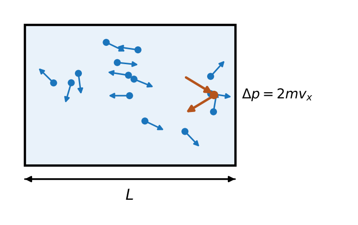
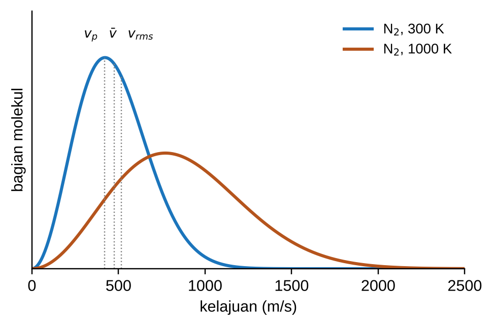
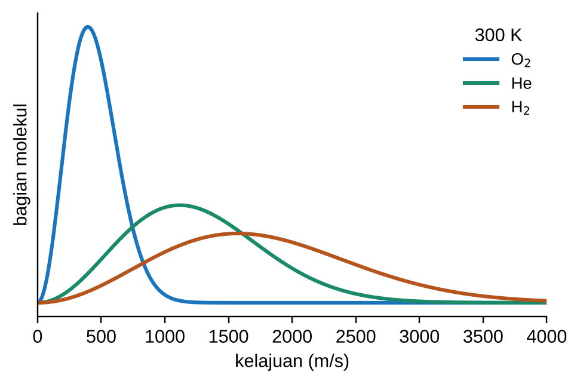
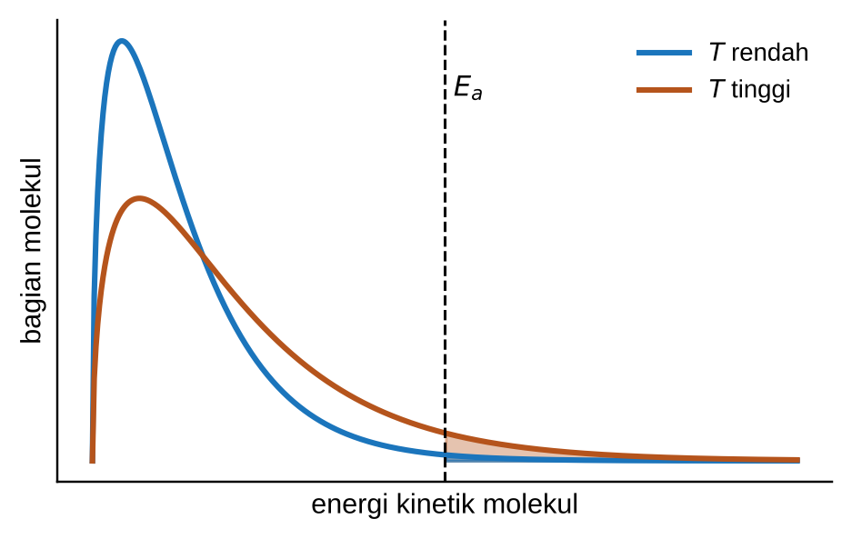
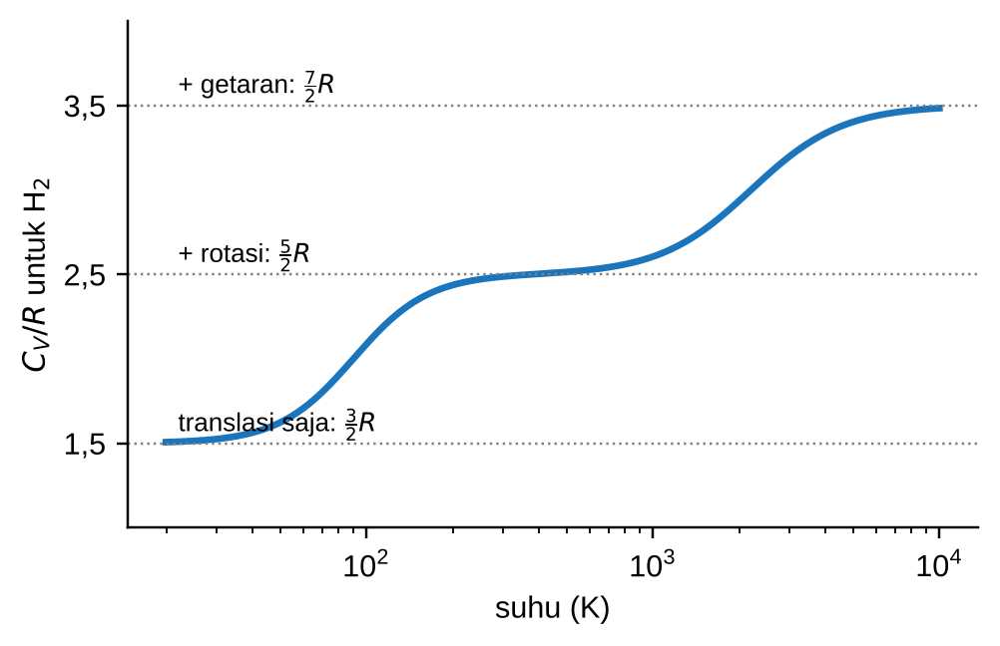
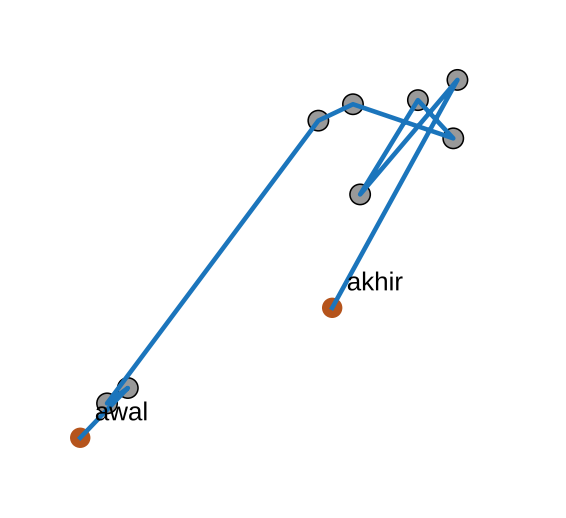
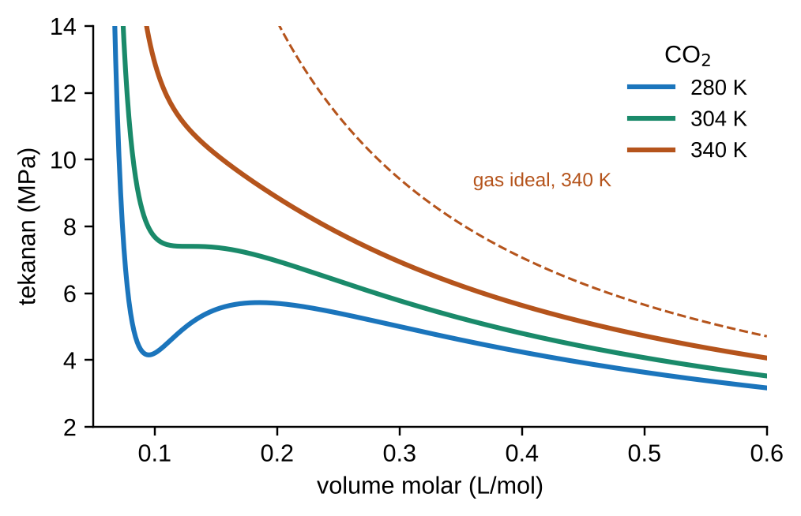

## 10.7 Teori kinetik gas

Persamaan $pV = nRT$ diperoleh dari percobaan. Ia mengatakan **bagaimana** gas berperilaku, tetapi tidak mengatakan **mengapa**. Teori kinetik menjawabnya dengan satu gambaran sederhana: gas adalah kumpulan sangat banyak molekul kecil yang bergerak acak dan terus-menerus, dan semua sifat gas yang terukur adalah akibat gerak itu.

### Model gas ideal

Model ini memakai empat anggapan:

1. Gas terdiri atas sangat banyak molekul yang bergerak acak ke segala arah.
2. Ukuran molekul dapat diabaikan terhadap jarak antarmolekul.
3. Molekul tidak saling tarik atau saling tolak, kecuali sesaat ketika bertumbukan.
4. Semua tumbukan, antarmolekul maupun dengan dinding, lenting sempurna.

Anggapan 2 dan 3 itulah yang membuat gas "ideal". Keduanya baik untuk gas renggang, dan mulai gagal pada tekanan tinggi atau suhu rendah (subbab 10.10).

### Tekanan dari tumbukan

{width=55%}

Tekanan gas adalah akibat hujan tumbukan molekul pada dinding (subbab 5.9). Sekarang kita hitung besarnya.

Tinjau satu molekul bermassa $m$ dalam kotak kubus bersisi $L$ (Gambar 10.7). Komponen kecepatannya ke arah dinding kanan adalah $v_x$.

- Tiap menumbuk dinding kanan, komponen itu berbalik: momentum molekul berubah sebesar $2mv_x$, dan dinding menerima impuls yang sama.
- Untuk kembali ke dinding yang sama, molekul menempuh jarak $2L$, jadi selang waktu antartumbukan $2L/v_x$.
- Gaya rata-rata pada dinding oleh satu molekul = impuls tiap tumbukan ÷ selang waktu:

$$
F_1 = \frac{2mv_x}{2L/v_x} = \frac{mv_x^2}{L} .
$$

Untuk $N$ molekul, jumlahkan. Hasilnya $N$ kali nilai rata-rata, yang ditulis dengan kurung sudut:

$$
F = \frac{Nm\langle v_x^2\rangle}{L}, \qquad p = \frac{F}{L^2} = \frac{Nm\langle v_x^2\rangle}{V} .
$$

Gerak molekul acak, tidak ada arah yang istimewa, sehingga $\langle v_x^2\rangle = \langle v_y^2\rangle = \langle v_z^2\rangle$. Karena $v^2 = v_x^2 + v_y^2 + v_z^2$, masing-masing sama dengan $\tfrac13\langle v^2\rangle$. Jadi

$$
\boxed{pV = \tfrac13Nm\langle v^2\rangle} \qquad \text{(10.17)}
$$

Ruas kiri adalah besaran yang terukur dengan manometer dan penggaris. Ruas kanan sepenuhnya tentang molekul. Karena $Nm/V$ adalah massa jenis gas, bentuk lainnya $p = \tfrac13\rho\langle v^2\rangle$.

### Arti suhu

Tulis (10.17) dengan energi kinetik rata-rata satu molekul, $\langle K\rangle = \tfrac12m\langle v^2\rangle$:

$$
pV = \tfrac23N\langle K\rangle .
$$

Bandingkan dengan hasil percobaan, $pV = Nk_BT$. Keduanya hanya dapat sama jika

$$
\boxed{\langle K\rangle = \tfrac12m\langle v^2\rangle = \tfrac32k_BT} \qquad \text{(10.18)}
$$

::: {.inti}
**Suhu mutlak adalah ukuran energi kinetik rata-rata gerak acak molekul.** Suhu yang sama berarti energi kinetik translasi rata-rata yang sama, apa pun jenis molekulnya.
:::

Inilah hasil terpenting bab ini. Tiga akibatnya langsung terlihat:

- **Nol mutlak** adalah keadaan ketika gerak termal berhenti (dalam gambaran klasik). Tidak ada suhu di bawahnya karena energi kinetik tidak dapat negatif.
- **Kesetimbangan termal** berarti molekul-molekul kedua benda sudah berbagi energi lewat tumbukan sampai rata-ratanya sama.
- Pada suhu yang sama, **molekul ringan bergerak lebih cepat** daripada molekul berat, karena energi kinetiknya sama.

Per mol, energi kinetik translasi itu $\tfrac32RT$. Pada suhu kamar nilainya sekitar 3,7 kJ/mol. Angka ini patut diingat sebagai ukuran "energi termal yang tersedia": ikatan kimia (ratusan kJ/mol) jauh di atasnya, ikatan hidrogen (sekitar 20 kJ/mol) beberapa kali di atasnya, dan gaya van der Waals (beberapa kJ/mol) setara dengannya. Itu sebabnya pada suhu kamar molekul tetap utuh, ikatan hidrogen terus-menerus putus dan terbentuk, dan gas mulia tidak mengembun.

### Kelajuan rms

Dari (10.18), akar dari rata-rata kuadrat kelajuan, disebut **kelajuan rms** (*root mean square*), adalah

$$
\boxed{v_\text{rms} = \sqrt{\langle v^2\rangle} = \sqrt{\frac{3k_BT}{m}} = \sqrt{\frac{3RT}{M}}} \qquad \text{(10.19)}
$$

Kedua bentuk itu sama, karena $R = N_Ak_B$ dan $M = N_Am$. Dalam bentuk kedua, $M$ **harus dalam kg/mol**.

| Gas | $M$ (g/mol) | $v_\text{rms}$ pada 298 K (m/s) |
|---|---|---|
| H₂ | 2,016 | 1920 |
| He | 4,003 | 1363 |
| H₂O | 18,02 | 642 |
| N₂ | 28,01 | 515 |
| O₂ | 32,00 | 482 |
| CO₂ | 44,01 | 411 |
| UF₆ | 352 | 145 |

Molekul udara di sekitarmu bergerak dengan kelajuan sekitar 500 m/s, lebih cepat daripada pesawat jet penumpang.

::: {.contoh}
**Contoh 10.27 · Tekanan dari kelajuan molekul**

Gas nitrogen pada 0 °C dan 1 atm memiliki massa jenis 1,25 kg/m³. (a) Berapa kelajuan rms molekulnya? (b) Hitung tekanan gas dari massa jenis dan kelajuan itu.

**Penyelesaian.**

(a) $v_\text{rms} = \sqrt{\dfrac{3(8{,}314)(273{,}15)}{0{,}02801}} = 493$ m/s.

(b) $p = \tfrac13\rho v_\text{rms}^2 = \tfrac13(1{,}25)(493)^2 = 1{,}01 \times 10^5$ Pa.

**Memahami hasil.** Hasilnya tepat 1 atm. Tekanan udara yang menahan kolom raksa setinggi 76 cm adalah akibat molekul-molekul seberat $4{,}7 \times 10^{-26}$ kg yang menghantam dengan kelajuan setengah kilometer per detik, dalam jumlah yang luar biasa besar.
:::

::: {.contoh}
**Contoh 10.28 · Energi termal pada suhu kamar**

Hitung energi kinetik translasi rata-rata satu molekul gas pada 298 K, dalam joule, dalam elektronvolt, dan per mol.

**Penyelesaian.**

$$
\langle K\rangle = \tfrac32k_BT = \tfrac32(1{,}381 \times 10^{-23})(298) = 6{,}17 \times 10^{-21}\ \text{J}.
$$

Dalam eV: $\dfrac{6{,}17 \times 10^{-21}}{1{,}602 \times 10^{-19}} = 0{,}0385$ eV. Per mol: $\tfrac32RT = \tfrac32(8{,}314)(298) = 3{,}72$ kJ/mol.

**Memahami hasil.** Jawaban ini tidak memerlukan jenis gasnya. Hafalkan juga $k_BT$ sendiri pada suhu kamar: 0,0257 eV, atau $\tfrac1{40}$ eV, atau 2,48 kJ/mol. Hampir semua pertanyaan "apakah proses ini terjadi pada suhu kamar?" dijawab dengan membandingkan energi yang diperlukan dengan angka ini.
:::

::: {.contoh}
**Contoh 10.29 · Membandingkan kelajuan molekul**

Pada suhu yang sama, (a) berapa kali lebih cepat molekul H₂ dibandingkan O₂? (b) Pada suhu berapa kelajuan rms N₂ dua kali nilainya pada 300 K?

**Penyelesaian.**

(a) $v_\text{rms} \propto 1/\sqrt M$: $\sqrt{\dfrac{32{,}00}{2{,}016}} = 3{,}98$ kali.

(b) $v_\text{rms} \propto \sqrt T$. Dua kali kelajuan memerlukan empat kali suhu mutlak: 1200 K.

**Memahami hasil.** Kelajuan molekul hanya tumbuh sebagai **akar** suhu. Menaikkan suhu dari 298 K ke 308 K hanya menaikkan kelajuan $\sqrt{308/298} = 1{,}017$ kali, yaitu 1,7%, angka yang disebut di pembuka bab.
:::

::: {.contoh}
**Contoh 10.30 · Energi dalam gas dan energi gerak wadahnya**

Satu mol helium (4,0 g) bersuhu 298 K berada dalam tabung. (a) Berapa energi kinetik total gerak acak atom-atomnya? (b) Dengan kelajuan berapa tabung itu harus dilempar agar energi kinetik gerak bersama gasnya sama dengan nilai (a)?

**Penyelesaian.**

(a) $U = \tfrac32nRT = \tfrac32(1)(8{,}314)(298) = 3{,}72 \times 10^3$ J.

(b) $\tfrac12(0{,}0040)v^2 = 3720$ memberi $v = 1360$ m/s.

**Memahami hasil.** Hasil (b) tentu saja sama dengan $v_\text{rms}$ helium. Energi gerak acak dalam segenggam gas setara dengan energi gerak gas itu jika seluruhnya melesat empat kali kelajuan bunyi. Kita tidak merasakannya karena arahnya acak dan saling meniadakan. Melempar tabung **tidak** menaikkan suhu gas: suhu hanya mengukur gerak acak relatif terhadap pusat massa.
:::

::: {.contoh}
**Contoh 10.31 · Mengapa atmosfer Bumi tidak mengandung hidrogen**

Kelajuan lepas dari Bumi 11,2 km/s. Lapisan teratas atmosfer bersuhu sekitar 1000 K. Sebuah gas perlahan-lahan lolos ke angkasa jika kelajuan lepas kurang dari kira-kira enam kali $v_\text{rms}$-nya. Periksa H₂, He, dan N₂.

**Penyelesaian.**

| Gas | $v_\text{rms}$ pada 1000 K | $11{,}2\ \text{km/s} \div v_\text{rms}$ | Nasib |
|---|---|---|---|
| H₂ | 3,52 km/s | 3,2 | lolos |
| He | 2,50 km/s | 4,5 | lolos |
| N₂ | 0,94 km/s | 11,9 | bertahan |

**Memahami hasil.** Mengapa enam kali, bukan satu kali? Karena kelajuan molekul tersebar (subbab 10.8): selalu ada sebagian kecil molekul yang jauh lebih cepat daripada rata-rata, dan dalam miliaran tahun bagian kecil itu cukup untuk menguras seluruh persediaan. Helium yang kita pakai di laboratorium berasal dari peluruhan radioaktif di kerak Bumi; begitu dilepas ke udara, ia hilang selamanya. Bulan, dengan kelajuan lepas 2,4 km/s, tidak mampu menahan gas apa pun.
:::

::: {.contoh}
**Contoh 10.32 · Kelajuan molekul dan laju bunyi**

Laju bunyi dalam gas adalah $v = \sqrt{\gamma RT/M}$ (subbab 9.3). Bandingkan dengan kelajuan rms molekul nitrogen pada 298 K ($\gamma = 1{,}40$).

**Penyelesaian.**

$$
\frac{v_\text{rms}}{v_\text{bunyi}} = \sqrt{\frac{3}{\gamma}} = \sqrt{\frac{3}{1{,}40}} = 1{,}46 .
$$

Laju bunyi: $\sqrt{\dfrac{(1{,}40)(8{,}314)(298)}{0{,}02801}} = 352$ m/s; kelajuan rms 515 m/s.

**Memahami hasil.** Bunyi diteruskan oleh molekul-molekul yang saling menumbuk, jadi tidak mungkin merambat lebih cepat daripada molekul pembawanya, tetapi juga tidak jauh lebih lambat. Kedua kelajuan bergantung pada $\sqrt{T/M}$ dengan cara yang sama. Itu sebabnya suara terdengar melengking setelah menghirup helium.
:::

::: {.contoh}
**Contoh 10.33 · Hujan molekul pada permukaan**

Banyaknya molekul yang menumbuk dinding tiap satuan luas tiap detik adalah $\tfrac14n\bar v$, dengan $n = N/V$ rapat molekul dan $\bar v$ kelajuan rata-rata. Untuk nitrogen pada 298 K, $\bar v = 475$ m/s. (a) Berapa tumbukan tiap detik pada 1 cm² dinding pada 1 atm? (b) Sebuah permukaan logam bersih memiliki sekitar $10^{19}$ tempat serapan tiap m². Jika tiap molekul yang datang menempel, berapa lama permukaan itu tertutup satu lapis pada tekanan $1{,}0 \times 10^{-4}$ Pa?

**Penyelesaian.**

(a) $n = \dfrac{p}{k_BT} = \dfrac{101\,325}{(1{,}381 \times 10^{-23})(298)} = 2{,}46 \times 10^{25}\ \text{m}^{-3}$. Fluksnya $\tfrac14(2{,}46 \times 10^{25})(475) = 2{,}9 \times 10^{27}\ \text{m}^{-2}\text{s}^{-1}$, atau $2{,}9 \times 10^{23}$ tumbukan tiap detik pada 1 cm².

(b) Pada $1{,}0 \times 10^{-4}$ Pa, $n$ dan fluksnya $10^9$ kali lebih kecil: $2{,}9 \times 10^{18}\ \text{m}^{-2}\text{s}^{-1}$. Waktu: $\dfrac{10^{19}}{2{,}9 \times 10^{18}} = 3{,}5$ s.

**Memahami hasil.** Pada (a), setengah mol molekul menghantam tiap sentimeter persegi kulitmu setiap detik. Pada (b), bahkan dalam vakum yang baik, permukaan bersih terkotori dalam beberapa detik. Karena itu penelitian permukaan dan katalis memerlukan vakum ultratinggi, $10^{-8}$ Pa atau lebih rendah, agar permukaan tetap bersih selama berjam-jam.
:::

::: {.kuis}
**Kuis cepat 10.7**

Campuran helium dan argon berada dalam kesetimbangan termal. Bandingkan (a) energi kinetik rata-rata atomnya; (b) kelajuan rms atomnya.
:::

## 10.8 Sebaran kelajuan Maxwell–Boltzmann

Kelajuan rms hanya satu angka. Molekul-molekul dalam gas tidak semuanya bergerak dengan kelajuan itu: tiap tumbukan mengubah kelajuan kedua molekul yang terlibat, dan tiap molekul bertumbukan miliaran kali per detik. Hasilnya adalah **sebaran** kelajuan yang mantap.

### Bentuk sebaran

Pada tahun 1860 James Clerk Maxwell menurunkan sebaran itu. Bagian molekul yang kelajuannya antara $v$ dan $v + dv$ adalah $f(v)\,dv$, dengan

$$
\boxed{f(v) = 4\pi\left(\frac{m}{2\pi k_BT}\right)^{3/2}v^2\,e^{-mv^2/2k_BT}} \qquad \text{(10.20)}
$$

Rumus ini tampak rumit, tetapi isinya hanya dua faktor yang bersaing:

- **$v^2$** menyatakan banyaknya cara memiliki kelajuan $v$. Makin besar kelajuan, makin banyak arah dan kombinasi komponen yang menghasilkannya. Faktor ini membuat kurva naik dari nol.
- **$e^{-mv^2/2k_BT}$** adalah faktor Boltzmann $e^{-E/k_BT}$ (subbab 6.5) dengan $E = \tfrac12mv^2$. Keadaan berenergi tinggi makin jarang dihuni. Faktor ini membuat kurva turun pada kelajuan besar.

Faktor di depan hanya memastikan jumlah seluruh bagian sama dengan satu.

{width=66%}

Luas di bawah kurva antara dua kelajuan adalah bagian molekul dalam rentang itu, dan luas seluruhnya selalu satu. Karena itu, ketika suhu naik dan kurva melebar, puncaknya **harus** merendah (Gambar 10.8).

{width=66%}

### Tiga kelajuan khas

Kurva itu tidak setangkup: ekornya memanjang ke kanan. Akibatnya ada tiga "kelajuan khas" yang berbeda:

$$
\boxed{v_p = \sqrt{\frac{2RT}{M}}, \qquad \bar v = \sqrt{\frac{8RT}{\pi M}}, \qquad v_\text{rms} = \sqrt{\frac{3RT}{M}}} \qquad \text{(10.21)}
$$

| Kelajuan | Arti | Dipakai untuk |
|---|---|---|
| $v_p$, paling mungkin | puncak kurva | menggambar dan membandingkan sebaran |
| $\bar v$, rata-rata | rata-rata hitung kelajuan | laju tumbukan, efusi, jalan bebas |
| $v_\text{rms}$ | akar rata-rata kuadrat | energi kinetik, tekanan |

Perbandingannya tetap: $v_p : \bar v : v_\text{rms} = 1 : 1{,}128 : 1{,}225$.

::: {.contoh}
**Contoh 10.34 · Tiga kelajuan nitrogen**

Hitung $v_p$, $\bar v$, dan $v_\text{rms}$ untuk N₂ pada 298 K.

**Penyelesaian.** $\dfrac{RT}{M} = \dfrac{(8{,}314)(298)}{0{,}02801} = 8{,}845 \times 10^4\ \text{m}^2/\text{s}^2$.

$$
v_p = \sqrt{2 \times 8{,}845 \times 10^4} = 421\ \text{m/s}, \qquad \bar v = \sqrt{\tfrac{8}{\pi} \times 8{,}845 \times 10^4} = 475\ \text{m/s}, \qquad v_\text{rms} = 515\ \text{m/s}.
$$

**Memahami hasil.** Urutannya selalu $v_p < \bar v < v_\text{rms}$. Rata-rata lebih besar daripada nilai paling mungkin karena ekor panjang di kanan menarik rata-rata ke atas, dan rata-rata kuadrat memberi bobot lebih besar lagi pada molekul cepat.
:::

::: {.contoh}
**Contoh 10.35 · Membaca kurva sebaran**

Sebuah kurva sebaran kelajuan gas pada 300 K berpuncak di 394 m/s. (a) Gas apakah itu? (b) Di mana puncaknya jika gas dipanaskan sampai 600 K, dan bagaimana tinggi puncaknya berubah?

**Penyelesaian.**

(a) $M = \dfrac{2RT}{v_p^2} = \dfrac{2(8{,}314)(300)}{(394)^2} = 0{,}0321$ kg/mol. Itu O₂.

(b) $v_p \propto \sqrt T$: $394\sqrt2 = 557$ m/s. Tinggi puncak sebanding dengan $1/v_p$, jadi turun menjadi $1/\sqrt2 = 0{,}71$ kali semula.

**Memahami hasil.** Melebar $\sqrt2$ kali dan merendah $\sqrt2$ kali: luasnya tetap satu.
:::

### Ekor sebaran dan laju reaksi

Sekarang pertanyaan pembuka bab. Reaksi kimia terjadi ketika dua molekul bertumbukan dengan energi yang cukup untuk melewati bukit energi aktivasi $E_a$ (subbab 4.8). Bagian tumbukan yang energinya melampaui $E_a$ kira-kira sebesar faktor Boltzmann:

$$
\boxed{\text{bagian berenergi} > E_a\ \approx\ e^{-E_a/RT}} \qquad \text{(10.22)}
$$

dengan $E_a$ per mol. Laju reaksi sebanding dengan bagian itu. Inilah asal **persamaan Arrhenius**, $k = Ae^{-E_a/RT}$.

{width=62%}

::: {.contoh}
**Contoh 10.36 · Mengapa 10 °C melipatduakan laju reaksi**

Suatu reaksi memiliki energi aktivasi 50 kJ/mol. (a) Berapa bagian tumbukan yang cukup berenergi pada 298 K dan pada 308 K? (b) Berapa kali laju reaksinya naik? (c) Ulangi (b) untuk $E_a = 75$ kJ/mol.

**Penyelesaian.**

(a) Pada 298 K: $\dfrac{E_a}{RT} = \dfrac{50\,000}{(8{,}314)(298)} = 20{,}18$, sehingga bagiannya $e^{-20{,}18} = 1{,}7 \times 10^{-9}$.

Pada 308 K: $\dfrac{E_a}{RT} = 19{,}53$, bagiannya $e^{-19{,}53} = 3{,}3 \times 10^{-9}$.

(b) Perbandingannya:

$$
\frac{k_{308}}{k_{298}} = \exp\left[\frac{E_a}{R}\left(\frac{1}{298} - \frac{1}{308}\right)\right] = e^{0{,}655} = 1{,}93 .
$$

(c) Dengan $E_a = 75$ kJ/mol, pangkatnya menjadi 0,983 dan perbandingannya 2,67.

**Memahami hasil.** Hanya dua dari semiliar tumbukan yang berhasil, dan kenaikan suhu 3% melipatduakan jumlah itu. Penyebabnya adalah sifat fungsi eksponen: $E_a/RT$ sekitar 20, dan perubahan kecil pada bilangan besar di dalam pangkat berakibat besar. Kelajuan rata-rata molekul sendiri hanya naik 1,7% (Contoh 10.29).

"Aturan dua kali" hanya tepat untuk $E_a$ sekitar 50 kJ/mol di dekat suhu kamar. Reaksi berenergi aktivasi tinggi jauh lebih peka terhadap suhu. Itu sebabnya makanan disimpan di lemari es (laju pembusukan turun beberapa kali lipat), dan itu pula sebabnya demam beberapa derajat saja sudah mengganggu kimia tubuh.
:::

::: {.contoh}
**Contoh 10.37 · Menentukan energi aktivasi**

Tetapan laju suatu reaksi tepat dua kali lebih besar pada 310 K daripada pada 300 K. Berapa energi aktivasinya?

**Penyelesaian.** Dari perbandingan dua persamaan Arrhenius:

$$
\ln\frac{k_2}{k_1} = \frac{E_a}{R}\left(\frac1{T_1} - \frac1{T_2}\right) \quad\Longrightarrow\quad E_a = \frac{R\ln 2}{\dfrac1{300} - \dfrac1{310}} = \frac{(8{,}314)(0{,}693)}{1{,}075 \times 10^{-4}} = 5{,}36 \times 10^4\ \text{J/mol}.
$$

Jadi $E_a = 54$ kJ/mol.

**Memahami hasil.** Di laboratorium, $E_a$ diperoleh dari kemiringan grafik $\ln k$ terhadap $1/T$, yang besarnya $-E_a/R$. Dua titik data, seperti di sini, adalah bentuk paling sederhana dari cara itu.
:::

::: {.contoh}
**Contoh 10.38 · Tingkat energi mana yang terisi?**

Faktor Boltzmann juga menentukan hunian tingkat energi molekul. Untuk HCl, jarak tingkat getaran terendah 0,358 eV, dan jarak dua tingkat rotasi terendah 0,0026 eV. Pada 298 K, berapa perbandingan faktor Boltzmann tingkat atas terhadap tingkat bawah untuk (a) getaran; (b) rotasi?

**Penyelesaian.** $k_BT = (8{,}617 \times 10^{-5}\ \text{eV/K})(298) = 0{,}0257$ eV.

(a) $e^{-0{,}358/0{,}0257} = e^{-13{,}9} = 9 \times 10^{-7}$.

(b) $e^{-0{,}0026/0{,}0257} = e^{-0{,}10} = 0{,}90$.

**Memahami hasil.** Pada suhu kamar hampir semua molekul HCl berada di tingkat getaran dasar, hanya satu dari sejuta yang tereksitasi. Sebaliknya, banyak tingkat rotasi terisi. Dua akibatnya: spektrum inframerah HCl hanya menunjukkan loncatan dari tingkat getaran dasar, tetapi tiap loncatan itu terpecah menjadi banyak garis rotasi. Dan getaran molekul hampir tidak ikut menyimpan energi pada suhu kamar, hal yang penting di subbab 10.9.
:::

### Efusi

**Efusi** adalah lolosnya gas melalui lubang yang sangat kecil ke ruang hampa. Molekul yang lebih cepat lebih sering sampai ke lubang, jadi laju efusi sebanding dengan kelajuan rata-rata:

$$
\boxed{\frac{\text{laju}_1}{\text{laju}_2} = \sqrt{\frac{M_2}{M_1}}} \qquad \text{(10.23)}
$$

Ini **hukum Graham**. Gas ringan lolos lebih cepat. Balon berisi helium kempis dalam sehari, sedangkan balon berisi udara bertahan berhari-hari.

::: {.contoh}
**Contoh 10.39 · Hukum Graham**

(a) Berapa kali lebih cepat H₂ berefusi dibandingkan O₂? (b) Sejumlah gas tak dikenal memerlukan 68 s untuk berefusi melalui sebuah lubang; oksigen dalam jumlah mol yang sama, pada keadaan yang sama, memerlukan 48 s. Berapa massa molar gas itu?

**Penyelesaian.**

(a) $\sqrt{\dfrac{32{,}00}{2{,}016}} = 3{,}98$ kali.

(b) Waktu berbanding terbalik dengan laju, jadi $\dfrac{t}{t_{\text{O}_2}} = \sqrt{\dfrac{M}{M_{\text{O}_2}}}$:

$$
M = 32{,}00\left(\frac{68}{48}\right)^2 = 64\ \text{g/mol}.
$$

**Memahami hasil.** Massa molar 64 g/mol cocok dengan SO₂. Gas yang lebih berat memerlukan waktu lebih lama, sesuai.
:::

::: {.contoh}
**Contoh 10.40 · Memperkaya uranium**

Uranium alam mengandung 0,72% ²³⁵U; reaktor memerlukan sekitar 3%. Pemisahan dilakukan dengan gas UF₆: ²³⁵UF₆ (349 g/mol) berefusi sedikit lebih cepat daripada ²³⁸UF₆ (352 g/mol). (a) Berapa faktor pemisahan satu tahap? (b) Kira-kira berapa tahap yang diperlukan?

**Penyelesaian.**

(a) $\sqrt{\dfrac{352}{349}} = 1{,}0043$.

(b) Perbandingan ²³⁵U terhadap ²³⁸U harus naik dari $\dfrac{0{,}72}{99{,}28} = 0{,}00725$ menjadi $\dfrac{3}{97} = 0{,}0309$, yaitu 4,26 kali. Tiap tahap mengalikan perbandingan dengan 1,0043:

$$
N = \frac{\ln 4{,}26}{\ln 1{,}0043} = \frac{1{,}450}{0{,}00429} \approx 340\ \text{tahap}.
$$

**Memahami hasil.** Selisih massa kurang dari 1% memberi selisih kelajuan hanya 0,4%, karena kelajuan bergantung pada akar massa. Itulah sebabnya pabrik pengayaan berukuran raksasa. Fluor dipilih karena hanya memiliki satu isotop stabil, sehingga selisih massa molekul UF₆ seluruhnya berasal dari uraniumnya.
:::

::: {.terapan}
**Kaitan kimia · Pendinginan karena penguapan**

Sebaran Maxwell–Boltzmann juga berlaku, secara kasar, dalam zat cair. Molekul yang mampu lolos dari permukaan adalah molekul di ekor sebaran, yang energinya cukup untuk melepaskan diri dari tarikan tetangganya. Ketika mereka pergi, energi rata-rata molekul yang tertinggal turun: zat cair mendingin. Itulah arti molekul dari kalor laten penguapan (subbab 10.5).

Hal yang sama menjelaskan **tekanan uap**. Bagian molekul yang mampu lolos sebanding dengan $e^{-\Delta H_\text{uap}/RT}$, sehingga tekanan uap naik sangat cepat dengan suhu, mengikuti persamaan Clausius–Clapeyron. Bentuknya persis sama dengan persamaan Arrhenius, karena asal-usulnya sama: keduanya menghitung isi ekor sebaran.
:::

::: {.kuis}
**Kuis cepat 10.8**

Suhu gas dinaikkan. Apa yang terjadi pada (a) letak puncak kurva sebaran; (b) tinggi puncak; (c) luas di bawah kurva?
:::

## 10.9 Ekuipartisi dan kapasitas kalor

Jika suhu adalah energi kinetik molekul, maka kalor yang diperlukan untuk menaikkan suhu, yaitu kapasitas kalor, seharusnya dapat **dihitung** dari gambaran molekul. Ini ujian yang berat bagi teori kinetik, dan hasilnya sangat mengajar: teori itu berhasil, lalu gagal di tempat yang menarik.

### Teorema ekuipartisi

Energi kinetik translasi rata-rata sebuah molekul adalah $\tfrac32k_BT$, dan itu berasal dari tiga arah gerak yang setara. Jadi tiap arah mendapat $\tfrac12k_BT$. Maxwell dan Boltzmann menunjukkan bahwa hal ini berlaku umum:

::: {.inti}
**Teorema ekuipartisi.** Dalam kesetimbangan termal, tiap **derajat kebebasan**, yaitu tiap suku kuadrat dalam energi molekul, mendapat energi rata-rata $\tfrac12k_BT$ (per mol: $\tfrac12RT$).
:::

Suku kuadrat itu misalnya $\tfrac12mv_x^2$ (translasi), $\tfrac12I\omega^2$ (rotasi), serta $\tfrac12mv^2$ dan $\tfrac12kx^2$ pada getaran. Energi dibagi rata; itu arti kata **ekuipartisi**.

| Molekul | Translasi | Rotasi | Jumlah $f$ (tanpa getaran) |
|---|---|---|---|
| Monoatomik (He, Ar) | 3 | 0 | 3 |
| Diatomik atau linear (N₂, CO₂) | 3 | 2 | 5 |
| Tak linear (H₂O, CH₄) | 3 | 3 | 6 |

Molekul linear hanya memiliki dua rotasi karena putaran mengelilingi sumbu molekulnya sendiri tidak menyimpan energi yang berarti. Tiap ragam **getaran** menyumbang dua derajat kebebasan (kinetik dan potensial), jika getaran itu aktif.

### Kapasitas kalor gas

Energi dalam $n$ mol gas ideal dengan $f$ derajat kebebasan adalah

$$
\boxed{U = \frac f2nRT} \qquad \text{(10.24)}
$$

Jika gas dipanaskan pada **volume tetap**, seluruh kalor menjadi energi dalam. Kapasitas kalor molarnya:

$$
\boxed{C_V = \frac f2R, \qquad C_p = C_V + R, \qquad \gamma = \frac{C_p}{C_V} = 1 + \frac2f} \qquad \text{(10.25)}
$$

Pada **tekanan tetap**, gas memuai dan melakukan usaha pada lingkungan, sehingga perlu kalor lebih banyak: $C_p$ lebih besar daripada $C_V$ sebesar $R$. Asal tambahan itu dibahas di Bab 11.

| Gas | $f$ | $C_V$ ramalan (J/(mol·K)) | $C_V$ terukur, 298 K | $\gamma$ terukur |
|---|---|---|---|---|
| He | 3 | 12,5 | 12,5 | 1,67 |
| Ar | 3 | 12,5 | 12,5 | 1,67 |
| H₂ | 5 | 20,8 | 20,5 | 1,41 |
| N₂ | 5 | 20,8 | 20,8 | 1,40 |
| O₂ | 5 | 20,8 | 21,1 | 1,40 |
| Cl₂ | 5 | 20,8 | 25,6 | 1,33 |
| CO₂ | 5 | 20,8 | 28,8 | 1,29 |
| H₂O (uap) | 6 | 24,9 | 25,3 | 1,33 |
| CH₄ | 6 | 24,9 | 27,4 | 1,30 |

Untuk gas mulia, ramalannya tepat sampai tiga angka. Untuk H₂, N₂, dan O₂ juga sangat baik. Tetapi Cl₂, CO₂, dan CH₄ menyimpan energi **lebih banyak** daripada ramalan, dan ada pertanyaan yang lebih mengganggu: mengapa getaran N₂ tidak ikut dihitung?

### Derajat kebebasan yang membeku

{width=66%}

Gambar 10.11 menunjukkan $C_V$ hidrogen pada rentang suhu yang lebar. Di bawah 50 K nilainya $\tfrac32R$, seolah-olah molekul H₂ tidak dapat berotasi. Di sekitar suhu kamar nilainya $\tfrac52R$. Baru di atas 1000 K nilainya naik menuju $\tfrac72R$.

Fisika klasik tidak dapat menjelaskan tangga ini. Penjelasannya adalah **kuantisasi** energi (subbab 8.7 dan 9.10): energi rotasi dan getaran molekul hanya boleh bernilai tertentu, dengan jarak tingkat $\Delta E$.

- Jika $k_BT \gg \Delta E$, tingkat-tingkat itu terisi dengan leluasa dan ekuipartisi berlaku.
- Jika $k_BT \ll \Delta E$, tumbukan termal tidak cukup kuat untuk mengangkat molekul ke tingkat berikutnya. Derajat kebebasan itu **membeku** dan tidak ikut menyimpan energi.

Jarak tingkat getaran N₂ adalah 0,29 eV, sebelas kali $k_BT$ pada suhu kamar: getarannya membeku. Ikatan Cl₂ lebih lemah dan atomnya lebih berat, sehingga jarak tingkat getarannya hanya 0,069 eV, kurang dari tiga kali $k_BT$: getarannya sudah sebagian aktif, dan $C_V$-nya melampaui $\tfrac52R$. CO₂ dan CH₄ memiliki ragam tekuk berfrekuensi rendah yang juga sebagian aktif.

Kapasitas kalor gas adalah salah satu petunjuk pertama, jauh sebelum tahun 1900, bahwa ada yang salah dengan fisika klasik.

::: {.contoh}
**Contoh 10.41 · Meramalkan kapasitas kalor**

Ramalkan $C_V$, $C_p$, dan $\gamma$ untuk (a) neon; (b) nitrogen pada suhu kamar; (c) nitrogen pada suhu sangat tinggi, ketika getarannya aktif sepenuhnya.

**Penyelesaian.**

| | $f$ | $C_V = \tfrac f2R$ | $C_p = C_V + R$ | $\gamma$ |
|---|---|---|---|---|
| (a) Ne | 3 | 12,47 | 20,79 | 1,67 |
| (b) N₂, 298 K | 5 | 20,79 | 29,10 | 1,40 |
| (c) N₂, suhu tinggi | 7 | 29,10 | 37,41 | 1,29 |

**Memahami hasil.** Nilai terukur $C_p$ nitrogen pada 298 K adalah 29,1 J/(mol·K), tepat. Pada 2000 K nilainya 36,0, sudah dekat dengan ramalan (c). Kapasitas kalor gas pada suhu nyala api lebih besar daripada pada suhu kamar, dan hal itu harus diperhitungkan ketika menghitung suhu nyala.
:::

::: {.contoh}
**Contoh 10.42 · Memanaskan gas pada volume tetap dan pada tekanan tetap**

Berapa kalor untuk menaikkan suhu 2,00 mol nitrogen sebesar 50,0 K (a) dalam tabung kaku; (b) dalam silinder berpiston bebas pada tekanan tetap? (c) Ke mana perginya selisihnya?

**Penyelesaian.**

(a) $Q = nC_V\Delta T = (2{,}00)(20{,}79)(50{,}0) = 2{,}08$ kJ.

(b) $Q = nC_p\Delta T = (2{,}00)(29{,}10)(50{,}0) = 2{,}91$ kJ.

(c) Selisihnya, 0,83 kJ, sama dengan $nR\Delta T = (2{,}00)(8{,}314)(50{,}0)$. Itu usaha yang dilakukan gas untuk mendorong piston.

**Memahami hasil.** Energi dalam gas naik sama besar pada kedua cara, 2,08 kJ, karena hanya bergantung pada suhu. Pada cara (b), 29% kalor tidak tinggal di dalam gas.
:::

::: {.contoh}
**Contoh 10.43 · Menebak bentuk molekul dari γ**

Pengukuran laju bunyi memberi $\gamma = 1{,}67$ untuk gas A, 1,40 untuk gas B, dan 1,31 untuk gas C. Apa yang dapat disimpulkan tentang molekulnya?

**Penyelesaian.** Dari $\gamma = 1 + \dfrac2f$, $f = \dfrac{2}{\gamma - 1}$:

- A: $f = 3{,}0$. Monoatomik.
- B: $f = 5{,}0$. Diatomik (atau linear) dengan getaran beku.
- C: $f = 6{,}5$. Molekul tak linear atau poliatomik, dengan sebagian getaran aktif.

**Memahami hasil.** Begitulah argon dikenali sebagai gas monoatomik ketika ditemukan pada tahun 1894: Rayleigh dan Ramsay mengukur laju bunyinya dan memperoleh $\gamma = 1{,}67$. Karena tidak membentuk senyawa apa pun, tidak ada cara kimia untuk mengetahuinya.
:::

::: {.contoh}
**Contoh 10.44 · Energi udara dalam ruangan**

Sebuah ruangan berukuran 4,0 m × 5,0 m × 3,0 m berisi udara pada 1 atm. (a) Berapa energi dalam udara itu? (b) Jika ruangan dipanaskan dari 15 °C ke 25 °C pada tekanan tetap (udara boleh keluar lewat celah), berapa perubahan energi dalam udara **di dalam ruangan**?

**Penyelesaian.**

(a) $U = \tfrac52nRT = \tfrac52pV = \tfrac52(1{,}013 \times 10^5)(60) = 1{,}5 \times 10^7$ J.

(b) Nol. $U = \tfrac52pV$, dan baik $p$ maupun $V$ tidak berubah.

**Memahami hasil.** Hasil (b) mengejutkan tetapi benar. Ketika udara dipanaskan, tiap molekul memang lebih berenergi, tetapi sebagian molekul keluar dari ruangan, dan kedua pengaruh itu tepat saling meniadakan. Energi dari pemanas pergi ke dinding, perabot, dan udara yang terdorong keluar. Kita memanaskan ruangan bukan untuk menambah energinya, melainkan untuk menaikkan **suhunya**.
:::

::: {.contoh}
**Contoh 10.45 · Mencampur dua gas berbeda suhu**

Satu mol helium bersuhu 400 K dan satu mol nitrogen bersuhu 300 K dicampur dalam wadah kaku tersekat. Berapa suhu akhirnya?

**Penyelesaian.** Energi dalam total tetap:

$$
T = \frac{C_{V,\text{He}}(400) + C_{V,\text{N}_2}(300)}{C_{V,\text{He}} + C_{V,\text{N}_2}} = \frac{(12{,}47)(400) + (20{,}79)(300)}{33{,}26} = 337\ \text{K}.
$$

**Memahami hasil.** Bukan 350 K. Nitrogen memiliki lima "kantong" energi tiap molekul, helium hanya tiga, sehingga nitrogen menarik suhu akhir ke arahnya. Ini kalorimetri biasa, hanya dengan kapasitas kalor yang diramalkan dari bentuk molekul.
:::

### Zat padat: hukum Dulong–Petit

Atom dalam kristal tidak dapat berpindah atau berputar; ia hanya bergetar di sekitar tempatnya, dalam tiga arah. Tiap arah getaran memiliki dua suku kuadrat, jadi $f = 6$:

$$
\boxed{C = 3R = 24{,}9\ \text{J/(mol·K)}} \qquad \text{(10.26)}
$$

Inilah penjelasan keteraturan pada tabel subbab 10.4: kapasitas kalor molar hampir semua logam sekitar 25 J/(mol·K). Pierre Dulong dan Alexis Petit menemukannya secara empiris pada tahun 1819, dan para kimiawan memakainya untuk menentukan massa atom unsur-unsur baru.

Hukum ini pun gagal pada suhu rendah, dengan alasan yang sama: getaran kisi membeku. Intan, dengan ikatan yang sangat kaku dan atom yang ringan, sudah menyimpang jauh pada suhu kamar ($C = 6{,}1$ J/(mol·K)). Penjelasan Einstein atas hal ini pada tahun 1907 adalah penerapan pertama gagasan kuantum pada zat padat.

::: {.contoh}
**Contoh 10.46 · Kalor jenis logam dari massa molarnya**

Ramalkan kalor jenis tembaga (63,55 g/mol), emas (197,0 g/mol), dan aluminium (26,98 g/mol), lalu bandingkan dengan nilai terukur.

**Penyelesaian.** $c = \dfrac{3R}{M}$:

| Logam | Ramalan (J/(kg·K)) | Terukur |
|---|---|---|
| Cu | $24{,}94/0{,}06355 = 392$ | 385 |
| Au | $24{,}94/0{,}1970 = 127$ | 129 |
| Al | $24{,}94/0{,}02698 = 924$ | 900 |

**Memahami hasil.** Cocok dalam 3%. Kalor jenis logam berat kecil **bukan** karena atomnya enggan menyimpan energi; tiap atom menyimpan sama banyak. Satu kilogram emas hanya memuat lebih sedikit atom.
:::

::: {.contoh}
**Contoh 10.47 · Massa atom dari kalor jenis**

Sebuah logam tak dikenal memiliki kalor jenis 0,235 J/(g·K). Analisis kimia menunjukkan bahwa oksidanya mengandung 93,1% logam menurut massa. (a) Taksir massa molarnya dengan hukum Dulong–Petit. (b) Tentukan rumus oksida dan massa molar yang lebih teliti.

**Penyelesaian.**

(a) $M \approx \dfrac{24{,}9}{0{,}235} = 106$ g/mol.

(b) Dalam 100 g oksida ada 93,1 g logam dan 6,9 g oksigen, yaitu $\dfrac{6{,}9}{16{,}00} = 0{,}431$ mol O. Dengan $M \approx 106$, logamnya $\dfrac{93{,}1}{106} = 0{,}88$ mol. Perbandingan logam terhadap O adalah 2,04, jadi rumusnya M₂O. Maka banyaknya logam tepat $2 \times 0{,}431 = 0{,}862$ mol, dan

$$
M = \frac{93{,}1}{0{,}862} = 108\ \text{g/mol}.
$$

**Memahami hasil.** Logam itu perak (107,9 g/mol), dan oksidanya Ag₂O. Analisis kimia saja hanya memberi massa **ekuivalen**; hukum Dulong–Petit memberi taksiran kasar yang cukup untuk memilih rumus yang benar. Dengan cara ini banyak massa atom dikoreksi pada abad ke-19.
:::

::: {.kuis}
**Kuis cepat 10.9**

Satu mol helium dan satu mol nitrogen masing-masing diberi kalor yang sama pada volume tetap. Gas mana yang suhunya naik lebih banyak?
:::

## 10.10 Jalan bebas rata-rata dan gas nyata

### Mengapa bau menyebar lambat

Molekul udara bergerak 500 m/s. Tetapi ketika sebotol amonia dibuka di ujung ruangan, baunya baru tercium di ujung lain setelah beberapa menit. Keberatan ini diajukan kepada teori kinetik sejak awal, dan jawabannya diberikan Rudolf Clausius: molekul tidak bergerak lurus. Ia terus-menerus bertumbukan dan berganti arah, menempuh lintasan zig-zag acak.

{width=52%}

Jarak rata-rata yang ditempuh molekul di antara dua tumbukan disebut **jalan bebas rata-rata**, $\lambda$. Untuk molekul berdiameter $d$ dalam gas dengan rapat molekul $n = N/V$:

$$
\boxed{\lambda = \frac{1}{\sqrt2\,\pi d^2n} = \frac{k_BT}{\sqrt2\,\pi d^2p}} \qquad \text{(10.27)}
$$

Bentuknya masuk akal. Sebuah molekul menabrak molekul lain jika pusat keduanya berjarak kurang dari $d$, jadi ia menyapu "tabung" berpenampang $\pi d^2$; makin besar penampang itu dan makin rapat gasnya, makin pendek jalan bebasnya. Faktor $\sqrt2$ muncul karena molekul sasaran juga bergerak.

Banyaknya tumbukan yang dialami satu molekul tiap detik adalah

$$
z = \frac{\bar v}{\lambda} . \qquad \text{(10.28)}
$$

::: {.contoh}
**Contoh 10.48 · Tumbukan dalam udara**

Diameter molekul N₂ sekitar 0,37 nm. Untuk nitrogen pada 298 K dan 1 atm, hitung (a) jalan bebas rata-rata; (b) frekuensi tumbukan satu molekul; (c) perbandingan $\lambda$ dengan diameter molekul.

**Penyelesaian.**

(a) $\lambda = \dfrac{(1{,}381 \times 10^{-23})(298)}{\sqrt2\,\pi(0{,}37 \times 10^{-9})^2(101\,325)} = 6{,}7 \times 10^{-8}$ m $= 67$ nm.

(b) Dengan $\bar v = 475$ m/s: $z = \dfrac{475}{6{,}7 \times 10^{-8}} = 7{,}1 \times 10^9$ tumbukan per detik.

(c) $\dfrac{\lambda}{d} = \dfrac{67}{0{,}37} = 180$.

**Memahami hasil.** Tiap molekul bertumbukan tujuh miliar kali per detik, dan di antara dua tumbukan menempuh jarak 180 kali ukurannya sendiri. Tiga panjang yang perlu dibedakan dalam gas pada 1 atm: ukuran molekul (0,3 nm), jarak antarmolekul (3 nm, Contoh 10.9), dan jalan bebas rata-rata (70 nm). Jalan bebas jauh lebih panjang daripada jarak antarmolekul karena molekul adalah sasaran yang kecil.
:::

::: {.contoh}
**Contoh 10.49 · Jalan bebas dalam vakum**

Berapa jalan bebas rata-rata molekul nitrogen pada 298 K dan tekanan $1{,}0 \times 10^{-4}$ Pa, tekanan kerja sebuah spektrometer massa?

**Penyelesaian.** $\lambda \propto 1/p$. Tekanan turun dari $1{,}013 \times 10^5$ Pa menjadi $1{,}0 \times 10^{-4}$ Pa, yaitu $1{,}013 \times 10^9$ kali:

$$
\lambda = (6{,}7 \times 10^{-8})(1{,}013 \times 10^9) = 68\ \text{m}.
$$

**Memahami hasil.** Jalan bebasnya jauh lebih panjang daripada alatnya. Itu syarat kerja spektrometer massa: ion harus terbang dari sumber ke detektor tanpa menabrak apa pun. Dalam keadaan ini molekul lebih sering menumbuk dinding daripada menumbuk sesamanya, dan gas tidak lagi berperilaku sebagai fluida.
:::

::: {.contoh}
**Contoh 10.50 · Seberapa lambat difusi?**

Koefisien difusi gas kira-kira $D \approx \tfrac13\lambda\bar v$, dan jarak rata-rata yang ditempuh dengan difusi dalam waktu $t$ adalah $x \approx \sqrt{2Dt}$ (subbab 7.9). Untuk nitrogen pada keadaan Contoh 10.48: (a) taksir $D$; (b) berapa lama sebuah molekul berdifusi sejauh 1,0 cm dan sejauh 1,0 m?

**Penyelesaian.**

(a) $D \approx \tfrac13(6{,}7 \times 10^{-8})(475) = 1{,}1 \times 10^{-5}\ \text{m}^2/\text{s}$.

(b) $t = \dfrac{x^2}{2D}$. Untuk 1,0 cm: $\dfrac{(0{,}010)^2}{2(1{,}1 \times 10^{-5})} = 4{,}7$ s. Untuk 1,0 m: $4{,}7 \times 10^4$ s, yaitu 13 jam.

**Memahami hasil.** Nilai terukur $D$ untuk nitrogen dalam udara $2 \times 10^{-5}\ \text{m}^2/\text{s}$, sesuai dalam orde besarnya. Karena waktu sebanding dengan **kuadrat** jarak, difusi cepat pada jarak pendek dan sangat lambat pada jarak jauh. Bau yang sampai ke seberang ruangan dalam beberapa menit dibawa oleh arus udara (konveksi), bukan oleh difusi. Dalam zat cair, $D$ sepuluh ribu kali lebih kecil lagi; itu sebabnya larutan harus diaduk.
:::

### Gas nyata

Model gas ideal mengabaikan dua hal: ukuran molekul dan gaya tarik antarmolekul. Pada tekanan tinggi atau suhu rendah, keduanya tidak dapat diabaikan. Ukuran penyimpangannya adalah **faktor kompresi**:

$$
Z = \frac{pV}{nRT} . \qquad \text{(10.29)}
$$

Untuk gas ideal $Z = 1$. Jika $Z < 1$, gaya tarik lebih berpengaruh dan gas lebih mudah dimampatkan daripada gas ideal. Jika $Z > 1$, ukuran molekul lebih berpengaruh dan gas lebih sukar dimampatkan.

Pada tahun 1873 Johannes van der Waals memperbaiki persamaan gas ideal dengan dua koreksi sederhana:

$$
\boxed{\left(p + \frac{an^2}{V^2}\right)(V - nb) = nRT} \qquad \text{(10.30)}
$$

- **$b$** adalah volume yang tidak dapat dimasuki karena ditempati molekul lain. Ruang gerak yang tersedia bukan $V$, melainkan $V - nb$.
- **$a$** mengukur gaya tarik antarmolekul. Molekul di dekat dinding ditarik ke dalam oleh tetangganya, sehingga menghantam dinding lebih lemah. Pengurangan tekanan itu sebanding dengan kuadrat rapat molekul.

| Gas | $a$ (Pa·m⁶/mol²) | $b$ ($10^{-5}$ m³/mol) | Titik didih (K) |
|---|---|---|---|
| He | 0,0035 | 2,38 | 4,2 |
| H₂ | 0,0247 | 2,66 | 20 |
| N₂ | 0,137 | 3,87 | 77 |
| O₂ | 0,138 | 3,19 | 90 |
| CO₂ | 0,364 | 4,27 | 195 (menyublim) |
| NH₃ | 0,423 | 3,71 | 240 |
| H₂O | 0,554 | 3,05 | 373 |

Nilai $b$ hampir sama untuk semua molekul kecil, karena ukurannya serupa. Nilai $a$ berbeda lebih dari seratus kali, dan urutannya mengikuti titik didih: gas dengan gaya tarik antarmolekul kuat (ikatan hidrogen pada NH₃ dan H₂O) memiliki $a$ besar dan sukar menguap.

{width=66%}

Persamaan van der Waals melakukan sesuatu yang tidak dapat dilakukan gas ideal: ia meramalkan **pengembunan**. Di bawah suatu suhu tertentu, isotermnya berlekuk (Gambar 10.13); pada daerah lekukan itu, gas dan zat cair hadir bersama. Suhu tertinggi tempat hal itu masih terjadi disebut **suhu kritis**:

$$
T_c = \frac{8a}{27Rb}, \qquad p_c = \frac{a}{27b^2}, \qquad V_c = 3b \ \ \text{(per mol)}. \qquad \text{(10.31)}
$$

Di atas suhu kritis, gas tidak dapat dicairkan dengan tekanan sebesar apa pun.

::: {.contoh}
**Contoh 10.51 · Karbon dioksida bertekanan**

Satu mol CO₂ bersuhu 300 K berada dalam wadah. Hitung tekanannya menurut gas ideal dan menurut van der Waals jika volume wadah (a) 1,00 L; (b) 0,100 L.

**Penyelesaian.** Untuk satu mol, $p = \dfrac{RT}{V - b} - \dfrac{a}{V^2}$, dengan $RT = 2494$ J/mol.

(a) Ideal: $\dfrac{2494}{1{,}00 \times 10^{-3}} = 2{,}49$ MPa.

Van der Waals: $\dfrac{2494}{(1{,}00 - 0{,}0427) \times 10^{-3}} - \dfrac{0{,}364}{(1{,}00 \times 10^{-3})^2} = 2{,}605 - 0{,}364 = 2{,}24$ MPa.

(b) Ideal: 24,9 MPa.

Van der Waals: $\dfrac{2494}{(1{,}00 - 0{,}427) \times 10^{-4}} - \dfrac{0{,}364}{(1{,}00 \times 10^{-4})^2} = 43{,}5 - 36{,}4 = 7{,}1$ MPa.

**Memahami hasil.** Pada 25 atm, gas ideal keliru 10%. Pada pemampatan sepuluh kali lebih lanjut, gas ideal keliru lebih dari tiga kali lipat ($Z = 0{,}29$): kedua suku koreksi sama-sama raksasa dan hampir saling menghapus. Pada keadaan (b), CO₂ sebenarnya sudah mencair; tabung pemadam api berisi CO₂ cair bertekanan sekitar 6 MPa pada suhu kamar.
:::

::: {.contoh}
**Contoh 10.52 · Titik kritis karbon dioksida**

Dari tetapan van der Waals CO₂, ramalkan suhu, tekanan, dan volume molar kritisnya. Bandingkan dengan nilai terukur: 304,1 K; 7,38 MPa; 94 cm³/mol.

**Penyelesaian.**

$$
T_c = \frac{8(0{,}364)}{27(8{,}314)(4{,}27 \times 10^{-5})} = 304\ \text{K}, \qquad p_c = \frac{0{,}364}{27(4{,}27 \times 10^{-5})^2} = 7{,}4\ \text{MPa},
$$

$$
V_c = 3(4{,}27 \times 10^{-5}) = 1{,}28 \times 10^{-4}\ \text{m}^3/\text{mol} = 128\ \text{cm}^3/\text{mol}.
$$

**Memahami hasil.** Suhu dan tekanan kritisnya tepat, dan itu tidak mengherankan: $a$ dan $b$ pada tabel memang ditetapkan dari keduanya. Ujian yang sebenarnya adalah $V_c$, dan di situ ramalannya meleset 36%. Persamaan van der Waals benar secara kualitatif tetapi kasar secara kuantitatif di dekat titik kritis.

Suhu kritis CO₂, 31 °C, hanya sedikit di atas suhu kamar. CO₂ superkritis, di atas 31 °C dan 74 bar, adalah pelarut yang dipakai untuk mengambil kafeina dari biji kopi tanpa meninggalkan sisa pelarut.
:::

::: {.contoh}
**Contoh 10.53 · Ukuran molekul dari tetapan b**

Tetapan $b$ dapat ditunjukkan sama dengan empat kali volume molekul-molekul itu sendiri (dianggap bola). Taksir diameter molekul CO₂ dari $b = 4{,}27 \times 10^{-5}$ m³/mol.

**Penyelesaian.** Volume satu molekul:

$$
\frac{b}{4N_A} = \frac{4{,}27 \times 10^{-5}}{4(6{,}022 \times 10^{23})} = 1{,}77 \times 10^{-29}\ \text{m}^3 = \tfrac43\pi r^3 .
$$

$r = 1{,}62 \times 10^{-10}$ m, jadi $d = 0{,}32$ nm.

**Memahami hasil.** Nilai ini sesuai dengan ukuran molekul yang diperoleh dari cara lain (kekentalan gas, difraksi sinar-X pada es kering). Van der Waals memperoleh ukuran molekul dari pengukuran tekanan dan volume saja, puluhan tahun sebelum keberadaan molekul dapat dibuktikan secara langsung.
:::

::: {.contoh}
**Contoh 10.54 · Kapan gas ideal cukup baik?**

Untuk nitrogen pada 298 K, taksir besar relatif kedua koreksi van der Waals pada (a) 1 atm; (b) 100 atm. Pakai volume molar gas ideal sebagai hampiran.

**Penyelesaian.** Koreksi volume adalah $b/V_m$; koreksi tekanan adalah $\dfrac{a}{V_m^2} \div p$.

(a) $V_m = 2{,}45 \times 10^{-2}$ m³/mol. Koreksi volume: $\dfrac{3{,}87 \times 10^{-5}}{2{,}45 \times 10^{-2}} = 0{,}16\%$. Koreksi tekanan: $\dfrac{0{,}137}{(2{,}45 \times 10^{-2})^2(1{,}013 \times 10^5)} = 0{,}23\%$.

(b) $V_m = 2{,}45 \times 10^{-4}$ m³/mol. Koreksi volume 16%; koreksi tekanan 23%.

**Memahami hasil.** Pada 1 atm, gas ideal benar sampai sepersekian persen; itu sebabnya ia cukup untuk hampir semua hitungan laboratorium. Kedua koreksi tumbuh sebanding dengan tekanan. Keduanya berlawanan tanda, sehingga pada 100 atm nitrogen kebetulan masih hampir ideal ($Z$ terukur 1,00), tetapi kebetulan itu tidak berlaku untuk gas lain.
:::

::: {.awas}
**Awas · Batas model**

Gas ideal baik jika gasnya renggang dan jauh di atas titik didihnya. Curigai hasilnya jika tekanan di atas puluhan atmosfer, suhu mendekati titik embun, atau molekulnya saling tarik dengan kuat (uap air, amonia). Persamaan van der Waals menunjukkan **arah** dan **orde** penyimpangannya, tetapi untuk hitungan teliti dipakai persamaan keadaan yang lebih baik atau tabel data.
:::

::: {.kuis}
**Kuis cepat 10.10**

Gas dalam wadah kaku dipanaskan. Apa yang terjadi pada (a) jalan bebas rata-rata molekulnya; (b) frekuensi tumbukannya?
:::
