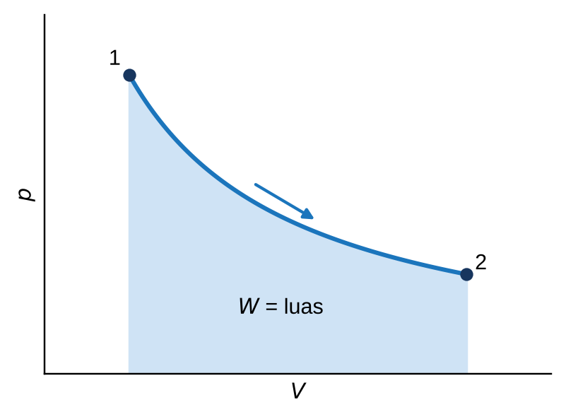
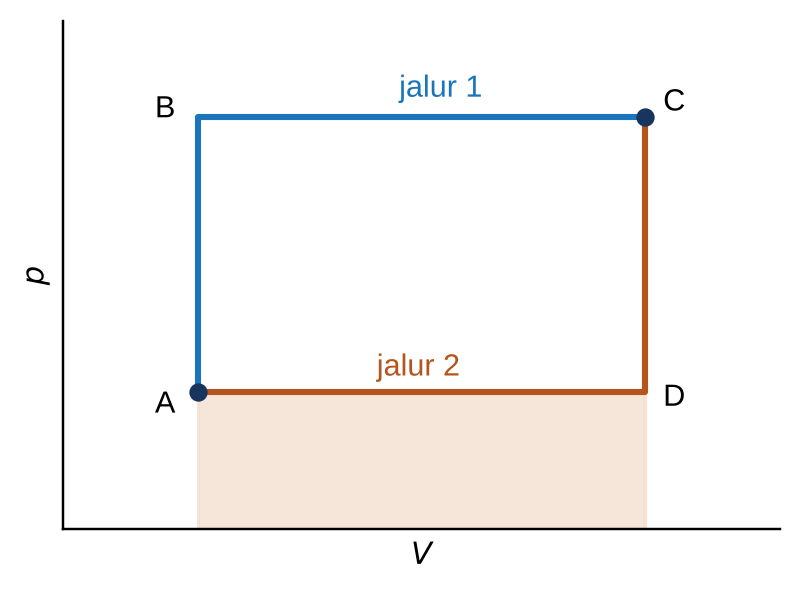
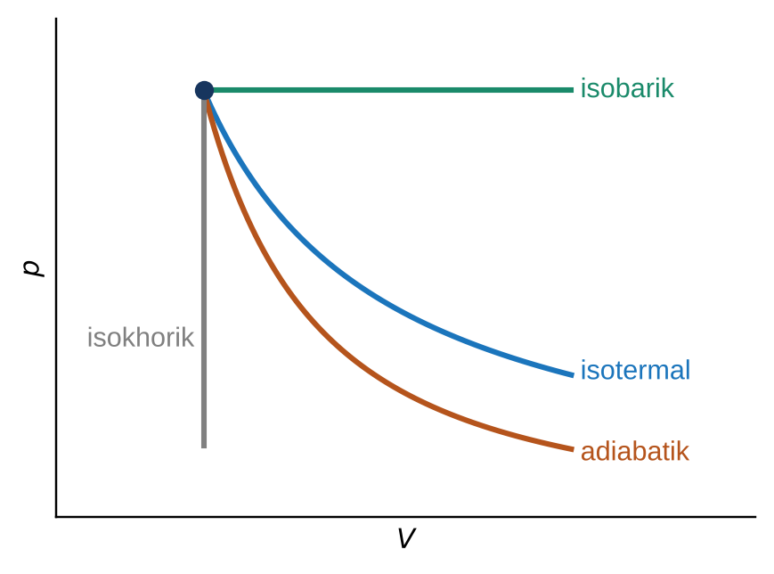

# Bab 11 Termodinamika

Segelas air panas yang dibiarkan di meja selalu mendingin sampai sehangat ruangan. Kebalikannya tidak pernah terjadi: segelas air suam tidak pernah tiba-tiba memanas dengan mengambil kalor dari udara, walaupun energi tetap kekal jika hal itu terjadi. Setetes tinta menyebar dalam air dan tidak pernah berkumpul kembali. Gas mengalir memenuhi ruang hampa dan tidak pernah kembali sendiri ke tabungnya.

Hukum kekekalan energi tidak melarang satu pun kejadian terbalik itu. Jadi ada hukum lain yang menentukan **arah** kejadian di alam. Hukum itu, hukum kedua termodinamika, adalah pokok paruh kedua bab ini. Ia menjawab pertanyaan yang paling penting bagi seorang kimiawan: reaksi mana yang berlangsung dengan sendirinya, sampai sejauh mana, dan berapa banyak usaha yang dapat diperoleh darinya.

Paruh pertama bab ini menyiapkan tanahnya dengan hukum pertama: pembukuan energi yang teliti antara kalor, usaha, dan energi dalam.

::: {.tujuan}
**Tujuan belajar**

Setelah mempelajari bab ini, kamu mampu:

1. Membedakan fungsi keadaan dari besaran yang bergantung pada jalur.
2. Menghitung usaha gas dari rumus dan dari diagram $pV$.
3. Menerapkan hukum pertama pada proses isokhorik, isobarik, isotermal, dan adiabatik.
4. Menghubungkan entalpi dengan kalor pada tekanan tetap, dan menghitung kalor reaksi dengan hukum Hess.
5. Menghitung efisiensi mesin kalor dan koefisien kinerja mesin pendingin.
6. Menjelaskan hukum kedua dan batas Carnot.
7. Menghitung perubahan entropi berbagai proses.
8. Menafsirkan entropi sebagai banyaknya susunan mikroskopik.
9. Memakai energi bebas Gibbs untuk meramalkan kespontanan dan kesetimbangan.
:::

::: {.mat}
**Prasyarat**

Dari Bab 4: usaha dan kekekalan energi. Dari Bab 10: gas ideal (10.3), kalor dan kalor laten (10.4, 10.5), energi dalam dan kapasitas kalor gas (10.9). Matematika: logaritma alami; luas di bawah kurva.
:::

## 11.1 Sistem, keadaan, dan proses

### Sistem dan lingkungan

Termodinamika selalu mulai dengan menarik garis batas. Bagian alam yang kita perhatikan disebut **sistem**: gas dalam silinder, larutan dalam gelas kimia, sebuah sel hidup. Segala sesuatu di luarnya disebut **lingkungan**.

| Jenis sistem | Bertukar zat? | Bertukar energi? | Contoh |
|---|---|---|---|
| Terbuka | ya | ya | gelas kimia tanpa tutup |
| Tertutup | tidak | ya | labu bersumbat, gas dalam silinder berpiston |
| Terisolasi | tidak | tidak | termos ideal, kalorimeter ideal |

### Keadaan dan fungsi keadaan

**Keadaan** sistem ditentukan oleh beberapa besaran terukur: tekanan, volume, suhu, dan jumlah zat. Untuk gas ideal, tiga di antaranya menentukan yang keempat lewat $pV = nRT$.

Besaran yang nilainya hanya bergantung pada keadaan sistem saat ini, dan tidak pada cara sistem sampai ke keadaan itu, disebut **fungsi keadaan**. Tekanan, volume, suhu, dan energi dalam $U$ adalah fungsi keadaan. Nanti kita menambah tiga lagi: entalpi $H$, entropi $S$, dan energi bebas Gibbs $G$.

Perumpamaannya adalah ketinggian tempat. Ketinggian puncak gunung adalah "fungsi keadaan": nilainya sama, lewat jalur mana pun kamu mendaki. Jarak yang kamu tempuh **bukan** fungsi keadaan: ia bergantung pada jalur. Kalor dan usaha berperilaku seperti jarak tempuh itu.

::: {.inti}
**Perubahan fungsi keadaan hanya bergantung pada keadaan awal dan akhir.** Karena itu kita bebas menghitungnya lewat jalur mana saja yang paling mudah, walaupun bukan jalur yang sebenarnya ditempuh. Seluruh termokimia berdiri di atas kebebasan ini.
:::

### Proses dan diagram pV

**Proses** adalah perubahan dari satu keadaan ke keadaan lain. Untuk gas, proses digambar sebagai kurva pada diagram tekanan terhadap volume. Tiap titik pada diagram $pV$ adalah satu keadaan, dan untuk sejumlah gas ideal yang tetap, suhunya sebanding dengan hasil kali $pV$ di titik itu.

Proses yang berlangsung sangat perlahan, sehingga sistem selalu hampir setimbang, disebut **kuasistatis**. Hanya proses seperti itu yang dapat digambar sebagai kurva. Proses kuasistatis tanpa gesekan dapat dibalik arahnya dengan perubahan sangat kecil pada lingkungan, dan disebut **reversibel**. Proses nyata selalu sedikit banyak ireversibel; proses reversibel adalah batas ideal, seperti bidang licin dalam mekanika.

::: {.contoh}
**Contoh 11.1 · Membaca suhu dari diagram pV**

Sebanyak 0,100 mol gas ideal berada pada keadaan A (100 kPa; 2,00 L), lalu dibawa ke keadaan B (300 kPa; 2,00 L), dan kemudian ke C (300 kPa; 4,00 L). Berapa suhu pada ketiga keadaan itu?

**Penyelesaian.** $T = \dfrac{pV}{nR}$.

$T_A = \dfrac{(1{,}00 \times 10^5)(2{,}00 \times 10^{-3})}{(0{,}100)(8{,}314)} = 241$ K. Di B, $pV$ tiga kali lebih besar: $T_B = 722$ K. Di C, $pV$ enam kali lebih besar: $T_C = 1443$ K.

**Memahami hasil.** Tidak perlu menghitung ulang dari awal: suhu sebanding dengan $pV$. Pada diagram $pV$, titik-titik yang makin jauh dari titik asal (ke kanan atas) makin panas, dan titik-titik bersuhu sama terletak pada satu hiperbola.
:::

::: {.kuis}
**Kuis cepat 11.1**

Seorang pendaki naik dari kemah ke puncak lewat jalur pendek yang terjal; temannya lewat jalur panjang yang landai. Mana yang sama bagi keduanya: perubahan ketinggian, jarak tempuh, atau lelahnya?
:::

## 11.2 Usaha oleh gas

### Usaha pemuaian

Gas dalam silinder mendorong piston seluas $A$ dengan gaya $F = pA$. Jika piston bergeser sejauh $\Delta x$, usaha yang dilakukan gas adalah $pA\,\Delta x = p\,\Delta V$. Jadi untuk proses pada **tekanan tetap**:

$$
\boxed{W = p\,\Delta V} \qquad \text{(11.1)}
$$

Jika tekanan berubah selama proses, usaha adalah jumlah banyak langkah kecil:

$$
\boxed{W = \int_{V_1}^{V_2}p\,dV = \text{luas di bawah kurva pada diagram } pV} \qquad \text{(11.2)}
$$

{width=52%}

Gas yang **memuai** melakukan usaha positif pada lingkungan. Gas yang **dimampatkan** melakukan usaha negatif; lingkunganlah yang melakukan usaha padanya. Jika volume tetap, tidak ada usaha, berapa pun tekanannya berubah.

Satuan yang berguna: 1 kPa × 1 L = 1 J. Dan 1 L·atm = 101,3 J.

::: {.awas}
**Awas · Dua perjanjian tanda**

Buku ini memakai perjanjian fisika: $W$ adalah usaha yang dilakukan **oleh** sistem. Buku-buku kimia memakai $w$, usaha yang dilakukan **pada** sistem, sehingga $w = -W$ dan $w = -p\,\Delta V$. Fisikanya sama; hanya pembukuannya berbeda. Selalu tanyakan: energi keluar dari sistem atau masuk?
:::

### Usaha pada proses isotermal

Jika gas ideal memuai pada suhu tetap, tekanannya turun mengikuti $p = nRT/V$. Luas di bawah hiperbola itu adalah

$$
\boxed{W = nRT\ln\frac{V_2}{V_1} = nRT\ln\frac{p_1}{p_2}} \qquad \text{(11.3)}
$$

::: {.contoh}
**Contoh 11.2 · Pemuaian pada tekanan tetap**

Gas dalam silinder memuai dari 2,0 L menjadi 5,0 L melawan tekanan tetap 150 kPa. Berapa usaha yang dilakukannya?

**Penyelesaian.** $W = p\,\Delta V = (150\ \text{kPa})(3{,}0\ \text{L}) = 450$ J.

**Memahami hasil.** Dalam SI: $(1{,}50 \times 10^5)(3{,}0 \times 10^{-3}) = 450$ J. Sama. Menurut perjanjian kimia, $w = -450$ J: sistem kehilangan energi sebesar itu sebagai usaha.
:::

::: {.contoh}
**Contoh 11.3 · Pemuaian isotermal**

Satu mol gas ideal pada 300 K memuai secara isotermal reversibel dari 10 L menjadi 20 L. (a) Berapa usahanya? (b) Bandingkan dengan pemuaian yang sama melawan tekanan luar tetap sebesar tekanan akhirnya.

**Penyelesaian.**

(a) $W = nRT\ln\dfrac{V_2}{V_1} = (1)(8{,}314)(300)\ln 2 = 1729$ J.

(b) Tekanan akhir: $p_2 = \dfrac{(8{,}314)(300)}{0{,}020} = 124{,}7$ kPa. $W = (124{,}7)(10) = 1247$ J.

**Memahami hasil.** Keadaan awal dan akhirnya sama, tetapi usahanya berbeda: **usaha bergantung pada jalur**. Jalur reversibel memberi usaha terbesar yang mungkin, karena pada tiap saat gas mendorong melawan tekanan terbesar yang masih dapat dikalahkannya. Proses mendadak selalu menyia-nyiakan sebagian.
:::

::: {.contoh}
**Contoh 11.4 · Usaha dalam satu siklus**

Gas dibawa mengelilingi siklus persegi panjang pada diagram $pV$: memuai dari 1,0 L ke 3,0 L pada 300 kPa, didinginkan pada volume tetap sampai 100 kPa, dimampatkan kembali ke 1,0 L pada 100 kPa, lalu dipanaskan pada volume tetap ke keadaan awal. Berapa usaha bersih tiap siklus?

**Penyelesaian.** Hanya dua ruas mendatar yang menyumbang usaha:

- memuai: $W = (300)(2{,}0) = +600$ J;
- dimampatkan: $W = (100)(-2{,}0) = -200$ J.

Usaha bersih: $+400$ J.

**Memahami hasil.** Itu tepat luas persegi panjang yang dilingkupi siklus: $(200\ \text{kPa})(2{,}0\ \text{L}) = 400$ J. Aturan umum: usaha bersih satu siklus sama dengan luas yang dilingkupinya, positif jika siklus dijalani searah jarum jam. Semua mesin kalor bekerja dengan cara ini: memuai pada tekanan tinggi, dimampatkan kembali pada tekanan rendah.
:::

::: {.contoh}
**Contoh 11.5 · Usaha oleh reaksi yang menghasilkan gas**

Seng berlebih bereaksi dengan asam klorida dalam gelas kimia terbuka pada 25 °C dan menghasilkan 1,00 mol gas H₂. Berapa usaha yang dilakukan sistem terhadap atmosfer?

**Penyelesaian.** Gas yang terbentuk mendorong atmosfer pada tekanan tetap. Volume zat padat dan larutan hampir tidak berubah, jadi $\Delta V$ adalah volume gas yang terbentuk:

$$
W = p\,\Delta V = \Delta n_\text{gas}RT = (1{,}00)(8{,}314)(298) = 2{,}48\ \text{kJ}.
$$

**Memahami hasil.** Tekanan atmosfer tidak perlu diketahui: $p\,\Delta V = \Delta n\,RT$. Setiap mol gas yang dihasilkan reaksi pada suhu kamar "membayar" 2,5 kJ untuk menyingkirkan udara. Angka inilah selisih antara $\Delta H$ dan $\Delta U$ reaksi (subbab 11.5).
:::

::: {.contoh}
**Contoh 11.6 · Usaha ketika air mendidih**

Satu mol air (18,0 g) menguap pada 100 °C dan 1 atm. Volume air cair 18,8 cm³. (a) Berapa usaha yang dilakukan uap terhadap atmosfer? (b) Kalor uapnya 40,7 kJ/mol. Berapa bagian kalor itu yang menjadi usaha?

**Penyelesaian.**

(a) Volume uap: $\dfrac{RT}{p} = \dfrac{(8{,}314)(373{,}15)}{101\,325} = 30{,}6$ L. $W = (101{,}325\ \text{kPa})(30{,}6 - 0{,}02\ \text{L}) = 3{,}10$ kJ.

(b) $\dfrac{3{,}10}{40{,}7} = 7{,}6\%$.

**Memahami hasil.** Volume membesar 1600 kali, tetapi hanya 8% kalor uap dipakai untuk mendorong atmosfer. Sisanya, 37,6 kJ/mol, dipakai untuk memisahkan molekul-molekul air satu dari yang lain. Itulah kenaikan energi dalamnya.
:::

::: {.kuis}
**Kuis cepat 11.2**

Gas memuai ke dalam ruang hampa (tidak ada yang didorong). Berapa usaha yang dilakukannya?
:::

## 11.3 Hukum pertama termodinamika

### Pembukuan energi

Energi dalam sistem dapat berubah dengan dua cara: kalor masuk atau keluar, dan usaha dilakukan oleh atau pada sistem. Kekekalan energi menuntut

$$
\boxed{\Delta U = Q - W} \qquad \text{(11.4)}
$$

| Besaran | Positif jika | Negatif jika |
|---|---|---|
| $Q$ | kalor **masuk** ke sistem | kalor keluar dari sistem |
| $W$ | sistem **melakukan** usaha (memuai) | usaha dilakukan pada sistem (dimampatkan) |
| $\Delta U$ | energi dalam naik | energi dalam turun |

Dalam perjanjian kimia, hukum yang sama ditulis $\Delta U = q + w$.

::: {.inti}
**Hukum pertama termodinamika.** Energi dalam adalah fungsi keadaan. Perubahannya sama dengan kalor yang masuk dikurangi usaha yang dilakukan sistem. Kalor dan usaha masing-masing bergantung pada jalur, tetapi selisihnya tidak.
:::

Untuk gas ideal, energi dalam hanya bergantung pada suhu (subbab 10.9):

$$
\boxed{\Delta U = nC_V\,\Delta T} \quad \text{(gas ideal, proses apa pun)}. \qquad \text{(11.5)}
$$

Rumus ini berlaku untuk **semua** proses gas ideal, bukan hanya proses bervolume tetap, karena $U$ fungsi keadaan.

{width=50%}

::: {.contoh}
**Contoh 11.7 · Hukum pertama, langsung**

(a) Gas menerima kalor 500 J dan melakukan usaha 200 J. (b) Gas dimampatkan dengan usaha 300 J sambil melepas kalor 120 J. Berapa perubahan energi dalamnya pada tiap peristiwa?

**Penyelesaian.**

(a) $\Delta U = 500 - 200 = +300$ J.

(b) Usaha dilakukan **pada** gas, jadi $W = -300$ J; kalor keluar, jadi $Q = -120$ J. $\Delta U = -120 - (-300) = +180$ J.

**Memahami hasil.** Cara berpikir yang aman: perlakukan seperti buku kas. Pada (b), 300 J masuk sebagai usaha dan 120 J keluar sebagai kalor; saldo naik 180 J.
:::

::: {.contoh}
**Contoh 11.8 · Dua jalur, satu perubahan energi dalam**

Gas monoatomik dibawa dari A (100 kPa; 1,0 L) ke C (300 kPa; 3,0 L) lewat dua jalur (Gambar 11.2). Jalur 1: dipanaskan pada volume tetap ke B, lalu memuai pada 300 kPa. Jalur 2: memuai pada 100 kPa ke D, lalu dipanaskan pada volume tetap. Hitung $W$, $\Delta U$, dan $Q$ untuk tiap jalur.

**Penyelesaian.** Untuk gas monoatomik, $U = \tfrac32nRT = \tfrac32pV$:

$$
\Delta U = \tfrac32\big[(300)(3{,}0) - (100)(1{,}0)\big] = 1200\ \text{J} \quad \text{(kedua jalur)}.
$$

| | $W$ | $\Delta U$ | $Q = \Delta U + W$ |
|---|---|---|---|
| Jalur 1 | $(300)(2{,}0) = 600$ J | 1200 J | 1800 J |
| Jalur 2 | $(100)(2{,}0) = 200$ J | 1200 J | 1400 J |

**Memahami hasil.** Selisih usaha, 400 J, sama dengan selisih kalor, dan sama dengan luas persegi panjang di antara kedua jalur. Tidak ada artinya bertanya "berapa kalor yang dimiliki gas di C"; yang bermakna hanya energi dalamnya.
:::

::: {.contoh}
**Contoh 11.9 · Siklus**

Dalam satu siklus, sebuah mesin menyerap kalor 800 J dan membuang kalor 550 J. Berapa usaha yang dihasilkannya?

**Penyelesaian.** Setelah satu siklus sistem kembali ke keadaan semula, jadi $\Delta U = 0$ dan $W = Q_\text{bersih} = 800 - 550 = 250$ J.

**Memahami hasil.** Tidak ada mesin yang dapat menghasilkan usaha lebih besar daripada kalor bersih yang diserapnya. Mesin yang menciptakan energi dari ketiadaan (*perpetuum mobile* jenis pertama) dilarang oleh hukum pertama.
:::

::: {.contoh}
**Contoh 11.10 · Hukum pertama pada tubuh**

Dalam satu jam bersepeda, seseorang melakukan usaha mekanik 540 kJ dan melepas kalor 1620 kJ ke lingkungan. (a) Berapa perubahan energi dalam tubuhnya? (b) Berapa efisiensi tubuhnya sebagai mesin? (c) Jika energi itu berasal dari lemak (38 kJ/g), berapa lemak yang terpakai?

**Penyelesaian.**

(a) $\Delta U = Q - W = -1620 - 540 = -2160$ kJ.

(b) $\dfrac{540}{2160} = 25\%$.

(c) $\dfrac{2160}{38} = 57$ g.

**Memahami hasil.** Energi dalam yang berkurang adalah energi kimia makanan dan cadangan tubuh. Tiga perempatnya terbuang sebagai kalor; itu sebabnya olahraga membuat panas. Satu jam bersepeda keras hanya menghabiskan lemak seberat sebutir telur.
:::

::: {.kuis}
**Kuis cepat 11.3**

Gas ideal memuai ke ruang hampa dalam wadah tersekat. Berapa $Q$, $W$, dan $\Delta U$? Apakah suhunya berubah?
:::

## 11.4 Empat proses penting

{width=56%}

| Proses | Yang tetap | $W$ | $Q$ | $\Delta U$ |
|---|---|---|---|---|
| Isokhorik | volume | 0 | $nC_V\Delta T$ | $nC_V\Delta T$ |
| Isobarik | tekanan | $p\,\Delta V = nR\,\Delta T$ | $nC_p\Delta T$ | $nC_V\Delta T$ |
| Isotermal | suhu | $nRT\ln(V_2/V_1)$ | $= W$ | 0 |
| Adiabatik | tidak ada kalor | $-nC_V\Delta T$ | 0 | $nC_V\Delta T$ |

### Isokhorik: volume tetap

Tidak ada usaha. Seluruh kalor menjadi energi dalam: $Q = \Delta U = nC_V\Delta T$. Inilah yang terjadi di dalam kalorimeter bom.

### Isobarik: tekanan tetap

Gas yang dipanaskan memuai dan melakukan usaha $p\,\Delta V = nR\,\Delta T$. Kalor yang masuk harus menutup keduanya:

$$
Q = \Delta U + W = nC_V\Delta T + nR\,\Delta T = n(C_V + R)\Delta T .
$$

Inilah asal hubungan $C_p = C_V + R$ yang dipakai di subbab 10.9. Hampir semua reaksi di laboratorium berlangsung pada tekanan tetap, yaitu tekanan atmosfer.

### Isotermal: suhu tetap

Energi dalam gas ideal tidak berubah, jadi $Q = W$: seluruh kalor yang diserap langsung keluar lagi sebagai usaha. Agar suhu tetap, proses harus berlangsung perlahan dalam sentuhan dengan tandon kalor.

### Adiabatik: tanpa pertukaran kalor

Proses berlangsung dalam wadah tersekat, atau begitu cepat sehingga kalor tidak sempat berpindah. Dengan $Q = 0$, hukum pertama menjadi $\Delta U = -W$: gas yang memuai melakukan usaha dengan mengorbankan energi dalamnya sendiri, dan **mendingin**. Gas yang dimampatkan **memanas**.

Untuk proses adiabatik reversibel pada gas ideal berlaku

$$
\boxed{pV^\gamma = \text{tetap}, \qquad TV^{\gamma-1} = \text{tetap}, \qquad \gamma = \frac{C_p}{C_V}} \qquad \text{(11.6)}
$$

Bentuk ketiga, yang berguna jika tekanan diketahui: $T^\gamma p^{1-\gamma}$ tetap, atau

$$
\frac{T_2}{T_1} = \left(\frac{p_2}{p_1}\right)^{(\gamma-1)/\gamma}. \qquad \text{(11.7)}
$$

Karena $\gamma > 1$, kurva adiabatik pada diagram $pV$ lebih curam daripada kurva isotermal (Gambar 11.3): ketika gas memuai adiabatik, tekanannya turun karena volumenya membesar **dan** karena suhunya turun.

::: {.strategi}
**Strategi · Soal proses gas**

1. Kenali prosesnya dari kata kunci: "wadah kaku" (isokhorik), "piston bebas" atau "terbuka ke atmosfer" (isobarik), "perlahan dalam penangas" (isotermal), "tersekat" atau "cepat" (adiabatik).
2. Gambar pada diagram $pV$.
3. Hitung $\Delta U = nC_V\Delta T$; ini selalu berlaku untuk gas ideal.
4. Hitung $W$ dari rumus proses atau dari luas.
5. Dapatkan $Q$ dari hukum pertama.
:::

::: {.contoh}
**Contoh 11.11 · Isokhorik**

Tabung kaku berisi 0,50 mol helium menerima kalor 300 J. Berapa kenaikan suhunya?

**Penyelesaian.** $W = 0$, jadi $Q = nC_V\Delta T$ dengan $C_V = \tfrac32R = 12{,}47$ J/(mol·K):

$$
\Delta T = \frac{300}{(0{,}50)(12{,}47)} = 48\ \text{K}.
$$

**Memahami hasil.** Jika gasnya nitrogen ($C_V = 20{,}79$), kenaikannya hanya 29 K: molekul diatomik menyimpan sebagian energi sebagai rotasi.
:::

::: {.contoh}
**Contoh 11.12 · Isobarik**

Dua mol nitrogen dipanaskan pada tekanan tetap sehingga suhunya naik 50,0 K. Hitung $Q$, $W$, dan $\Delta U$.

**Penyelesaian.**

$Q = nC_p\Delta T = (2{,}00)(29{,}10)(50{,}0) = 2910$ J.

$W = nR\,\Delta T = (2{,}00)(8{,}314)(50{,}0) = 831$ J.

$\Delta U = nC_V\Delta T = (2{,}00)(20{,}79)(50{,}0) = 2079$ J.

**Memahami hasil.** $Q - W = 2910 - 831 = 2079$ J. Cocok. Dari kalor yang masuk, 71% menjadi energi dalam dan 29% menjadi usaha; untuk gas diatomik perbandingan itu selalu $5 : 2$.
:::

::: {.contoh}
**Contoh 11.13 · Pemampatan isotermal**

Sebanyak 0,100 mol gas ideal pada 300 K dimampatkan perlahan dari 2,00 L menjadi 0,500 L dalam penangas bersuhu tetap. Hitung usaha dan kalor.

**Penyelesaian.**

$$
W = nRT\ln\frac{V_2}{V_1} = (0{,}100)(8{,}314)(300)\ln\frac{0{,}500}{2{,}00} = -346\ \text{J}.
$$

$\Delta U = 0$, jadi $Q = W = -346$ J.

**Memahami hasil.** Usaha 346 J dilakukan pada gas, dan kalor sebesar itu mengalir keluar ke penangas. Energi dalam gas tidak bertambah sedikit pun, padahal tekanannya naik empat kali. Yang berubah adalah entropinya (subbab 11.8).
:::

::: {.contoh}
**Contoh 11.14 · Pompa sepeda yang memanas**

Udara 300 K pada 1,00 atm dimampatkan cepat dalam pompa sampai volumenya seperempat volume semula. Berapa suhu dan tekanan akhirnya? ($\gamma = 1{,}40$)

**Penyelesaian.**

$$
T_2 = T_1\left(\frac{V_1}{V_2}\right)^{\gamma-1} = 300 \times 4^{0{,}40} = 522\ \text{K}, \qquad p_2 = p_1\left(\frac{V_1}{V_2}\right)^\gamma = 1{,}00 \times 4^{1{,}40} = 6{,}96\ \text{atm}.
$$

**Memahami hasil.** Suhunya naik ke 249 °C. Pada pemampatan isotermal, tekanan hanya naik empat kali; tambahan 74% berasal dari pemanasan. Dalam pompa nyata, sebagian kalor sempat lolos ke dinding, tetapi ujung pompa tetap terasa panas.
:::

::: {.contoh}
**Contoh 11.15 · Mesin diesel**

Mesin diesel memampatkan udara 300 K dengan perbandingan volume 18 : 1. Berapa suhu udara pada akhir pemampatan?

**Penyelesaian.** $T_2 = 300 \times 18^{0{,}40} = 953$ K.

**Memahami hasil.** Suhu 680 °C jauh di atas suhu nyala solar (sekitar 210 °C). Bahan bakar yang disemprotkan langsung terbakar tanpa busi. Itulah asas mesin diesel, dan itu sebabnya ia memerlukan perbandingan pemampatan yang tinggi.
:::

::: {.contoh}
**Contoh 11.16 · Mengapa udara di gunung dingin**

Udara di permukaan laut (20 °C; 100 kPa) terdorong naik melewati gunung sampai tekanannya 70 kPa. Udara penghantar kalor yang buruk, sehingga pemuaiannya hampir adiabatik. Berapa suhunya?

**Penyelesaian.** Dari (11.7), dengan $\dfrac{\gamma - 1}{\gamma} = \dfrac{0{,}40}{1{,}40} = 0{,}286$:

$$
T_2 = 293 \times (0{,}70)^{0{,}286} = 265\ \text{K} = -8\ \text{°C}.
$$

**Memahami hasil.** Tekanan 70 kPa terdapat pada ketinggian sekitar 3000 m, jadi suhu turun kira-kira 10 K tiap kilometer. Ketika udara lembap naik dan mendingin seperti ini, uap airnya mengembun menjadi awan. Asas yang sama bekerja ketika tabung CO₂ dibuka dan menyemburkan salju es kering, dan pada kabut yang muncul sesaat ketika botol minuman bersoda dibuka.
:::

::: {.contoh}
**Contoh 11.17 · Usaha adiabatik dan usaha isotermal**

Satu mol nitrogen pada 300 K memuai sampai volumenya dua kali. Hitung usaha yang dilakukannya jika pemuaian itu (a) adiabatik reversibel; (b) isotermal reversibel.

**Penyelesaian.**

(a) $T_2 = 300 \times 2^{-0{,}40} = 227$ K. $W = -\Delta U = nC_V(T_1 - T_2) = (1)(20{,}79)(72{,}6) = 1510$ J.

(b) $W = RT\ln 2 = 1729$ J.

**Memahami hasil.** Pemuaian adiabatik menghasilkan usaha lebih kecil, karena gasnya mendingin dan tekanannya turun lebih cepat. Pada pemuaian isotermal, kalor yang mengalir masuk terus menopang tekanan.
:::

::: {.kuis}
**Kuis cepat 11.4**

Gas dimampatkan menjadi setengah volumenya, sekali secara isotermal dan sekali secara adiabatik. Pada cara mana tekanan akhirnya lebih besar?
:::

## 11.5 Entalpi dan termokimia

### Kalor pada tekanan tetap

Hampir semua reaksi kimia dilakukan dalam wadah terbuka, pada tekanan atmosfer yang tetap. Kalor yang terukur pada keadaan itu **bukan** $\Delta U$, karena sebagian energi dipakai (atau diperoleh) sebagai usaha melawan atmosfer:

$$
Q_p = \Delta U + p\,\Delta V .
$$

Agar tidak perlu menghitung suku usaha itu setiap kali, didefinisikan fungsi keadaan baru, **entalpi**:

$$
\boxed{H = U + pV, \qquad \Delta H = Q_p} \qquad \text{(11.8)}
$$

::: {.inti}
**Perubahan entalpi adalah kalor yang diserap sistem pada tekanan tetap.** $\Delta H < 0$: reaksi eksoterm, melepas kalor. $\Delta H > 0$: reaksi endoterm, menyerap kalor.
:::

Karena $H$ fungsi keadaan, $\Delta H$ tidak bergantung pada jalur. Kalor laten di subbab 10.5 adalah perubahan entalpi: $L_f = \Delta H_\text{lebur}$ dan $L_v = \Delta H_\text{uap}$.

### Hubungan ΔH dengan ΔU

Untuk reaksi yang melibatkan gas ideal pada suhu tetap, $p\,\Delta V = \Delta n_\text{gas}RT$, sehingga

$$
\boxed{\Delta H = \Delta U + \Delta n_\text{gas}RT} \qquad \text{(11.9)}
$$

$\Delta n_\text{gas}$ adalah mol gas hasil dikurangi mol gas pereaksi. Untuk reaksi yang hanya melibatkan zat padat dan zat cair, selisihnya dapat diabaikan.

::: {.contoh}
**Contoh 11.18 · ΔH dan ΔU pembakaran propana**

Pembakaran propana, C₃H₈(g) + 5 O₂(g) → 3 CO₂(g) + 4 H₂O(l), memiliki $\Delta H = -2220$ kJ/mol pada 298 K. Berapa $\Delta U$-nya?

**Penyelesaian.** $\Delta n_\text{gas} = 3 - (1 + 5) = -3$.

$$
\Delta U = \Delta H - \Delta n_\text{gas}RT = -2220 - (-3)(8{,}314 \times 10^{-3})(298) = -2220 + 7{,}4 = -2213\ \text{kJ/mol}.
$$

**Memahami hasil.** Volume gas menyusut, sehingga atmosfer melakukan usaha 7,4 kJ pada sistem; energi itu ikut keluar sebagai kalor, dan $\lvert\Delta H\rvert$ sedikit lebih besar daripada $\lvert\Delta U\rvert$. Selisihnya hanya 0,3%: untuk reaksi kimia, $\Delta H$ dan $\Delta U$ biasanya hampir sama.
:::

### Kalorimeter bom

Dalam **kalorimeter bom**, cuplikan dibakar dalam bejana baja kaku berisi oksigen bertekanan. Volumenya tetap, jadi kalor yang terukur adalah $\Delta U$. Nilai $\Delta H$ diperoleh dengan (11.9).

::: {.contoh}
**Contoh 11.19 · Kalorimeter bom**

Kalorimeter bom dikalibrasi dengan membakar 1,000 g asam benzoat (26,43 kJ/g); suhunya naik 2,95 K. Kemudian 0,800 g glukosa (180,2 g/mol) dibakar dan suhu naik 1,39 K. (a) Berapa kapasitas kalor kalorimeter? (b) Berapa $\Delta U$ pembakaran glukosa per mol?

**Penyelesaian.**

(a) $C = \dfrac{26{,}43}{2{,}95} = 8{,}96$ kJ/K.

(b) Kalor yang dilepas: $(8{,}96)(1{,}39) = 12{,}45$ kJ untuk $\dfrac{0{,}800}{180{,}2} = 4{,}44 \times 10^{-3}$ mol.

$$
\Delta U = -\frac{12{,}45}{4{,}44 \times 10^{-3}} = -2805\ \text{kJ/mol}.
$$

**Memahami hasil.** Untuk C₆H₁₂O₆(s) + 6 O₂(g) → 6 CO₂(g) + 6 H₂O(l), $\Delta n_\text{gas} = 0$, jadi $\Delta H = \Delta U$. Per gram, glukosa memberi 15,6 kJ, yaitu 3,7 kkal: angka "4 kkal per gram karbohidrat" pada label makanan diperoleh persis dengan cara ini.
:::

### Hukum Hess dan entalpi pembentukan

Karena entalpi fungsi keadaan:

::: {.inti}
**Hukum Hess.** Perubahan entalpi suatu reaksi sama dengan jumlah perubahan entalpi tahap-tahap mana pun yang jika dijumlahkan menghasilkan reaksi itu.
:::

Hukum Hess bukan hukum alam yang baru; ia adalah hukum pertama yang diterapkan pada reaksi kimia. Dengan itu, kalor reaksi yang sukar diukur dapat dihitung dari reaksi lain yang mudah diukur.

**Entalpi pembentukan standar**, $\Delta H_f^\circ$, adalah perubahan entalpi pembentukan satu mol senyawa dari unsur-unsurnya dalam bentuk paling mantap pada 1 bar. Untuk unsur dalam bentuk itu, nilainya nol. Maka

$$
\boxed{\Delta H^\circ = \sum\Delta H_f^\circ(\text{hasil}) - \sum\Delta H_f^\circ(\text{pereaksi})} \qquad \text{(11.10)}
$$

| Zat | $\Delta H_f^\circ$ (kJ/mol) | Zat | $\Delta H_f^\circ$ (kJ/mol) |
|---|---|---|---|
| H₂O(l) | −285,8 | CH₄(g) | −74,8 |
| H₂O(g) | −241,8 | C₂H₅OH(l) | −277,7 |
| CO₂(g) | −393,5 | C₆H₁₂O₆(s) | −1273 |
| CO(g) | −110,5 | NH₃(g) | −46,1 |
| CaCO₃(s) | −1206,9 | CaO(s) | −635,1 |

::: {.contoh}
**Contoh 11.20 · Hukum Hess**

Pembakaran karbon menjadi CO tidak dapat diukur langsung, karena selalu terbentuk juga CO₂. Tentukan $\Delta H$-nya dari:

- C(s) + O₂(g) → CO₂(g), $\Delta H = -393{,}5$ kJ;
- CO(g) + ½ O₂(g) → CO₂(g), $\Delta H = -283{,}0$ kJ.

**Penyelesaian.** Reaksi sasaran, C(s) + ½ O₂(g) → CO(g), diperoleh dengan menjumlahkan reaksi pertama dan **kebalikan** reaksi kedua:

$$
\Delta H = -393{,}5 - (-283{,}0) = -110{,}5\ \text{kJ}.
$$

**Memahami hasil.** Gambarkan sebagai tangga energi: dari C + O₂ turun 393,5 kJ ke CO₂; dari CO turun 283,0 kJ ke CO₂ yang sama. Jadi CO terletak 110,5 kJ di bawah C + O₂. Membalik reaksi membalik tanda $\Delta H$.
:::

::: {.contoh}
**Contoh 11.21 · Kalor pembakaran dari entalpi pembentukan**

Hitung $\Delta H^\circ$ pembakaran metana: CH₄(g) + 2 O₂(g) → CO₂(g) + 2 H₂O(l).

**Penyelesaian.**

$$
\Delta H^\circ = \big[(-393{,}5) + 2(-285{,}8)\big] - \big[(-74{,}8) + 0\big] = -890{,}3\ \text{kJ/mol}.
$$

**Memahami hasil.** Jika airnya terbentuk sebagai uap, pakai −241,8: hasilnya −802,3 kJ/mol. Selisih 88 kJ adalah kalor uap dua mol air. Pemanas air modern yang mengembunkan uap dalam gas buangnya memanfaatkan selisih itu dan menghemat bahan bakar sekitar 10%.
:::

::: {.contoh}
**Contoh 11.22 · Membandingkan bahan bakar**

Dari kalor pembakarannya, hitung energi tiap gram untuk hidrogen (−285,8 kJ/mol), metana (−890,3), oktana C₈H₁₈ (−5471), etanol (−1367), dan glukosa (−2805).

**Penyelesaian.**

| Bahan bakar | $M$ (g/mol) | Energi (kJ/g) |
|---|---|---|
| Hidrogen | 2,016 | 142 |
| Metana | 16,04 | 55,5 |
| Oktana | 114,2 | 47,9 |
| Etanol | 46,07 | 29,7 |
| Glukosa | 180,2 | 15,6 |

**Memahami hasil.** Makin banyak oksigen yang sudah terkandung dalam molekul, makin sedikit energi yang tersisa untuk dilepas: etanol dan glukosa adalah bahan bakar yang "sudah setengah terbakar". Hidrogen juara per gram, tetapi sebagai gas ia sangat renggang; per liter, bensin jauh di depan. Itulah persoalan pokok kendaraan hidrogen.
:::

::: {.kuis}
**Kuis cepat 11.5**

Untuk reaksi N₂(g) + 3 H₂(g) → 2 NH₃(g) yang eksoterm, mana yang lebih besar: kalor yang dilepas pada tekanan tetap atau pada volume tetap?
:::
