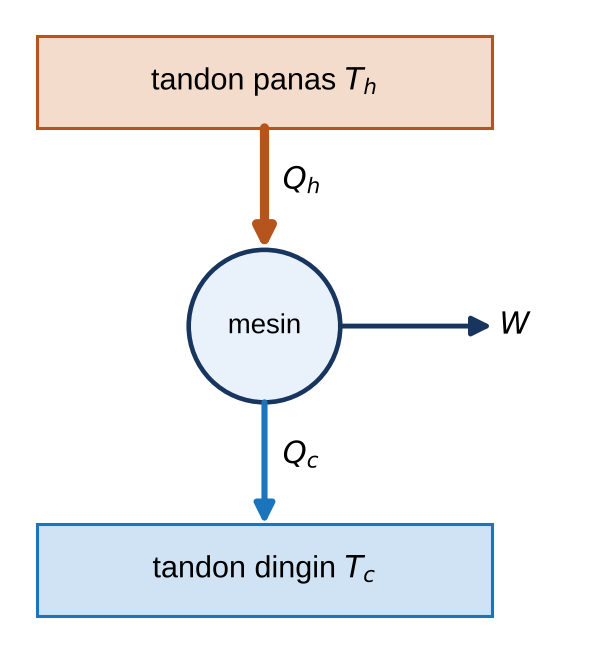
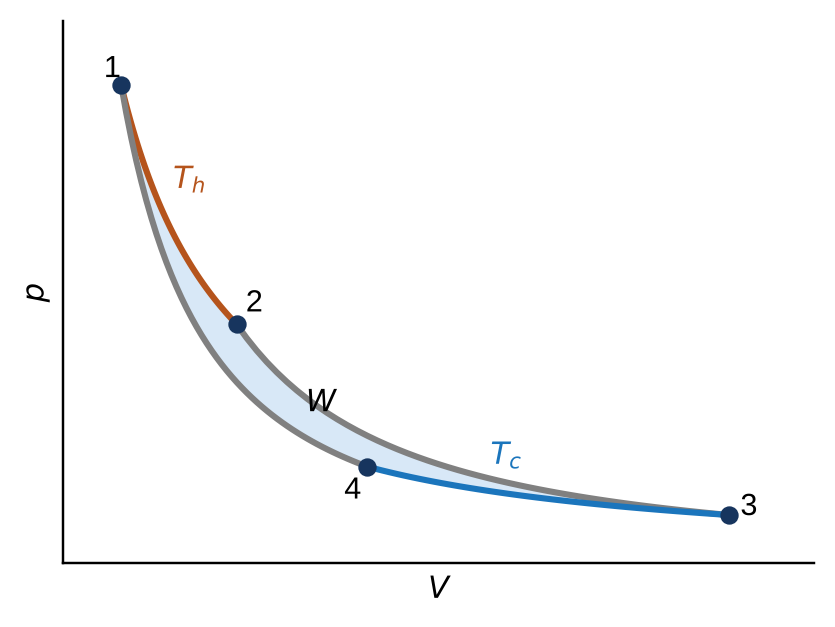
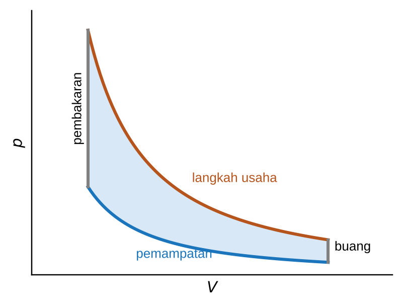
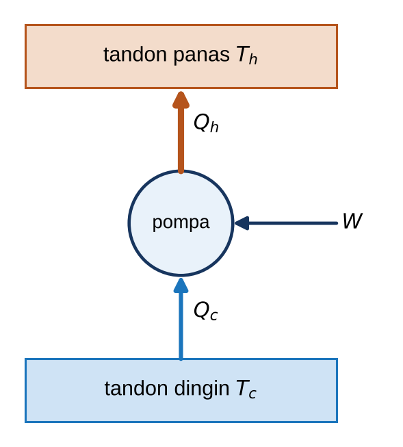
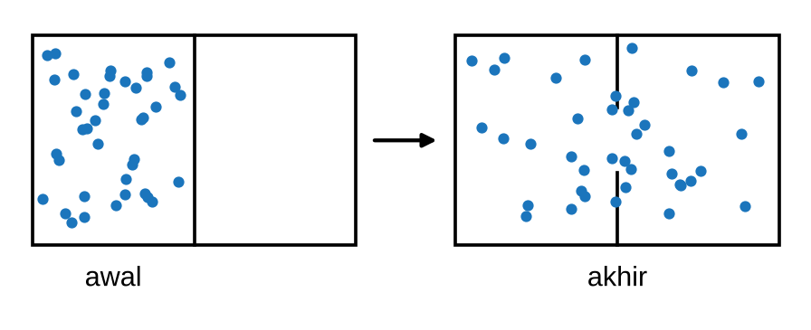
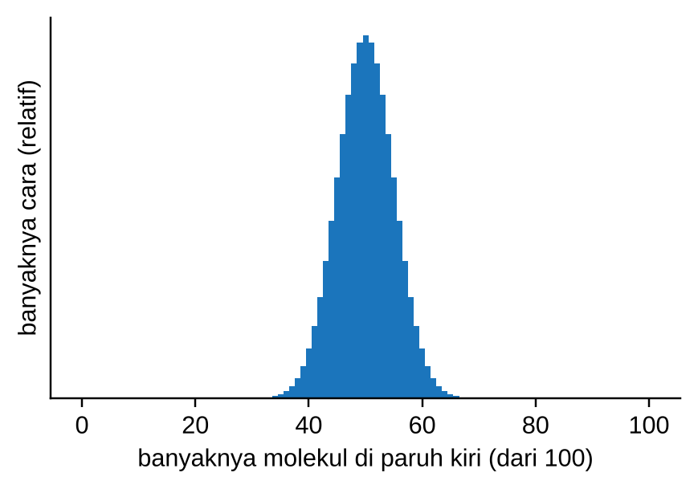
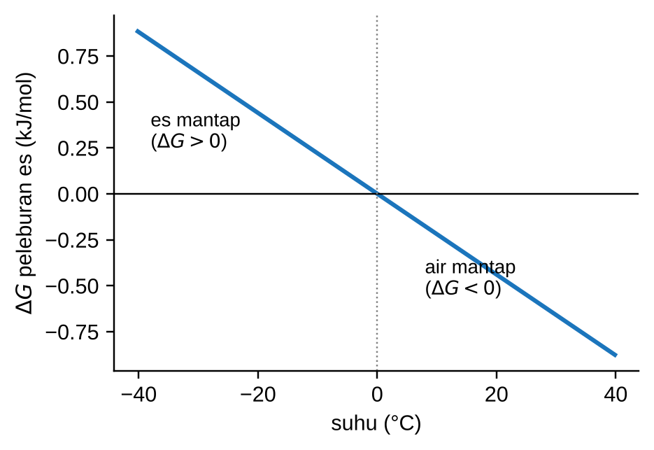
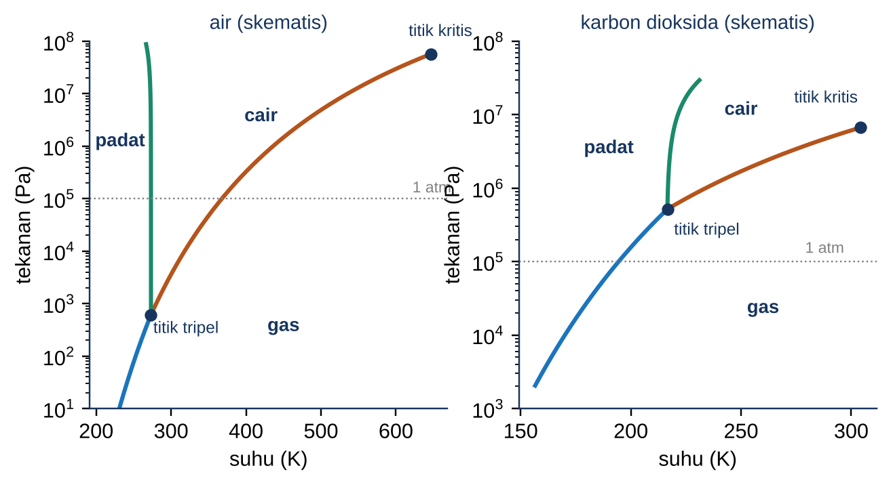

## 11.6 Mesin kalor dan hukum kedua

### Mengubah kalor menjadi usaha

Mengubah usaha menjadi kalor itu mudah dan dapat sempurna: gosokkan kedua tanganmu. Kebalikannya, mengubah kalor menjadi usaha, adalah persoalan yang melahirkan termodinamika pada abad ke-19, ketika para insinyur berusaha memperbaiki mesin uap.

**Mesin kalor** adalah alat yang bekerja dalam siklus dan mengubah sebagian kalor menjadi usaha. Mesin uap, mesin mobil, turbin pembangkit listrik, semuanya mengikuti pola yang sama (Gambar 11.4):

1. menyerap kalor $Q_h$ dari tandon bersuhu tinggi $T_h$;
2. mengubah sebagiannya menjadi usaha $W$;
3. membuang sisanya, $Q_c$, ke tandon bersuhu rendah $T_c$.

{width=36%}

Dalam subbab ini dan berikutnya, $Q_h$, $Q_c$, dan $W$ semuanya bernilai positif; arahnya ditunjukkan gambar. Setelah satu siklus $\Delta U = 0$, sehingga $W = Q_h - Q_c$. **Efisiensi** mesin adalah bagian kalor masukan yang menjadi usaha:

$$
\boxed{e = \frac{W}{Q_h} = 1 - \frac{Q_c}{Q_h}} \qquad \text{(11.11)}
$$

### Hukum kedua

Hukum pertama mengizinkan $Q_c = 0$ dan $e = 100\%$. Tidak seorang pun pernah berhasil membuat mesin seperti itu. Pengalaman itu dirumuskan sebagai hukum alam, dalam dua bentuk yang setara:

::: {.inti}
**Hukum kedua termodinamika.**

*Rumusan Kelvin–Planck:* tidak mungkin ada mesin yang bekerja dalam siklus dan mengubah kalor seluruhnya menjadi usaha, tanpa akibat lain.

*Rumusan Clausius:* kalor tidak mengalir dengan sendirinya dari benda dingin ke benda panas.
:::

Mesin yang melanggar rumusan pertama, misalnya kapal yang berlayar hanya dengan mengambil kalor dari air laut, disebut *perpetuum mobile* jenis kedua. Ia tidak melanggar kekekalan energi, tetapi tetap mustahil. Setiap mesin kalor **harus** membuang sebagian kalor. Menara pendingin di pembangkit listrik bukan tanda rancangan yang buruk; ia tuntutan hukum alam.

::: {.contoh}
**Contoh 11.23 · Efisiensi sebuah mesin**

Tiap siklus, sebuah mesin menyerap 2000 J dari tandon panas dan menghasilkan usaha 500 J. Berapa efisiensinya dan berapa kalor yang dibuangnya?

**Penyelesaian.** $e = \dfrac{500}{2000} = 25\%$. $Q_c = 2000 - 500 = 1500$ J.

**Memahami hasil.** Tiga perempat kalor terbuang. Angka seperti ini lazim untuk mesin mobil.
:::

::: {.contoh}
**Contoh 11.24 · Pembangkit listrik**

Pembangkit listrik tenaga uap menghasilkan 1000 MW listrik dengan efisiensi 38%. (a) Berapa laju kalor dari pembakaran yang diperlukan? (b) Berapa laju kalor yang dibuang? (c) Jika kalor buangan itu diserap air sungai yang suhunya boleh naik 10 K, berapa laju aliran air yang diperlukan?

**Penyelesaian.**

(a) $\dfrac{1000}{0{,}38} = 2630$ MW.

(b) $2630 - 1000 = 1630$ MW.

(c) $\dfrac{m}{t} = \dfrac{1{,}63 \times 10^9}{(4186)(10)} = 3{,}9 \times 10^4$ kg/s.

**Memahami hasil.** Pembangkit itu membuang kalor lebih banyak daripada listrik yang dihasilkannya, dan memerlukan 39 m³ air pendingin tiap detik, sebesar sungai sedang. Itu sebabnya pembangkit besar selalu dibangun di tepi sungai atau laut.
:::

::: {.contoh}
**Contoh 11.25 · Pemakaian bensin**

Sebuah mobil memerlukan daya mekanik 20 kW untuk melaju tetap 90 km/jam. Efisiensi mesinnya 25%, dan bensin memuat 34 MJ/L. Berapa liter bensin yang dipakai tiap 100 km?

**Penyelesaian.** Laju kalor dari pembakaran: $\dfrac{20}{0{,}25} = 80$ kW. Menempuh 100 km memerlukan $\dfrac{100}{90}$ jam $= 4000$ s, jadi energinya $(80 \times 10^3)(4000) = 3{,}2 \times 10^8$ J.

$$
\text{Bensin} = \frac{3{,}2 \times 10^8}{34 \times 10^6} = 9{,}4\ \text{L}.
$$

**Memahami hasil.** Sekitar 10,6 km per liter, angka yang wajar. Dari 9,4 L itu, 7 L keluar sebagai kalor lewat radiator dan knalpot.
:::

::: {.kuis}
**Kuis cepat 11.6**

Dapatkah dapur didinginkan dengan membiarkan pintu lemari es terbuka?
:::

## 11.7 Siklus Carnot, mesin pendingin, dan pompa kalor

### Batas efisiensi

Jika efisiensi 100% mustahil, berapa yang terbaik? Pada tahun 1824 insinyur muda Prancis Sadi Carnot menjawabnya dengan membayangkan mesin ideal yang seluruh langkahnya reversibel.

{width=56%}

**Siklus Carnot** terdiri atas empat langkah (Gambar 11.5):

1. **Pemuaian isotermal** pada $T_h$: gas menyerap $Q_h$.
2. **Pemuaian adiabatik**: suhu turun dari $T_h$ ke $T_c$.
3. **Pemampatan isotermal** pada $T_c$: gas membuang $Q_c$.
4. **Pemampatan adiabatik**: suhu naik kembali ke $T_h$.

Dengan rumus-rumus subbab 11.4 dapat ditunjukkan bahwa untuk siklus ini $\dfrac{Q_c}{Q_h} = \dfrac{T_c}{T_h}$, sehingga

$$
\boxed{e_\text{Carnot} = 1 - \frac{T_c}{T_h}} \qquad \text{(11.12)}
$$

dengan suhu dalam kelvin.

::: {.inti}
**Teorema Carnot.** Tidak ada mesin yang bekerja di antara dua tandon dapat lebih efisien daripada mesin Carnot di antara tandon yang sama. Semua mesin reversibel di antara dua suhu itu memiliki efisiensi yang sama, apa pun zat kerjanya.
:::

Batas ini tidak dapat dikalahkan dengan rekayasa yang lebih pandai. Yang dapat dilakukan hanya dua hal: menaikkan $T_h$ (dibatasi ketahanan bahan) atau menurunkan $T_c$ (dibatasi suhu lingkungan).

::: {.contoh}
**Contoh 11.26 · Efisiensi Carnot**

(a) Berapa efisiensi terbesar mesin yang bekerja di antara 500 K dan 300 K? (b) Uap dalam pembangkit listrik modern bersuhu 550 °C dan air pendinginnya 30 °C. Berapa batas Carnot-nya?

**Penyelesaian.**

(a) $e = 1 - \dfrac{300}{500} = 40\%$.

(b) $e = 1 - \dfrac{303}{823} = 63\%$.

**Memahami hasil.** Pembangkit nyata pada (b) mencapai sekitar 38–45%, kira-kira dua pertiga batas Carnot. Sisanya hilang karena gesekan, aliran kalor melalui beda suhu yang berhingga, dan ketidaksempurnaan lain: semuanya proses ireversibel.
:::

::: {.contoh}
**Contoh 11.27 · Energi dari laut**

Di laut tropis, air permukaan bersuhu 25 °C dan air pada kedalaman 1 km bersuhu 5 °C. Berapa efisiensi terbesar mesin yang memanfaatkan selisih suhu ini?

**Penyelesaian.** $e = 1 - \dfrac{278}{298} = 6{,}7\%$.

**Memahami hasil.** Lautan menyimpan energi termal yang luar biasa besar, tetapi hampir semuanya tidak dapat diubah menjadi usaha karena selisih suhunya kecil. Hukum kedua memberi energi sebuah **mutu**: kalor pada suhu tinggi lebih berharga daripada kalor sebanyak itu pada suhu rendah.
:::

::: {.contoh}
**Contoh 11.28 · Satu siklus Carnot, selangkah demi selangkah**

Satu mol gas ideal menjalani siklus Carnot di antara 500 K dan 300 K. Pada pemuaian isotermal, volumenya menjadi dua kali. Hitung $Q_h$, $Q_c$, $W$, dan efisiensinya.

**Penyelesaian.**

$Q_h = RT_h\ln 2 = (8{,}314)(500)(0{,}693) = 2881$ J.

Pada kedua adiabat, perbandingan volumenya sama, sehingga pemampatan isotermal juga berbanding $2 : 1$: $Q_c = RT_c\ln 2 = 1729$ J.

$W = 2881 - 1729 = 1152$ J, dan $e = \dfrac{1152}{2881} = 40\%$.

**Memahami hasil.** Sama dengan $1 - 300/500$. Perhatikan bahwa $\dfrac{Q_h}{T_h} = \dfrac{Q_c}{T_c} = 5{,}76$ J/K. Kesamaan ini adalah pintu masuk ke konsep entropi (subbab 11.8).
:::

### Siklus Otto

{width=54%}

Mesin bensin dimodelkan dengan **siklus Otto** (Gambar 11.6). Efisiensi idealnya hanya bergantung pada **perbandingan pemampatan** $r = V_\text{maks}/V_\text{min}$:

$$
e_\text{Otto} = 1 - \frac{1}{r^{\gamma-1}} . \qquad \text{(11.13)}
$$

::: {.contoh}
**Contoh 11.29 · Mesin bensin**

Berapa efisiensi ideal mesin bensin dengan perbandingan pemampatan 9? ($\gamma = 1{,}40$)

**Penyelesaian.** $e = 1 - 9^{-0{,}40} = 58\%$.

**Memahami hasil.** Mesin nyata hanya mencapai 25–35%, karena gesekan, kalor yang lolos ke dinding silinder, dan pembakaran yang tidak sempurna. Menaikkan $r$ menaikkan efisiensi, tetapi campuran bensin–udara yang dimampatkan terlalu kuat menyala sendiri sebelum waktunya (ketukan). Bilangan oktan mengukur ketahanan bahan bakar terhadap hal itu. Mesin diesel, dengan $r \approx 18$, lebih efisien.
:::

### Mesin pendingin dan pompa kalor

{width=36%}

Mesin kalor yang dijalankan terbalik menjadi **mesin pendingin** (Gambar 11.7): usaha $W$ dari luar dipakai untuk mengangkut kalor $Q_c$ dari tempat dingin dan membuang $Q_h = Q_c + W$ ke tempat panas. Ini tidak melanggar rumusan Clausius, karena kalor tidak mengalir "dengan sendirinya"; ia dipaksa.

Ukuran kinerjanya adalah **koefisien kinerja** (*coefficient of performance*, COP):

$$
\boxed{\text{COP}_\text{pendingin} = \frac{Q_c}{W} \le \frac{T_c}{T_h - T_c}, \qquad \text{COP}_\text{pompa kalor} = \frac{Q_h}{W} \le \frac{T_h}{T_h - T_c}} \qquad \text{(11.14)}
$$

Alat yang sama disebut pendingin jika yang kita inginkan adalah $Q_c$ (lemari es, AC), dan **pompa kalor** jika yang kita inginkan adalah $Q_h$ (pemanas ruangan). COP biasanya lebih besar daripada satu: alat itu **memindahkan** kalor, bukan membuatnya.

::: {.contoh}
**Contoh 11.30 · Lemari pembeku**

Lemari pembeku menjaga suhu −18 °C di dapur bersuhu 25 °C. (a) Berapa COP terbesar yang mungkin? (b) Jika COP sebenarnya 2,5, berapa usaha untuk mengambil kalor 500 kJ dari dalamnya, dan berapa kalor yang dibuang ke dapur?

**Penyelesaian.**

(a) $\text{COP} = \dfrac{255}{298 - 255} = 5{,}9$.

(b) $W = \dfrac{500}{2{,}5} = 200$ kJ. $Q_h = 500 + 200 = 700$ kJ.

**Memahami hasil.** Dapur menerima kalor lebih banyak daripada yang diambil dari dalam pembeku. Itu jawaban Kuis cepat 11.6: lemari es yang pintunya terbuka memanaskan dapur.
:::

::: {.contoh}
**Contoh 11.31 · Pompa kalor dan AC**

(a) Pompa kalor dengan COP 4,0 memakai listrik 1,0 kW. Berapa laju kalor yang dimasukkannya ke rumah? Bandingkan dengan pemanas listrik biasa. (b) AC berkapasitas pendinginan 3,5 kW memiliki COP 3,2. Berapa daya listriknya, dan berapa laju kalor yang dibuang ke luar?

**Penyelesaian.**

(a) $Q_h/t = (4{,}0)(1{,}0) = 4{,}0$ kW. Pemanas listrik biasa hanya memberi 1,0 kW.

(b) $P = \dfrac{3{,}5}{3{,}2} = 1{,}1$ kW. Kalor yang dibuang: $3{,}5 + 1{,}1 = 4{,}6$ kW.

**Memahami hasil.** Pompa kalor memberi kalor empat kali listrik yang dipakainya; tiga perempatnya diambil gratis dari udara luar. Tidak ada pelanggaran kekekalan energi. Karena itu pompa kalor adalah cara memanaskan yang paling hemat, selama selisih suhunya tidak terlalu besar.
:::

::: {.kuis}
**Kuis cepat 11.7**

Dua mesin Carnot bekerja di antara (a) 600 K dan 300 K; (b) 900 K dan 600 K. Selisih suhunya sama. Mana yang lebih efisien?
:::

## 11.8 Entropi

### Fungsi keadaan baru

Pada siklus Carnot, $\dfrac{Q_h}{T_h} = \dfrac{Q_c}{T_c}$. Besaran $Q/T$ yang masuk pada suhu tinggi sama dengan yang keluar pada suhu rendah. Rudolf Clausius menyadari bahwa ini menandakan adanya fungsi keadaan baru, yang ia namai **entropi**, $S$. Untuk proses reversibel pada suhu tetap:

$$
\boxed{\Delta S = \frac{Q_\text{rev}}{T}} \qquad \text{(11.15)}
$$

Satuannya J/K. Jika suhu berubah selama proses, jumlahkan langkah-langkah kecilnya: $\Delta S = \displaystyle\int\frac{dQ_\text{rev}}{T}$.

Karena $S$ fungsi keadaan, $\Delta S$ untuk proses **apa pun**, termasuk yang ireversibel, dapat dihitung dengan membayangkan jalur reversibel yang menghubungkan keadaan awal dan akhir yang sama.

| Proses | Perubahan entropi sistem |
|---|---|
| Perubahan fasa pada suhu $T$ | $\Delta S = \dfrac{mL}{T} = \dfrac{\Delta H}{T}$ |
| Pemanasan dengan kapasitas kalor tetap | $\Delta S = mc\ln\dfrac{T_2}{T_1}$ |
| Gas ideal, suhu tetap | $\Delta S = nR\ln\dfrac{V_2}{V_1}$ |
| Adiabatik reversibel | $\Delta S = 0$ |

### Hukum kedua dalam bahasa entropi

::: {.inti}
**Hukum kedua termodinamika (rumusan entropi).** Entropi total sistem dan lingkungannya tidak pernah berkurang:

$$
\Delta S_\text{total} = \Delta S_\text{sistem} + \Delta S_\text{lingkungan} \ge 0 .
$$

Tanda sama dengan berlaku untuk proses reversibel; tanda lebih besar untuk semua proses nyata.
:::

Inilah jawaban atas pertanyaan pembuka bab. Proses yang berlangsung dengan sendirinya adalah proses yang menaikkan entropi total. Kebalikannya akan menurunkan entropi total, dan karena itu tidak terjadi. Entropi memberi **arah** pada waktu.

Entropi sebuah **sistem** boleh turun, asal entropi lingkungannya naik lebih banyak. Air yang membeku, kristal yang tumbuh dari larutan, dan makhluk hidup yang menyusun dirinya, semuanya menurunkan entropinya sendiri dengan membuang kalor ke lingkungan.

::: {.contoh}
**Contoh 11.32 · Entropi peleburan dan penguapan**

Hitung perubahan entropi ketika (a) 1,00 kg es melebur pada 0 °C; (b) 1,00 mol air menguap pada 100 °C ($\Delta H_\text{uap} = 40{,}66$ kJ/mol); (c) 1,00 mol benzena menguap pada titik didihnya, 353,2 K ($\Delta H_\text{uap} = 30{,}72$ kJ/mol).

**Penyelesaian.**

(a) $\Delta S = \dfrac{(1{,}00)(334\,000)}{273{,}15} = 1223$ J/K.

(b) $\Delta S = \dfrac{40\,660}{373{,}15} = 109$ J/(mol·K).

(c) $\Delta S = \dfrac{30\,720}{353{,}2} = 87$ J/(mol·K).

**Memahami hasil.** Untuk kebanyakan zat cair, entropi penguapan pada titik didih normal sekitar 85–90 J/(mol·K); ini **aturan Trouton**. Penyebabnya: kenaikan ketidakteraturan dari zat cair ke gas hampir sama untuk semua zat. Air menyimpang ke atas karena zat cairnya luar biasa teratur oleh ikatan hidrogen. Aturan ini dapat dipakai untuk menaksir kalor uap dari titik didih.
:::

::: {.contoh}
**Contoh 11.33 · Entropi pemanasan**

Berapa perubahan entropi 1,00 kg air yang dipanaskan dari 20 °C ke 80 °C?

**Penyelesaian.**

$$
\Delta S = mc\ln\frac{T_2}{T_1} = (1{,}00)(4186)\ln\frac{353{,}15}{293{,}15} = 780\ \text{J/K}.
$$

**Memahami hasil.** Suhu harus dalam kelvin, karena yang masuk adalah **perbandingan** suhu. Dengan Celsius, $\ln(80/20)$ memberi hasil yang keliru hampir tujuh kali.
:::

::: {.contoh}
**Contoh 11.34 · Kalor mengalir dari panas ke dingin**

Kalor 1000 J mengalir dari tandon 400 K ke tandon 300 K. Berapa perubahan entropi total?

**Penyelesaian.**

$$
\Delta S = -\frac{1000}{400} + \frac{1000}{300} = -2{,}50 + 3{,}33 = +0{,}83\ \text{J/K}.
$$

**Memahami hasil.** Positif, jadi proses ini berlangsung sendiri. Aliran sebaliknya akan memberi −0,83 J/K dan dilarang. Rumusan Clausius adalah akibat langsung rumusan entropi: kalor yang sama "bernilai" entropi lebih besar pada suhu lebih rendah.
:::

::: {.contoh}
**Contoh 11.35 · Air panas mendingin di ruangan**

Satu kilogram air 80 °C dibiarkan mendingin sampai 20 °C di ruangan bersuhu 20 °C. Hitung perubahan entropi air, ruangan, dan totalnya.

**Penyelesaian.**

Air: $\Delta S = (4186)\ln\dfrac{293{,}15}{353{,}15} = -780$ J/K.

Ruangan menerima kalor $(1{,}00)(4186)(60) = 2{,}51 \times 10^5$ J pada suhu tetap 293,15 K: $\Delta S = +\dfrac{2{,}51 \times 10^5}{293{,}15} = +857$ J/K.

Total: $+77$ J/K.

**Memahami hasil.** Entropi air turun, tetapi entropi ruangan naik lebih banyak. Agar air itu memanas kembali dengan sendirinya, entropi total harus turun 77 J/K, dan itu tidak terjadi. Pertanyaan pembuka bab terjawab dengan angka.
:::

::: {.contoh}
**Contoh 11.36 · Mencampur air panas dan dingin**

Satu kilogram air 80 °C dicampur dengan satu kilogram air 20 °C dalam wadah tersekat. Berapa perubahan entropi totalnya?

**Penyelesaian.** Suhu akhir 50 °C = 323,15 K.

$$
\Delta S = (4186)\left[\ln\frac{323{,}15}{353{,}15} + \ln\frac{323{,}15}{293{,}15}\right] = (4186)(-0{,}0888 + 0{,}0974) = +36\ \text{J/K}.
$$

**Memahami hasil.** Sistemnya terisolasi dan tidak ada energi yang hilang, tetapi ada sesuatu yang hilang: **kesempatan**. Sebelum dicampur, sebuah mesin kalor dapat bekerja di antara kedua air itu. Sesudahnya tidak. Kenaikan entropi mengukur hilangnya kemampuan menghasilkan usaha.
:::

::: {.contoh}
**Contoh 11.37 · Pemuaian gas**

Satu mol gas ideal memuai sampai volumenya dua kali, pada suhu tetap 300 K. Hitung perubahan entropi gas, lingkungan, dan totalnya jika pemuaian itu (a) isotermal reversibel; (b) pemuaian bebas ke ruang hampa.

**Penyelesaian.** Keadaan awal dan akhir gas sama pada kedua cara, jadi

$$
\Delta S_\text{gas} = nR\ln 2 = 5{,}76\ \text{J/K} \quad \text{(kedua cara)}.
$$

(a) Gas menyerap $Q = 1729$ J dari tandon 300 K. Entropi tandon berubah $-\dfrac{1729}{300} = -5{,}76$ J/K. Total: nol.

(b) Tidak ada kalor dan tidak ada usaha. Entropi lingkungan tidak berubah. Total: $+5{,}76$ J/K.

**Memahami hasil.** Pada (b), $Q = 0$, tetapi $\Delta S_\text{gas}$ **bukan** nol: rumus $\Delta S = Q/T$ hanya berlaku untuk jalur reversibel. Pemuaian bebas ireversibel, dan entropi totalnya naik. Usaha 1729 J yang sebenarnya dapat diperoleh pada cara (a) terbuang percuma.
:::

::: {.contoh}
**Contoh 11.38 · Entropi yang dihasilkan mesin nyata**

Mesin pada Contoh 11.23 (menyerap 2000 J, membuang 1500 J) bekerja di antara tandon 500 K dan 300 K. (a) Berapa perubahan entropi total tiap siklus? (b) Berapa usaha yang "hilang" dibandingkan mesin Carnot?

**Penyelesaian.**

(a) Zat kerja kembali ke keadaan semula, jadi entropinya tidak berubah. Tandon: $\Delta S = -\dfrac{2000}{500} + \dfrac{1500}{300} = +1{,}00$ J/K.

(b) Mesin Carnot akan menghasilkan $(0{,}40)(2000) = 800$ J. Yang hilang: 300 J.

**Memahami hasil.** $T_c\,\Delta S_\text{total} = (300)(1{,}00) = 300$ J. Bukan kebetulan: usaha yang hilang selalu sama dengan suhu tandon dingin dikalikan entropi yang dihasilkan. Setiap joule per kelvin entropi yang tercipta adalah kesempatan yang terbuang.
:::

::: {.kuis}
**Kuis cepat 11.8**

Air membeku menjadi es pada −5 °C. Entropi air turun. Apakah ini melanggar hukum kedua?
:::

## 11.9 Entropi dan peluang

### Mengapa entropi naik

Termodinamika klasik menyatakan **bahwa** entropi naik, tetapi tidak **mengapa**. Jawabannya diberikan Ludwig Boltzmann dengan gambaran molekul, dan ternyata sangat sederhana: sistem bergerak ke keadaan yang dapat diwujudkan dengan **cara paling banyak**.

{width=62%}

Tinjau gas dalam wadah yang dibagi dua (Gambar 11.8). **Keadaan makro** adalah apa yang kita amati: berapa molekul di kiri dan berapa di kanan. **Keadaan mikro** adalah rincian lengkapnya: molekul nomor berapa ada di mana. Untuk empat molekul:

| Molekul di kiri | 4 | 3 | 2 | 1 | 0 |
|---|---|---|---|---|---|
| Banyaknya cara, $W$ | 1 | 4 | 6 | 4 | 1 |

Tiap keadaan mikro sama mungkinnya. Keadaan makro "dua–dua" paling sering teramati hanya karena dapat diwujudkan dengan cara paling banyak. Peluang keempat molekul berada di kiri adalah $\tfrac{1}{16}$.

{width=60%}

Untuk 100 molekul, sebarannya sudah sangat lancip (Gambar 11.9), dan peluang semuanya di kiri adalah $2^{-100} \approx 10^{-30}$. Untuk satu mol, puncak itu begitu tajam sehingga penyimpangan yang terukur tidak pernah teramati.

::: {.inti}
**Rumus Boltzmann.**

$$
S = k_B\ln W \qquad \text{(11.16)}
$$

Entropi suatu keadaan makro sebanding dengan logaritma banyaknya keadaan mikro yang mewujudkannya.
:::

(Di sini $W$ adalah banyaknya cara, bukan usaha; lambang ini sudah baku.) Hukum kedua lalu berubah dari larangan mutlak menjadi pernyataan peluang: entropi naik karena keadaan berentropi tinggi **jauh lebih banyak**. Gas dapat saja berkumpul kembali di satu sisi; hanya saja peluangnya begitu kecil sehingga tidak akan terjadi selama umur alam semesta.

Entropi sering disebut "ketidakteraturan". Ungkapan yang lebih tepat: entropi mengukur **penyebaran**, yaitu seberapa banyak cara energi dan partikel dapat dibagi-bagikan. Gas berentropi lebih besar daripada zat cair, zat cair lebih besar daripada zat padat, dan campuran lebih besar daripada zat-zat murninya.

::: {.contoh}
**Contoh 11.39 · Dari hitungan cara ke entropi**

Satu mol gas memuai bebas sampai volumenya dua kali. Hitung perubahan entropinya dengan rumus Boltzmann.

**Penyelesaian.** Setelah volume menjadi dua kali, tiap molekul memiliki dua kali lebih banyak tempat. Untuk $N$ molekul, banyaknya cara menjadi $2^N$ kali:

$$
\Delta S = k_B\ln\frac{W_2}{W_1} = k_B\ln 2^N = Nk_B\ln 2 = R\ln 2 = 5{,}76\ \text{J/K}.
$$

**Memahami hasil.** Persis sama dengan hasil Contoh 11.37, yang diperoleh dari $Q/T$ tanpa menyebut molekul sama sekali. Dua jalan yang sama sekali berbeda bertemu di angka yang sama; itulah bukti bahwa tafsiran Boltzmann benar.
:::

::: {.contoh}
**Contoh 11.40 · Seberapa mustahil?**

Berapa peluang semua molekul dalam wadah berada di paruh kiri, jika wadah berisi (a) 10 molekul; (b) 100 molekul; (c) $6 \times 10^{23}$ molekul?

**Penyelesaian.**

(a) $2^{-10} = \dfrac{1}{1024}$.

(b) $2^{-100} = 7{,}9 \times 10^{-31}$.

(c) $2^{-6 \times 10^{23}} = 10^{-1{,}8 \times 10^{23}}$.

**Memahami hasil.** Pada (a), kejadian itu teramati kira-kira sekali tiap seribu pengamatan. Pada (b), jika susunan berganti semiliar kali per detik, kita harus menunggu $10^{21}$ detik, sepuluh ribu kali umur alam semesta. Pada (c), pangkatnya sendiri berisi 24 angka. "Tidak pernah" dalam hukum kedua berarti ini.
:::

::: {.contoh}
**Contoh 11.41 · Entropi pencampuran**

Entropi pencampuran gas ideal adalah $\Delta S = -n_\text{total}R\sum x_i\ln x_i$. Hitung untuk (a) 1 mol N₂ dicampur dengan 1 mol O₂; (b) pembentukan 1 mol udara (79% N₂, 21% O₂).

**Penyelesaian.**

(a) $\Delta S = -(2)(8{,}314)\big[\tfrac12\ln\tfrac12 + \tfrac12\ln\tfrac12\big] = (2)(8{,}314)(0{,}693) = 11{,}5$ J/K.

(b) $\Delta S = -(8{,}314)\big[0{,}79\ln 0{,}79 + 0{,}21\ln 0{,}21\big] = (8{,}314)(0{,}514) = 4{,}3$ J/K.

**Memahami hasil.** Hasil (a) sama dengan dua pemuaian bebas: tiap gas memuai ke volume dua kali lipat, masing-masing $R\ln 2$. Gas ideal bercampur bukan karena saling tarik; tidak ada kalor yang terlibat. Pencampuran digerakkan seluruhnya oleh entropi. Memisahkan udara kembali menjadi nitrogen dan oksigen memerlukan usaha paling sedikit $T\Delta S$, sekitar 1,3 kJ per mol pada suhu kamar.
:::

::: {.contoh}
**Contoh 11.42 · Entropi sisa kristal CO**

Dalam kristal karbon monoksida, tiap molekul dapat terpasang dengan dua arah, CO atau OC, dengan energi hampir sama. Jika arah itu terbekukan secara acak ketika kristal didinginkan, berapa entropi yang tersisa pada 0 K tiap mol?

**Penyelesaian.** Tiap molekul memiliki 2 pilihan, jadi $W = 2^{N_A}$:

$$
S = k_B\ln 2^{N_A} = R\ln 2 = 5{,}8\ \text{J/(mol·K)}.
$$

**Memahami hasil.** Nilai terukur 4,6 J/(mol·K), sedikit lebih kecil karena arah molekulnya tidak sepenuhnya acak. **Hukum ketiga termodinamika** menyatakan bahwa entropi kristal sempurna pada 0 K adalah nol, karena hanya ada satu susunan ($W = 1$, $\ln 1 = 0$). Kristal CO tidak sempurna dalam arti itu. Hukum ketiga inilah yang memungkinkan penetapan entropi **mutlak** zat, $S^\circ$, yang tercantum di tabel termokimia.
:::

::: {.kuis}
**Kuis cepat 11.9**

Untuk tiap pasangan, mana yang entropinya lebih besar: (a) 1 mol es atau 1 mol air pada 0 °C; (b) 1 mol gas pada 1 atm atau pada 10 atm, suhu sama; (c) garam dan air terpisah atau larutannya?
:::

## 11.10 Energi bebas Gibbs dan kespontanan

### Satu ukuran untuk sistem saja

Hukum kedua menuntut kita menghitung entropi sistem **dan** lingkungan. Bagi kimiawan itu merepotkan: yang menarik adalah isi labu, bukan seluruh laboratorium. Josiah Willard Gibbs menunjukkan cara menghindarinya.

Pada suhu dan tekanan tetap, sistem yang berubah dengan $\Delta H$ menyerahkan kalor $-\Delta H$ ke lingkungan, sehingga $\Delta S_\text{lingkungan} = -\dfrac{\Delta H}{T}$. Maka

$$
\Delta S_\text{total} = \Delta S - \frac{\Delta H}{T} \ge 0 \quad\Longleftrightarrow\quad \Delta H - T\Delta S \le 0 .
$$

Ruas kiri hanya memuat besaran sistem. Didefinisikan **energi bebas Gibbs**:

$$
\boxed{G = H - TS, \qquad \Delta G = \Delta H - T\Delta S \quad (T, p\ \text{tetap})} \qquad \text{(11.17)}
$$

::: {.inti}
**Syarat kespontanan pada suhu dan tekanan tetap.**

- $\Delta G < 0$: proses spontan.
- $\Delta G = 0$: kesetimbangan.
- $\Delta G > 0$: tidak spontan; kebalikannya yang spontan.
:::

"Spontan" berarti dapat berlangsung tanpa dorongan terus-menerus dari luar. Kata itu tidak mengatakan apa-apa tentang **laju**: intan menjadi grafit adalah proses spontan, tetapi berlangsung begitu lambat sehingga tidak teramati. Laju adalah urusan energi aktivasi (subbab 10.8).

### Tarik-menarik entalpi dan entropi

$\Delta G$ memuat dua kecenderungan alam: menuju energi rendah ($\Delta H < 0$) dan menuju entropi tinggi ($\Delta S > 0$). Suhu menentukan bobot yang kedua.

| $\Delta H$ | $\Delta S$ | Spontan? | Contoh |
|---|---|---|---|
| − | + | selalu | pembakaran |
| + | − | tidak pernah | kebalikan pembakaran |
| − | − | pada suhu **rendah** | pembekuan, pengembunan, sintesis NH₃ |
| + | + | pada suhu **tinggi** | peleburan, penguapan, penguraian CaCO₃ |

Pada dua baris terakhir, suhu peralihannya adalah suhu saat $\Delta G = 0$:

$$
T = \frac{\Delta H}{\Delta S} . \qquad \text{(11.18)}
$$

{width=58%}

::: {.contoh}
**Contoh 11.43 · Mengapa es melebur di atas 0 °C**

Untuk peleburan es, $\Delta H = +6{,}01$ kJ/mol dan $\Delta S = +22{,}0$ J/(mol·K). Hitung $\Delta G$ pada −10 °C, 0 °C, dan +10 °C.

**Penyelesaian.**

| Suhu | $T\Delta S$ (kJ/mol) | $\Delta G = \Delta H - T\Delta S$ |
|---|---|---|
| 263,15 K | 5,79 | +0,22 kJ/mol |
| 273,15 K | 6,01 | 0 |
| 283,15 K | 6,23 | −0,22 kJ/mol |

**Memahami hasil.** Peleburan selalu memerlukan energi (entalpi melawan) dan selalu menaikkan entropi (entropi mendukung). Pada suhu rendah entalpi menang dan es mantap; pada suhu tinggi entropi menang dan es melebur. Titik lebur adalah suhu tempat keduanya seimbang (Gambar 11.10). Selisihnya kecil sekali, hanya 0,22 kJ/mol untuk 10 K, tetapi tandanya menentukan segalanya.
:::

::: {.contoh}
**Contoh 11.44 · Titik didih dari ΔH dan ΔS**

Untuk penguapan raksa, $\Delta H = 59{,}1$ kJ/mol dan $\Delta S = 93{,}8$ J/(mol·K). Taksir titik didih normalnya.

**Penyelesaian.** Pada titik didih, zat cair dan uap setimbang: $\Delta G = 0$.

$$
T = \frac{\Delta H}{\Delta S} = \frac{59\,100}{93{,}8} = 630\ \text{K} = 357\ \text{°C}.
$$

**Memahami hasil.** Cocok dengan titik didih raksa pada tabel subbab 10.5. Rumus $\Delta S = \Delta H/T$ untuk perubahan fasa (subbab 11.8) dan syarat $\Delta G = 0$ adalah pernyataan yang sama.
:::

::: {.contoh}
**Contoh 11.45 · Sintesis amonia**

Untuk N₂(g) + 3 H₂(g) → 2 NH₃(g), $\Delta H^\circ = -92{,}2$ kJ dan $\Delta S^\circ = -198{,}7$ J/K. (a) Hitung $\Delta G^\circ$ pada 298 K. (b) Di atas suhu berapa reaksi tidak lagi spontan pada keadaan standar?

**Penyelesaian.**

(a) $\Delta G^\circ = -92{,}2 - (298)(-0{,}1987) = -92{,}2 + 59{,}2 = -33{,}0$ kJ.

(b) $T = \dfrac{-92\,200}{-198{,}7} = 464$ K.

**Memahami hasil.** Entropi turun karena empat mol gas menjadi dua. Reaksi ini lebih menguntungkan pada suhu **rendah**, tetapi pada suhu rendah lajunya terlalu lambat. Proses Haber–Bosch adalah kompromi: suhu sekitar 700 K demi laju, tekanan ratusan atmosfer untuk menggeser kesetimbangan kembali ke amonia, dan katalis besi. Termodinamika menentukan **ke mana**; kinetika menentukan **seberapa cepat**.
:::

::: {.contoh}
**Contoh 11.46 · Membakar batu kapur**

Untuk CaCO₃(s) → CaO(s) + CO₂(g), $\Delta H^\circ = +178{,}3$ kJ dan $\Delta S^\circ = +160{,}5$ J/K. Di atas suhu berapa penguraian ini spontan pada tekanan CO₂ 1 bar?

**Penyelesaian.** $T = \dfrac{178\,300}{160{,}5} = 1111$ K $= 838$ °C.

**Memahami hasil.** Batu kapur mantap pada suhu kamar tetapi terurai dalam tanur. Reaksi endoterm ini digerakkan oleh entropi: gas CO₂ yang terbentuk. Tanur kapur memang bekerja pada sekitar 900 °C. Hitungan ini menganggap $\Delta H$ dan $\Delta S$ tidak bergantung pada suhu, hampiran yang biasanya cukup baik.
:::

### Energi bebas dan tetapan kesetimbangan

Reaksi tidak berjalan sampai habis; ia berhenti di kesetimbangan, ketika $G$ campuran mencapai nilai terendah. Letak kesetimbangan itu ditentukan oleh $\Delta G^\circ$:

$$
\boxed{\Delta G^\circ = -RT\ln K} \qquad \text{(11.19)}
$$

Bentuk ini seharusnya terasa akrab: $K = e^{-\Delta G^\circ/RT}$ adalah faktor Boltzmann lagi. Perbandingan hasil terhadap pereaksi pada kesetimbangan ditentukan oleh selisih energi bebasnya dibandingkan dengan $RT$.

::: {.contoh}
**Contoh 11.47 · Tetapan kesetimbangan dari ΔG°**

(a) Hitung $K$ sintesis amonia pada 298 K dari $\Delta G^\circ = -33{,}0$ kJ. (b) Berapa $\Delta G^\circ$ reaksi yang memiliki $K = 10$ pada 298 K?

**Penyelesaian.**

(a) $K = \exp\left[\dfrac{33\,000}{(8{,}314)(298)}\right] = e^{13{,}3} = 6 \times 10^5$.

(b) $\Delta G^\circ = -(8{,}314)(298)\ln 10 = -5{,}7$ kJ/mol.

**Memahami hasil.** Patokan yang berguna: pada suhu kamar, tiap 5,7 kJ/mol mengubah $K$ sepuluh kali. Reaksi dengan $\Delta G^\circ = -33$ kJ hampir berjalan tuntas; reaksi dengan $\Delta G^\circ = 0$ berhenti di tengah. Selisih energi sekecil beberapa kali $RT$ sudah menentukan arah kimia.
:::

### Energi bebas sebagai usaha yang tersedia

Nama "energi bebas" berasal dari arti lainnya:

$$
\boxed{W_\text{maks, bukan pemuaian} = -\Delta G} \qquad \text{(11.20)}
$$

Dari energi $\lvert\Delta H\rvert$ yang dilepas suatu reaksi, hanya bagian $\lvert\Delta G\rvert$ yang "bebas" untuk diubah menjadi usaha, misalnya usaha listrik. Sisanya, $T\Delta S$, harus diserahkan ke lingkungan sebagai kalor untuk memenuhi hukum kedua.

::: {.contoh}
**Contoh 11.48 · Sel bahan bakar hidrogen**

Untuk H₂(g) + ½ O₂(g) → H₂O(l) pada 298 K, $\Delta H^\circ = -285{,}8$ kJ dan $\Delta G^\circ = -237{,}1$ kJ. (a) Berapa usaha listrik terbesar tiap mol hidrogen? (b) Berapa efisiensi terbesar sel bahan bakar? (c) Bandingkan dengan mesin kalor yang membakar hidrogen itu dan bekerja di antara 800 K dan 300 K.

**Penyelesaian.**

(a) 237,1 kJ.

(b) $\dfrac{237{,}1}{285{,}8} = 83\%$.

(c) $e_\text{Carnot} = 1 - \dfrac{300}{800} = 62{,}5\%$.

**Memahami hasil.** Sel bahan bakar mengubah energi kimia langsung menjadi listrik tanpa melewati kalor, sehingga **tidak** dibatasi rumus Carnot. Sel nyata mencapai 50–60%. Sisa $285{,}8 - 237{,}1 = 48{,}7$ kJ tetap harus dibuang sebagai kalor, karena reaksi ini menurunkan entropi sistem. Tegangan sel (1,23 V) dihitung dari $\Delta G$ ini di Bab 13.
:::

::: {.contoh}
**Contoh 11.49 · Efisiensi sel hidup**

Oksidasi satu mol glukosa melepas energi bebas 2870 kJ. Sel menyimpan sebagiannya dengan membentuk sekitar 32 mol ATP, masing-masing memerlukan 30,5 kJ. Berapa efisiensinya?

**Penyelesaian.** $\dfrac{(32)(30{,}5)}{2870} = \dfrac{976}{2870} = 34\%$.

**Memahami hasil.** Tubuh bersuhu hampir seragam, 310 K. Jika ia mesin kalor, efisiensi Carnot-nya nyaris nol. Makhluk hidup adalah mesin **kimia**, bukan mesin kalor: seperti sel bahan bakar, ia memanen energi bebas secara langsung, selangkah demi selangkah. Dua pertiga sisanya menjadi kalor yang menjaga tubuh tetap hangat.
:::

::: {.terapan}
**Kaitan kimia · Peta termodinamika**

| Pertanyaan | Besaran | Diukur dengan |
|---|---|---|
| Berapa kalor reaksi pada tekanan tetap? | $\Delta H$ | kalorimeter |
| Ke arah mana reaksi berjalan? | tanda $\Delta G$ | $\Delta H - T\Delta S$ |
| Sampai sejauh mana? | $K = e^{-\Delta G^\circ/RT}$ | susunan kesetimbangan |
| Berapa usaha terbesar yang dapat diperoleh? | $-\Delta G$ | tegangan sel |
| Seberapa cepat? | $E_a$ (bukan termodinamika) | kinetika |

Tiga hukum termodinamika, dalam satu kalimat masing-masing: energi kekal; entropi alam semesta naik; entropi kristal sempurna pada nol mutlak adalah nol.
:::

::: {.kuis}
**Kuis cepat 11.10**

Melarutkan amonium nitrat dalam air membuat larutan terasa dingin (endoterm), tetapi garam itu larut dengan sendirinya. Apa tanda $\Delta H$, $\Delta S$, dan $\Delta G$?
:::

## 11.11 Kesetimbangan fasa

### Diagram fasa

Air dapat berwujud padat, cair, atau gas. Wujud mana yang mantap ditentukan oleh suhu dan tekanan, dan peta wilayah-wilayahnya disebut **diagram fasa** (Gambar 11.11). Garis-garis pada diagram adalah tempat dua fasa berada dalam kesetimbangan: garis lebur (padat–cair), garis uap (cair–gas), dan garis sublimasi (padat–gas). Ketiganya bertemu di **titik tripel**, satu-satunya keadaan tempat ketiga fasa hidup berdampingan. Garis uap berakhir di **titik kritis** (subbab 10.10); di atasnya, cair dan gas tidak lagi dapat dibedakan.

{width=86%}

| Zat | Titik tripel | Titik kritis |
|---|---|---|
| Air | 273,16 K; 611,7 Pa | 647 K; 22,1 MPa |
| Karbon dioksida | 216,6 K; 518 kPa (5,11 atm) | 304,1 K; 7,38 MPa |
| Nitrogen | 63,2 K; 12,5 kPa | 126,2 K; 3,40 MPa |

Dua hal pada diagram fasa layak diperhatikan. Pertama, karena titik tripel CO₂ berada di atas 1 atm, CO₂ cair tidak dapat ada pada tekanan atmosfer: es kering langsung menjadi gas pada −78,5 °C. Kedua, garis lebur air miring **ke kiri**, hampir satu-satunya di antara zat sehari-hari: es lebih renggang daripada air (subbab 10.2), sehingga tekanan yang tinggi memihak wujud cair.

### Persamaan Clapeyron

Di sepanjang garis kesetimbangan dua fasa, energi bebas Gibbs molar kedua fasa sama (subbab 11.10). Jika suhu berubah sedikit, tekanan harus berubah sedemikian rupa sehingga keduanya tetap sama. Syarat itu memberi kemiringan garis kesetimbangan:

$$
\boxed{\frac{dp}{dT} = \frac{\Delta H}{T\,\Delta V}} \qquad \text{(11.21)}
$$

dengan $\Delta H$ dan $\Delta V$ perubahan entalpi dan volume molar pada perubahan fasa. Ini **persamaan Clapeyron**. Untuk peleburan es, $\Delta V$ negatif, sehingga kemiringannya negatif.

### Persamaan Clausius–Clapeyron

Untuk penguapan, volume uap jauh lebih besar daripada volume cairannya, dan uapnya dapat dianggap gas ideal: $\Delta V \approx RT/p$. Persamaan Clapeyron menjadi $\dfrac{dp}{p} = \dfrac{\Delta H_\text{uap}}{R}\dfrac{dT}{T^2}$. Jika $\Delta H_\text{uap}$ dianggap tetap, integralnya:

$$
\boxed{\ln\frac{p_2}{p_1} = -\frac{\Delta H_\text{uap}}{R}\left(\frac1{T_2} - \frac1{T_1}\right)} \qquad \text{(11.22)}
$$

Ini **persamaan Clausius–Clapeyron**. Bentuknya persis persamaan Arrhenius (subbab 10.8), dan alasannya sama: tekanan uap sebanding dengan bagian molekul yang cukup berenergi untuk lepas dari cairan, yaitu faktor Boltzmann $e^{-\Delta H/RT}$. Grafik $\ln p$ terhadap $1/T$ berupa garis lurus dengan kemiringan $-\Delta H_\text{uap}/R$.

**Titik didih** adalah suhu ketika tekanan uap sama dengan tekanan luar. Itu sebabnya air mendidih pada suhu lebih rendah di pegunungan, dan pada suhu lebih tinggi di dalam panci presto.

::: {.contoh}
**Contoh 11.50 · Mendidih di puncak gunung**

Dengan $\Delta H_\text{uap} = 40{,}7$ kJ/mol dan titik didih normal 100 °C, hitung titik didih air (a) di puncak Gunung Semeru (tekanan sekitar 64 kPa); (b) di puncak Everest (33,7 kPa); (c) di dalam panci presto bertekanan mutlak 2,0 atm.

**Penyelesaian.** Dari (11.22), $\dfrac1{T_2} = \dfrac1{T_1} - \dfrac{R}{\Delta H}\ln\dfrac{p_2}{p_1}$, dengan $T_1 = 373{,}15$ K dan $p_1 = 101{,}3$ kPa.

(a) $\dfrac1{T_2} = \dfrac1{373{,}15} - \dfrac{8{,}314}{40\,700}\ln\dfrac{64}{101{,}3} = 2{,}773 \times 10^{-3}$, $T_2 = 360{,}5$ K $= 87$ °C.

(b) $T_2 = 344$ K $= 71$ °C.

(c) $T_2 = 394$ K $= 121$ °C.

**Memahami hasil.** Di puncak Everest, air mendidih pada 71 °C: terlalu dingin untuk menanak nasi dengan baik. Panci presto bekerja sebaliknya: pada 121 °C, laju reaksi pemasakan (dengan energi aktivasi sekitar 50–100 kJ/mol) naik lima sampai sepuluh kali lipat dibandingkan 100 °C. Suhu 121 °C juga suhu baku autoklaf untuk mensterilkan alat laboratorium.
:::

::: {.contoh}
**Contoh 11.51 · Kalor uap dari dua tekanan uap**

Tekanan uap etanol 5,95 kPa pada 20 °C dan 29,5 kPa pada 50 °C. Hitung kalor uapnya.

**Penyelesaian.**

$$
\Delta H_\text{uap} = \frac{R\ln(p_2/p_1)}{1/T_1 - 1/T_2} = \frac{(8{,}314)\ln(29{,}5/5{,}95)}{1/293{,}15 - 1/323{,}15} = 4{,}20 \times 10^4\ \text{J/mol}.
$$

**Memahami hasil.** Nilai tabel sekitar 42 kJ/mol pada suhu itu (38,6 kJ/mol di titik didih). Cara ini, mengukur tekanan uap pada beberapa suhu lalu menarik garis $\ln p$ terhadap $1/T$, adalah cara baku menentukan kalor uap. Jika data meliputi rentang suhu yang lebar, garisnya sedikit melengkung, karena $\Delta H_\text{uap}$ sedikit menurun ketika suhu naik.
:::

::: {.contoh}
**Contoh 11.52 · Apakah tekanan sepatu luncur melelehkan es?**

Massa jenis es 0,9168 g/cm³ dan air 0,9998 g/cm³ pada 0 °C; $\Delta H_\text{lebur} = 6{,}01$ kJ/mol. (a) Hitung kemiringan garis lebur es. (b) Seorang peluncur 70 kg bertumpu pada pisau sepatu dengan luas sentuh 1,0 cm². Berapa penurunan titik lebur di bawah pisaunya?

**Penyelesaian.**

(a) Volume molar: es $18{,}015/0{,}9168 = 19{,}65$ cm³; air $18{,}015/0{,}9998 = 18{,}02$ cm³. $\Delta V = -1{,}63$ cm³/mol.

$$
\frac{dp}{dT} = \frac{6010}{(273{,}15)(-1{,}63 \times 10^{-6})} = -1{,}35 \times 10^7\ \text{Pa/K} \approx -133\ \text{atm/K}.
$$

(b) Tekanan: $\dfrac{(70)(9{,}8)}{1{,}0 \times 10^{-4}} = 6{,}9 \times 10^6$ Pa. Penurunan titik lebur: $\dfrac{6{,}9 \times 10^6}{1{,}35 \times 10^7} = 0{,}5$ K.

**Memahami hasil.** Hanya setengah derajat. Pada es bersuhu −10 °C, tekanan pisau sama sekali tidak cukup untuk melelehkannya. Penjelasan yang sering dikutip itu keliru; licinnya es sebagian besar berasal dari lapisan tipis molekul air di permukaan es yang tidak terikat dalam kisi kristal, dan dari kalor gesekan. Contoh ini menunjukkan nilai sebuah hitungan: ia dapat menolak penjelasan yang terdengar masuk akal.
:::

::: {.kuis}
**Kuis cepat 11.11**

Mengapa es kering tidak pernah meleleh menjadi cairan pada tekanan atmosfer?
:::

## 11.12 Energi bebas, konsentrasi, dan kesetimbangan

### Energi bebas bergantung pada konsentrasi

Di subbab 11.10, $\Delta G^\circ$ adalah perubahan energi bebas pada **keadaan standar**: semua gas pada 1 bar, semua zat terlarut pada 1 mol/L. Dalam kenyataan, reaksi jarang berlangsung pada keadaan itu. Yang menentukan arah reaksi adalah $\Delta G$ pada konsentrasi yang sebenarnya:

$$
\boxed{\Delta G = \Delta G^\circ + RT\ln Q} \qquad \text{(11.23)}
$$

dengan $Q$ kuosien reaksi, yang bentuknya sama dengan tetapan kesetimbangan tetapi memakai konsentrasi (atau tekanan parsial) saat itu.

Asal suku $RT\ln Q$ adalah entropi. Gas yang diencerkan dari tekanan $p^\circ$ ke tekanan $p$ mendapat tambahan entropi $-R\ln(p/p^\circ)$ tiap mol (subbab 11.8), sehingga energi bebasnya berubah $+RT\ln(p/p^\circ)$. Energi bebas tiap mol suatu zat dalam campuran disebut **potensial kimia**:

$$
\mu = \mu^\circ + RT\ln\frac{p}{p^\circ} \quad \text{(gas ideal)}, \qquad \mu = \mu^\circ + RT\ln\frac{c}{c^\circ} \quad \text{(larutan encer)} . \qquad \text{(11.24)}
$$

Zat selalu cenderung berpindah dari tempat potensial kimianya tinggi ke tempat potensial kimianya rendah, seperti kalor dari tempat panas ke tempat dingin. Difusi (subbab 7.9), osmosis (subbab 6.11), penguapan, dan reaksi kimia semuanya dapat dipandang sebagai aliran menuruni potensial kimia.

Pada kesetimbangan, $\Delta G = 0$ dan $Q = K$, sehingga (11.23) memberi kembali $\Delta G^\circ = -RT\ln K$. Persamaan itu menyatakan sesuatu yang sederhana: **reaksi berjalan ke arah yang membawa $Q$ menuju $K$**. Jika $Q < K$, $\Delta G < 0$ dan reaksi maju; jika $Q > K$, reaksi mundur.

### Kebergantungan K pada suhu

Gabungkan $\Delta G^\circ = -RT\ln K$ dengan $\Delta G^\circ = \Delta H^\circ - T\Delta S^\circ$:

$$
\ln K = -\frac{\Delta H^\circ}{RT} + \frac{\Delta S^\circ}{R} .
$$

Untuk dua suhu, dengan $\Delta H^\circ$ dan $\Delta S^\circ$ dianggap tetap:

$$
\boxed{\ln\frac{K_2}{K_1} = -\frac{\Delta H^\circ}{R}\left(\frac1{T_2} - \frac1{T_1}\right)} \qquad \text{(11.25)}
$$

Ini **persamaan van 't Hoff**, saudara kembar persamaan Clausius–Clapeyron dan persamaan Arrhenius. Ia memberi dasar kuantitatif bagi asas Le Chatelier: menaikkan suhu menggeser kesetimbangan ke arah reaksi **endoterm**.

### Sifat koligatif dari termodinamika

Zat terlarut menurunkan potensial kimia pelarut, karena menaikkan entropinya. Akibatnya, pelarut dalam larutan "kurang ingin" menguap dan "kurang ingin" membeku. Untuk larutan encer dengan fraksi mol zat terlarut $x_B$:

- tekanan uap turun sebanding dengan $x_B$: $p = (1 - x_B)p^*$ (**hukum Raoult**);
- titik didih naik, dan titik beku turun, sebesar

$$
\Delta T_b = K_bm, \quad K_b = \frac{RT_b^2M_A}{\Delta H_\text{uap}}; \qquad \Delta T_f = K_fm, \quad K_f = \frac{RT_f^2M_A}{\Delta H_\text{lebur}} , \qquad \text{(11.26)}
$$

dengan $m$ molalitas zat terlarut dan $M_A$ massa molar pelarut (kg/mol). Tetapan krioskopik dan ebulioskopik yang di kuliah kimia dasar dihafal sebagai angka, ternyata dapat **dihitung** dari sifat pelarut murni.

::: {.contoh}
**Contoh 11.53 · Tetapan krioskopik dan ebulioskopik air**

Hitung $K_b$ dan $K_f$ air dari $T_b = 373{,}15$ K, $\Delta H_\text{uap} = 40{,}66$ kJ/mol, $T_f = 273{,}15$ K, $\Delta H_\text{lebur} = 6{,}01$ kJ/mol, dan $M_A = 0{,}018015$ kg/mol.

**Penyelesaian.**

$$
K_b = \frac{(8{,}314)(373{,}15)^2(0{,}018015)}{40\,660} = 0{,}513\ \text{K·kg/mol}, \qquad K_f = \frac{(8{,}314)(273{,}15)^2(0{,}018015)}{6010} = 1{,}86\ \text{K·kg/mol}.
$$

**Memahami hasil.** Keduanya tepat sama dengan nilai tabel. $K_f$ air hampir empat kali $K_b$ karena kalor leburnya jauh lebih kecil daripada kalor uapnya. Pelarut dengan kalor lebur kecil dan titik beku tinggi, seperti kamfer ($K_f \approx 40$), dipakai untuk menentukan massa molar dengan penurunan titik beku karena memberi efek yang besar.
:::

::: {.contoh}
**Contoh 11.54 · ATP di dalam sel**

Hidrolisis ATP, ATP + H₂O → ADP + Pᵢ, memiliki $\Delta G^\circ = -30{,}5$ kJ/mol. Di dalam sel otot pada 37 °C, [ATP] = 5,0 mmol/L, [ADP] = 0,50 mmol/L, dan [Pᵢ] = 5,0 mmol/L. Berapa $\Delta G$ sebenarnya?

**Penyelesaian.** Dengan konsentrasi dalam mol/L dan air sebagai pelarut:

$$
Q = \frac{(5{,}0 \times 10^{-4})(5{,}0 \times 10^{-3})}{5{,}0 \times 10^{-3}} = 5{,}0 \times 10^{-4} .
$$

$$
\Delta G = -30{,}5 + \frac{(8{,}314)(310)}{1000}\ln(5{,}0 \times 10^{-4}) = -30{,}5 - 19{,}6 = -50\ \text{kJ/mol}.
$$

**Memahami hasil.** Sel menjaga perbandingan ATP terhadap ADP jauh dari kesetimbangan, sehingga tiap molekul ATP yang dihidrolisis memberi energi bebas 64% lebih banyak daripada nilai standarnya. Sel hidup adalah sistem yang terus-menerus dijaga **jauh dari kesetimbangan**; kesetimbangan bagi sel berarti kematian.
:::

::: {.contoh}
**Contoh 11.55 · Mengapa pabrik amonia bekerja pada suhu tinggi?**

Untuk N₂ + 3 H₂ ⇌ 2 NH₃, $K = 6 \times 10^5$ pada 298 K dan $\Delta H^\circ = -92{,}2$ kJ (Contoh 11.47). Taksir $K$ pada 700 K.

**Penyelesaian.**

$$
\ln\frac{K_{700}}{K_{298}} = -\frac{-92\,200}{8{,}314}\left(\frac1{700} - \frac1{298}\right) = -21{,}4 \quad\Longrightarrow\quad K_{700} = (6 \times 10^5)e^{-21{,}4} = 3 \times 10^{-4} .
$$

**Memahami hasil.** Kenaikan suhu menurunkan $K$ dua miliar kali, karena reaksinya eksoterm. Tetapi pada suhu kamar reaksi itu praktis tidak berjalan (energi aktivasi memutus ikatan rangkap tiga N≡N sangat besar). Proses Haber–Bosch memilih 700 K demi laju, lalu menebus $K$ yang kecil dengan tekanan ratusan atmosfer: karena reaksi mengurangi jumlah mol gas, tekanan tinggi menaikkan bagian amonia pada kesetimbangan. Ini pertarungan termodinamika lawan kinetika dalam bentuk paling jelas.
:::

::: {.contoh}
**Contoh 11.56 · Hukum Raoult**

Satu mol sukrosa dilarutkan dalam 1,00 kg air pada 25 °C. Tekanan uap air murni pada suhu itu 3,17 kPa. Berapa tekanan uap larutan?

**Penyelesaian.** $n_\text{air} = 1000/18{,}015 = 55{,}5$ mol. $x_\text{gula} = \dfrac{1}{56{,}5} = 0{,}0177$.

$$
p = (1 - 0{,}0177)(3{,}17) = 3{,}11\ \text{kPa}.
$$

**Memahami hasil.** Tekanan uap turun 1,8%. Karena tekanan uap lebih rendah, larutan harus dipanaskan lebih tinggi untuk mendidih: $\Delta T_b = (0{,}513)(1{,}0) = 0{,}51$ K. Penurunan tekanan uap, kenaikan titik didih, penurunan titik beku, dan tekanan osmotik adalah empat akibat dari satu sebab: entropi pencampuran yang menurunkan potensial kimia pelarut.
:::

::: {.kuis}
**Kuis cepat 11.12**

Suatu reaksi memiliki $\Delta G^\circ > 0$. Mungkinkah reaksi itu tetap berjalan maju? Pada keadaan apa?
:::
