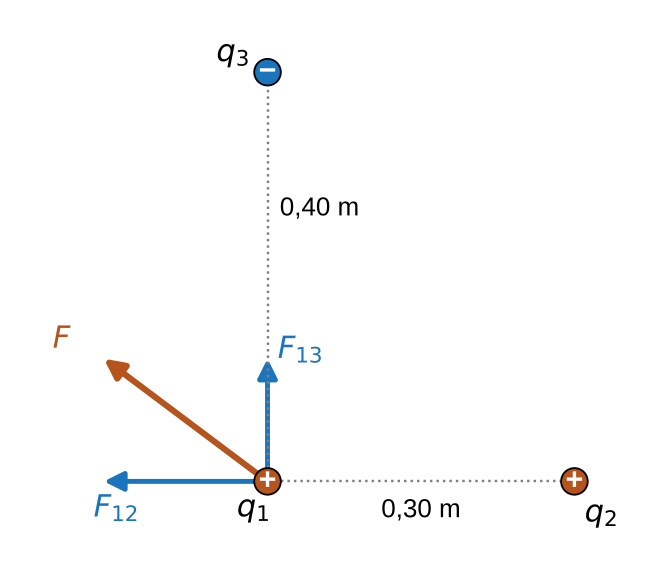
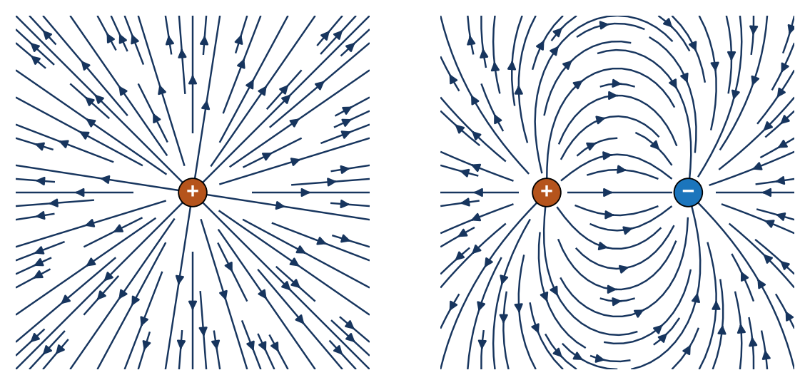
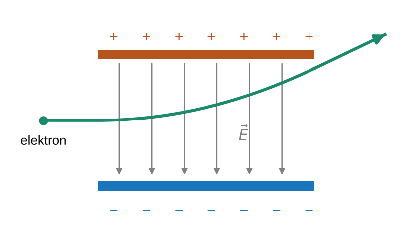
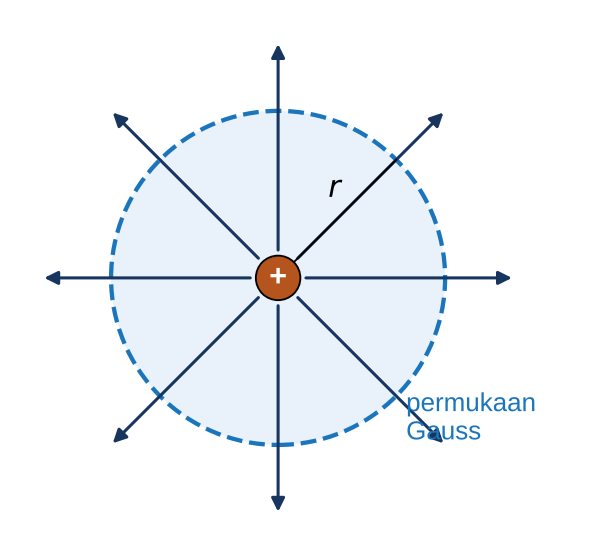

# Bab 12 Listrik Statis

Sebutir garam dapur adalah benda yang keras. Titik leburnya 801 °C, dan untuk memisahkan ion Na⁺ dari ion Cl⁻ tetangganya diperlukan energi ratusan kali energi termal pada suhu kamar. Tetapi jatuhkan butir itu ke dalam segelas air, dan dalam beberapa detik ia lenyap: ion-ionnya berpisah dengan sendirinya, tanpa dipanaskan.

Air tidak bereaksi dengan garam, dan suhunya hampir tidak berubah. Apa yang dilakukan air sehingga gaya yang begitu kuat tiba-tiba menjadi begitu lemah? Jawabannya ada pada satu bilangan, tetapan dielektrik air, dan pada bentuk molekul air yang bengkok. Hitungannya ada di Contoh 12.39.

Hampir seluruh kimia adalah listrik statis. Gaya yang mengikat elektron ke inti, atom ke atom, ion ke ion, dan molekul ke molekul adalah gaya listrik antara muatan-muatan. Bab ini membangun alat untuk menghitungnya: hukum Coulomb, medan, potensial, dan energi.

::: {.tujuan}
**Tujuan belajar**

Setelah mempelajari bab ini, kamu mampu:

1. Menjelaskan sifat muatan listrik: dua jenis, terkuantisasi, dan kekal.
2. Menghitung gaya listrik dengan hukum Coulomb dan asas superposisi.
3. Menghitung dan menggambarkan medan listrik.
4. Menganalisis gerak partikel bermuatan dalam medan seragam.
5. Memakai hukum Gauss untuk susunan muatan yang setangkup.
6. Menghitung potensial dan energi potensial listrik, termasuk dalam elektronvolt.
7. Menghitung kapasitansi, muatan, dan energi kapasitor.
8. Menjelaskan peran dielektrik, khususnya air sebagai pelarut.
9. Menerapkan elektrostatika pada atom, ion, molekul polar, dan kristal ion.
:::

::: {.mat}
**Prasyarat**

Dari Bab 1: vektor dan komponennya. Dari Bab 3: hukum Newton. Dari Bab 4: usaha, energi potensial, dan kurva energi potensial (subbab 4.8). Dari Bab 10: energi termal $k_BT$ dan faktor Boltzmann.
:::

## 12.1 Muatan listrik

### Dua jenis muatan

Gosokkan penggaris plastik pada rambut kering, dan penggaris itu menarik sobekan kertas. Gejala ini sudah dikenal orang Yunani kuno pada batu ambar, *elektron* dalam bahasa mereka. Percobaan sederhana menunjukkan tiga hal:

- Ada **dua jenis** muatan, yang oleh Benjamin Franklin dinamai positif dan negatif.
- Muatan sejenis **tolak-menolak**; muatan tak sejenis **tarik-menarik**.
- Benda biasanya netral, karena memuat kedua jenis dalam jumlah sama.

Kini kita tahu asalnya. Atom terdiri atas inti bermuatan positif (proton dan neutron) dan elektron bermuatan negatif. Menggosok tidak menciptakan muatan; ia **memindahkan** elektron dari satu benda ke benda lain.

| Partikel | Muatan | Massa (kg) |
|---|---|---|
| Elektron | $-e$ | $9{,}109 \times 10^{-31}$ |
| Proton | $+e$ | $1{,}673 \times 10^{-27}$ |
| Neutron | 0 | $1{,}675 \times 10^{-27}$ |

Satuan muatan adalah **coulomb** (C). **Muatan elementer**:

$$
\boxed{e = 1{,}602 \times 10^{-19}\ \text{C}} \qquad \text{(12.1)}
$$

### Kuantisasi dan kekekalan

::: {.inti}
**Muatan terkuantisasi.** Muatan setiap benda adalah kelipatan bulat muatan elementer: $q = \pm Ne$.

**Muatan kekal.** Jumlah aljabar muatan dalam sistem terisolasi tidak pernah berubah.
:::

Kekekalan muatan adalah dasar penyetaraan muatan dalam persamaan reaksi dan setengah-reaksi redoks: jumlah muatan di ruas kiri harus sama dengan di ruas kanan.

Satu mol muatan elementer disebut **tetapan Faraday**:

$$
F = N_Ae = 96\,485\ \text{C/mol}. \qquad \text{(12.2)}
$$

### Konduktor dan isolator

Dalam **konduktor** (logam, larutan elektrolit, garam leleh), ada muatan yang bebas bergerak: elektron pada logam, ion pada larutan. Dalam **isolator** (kaca, plastik, air murni, udara kering), semua muatan terikat pada tempatnya. **Semikonduktor** berada di antaranya.

Benda dapat dimuati dengan tiga cara: digosok, disentuh benda bermuatan (konduksi), atau didekati benda bermuatan lalu dibumikan (induksi). Benda netral pun ditarik benda bermuatan, karena muatan di dalamnya sedikit bergeser: sisi yang dekat menjadi berlawanan tanda dan ditarik lebih kuat. Pergeseran ini disebut **polarisasi**, dan ia akan muncul lagi di subbab 12.8.

::: {.contoh}
**Contoh 12.1 · Menghitung elektron**

(a) Berapa elektron berlebih pada benda bermuatan −1,0 μC? (b) Balon yang digosok bermuatan −50 nC. Berapa elektron yang berpindah kepadanya?

**Penyelesaian.**

(a) $N = \dfrac{1{,}0 \times 10^{-6}}{1{,}602 \times 10^{-19}} = 6{,}2 \times 10^{12}$.

(b) $N = \dfrac{50 \times 10^{-9}}{1{,}602 \times 10^{-19}} = 3{,}1 \times 10^{11}$.

**Memahami hasil.** Triliunan elektron, tetapi butir muatannya begitu kecil sehingga dalam percobaan sehari-hari muatan tampak malar. Satu coulomb adalah muatan yang sangat besar; muatan statis biasa berukuran nanocoulomb sampai mikrocoulomb.
:::

::: {.contoh}
**Contoh 12.2 · Betapa netralnya benda**

Sekeping tembaga bermassa 3,0 g (63,55 g/mol; 29 elektron tiap atom). (a) Berapa muatan total semua elektronnya? (b) Jika keping itu bermuatan +50 nC, berapa bagian elektronnya yang hilang?

**Penyelesaian.**

(a) Banyaknya atom: $\dfrac{3{,}0}{63{,}55}(6{,}022 \times 10^{23}) = 2{,}84 \times 10^{22}$. Banyaknya elektron: $29 \times 2{,}84 \times 10^{22} = 8{,}2 \times 10^{23}$. Muatannya: $-(8{,}2 \times 10^{23})(1{,}602 \times 10^{-19}) = -1{,}3 \times 10^5$ C.

(b) Elektron yang hilang $3{,}1 \times 10^{11}$ (Contoh 12.1). Bagiannya: $\dfrac{3{,}1 \times 10^{11}}{8{,}2 \times 10^{23}} = 4 \times 10^{-13}$.

**Memahami hasil.** Benda "bermuatan" pun hampir netral sempurna: hanya empat dari sepuluh triliun elektron yang berpindah. Materi memuat muatan positif dan negatif yang luar biasa besar, yang saling meniadakan dengan ketelitian luar biasa. Sedikit saja ketakseimbangan sudah menimbulkan gaya yang besar.
:::

::: {.contoh}
**Contoh 12.3 · Muatan dalam elektrolisis**

Berapa muatan yang diperlukan untuk mengendapkan 1,00 g tembaga dari larutan Cu²⁺?

**Penyelesaian.** $n = \dfrac{1{,}00}{63{,}55} = 0{,}01574$ mol tembaga. Tiap ion memerlukan dua elektron:

$$
Q = 2nF = 2(0{,}01574)(96\,485) = 3{,}04 \times 10^3\ \text{C}.
$$

**Memahami hasil.** Tiga ribu coulomb, muatan yang mustahil dikumpulkan pada satu benda, mengalir dengan mudah melalui kawat karena di dalam konduktor muatan positif dan negatif tetap hampir seimbang di setiap tempat. Hukum Faraday tentang elektrolisis hanyalah kuantisasi muatan yang dihitung per mol.
:::

::: {.kuis}
**Kuis cepat 12.1**

Batang kaca bermuatan positif didekatkan ke bola logam netral yang tergantung. Bola itu tertarik. Apakah bola menjadi bermuatan?
:::

## 12.2 Hukum Coulomb

### Gaya antara dua muatan titik

Pada tahun 1785 Charles Coulomb mengukur gaya antara dua bola kecil bermuatan dengan neraca puntir. Hasilnya:

$$
\boxed{F = k\,\frac{\lvert q_1q_2\rvert}{r^2}, \qquad k = \frac{1}{4\pi\varepsilon_0} = 8{,}988 \times 10^9\ \text{N·m}^2/\text{C}^2} \qquad \text{(12.3)}
$$

$\varepsilon_0 = 8{,}854 \times 10^{-12}\ \text{C}^2/(\text{N·m}^2)$ disebut **permitivitas ruang hampa**. Gayanya bekerja sepanjang garis hubung kedua muatan: tolak-menolak jika sejenis, tarik-menarik jika tak sejenis. Sesuai hukum ketiga Newton, gaya pada kedua muatan sama besar dan berlawanan arah.

Bentuknya sama dengan hukum gravitasi Newton: berbanding terbalik dengan kuadrat jarak. Bedanya, gaya listrik dapat tarik atau tolak, dan jauh lebih kuat.

Untuk hitungan skala atom, satuan yang praktis:

$$
ke^2 = 2{,}307 \times 10^{-28}\ \text{J·m} = 1{,}440\ \text{eV·nm}. \qquad \text{(12.4)}
$$

### Asas superposisi

Jika ada lebih dari dua muatan, gaya pada satu muatan adalah **jumlah vektor** gaya dari tiap muatan lain, masing-masing dihitung seolah-olah yang lain tidak ada.

::: {.strategi}
**Strategi · Soal hukum Coulomb**

1. Gambar muatan-muatannya dan tandai muatan yang ditinjau.
2. Untuk tiap muatan lain, hitung **besar** gaya dengan (12.3), memakai nilai mutlak muatan.
3. Tentukan **arah** dari tanda: sejenis menolak, tak sejenis menarik. Gambar anak panahnya.
4. Uraikan tiap gaya ke komponen $x$ dan $y$, lalu jumlahkan per komponen.
5. Ubah satuan lebih dulu: μC ke C, cm ke m.
:::

::: {.contoh}
**Contoh 12.4 · Gaya antara dua muatan**

Muatan +3,0 μC dan −5,0 μC terpisah 20 cm. Berapa gaya di antara keduanya?

**Penyelesaian.**

$$
F = (8{,}988 \times 10^9)\frac{(3{,}0 \times 10^{-6})(5{,}0 \times 10^{-6})}{(0{,}20)^2} = 3{,}4\ \text{N}, \quad \text{tarik-menarik}.
$$

**Memahami hasil.** Muatan sekecil beberapa mikrocoulomb sudah menghasilkan gaya yang terasa, setara berat benda 340 g.
:::

::: {.contoh}
**Contoh 12.5 · Listrik melawan gravitasi**

Dalam atom hidrogen, elektron dan proton terpisah rata-rata $5{,}29 \times 10^{-11}$ m. Bandingkan gaya listrik dan gaya gravitasi di antara keduanya.

**Penyelesaian.**

$$
F_e = \frac{ke^2}{r^2} = \frac{2{,}307 \times 10^{-28}}{(5{,}29 \times 10^{-11})^2} = 8{,}2 \times 10^{-8}\ \text{N}.
$$

$$
F_g = \frac{Gm_em_p}{r^2} = \frac{(6{,}674 \times 10^{-11})(9{,}109 \times 10^{-31})(1{,}673 \times 10^{-27})}{(5{,}29 \times 10^{-11})^2} = 3{,}6 \times 10^{-47}\ \text{N}.
$$

Perbandingannya $2{,}3 \times 10^{39}$.

**Memahami hasil.** Gravitasi dapat diabaikan sepenuhnya dalam atom dan molekul; kimia adalah urusan gaya listrik semata. Gravitasi baru menguasai pada skala planet, karena benda besar netral secara listrik sedangkan massa selalu menjumlah.
:::

::: {.contoh}
**Contoh 12.6 · Tiga muatan segaris**

Tiga muatan terletak pada sumbu $x$: $q_1 = +4{,}0$ μC di $x = 0$; $q_2 = -2{,}0$ μC di $x = 0{,}30$ m; $q_3 = +3{,}0$ μC di $x = 0{,}50$ m. Berapa gaya total pada $q_3$?

**Penyelesaian.**

Dari $q_1$ (sejenis, menolak ke arah $+x$), jarak 0,50 m:

$$
F_{31} = (8{,}988 \times 10^9)\frac{(4{,}0 \times 10^{-6})(3{,}0 \times 10^{-6})}{(0{,}50)^2} = 0{,}43\ \text{N}.
$$

Dari $q_2$ (tak sejenis, menarik ke arah $-x$), jarak 0,20 m:

$$
F_{32} = (8{,}988 \times 10^9)\frac{(2{,}0 \times 10^{-6})(3{,}0 \times 10^{-6})}{(0{,}20)^2} = 1{,}35\ \text{N}.
$$

Total: $0{,}43 - 1{,}35 = -0{,}92$ N, ke arah $-x$.

**Memahami hasil.** Muatan $q_2$ lebih kecil daripada $q_1$, tetapi jauh lebih dekat, dan jarak masuk sebagai kuadrat.
:::

::: {.contoh}
**Contoh 12.7 · Titik tanpa gaya**

Muatan +4,0 μC dan +1,0 μC terpisah 30 cm. Di mana muatan ketiga harus diletakkan agar gaya totalnya nol?

**Penyelesaian.** Titik itu harus di antara keduanya, tempat kedua gaya tolak berlawanan arah. Misalkan jaraknya $x$ dari muatan besar:

$$
\frac{4{,}0}{x^2} = \frac{1{,}0}{(0{,}30 - x)^2} \quad\Longrightarrow\quad \frac{x}{0{,}30 - x} = 2 \quad\Longrightarrow\quad x = 0{,}20\ \text{m}.
$$

**Memahami hasil.** Titik setimbang lebih dekat ke muatan yang kecil, dan letaknya tidak bergantung pada besar atau tanda muatan ketiga.
:::

{width=46%}

::: {.contoh}
**Contoh 12.8 · Superposisi dalam dua dimensi**

Tiga muatan berada di titik sudut segitiga siku-siku (Gambar 12.1): $q_1 = +2{,}0$ μC di titik asal; $q_2 = +3{,}0$ μC di (0,30 m; 0); $q_3 = -4{,}0$ μC di (0; 0,40 m). Tentukan gaya total pada $q_1$.

**Penyelesaian.**

$F_{12} = (8{,}988 \times 10^9)\dfrac{(2{,}0 \times 10^{-6})(3{,}0 \times 10^{-6})}{(0{,}30)^2} = 0{,}60$ N, tolak, ke arah $-x$.

$F_{13} = (8{,}988 \times 10^9)\dfrac{(2{,}0 \times 10^{-6})(4{,}0 \times 10^{-6})}{(0{,}40)^2} = 0{,}45$ N, tarik, ke arah $+y$.

$$
F = \sqrt{0{,}60^2 + 0{,}45^2} = 0{,}75\ \text{N}, \qquad \theta = \tan^{-1}\frac{0{,}45}{0{,}60} = 37°\ \text{di atas sumbu } -x .
$$

**Memahami hasil.** Gaya adalah vektor: besarnya tidak dijumlahkan langsung ($0{,}60 + 0{,}45 \ne 0{,}75$).
:::

::: {.contoh}
**Contoh 12.9 · Dua bola yang saling menolak**

Dua bola kecil identik bermassa 2,0 g digantung dari satu titik dengan benang 50 cm. Setelah diberi muatan sama, tiap benang menyimpang 10° dari garis tegak. Berapa muatan tiap bola?

**Penyelesaian.** Pada tiap bola bekerja berat, tegangan benang, dan gaya tolak listrik mendatar. Kesetimbangan memberi $F = mg\tan\theta$:

$$
F = (0{,}0020)(9{,}8)\tan 10° = 3{,}46 \times 10^{-3}\ \text{N}.
$$

Jarak antarbola: $r = 2L\sin\theta = 2(0{,}50)\sin 10° = 0{,}174$ m.

$$
q = \sqrt{\frac{Fr^2}{k}} = \sqrt{\frac{(3{,}46 \times 10^{-3})(0{,}174)^2}{8{,}988 \times 10^9}} = 1{,}1 \times 10^{-7}\ \text{C} = 0{,}11\ \mu\text{C}.
$$

**Memahami hasil.** Ini soal kesetimbangan dari Bab 3 dengan satu gaya baru. Elektroskop sederhana bekerja dengan asas ini.
:::

::: {.contoh}
**Contoh 12.10 · Gaya antara dua ion**

Dalam molekul NaCl berfasa gas, ion Na⁺ dan Cl⁻ terpisah 0,236 nm. Berapa gaya tarik di antara keduanya?

**Penyelesaian.**

$$
F = \frac{ke^2}{r^2} = \frac{2{,}307 \times 10^{-28}}{(0{,}236 \times 10^{-9})^2} = 4{,}1 \times 10^{-9}\ \text{N}.
$$

**Memahami hasil.** Empat nanonewton tampak kecil, tetapi ion natrium hanya bermassa $3{,}8 \times 10^{-26}$ kg; gaya itu $10^{16}$ kali beratnya. Gaya sebesar ini kini dapat diukur langsung dengan mikroskop gaya atom.
:::

::: {.kuis}
**Kuis cepat 12.2**

Jarak antara dua muatan dijadikan tiga kali, dan salah satu muatannya dijadikan dua kali. Bagaimana gayanya berubah?
:::

## 12.3 Medan listrik

### Dari gaya ke medan

Bagaimana satu muatan "tahu" ada muatan lain di kejauhan? Michael Faraday menjawab dengan gagasan **medan**: setiap muatan mengubah ruang di sekitarnya, dan muatan lain merasakan perubahan itu di tempatnya sendiri. **Medan listrik** di suatu titik adalah gaya tiap satuan muatan yang akan dialami muatan uji positif di titik itu:

$$
\boxed{\vec E = \frac{\vec F}{q}, \qquad \vec F = q\vec E} \qquad \text{(12.5)}
$$

Satuannya N/C, sama dengan V/m. Muatan positif didorong **searah** medan; muatan negatif didorong **berlawanan** arah medan.

Medan oleh muatan titik $Q$ pada jarak $r$:

$$
\boxed{E = \frac{k\lvert Q\rvert}{r^2}} \qquad \text{(12.6)}
$$

arahnya menjauhi muatan positif dan menuju muatan negatif. Medan oleh banyak muatan adalah jumlah vektor medan masing-masing.

| Tempat | Medan (N/C) |
|---|---|
| Kabel listrik rumah | $10^{-2}$ |
| Atmosfer cuaca cerah | 100 |
| Dekat balon yang digosok | $10^3$ |
| Udara mulai memercik (tembus) | $3 \times 10^6$ |
| Membran sel | $10^7$ |
| Pada elektron dalam atom hidrogen | $5 \times 10^{11}$ |

### Garis medan

{width=78%}

Medan digambarkan dengan **garis medan** (Gambar 12.2):

- garis medan keluar dari muatan positif dan masuk ke muatan negatif;
- arah medan di suatu titik adalah arah garis singgung di titik itu;
- makin rapat garisnya, makin kuat medannya;
- garis medan tidak pernah berpotongan.

### Dipol listrik

Sepasang muatan $+q$ dan $-q$ yang terpisah sejauh $d$ disebut **dipol listrik**. Ukurannya adalah **momen dipol**:

$$
\boxed{p = qd} \qquad \text{(12.7)}
$$

berarah dari muatan negatif ke muatan positif. (Kimiawan sering menggambar anak panahnya terbalik, dari $\delta+$ ke $\delta-$; besarnya sama.) Satuan SI-nya C·m; satuan yang lazim untuk molekul adalah **debye**: 1 D $= 3{,}336 \times 10^{-30}$ C·m.

Dipol netral secara keseluruhan, tetapi tetap menghasilkan medan, karena kedua muatannya tidak berimpit. Jauh dari dipol, pada sumbunya:

$$
E \approx \frac{2kp}{r^3} . \qquad \text{(12.8)}
$$

Medan dipol melemah sebagai $1/r^3$, lebih cepat daripada medan muatan tunggal, karena dari jauh kedua muatan hampir saling meniadakan.

Dipol dalam medan luar mengalami torsi yang memutarnya agar sejajar medan, dan energi potensialnya

$$
U = -pE\cos\theta . \qquad \text{(12.9)}
$$

Paling rendah ketika dipol searah medan ($\theta = 0$).

### Medan seragam

Di antara dua pelat sejajar yang bermuatan sama besar dan berlawanan tanda, medannya **seragam**: sama besar dan sama arah di semua titik (jauh dari tepi). Jika rapat muatan pelat $\sigma$ (C/m²):

$$
\boxed{E = \frac{\sigma}{\varepsilon_0}} \qquad \text{(12.10)}
$$

::: {.contoh}
**Contoh 12.11 · Medan muatan titik**

(a) Berapa medan listrik pada jarak 30 cm dari muatan +5,0 nC? (b) Berapa gaya pada elektron yang diletakkan di sana?

**Penyelesaian.**

(a) $E = \dfrac{(8{,}988 \times 10^9)(5{,}0 \times 10^{-9})}{(0{,}30)^2} = 500$ N/C, menjauhi muatan.

(b) $F = eE = (1{,}602 \times 10^{-19})(500) = 8{,}0 \times 10^{-17}$ N, **menuju** muatan itu.

**Memahami hasil.** Medan ada di titik itu, ada elektron atau tidak. Elektron, yang negatif, didorong melawan arah medan.
:::

::: {.contoh}
**Contoh 12.12 · Medan di antara dua muatan**

Muatan +6,0 nC dan −6,0 nC terpisah 10 cm. Berapa medan di titik tengahnya?

**Penyelesaian.** Di titik tengah, medan oleh muatan positif menjauhinya, yaitu menuju muatan negatif; medan oleh muatan negatif juga menuju muatan negatif. Keduanya searah:

$$
E = 2 \times \frac{(8{,}988 \times 10^9)(6{,}0 \times 10^{-9})}{(0{,}050)^2} = 4{,}3 \times 10^4\ \text{N/C}.
$$

**Memahami hasil.** Jika kedua muatan sejenis, medan di tengah nol. Untuk dipol, medan di tengah justru paling tegas arahnya, dari positif ke negatif.
:::

::: {.contoh}
**Contoh 12.13 · Titik bermedan nol**

Muatan +9,0 nC berada di $x = 0$ dan −4,0 nC di $x = 10$ cm. Di mana medannya nol?

**Penyelesaian.** Di antara keduanya, kedua medan searah, jadi tidak mungkin nol. Titik itu harus di luar, di sisi muatan yang lebih kecil. Misalkan jaraknya $s$ di sebelah kanan muatan negatif:

$$
\frac{9{,}0}{(0{,}10 + s)^2} = \frac{4{,}0}{s^2} \quad\Longrightarrow\quad \frac{0{,}10 + s}{s} = 1{,}5 \quad\Longrightarrow\quad s = 0{,}20\ \text{m}.
$$

Jadi di $x = 30$ cm.

**Memahami hasil.** Di sana, muatan besar yang jauh dan muatan kecil yang dekat memberi medan sama besar dan berlawanan arah.
:::

::: {.contoh}
**Contoh 12.14 · Medan di dalam atom**

Berapa medan listrik yang dihasilkan proton pada jarak $5{,}29 \times 10^{-11}$ m, tempat elektron atom hidrogen berada?

**Penyelesaian.**

$$
E = \frac{ke}{r^2} = \frac{(8{,}988 \times 10^9)(1{,}602 \times 10^{-19})}{(5{,}29 \times 10^{-11})^2} = 5{,}1 \times 10^{11}\ \text{N/C}.
$$

**Memahami hasil.** Ini seratus ribu kali medan yang membuat udara memercik. Medan laboratorium terkuat pun hanya gangguan kecil bagi atom, dan itu sebabnya atom begitu mantap. Hanya laser berdenyut sangat kuat yang dapat menandingi medan ini dan mengoyak elektron dari atom.
:::

::: {.contoh}
**Contoh 12.15 · Medan molekul air**

Momen dipol molekul air 1,85 D. (a) Nyatakan dalam C·m. (b) Berapa medan pada sumbu dipol, pada jarak 0,30 nm, kira-kira jarak molekul tetangga?

**Penyelesaian.**

(a) $p = (1{,}85)(3{,}336 \times 10^{-30}) = 6{,}17 \times 10^{-30}$ C·m.

(b) $E \approx \dfrac{2kp}{r^3} = \dfrac{2(8{,}988 \times 10^9)(6{,}17 \times 10^{-30})}{(0{,}30 \times 10^{-9})^3} = 4{,}1 \times 10^9$ N/C.

**Memahami hasil.** Molekul air netral, tetapi tetangga terdekatnya merasakan medan miliaran N/C. Inilah asal gaya antarmolekul yang kuat dalam air. Pada jarak sedekat ini rumus medan jauh hanya taksiran, tetapi ordenya benar.
:::

::: {.contoh}
**Contoh 12.16 · Dapatkah medan luar menjajarkan molekul air?**

Molekul air berada dalam medan $1{,}0 \times 10^6$ N/C, medan yang kuat menurut ukuran laboratorium. Bandingkan energi penjajaran $pE$ dengan energi termal $k_BT$ pada 298 K.

**Penyelesaian.**

$pE = (6{,}17 \times 10^{-30})(1{,}0 \times 10^6) = 6{,}2 \times 10^{-24}$ J. $k_BT = 4{,}11 \times 10^{-21}$ J.

$$
\frac{pE}{k_BT} = 1{,}5 \times 10^{-3} .
$$

**Memahami hasil.** Gerak termal menang telak; molekul hampir tetap berarah acak, dengan hanya sedikit kecenderungan searah medan. Tetapi di dekat ion, medannya ribuan kali lebih kuat (Contoh 12.15), dan di sana molekul air **benar-benar** terjajar. Itulah hidrasi.
:::

::: {.kuis}
**Kuis cepat 12.3**

Garis-garis medan di suatu daerah sejajar dan sama rapat. Apa yang dapat dikatakan tentang medan di daerah itu?
:::

## 12.4 Gerak muatan dalam medan listrik

Partikel bermuatan $q$ dan bermassa $m$ dalam medan $\vec E$ mengalami gaya $q\vec E$ dan percepatan

$$
\boxed{\vec a = \frac{q\vec E}{m}} \qquad \text{(12.11)}
$$

Dalam medan **seragam**, percepatannya tetap, dan semua rumus gerak berpercepatan tetap dari Bab 2 berlaku, termasuk gerak parabola. Bedanya dengan gravitasi: percepatan bergantung pada perbandingan $q/m$ partikel.

{width=58%}

::: {.contoh}
**Contoh 12.17 · Elektron dipercepat**

Elektron dilepas dari diam dalam medan seragam $2{,}0 \times 10^4$ N/C. (a) Berapa percepatannya? (b) Berapa kelajuannya setelah menempuh 1,0 cm, dan berapa lama?

**Penyelesaian.**

(a) $a = \dfrac{eE}{m} = \dfrac{(1{,}602 \times 10^{-19})(2{,}0 \times 10^4)}{9{,}109 \times 10^{-31}} = 3{,}5 \times 10^{15}\ \text{m/s}^2$.

(b) $v = \sqrt{2ad} = \sqrt{2(3{,}5 \times 10^{15})(0{,}010)} = 8{,}4 \times 10^6$ m/s. $t = \dfrac va = 2{,}4 \times 10^{-9}$ s.

**Memahami hasil.** Percepatannya $10^{14}$ kali $g$; berat elektron sama sekali tidak berarti. Dalam satu sentimeter dan dua nanodetik, elektron mencapai 3% laju cahaya.
:::

::: {.contoh}
**Contoh 12.18 · Pembelokan berkas elektron**

Elektron berkelajuan $2{,}0 \times 10^7$ m/s masuk mendatar ke antara dua pelat sepanjang 4,0 cm, tempat medan seragam $1{,}0 \times 10^4$ N/C berarah tegak lurus kecepatannya (Gambar 12.3). Berapa simpangan dan sudut beloknya ketika keluar?

**Penyelesaian.** Gerak mendatar berkelajuan tetap: $t = \dfrac{0{,}040}{2{,}0 \times 10^7} = 2{,}0 \times 10^{-9}$ s.

Gerak tegak lurus berpercepatan tetap, $a = \dfrac{eE}{m} = 1{,}76 \times 10^{15}\ \text{m/s}^2$:

$$
y = \tfrac12at^2 = \tfrac12(1{,}76 \times 10^{15})(2{,}0 \times 10^{-9})^2 = 3{,}5\ \text{mm}.
$$

$v_y = at = 3{,}5 \times 10^6$ m/s, sehingga $\tan\theta = \dfrac{3{,}5 \times 10^6}{2{,}0 \times 10^7}$ dan $\theta = 10°$.

**Memahami hasil.** Persis gerak peluru di Bab 2, dengan $eE/m$ menggantikan $g$. Begitulah berkas elektron diarahkan dalam tabung sinar katode dan mikroskop elektron. Dengan cara ini pula J. J. Thomson mengukur $e/m$ elektron pada tahun 1897.
:::

::: {.contoh}
**Contoh 12.19 · Percobaan tetes minyak Millikan**

Tetes minyak berjari-jari 1,0 μm (massa jenis 900 kg/m³) membawa tiga elektron berlebih. Berapa medan yang diperlukan agar tetes itu melayang diam?

**Penyelesaian.** Massa tetes: $m = \rho\cdot\tfrac43\pi r^3 = (900)\tfrac43\pi(1{,}0 \times 10^{-6})^3 = 3{,}77 \times 10^{-15}$ kg. Syarat melayang: $qE = mg$.

$$
E = \frac{mg}{3e} = \frac{(3{,}77 \times 10^{-15})(9{,}8)}{3(1{,}602 \times 10^{-19})} = 7{,}7 \times 10^4\ \text{N/C}.
$$

**Memahami hasil.** Robert Millikan membalik hitungan ini: dari medan yang membuat tetes melayang ia memperoleh muatannya, dan menemukan bahwa muatan itu selalu kelipatan bulat dari satu nilai terkecil. Itu pengukuran pertama $e$ dan bukti langsung kuantisasi muatan. Massa tetes ia peroleh dari kelajuan jatuhnya, dengan hukum Stokes (subbab 7.8).
:::

::: {.contoh}
**Contoh 12.20 · Ion dalam larutan**

Ion Na⁺ dalam air berada dalam medan 1000 N/C. (a) Berapa gaya listrik padanya? (b) Mobilitas ion Na⁺ dalam air adalah $5{,}19 \times 10^{-8}\ \text{m}^2/(\text{V·s})$; artinya kelajuan hanyutnya $v = \mu E$. Berapa kelajuan itu?

**Penyelesaian.**

(a) $F = eE = 1{,}6 \times 10^{-16}$ N.

(b) $v = (5{,}19 \times 10^{-8})(1000) = 5{,}2 \times 10^{-5}$ m/s.

**Memahami hasil.** Di ruang hampa, gaya itu akan memberi percepatan $4 \times 10^9\ \text{m/s}^2$. Dalam air, ion langsung mencapai kelajuan akhir yang sangat kecil, 0,05 mm/s, karena terus-menerus bertumbukan dengan molekul air: gaya listrik diimbangi gaya hambat kental. Gerak hanyut inilah yang menghantarkan arus dalam larutan (Bab 13), dan perbedaan mobilitas antarion dimanfaatkan dalam elektroforesis.
:::

::: {.kuis}
**Kuis cepat 12.4**

Proton dan elektron dilepas dari diam dalam medan seragam yang sama. Bandingkan besar gaya dan besar percepatan keduanya.
:::

## 12.5 Hukum Gauss

### Fluks listrik

**Fluks listrik** melalui suatu permukaan mengukur "banyaknya garis medan" yang menembusnya. Untuk medan seragam yang menembus permukaan datar seluas $A$:

$$
\Phi_E = EA\cos\theta , \qquad \text{(12.12)}
$$

dengan $\theta$ sudut antara medan dan garis normal permukaan.

### Hukum Gauss

::: {.inti}
**Hukum Gauss.** Fluks listrik total yang keluar dari permukaan tertutup mana pun sama dengan muatan total di dalamnya dibagi $\varepsilon_0$:

$$
\Phi_E = \frac{Q_\text{dalam}}{\varepsilon_0} . \qquad \text{(12.13)}
$$
:::

Hukum Gauss setara dengan hukum Coulomb, tetapi untuk susunan muatan yang setangkup ia jauh lebih mudah dipakai. Caranya: pilih permukaan khayal (**permukaan Gauss**) yang bentuknya mengikuti kesetangkupan muatan, sehingga medan sama besar di seluruh permukaan itu.

{width=38%}

Untuk muatan titik (Gambar 12.4), permukaan Gauss berupa bola berjari-jari $r$: fluksnya $E \cdot 4\pi r^2 = Q/\varepsilon_0$, sehingga $E = Q/(4\pi\varepsilon_0r^2)$. Hukum Coulomb muncul kembali. Faktor $1/r^2$ hanyalah akibat luas bola yang tumbuh sebagai $r^2$.

| Susunan muatan | Medan | Bergantung pada jarak sebagai |
|---|---|---|
| Titik, atau di luar bola setangkup | $E = \dfrac{kQ}{r^2}$ | $1/r^2$ |
| Di dalam kulit bola bermuatan | $E = 0$ | — |
| Di dalam bola pejal bermuatan seragam | $E = \dfrac{kQr}{R^3}$ | $r$ |
| Garis panjang, rapat muatan $\lambda$ | $E = \dfrac{2k\lambda}{r}$ | $1/r$ |
| Bidang luas, rapat muatan $\sigma$ | $E = \dfrac{\sigma}{2\varepsilon_0}$ | tetap |
| Tepat di luar permukaan konduktor | $E = \dfrac{\sigma}{\varepsilon_0}$ | — |

Dua hasil penting untuk kimia. Pertama, **dari luar, bola bermuatan setangkup berperilaku seperti muatan titik di pusatnya**; itu sebabnya ion boleh diperlakukan sebagai muatan titik. Kedua, **kulit bola tidak menghasilkan medan di dalamnya**; itu dasar gagasan **perisai**: elektron valensi hanya merasakan muatan inti dikurangi muatan elektron-elektron di kulit yang lebih dalam.

### Konduktor dalam kesetimbangan

Di dalam konduktor, muatan bebas bergerak sampai tidak ada lagi gaya padanya. Akibatnya:

- medan listrik di **dalam** konduktor nol;
- muatan berlebih seluruhnya berada di **permukaan**;
- medan tepat di luar permukaan tegak lurus permukaan itu;
- muatan paling rapat di bagian yang runcing, dan medan di sana paling kuat.

Butir pertama adalah asas **sangkar Faraday**: ruang yang dikelilingi logam terlindung dari medan listrik luar. Butir terakhir adalah asas penangkal petir.

::: {.contoh}
**Contoh 12.21 · Fluks**

(a) Medan seragam 500 N/C menembus bidang seluas 0,20 m² yang garis normalnya membentuk sudut 60° dengan medan. Berapa fluksnya? (b) Berapa fluks total yang keluar dari permukaan tertutup yang melingkupi muatan +2,0 μC?

**Penyelesaian.**

(a) $\Phi = (500)(0{,}20)\cos 60° = 50\ \text{N·m}^2/\text{C}$.

(b) $\Phi = \dfrac{2{,}0 \times 10^{-6}}{8{,}854 \times 10^{-12}} = 2{,}3 \times 10^5\ \text{N·m}^2/\text{C}$.

**Memahami hasil.** Hasil (b) tidak bergantung pada bentuk atau ukuran permukaannya, dan tidak pada letak muatan di dalamnya.
:::

::: {.contoh}
**Contoh 12.22 · Kulit bola bermuatan**

Kulit bola logam berjari-jari 10 cm bermuatan +50 nC. Berapa medan pada jarak (a) 5,0 cm; (b) 20 cm dari pusatnya?

**Penyelesaian.**

(a) Permukaan Gauss berjari-jari 5,0 cm tidak melingkupi muatan apa pun: $E = 0$.

(b) $E = \dfrac{(8{,}988 \times 10^9)(50 \times 10^{-9})}{(0{,}20)^2} = 1{,}1 \times 10^4$ N/C.

**Memahami hasil.** Di dalam, tarikan muatan di sisi yang dekat tepat diimbangi muatan yang lebih banyak di sisi yang jauh. Di luar, kulit itu tidak dapat dibedakan dari muatan titik di pusatnya.
:::

::: {.contoh}
**Contoh 12.23 · Medan di permukaan inti atom**

Inti emas memuat 79 proton dan berjari-jari 7,0 fm. Anggap muatannya tersebar seragam. Berapa medan listrik (a) di permukaan inti; (b) di tengah-tengah antara pusat dan permukaan?

**Penyelesaian.**

(a) $E = \dfrac{k(79e)}{R^2} = \dfrac{(8{,}988 \times 10^9)(79)(1{,}602 \times 10^{-19})}{(7{,}0 \times 10^{-15})^2} = 2{,}3 \times 10^{21}$ N/C.

(b) Di dalam bola seragam, $E \propto r$: setengahnya, $1{,}2 \times 10^{21}$ N/C.

**Memahami hasil.** Medan ini sepuluh miliar kali medan pada elektron atom hidrogen. Gaya tolak listrik antarproton di dalam inti sangat besar; inti tetap utuh karena gaya inti kuat, yang jauh lebih kuat lagi tetapi berjangkauan sangat pendek.
:::

::: {.contoh}
**Contoh 12.24 · Kawat panjang bermuatan**

Kawat panjang memiliki rapat muatan 2,0 nC/m. Berapa medan pada jarak 5,0 cm darinya?

**Penyelesaian.**

$$
E = \frac{2k\lambda}{r} = \frac{2(8{,}988 \times 10^9)(2{,}0 \times 10^{-9})}{0{,}050} = 720\ \text{N/C}.
$$

**Memahami hasil.** Medan garis melemah hanya sebagai $1/r$, lebih lambat daripada muatan titik. Molekul DNA, yang membawa dua muatan negatif tiap 0,34 nm panjangnya, berperilaku seperti muatan garis; medannya berjangkauan jauh dan menarik awan ion positif yang rapat di sekelilingnya.
:::

::: {.contoh}
**Contoh 12.25 · Berapa banyak muatan yang dapat ditampung bola logam?**

Udara menjadi penghantar (tembus) jika medan melampaui $3{,}0 \times 10^6$ N/C. Berapa muatan terbesar yang dapat ditahan bola logam berjari-jari 10 cm di udara?

**Penyelesaian.** Medan di permukaan bola: $E = \dfrac{kQ}{R^2}$.

$$
Q = \frac{ER^2}{k} = \frac{(3{,}0 \times 10^6)(0{,}10)^2}{8{,}988 \times 10^9} = 3{,}3 \times 10^{-6}\ \text{C}.
$$

**Memahami hasil.** Hanya tiga mikrocoulomb; lebih dari itu, muatan bocor ke udara sebagai percikan. Karena $Q \propto R^2$, kubah generator Van de Graaff dibuat besar dan halus. Sebaliknya, ujung runcing berjari-jari kecil mencapai medan tembus pada muatan yang sangat sedikit, dan membocorkan muatan dengan tenang; itu cara kerja penangkal petir.
:::

::: {.kuis}
**Kuis cepat 12.5**

Mengapa penumpang di dalam mobil atau pesawat terbang aman ketika kendaraannya tersambar petir?
:::
