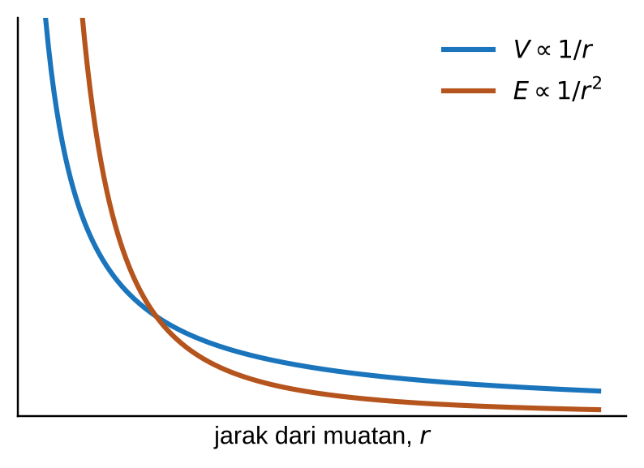
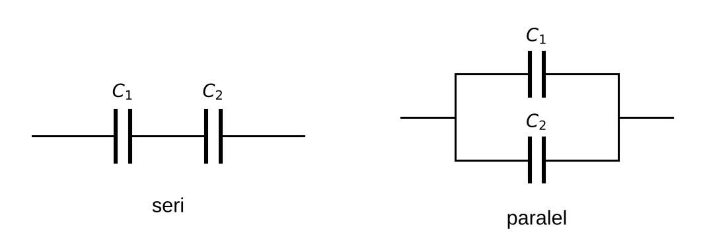
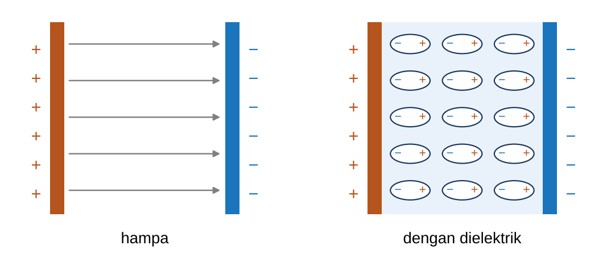
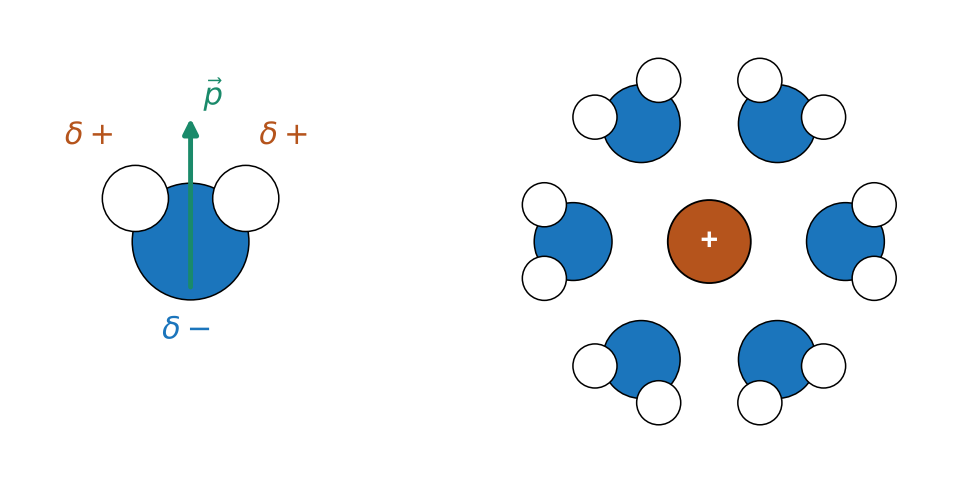
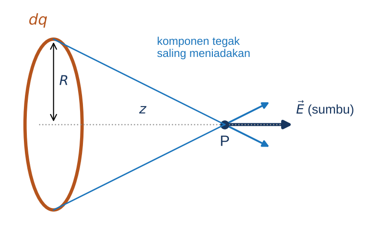
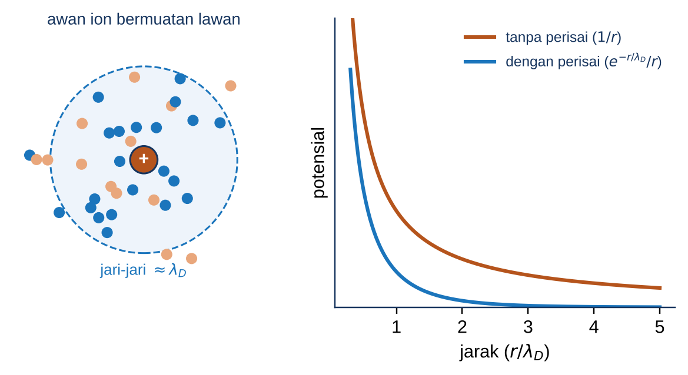

## 12.6 Energi potensial dan potensial listrik

### Gaya listrik bersifat konservatif

Seperti gravitasi, gaya listrik bersifat konservatif: usaha yang dilakukannya tidak bergantung pada jalur, sehingga ada energi potensial. Untuk dua muatan titik berjarak $r$:

$$
\boxed{U = \frac{kq_1q_2}{r}} \qquad \text{(12.14)}
$$

dengan $U = 0$ pada jarak tak berhingga. Di sini tanda muatan **diikutkan**:

- muatan tak sejenis: $U < 0$. Sistemnya terikat; perlu energi untuk memisahkannya.
- muatan sejenis: $U > 0$. Perlu usaha untuk mendekatkannya; jika dilepas, keduanya saling menjauh.

Untuk banyak muatan, energi potensial total adalah jumlah (12.14) untuk **setiap pasangan**. Rumus ini adalah dasar hampir semua hitungan energi dalam kimia: energi ionisasi, energi kisi, energi ikatan ion.

### Potensial listrik

Seperti medan adalah gaya tiap satuan muatan, **potensial listrik** adalah energi potensial tiap satuan muatan:

$$
\boxed{V = \frac{U}{q}, \qquad U = qV} \qquad \text{(12.15)}
$$

Satuannya **volt**: 1 V = 1 J/C. Potensial adalah skalar, jadi menjumlahkannya jauh lebih mudah daripada menjumlahkan medan. Potensial oleh muatan titik $Q$:

$$
\boxed{V = \frac{kQ}{r}} \qquad \text{(12.16)}
$$

positif di dekat muatan positif, negatif di dekat muatan negatif. Yang bermakna secara fisis adalah **beda potensial** (tegangan) antara dua titik. Usaha oleh gaya listrik ketika muatan $q$ berpindah dari A ke B:

$$
W = q(V_A - V_B) . \qquad \text{(12.17)}
$$

Muatan positif "jatuh" ke potensial yang lebih rendah; muatan negatif "jatuh" ke potensial yang lebih tinggi.

{width=54%}

### Elektronvolt

Energi yang diperoleh satu muatan elementer ketika melewati beda potensial satu volt disebut **elektronvolt**:

$$
\boxed{1\ \text{eV} = 1{,}602 \times 10^{-19}\ \text{J}} \qquad \text{(12.18)}
$$

| Energi | Besarnya |
|---|---|
| Energi termal $k_BT$ pada 298 K | 0,0257 eV |
| Ikatan hidrogen | 0,2 eV |
| Foton cahaya tampak | 1,8–3,1 eV |
| Ikatan kovalen | 2–10 eV |
| Ionisasi atom hidrogen | 13,6 eV |
| Sinar-X | $10^3$–$10^5$ eV |

Untuk mengubah ke satuan kimia: **1 eV per partikel = 96,49 kJ/mol**. Angka itu adalah tetapan Faraday, bukan kebetulan: 1 eV adalah $e$ × 1 V, dan satu mol-nya adalah $N_Ae$ × 1 V.

### Hubungan medan dan potensial

Medan menunjuk ke arah potensial **turun** paling curam, dan besarnya adalah laju penurunan itu:

$$
\boxed{E = -\frac{dV}{dx}; \qquad \text{medan seragam: } E = \frac{\Delta V}{d}} \qquad \text{(12.19)}
$$

Itu sebabnya satuan medan boleh ditulis V/m. Permukaan yang semua titiknya berpotensial sama disebut **permukaan ekuipotensial**; garis medan selalu tegak lurus padanya. Seluruh konduktor dalam kesetimbangan berada pada satu potensial.

::: {.contoh}
**Contoh 12.26 · Potensial muatan titik**

(a) Berapa potensial pada jarak 30 cm dari muatan +5,0 nC? (b) Berapa usaha yang harus kita lakukan untuk membawa muatan +2,0 μC dari tempat yang sangat jauh ke titik itu?

**Penyelesaian.**

(a) $V = \dfrac{(8{,}988 \times 10^9)(5{,}0 \times 10^{-9})}{0{,}30} = 150$ V.

(b) $W = qV = (2{,}0 \times 10^{-6})(150) = 3{,}0 \times 10^{-4}$ J.

**Memahami hasil.** Bandingkan dengan Contoh 12.11: medan di titik yang sama 500 N/C. Potensial dan medan adalah dua cara memerikan hal yang sama.
:::

::: {.contoh}
**Contoh 12.27 · Potensial oleh beberapa muatan**

Muatan +2,0 nC berjarak 0,30 m dari titik P, dan muatan −3,0 nC berjarak 0,40 m dari P. Berapa potensial di P?

**Penyelesaian.**

$$
V = (8{,}988 \times 10^9)\left[\frac{2{,}0 \times 10^{-9}}{0{,}30} - \frac{3{,}0 \times 10^{-9}}{0{,}40}\right] = 59{,}9 - 67{,}4 = -7{,}5\ \text{V}.
$$

**Memahami hasil.** Tidak perlu tahu arah-arahnya; potensial dijumlahkan sebagai bilangan biasa. Untuk medan di P, kita harus menguraikan vektor.
:::

::: {.contoh}
**Contoh 12.28 · Energi atom hidrogen**

Elektron atom hidrogen berjarak rata-rata 0,0529 nm dari proton. (a) Berapa energi potensial listriknya? (b) Energi kinetik elektron itu setengah besar energi potensialnya. Berapa energi totalnya?

**Penyelesaian.**

(a) $U = -\dfrac{ke^2}{r} = -\dfrac{1{,}440\ \text{eV·nm}}{0{,}0529\ \text{nm}} = -27{,}2$ eV.

(b) $K = 13{,}6$ eV, jadi $E = K + U = -13{,}6$ eV.

**Memahami hasil.** Energi total negatif berarti elektron terikat. Untuk melepasnya diperlukan 13,6 eV, yaitu energi ionisasi hidrogen yang terukur: 1312 kJ/mol. Dengan $ke^2 = 1{,}440$ eV·nm, hitungan skala atom menjadi satu baris.
:::

::: {.contoh}
**Contoh 12.29 · Partikel yang dipercepat tegangan**

(a) Elektron dipercepat dari diam melalui beda potensial 1000 V. Berapa energi kinetik dan kelajuannya? (b) Ulangi untuk proton.

**Penyelesaian.**

(a) $K = eV = 1000$ eV $= 1{,}602 \times 10^{-16}$ J. $v = \sqrt{\dfrac{2K}{m}} = \sqrt{\dfrac{2(1{,}602 \times 10^{-16})}{9{,}109 \times 10^{-31}}} = 1{,}9 \times 10^7$ m/s.

(b) Energi kinetiknya sama, 1000 eV. $v = \sqrt{\dfrac{2(1{,}602 \times 10^{-16})}{1{,}673 \times 10^{-27}}} = 4{,}4 \times 10^5$ m/s.

**Memahami hasil.** Tegangan yang sama memberi **energi** yang sama kepada partikel bermuatan sama, tetapi kelajuan yang sangat berbeda. Spektrometer massa waktu-terbang memanfaatkannya: semua ion dipercepat dengan tegangan yang sama, lalu yang ringan tiba lebih dulu di detektor.
:::

::: {.contoh}
**Contoh 12.30 · Medan dari tegangan**

(a) Dua pelat sejajar berjarak 3,0 mm dihubungkan ke baterai 12 V. Berapa medan di antaranya? (b) Beda potensial antara sisi dalam dan sisi luar membran sel 70 mV, dan tebal membran 7,0 nm. Berapa medan di dalam membran?

**Penyelesaian.**

(a) $E = \dfrac{12}{3{,}0 \times 10^{-3}} = 4{,}0 \times 10^3$ V/m.

(b) $E = \dfrac{0{,}070}{7{,}0 \times 10^{-9}} = 1{,}0 \times 10^7$ V/m.

**Memahami hasil.** Tegangan sekecil 70 mV, karena bekerja pada jarak yang sangat pendek, menghasilkan medan tiga kali medan tembus udara. Protein saluran ion di dalam membran merasakan medan raksasa ini, dan membuka atau menutup ketika medan itu berubah. Begitulah sel saraf bekerja.
:::

::: {.contoh}
**Contoh 12.31 · Jarak terdekat ke inti**

Partikel alfa (muatan $+2e$) berenergi kinetik 5,0 MeV ditembakkan lurus ke inti emas (muatan $+79e$). Seberapa dekat ia sampai sebelum berbalik?

**Penyelesaian.** Di titik terdekat, seluruh energi kinetik telah menjadi energi potensial:

$$
K = \frac{k(2e)(79e)}{r} \quad\Longrightarrow\quad r = \frac{(2)(79)(1{,}440\ \text{eV·nm})}{5{,}0 \times 10^6\ \text{eV}} = 4{,}6 \times 10^{-5}\ \text{nm} = 46\ \text{fm}.
$$

**Memahami hasil.** Jarak itu sepuluh ribu kali lebih kecil daripada atom. Dari percobaan seperti ini, pada tahun 1911 Ernest Rutherford menyimpulkan bahwa muatan positif atom terpusat di **inti** yang sangat kecil. Hitungan ini pemakaian langsung kekekalan energi, seperti bola yang dilempar menaiki bukit.
:::

::: {.contoh}
**Contoh 12.32 · Energi sepasang ion**

Dalam molekul NaCl berfasa gas, jarak antarion 0,236 nm. (a) Berapa energi potensial listrik pasangan ion itu, dalam eV dan kJ/mol? (b) Membentuk Na⁺ dari Na memerlukan 5,14 eV; membentuk Cl⁻ dari Cl melepas 3,61 eV. Berapa energi yang dilepas ketika atom Na dan atom Cl netral bergabung menjadi pasangan ion?

**Penyelesaian.**

(a) $U = -\dfrac{1{,}440}{0{,}236} = -6{,}10$ eV, atau $(-6{,}10)(96{,}49) = -589$ kJ/mol.

(b) Memindahkan elektron dari Na ke Cl **memerlukan** $5{,}14 - 3{,}61 = 1{,}53$ eV. Jadi energi bersihnya $1{,}53 - 6{,}10 = -4{,}57$ eV.

**Memahami hasil.** Nilai terukur energi ikatan NaCl gas 4,27 eV; selisihnya adalah gaya tolak jarak dekat antarawan elektron, yang kita abaikan. Perhatikan urutan logikanya: memindahkan elektron dari natrium ke klorin **merugi**; ikatan ion terbentuk hanya karena tarikan Coulomb antara kedua ion membayar kerugian itu berkali-kali lipat. "Natrium ingin melepas elektron" adalah ungkapan yang menyesatkan.
:::

::: {.contoh}
**Contoh 12.33 · Energi kilat**

Sambaran petir memindahkan muatan 20 C melalui beda potensial $1{,}0 \times 10^8$ V. Berapa energi yang dilepas?

**Penyelesaian.** $U = QV = (20)(1{,}0 \times 10^8) = 2{,}0 \times 10^9$ J.

**Memahami hasil.** Dua gigajoule, setara 560 kWh, kira-kira pemakaian listrik sebuah rumah selama dua bulan. Tetapi energi itu dilepas dalam sepersekian milidetik, sebagian besar menjadi kalor, cahaya, dan bunyi; menangkapnya tidak praktis.
:::

::: {.kuis}
**Kuis cepat 12.6**

Elektron dilepas dari diam di suatu titik. Apakah ia bergerak ke potensial yang lebih tinggi atau lebih rendah? Apa yang terjadi pada energi potensialnya?
:::

## 12.7 Kapasitor

### Menyimpan muatan

**Kapasitor** adalah sepasang konduktor yang dipisahkan isolator. Jika dihubungkan ke baterai, satu konduktor memperoleh muatan $+Q$ dan yang lain $-Q$. Muatan itu sebanding dengan tegangan:

$$
\boxed{Q = CV} \qquad \text{(12.20)}
$$

Tetapan $C$ disebut **kapasitansi**, satuannya **farad** (F = C/V). Satu farad sangat besar; kapasitor biasa berukuran pikofarad sampai mikrofarad.

Untuk kapasitor pelat sejajar seluas $A$ berjarak $d$, dari (12.10) dan (12.19):

$$
\boxed{C = \frac{\varepsilon_0A}{d}} \qquad \text{(12.21)}
$$

Kapasitansi hanya bergantung pada bentuk dan ukuran, tidak pada muatan atau tegangannya. Pelat luas dan celah sempit memberi kapasitansi besar.

### Energi yang tersimpan

Memuati kapasitor memerlukan usaha, dan usaha itu tersimpan sebagai energi potensial:

$$
\boxed{U = \tfrac12QV = \tfrac12CV^2 = \frac{Q^2}{2C}} \qquad \text{(12.22)}
$$

Faktor setengah muncul karena muatan dipindahkan sedikit demi sedikit melawan tegangan yang tumbuh dari nol sampai $V$. Energi itu berada di dalam **medan listrik** di antara pelat, dengan rapat energi

$$
u = \tfrac12\varepsilon_0E^2 . \qquad \text{(12.23)}
$$

### Gabungan kapasitor

{width=62%}

$$
\boxed{\text{paralel: } C = C_1 + C_2 + \dots \qquad \text{seri: } \frac1C = \frac1{C_1} + \frac1{C_2} + \dots} \qquad \text{(12.24)}
$$

| | Paralel | Seri |
|---|---|---|
| Yang sama | tegangan | muatan |
| Yang terbagi | muatan | tegangan |
| Hasil | lebih besar daripada yang terbesar | lebih kecil daripada yang terkecil |

Susunan paralel seperti memperluas pelat; susunan seri seperti memperlebar celah. (Aturannya terbalik dibandingkan hambatan, Bab 13.)

::: {.contoh}
**Contoh 12.34 · Kapasitor pelat sejajar**

Dua pelat seluas 100 cm² dipisahkan udara setebal 1,0 mm. (a) Berapa kapasitansinya? (b) Berapa muatannya jika dihubungkan ke 12 V? (c) Berapa luas pelat yang diperlukan untuk kapasitansi 1,0 F pada jarak yang sama?

**Penyelesaian.**

(a) $C = \dfrac{(8{,}854 \times 10^{-12})(0{,}0100)}{1{,}0 \times 10^{-3}} = 8{,}9 \times 10^{-11}$ F $= 89$ pF.

(b) $Q = CV = (8{,}9 \times 10^{-11})(12) = 1{,}1 \times 10^{-9}$ C.

(c) $A = \dfrac{Cd}{\varepsilon_0} = \dfrac{(1{,}0)(1{,}0 \times 10^{-3})}{8{,}854 \times 10^{-12}} = 1{,}1 \times 10^8\ \text{m}^2$.

**Memahami hasil.** Hasil (c) adalah 113 km², seluas sebuah kota. Kapasitor besar hanya mungkin dengan celah yang sangat sempit dan bahan dielektrik (subbab 12.8).
:::

::: {.contoh}
**Contoh 12.35 · Defibrilator**

Kapasitor defibrilator 70 μF dimuati sampai 5000 V. (a) Berapa energi yang tersimpan? (b) Jika dilepas dalam 5,0 ms, berapa daya rata-ratanya?

**Penyelesaian.**

(a) $U = \tfrac12CV^2 = \tfrac12(70 \times 10^{-6})(5000)^2 = 875$ J.

(b) $P = \dfrac{875}{5{,}0 \times 10^{-3}} = 1{,}8 \times 10^5$ W.

**Memahami hasil.** Energinya tidak besar, setara mengangkat orang setinggi satu meter. Kegunaan kapasitor adalah melepas energi itu dengan **sangat cepat**: 175 kW selama sekejap, sesuatu yang tidak sanggup dilakukan baterai. Lampu kilat kamera bekerja dengan asas yang sama.
:::

::: {.contoh}
**Contoh 12.36 · Gabungan kapasitor**

Kapasitor 2,0 μF dan 4,0 μF disusun paralel, lalu gabungan itu diseri dengan kapasitor 3,0 μF. Susunan dihubungkan ke baterai 12 V. Tentukan kapasitansi pengganti, muatan, dan tegangan pada tiap bagian.

**Penyelesaian.** Paralel: $2{,}0 + 4{,}0 = 6{,}0$ μF. Seri dengan 3,0 μF:

$$
C = \frac{(6{,}0)(3{,}0)}{6{,}0 + 3{,}0} = 2{,}0\ \mu\text{F}.
$$

Muatan yang ditarik dari baterai: $Q = (2{,}0)(12) = 24$ μC. Muatan itu sama pada kedua bagian yang seri. Tegangan pada 3,0 μF: $\dfrac{24}{3{,}0} = 8{,}0$ V. Tegangan pada gabungan paralel: $\dfrac{24}{6{,}0} = 4{,}0$ V.

Pada 4,0 V: kapasitor 2,0 μF memuat 8,0 μC dan kapasitor 4,0 μF memuat 16 μC.

**Memahami hasil.** $8{,}0 + 4{,}0 = 12$ V, dan $8{,}0 + 16 = 24$ μC. Pada susunan seri, kapasitor yang lebih **kecil** mendapat tegangan lebih besar.
:::

::: {.contoh}
**Contoh 12.37 · Menarik pelat kapasitor**

Kapasitor pelat sejajar dimuati lalu dilepas dari baterai. Kemudian jarak pelatnya dijadikan dua kali. Apa yang terjadi pada muatan, kapasitansi, tegangan, medan, dan energinya?

**Penyelesaian.**

| Besaran | Perubahan | Alasan |
|---|---|---|
| Muatan | tetap | terisolasi, tidak ada jalan keluar |
| Kapasitansi | setengah | $C = \varepsilon_0A/d$ |
| Tegangan | dua kali | $V = Q/C$ |
| Medan | tetap | $E = \sigma/\varepsilon_0$, rapat muatan tetap |
| Energi | dua kali | $U = Q^2/2C$ |

**Memahami hasil.** Dari mana tambahan energinya? Dari usaha yang kita lakukan untuk menarik pelat-pelat itu melawan gaya tarik di antara keduanya. Medannya tetap, tetapi sekarang mengisi volume dua kali lebih besar, sesuai dengan rapat energi (12.23).
:::

::: {.contoh}
**Contoh 12.38 · Membran sel sebagai kapasitor**

Membran sel adalah lapisan lemak penyekat setebal 3,0 nm ($\kappa = 3{,}0$; lihat subbab 12.8) yang memisahkan dua larutan penghantar. (a) Berapa kapasitansinya tiap satuan luas? (b) Untuk sel bulat berjari-jari 10 μm dengan tegangan membran 70 mV, berapa muatan pada tiap sisi, dan berapa ion bermuatan tunggal itu? (c) Sel itu memuat ion K⁺ berkonsentrasi 0,150 mol/L. Berapa bagian ion yang harus berpindah untuk membangun tegangan tersebut?

**Penyelesaian.**

(a) $\dfrac CA = \dfrac{\kappa\varepsilon_0}{d} = \dfrac{(3{,}0)(8{,}854 \times 10^{-12})}{3{,}0 \times 10^{-9}} = 8{,}9 \times 10^{-3}\ \text{F/m}^2$, atau 0,89 μF/cm².

(b) Luas sel: $4\pi(1{,}0 \times 10^{-5})^2 = 1{,}26 \times 10^{-9}\ \text{m}^2$. $C = 1{,}1 \times 10^{-11}$ F. $Q = CV = 7{,}8 \times 10^{-13}$ C, yaitu $4{,}9 \times 10^6$ ion.

(c) Volume sel $4{,}19 \times 10^{-15}\ \text{m}^3 = 4{,}19 \times 10^{-12}$ L, memuat $(0{,}150)(4{,}19 \times 10^{-12})(6{,}022 \times 10^{23}) = 3{,}8 \times 10^{11}$ ion K⁺. Bagiannya: $1{,}3 \times 10^{-5}$.

**Memahami hasil.** Nilai terukur kapasitansi membran sekitar 1 μF/cm² untuk hampir semua sel. Hasil (c) adalah hal penting dalam fisiologi: tegangan membran dibangun oleh perpindahan hanya seperseratus ribu ion. Konsentrasi di dalam dan di luar sel praktis tidak berubah ketika sel saraf menembak.
:::

::: {.kuis}
**Kuis cepat 12.7**

Dua kapasitor identik dapat disusun seri atau paralel pada baterai yang sama. Susunan mana yang menyimpan energi lebih besar, dan berapa kali?
:::

## 12.8 Dielektrik

### Isolator di antara pelat

Faraday menemukan bahwa jika ruang di antara pelat kapasitor diisi bahan isolator, kapasitansinya naik dengan faktor tertentu yang khas bagi bahan itu:

$$
\boxed{C = \kappa C_0 = \frac{\kappa\varepsilon_0A}{d}} \qquad \text{(12.25)}
$$

$\kappa$ adalah **tetapan dielektrik** (atau permitivitas relatif, $\varepsilon_r$), dan bahannya disebut **dielektrik**.

| Bahan | $\kappa$ | Bahan | $\kappa$ |
|---|---|---|---|
| Hampa | 1 (tepat) | Mika | 5,4 |
| Udara | 1,0006 | Etanol | 24 |
| Heksana | 1,9 | Metanol | 33 |
| Teflon | 2,1 | **Air (25 °C)** | **78,5** |
| Benzena | 2,3 | Es (−5 °C) | 95 |
| Kertas | 3,5 | Barium titanat | > 1000 |

### Asal molekulnya

{width=72%}

Medan di antara pelat **memolarisasi** molekul dielektrik (Gambar 12.7), dengan dua cara:

- **Molekul polar** (air, etanol), yang memiliki dipol tetap, berputar sehingga cenderung searah medan.
- **Molekul tak polar** (heksana, benzena): awan elektronnya sedikit bergeser terhadap inti, membentuk dipol **terimbas**.

Dipol-dipol yang terjajar itu menghasilkan lapisan muatan pada kedua permukaan dielektrik, berlawanan tanda dengan muatan pelat di dekatnya. Akibatnya, medan di dalam dielektrik **melemah** menjadi $1/\kappa$ kali:

$$
\boxed{E = \frac{E_0}{\kappa}} \qquad \text{(12.26)}
$$

Zat cair polar memiliki $\kappa$ besar karena dipol tetapnya dapat berputar bebas. Air luar biasa: molekulnya kecil, dipolnya besar, dan ikatan hidrogen membuat molekul-molekulnya berputar bersama-sama.

### Hukum Coulomb di dalam pelarut

Bagi kimia, akibat terpenting adalah ini. Gaya dan energi antara dua muatan yang terbenam dalam dielektrik melemah dengan faktor yang sama:

$$
\boxed{F = \frac{k\lvert q_1q_2\rvert}{\kappa r^2}, \qquad U = \frac{kq_1q_2}{\kappa r}} \qquad \text{(12.27)}
$$

Di dalam air, gaya antara dua ion hampir **delapan puluh kali lebih lemah** daripada di ruang hampa.

{width=64%}

::: {.contoh}
**Contoh 12.39 · Mengapa garam larut dalam air**

Dalam kristal NaCl, ion Na⁺ dan Cl⁻ yang bertetangga berjarak 0,282 nm. (a) Berapa energi untuk memisahkan sepasang ion itu di ruang hampa, dan berapa kali $k_BT$ pada 298 K? (b) Ulangi jika pasangan itu berada di dalam air ($\kappa = 78{,}5$). (c) Apa artinya bagi kelarutan?

**Penyelesaian.** $k_BT = 0{,}0257$ eV.

(a) $\lvert U\rvert = \dfrac{1{,}440}{0{,}282} = 5{,}1$ eV, yaitu $\dfrac{5{,}1}{0{,}0257} = 200\,k_BT$.

(b) $\lvert U\rvert = \dfrac{5{,}1}{78{,}5} = 0{,}065$ eV, yaitu $2{,}5\,k_BT$.

(c) Peluang gerak termal menyediakan energi itu sebanding dengan faktor Boltzmann. Di ruang hampa: $e^{-200} \approx 10^{-87}$, mustahil. Di dalam air: $e^{-2{,}5} = 0{,}08$, biasa saja.

**Memahami hasil.** Inilah jawaban pertanyaan pembuka bab. Air tidak memutus ikatan ion dengan paksa; air **melemahkan gaya Coulomb** delapan puluh kali, sehingga ikatan yang tadinya dua ratus kali energi termal menjadi hanya beberapa kali energi termal. Guncangan termal biasa, ditambah keuntungan entropi karena ion-ion tersebar (subbab 11.9), sudah cukup untuk menceraikan kristal.

Gambaran molekulnya (Gambar 12.8): tiap ion dikelilingi molekul-molekul air yang menghadapkan ujung berlawanan tandanya. Selubung hidrasi itu menutupi sebagian muatan ion. Tetapan dielektrik adalah cara ringkas untuk menghitung akibat rata-ratanya. Dalam heksana ($\kappa = 1{,}9$), energinya masih $100\,k_BT$, dan garam tidak larut: "sejenis melarutkan sejenis".
:::

::: {.contoh}
**Contoh 12.40 · Kapasitor berisi mika**

Kapasitor udara 89 pF (Contoh 12.34) diisi mika. (a) Berapa kapasitansinya? (b) Jika kapasitor tetap terhubung ke baterai 12 V selama mika dimasukkan, apa yang terjadi pada muatan dan energinya?

**Penyelesaian.**

(a) $C = (5{,}4)(89) = 480$ pF.

(b) Tegangan tetap 12 V. Muatan menjadi 5,4 kali ($Q = CV$), dan energi menjadi 5,4 kali ($U = \tfrac12CV^2$).

**Memahami hasil.** Baterai memasok muatan tambahan, karena dielektrik menetralkan sebagian medan dan pelat dapat menampung lebih banyak muatan pada tegangan yang sama. Dielektrik juga menahan medan tembus yang lebih tinggi daripada udara dan menjaga pelat tetap terpisah pada jarak sangat kecil; tiga keuntungan sekaligus.
:::

::: {.contoh}
**Contoh 12.41 · Jarak Bjerrum**

Jarak ketika energi Coulomb dua ion bermuatan tunggal sama dengan $k_BT$ disebut **jarak Bjerrum**. Hitung pada 298 K untuk (a) ruang hampa; (b) air; (c) etanol.

**Penyelesaian.** Dari $\dfrac{ke^2}{\kappa\ell} = k_BT$:

$$
\ell = \frac{ke^2}{\kappa k_BT} = \frac{1{,}440\ \text{eV·nm}}{\kappa(0{,}0257\ \text{eV})} = \frac{56\ \text{nm}}{\kappa} .
$$

(a) 56 nm. (b) $\dfrac{56}{78{,}5} = 0{,}71$ nm. (c) $\dfrac{56}{24} = 2{,}3$ nm.

**Memahami hasil.** Lebih dekat daripada jarak ini, tarikan listrik mengalahkan gerak termal dan ion-ion cenderung berpasangan; lebih jauh, mereka bebas. Dalam air jarak itu hanya dua kali ukuran ion, sehingga garam terurai hampir sempurna. Dalam pelarut ber-$\kappa$ rendah, ion-ion berpasangan dan elektrolit menjadi "lemah". Jarak Bjerrum adalah titik awal teori larutan elektrolit Debye–Hückel.
:::

::: {.contoh}
**Contoh 12.42 · Superkapasitor**

Pada permukaan elektrode dalam larutan elektrolit terbentuk **lapisan ganda listrik**: muatan pada elektrode dan lapisan ion berlawanan tanda di larutan, terpisah sekitar 0,50 nm, dengan $\kappa \approx 10$ di celah itu. (a) Berapa kapasitansinya tiap m²? (b) Karbon aktif memiliki luas permukaan 1000 m² tiap gram. Berapa kapasitansi tiap gram?

**Penyelesaian.**

(a) $\dfrac CA = \dfrac{(10)(8{,}854 \times 10^{-12})}{0{,}50 \times 10^{-9}} = 0{,}18\ \text{F/m}^2$.

(b) $(0{,}18)(1000) = 180$ F/g.

**Memahami hasil.** Seratus delapan puluh farad dalam satu gram, padahal Contoh 12.34 memerlukan pelat seluas kota untuk satu farad. Rahasianya dua: celah setebal satu molekul dan luas permukaan yang sangat besar. Lapisan ganda yang sama ada pada setiap elektrode di elektrokimia dan pada permukaan setiap partikel koloid.
:::

::: {.kuis}
**Kuis cepat 12.8**

Kapasitor dimuati lalu **dilepas** dari baterai, kemudian dielektrik dimasukkan. Apa yang terjadi pada tegangan dan energinya?
:::

## 12.9 Listrik dalam molekul dan kristal

Subbab ini mengumpulkan alat-alat bab ini untuk menjawab pertanyaan kimia: seberapa polar suatu ikatan, seberapa kuat kristal ion terikat, dan dari mana gaya antarmolekul berasal.

### Ikatan polar dan momen dipol

Dalam ikatan antara dua atom yang berbeda, elektron tertarik lebih kuat ke atom yang lebih elektronegatif. Atom itu memperoleh muatan parsial $\delta-$, dan pasangannya $\delta+$. Jika jarak ikatannya $d$, momen dipolnya $p = \delta e\,d$. Dari $p$ dan $d$ yang terukur, kita memperoleh $\delta$, yaitu **persen sifat ion** ikatan itu.

Momen dipol adalah vektor. Molekul yang ikatannya polar dapat saja **tidak** polar jika dipol-dipol ikatannya saling meniadakan: CO₂ (linear) dan CCl₄ (tetrahedral) bermomen dipol nol; H₂O (bengkok) dan NH₃ (piramida) tidak.

::: {.contoh}
**Contoh 12.43 · Seberapa ionik ikatan H–Cl?**

Molekul HCl memiliki momen dipol 1,08 D dan panjang ikatan 127 pm. Berapa muatan parsial pada tiap atom?

**Penyelesaian.** $p = (1{,}08)(3{,}336 \times 10^{-30}) = 3{,}60 \times 10^{-30}$ C·m.

$$
\delta = \frac{p}{ed} = \frac{3{,}60 \times 10^{-30}}{(1{,}602 \times 10^{-19})(1{,}27 \times 10^{-10})} = 0{,}18 .
$$

**Memahami hasil.** Jika elektron berpindah sepenuhnya (H⁺Cl⁻), momen dipolnya akan 6,1 D. Nilai terukur hanya 18% dari itu: ikatan H–Cl adalah ikatan kovalen polar. Untuk NaCl gas hitungan yang sama memberi sekitar 80%.
:::

::: {.contoh}
**Contoh 12.44 · Momen dipol molekul air**

Tiap ikatan O–H dalam air memiliki momen dipol 1,51 D, dan sudut H–O–H 104,5°. Berapa momen dipol molekulnya?

**Penyelesaian.** Kedua dipol ikatan dijumlahkan sebagai vektor. Komponen yang tegak lurus sumbu simetri saling meniadakan; komponen sepanjang sumbu menjumlah:

$$
p = 2(1{,}51)\cos\frac{104{,}5°}{2} = 2(1{,}51)(0{,}612) = 1{,}85\ \text{D}.
$$

**Memahami hasil.** Sesuai nilai terukur. Jika air linear (180°), kosinusnya nol dan molekulnya tidak polar; air akan menjadi gas pada suhu kamar dan tidak akan melarutkan garam. Bentuk bengkok itu menentukan hampir semua sifat istimewa air.
:::

### Energi kisi kristal ion

Dalam kristal ion, tiap ion berinteraksi dengan **semua** ion lain: ditarik tetangga terdekat yang berlawanan tanda, ditolak tetangga berikutnya yang sejenis, dan seterusnya. Jumlah deret itu dirangkum dalam satu bilangan, **tetapan Madelung** $M$, yang hanya bergantung pada jenis susunan kristal. Energi Coulomb tiap pasangan ion:

$$
U = -\frac{Mke^2\lvert z_+z_-\rvert}{r_0} , \qquad \text{(12.28)}
$$

dengan $r_0$ jarak tetangga terdekat dan $z$ bilangan muatan ion. Untuk susunan NaCl, $M = 1{,}748$.

::: {.contoh}
**Contoh 12.45 · Energi kisi natrium klorida**

Dalam kristal NaCl, $r_0 = 0{,}282$ nm. (a) Hitung energi Coulomb tiap pasangan ion, dalam eV dan kJ/mol. (b) Gaya tolak jarak dekat mengurangi energi ikat sekitar seperdelapannya. Taksir energi kisi dan bandingkan dengan nilai terukur, 787 kJ/mol.

**Penyelesaian.**

(a) $U = -\dfrac{(1{,}748)(1{,}440)}{0{,}282} = -8{,}93$ eV, yaitu $-861$ kJ/mol.

(b) $861 \times \tfrac78 = 754$ kJ/mol.

**Memahami hasil.** Meleset hanya 4% dari nilai terukur, dengan model yang memperlakukan ion sebagai muatan titik. Bandingkan dengan pasangan ion tunggal pada jarak yang sama (5,1 eV): kristal lebih mantap 1,75 kali, karena tiap ion ditarik banyak tetangga. Itu sebabnya zat ion membentuk kristal, bukan molekul terpisah.

Rumus (12.28) juga menjelaskan kecenderungan: MgO (muatan ±2, jarak lebih pendek) memiliki energi kisi sekitar lima kali NaCl, dan titik lebur 2852 °C.
:::

### Gaya antarmolekul

Molekul netral pun saling tarik, dan semuanya dapat dipahami dari interaksi muatan dan dipol.

| Interaksi | Energi bergantung jarak sebagai | Besar khas (kJ/mol) |
|---|---|---|
| Ion–ion | $1/r$ | 400–4000 |
| Ion–dipol | $1/r^2$ | 40–600 |
| Dipol–dipol (arah tetap) | $1/r^3$ | 5–25 |
| Ikatan hidrogen | — | 10–40 |
| Dipol–dipol terimbas, dispersi London | $1/r^6$ | 0,05–40 |

Makin "netral" pasangannya, makin cepat interaksinya melemah dengan jarak. Rumus untuk dua kasus pertama yang bukan Coulomb murni, pada susunan yang paling menguntungkan:

$$
U_\text{ion–dipol} = -\frac{k\lvert q\rvert p}{r^2}, \qquad U_\text{dipol–dipol} = -\frac{2kp_1p_2}{r^3} . \qquad \text{(12.29)}
$$

::: {.contoh}
**Contoh 12.46 · Ion dan molekul air**

Ion Na⁺ dalam larutan dikelilingi molekul air; jarak dari pusat ion ke pusat dipol air sekitar 0,24 nm. Berapa energi interaksi ion dengan satu molekul air yang dipolnya menghadap tepat ke ion?

**Penyelesaian.**

$$
U = -\frac{kep}{r^2} = -\frac{(8{,}988 \times 10^9)(1{,}602 \times 10^{-19})(6{,}17 \times 10^{-30})}{(0{,}24 \times 10^{-9})^2} = -1{,}54 \times 10^{-19}\ \text{J}.
$$

Itu $-0{,}96$ eV, atau $-93$ kJ/mol.

**Memahami hasil.** Besarnya 37 kali $k_BT$: molekul air di lapisan pertama terikat erat dan terjajar. Enam molekul air seperti itu memberi kira-kira −560 kJ/mol; entalpi hidrasi Na⁺ yang terukur −406 kJ/mol (lebih kecil karena molekul-molekul air itu saling menolak dan harus melepaskan ikatan hidrogennya semula). Energi hidrasi inilah yang "membayar" energi kisi ketika garam larut.
:::

::: {.contoh}
**Contoh 12.47 · Ikatan hidrogen dari elektrostatika**

Perlakukan dua molekul air sebagai dua dipol 1,85 D yang tersusun segaris, kepala bertemu ekor, berjarak 0,28 nm. Berapa energi interaksinya?

**Penyelesaian.**

$$
U = -\frac{2kp^2}{r^3} = -\frac{2(8{,}988 \times 10^9)(6{,}17 \times 10^{-30})^2}{(0{,}28 \times 10^{-9})^3} = -3{,}1 \times 10^{-20}\ \text{J}.
$$

Itu $-0{,}19$ eV, atau $-19$ kJ/mol.

**Memahami hasil.** Energi ikatan hidrogen dalam air yang terukur sekitar 20 kJ/mol. Model dua dipol titik yang kasar ini sudah menangkap besarnya: ikatan hidrogen sebagian besar adalah tarikan elektrostatik antara H yang $\delta+$ dan pasangan elektron bebas O yang $\delta-$. Besarnya sekitar $8\,k_BT$: cukup kuat untuk membuat air cair pada suhu kamar, cukup lemah untuk terus-menerus putus dan terbentuk kembali.
:::

::: {.terapan}
**Kaitan kimia · Satu hukum, banyak wajah**

| Gejala kimia | Wujud hukum Coulomb |
|---|---|
| Energi ionisasi, jari-jari atom | $-kZ_\text{ef}e^2/r$ dengan muatan inti efektif (perisai) |
| Ikatan ion, energi kisi | jumlah $kq_1q_2/r$ semua pasangan ion |
| Kepolaran ikatan | momen dipol $p = \delta e\,d$ |
| Kelarutan garam, kekuatan elektrolit | $U/\kappa$ dibandingkan $k_BT$ |
| Hidrasi ion | interaksi ion–dipol |
| Titik didih, ikatan hidrogen | interaksi dipol–dipol |
| Tegangan sel, elektrolisis | energi $qV$; muatan $nF$ |

Tidak ada gaya "kimia" tersendiri. Yang ada hanya gaya listrik antara inti dan elektron, yang diatur oleh mekanika kuantum (Bab 15).
:::

::: {.kuis}
**Kuis cepat 12.9**

Molekul BF₃ berbentuk segitiga datar dan NF₃ berbentuk piramida. Ikatan keduanya polar. Molekul mana yang memiliki momen dipol?
:::

## 12.10 Medan dari muatan yang tersebar

Hukum Coulomb ditulis untuk muatan titik. Muatan pada benda nyata tersebar sepanjang batang, pada permukaan pelat, atau di dalam volume. Hukum Gauss (subbab 12.5) menyelesaikan susunan yang sangat setangkup, tetapi untuk susunan lain kita kembali ke cara yang paling langsung: **potong muatan menjadi bagian-bagian kecil, hitung medan tiap bagian, lalu jumlahkan**. Jika bagian-bagiannya dibuat sangat kecil, penjumlahan itu menjadi integral:

$$
\vec E = \int d\vec E, \qquad dE = \frac{k\,dq}{r^2} . \qquad \text{(12.30)}
$$

::: {.strategi}
**Strategi · Menghitung medan muatan tersebar**

1. Pilih satu bagian kecil $dq$ dan nyatakan dalam ukuran geometrinya: $dq = \lambda\,dx$ (garis), $dq = \sigma\,dA$ (permukaan), atau $dq = \rho\,dV$ (volume).
2. Tulis besar $dE$ dan tentukan arahnya.
3. **Manfaatkan kesetangkupan**: komponen yang pasti saling meniadakan tidak perlu dihitung.
4. Integralkan komponen yang tersisa.
5. Periksa batas-batasnya: jauh dari benda, hasilnya harus menjadi medan muatan titik.
:::

### Cincin bermuatan

{width=56%}

Untuk cincin berjari-jari $R$ bermuatan $Q$, semua bagian $dq$ berjarak sama dari titik P pada sumbu, $\sqrt{z^2 + R^2}$ (Gambar 12.9). Komponen tegak lurus sumbu saling meniadakan; komponen sepanjang sumbu menjumlah, masing-masing dikalikan $\cos\theta = z/\sqrt{z^2 + R^2}$:

$$
\boxed{E_z = \frac{kQz}{(z^2 + R^2)^{3/2}}} \qquad \text{(12.31)}
$$

Di pusat cincin ($z = 0$) medannya nol. Jauh dari cincin ($z \gg R$), $E_z \to kQ/z^2$, seperti muatan titik.

### Cakram dan bidang bermuatan

Cakram berjari-jari $R$ dengan rapat muatan $\sigma$ dapat dipandang sebagai tumpukan cincin. Menjumlahkan (12.31) untuk semua cincin dari jari-jari 0 sampai $R$ memberi

$$
E_z = \frac{\sigma}{2\varepsilon_0}\left[1 - \frac{z}{\sqrt{z^2 + R^2}}\right] . \qquad \text{(12.32)}
$$

Jika cakram sangat luas ($R \to \infty$), suku dalam kurung menjadi 1, dan $E = \sigma/2\varepsilon_0$: tidak bergantung pada jarak, persis hasil hukum Gauss untuk bidang luas (subbab 12.5). Dua cara yang sama sekali berbeda memberi jawaban yang sama.

### Batang bermuatan

Untuk batang sepanjang $L$ dengan rapat muatan $\lambda$, di titik pada perpanjangan batang sejauh $d$ dari ujung terdekatnya:

$$
E = \int_d^{d+L}\frac{k\lambda\,dx}{x^2} = k\lambda\left[\frac1d - \frac{1}{d + L}\right] = \frac{k\lambda L}{d(d + L)} . \qquad \text{(12.33)}
$$

::: {.contoh}
**Contoh 12.48 · Medan cincin**

Cincin berjari-jari 5,0 cm bermuatan +10 nC. Berapa medan di titik pada sumbunya sejauh 5,0 cm dari pusat? Di mana medan pada sumbu paling besar?

**Penyelesaian.**

$$
E = \frac{(8{,}988 \times 10^9)(10 \times 10^{-9})(0{,}050)}{(0{,}050^2 + 0{,}050^2)^{3/2}} = 1{,}27 \times 10^4\ \text{N/C}.
$$

Medan nol di pusat dan menuju nol di jauh, jadi ada maksimum di antaranya. Turunan (12.31) terhadap $z$ sama dengan nol di $z = R/\sqrt2 = 3{,}5$ cm, dengan $E = 1{,}38 \times 10^4$ N/C.

**Memahami hasil.** Jika seluruh muatan dipusatkan di pusat cincin, medan di $z = 5{,}0$ cm akan $3{,}6 \times 10^4$ N/C. Cincin memberi lebih kecil, karena muatannya lebih jauh dan sebagian medannya meniadakan.
:::

::: {.contoh}
**Contoh 12.49 · Batang bermuatan**

Batang plastik sepanjang 1,0 m bermuatan seragam 2,0 nC/m. Berapa medan di titik pada perpanjangan batang, 0,50 m dari ujungnya?

**Penyelesaian.**

$$
E = \frac{k\lambda L}{d(d + L)} = \frac{(8{,}988 \times 10^9)(2{,}0 \times 10^{-9})(1{,}0)}{(0{,}50)(1{,}50)} = 24\ \text{N/C}.
$$

**Memahami hasil.** Muatan totalnya 2,0 nC. Jika seluruhnya dipusatkan di tengah batang (berjarak 1,0 m), medannya 18 N/C. Hasil sebenarnya lebih besar, karena bagian batang yang dekat menyumbang jauh lebih banyak ($1/x^2$) daripada yang dikurangi bagian yang jauh.
:::

::: {.contoh}
**Contoh 12.50 · Cakram yang tidak terlalu luas**

Cakram berjari-jari 10 cm bermuatan seragam $1{,}0\ \mu\text{C/m}^2$. Berapa medan pada sumbunya sejauh 2,0 cm? Bandingkan dengan bidang tak berhingga.

**Penyelesaian.** $\dfrac{\sigma}{2\varepsilon_0} = \dfrac{1{,}0 \times 10^{-6}}{2(8{,}854 \times 10^{-12})} = 5{,}65 \times 10^4$ N/C. Faktor kurung: $1 - \dfrac{0{,}020}{\sqrt{0{,}020^2 + 0{,}10^2}} = 0{,}804$.

$E = (5{,}65 \times 10^4)(0{,}804) = 4{,}5 \times 10^4$ N/C, 80% nilai bidang tak berhingga.

**Memahami hasil.** Pada jarak yang kecil dibandingkan ukuran cakram, cakram "tampak" seperti bidang luas. Itulah alasan kapasitor pelat sejajar (subbab 12.7) memiliki medan yang hampir seragam asal celahnya jauh lebih kecil daripada pelatnya.
:::

::: {.kuis}
**Kuis cepat 12.10**

Berapa medan listrik tepat di pusat cincin bermuatan seragam? Mengapa?
:::

## 12.11 Elektrostatika larutan: perisai ion

### Awan ion

Di subbab 12.8, pengaruh pelarut pada gaya antarion dirangkum dengan tetapan dielektrik. Tetapi dalam larutan elektrolit ada pengaruh kedua yang sama pentingnya: **ion-ion lain**. Di sekitar ion positif, ion negatif sedikit lebih sering dijumpai daripada ion positif, karena ditarik; di sekitar ion negatif sebaliknya. Gerak termal mencegah ion-ion itu menempel, tetapi rata-ratanya tiap ion dikelilingi **awan ion** yang muatan bersihnya sama besar dan berlawanan tanda (Gambar 12.10). Dari kejauhan, ion beserta awannya tampak netral: medannya **terperisai**.

{width=82%}

Peter Debye dan Erich Hückel (1923) menghitung bahwa potensial di sekitar ion dalam larutan berbentuk

$$
V(r) = \frac{kq}{\kappa r}\,e^{-r/\lambda_D} , \qquad \text{(12.34)}
$$

dengan $\kappa$ tetapan dielektrik pelarut. Faktor eksponen memotong jangkauan gaya Coulomb pada jarak sekitar **panjang Debye** $\lambda_D$:

$$
\boxed{\lambda_D = \sqrt{\frac{\kappa\varepsilon_0k_BT}{2N_Ae^2I}}} \qquad \text{(12.35)}
$$

dengan $I$ **kekuatan ion** (dalam mol/m³ pada rumus ini):

$$
\boxed{I = \tfrac12\sum_ic_iz_i^2} \qquad \text{(12.36)}
$$

Ion bermuatan ganda menyumbang empat kali lebih banyak. Untuk air pada 25 °C, rumus (12.35) menjadi sangat sederhana: $\lambda_D \approx \dfrac{0{,}304\ \text{nm}}{\sqrt{I}}$, dengan $I$ dalam mol/L.

| Larutan | $I$ (mol/L) | $\lambda_D$ |
|---|---|---|
| Air murni ($10^{-7}$ M H⁺, OH⁻) | $10^{-7}$ | ~1 μm |
| NaCl 0,001 M | 0,001 | 9,6 nm |
| NaCl 0,01 M | 0,01 | 3,0 nm |
| Cairan tubuh (~0,15 M) | 0,15 | 0,79 nm |
| Air laut (~0,7 M) | 0,7 | 0,36 nm |

### Koefisien aktivitas

Karena tiap ion dikelilingi awan bermuatan lawan, energinya sedikit lebih rendah daripada jika ia sendirian. Akibatnya ion dalam larutan "kurang aktif" daripada yang diramalkan konsentrasinya: ia lebih sedikit menyumbang pada tekanan osmotik, potensial sel, dan kesetimbangan. Konsentrasi efektifnya, **aktivitas**, adalah $a = \gamma c$, dengan $\gamma$ **koefisien aktivitas**. Untuk larutan encer pada 25 °C, Debye dan Hückel memperoleh **hukum pembatas**:

$$
\boxed{\log\gamma_\pm = -0{,}509\,\lvert z_+z_-\rvert\sqrt{I}} \qquad \text{(12.37)}
$$

Hukum ini cukup baik sampai sekitar 0,01 mol/L; untuk larutan yang lebih pekat diperlukan koreksi.

::: {.contoh}
**Contoh 12.51 · Kekuatan ion dan panjang Debye**

Hitung kekuatan ion dan panjang Debye untuk (a) NaCl 0,010 mol/L; (b) MgSO₄ 0,010 mol/L; (c) cairan fisiologis (NaCl 0,15 mol/L).

**Penyelesaian.**

(a) $I = \tfrac12[(0{,}010)(1) + (0{,}010)(1)] = 0{,}010$ mol/L. $\lambda_D = 0{,}304/\sqrt{0{,}010} = 3{,}0$ nm.

(b) $I = \tfrac12[(0{,}010)(4) + (0{,}010)(4)] = 0{,}040$ mol/L. $\lambda_D = 1{,}5$ nm.

(c) $I = 0{,}15$ mol/L. $\lambda_D = 0{,}79$ nm.

**Memahami hasil.** Pada konsentrasi molar yang sama, garam bermuatan ganda memperisai jauh lebih kuat. Di dalam tubuh, gaya elektrostatik antara dua muatan pada protein praktis padam pada jarak lebih dari sekitar satu nanometer. Interaksi listrik dalam biologi karena itu bersifat **lokal**: hanya muatan yang bersentuhan atau hampir bersentuhan yang saling "merasakan".
:::

::: {.contoh}
**Contoh 12.52 · Koefisien aktivitas**

Hitung koefisien aktivitas rata-rata untuk (a) NaCl 0,010 mol/L; (b) CaCl₂ 0,0010 mol/L.

**Penyelesaian.**

(a) $I = 0{,}010$. $\log\gamma_\pm = -0{,}509(1)(0{,}10) = -0{,}0509$, $\gamma_\pm = 0{,}89$.

(b) $I = \tfrac12[(0{,}0010)(4) + (0{,}0020)(1)] = 0{,}0030$. $\log\gamma_\pm = -0{,}509(2)\sqrt{0{,}0030} = -0{,}0558$, $\gamma_\pm = 0{,}88$.

**Memahami hasil.** Bahkan pada larutan seencer 0,01 M, ion-ion berperilaku 11% "kurang" daripada konsentrasinya. Nilai terukur NaCl 0,010 M adalah 0,90: hukum pembatas bekerja baik di sini. Inilah alasan tabel tetapan kesetimbangan yang teliti selalu memakai aktivitas, bukan konsentrasi.
:::

::: {.contoh}
**Contoh 12.53 · Efek garam pada kelarutan**

Kelarutan AgCl dalam air murni $1{,}3 \times 10^{-5}$ mol/L. Bagaimana kelarutannya jika air mengandung KNO₃ 0,010 mol/L, garam yang tidak memiliki ion sejenis dengan AgCl?

**Penyelesaian.** $K_{sp} = a_{\text{Ag}^+}a_{\text{Cl}^-} = \gamma_\pm^2s^2$ tetap. Dalam KNO₃ 0,010 M, $I \approx 0{,}010$ dan $\gamma_\pm = 0{,}89$ (Contoh 12.52). Dalam air murni, $I$ sangat kecil dan $\gamma_\pm \approx 1$. Jadi

$$
s = \frac{1{,}3 \times 10^{-5}}{0{,}89} = 1{,}5 \times 10^{-5}\ \text{mol/L}.
$$

**Memahami hasil.** Kelarutan naik sekitar 12%, padahal KNO₃ tidak bereaksi dengan AgCl. Awan ion dari garam asing memperisai Ag⁺ dan Cl⁻ satu sama lain, sehingga mereka lebih "betah" di larutan. Gejala ini, **efek garam**, berlawanan arah dengan efek ion senama, yang menurunkan kelarutan.
:::

::: {.terapan}
**Kaitan kimia · Kestabilan koloid**

Partikel koloid (lempung, sel, tetes lemak dalam susu, protein) biasanya bermuatan di permukaannya dan dikelilingi lapisan ion bermuatan lawan setebal kira-kira $\lambda_D$. Dua partikel yang mendekat saling menolak ketika lapisan ionnya bertumpang tindih. Dalam air yang encer garamnya, $\lambda_D$ besar dan tolakan itu menjaga partikel tetap tersebar. Jika garam ditambahkan, $\lambda_D$ mengecil, tolakan hanya bekerja pada jarak sangat dekat, dan gaya tarik van der Waals menang: partikel menggumpal dan mengendap.

Inilah sebabnya delta terbentuk di muara sungai (lempung menggumpal ketika bertemu air laut), sebabnya tawas dipakai menjernihkan air (ion Al³⁺ bermuatan tiga sangat efektif menaikkan $I$), dan sebabnya protein dapat diendapkan dengan menambahkan garam pekat. Kaidah Schulze–Hardy menyatakan bahwa daya penggumpal ion bermuatan $z$ naik kira-kira sebanding dengan $z^6$.
:::

::: {.kuis}
**Kuis cepat 12.11**

Larutan A berisi NaCl 0,03 mol/L, larutan B berisi MgCl₂ 0,01 mol/L. Mana yang kekuatan ionnya lebih besar?
:::
