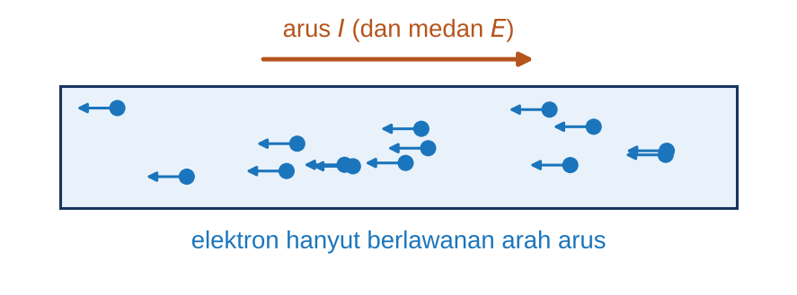
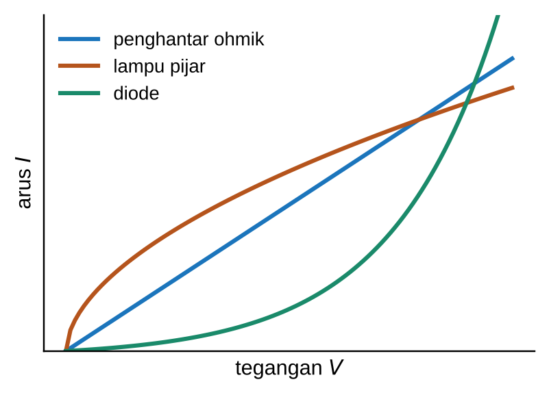
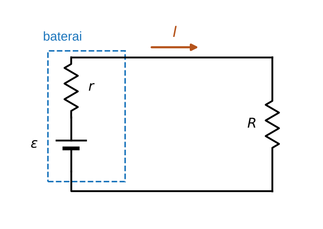
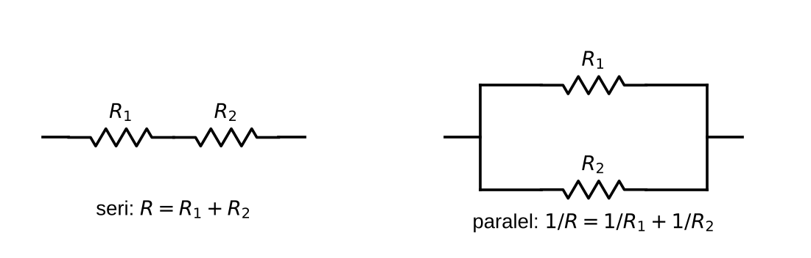

# Bab 13 Listrik Dinamis

Tekan sakelar, dan lampu di ujung lain ruangan menyala seketika. Wajar jika kita membayangkan elektron-elektron melesat sepanjang kawat dari sakelar ke lampu secepat kilat. Kenyataannya, elektron dalam kawat itu merayap lebih lambat daripada siput: kurang dari sepersepuluh milimeter tiap detik. Sebuah elektron memerlukan berjam-jam untuk menempuh satu meter kawat.

Lalu bagaimana lampu dapat menyala seketika? Dan jika elektronnya begitu lambat, bagaimana arus sebesar itu dapat mengalir? Jawabannya ada di Contoh 13.2, dan gambaran yang sama, yaitu sangat banyak pembawa muatan yang bergerak sangat lambat, berlaku juga untuk ion-ion dalam larutan elektrolit.

Bab ini membahas muatan yang mengalir: arus, hambatan, energi, dan rangkaian. Bagian akhirnya membawa semua itu ke dalam gelas kimia: hantaran larutan, elektrolisis, dan sel elektrokimia, tempat listrik dan kimia bertemu secara langsung.

::: {.tujuan}
**Tujuan belajar**

Setelah mempelajari bab ini, kamu mampu:

1. Menghubungkan arus dengan gerak hanyut pembawa muatan.
2. Menerapkan hukum Ohm dan menghitung hambatan dari hambat jenis.
3. Menghitung daya dan energi listrik.
4. Memperhitungkan ggl dan hambatan dalam sumber.
5. Menganalisis rangkaian seri, paralel, dan gabungannya.
6. Menerapkan hukum Kirchhoff pada rangkaian majemuk.
7. Menjelaskan cara kerja amperemeter, voltmeter, jembatan Wheatstone, dan potensiometer.
8. Menganalisis pengisian dan pengosongan kapasitor.
9. Menghitung hantaran larutan, hasil elektrolisis, dan tegangan sel elektrokimia.
:::

::: {.mat}
**Prasyarat**

Dari Bab 12: muatan dan tetapan Faraday (12.1), medan dan potensial (12.3, 12.6), kapasitor (12.7). Dari Bab 11: energi bebas Gibbs (11.10). Dari Bab 4: daya. Matematika: fungsi eksponen dan logaritma alami; sistem persamaan linear.
:::

## 13.1 Arus listrik

### Muatan yang mengalir

**Arus listrik** adalah laju aliran muatan melalui suatu penampang:

$$
\boxed{I = \frac{\Delta Q}{\Delta t}} \qquad \text{(13.1)}
$$

Satuannya **ampere**: 1 A = 1 C/s. Menurut perjanjian, arah arus adalah arah aliran muatan **positif**. Dalam logam, pembawa muatannya elektron yang negatif, sehingga elektron bergerak **berlawanan** dengan arah arus. Dalam larutan elektrolit, ion positif bergerak searah arus dan ion negatif berlawanan; keduanya menyumbang arus ke arah yang sama.

| Arus | Besarnya |
|---|---|
| Saluran ion tunggal pada membran sel | $10^{-12}$ A |
| Batas terasa oleh tubuh | $10^{-3}$ A |
| Berbahaya bagi jantung | 0,1 A |
| Lampu LED rumah | 0,05 A |
| Setrika, ketel listrik | 5–10 A |
| Starter mobil | 200 A |
| Sel elektrolisis aluminium | $3 \times 10^5$ A |
| Sambaran petir | $3 \times 10^4$ A |

### Kelajuan hanyut

{width=62%}

Elektron bebas dalam logam bergerak acak dengan kelajuan sekitar $10^6$ m/s, terus-menerus bertumbukan dengan ion-ion kisi. Tanpa medan, gerak acak itu tidak menghasilkan arus. Jika ujung-ujung kawat diberi beda potensial, medan listrik di dalam kawat menambahkan gerak hanyut kecil yang searah pada gerak acak itu. Kelajuan rata-rata gerak searah ini disebut **kelajuan hanyut**, $v_d$.

Jika tiap satuan volume memuat $n$ pembawa bermuatan $q$, dan penampang kawat $A$, maka dalam waktu $\Delta t$ muatan dalam silinder sepanjang $v_d\Delta t$ melewati penampang:

$$
\boxed{I = nqv_dA} \qquad \text{(13.2)}
$$

Arus tiap satuan luas disebut **rapat arus**: $J = I/A = nqv_d$.

::: {.contoh}
**Contoh 13.1 · Arus dan banyaknya elektron**

(a) Muatan 5,0 C melewati penampang kawat dalam 2,0 s. Berapa arusnya? (b) Berapa elektron melewati penampang tiap detik pada arus 1,0 A?

**Penyelesaian.**

(a) $I = \dfrac{5{,}0}{2{,}0} = 2{,}5$ A.

(b) $\dfrac{1{,}0}{1{,}602 \times 10^{-19}} = 6{,}2 \times 10^{18}$ elektron per detik.

**Memahami hasil.** Enam miliar miliar elektron tiap detik, tetapi itu baru $10^{-5}$ mol. Perlu arus 1 A selama 27 jam untuk mengalirkan satu mol elektron.
:::

::: {.contoh}
**Contoh 13.2 · Seberapa cepat elektron bergerak dalam kawat?**

Kawat tembaga berpenampang 1,0 mm² dialiri arus 1,0 A. Tembaga memiliki $8{,}47 \times 10^{28}$ elektron bebas tiap m³ (satu tiap atom). (a) Berapa kelajuan hanyut elektronnya? (b) Berapa lama sebuah elektron menempuh 1,0 m? (c) Mengapa lampu menyala seketika?

**Penyelesaian.**

(a) $v_d = \dfrac{I}{neA} = \dfrac{1{,}0}{(8{,}47 \times 10^{28})(1{,}602 \times 10^{-19})(1{,}0 \times 10^{-6})} = 7{,}4 \times 10^{-5}$ m/s.

(b) $t = \dfrac{1{,}0}{7{,}4 \times 10^{-5}} = 1{,}4 \times 10^4$ s, hampir empat jam.

(c) Kawat sudah penuh elektron dari ujung ke ujung. Ketika sakelar ditutup, **medan listrik** menjalar sepanjang kawat mendekati laju cahaya, dan semua elektron di seluruh rangkaian mulai hanyut hampir serentak. Elektron yang menyalakan lampu adalah elektron yang sudah ada di dalam kawat pijarnya.

**Memahami hasil.** Perumpamaannya pipa yang sudah penuh air: begitu keran dibuka, air langsung keluar di ujung, walaupun air yang baru masuk belum sampai. Arus bisa besar dengan kelajuan sekecil itu karena pembawanya luar biasa banyak: $n$ dalam tembaga sekitar $10^{29}$ tiap m³. Pada arus bolak-balik 50 Hz, elektron bahkan tidak ke mana-mana; ia hanya bergoyang maju-mundur kurang dari satu mikrometer.
:::

::: {.contoh}
**Contoh 13.3 · Isi sebuah baterai**

Baterai telepon berkapasitas 3000 mA·h. (a) Berapa muatan yang dapat dialirkannya? (b) Berapa mol elektron itu? (c) Jika telepon memakai arus rata-rata 150 mA, berapa lama baterai bertahan?

**Penyelesaian.**

(a) $Q = (3{,}000\ \text{A})(3600\ \text{s}) = 1{,}08 \times 10^4$ C.

(b) $n = \dfrac{Q}{F} = \dfrac{1{,}08 \times 10^4}{96\,485} = 0{,}112$ mol.

(c) $t = \dfrac{3000}{150} = 20$ jam.

**Memahami hasil.** "Kapasitas" baterai dalam mA·h adalah muatan, bukan energi. Dan muatan itu pada dasarnya adalah jumlah zat: 0,112 mol elektron berarti 0,112 mol litium yang berpindah antar-elektrode, sekitar 0,78 g. Baterai adalah reaktor kimia yang hasilnya dihitung dalam coulomb.
:::

::: {.contoh}
**Contoh 13.4 · Arus dalam larutan**

Dalam tabung berpenampang 1,0 cm² berisi larutan NaCl 0,10 mol/L mengalir arus 10 mA. Anggap kedua jenis ion hanyut dengan kelajuan sama. Berapa kelajuan hanyut itu?

**Penyelesaian.** Rapat ion tiap jenis: $n = (0{,}10 \times 10^3\ \text{mol/m}^3)(6{,}022 \times 10^{23}) = 6{,}0 \times 10^{25}\ \text{m}^{-3}$. Kedua jenis ion menyumbang arus, jadi $I = 2nev_dA$:

$$
v_d = \frac{0{,}010}{2(6{,}0 \times 10^{25})(1{,}602 \times 10^{-19})(1{,}0 \times 10^{-4})} = 5{,}2 \times 10^{-6}\ \text{m/s}.
$$

**Memahami hasil.** Lima mikrometer per detik. Ion Na⁺ bergerak ke satu arah dan Cl⁻ ke arah sebaliknya; karena muatannya berlawanan tanda, arus keduanya searah. Dalam kenyataan Cl⁻ sedikit lebih lincah daripada Na⁺ dan membawa bagian arus yang lebih besar (subbab 13.9).
:::

::: {.kuis}
**Kuis cepat 13.1**

Kawat tebal disambung dengan kawat tipis dari bahan sama, dan arus yang sama mengalir melalui keduanya. Di kawat mana elektron hanyut lebih cepat?
:::

## 13.2 Hambatan dan hukum Ohm

### Hukum Ohm

Untuk mengalirkan arus melalui penghantar diperlukan beda potensial. Perbandingan keduanya disebut **hambatan**:

$$
\boxed{R = \frac VI, \qquad V = IR} \qquad \text{(13.3)}
$$

Satuannya **ohm**: 1 Ω = 1 V/A. Georg Ohm menemukan bahwa untuk logam pada suhu tetap, hambatan itu tidak bergantung pada tegangan: arus berbanding lurus dengan tegangan. Itulah **hukum Ohm**, dan bahan yang mematuhinya disebut **ohmik**.

{width=52%}

Hukum Ohm bukan hukum alam yang mendasar; ia sifat bahan tertentu. Lampu pijar (yang hambatannya naik ketika memanas), diode, dan larutan elektrolit pada tegangan rendah tidak mematuhinya (Gambar 13.2). Tetapi definisi $R = V/I$ tetap berlaku untuk semua komponen.

Asal hambatan adalah tumbukan: elektron yang dipercepat medan terus-menerus menabrak ion kisi yang bergetar dan menyerahkan energinya. Perumpamaan yang berguna: tegangan seperti beda ketinggian air, arus seperti debit, dan hambatan seperti sempitnya pipa.

### Hambat jenis

Hambatan sebuah kawat sebanding dengan panjangnya dan berbanding terbalik dengan luas penampangnya:

$$
\boxed{R = \rho\frac LA} \qquad \text{(13.4)}
$$

$\rho$ adalah **hambat jenis** (resistivitas), sifat bahan, bersatuan Ω·m. Kebalikannya adalah **konduktivitas**, $\sigma = 1/\rho$, bersatuan siemens per meter (S/m; 1 S = 1 Ω⁻¹).

| Bahan | $\rho$ (Ω·m) pada 20 °C | $\alpha$ (K⁻¹) |
|---|---|---|
| Perak | $1{,}59 \times 10^{-8}$ | 0,0038 |
| Tembaga | $1{,}68 \times 10^{-8}$ | 0,0039 |
| Aluminium | $2{,}65 \times 10^{-8}$ | 0,0039 |
| Wolfram | $5{,}6 \times 10^{-8}$ | 0,0045 |
| Besi | $9{,}7 \times 10^{-8}$ | 0,0050 |
| Platina | $1{,}06 \times 10^{-7}$ | 0,0039 |
| Nikrom | $1{,}10 \times 10^{-6}$ | 0,0004 |
| Grafit | $3{,}5 \times 10^{-5}$ | −0,0005 |
| Air laut | 0,2 | — |
| Silikon murni | $2{,}3 \times 10^3$ | negatif |
| Air murni | $1{,}8 \times 10^5$ | — |
| Kaca | $10^{10}$–$10^{14}$ | — |
| Teflon | $> 10^{13}$ | — |

Hambat jenis bahan terentang lebih dari dua puluh orde besaran, rentang terlebar di antara semua sifat fisika bahan.

### Pengaruh suhu

Pada logam, kenaikan suhu memperkuat getaran kisi sehingga tumbukan lebih sering dan hambatan **naik**:

$$
\boxed{R = R_0\big[1 + \alpha(T - T_0)\big]} \qquad \text{(13.5)}
$$

$\alpha$ adalah **koefisien suhu hambatan**. Pada semikonduktor dan larutan elektrolit terjadi kebalikannya: kenaikan suhu menambah banyaknya pembawa muatan (semikonduktor) atau menurunkan kekentalan pelarut (larutan), sehingga hambatan **turun**. Di bawah suhu tertentu yang sangat rendah, beberapa bahan menjadi **superkonduktor**: hambatannya tepat nol.

::: {.contoh}
**Contoh 13.5 · Hukum Ohm**

(a) Hambatan 4,0 Ω dihubungkan ke baterai 12 V. Berapa arusnya? (b) Arus 0,25 A mengalir melalui lampu ketika tegangannya 3,0 V. Berapa hambatannya?

**Penyelesaian.**

(a) $I = \dfrac{12}{4{,}0} = 3{,}0$ A.

(b) $R = \dfrac{3{,}0}{0{,}25} = 12$ Ω.
:::

::: {.contoh}
**Contoh 13.6 · Hambatan kawat**

(a) Berapa hambatan kawat tembaga sepanjang 10 m berpenampang 1,0 mm²? (b) Berapa penurunan tegangan sepanjang kawat itu ketika dialiri 10 A?

**Penyelesaian.**

(a) $R = \dfrac{(1{,}68 \times 10^{-8})(10)}{1{,}0 \times 10^{-6}} = 0{,}17$ Ω.

(b) $V = IR = (10)(0{,}17) = 1{,}7$ V.

**Memahami hasil.** Kawat penghubung biasanya dianggap tanpa hambatan, dan itu wajar: 0,17 Ω jauh lebih kecil daripada hambatan alat yang dilayaninya. Tetapi pada arus besar penurunan 1,7 V sudah terasa, dan kabel yang terlalu tipis menjadi panas. Itu sebabnya alat berdaya besar memerlukan kabel tebal.
:::

::: {.contoh}
**Contoh 13.7 · Merancang elemen pemanas**

Elemen pemanas 20 Ω hendak dibuat dari kawat nikrom berdiameter 0,50 mm. Berapa panjang kawat yang diperlukan?

**Penyelesaian.** $A = \pi(0{,}25 \times 10^{-3})^2 = 1{,}96 \times 10^{-7}\ \text{m}^2$.

$$
L = \frac{RA}{\rho} = \frac{(20)(1{,}96 \times 10^{-7})}{1{,}10 \times 10^{-6}} = 3{,}6\ \text{m}.
$$

**Memahami hasil.** Kawat sepanjang itu digulung menjadi kumparan. Nikrom dipilih karena hambat jenisnya 65 kali tembaga, hampir tidak berubah dengan suhu, dan tidak teroksidasi ketika membara.
:::

::: {.contoh}
**Contoh 13.8 · Kawat yang ditarik**

Seutas kawat ditarik sampai panjangnya dua kali, dengan volume tetap. Menjadi berapa kali hambatannya?

**Penyelesaian.** Volume $AL$ tetap, jadi penampangnya menjadi setengah. $R = \rho\dfrac LA$: pembilang dua kali, penyebut setengah. Hambatan menjadi **empat kali**.

**Memahami hasil.** Kepekaan ini dimanfaatkan dalam **pengukur regangan**: lembar logam tipis yang ditempelkan pada jembatan atau sayap pesawat, dan hambatannya dipantau untuk mengukur perubahan panjang sekecil sepersejuta.
:::

::: {.contoh}
**Contoh 13.9 · Termometer hambatan platina**

Termometer platina berhambatan 100,0 Ω pada 0 °C. Dalam suatu penangas, hambatannya 138,5 Ω. Berapa suhu penangas? ($\alpha = 0{,}00392$ K⁻¹)

**Penyelesaian.**

$$
T = \frac{R/R_0 - 1}{\alpha} = \frac{0{,}385}{0{,}00392} = 98\ \text{°C}.
$$

**Memahami hasil.** Termometer hambatan platina ("Pt100") adalah patokan pengukuran suhu teliti di laboratorium dan industri, karena platina murni, lembam secara kimia, dan hambatannya berubah hampir linear dengan suhu.
:::

::: {.contoh}
**Contoh 13.10 · Suhu kawat pijar**

Kawat wolfram sebuah lampu berhambatan 20 Ω pada 20 °C dan 240 Ω ketika menyala. Taksir suhunya saat menyala.

**Penyelesaian.**

$$
T - 20 = \frac{240/20 - 1}{0{,}0045} = 2440\ \text{K} \quad\Longrightarrow\quad T \approx 2500\ \text{°C}.
$$

**Memahami hasil.** Hambatan saat dingin dua belas kali lebih kecil, sehingga pada saat dinyalakan arusnya dua belas kali arus normal. Itu sebabnya lampu pijar paling sering putus tepat ketika dinyalakan. Rumus linear (13.5) hanya hampiran pada rentang selebar ini, tetapi hasilnya dekat dengan suhu kerja sebenarnya.
:::

### Gambaran mikroskopik hambatan

Mengapa arus sebanding dengan tegangan? Di antara dua tumbukan, elektron dipercepat medan dengan $a = eE/m$. Tumbukan mengacak arahnya kembali, sehingga kecepatan searah yang sempat terkumpul hanya sebesar $a\tau$, dengan $\tau$ **waktu rata-rata antartumbukan**. Jadi $v_d = eE\tau/m$, sebanding dengan medan. Dengan $J = nev_d$ dan $E = \rho J$:

$$
\rho = \frac{m}{ne^2\tau} . \qquad \text{(13.6)}
$$

Inilah **model Drude**. Hambat jenis kecil jika pembawanya banyak ($n$ besar) dan jarang bertumbukan ($\tau$ panjang). Memanaskan logam memperpendek $\tau$; memanaskan semikonduktor memperbesar $n$. Dua kecenderungan yang berlawanan itu berasal dari satu rumus.

::: {.contoh}
**Contoh 13.11 · Waktu antartumbukan dalam tembaga**

(a) Berapa waktu rata-rata antartumbukan elektron dalam tembaga pada 20 °C? (b) Elektron penghantar tembaga bergerak acak dengan kelajuan $1{,}57 \times 10^6$ m/s. Berapa jarak rata-rata antartumbukannya, dan berapa kali jarak antaratom (0,26 nm)?

**Penyelesaian.**

(a) $\tau = \dfrac{m}{ne^2\rho} = \dfrac{9{,}109 \times 10^{-31}}{(8{,}47 \times 10^{28})(1{,}602 \times 10^{-19})^2(1{,}68 \times 10^{-8})} = 2{,}5 \times 10^{-14}$ s.

(b) $\ell = v\tau = (1{,}57 \times 10^6)(2{,}5 \times 10^{-14}) = 3{,}9 \times 10^{-8}$ m $= 39$ nm, sekitar 150 jarak antaratom.

**Memahami hasil.** Elektron melewati seratus lima puluh atom tanpa menabrak. Menurut fisika klasik itu mustahil: ion-ion kisi memenuhi ruang. Penjelasannya kuantum (Bab 15): elektron adalah gelombang, dan gelombang merambat tanpa hamburan melalui kisi yang teratur sempurna. Yang menghamburkannya hanya **ketidakteraturan**: getaran termal dan atom asing. Itu sebabnya paduan logam selalu menghantar lebih buruk daripada logam murninya.
:::

::: {.kuis}
**Kuis cepat 13.2**

Dua kawat tembaga sama panjang; kawat A berdiameter dua kali kawat B. Bandingkan hambatannya.
:::

## 13.3 Energi dan daya listrik

Muatan $\Delta Q$ yang mengalir melalui beda potensial $V$ kehilangan energi potensial $V\,\Delta Q$. Laju pelepasan energi itu adalah **daya**:

$$
\boxed{P = IV} \qquad \text{(13.7)}
$$

Rumus ini berlaku untuk alat apa pun. Untuk hambatan, dengan $V = IR$:

$$
\boxed{P = I^2R = \frac{V^2}{R}} \qquad \text{(13.8)}
$$

Dalam hambatan, energi itu seluruhnya menjadi kalor (**pemanasan Joule**). Pakai $I^2R$ jika arusnya diketahui atau sama (komponen seri); pakai $V^2/R$ jika tegangannya diketahui atau sama (komponen paralel).

Energi listrik dijual dalam **kilowatt-jam**: 1 kW·h = $3{,}6 \times 10^6$ J.

::: {.contoh}
**Contoh 13.12 · Lampu 60 W**

Lampu bertuliskan "60 W, 220 V". (a) Berapa arus dan hambatannya ketika menyala normal? (b) Berapa dayanya jika tegangan turun menjadi 200 V (anggap hambatan tetap)?

**Penyelesaian.**

(a) $I = \dfrac PV = \dfrac{60}{220} = 0{,}27$ A. $R = \dfrac{V^2}{P} = \dfrac{220^2}{60} = 807$ Ω.

(b) $P = \dfrac{200^2}{807} = 50$ W.

**Memahami hasil.** Tegangan turun 9%, daya turun 17%: daya sebanding dengan kuadrat tegangan. Angka pada alat listrik hanya berlaku pada tegangan yang tertulis.
:::

::: {.contoh}
**Contoh 13.13 · Tagihan listrik**

Pendingin ruangan 1,0 kW dinyalakan 8 jam tiap hari selama 30 hari. Jika tarifnya Rp1.500 per kW·h, berapa biayanya?

**Penyelesaian.** Energi: $(1{,}0)(8)(30) = 240$ kW·h. Biaya: $240 \times 1500 = \text{Rp}360.000$.

**Memahami hasil.** 240 kW·h adalah 864 MJ, setara energi kimia dalam 25 L bensin.
:::

::: {.contoh}
**Contoh 13.14 · Alat yang dibawa ke negara lain**

Ketel listrik "1500 W, 220 V" dipakai di negara bertegangan 110 V. Berapa dayanya di sana?

**Penyelesaian.** $R = \dfrac{220^2}{1500} = 32{,}3$ Ω. $P = \dfrac{110^2}{32{,}3} = 375$ W.

**Memahami hasil.** Tegangan setengah, daya seperempat; air mendidih empat kali lebih lama. Sebaliknya, alat 110 V yang dicolokkan ke 220 V menerima empat kali daya rancangannya dan terbakar.
:::

::: {.contoh}
**Contoh 13.15 · Mengapa listrik dikirim dengan tegangan tinggi**

Daya 100 kW dikirim melalui kabel berhambatan total 2,0 Ω. Hitung daya yang hilang di kabel jika tegangan pengirimannya (a) 220 V; (b) 20 kV.

**Penyelesaian.**

(a) $I = \dfrac{100\,000}{220} = 455$ A. Rugi: $I^2R = (455)^2(2{,}0) = 413$ kW.

(b) $I = \dfrac{100\,000}{20\,000} = 5{,}0$ A. Rugi: $(5{,}0)^2(2{,}0) = 50$ W.

**Memahami hasil.** Hasil (a) lebih besar daripada daya yang hendak dikirim: mustahil. Pada 20 kV ruginya hanya 0,05%. Karena $P = IV$, daya yang sama dapat dikirim dengan arus kecil jika tegangannya besar, dan rugi kabel sebanding dengan **kuadrat** arus. Tegangan dinaikkan dan diturunkan dengan transformator (Bab 14), dan itu alasan pokok jaringan listrik memakai arus bolak-balik.
:::

::: {.contoh}
**Contoh 13.16 · Pemanas celup**

Pemanas celup 500 W dipakai untuk memanaskan 250 g air dari 25 °C sampai 100 °C. Berapa lama, jika tidak ada kalor yang hilang?

**Penyelesaian.** $Q = mc\,\Delta T = (0{,}250)(4186)(75) = 7{,}85 \times 10^4$ J. $t = \dfrac{7{,}85 \times 10^4}{500} = 157$ s.

**Memahami hasil.** Pemanas listrik adalah sumber kalor yang dayanya diketahui dengan teliti, $P = IV$. Karena itu kalorimeter dikalibrasi secara listrik (subbab 10.4).
:::

::: {.contoh}
**Contoh 13.17 · Pemutus arus**

Sebuah rumah bertegangan 220 V memiliki pemutus arus 10 A. Penanak nasi 350 W, setrika 1000 W, dan pompa air 600 W sedang menyala. (a) Berapa arus totalnya? (b) Bolehkah ketel 800 W ikut dinyalakan?

**Penyelesaian.**

(a) $I = \dfrac{350 + 1000 + 600}{220} = 8{,}9$ A.

(b) Dengan ketel: $\dfrac{2750}{220} = 12{,}5$ A. Melebihi 10 A; pemutus arus akan bekerja.

**Memahami hasil.** Daya terbesar yang tersedia $(220)(10) = 2200$ W. Pemutus arus melindungi **kabel**: arus berlebih memanaskan kabel sebanding dengan $I^2$ dan dapat menyebabkan kebakaran.
:::

### Listrik dan tubuh

Yang mencederai adalah **arus** yang melewati tubuh, bukan tegangannya sendiri. Tegangan hanya menentukan berapa arus yang mengalir melalui hambatan tubuh.

| Arus melalui tubuh (50 Hz) | Akibat |
|---|---|
| 1 mA | mulai terasa |
| 5 mA | menyakitkan |
| 10–20 mA | otot kejang, tidak dapat melepas pegangan |
| 50–100 mA | gangguan napas; getar bilik jantung dapat terjadi |
| > 200 mA | luka bakar berat; jantung berhenti |

::: {.contoh}
**Contoh 13.18 · Tangan kering dan tangan basah**

Hambatan tubuh antara kedua tangan sekitar 100 kΩ jika kulit kering, tetapi hanya sekitar 1,5 kΩ jika kulit basah. Berapa arus yang mengalir jika seseorang menyentuh tegangan 220 V dalam kedua keadaan itu?

**Penyelesaian.**

Kering: $I = \dfrac{220}{100\,000} = 2{,}2$ mA. Basah: $I = \dfrac{220}{1500} = 150$ mA.

**Memahami hasil.** Tegangan yang sama: sekadar mengejutkan dalam keadaan pertama, mematikan dalam keadaan kedua. Hampir seluruh hambatan tubuh berada di lapisan kulit kering yang tipis; bagian dalam tubuh adalah larutan elektrolit yang menghantar dengan baik. Karena itu alat listrik tidak boleh disentuh dengan tangan basah, dan stopkontak di kamar mandi dilindungi pemutus arus bocor yang bekerja pada 30 mA.
:::

::: {.contoh}
**Contoh 13.19 · Kabel sambungan yang terlalu tipis**

Pemanas 2200 W, 220 V dihubungkan dengan kabel sambungan sepanjang 20 m dari kawat tembaga berpenampang 0,75 mm². (a) Berapa hambatan kabel (arus menempuh dua kawat)? (b) Berapa penurunan tegangan dan daya yang hilang di kabel pada arus 10 A?

**Penyelesaian.**

(a) Panjang kawat 40 m: $R = \dfrac{(1{,}68 \times 10^{-8})(40)}{0{,}75 \times 10^{-6}} = 0{,}90$ Ω.

(b) $V = (10)(0{,}90) = 9{,}0$ V. $P = (10)^2(0{,}90) = 90$ W.

**Memahami hasil.** Sembilan puluh watt memanaskan kabel sepanjang 20 m, cukup untuk membuatnya hangat; jika kabel itu masih tergulung, kalornya terperangkap dan penyekatnya dapat meleleh. Kabel sambungan untuk alat berdaya besar harus tebal dan diurai seluruhnya.
:::

::: {.kuis}
**Kuis cepat 13.3**

Dua lampu, 25 W dan 100 W, dirancang untuk tegangan yang sama. Lampu mana yang hambatannya lebih besar?
:::

## 13.4 Ggl dan hambatan dalam

### Sumber ggl

Agar arus terus mengalir, harus ada sesuatu yang mengangkat muatan kembali ke potensial tinggi, seperti pompa mengangkat air. Alat itu disebut **sumber gaya gerak listrik** (ggl): baterai, sel surya, generator. **Ggl**, $\varepsilon$, adalah energi yang diberikan sumber tiap satuan muatan; satuannya volt. Dalam baterai, energi itu berasal dari reaksi kimia (subbab 13.9).

{width=42%}

### Hambatan dalam

Baterai nyata memiliki **hambatan dalam** $r$, yang berasal dari elektrolit dan elektrodenya. Ketika arus $I$ mengalir, sebagian tegangan hilang di dalam baterai sendiri. **Tegangan jepit** pada kutub-kutubnya:

$$
\boxed{V = \varepsilon - Ir, \qquad I = \frac{\varepsilon}{R + r}} \qquad \text{(13.9)}
$$

Tegangan jepit sama dengan ggl hanya ketika tidak ada arus. Makin besar arus yang ditarik, makin rendah tegangan jepitnya.

::: {.contoh}
**Contoh 13.20 · Tegangan jepit**

Baterai 1,5 V berhambatan dalam 0,50 Ω dihubungkan ke lampu 2,5 Ω. Berapa arus dan tegangan pada lampu?

**Penyelesaian.** $I = \dfrac{1{,}5}{2{,}5 + 0{,}50} = 0{,}50$ A. $V = IR = (0{,}50)(2{,}5) = 1{,}25$ V.

**Memahami hasil.** Atau $V = \varepsilon - Ir = 1{,}5 - 0{,}25 = 1{,}25$ V. Seperenam ggl hilang di dalam baterai, menjadi kalor. Baterai tua "lemah" terutama karena hambatan dalamnya membesar, bukan karena ggl-nya turun.
:::

::: {.contoh}
**Contoh 13.21 · Aki mobil**

Tegangan aki tanpa beban 12,6 V. Ketika motor starter menarik 50 A, tegangan jepitnya turun menjadi 10,6 V. (a) Berapa hambatan dalamnya? (b) Berapa arus hubung singkatnya? (c) Berapa daya terbesar yang dapat diberikannya kepada beban?

**Penyelesaian.**

(a) $r = \dfrac{12{,}6 - 10{,}6}{50} = 0{,}040$ Ω.

(b) $I = \dfrac{\varepsilon}{r} = \dfrac{12{,}6}{0{,}040} = 315$ A.

(c) Daya pada beban terbesar ketika $R = r$: $P = \dfrac{\varepsilon^2}{4r} = \dfrac{12{,}6^2}{4(0{,}040)} = 990$ W.

**Memahami hasil.** Hambatan dalam aki sangat kecil, sehingga ia sanggup memberi ratusan ampere. Delapan baterai senter 1,5 V terseri juga memberi 12 V, tetapi hambatan dalamnya puluhan kali lebih besar dan tidak akan memutar starter. Hubung singkat aki berbahaya: 315 A melelehkan kunci pas. Pada keadaan (c), setengah daya hilang di dalam aki; daya terbesar tidak sama dengan efisiensi terbaik.
:::

::: {.kuis}
**Kuis cepat 13.4**

Mengapa lampu mobil meredup sesaat ketika mesin distarter?
:::

## 13.5 Rangkaian seri dan paralel

{width=74%}

$$
\boxed{\text{seri: } R = R_1 + R_2 + \dots \qquad \text{paralel: } \frac1R = \frac1{R_1} + \frac1{R_2} + \dots} \qquad \text{(13.10)}
$$

| | Seri | Paralel |
|---|---|---|
| Yang sama | arus | tegangan |
| Yang terbagi | tegangan, sebanding $R$ | arus, berbanding terbalik $R$ |
| Hambatan pengganti | lebih besar daripada yang terbesar | lebih kecil daripada yang terkecil |
| Jika satu putus | semua padam | yang lain tetap menyala |

Susunan seri memperpanjang jalan arus; susunan paralel menambah jalur. Untuk dua hambatan paralel: $R = \dfrac{R_1R_2}{R_1 + R_2}$. Instalasi rumah tersusun paralel: tiap alat mendapat tegangan penuh dan dapat dimatikan sendiri-sendiri.

::: {.strategi}
**Strategi · Menyederhanakan rangkaian**

1. Cari kelompok hambatan yang jelas seri (satu jalur tanpa cabang) atau jelas paralel (kedua ujungnya bertemu).
2. Ganti kelompok itu dengan hambatan penggantinya, gambar ulang, dan ulangi sampai tersisa satu hambatan.
3. Hitung arus total dari sumber.
4. Kembali selangkah demi selangkah: pada bagian seri arusnya sama; pada bagian paralel tegangannya sama.
5. Periksa: jumlah tegangan sepanjang jalur harus sama dengan tegangan sumber, dan jumlah arus cabang harus sama dengan arus induk.
:::

::: {.contoh}
**Contoh 13.22 · Seri**

Hambatan 2,0 Ω, 3,0 Ω, dan 5,0 Ω diseri pada 20 V. Berapa arus dan tegangan pada tiap hambatan?

**Penyelesaian.** $R = 10$ Ω, $I = 2{,}0$ A. Tegangannya: 4,0 V; 6,0 V; 10 V.

**Memahami hasil.** Jumlahnya 20 V. Hambatan terbesar mendapat bagian tegangan terbesar.
:::

::: {.contoh}
**Contoh 13.23 · Paralel**

Hambatan 6,0 Ω dan 12 Ω diparalel pada 12 V. Berapa hambatan pengganti, arus total, dan arus tiap cabang?

**Penyelesaian.** $R = \dfrac{(6{,}0)(12)}{18} = 4{,}0$ Ω. $I = 3{,}0$ A. Arus cabang: $\dfrac{12}{6{,}0} = 2{,}0$ A dan $\dfrac{12}{12} = 1{,}0$ A.

**Memahami hasil.** $2{,}0 + 1{,}0 = 3{,}0$ A. Arus lebih banyak memilih jalur berhambatan kecil, tetapi tidak seluruhnya.
:::

::: {.contoh}
**Contoh 13.24 · Gabungan**

Hambatan 6,0 Ω dan 3,0 Ω diparalel, dan gabungan itu diseri dengan 4,0 Ω pada baterai 12 V. Tentukan arus dan daya pada tiap hambatan.

**Penyelesaian.** Paralel: $\dfrac{(6{,}0)(3{,}0)}{9{,}0} = 2{,}0$ Ω. Total: $4{,}0 + 2{,}0 = 6{,}0$ Ω. Arus total: 2,0 A, seluruhnya melalui 4,0 Ω.

Tegangan pada bagian paralel: $(2{,}0)(2{,}0) = 4{,}0$ V. Arus: $\dfrac{4{,}0}{6{,}0} = 0{,}67$ A melalui 6,0 Ω dan $\dfrac{4{,}0}{3{,}0} = 1{,}33$ A melalui 3,0 Ω.

Daya: $(2{,}0)^2(4{,}0) = 16$ W; $\dfrac{4{,}0^2}{6{,}0} = 2{,}7$ W; $\dfrac{4{,}0^2}{3{,}0} = 5{,}3$ W.

**Memahami hasil.** Jumlah daya 24 W, sama dengan daya baterai $IV = (2{,}0)(12)$.
:::

::: {.contoh}
**Contoh 13.25 · Dua lampu diseri**

Dua lampu "60 W, 220 V" diseri pada 220 V. Berapa daya tiap lampu (anggap hambatan tetap)?

**Penyelesaian.** Tiap lampu mendapat 110 V, setengah tegangan rancangannya. Daya sebanding $V^2$: $60 \times \tfrac14 = 15$ W tiap lampu.

**Memahami hasil.** Total 30 W, bukan 120 W. Lampu yang diseri menyala redup. Jika diparalel, masing-masing menyala penuh 60 W.
:::

::: {.contoh}
**Contoh 13.26 · Pembagi tegangan**

Hambatan 6,0 kΩ dan 3,0 kΩ diseri pada 9,0 V. (a) Berapa tegangan pada hambatan 3,0 kΩ? (b) Berapa tegangan itu jika sebuah alat berhambatan 3,0 kΩ dipasang paralel dengannya?

**Penyelesaian.**

(a) $V = 9{,}0 \times \dfrac{3{,}0}{6{,}0 + 3{,}0} = 3{,}0$ V.

(b) 3,0 kΩ paralel 3,0 kΩ menjadi 1,5 kΩ: $V = 9{,}0 \times \dfrac{1{,}5}{7{,}5} = 1{,}8$ V.

**Memahami hasil.** Pembagi tegangan adalah cara termudah memperoleh tegangan lebih kecil, tetapi keluarannya **turun** begitu dibebani. Pembagi hanya baik jika hambatan beban jauh lebih besar daripada hambatan pembaginya. Elektrode kaca pH meter, yang hambatannya ratusan megaohm, karena itu memerlukan alat ukur berhambatan masukan sangat besar.
:::

::: {.contoh}
**Contoh 13.27 · Menyusun paket baterai**

Sel litium-ion 3,7 V berkapasitas 3,0 A·h dan berhambatan dalam 0,050 Ω. Delapan sel disusun menjadi dua untai paralel, masing-masing empat sel seri. Tentukan ggl, kapasitas, energi, dan hambatan dalam paket itu.

**Penyelesaian.**

Empat sel seri: ggl $4 \times 3{,}7 = 14{,}8$ V; hambatan dalam $4 \times 0{,}050 = 0{,}20$ Ω; kapasitas tetap 3,0 A·h (muatan yang sama melewati semua sel).

Dua untai paralel: ggl tetap 14,8 V; hambatan dalam $0{,}20/2 = 0{,}10$ Ω; kapasitas $2 \times 3{,}0 = 6{,}0$ A·h.

Energi: $(14{,}8)(6{,}0) = 89$ W·h.

**Memahami hasil.** Energi total sama dengan delapan kali energi satu sel, $8 \times 11{,}1 = 89$ W·h, bagaimanapun susunannya. Seri menaikkan tegangan; paralel menaikkan kapasitas dan kemampuan arus. Paket baterai mobil listrik memuat ribuan sel yang disusun dengan asas ini.
:::

::: {.contoh}
**Contoh 13.28 · Rangkaian tiga tingkat**

Hambatan $R_1 = 2{,}0$ Ω diseri dengan gabungan paralel dua cabang: cabang pertama $R_2 = 6{,}0$ Ω; cabang kedua $R_3 = 2{,}0$ Ω dan $R_4 = 4{,}0$ Ω yang diseri. Rangkaian diberi 12 V. Tentukan tegangan pada $R_4$.

**Penyelesaian.** Cabang kedua: $2{,}0 + 4{,}0 = 6{,}0$ Ω. Paralel dengan 6,0 Ω: 3,0 Ω. Total: $2{,}0 + 3{,}0 = 5{,}0$ Ω. Arus total: $\dfrac{12}{5{,}0} = 2{,}4$ A.

Tegangan pada gabungan paralel: $(2{,}4)(3{,}0) = 7{,}2$ V. Arus cabang kedua: $\dfrac{7{,}2}{6{,}0} = 1{,}2$ A. Tegangan pada $R_4$: $(1{,}2)(4{,}0) = 4{,}8$ V.

**Memahami hasil.** Sederhanakan dari dalam ke luar, lalu kembali dari luar ke dalam. Tegangan pada $R_1$ adalah 4,8 V; $4{,}8 + 7{,}2 = 12$ V.
:::

::: {.kuis}
**Kuis cepat 13.5**

Tiga lampu identik: dua diparalel, lalu gabungan itu diseri dengan lampu ketiga. Lampu mana yang paling terang?
:::
