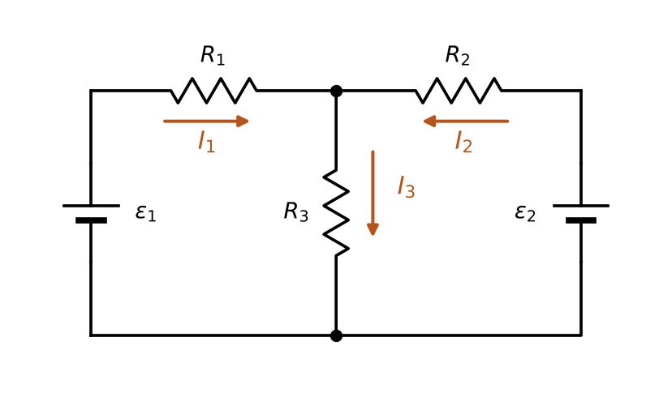
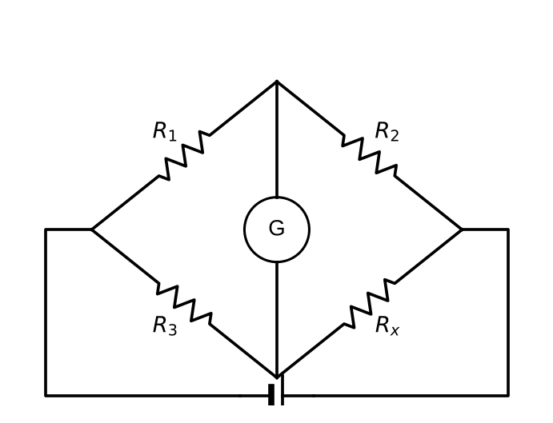
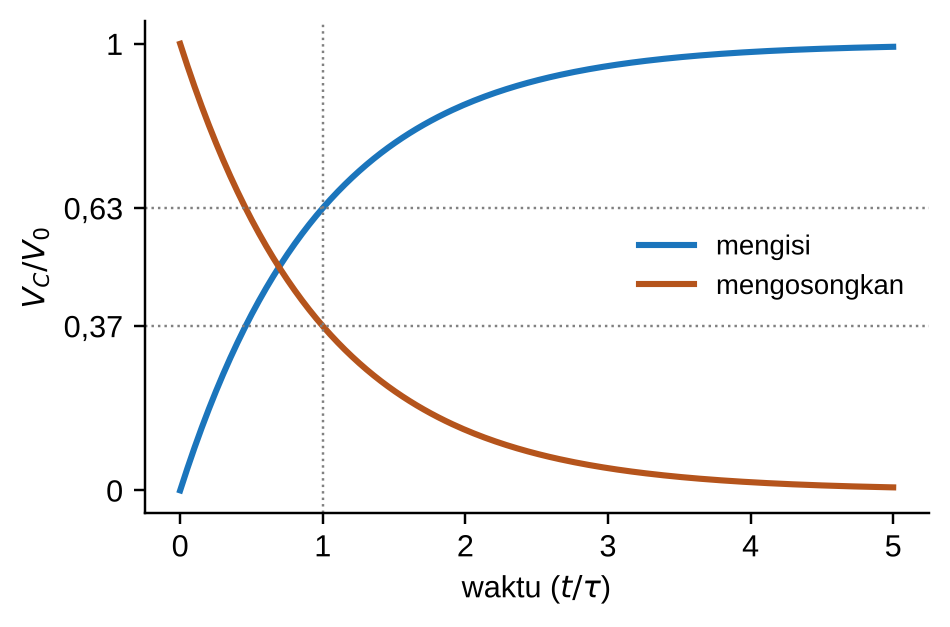
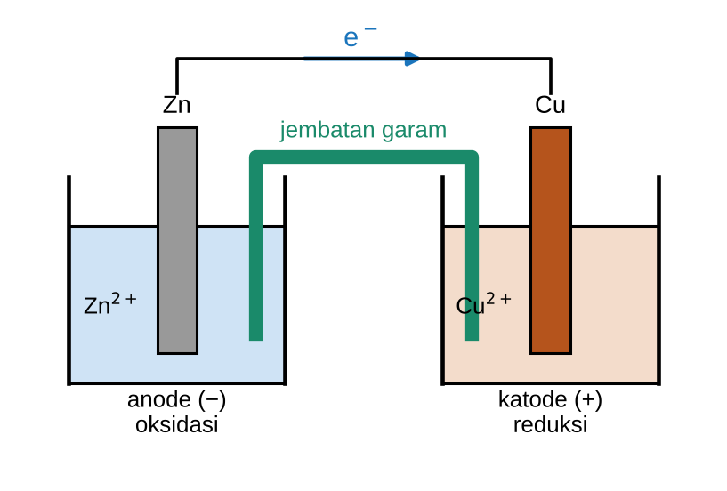

## 13.6 Hukum Kirchhoff

Banyak rangkaian tidak dapat disederhanakan menjadi seri dan paralel, misalnya rangkaian dengan dua baterai di cabang yang berbeda. Untuk itu Gustav Kirchhoff merumuskan dua aturan, yang sebenarnya hanyalah dua hukum kekekalan.

::: {.inti}
**Hukum titik cabang** (kekekalan muatan). Jumlah arus yang masuk ke suatu titik cabang sama dengan jumlah arus yang keluar darinya.

**Hukum simpal** (kekekalan energi). Jumlah aljabar perubahan potensial sepanjang lintasan tertutup mana pun sama dengan nol.
:::

Perjanjian tanda ketika mengelilingi simpal:

| Melewati | Searah | Berlawanan |
|---|---|---|
| Hambatan (terhadap arah arus) | $-IR$ | $+IR$ |
| Baterai (dari kutub − ke kutub +) | $+\varepsilon$ | $-\varepsilon$ |

::: {.strategi}
**Strategi · Memakai hukum Kirchhoff**

1. Beri nama arus di tiap cabang dan **pilih arahnya sesukamu**. Jika hasilnya negatif, arah sebenarnya berlawanan dengan pilihanmu.
2. Tulis hukum titik cabang. Untuk $N$ titik cabang, hanya $N - 1$ persamaan yang bebas.
3. Tulis hukum simpal sebanyak yang diperlukan, sampai jumlah persamaan sama dengan jumlah arus yang tidak diketahui.
4. Selesaikan sistem persamaan itu.
5. Periksa dengan simpal yang belum dipakai, atau dengan neraca daya.
:::

{width=54%}

::: {.contoh}
**Contoh 13.29 · Rangkaian dua simpal**

Pada Gambar 13.5, $\varepsilon_1 = 12$ V, $\varepsilon_2 = 6{,}0$ V, $R_1 = 2{,}0$ Ω, $R_2 = 3{,}0$ Ω, dan $R_3 = 4{,}0$ Ω. Kutub positif kedua baterai di atas. Tentukan ketiga arus.

**Penyelesaian.**

Titik cabang atas: $I_1 + I_2 = I_3$.

Simpal kiri (searah jarum jam, mulai dari baterai 1): $12 - 2{,}0I_1 - 4{,}0I_3 = 0$.

Simpal kanan (berlawanan jarum jam, mulai dari baterai 2): $6{,}0 - 3{,}0I_2 - 4{,}0I_3 = 0$.

Dari kedua simpal: $I_1 = 6{,}0 - 2{,}0I_3$ dan $I_2 = 2{,}0 - 1{,}33I_3$. Masukkan ke persamaan titik cabang:

$$
8{,}0 - 3{,}33I_3 = I_3 \quad\Longrightarrow\quad I_3 = 1{,}85\ \text{A}, \qquad I_1 = 2{,}31\ \text{A}, \qquad I_2 = -0{,}46\ \text{A}.
$$

**Memahami hasil.** $I_2$ negatif: arus di cabang kanan sebenarnya mengalir **masuk** ke kutub positif baterai 2. Baterai itu sedang diisi oleh baterai 1. Neraca daya: baterai 1 memberi $(12)(2{,}31) = 27{,}7$ W; baterai 2 menyerap $(6{,}0)(0{,}46) = 2{,}8$ W; hambatan-hambatan membuang $(2{,}31)^2(2{,}0) + (0{,}46)^2(3{,}0) + (1{,}85)^2(4{,}0) = 24{,}9$ W. Seimbang.
:::

::: {.contoh}
**Contoh 13.30 · Mengisi aki**

Pengisi aki ber-ggl 14,0 V dan berhambatan dalam 0,10 Ω dihubungkan ke aki 12,0 V berhambatan dalam 0,050 Ω (kutub positif ke kutub positif). (a) Berapa arus pengisiannya? (b) Berapa tegangan jepit aki selama diisi? (c) Dari daya yang masuk ke aki, berapa yang tersimpan sebagai energi kimia?

**Penyelesaian.**

(a) Satu simpal: $14{,}0 - 0{,}10I - 0{,}050I - 12{,}0 = 0$, jadi $I = 13$ A.

(b) $V = \varepsilon + Ir = 12{,}0 + (13{,}3)(0{,}050) = 12{,}7$ V.

(c) Daya masuk: $(12{,}7)(13{,}3) = 169$ W. Yang tersimpan: $\varepsilon I = (12{,}0)(13{,}3) = 160$ W. Sisanya, 9 W, menjadi kalor di dalam aki.

**Memahami hasil.** Ketika baterai diisi, arus dipaksa melawan ggl-nya dan reaksi kimianya berjalan terbalik; tegangan jepitnya **lebih besar** daripada ggl. Pengisian cepat berarti arus besar dan pemanasan $I^2r$ yang besar; itu sebabnya telepon menghangat ketika diisi cepat.
:::

::: {.contoh}
**Contoh 13.31 · Memancing aki yang lemah**

Aki lemah (ggl 11,0 V; hambatan dalam 0,50 Ω) dibantu aki sehat (12,6 V; 0,040 Ω) yang dipasang paralel dengan kabel pancing. Keduanya melayani motor starter berhambatan 0,10 Ω. Berapa arus starter, dan berapa sumbangan tiap aki?

**Penyelesaian.** Misalkan tegangan pada starter $V$. Hukum titik cabang: arus dari kedua aki sama dengan arus starter:

$$
\frac{11{,}0 - V}{0{,}50} + \frac{12{,}6 - V}{0{,}040} = \frac{V}{0{,}10} \quad\Longrightarrow\quad 22 + 315 = V(2{,}0 + 25 + 10) \quad\Longrightarrow\quad V = 9{,}1\ \text{V}.
$$

Arus starter: $\dfrac{9{,}1}{0{,}10} = 91$ A. Dari aki sehat: $\dfrac{12{,}6 - 9{,}1}{0{,}040} = 87$ A. Dari aki lemah: $\dfrac{11{,}0 - 9{,}1}{0{,}50} = 3{,}8$ A.

**Memahami hasil.** $87 + 3{,}8 = 91$ A. Aki sehat memikul hampir seluruh beban, karena hambatan dalamnya jauh lebih kecil. Sendirian, aki lemah hanya memberi $\dfrac{11{,}0}{0{,}60} = 18$ A, tidak cukup untuk memutar mesin. Cara "tegangan titik cabang" seperti ini sering lebih cepat daripada menulis persamaan simpal.
:::

::: {.kuis}
**Kuis cepat 13.6**

Dalam menyelesaikan soal Kirchhoff, kamu memperoleh arus bernilai −2 A. Apakah kamu melakukan kesalahan?
:::

## 13.7 Alat ukur listrik

### Amperemeter dan voltmeter

**Amperemeter** mengukur arus, jadi harus dipasang **seri** agar arus melewatinya. Agar tidak mengubah arus yang diukur, hambatannya harus **sangat kecil**.

**Voltmeter** mengukur beda potensial antara dua titik, jadi dipasang **paralel**. Agar tidak mengambil arus dari rangkaian, hambatannya harus **sangat besar**.

Keduanya dapat dibuat dari **galvanometer**, alat peka yang jarumnya menyimpang penuh pada arus kecil $I_g$ dan berhambatan $R_g$:

- menjadi amperemeter dengan hambatan kecil paralel (**shunt**) yang melewatkan sebagian besar arus;
- menjadi voltmeter dengan hambatan besar seri (**pengali**) yang menahan sebagian besar tegangan.

::: {.contoh}
**Contoh 13.32 · Membuat amperemeter dan voltmeter**

Galvanometer menyimpang penuh pada 1,0 mA dan berhambatan 50 Ω. (a) Berapa hambatan shunt agar menjadi amperemeter 1,0 A? (b) Berapa hambatan seri agar menjadi voltmeter 10 V?

**Penyelesaian.**

(a) Pada simpangan penuh, 1,0 mA lewat galvanometer dan 999 mA lewat shunt; tegangan keduanya sama:

$$
R_s = \frac{I_gR_g}{I - I_g} = \frac{(0{,}0010)(50)}{0{,}999} = 0{,}050\ \Omega .
$$

(b) Pada 10 V arusnya harus 1,0 mA, jadi hambatan total 10 kΩ: $R = 10\,000 - 50 = 9950$ Ω.

**Memahami hasil.** Amperemeter itu berhambatan 0,05 Ω, voltmeternya 10 kΩ, sesuai tuntutan masing-masing. Voltmeter digital modern berhambatan 10 MΩ atau lebih.
:::

::: {.contoh}
**Contoh 13.33 · Voltmeter yang mengganggu**

Dua hambatan 100 kΩ diseri pada 10,0 V. Voltmeter berhambatan 100 kΩ dipakai untuk mengukur tegangan pada salah satunya. Berapa yang terbaca?

**Penyelesaian.** Tanpa voltmeter, tegangannya 5,00 V. Dengan voltmeter terpasang, hambatan itu menjadi $100 \parallel 100 = 50$ kΩ:

$$
V = 10{,}0 \times \frac{50}{100 + 50} = 3{,}33\ \text{V}.
$$

**Memahami hasil.** Pembacaan keliru sepertiganya. Alat ukur selalu menjadi bagian dari rangkaian yang diukurnya. Dengan voltmeter 10 MΩ, hasilnya 4,98 V. Aturan praktis: hambatan voltmeter harus paling sedikit seratus kali hambatan yang diukur.
:::

### Jembatan Wheatstone

{width=44%}

Cara paling teliti mengukur hambatan adalah membandingkannya dengan hambatan yang diketahui, memakai **jembatan Wheatstone** (Gambar 13.6). Salah satu hambatan diatur sampai galvanometer menunjuk nol. Pada keadaan seimbang itu:

$$
\boxed{\frac{R_1}{R_2} = \frac{R_3}{R_x} \quad\Longrightarrow\quad R_x = \frac{R_2R_3}{R_1}} \qquad \text{(13.11)}
$$

Keunggulan **metode nol**: hasilnya tidak bergantung pada tegangan baterai atau pada ketelitian skala galvanometer; galvanometer hanya perlu menunjukkan "nol atau tidak".

::: {.contoh}
**Contoh 13.34 · Jembatan Wheatstone**

Jembatan seimbang ketika $R_1 = 100$ Ω, $R_2 = 250$ Ω, dan $R_3 = 40{,}0$ Ω. Berapa $R_x$?

**Penyelesaian.** $R_x = \dfrac{(250)(40{,}0)}{100} = 100$ Ω.

**Memahami hasil.** Termometer hambatan, pengukur regangan, dan sel konduktivitas larutan semuanya dibaca dengan jembatan seperti ini. Untuk larutan dipakai arus bolak-balik, agar tidak terjadi elektrolisis di elektrode.
:::

### Potensiometer

Voltmeter biasa menarik arus, sehingga yang terukur adalah tegangan jepit, bukan ggl. **Potensiometer** membandingkan ggl yang tidak diketahui dengan penurunan tegangan sepanjang kawat seragam yang dialiri arus tetap. Kontak geser dipindahkan sampai galvanometer menunjuk nol; pada saat itu **tidak ada arus** yang ditarik dari sel yang diukur, dan

$$
\frac{\varepsilon_x}{\varepsilon_s} = \frac{L_x}{L_s} . \qquad \text{(13.12)}
$$

::: {.contoh}
**Contoh 13.35 · Mengukur ggl tanpa menarik arus**

Pada sebuah potensiometer, sel baku 1,018 V seimbang pada panjang kawat 50,9 cm. Sel yang hendak diukur seimbang pada 72,5 cm. Berapa ggl-nya?

**Penyelesaian.** $\varepsilon_x = 1{,}018 \times \dfrac{72{,}5}{50{,}9} = 1{,}450$ V.

**Memahami hasil.** Dalam elektrokimia, potensial sel harus diukur tanpa arus: begitu arus mengalir, konsentrasi di dekat elektrode berubah dan tegangan menyimpang dari nilai kesetimbangannya. Voltmeter elektronik berhambatan sangat besar kini menggantikan potensiometer, tetapi asasnya sama: ukur tanpa menarik arus.
:::

::: {.kuis}
**Kuis cepat 13.7**

Apa yang terjadi jika amperemeter secara keliru dipasang paralel dengan baterai?
:::

## 13.8 Rangkaian RC

Sampai di sini arus tidak berubah dengan waktu. Jika rangkaian memuat kapasitor, arus dan tegangan berubah selama kapasitor terisi atau terkosongkan.

### Mengisi dan mengosongkan

Kapasitor $C$ kosong dihubungkan ke baterai $\varepsilon$ melalui hambatan $R$. Mula-mula arus besar, $\varepsilon/R$. Ketika muatan menumpuk, tegangan kapasitor melawan baterai dan arus mengecil. Hukum simpal, $\varepsilon - IR - Q/C = 0$, memberi

$$
\boxed{V_C = \varepsilon\left(1 - e^{-t/\tau}\right), \qquad I = \frac{\varepsilon}{R}e^{-t/\tau}, \qquad \tau = RC} \qquad \text{(13.13)}
$$

Jika kapasitor bermuatan dikosongkan melalui hambatan:

$$
\boxed{V_C = V_0\,e^{-t/\tau}, \qquad I = \frac{V_0}{R}e^{-t/\tau}} \qquad \text{(13.14)}
$$

$\tau = RC$ disebut **tetapan waktu**. (Periksa satuannya: Ω·F = (V/A)(C/V) = C/A = s.)

{width=58%}

| Waktu | Pengisian (bagian dari $\varepsilon$) | Pengosongan (bagian dari $V_0$) |
|---|---|---|
| $\tau$ | 63% | 37% |
| $2\tau$ | 86% | 14% |
| $3\tau$ | 95% | 5% |
| $5\tau$ | 99,3% | 0,7% |

Waktu paruhnya $t_{1/2} = \tau\ln 2 = 0{,}693\,RC$. Bentuk eksponen ini sama persis dengan pendinginan Newton (subbab 10.6), peluruhan radioaktif, dan kinetika reaksi orde satu: dalam semuanya, **laju perubahan sebanding dengan besaran itu sendiri**.

::: {.contoh}
**Contoh 13.36 · Mengisi kapasitor**

Kapasitor 100 μF diisi dari baterai 12 V melalui hambatan 10 kΩ. (a) Berapa tetapan waktunya? (b) Berapa tegangan kapasitor setelah 2,0 s? (c) Berapa arus awal, dan arus setelah 2,0 s?

**Penyelesaian.**

(a) $\tau = (1{,}0 \times 10^4)(100 \times 10^{-6}) = 1{,}0$ s.

(b) $V_C = 12(1 - e^{-2{,}0}) = 12(0{,}865) = 10{,}4$ V.

(c) $I_0 = \dfrac{12}{10\,000} = 1{,}2$ mA. Setelah 2,0 s: $1{,}2\,e^{-2{,}0} = 0{,}16$ mA.

**Memahami hasil.** Tegangan pada hambatan setelah 2,0 s adalah $(0{,}16\ \text{mA})(10\ \text{k}\Omega) = 1{,}6$ V, dan $10{,}4 + 1{,}6 = 12$ V. Hukum simpal terpenuhi pada setiap saat.
:::

::: {.contoh}
**Contoh 13.37 · Denyut defibrilator**

Kapasitor 70 μF bertegangan 5000 V dikosongkan melalui dada pasien yang berhambatan 50 Ω. (a) Berapa tetapan waktunya? (b) Berapa arus awalnya? (c) Setelah berapa lama tegangan tinggal 1%?

**Penyelesaian.**

(a) $\tau = (50)(70 \times 10^{-6}) = 3{,}5$ ms.

(b) $I_0 = \dfrac{5000}{50} = 100$ A.

(c) $t = \tau\ln 100 = (3{,}5)(4{,}61) = 16$ ms.

**Memahami hasil.** Seratus ampere selama beberapa milidetik menghentikan getar tak teratur otot jantung, sehingga pemacu alaminya dapat mengambil alih. Setelah $5\tau$ kapasitor praktis kosong.
:::

::: {.contoh}
**Contoh 13.38 · Mengukur hambatan yang sangat besar**

Kapasitor 1,00 μF bermuatan dihubungkan ke bahan penyekat yang hendak diuji. Tegangannya turun menjadi setengah dalam 35 s. Berapa hambatan bahan itu?

**Penyelesaian.** $t_{1/2} = RC\ln 2$:

$$
R = \frac{35}{(1{,}00 \times 10^{-6})(0{,}693)} = 5{,}0 \times 10^7\ \Omega = 50\ \text{M}\Omega .
$$

**Memahami hasil.** Hambatan sebesar ini sukar diukur dengan ohmmeter biasa, tetapi mudah dengan stopwatch. Cara berpikirnya sama dengan menentukan tetapan laju dari waktu paruh.
:::

::: {.contoh}
**Contoh 13.39 · Tetapan waktu membran sel**

Tiap meter persegi membran sel saraf memiliki kapasitansi $1{,}0 \times 10^{-2}$ F dan hambatan bocor 1,0 Ω (yaitu 1,0 Ω·m²). Berapa tetapan waktunya? Apakah bergantung pada ukuran sel?

**Penyelesaian.** Untuk membran seluas $A$: $C = (1{,}0 \times 10^{-2})A$ dan $R = \dfrac{1{,}0}{A}$.

$$
\tau = RC = (1{,}0)(1{,}0 \times 10^{-2}) = 10\ \text{ms}.
$$

**Memahami hasil.** Luasnya tercoret: tetapan waktu adalah sifat membran, bukan sifat sel. Sepuluh milidetik adalah skala waktu khas sinyal saraf. Sel tidak dapat menanggapi rangsang yang jauh lebih cepat daripada itu; kapasitansi membrannya harus terisi lebih dulu.
:::

::: {.contoh}
**Contoh 13.40 · Lampu kedip**

Lampu neon menyala tiba-tiba ketika tegangannya mencapai 80 V, lalu mengosongkan kapasitor yang terpasang paralel dengannya hampir seketika. Kapasitor 0,50 μF itu diisi dari sumber 120 V melalui hambatan 1,0 MΩ. Berapa selang waktu antarkedipan?

**Penyelesaian.** $\tau = (1{,}0 \times 10^6)(0{,}50 \times 10^{-6}) = 0{,}50$ s. Kapasitor terisi dari nol sampai 80 V:

$$
80 = 120(1 - e^{-t/\tau}) \quad\Longrightarrow\quad t = \tau\ln\frac{120}{120 - 80} = (0{,}50)\ln 3 = 0{,}55\ \text{s}.
$$

**Memahami hasil.** Rangkaian RC adalah jam yang paling sederhana. Pewaktu elektronik, lampu sein, dan alat pacu jantung memakai asas yang sama: kapasitor terisi perlahan sampai ambang, lalu dikosongkan. Sel saraf pun "menembak" dengan cara serupa.
:::

::: {.kuis}
**Kuis cepat 13.8**

Hambatan dalam rangkaian RC dijadikan dua kali. Apa yang terjadi pada (a) muatan akhir kapasitor; (b) waktu untuk mencapainya?
:::

## 13.9 Listrik dan kimia

### Hantaran dalam larutan

Larutan elektrolit menghantar listrik karena ion-ionnya hanyut dalam medan. Ukurannya adalah **konduktivitas** $\kappa$ (S/m). (Lambang $\kappa$ di sini lazim dalam elektrokimia; jangan tertukar dengan tetapan dielektrik.) Larutan diukur dalam **sel konduktivitas**: dua elektrode seluas $A$ berjarak $L$, dengan hambatan

$$
R = \frac{L}{\kappa A} . \qquad \text{(13.15)}
$$

Karena konduktivitas bergantung pada banyaknya ion, kimiawan memakai **konduktivitas molar**:

$$
\boxed{\Lambda_m = \frac{\kappa}{c}} \qquad \text{(13.16)}
$$

dengan $c$ dalam mol/m³. Satuan yang lazim adalah S·cm²/mol. Pada pengenceran tak hingga, tiap ion menyumbang secara mandiri: $\Lambda_m^\circ = \lambda_+^\circ + \lambda_-^\circ$ (**hukum Kohlrausch**).

| Ion | $\lambda^\circ$ (S·cm²/mol) | Ion | $\lambda^\circ$ (S·cm²/mol) |
|---|---|---|---|
| H⁺ | 349,8 | OH⁻ | 198,3 |
| K⁺ | 73,5 | Cl⁻ | 76,3 |
| Na⁺ | 50,1 | NO₃⁻ | 71,5 |
| Li⁺ | 38,7 | CH₃COO⁻ | 40,9 |

Dua hal menarik. Ion Li⁺, yang paling kecil, justru paling lambat: medannya yang kuat mengikat selubung air yang tebal (subbab 12.9), sehingga ia bergerak sebagai gumpalan besar. Dan H⁺ serta OH⁻ luar biasa cepat, karena muatannya tidak perlu berjalan sendiri: ia "dioperkan" dari satu molekul air ke molekul berikutnya lewat ikatan hidrogen.

::: {.contoh}
**Contoh 13.41 · Sel konduktivitas**

Sel konduktivitas memiliki elektrode seluas 1,00 cm² berjarak 1,00 cm, dan berisi larutan KCl 0,0100 mol/L ($\kappa = 0{,}1413$ S/m). (a) Berapa hambatannya? (b) Berapa konduktivitas molar larutan itu?

**Penyelesaian.**

(a) $R = \dfrac{0{,}0100}{(0{,}1413)(1{,}00 \times 10^{-4})} = 708$ Ω.

(b) $c = 10{,}0$ mol/m³. $\Lambda_m = \dfrac{0{,}1413}{10{,}0} = 0{,}01413$ S·m²/mol $= 141{,}3$ S·cm²/mol.

**Memahami hasil.** Dari tabel, $\Lambda_m^\circ(\text{KCl}) = 73{,}5 + 76{,}3 = 149{,}8$. Nilai pada 0,0100 mol/L sedikit lebih kecil, karena ion-ion yang berdekatan saling menghambat. Larutan KCl dipakai sebagai baku untuk mengalibrasi sel konduktivitas.
:::

::: {.contoh}
**Contoh 13.42 · Derajat ionisasi asam lemah**

Larutan asam asetat 0,0100 mol/L memiliki konduktivitas molar 16,2 S·cm²/mol. (a) Hitung $\Lambda_m^\circ$-nya dari tabel. (b) Berapa derajat ionisasinya? (c) Berapa $K_a$?

**Penyelesaian.**

(a) $\Lambda_m^\circ = 349{,}8 + 40{,}9 = 390{,}7$ S·cm²/mol.

(b) Hanya molekul yang terion yang menghantar: $\alpha = \dfrac{\Lambda_m}{\Lambda_m^\circ} = \dfrac{16{,}2}{390{,}7} = 0{,}0415$.

(c) $K_a = \dfrac{c\alpha^2}{1 - \alpha} = \dfrac{(0{,}0100)(0{,}0415)^2}{0{,}9585} = 1{,}8 \times 10^{-5}$.

**Memahami hasil.** Cocok dengan nilai tabel. Begitulah Arrhenius dan Ostwald pada tahun 1880-an membuktikan bahwa elektrolit terurai menjadi ion di dalam larutan, dan mengukur tetapan kesetimbangan pertama untuk asam lemah, hanya dengan mengukur hambatan.
:::

### Elektrolisis

Dalam **elektrolisis**, sumber ggl luar memaksa reaksi yang tidak spontan. Karena muatan terkuantisasi, banyaknya zat yang bereaksi di elektrode sebanding dengan muatan yang dialirkan:

$$
\boxed{n = \frac{Q}{zF} = \frac{It}{zF}} \qquad \text{(13.17)}
$$

dengan $z$ banyaknya elektron tiap ion atau molekul. Ini **hukum Faraday**.

::: {.contoh}
**Contoh 13.43 · Menyepuh tembaga**

Arus 2,00 A dialirkan selama 30,0 menit melalui larutan CuSO₄. Berapa massa tembaga (63,55 g/mol) yang mengendap di katode?

**Penyelesaian.** $Q = (2{,}00)(1800) = 3600$ C. Untuk Cu²⁺ + 2 e⁻ → Cu, $z = 2$:

$$
n = \frac{3600}{2(96\,485)} = 0{,}01866\ \text{mol}, \qquad m = (0{,}01866)(63{,}55) = 1{,}19\ \text{g}.
$$

**Memahami hasil.** Amperemeter dan stopwatch menggantikan neraca: muatan adalah ukuran jumlah zat. Cara analisis ini, **kulometri**, termasuk yang paling teliti dalam kimia.
:::

::: {.contoh}
**Contoh 13.44 · Elektrolisis air**

Arus 1,50 A dialirkan melalui air yang diasamkan selama 1,00 jam. Berapa volume H₂ dan O₂ yang dihasilkan pada 25 °C dan 1 bar (24,8 L/mol)?

**Penyelesaian.** $Q = 5400$ C, yaitu $\dfrac{5400}{96\,485} = 0{,}0560$ mol elektron.

Katode: 2 H⁺ + 2 e⁻ → H₂. $n = 0{,}0280$ mol, yaitu 0,694 L.

Anode: 2 H₂O → O₂ + 4 H⁺ + 4 e⁻. $n = 0{,}0140$ mol, yaitu 0,347 L.

**Memahami hasil.** Perbandingan volume $2 : 1$, sesuai rumus H₂O. Pengamatan inilah yang pada tahun 1800 pertama kali menunjukkan bahwa listrik dapat menguraikan senyawa.
:::

::: {.contoh}
**Contoh 13.45 · Harga energi aluminium**

Aluminium dibuat dengan elektrolisis: Al³⁺ + 3 e⁻ → Al, pada tegangan sel sekitar 4,5 V. Berapa muatan dan energi listrik untuk menghasilkan 1,00 ton aluminium (26,98 g/mol)?

**Penyelesaian.** $n = \dfrac{1{,}00 \times 10^6}{26{,}98} = 3{,}71 \times 10^4$ mol.

$Q = 3nF = 3(3{,}71 \times 10^4)(96\,485) = 1{,}07 \times 10^{10}$ C.

Energi: $QV = (1{,}07 \times 10^{10})(4{,}5) = 4{,}8 \times 10^{10}$ J $= 13\,400$ kW·h.

**Memahami hasil.** Itu pemakaian listrik sebuah rumah selama beberapa tahun, untuk satu ton logam. Pabrik aluminium karena itu dibangun di dekat pembangkit listrik murah, dan mendaur ulang kaleng aluminium menghemat 95% energinya.
:::

### Sel Galvani: ggl dari reaksi kimia

{width=58%}

Dalam **sel Galvani**, reaksi redoks spontan dipisahkan menjadi dua setengah-reaksi di dua elektrode, sehingga elektron terpaksa mengalir melalui kawat luar (Gambar 13.8). Usaha listrik terbesar yang dapat diperoleh adalah penurunan energi bebas Gibbs (subbab 11.10). Tiap mol reaksi memindahkan muatan $zF$ melalui beda potensial $E$:

$$
\boxed{\Delta G = -zFE} \qquad \text{(13.18)}
$$

Persamaan ini adalah jembatan antara termodinamika dan listrik. Reaksi spontan ($\Delta G < 0$) memberi ggl positif. Dengan $\Delta G^\circ = -RT\ln K$:

$$
E^\circ = \frac{RT}{zF}\ln K . \qquad \text{(13.19)}
$$

Jika konsentrasinya tidak baku, tegangan sel mengikuti **persamaan Nernst**:

$$
\boxed{E = E^\circ - \frac{RT}{zF}\ln Q} \qquad \text{(13.20)}
$$

dengan $Q$ kuosien reaksi. Pada 25 °C, $\dfrac{RT}{F} = 25{,}7$ mV, dan dengan logaritma basis sepuluh faktornya 59,2 mV.

::: {.contoh}
**Contoh 13.46 · Sel Daniell**

Untuk Zn(s) + Cu²⁺(aq) → Zn²⁺(aq) + Cu(s), $E^\circ = 1{,}10$ V. Hitung (a) $\Delta G^\circ$; (b) tetapan kesetimbangan pada 298 K.

**Penyelesaian.**

(a) $\Delta G^\circ = -zFE^\circ = -(2)(96\,485)(1{,}10) = -212$ kJ/mol.

(b) $\ln K = \dfrac{zFE^\circ}{RT} = \dfrac{(2)(96\,485)(1{,}10)}{(8{,}314)(298)} = 85{,}7$, sehingga $K = 2 \times 10^{37}$.

**Memahami hasil.** Tegangan sedikit di atas satu volt sudah berarti reaksi berjalan praktis tuntas. Satu volt per elektron adalah 96,5 kJ/mol, hampir empat puluh kali $RT$. Itu sebabnya tegangan sel kimia selalu berkisar satu sampai beberapa volt: besarnya ditentukan oleh energi ikatan kimia, beberapa eV per elektron.
:::

::: {.contoh}
**Contoh 13.47 · Tegangan sel bahan bakar**

Untuk H₂ + ½ O₂ → H₂O(l), $\Delta G^\circ = -237{,}1$ kJ/mol. Berapa ggl bakunya?

**Penyelesaian.** Dua elektron tiap molekul H₂:

$$
E^\circ = \frac{237\,100}{(2)(96\,485)} = 1{,}23\ \text{V}.
$$

**Memahami hasil.** Ini juga tegangan terkecil untuk mengelektrolisis air. Dalam praktik diperlukan 1,8–2,0 V; kelebihannya, disebut tegangan lebih, menjadi kalor.
:::

::: {.contoh}
**Contoh 13.48 · Persamaan Nernst**

Sel Daniell dibuat dengan $[\text{Zn}^{2+}] = 1{,}0$ mol/L dan $[\text{Cu}^{2+}] = 0{,}010$ mol/L. Berapa tegangannya pada 25 °C?

**Penyelesaian.** $Q = \dfrac{[\text{Zn}^{2+}]}{[\text{Cu}^{2+}]} = 100$.

$$
E = 1{,}10 - \frac{0{,}0257}{2}\ln 100 = 1{,}10 - 0{,}059 = 1{,}04\ \text{V}.
$$

**Memahami hasil.** Pereaksi lebih encer, dorongan reaksi lebih kecil, tegangan turun. Tiap perubahan sepuluh kali pada $Q$ mengubah tegangan $59{,}2/z$ mV. Ketika baterai dipakai, $Q$ naik terus dan tegangan turun, sampai $Q = K$ dan $E = 0$: baterai mati adalah sistem yang telah mencapai kesetimbangan.
:::

::: {.contoh}
**Contoh 13.49 · pH meter**

Elektrode kaca menanggapi ion H⁺ menurut persamaan Nernst dengan $z = 1$. (a) Berapa perubahan tegangannya tiap satuan pH pada 25 °C? (b) Dua larutan memberi tegangan yang berbeda 148 mV. Berapa selisih pH-nya?

**Penyelesaian.**

(a) $\dfrac{RT}{F}\ln 10 = (25{,}7)(2{,}303) = 59{,}2$ mV tiap satuan pH.

(b) $\dfrac{148}{59{,}2} = 2{,}50$ satuan pH.

**Memahami hasil.** pH meter adalah voltmeter berhambatan sangat besar yang skalanya dibagi 59,2 mV. Karena kemiringan itu sebanding dengan $T$, pH meter memerlukan koreksi suhu, dan harus dikalibrasi dengan larutan penyangga baku.
:::

::: {.contoh}
**Contoh 13.50 · Potensial membran sel**

Konsentrasi K⁺ di dalam sel saraf 140 mmol/L dan di luarnya 5,0 mmol/L. Jika membran hanya dapat ditembus K⁺, berapa potensial bagian dalam terhadap bagian luar pada 37 °C?

**Penyelesaian.** Kesetimbangan tercapai ketika beda potensial tepat mengimbangi kecenderungan ion berdifusi ke luar:

$$
V = \frac{RT}{F}\ln\frac{c_\text{luar}}{c_\text{dalam}} = \frac{(8{,}314)(310)}{96\,485}\ln\frac{5{,}0}{140} = (26{,}7\ \text{mV})(-3{,}33) = -89\ \text{mV}.
$$

**Memahami hasil.** Potensial istirahat sel saraf yang terukur sekitar −70 mV; selisihnya karena membran sedikit bocor terhadap Na⁺. Persamaan ini adalah faktor Boltzmann yang ditulis terbalik: $\dfrac{c_\text{dalam}}{c_\text{luar}} = e^{-eV/k_BT}$. Sel hidup adalah sel konsentrasi, dan setiap pikiranmu adalah peristiwa elektrokimia.
:::

::: {.contoh}
**Contoh 13.51 · Energi dalam baterai**

Baterai litium-ion 3,7 V berkapasitas 3000 mA·h dan bermassa 45 g. (a) Berapa energi yang disimpannya? (b) Berapa energi jenisnya dalam W·h/kg? Bandingkan dengan bensin (12 000 W·h/kg).

**Penyelesaian.**

(a) $U = QV = (1{,}08 \times 10^4\ \text{C})(3{,}7\ \text{V}) = 4{,}0 \times 10^4$ J $= 11$ W·h.

(b) $\dfrac{11{,}1}{0{,}045} = 250$ W·h/kg.

**Memahami hasil.** Bensin menyimpan energi lima puluh kali lebih banyak tiap kilogram. Selisih itu menyusut karena motor listrik tiga sampai empat kali lebih efisien daripada mesin bakar (subbab 11.7), tetapi tetap menjadi alasan baterai mobil listrik begitu berat. Baterai harus membawa kedua pereaksinya; bensin mengambil oksigen dari udara.
:::

::: {.terapan}
**Kaitan kimia · Empat persamaan penghubung**

| Persamaan | Menghubungkan |
|---|---|
| $n = Q/zF$ | muatan listrik dengan jumlah zat |
| $\Delta G = -zFE$ | tegangan sel dengan energi bebas |
| $E = E^\circ - (RT/zF)\ln Q$ | tegangan dengan konsentrasi |
| $\Lambda_m = \kappa/c$ | hantaran dengan banyaknya ion |

Tetapan Faraday, $F = N_Ae$, muncul di tiga di antaranya. Ia adalah kurs tukar antara dunia listrik (coulomb, volt) dan dunia kimia (mol, kJ/mol).
:::

::: {.contoh}
**Contoh 13.52 · Dari mobilitas ke konduktivitas, dan bilangan angkut**

(a) Mobilitas ion Na⁺ dalam air $5{,}19 \times 10^{-8}\ \text{m}^2/(\text{V·s})$. Konduktivitas molar ion adalah $\lambda = zF\mu$. Hitung $\lambda(\text{Na}^+)$. (b) Berapa bagian arus yang dibawa kation dalam larutan NaCl encer, dan dalam larutan HCl encer?

**Penyelesaian.**

(a) $\lambda = (1)(96\,485)(5{,}19 \times 10^{-8}) = 5{,}01 \times 10^{-3}$ S·m²/mol $= 50{,}1$ S·cm²/mol.

(b) Bagian arus yang dibawa suatu ion disebut **bilangan angkut**: $t_+ = \dfrac{\lambda_+}{\lambda_+ + \lambda_-}$.

NaCl: $\dfrac{50{,}1}{50{,}1 + 76{,}3} = 0{,}40$. HCl: $\dfrac{349{,}8}{349{,}8 + 76{,}3} = 0{,}82$.

**Memahami hasil.** Hasil (a) sama dengan nilai tabel: konduktivitas ion tidak lain adalah mobilitasnya yang dikalikan muatan satu mol. Pada (b), dalam larutan NaCl ion klorida membawa lebih dari separuh arus; dalam HCl, proton membawa hampir semuanya. Jembatan garam diisi KCl karena bilangan angkut K⁺ dan Cl⁻ hampir sama (0,49 dan 0,51), sehingga tidak timbul tegangan tambahan di sambungan cairan.
:::

::: {.contoh}
**Contoh 13.53 · Kelarutan garam sukar larut dari hantarannya**

Larutan jenuh AgCl pada 25 °C memiliki konduktivitas $1{,}86 \times 10^{-4}$ S/m (setelah dikurangi sumbangan air). Konduktivitas ion: Ag⁺ 61,9 dan Cl⁻ 76,3 S·cm²/mol. Hitung kelarutan dan $K_{sp}$ AgCl.

**Penyelesaian.** $\Lambda_m^\circ = 61{,}9 + 76{,}3 = 138{,}2$ S·cm²/mol $= 0{,}01382$ S·m²/mol. Larutannya sangat encer, jadi $\Lambda_m \approx \Lambda_m^\circ$:

$$
c = \frac{\kappa}{\Lambda_m^\circ} = \frac{1{,}86 \times 10^{-4}}{0{,}01382} = 0{,}0135\ \text{mol/m}^3 = 1{,}35 \times 10^{-5}\ \text{mol/L}.
$$

$K_{sp} = c^2 = 1{,}8 \times 10^{-10}$.

**Memahami hasil.** Kelarutan itu setara 1,9 mg per liter, terlalu kecil untuk ditimbang dengan teliti, tetapi mudah diukur sebagai hambatan. Banyak nilai $K_{sp}$ pada tabel diperoleh dengan cara ini.
:::

::: {.contoh}
**Contoh 13.54 · Sel bahan bakar pada mobil**

Tumpukan sel bahan bakar hidrogen menghasilkan daya 100 kW dengan tegangan kerja 0,70 V tiap sel. (a) Berapa gram hidrogen yang dipakai tiap detik? (b) Berapa efisiensinya terhadap $\Delta H$ pembakaran (286 kJ/mol)?

**Penyelesaian.**

(a) Tiap mol H₂ mengalirkan $2F$ coulomb melalui 0,70 V, jadi memberi energi listrik $(2)(96\,485)(0{,}70) = 135$ kJ. Laju pemakaian: $\dfrac{100\ \text{kJ/s}}{135\ \text{kJ/mol}} = 0{,}74$ mol/s $= 1{,}5$ g/s.

(b) $\dfrac{135}{286} = 47\%$.

**Memahami hasil.** Batas termodinamikanya 83% (subbab 11.10), tercapai pada tegangan 1,23 V. Ketika arus besar ditarik, tegangan sel turun ke 0,70 V; selisihnya menjadi kalor. Perbandingan tegangan kerja terhadap tegangan ideal, $0{,}70/1{,}23 = 57\%$, langsung menunjukkan berapa bagian energi bebas yang benar-benar terpanen.
:::

::: {.kuis}
**Kuis cepat 13.9**

Baterai yang sudah lama dipakai tegangannya turun. Jelaskan dengan persamaan Nernst.
:::

## 13.10 Semikonduktor

### Pita energi

Mengapa tembaga menghantar listrik $10^{20}$ kali lebih baik daripada kaca (subbab 13.2)? Jawabannya ada pada mekanika kuantum. Dalam atom tunggal, elektron menempati tingkat-tingkat energi yang terpisah (Bab 15). Ketika $10^{23}$ atom bergabung menjadi kristal, setiap tingkat terpecah menjadi $10^{23}$ tingkat yang sangat rapat, membentuk **pita energi**. Di antara pita-pita itu terdapat **celah pita**, rentang energi yang tidak boleh ditempati elektron.

{width=68%}

Arus mengalir hanya jika elektron dapat berpindah ke tingkat energi sedikit lebih tinggi, yang memerlukan tingkat kosong di dekatnya (Gambar 13.9):

- **Logam**: pita teratasnya hanya terisi sebagian. Tingkat kosong tersedia tepat di atas elektron-elektron teratas, sehingga medan sekecil apa pun menggerakkan mereka.
- **Isolator**: pita teratas yang terisi (pita valensi) penuh, dan pita kosong berikutnya (pita konduksi) berjarak lebih dari sekitar 4 eV. Energi termal ($k_BT = 0{,}026$ eV) hampir tidak pernah cukup untuk melompatinya.
- **Semikonduktor**: celahnya sekitar 0,5–3 eV. Sebagian kecil elektron tereksitasi secara termal ke pita konduksi, dan masing-masing meninggalkan **lubang** di pita valensi. Elektron dan lubang sama-sama membawa arus; lubang berperilaku sebagai pembawa muatan positif (efek Hall membuktikannya, subbab 14.3).

| Bahan | Celah pita $E_g$ (eV) | Panjang gelombang $hc/E_g$ |
|---|---|---|
| Germanium | 0,67 | 1850 nm |
| Silikon | 1,12 | 1110 nm |
| Galium arsenida | 1,42 | 870 nm |
| Galium fosfida | 2,26 | 550 nm |
| Galium nitrida | 3,4 | 365 nm |
| Intan | 5,5 | 225 nm |

Banyaknya elektron yang tereksitasi sebanding dengan faktor Boltzmann $e^{-E_g/2k_BT}$ (faktor 2 muncul karena tiap eksitasi menghasilkan dua pembawa). Itu sebabnya, berlawanan dengan logam, hantaran semikonduktor **naik tajam** dengan suhu.

### Doping

Silikon murni memiliki terlalu sedikit pembawa untuk berguna. Sifatnya diubah dengan menambahkan sedikit sekali atom lain, proses yang disebut **doping**. Atom fosfor (golongan 15) memiliki satu elektron valensi lebih banyak daripada silikon; elektron itu mudah lepas ke pita konduksi, menghasilkan semikonduktor **tipe n**. Atom boron (golongan 13) kekurangan satu elektron dan menciptakan lubang: semikonduktor **tipe p**. Ini adalah kimia golongan unsur yang diterjemahkan langsung menjadi elektronika.

### Diode, LED, dan sel surya

Jika daerah tipe p dan tipe n bersambung, terbentuk **sambungan p–n**. Di sambungan itu, elektron dan lubang saling meniadakan dan meninggalkan lapisan bermuatan yang menimbulkan medan listrik dalam. Akibatnya arus mudah mengalir ke satu arah saja: itulah **diode**. Arusnya naik secara eksponen dengan tegangan maju:

$$
I = I_0\left(e^{eV/k_BT} - 1\right) . \qquad \text{(13.21)}
$$

Bentuk ini lagi-lagi faktor Boltzmann: tegangan maju menurunkan "bukit" energi yang harus dilewati pembawa.

Dalam **LED** (diode pancar cahaya), elektron yang menyeberang sambungan jatuh ke lubang dan memancarkan foton berenergi sekitar $E_g$. Warna LED karena itu ditentukan oleh **kimia bahannya**. Dalam **sel surya**, prosesnya berbalik: foton berenergi lebih dari $E_g$ menciptakan pasangan elektron–lubang, dan medan dalam sambungan memisahkan keduanya sehingga mengalir arus.

::: {.contoh}
**Contoh 13.55 · Semikonduktor yang dipanaskan**

Taksir berapa kali banyaknya pembawa muatan dalam silikon murni bertambah jika suhunya naik dari 300 K ke 350 K. (Anggap sebanding dengan $T^{3/2}e^{-E_g/2k_BT}$; $E_g = 1{,}12$ eV.)

**Penyelesaian.** $k_B = 8{,}617 \times 10^{-5}$ eV/K.

$$
\frac{n_{350}}{n_{300}} = \left(\frac{350}{300}\right)^{3/2}\exp\left[-\frac{1{,}12}{2(8{,}617 \times 10^{-5})}\left(\frac1{350} - \frac1{300}\right)\right] = (1{,}26)(22{,}1) = 28 .
$$

**Memahami hasil.** Kenaikan suhu 50 K menaikkan hantaran 28 kali, sedangkan pada logam hantaran justru **turun** sekitar 20%. Kepekaan ini dimanfaatkan dalam **termistor**, pengukur suhu yang peka, dan sekaligus menjadi sebab peranti elektronik harus didinginkan: makin panas, makin banyak arus bocor.
:::

::: {.contoh}
**Contoh 13.56 · Doping silikon**

Silikon memuat $5{,}0 \times 10^{28}$ atom tiap m³, dan pada suhu kamar hanya sekitar $1 \times 10^{16}$ elektron bebas tiap m³. Silikon itu didoping dengan fosfor sebanyak satu atom tiap sejuta atom silikon, dan setiap atom fosfor menyumbang satu elektron. Berapa kali banyaknya elektron bebas bertambah?

**Penyelesaian.** Atom fosfor: $(5{,}0 \times 10^{28})(10^{-6}) = 5{,}0 \times 10^{22}$ tiap m³. Perbandingan: $\dfrac{5{,}0 \times 10^{22}}{1 \times 10^{16}} = 5 \times 10^6$.

**Memahami hasil.** Kotoran sebesar satu per sejuta, kemurnian yang dalam kimia biasa dianggap "sangat murni", menaikkan hantaran lima juta kali. Itu sebabnya silikon untuk elektronika dimurnikan sampai sembilan angka sembilan (99,9999999%) sebelum didoping dengan jumlah yang diatur sangat teliti.
:::

::: {.contoh}
**Contoh 13.57 · Warna LED dari celah pita**

(a) Berapa panjang gelombang cahaya LED dari GaAs, GaP, dan GaN? (b) LED merah memancarkan cahaya 620 nm. Berapa celah pita bahannya?

**Penyelesaian.** $\lambda = hc/E_g = (1240\ \text{eV·nm})/E_g$.

(a) GaAs: 873 nm (inframerah, dipakai pada remote televisi). GaP: 549 nm (hijau). GaN: 365 nm (ultraviolet dekat).

(b) $E_g = 1240/620 = 2{,}0$ eV.

**Memahami hasil.** Paduan seperti GaAs₁₋ₓPₓ memiliki celah pita di antara kedua ujungnya, sehingga warnanya dapat diatur dengan mengubah komposisi $x$. LED biru dari GaN, yang memungkinkan lampu LED putih, dianugerahi Hadiah Nobel Fisika 2014. Ini rekayasa bahan yang sepenuhnya kimia.
:::

::: {.contoh}
**Contoh 13.58 · Diode**

Sebuah diode silikon memiliki $I_0 = 1{,}0 \times 10^{-12}$ A pada 25 °C. Berapa arusnya pada tegangan maju 0,60 V dan 0,70 V? Berapa kenaikan tegangan untuk menaikkan arus sepuluh kali?

**Penyelesaian.** $k_BT/e = 0{,}0257$ V.

$I(0{,}60) = (1{,}0 \times 10^{-12})e^{0{,}60/0{,}0257} = 0{,}014$ A. $I(0{,}70) = 0{,}68$ A.

Sepuluh kali arus: $\Delta V = (k_BT/e)\ln 10 = 59$ mV.

**Memahami hasil.** Kenaikan 0,1 V menaikkan arus hampir lima puluh kali. Karena itu diode silikon disebut "menyala" pada sekitar 0,6–0,7 V. Angka 59 mV per kelipatan sepuluh adalah angka yang sama dengan kemiringan persamaan Nernst (Contoh 13.49): keduanya berasal dari $k_BT\ln 10$.
:::

::: {.kuis}
**Kuis cepat 13.10**

Mengapa hambatan logam naik ketika dipanaskan, sedangkan hambatan semikonduktor turun?
:::

## 13.11 Sel elektrokimia yang bekerja

### Tegangan kesetimbangan dan tegangan kerja

Persamaan Nernst (subbab 13.9) memberi tegangan sel ketika **tidak ada arus**. Begitu arus mengalir, tegangan berubah:

- sel Galvani (baterai) memberi tegangan **lebih kecil** daripada ggl-nya;
- sel elektrolisis memerlukan tegangan **lebih besar** daripada nilai termodinamikanya.

Selisihnya berasal dari tiga sumber:

1. **Hambatan dalam** elektrolit dan elektrode, $IR$ (subbab 13.4).
2. **Tegangan lebih aktivasi**: reaksi di permukaan elektrode memiliki energi aktivasi (subbab 10.8), dan sebagian tegangan dipakai untuk "mendorong" reaksi itu cukup cepat.
3. **Tegangan lebih konsentrasi**: di dekat elektrode, pereaksi terpakai lebih cepat daripada yang dapat didatangkan oleh difusi, sehingga konsentrasinya turun.

### Persamaan Tafel

Untuk arus yang cukup besar, tegangan lebih aktivasi $\eta$ naik secara logaritmis dengan rapat arus $i$:

$$
\boxed{\eta = b\log\frac{i}{i_0}} \qquad \text{(13.22)}
$$

Ini **persamaan Tafel**. $i_0$ adalah **rapat arus pertukaran**, ukuran kecepatan intrinsik reaksi elektrode, dan $b$ (biasanya 0,03–0,12 V tiap kelipatan sepuluh) **kemiringan Tafel**. Bentuk logaritma ini, sekali lagi, berasal dari faktor Boltzmann: tegangan yang diberikan menurunkan bukit energi aktivasi sebagian, sehingga laju reaksi naik secara eksponen.

Nilai $i_0$ sangat bergantung pada bahan elektrode. Untuk pelepasan hidrogen, $i_0$ pada platina sekitar $10^{-3}$ A/cm², sedangkan pada raksa sekitar $10^{-12}$ A/cm². Itu sebabnya platina adalah katalis elektrokimia yang sangat baik, dan sebabnya elektrolisis air yang efisien memerlukan elektrode khusus. Dalam elektrokimia, **katalis menurunkan tegangan lebih**.

::: {.contoh}
**Contoh 13.59 · Tegangan lebih pada elektrolisis**

Sebuah elektrode memiliki $i_0 = 1{,}0 \times 10^{-6}$ A/cm² dan kemiringan Tafel 0,12 V. (a) Berapa tegangan lebih pada rapat arus 0,10 A/cm²? (b) Elektrolisis air memerlukan minimal 1,23 V, tetapi alat nyata bekerja pada 2,0 V. Berapa efisiensi tegangannya?

**Penyelesaian.**

(a) $\eta = 0{,}12\log\dfrac{0{,}10}{1{,}0 \times 10^{-6}} = 0{,}12 \times 5{,}0 = 0{,}60$ V.

(b) $\dfrac{1{,}23}{2{,}0} = 62\%$.

**Memahami hasil.** Tegangan lebih satu elektrode saja sudah setengah volt. Sisa tegangan (2,0 − 1,23 = 0,77 V) terbagi antara tegangan lebih di kedua elektrode dan penurunan $IR$, dan seluruhnya berubah menjadi kalor. Menurunkan tegangan lebih adalah persoalan pokok dalam produksi hidrogen dengan listrik, dan pencarian katalis yang murah untuk itu adalah salah satu bidang riset kimia paling aktif saat ini.
:::

::: {.contoh}
**Contoh 13.60 · Korosi besi**

Korosi besi adalah reaksi elektrokimia: di daerah anode, Fe → Fe²⁺ + 2e⁻. Sebatang pipa besi di dalam tanah lembap berkarat dengan rapat arus korosi 1,0 μA/cm². Berapa tebal besi yang hilang tiap tahun? (Besi: 55,85 g/mol; massa jenis 7,87 g/cm³.)

**Penyelesaian.** Muatan tiap cm² tiap tahun: $(1{,}0 \times 10^{-6})(3{,}156 \times 10^7) = 31{,}6$ C. Mol besi: $\dfrac{31{,}6}{2(96\,485)} = 1{,}64 \times 10^{-4}$ mol, atau $9{,}1 \times 10^{-3}$ g. Tebal: $\dfrac{9{,}1 \times 10^{-3}}{7{,}87} = 1{,}2 \times 10^{-3}$ cm $= 12$ μm.

**Memahami hasil.** Arus sekecil satu mikroampere tiap sentimeter persegi menggerogoti satu milimeter besi dalam 80 tahun. **Perlindungan katodik** membalik arus itu: pipa dihubungkan ke logam yang lebih mudah teroksidasi (seng atau magnesium, "anode korban"), sehingga besi menjadi katode dan tidak teroksidasi. Itu juga sebabnya besi digalvanisasi dengan seng.
:::

::: {.contoh}
**Contoh 13.61 · Daya terbesar sebuah baterai**

Sebuah sel bahan bakar memiliki ggl 1,23 V dan hambatan dalam efektif (gabungan hambatan dan tegangan lebih) 0,40 Ω·cm² tiap sentimeter persegi luas elektrode. Berapa rapat daya terbesar yang dapat diberikannya?

**Penyelesaian.** Daya keluaran tiap cm²: $P = Vi = (\varepsilon - ri)i$. Terbesar ketika $dP/di = 0$: $i = \varepsilon/(2r) = 1{,}54$ A/cm², dengan $V = \varepsilon/2 = 0{,}62$ V.

$$
P_\text{maks} = \frac{\varepsilon^2}{4r} = \frac{(1{,}23)^2}{4(0{,}40)} = 0{,}95\ \text{W/cm}^2 .
$$

**Memahami hasil.** Pada daya terbesar, efisiensinya hanya 50% (separuh tegangan hilang di dalam sel), sama seperti aki pada Contoh 13.21. Mobil sel bahan bakar karena itu tidak dijalankan pada daya terbesar, melainkan pada tegangan sekitar 0,7 V: lebih sedikit daya tiap cm², tetapi jauh lebih efisien.
:::

::: {.kuis}
**Kuis cepat 13.11**

Mengapa baterai yang dipakai dengan arus besar terasa hangat dan cepat habis, walaupun muatan yang dikeluarkannya sama?
:::
