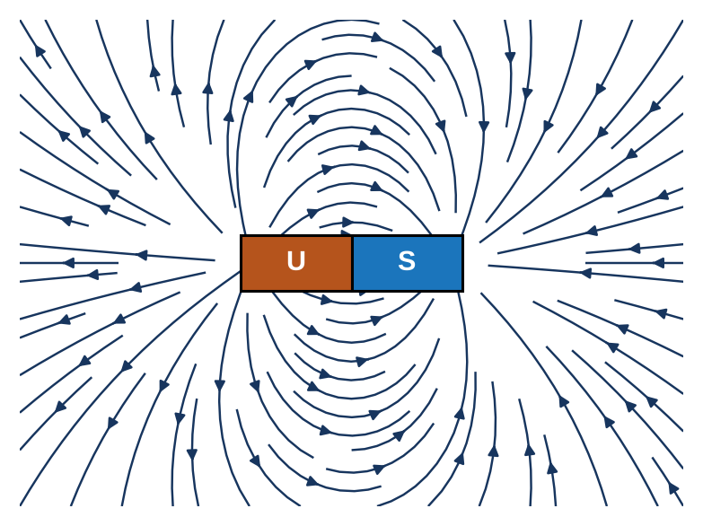
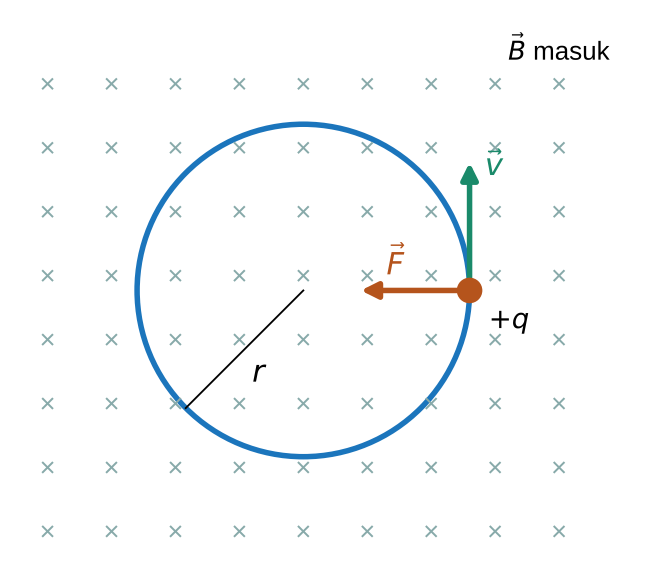
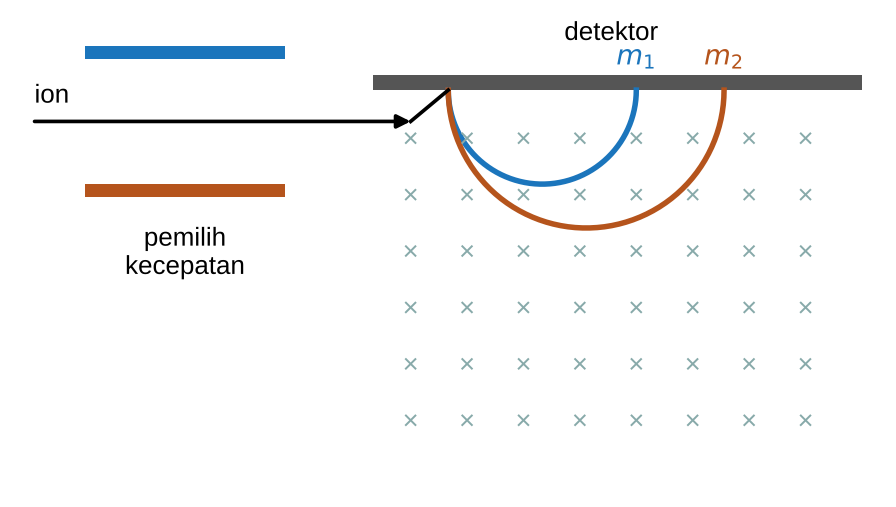
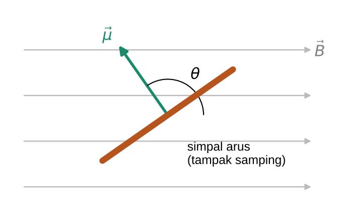
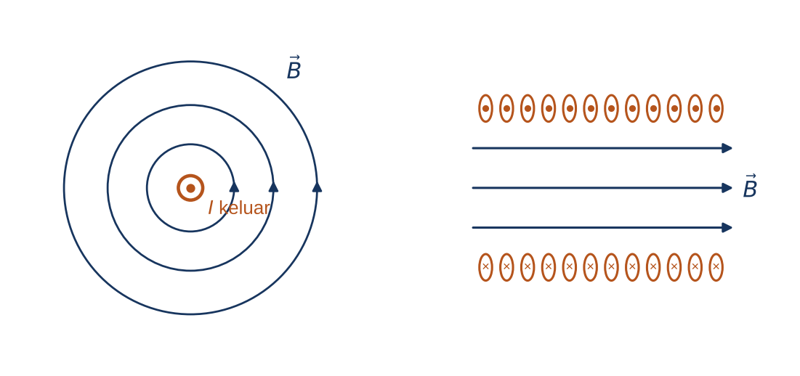

# Bab 14 Kemagnetan dan Induksi

Tuangkan nitrogen cair di antara kutub-kutub magnet yang kuat, dan cairan itu mengalir lewat begitu saja. Tuangkan oksigen cair, dan sesuatu yang ganjil terjadi: cairan biru pucat itu **tersangkut** di antara kedua kutub, menggantung melawan gravitasi sampai habis menguap.

Kedua molekul itu hampir kembar: sama-sama diatomik, hampir sama berat, sama-sama tidak polar. Rumus Lewis yang biasa, O=O, menggambarkan semua elektron oksigen berpasangan, dan menurut gambar itu oksigen seharusnya tidak peduli pada magnet, seperti nitrogen. Percobaan sederhana ini menunjukkan bahwa gambar itu keliru: molekul oksigen memiliki dua elektron yang **tidak berpasangan**. Magnet dapat "melihat" ke dalam susunan elektron molekul. Hitungannya ada di Contoh 14.20.

Bab ini membahas gaya magnet, asal-usul medan magnet, dan gejala induksi yang menjadi dasar generator dan transformator. Di tengahnya ada bagian yang penting bagi kimia: kemagnetan atom dan molekul, yang melahirkan dua alat terpenting kimiawan modern, spektrometer massa dan spektrometer NMR.

::: {.tujuan}
**Tujuan belajar**

Setelah mempelajari bab ini, kamu mampu:

1. Menentukan besar dan arah gaya magnet pada muatan bergerak dan pada kawat berarus.
2. Menganalisis gerak melingkar partikel bermuatan dalam medan magnet, termasuk dalam spektrometer massa.
3. Menghitung torsi dan momen magnet simpal arus.
4. Menghitung medan magnet oleh kawat lurus, simpal, dan solenoide.
5. Menjelaskan diamagnetisme, paramagnetisme, dan feromagnetisme dari susunan elektron.
6. Menghitung pemisahan tingkat energi spin dalam medan magnet (asas NMR dan ESR).
7. Menerapkan hukum Faraday dan hukum Lenz.
8. Menjelaskan generator, transformator, dan arus bolak-balik.
9. Menghitung induktansi dan energi medan magnet.
10. Memerikan gelombang elektromagnetik dan spektrumnya.
:::

::: {.mat}
**Prasyarat**

Dari Bab 2 dan 3: gerak melingkar dan gaya sentripetal. Dari Bab 12: medan listrik, potensial, dan energi dipol (12.3, 12.6). Dari Bab 13: arus, ggl, dan rangkaian RC. Dari Bab 9: gelombang, frekuensi, dan panjang gelombang. Dari Bab 10: faktor Boltzmann dan $k_BT$.
:::

## 14.1 Magnet dan medan magnet

### Kutub magnet

Setiap magnet memiliki dua kutub, **utara** (U) dan **selatan** (S). Kutub sejenis tolak-menolak; kutub tak sejenis tarik-menarik. Sampai di sini mirip muatan listrik, tetapi ada satu perbedaan mendasar: **kutub magnet tidak dapat dipisahkan**. Potong magnet batang menjadi dua, dan diperoleh dua magnet utuh, masing-masing dengan kutub utara dan selatan. Kutub magnet tunggal (monopol) tidak pernah ditemukan.

Alasannya akan jelas di subbab 14.5 dan 14.6: kemagnetan berasal dari **muatan yang bergerak**, yaitu arus, dan sumber terkecilnya adalah simpal arus, yang selalu berkutub dua.

{width=52%}

### Medan magnet

Ruang di sekitar magnet atau arus memuat **medan magnet**, $\vec B$. Arahnya di suatu titik adalah arah yang ditunjuk kutub utara jarum kompas di titik itu. Garis medan magnet (Gambar 14.1) selalu berupa **lengkung tertutup**: keluar dari kutub utara, masuk ke kutub selatan, dan bersambung di dalam magnet. Garis medan listrik berawal dan berakhir pada muatan; garis medan magnet tidak berawal dan tidak berakhir, karena tidak ada monopol.

Satuan medan magnet adalah **tesla** (T). Satuan lama, gauss: 1 G = $10^{-4}$ T.

| Sumber | Medan (T) |
|---|---|
| Otak manusia | $10^{-13}$ |
| Ruang antarbintang | $10^{-10}$ |
| Permukaan Bumi | $5 \times 10^{-5}$ |
| Magnet tempel | 0,01 |
| Magnet neodimium | 0,3–1,3 |
| Pemindai MRI rumah sakit | 1,5–3 |
| Spektrometer NMR | 7–28 |
| Magnet tetap terkuat di laboratorium | 45 |
| Permukaan bintang neutron | $10^8$ |

Bumi sendiri adalah magnet raksasa, dengan kutub magnet **selatan** di dekat kutub geografis utara; itu sebabnya ujung utara jarum kompas menunjuk ke sana.

::: {.kuis}
**Kuis cepat 14.1**

Sebatang besi dan sebatang magnet tampak persis sama. Tanpa alat lain, bagaimana membedakannya?
:::

## 14.2 Gaya magnet pada muatan bergerak

### Gaya Lorentz

Medan magnet tidak memengaruhi muatan yang diam. Ia hanya mengerjakan gaya pada muatan yang **bergerak**, dan gaya itu memiliki arah yang tidak biasa: tegak lurus kecepatan **dan** tegak lurus medan. Besarnya:

$$
\boxed{F = \lvert q\rvert vB\sin\theta} \qquad \text{(14.1)}
$$

dengan $\theta$ sudut antara kecepatan dan medan. Dalam lambang vektor, $\vec F = q\vec v \times \vec B$. Jika ada juga medan listrik, gaya totalnya, **gaya Lorentz**, adalah $\vec F = q(\vec E + \vec v \times \vec B)$.

::: {.strategi}
**Strategi · Kaidah tangan kanan**

1. Luruskan jari-jari tangan kanan searah kecepatan $\vec v$.
2. Tekuk jari-jari ke arah medan $\vec B$ (lewat sudut yang lebih kecil).
3. Ibu jari menunjukkan arah gaya pada muatan **positif**.
4. Untuk muatan **negatif**, balik arahnya.

Pada gambar, medan yang masuk bidang kertas ditandai × (ekor anak panah) dan yang keluar ditandai • (ujung anak panah).
:::

Tiga akibat penting dari bentuk gaya ini:

- Gaya **nol** jika muatan bergerak sejajar medan, dan terbesar jika tegak lurus.
- Gaya selalu tegak lurus kecepatan, sehingga **tidak melakukan usaha**. Medan magnet dapat membelokkan partikel, tetapi tidak dapat mengubah kelajuan atau energi kinetiknya.
- Arah gaya bergantung pada tanda muatan; itu memberi cara membedakan partikel positif dari negatif.

::: {.contoh}
**Contoh 14.1 · Gaya pada proton**

Proton bergerak $3{,}0 \times 10^6$ m/s tegak lurus medan 0,50 T. (a) Berapa gaya magnet padanya? (b) Berapa percepatannya?

**Penyelesaian.**

(a) $F = evB = (1{,}602 \times 10^{-19})(3{,}0 \times 10^6)(0{,}50) = 2{,}4 \times 10^{-13}$ N.

(b) $a = \dfrac Fm = \dfrac{2{,}4 \times 10^{-13}}{1{,}673 \times 10^{-27}} = 1{,}4 \times 10^{14}\ \text{m/s}^2$.

**Memahami hasil.** Percepatannya sangat besar, tetapi kelajuan proton tidak berubah: percepatan itu seluruhnya sentripetal, hanya membelokkan.
:::

::: {.contoh}
**Contoh 14.2 · Sudut antara kecepatan dan medan**

Elektron bergerak $2{,}0 \times 10^7$ m/s dalam medan 0,010 T. Berapa gaya padanya jika sudut antara kecepatan dan medan (a) 90°; (b) 30°; (c) 0°?

**Penyelesaian.** $evB = (1{,}602 \times 10^{-19})(2{,}0 \times 10^7)(0{,}010) = 3{,}2 \times 10^{-14}$ N.

(a) $3{,}2 \times 10^{-14}$ N. (b) Setengahnya, $1{,}6 \times 10^{-14}$ N. (c) Nol.

**Memahami hasil.** Hanya komponen kecepatan yang **tegak lurus** medan yang merasakan gaya. Komponen yang sejajar tidak terpengaruh; itu asal lintasan berbentuk pilin (subbab 14.3).
:::

::: {.contoh}
**Contoh 14.3 · Menentukan arah**

Medan magnet berarah ke utara. Tentukan arah gaya pada (a) proton yang bergerak ke timur; (b) elektron yang bergerak ke timur; (c) proton yang bergerak ke atas; (d) proton yang bergerak ke utara.

**Penyelesaian.** Dengan kaidah tangan kanan (timur × utara = atas):

| | Kecepatan | Gaya |
|---|---|---|
| (a) proton | timur | ke atas |
| (b) elektron | timur | ke bawah |
| (c) proton | atas | ke barat |
| (d) proton | utara | nol |

**Memahami hasil.** Untuk (c), pakai aturan putar: jika timur × utara = atas, maka utara × atas = timur dan atas × timur = utara; membalik urutan membalik tanda, jadi atas × utara = −timur = barat. Ketiga arah (kecepatan, medan, gaya) selalu saling tegak lurus.
:::

::: {.contoh}
**Contoh 14.4 · Medan Bumi dan elektron**

Elektron bergerak $1{,}0 \times 10^6$ m/s tegak lurus medan magnet Bumi, $5{,}0 \times 10^{-5}$ T. Bandingkan gaya magnet padanya dengan beratnya.

**Penyelesaian.**

$F_B = (1{,}602 \times 10^{-19})(1{,}0 \times 10^6)(5{,}0 \times 10^{-5}) = 8{,}0 \times 10^{-18}$ N.

$mg = (9{,}109 \times 10^{-31})(9{,}8) = 8{,}9 \times 10^{-30}$ N.

Perbandingannya $9 \times 10^{11}$.

**Memahami hasil.** Medan Bumi yang lemah pun menguasai gerak partikel bermuatan. Medan itu membelokkan partikel bermuatan dari Matahari dan menjeratnya; tanpa perisai ini, atmosfer Bumi akan terkikis perlahan.
:::

::: {.kuis}
**Kuis cepat 14.2**

Partikel bermuatan melewati suatu daerah tanpa dibelokkan. Dapatkah disimpulkan bahwa di daerah itu tidak ada medan magnet?
:::

## 14.3 Gerak partikel bermuatan dalam medan magnet

### Lintasan lingkaran

{width=44%}

Partikel yang bergerak tegak lurus medan seragam mengalami gaya yang besarnya tetap dan selalu tegak lurus kecepatannya. Itu persis syarat gerak melingkar beraturan (Gambar 14.2). Gaya magnet menjadi gaya sentripetal:

$$
qvB = \frac{mv^2}{r} \quad\Longrightarrow\quad \boxed{r = \frac{mv}{\lvert q\rvert B}} \qquad \text{(14.2)}
$$

Jari-jari lintasan sebanding dengan momentum partikel. Periode dan frekuensi putarannya:

$$
\boxed{T = \frac{2\pi m}{\lvert q\rvert B}, \qquad f = \frac{\lvert q\rvert B}{2\pi m}} \qquad \text{(14.3)}
$$

Yang mengejutkan: **frekuensi ini tidak bergantung pada kelajuan**. Partikel yang lebih cepat menempuh lingkaran lebih besar dalam waktu yang sama. Frekuensi ini disebut **frekuensi siklotron**, dan hanya bergantung pada $q/m$ dan $B$.

Jika kecepatan partikel juga memiliki komponen sejajar medan, komponen itu tidak berubah, dan lintasannya berbentuk **pilin** yang melilit garis medan. Partikel bermuatan dari Matahari terjerat dalam medan Bumi dengan cara ini dan terbawa ke daerah kutub, tempat mereka menumbuk atmosfer dan menyalakan **aurora**.

::: {.contoh}
**Contoh 14.5 · Lingkaran elektron**

Elektron berkelajuan $2{,}0 \times 10^7$ m/s masuk tegak lurus ke medan $1{,}0 \times 10^{-3}$ T. Tentukan jari-jari dan periode lintasannya.

**Penyelesaian.**

$$
r = \frac{mv}{eB} = \frac{(9{,}109 \times 10^{-31})(2{,}0 \times 10^7)}{(1{,}602 \times 10^{-19})(1{,}0 \times 10^{-3})} = 0{,}11\ \text{m}.
$$

$$
T = \frac{2\pi m}{eB} = \frac{2\pi(9{,}109 \times 10^{-31})}{(1{,}602 \times 10^{-19})(1{,}0 \times 10^{-3})} = 3{,}6 \times 10^{-8}\ \text{s}.
$$

**Memahami hasil.** Medan hanya dua puluh kali medan Bumi sudah melengkungkan elektron cepat menjadi lingkaran selebar piring. Dengan mengukur $r$ pada $v$ dan $B$ yang diketahui, diperoleh $e/m$.
:::

::: {.contoh}
**Contoh 14.6 · Siklotron**

Siklotron mempercepat proton dalam medan 1,5 T; jari-jari lintasan terluarnya 0,50 m. (a) Berapa frekuensi tegangan pemercepatnya? (b) Berapa kelajuan dan energi kinetik proton ketika keluar?

**Penyelesaian.**

(a) $f = \dfrac{eB}{2\pi m} = \dfrac{(1{,}602 \times 10^{-19})(1{,}5)}{2\pi(1{,}673 \times 10^{-27})} = 2{,}3 \times 10^7$ Hz $= 23$ MHz.

(b) $v = \dfrac{eBr}{m} = \dfrac{(1{,}602 \times 10^{-19})(1{,}5)(0{,}50)}{1{,}673 \times 10^{-27}} = 7{,}2 \times 10^7$ m/s.

$K = \tfrac12mv^2 = 4{,}3 \times 10^{-12}$ J $= 27$ MeV.

**Memahami hasil.** Karena frekuensi putaran tidak bergantung pada kelajuan, tegangan bolak-balik berfrekuensi **tetap** dapat mendorong proton pada setiap putaran, makin lama makin cepat dan makin lebar lingkarannya. Kelajuan akhirnya sudah 24% laju cahaya, sehingga koreksi relativitas (Bab 15) mulai terasa. Siklotron rumah sakit membuat isotop berumur pendek, seperti ¹⁸F, untuk pencitraan PET.
:::

### Pemilih kecepatan

Dalam daerah yang memuat medan listrik dan medan magnet saling tegak lurus, gaya listrik $qE$ dan gaya magnet $qvB$ dapat diatur berlawanan arah. Keduanya seimbang hanya untuk satu kelajuan:

$$
\boxed{v = \frac EB} \qquad \text{(14.4)}
$$

Partikel berkelajuan itu lewat lurus, apa pun muatan dan massanya; yang lain dibelokkan. Susunan ini disebut **pemilih kecepatan**.

### Spektrometer massa

{width=62%}

Ion-ion yang kelajuannya sudah diketahui dimasukkan ke medan magnet (Gambar 14.3). Jari-jari lintasannya sebanding dengan massanya:

$$
\boxed{\frac mq = \frac{rB}{v}} \qquad \text{(14.5)}
$$

Jika ion dari keadaan diam dipercepat dulu dengan tegangan $V$ (tanpa pemilih kecepatan), $\tfrac12mv^2 = qV$, dan

$$
\frac mq = \frac{B^2r^2}{2V} . \qquad \text{(14.6)}
$$

Yang terukur selalu perbandingan massa terhadap muatan, yang oleh kimiawan ditulis $m/z$.

::: {.contoh}
**Contoh 14.7 · Pemilih kecepatan**

Pemilih kecepatan memakai medan listrik $2{,}0 \times 10^4$ V/m dan medan magnet 0,010 T. Berapa kelajuan ion yang lolos?

**Penyelesaian.** $v = \dfrac EB = \dfrac{2{,}0 \times 10^4}{0{,}010} = 2{,}0 \times 10^6$ m/s.

**Memahami hasil.** Ion yang lebih cepat dibelokkan ke arah gaya magnet; yang lebih lambat ke arah gaya listrik. Dengan susunan ini dan pembelokan elektrostatik, J. J. Thomson mengukur $e/m$ elektron.
:::

::: {.contoh}
**Contoh 14.8 · Memisahkan isotop klorin**

Ion ³⁵Cl⁺ (34,97 u) dan ³⁷Cl⁺ (36,97 u) berkelajuan $1{,}0 \times 10^5$ m/s memasuki medan 0,20 T. (a) Berapa jari-jari lintasan masing-masing? (b) Seberapa jauh keduanya terpisah pada detektor setelah menempuh setengah lingkaran? (1 u $= 1{,}6605 \times 10^{-27}$ kg)

**Penyelesaian.**

(a) ³⁵Cl⁺: $r = \dfrac{(34{,}97)(1{,}6605 \times 10^{-27})(1{,}0 \times 10^5)}{(1{,}602 \times 10^{-19})(0{,}20)} = 0{,}181$ m.

³⁷Cl⁺: $r = 0{,}181 \times \dfrac{36{,}97}{34{,}97} = 0{,}192$ m.

(b) Titik jatuh berjarak $2r$ dari celah masuk. Selisihnya $2(0{,}192 - 0{,}181) = 0{,}021$ m $= 2{,}1$ cm.

**Memahami hasil.** Dua puncak, terpisah dua sentimeter, dengan tinggi berbanding kira-kira $3 : 1$ (kelimpahan ³⁵Cl 76%, ³⁷Cl 24%). Pola "dua puncak berjarak 2 satuan, berbanding 3 : 1" adalah sidik jari senyawa berklorin dalam spektrum massa. Massa atom relatif klorin, 35,45, adalah rata-rata tertimbang keduanya.
:::

::: {.contoh}
**Contoh 14.9 · Mengenali ion dari jari-jarinya**

Ion bermuatan tunggal dipercepat dari diam melalui 2000 V, lalu memasuki medan 0,100 T dan menempuh lintasan berjari-jari 0,288 m. Berapa massanya, dan ion apakah itu?

**Penyelesaian.**

$$
m = \frac{qB^2r^2}{2V} = \frac{(1{,}602 \times 10^{-19})(0{,}100)^2(0{,}288)^2}{2(2000)} = 3{,}32 \times 10^{-26}\ \text{kg} = 20{,}0\ \text{u}.
$$

**Memahami hasil.** Itu ²⁰Ne⁺. Dengan alat seperti inilah Thomson dan Aston pada tahun 1913 menemukan bahwa neon terdiri atas dua jenis atom, bermassa 20 dan 22: penemuan pertama isotop unsur yang tidak radioaktif.
:::

::: {.contoh}
**Contoh 14.10 · Proton dalam medan Bumi**

Proton dari Matahari memiliki komponen kecepatan $1{,}0 \times 10^5$ m/s tegak lurus medan Bumi ($5{,}0 \times 10^{-5}$ T). Berapa jari-jari pilinnya?

**Penyelesaian.** $r = \dfrac{mv}{eB} = \dfrac{(1{,}673 \times 10^{-27})(1{,}0 \times 10^5)}{(1{,}602 \times 10^{-19})(5{,}0 \times 10^{-5})} = 21$ m.

**Memahami hasil.** Dua puluh meter, amat kecil dibandingkan ukuran Bumi. Proton itu praktis "terikat" pada garis medan dan meluncur sepanjang garis itu menuju kutub.
:::

### Efek Hall

Jika lempeng penghantar berarus diletakkan dalam medan magnet tegak lurus arus, pembawa muatannya terdorong ke satu sisi. Muatan menumpuk di sana sampai medan listrik yang ditimbulkannya mengimbangi gaya magnet. Beda potensial melintang yang terjadi disebut **tegangan Hall**:

$$
\boxed{V_H = \frac{IB}{nqt}} \qquad \text{(14.7)}
$$

dengan $t$ tebal lempeng searah medan. Tanda $V_H$ menunjukkan tanda pembawa muatan, dan besarnya memberi rapat pembawa $n$.

::: {.contoh}
**Contoh 14.11 · Tegangan Hall**

Lempeng setebal 0,10 mm dialiri arus dalam medan 1,0 T. Hitung tegangan Hall untuk (a) tembaga ($n = 8{,}47 \times 10^{28}$ m⁻³) berarus 10 A; (b) semikonduktor ($n = 1{,}0 \times 10^{22}$ m⁻³) berarus 10 mA.

**Penyelesaian.**

(a) $V_H = \dfrac{(10)(1{,}0)}{(8{,}47 \times 10^{28})(1{,}602 \times 10^{-19})(1{,}0 \times 10^{-4})} = 7{,}4 \times 10^{-6}$ V.

(b) $V_H = \dfrac{(0{,}010)(1{,}0)}{(1{,}0 \times 10^{22})(1{,}602 \times 10^{-19})(1{,}0 \times 10^{-4})} = 0{,}062$ V.

**Memahami hasil.** Pada logam, tegangan Hall hanya beberapa mikrovolt. Pada semikonduktor, yang pembawanya jutaan kali lebih jarang, ribuan kali lebih besar walaupun arusnya seperseribu. Karena itu pengukur medan magnet (**sensor Hall**) dibuat dari semikonduktor; alat itu ada di setiap telepon sebagai kompas. Efek Hall juga yang pertama kali menunjukkan bahwa pada beberapa bahan pembawa muatannya **positif** ("lubang").
:::

::: {.kuis}
**Kuis cepat 14.3**

Proton dan elektron berkelajuan sama memasuki medan magnet yang sama. Bandingkan jari-jari dan arah putar lintasannya.
:::

## 14.4 Gaya pada kawat berarus dan momen magnet

### Gaya pada kawat

Arus adalah muatan yang bergerak, jadi kawat berarus dalam medan magnet mengalami gaya. Untuk kawat lurus sepanjang $L$:

$$
\boxed{F = ILB\sin\theta} \qquad \text{(14.8)}
$$

dengan arah menurut kaidah tangan kanan (jari searah arus, tekuk ke arah medan).

### Torsi pada simpal arus

{width=48%}

Simpal berarus dalam medan seragam tidak mengalami gaya total, tetapi mengalami **torsi**. Simpal seluas $A$ dengan $N$ lilitan dan arus $I$ memiliki **momen dipol magnet**:

$$
\boxed{\mu = NIA} \qquad \text{(14.9)}
$$

berarah tegak lurus bidang simpal (kaidah tangan kanan: jari mengikuti arus, ibu jari menunjuk $\vec\mu$). Torsi dan energi potensialnya:

$$
\boxed{\tau = \mu B\sin\theta, \qquad U = -\mu B\cos\theta} \qquad \text{(14.10)}
$$

Bandingkan dengan dipol listrik (subbab 12.3): $U = -pE\cos\theta$. Bentuknya sama. Simpal arus adalah **dipol magnet**, dan berperilaku seperti magnet batang kecil: ia berputar sampai $\vec\mu$ searah $\vec B$, keadaan berenergi terendah. Jarum kompas, motor listrik, galvanometer, dan, seperti akan kita lihat, elektron dan inti atom, semuanya adalah dipol magnet dalam medan.

Dalam **motor listrik**, arah arus dibalik setiap setengah putaran (oleh komutator) sehingga torsi selalu searah dan simpal berputar terus.

::: {.contoh}
**Contoh 14.12 · Gaya pada kawat**

(a) Kawat sepanjang 20 cm berarus 5,0 A tegak lurus medan 0,30 T. Berapa gayanya? (b) Kabel listrik mendatar sepanjang 50 m berarus 100 A tegak lurus medan Bumi ($5{,}0 \times 10^{-5}$ T). Berapa gayanya?

**Penyelesaian.**

(a) $F = (5{,}0)(0{,}20)(0{,}30) = 0{,}30$ N.

(b) $F = (100)(50)(5{,}0 \times 10^{-5}) = 0{,}25$ N.

**Memahami hasil.** Gaya pada (b) tidak berarti dibandingkan berat kabel. Tetapi dalam medan kuat, gaya pada kawat berarus sangat besar; itulah penggerak semua motor listrik.
:::

::: {.contoh}
**Contoh 14.13 · Kawat yang melayang**

Kawat mendatar bermassa 10 g tiap meter berada dalam medan mendatar 0,050 T yang tegak lurus kawat. Berapa arus agar gaya magnet menopang beratnya?

**Penyelesaian.** Tiap meter kawat: $ILB = mg$.

$$
I = \frac{(0{,}010)(9{,}8)}{(1{,}0)(0{,}050)} = 2{,}0\ \text{A}.
$$

**Memahami hasil.** Arah arus harus dipilih agar gayanya ke atas. Kereta maglev memakai asas yang sama dengan magnet superkonduktor.
:::

::: {.contoh}
**Contoh 14.14 · Kumparan dalam medan**

Kumparan 100 lilitan seluas 20 cm² berarus 0,50 A berada dalam medan 0,20 T. (a) Berapa momen magnetnya? (b) Berapa torsi terbesarnya? (c) Berapa usaha untuk memutarnya dari searah medan menjadi berlawanan arah?

**Penyelesaian.**

(a) $\mu = NIA = (100)(0{,}50)(2{,}0 \times 10^{-3}) = 0{,}10$ A·m².

(b) $\tau = \mu B = (0{,}10)(0{,}20) = 0{,}020$ N·m, ketika $\vec\mu$ tegak lurus $\vec B$.

(c) $W = \Delta U = \mu B - (-\mu B) = 2\mu B = 0{,}040$ J.

**Memahami hasil.** Hasil (c), $2\mu B$, adalah selisih energi antara dua arah yang berlawanan. Untuk kumparan, semua arah di antaranya boleh. Untuk elektron dan inti atom, mekanika kuantum hanya mengizinkan beberapa arah, dan selisih energi $2\mu B$ inilah yang diukur dalam spektroskopi ESR dan NMR (subbab 14.6).
:::

::: {.kuis}
**Kuis cepat 14.4**

Simpal arus diletakkan dalam medan seragam dengan momen magnetnya searah medan. Berapa torsinya? Apakah keadaan itu mantap?
:::

## 14.5 Medan magnet oleh arus

### Penemuan Oersted

Pada tahun 1820 Hans Christian Oersted memperhatikan jarum kompas menyimpang ketika arus dialirkan dalam kawat di dekatnya. Listrik dan magnet, yang selama itu dianggap dua gejala terpisah, ternyata berhubungan: **arus listrik menghasilkan medan magnet**.

{width=76%}

| Sumber | Medan | Keterangan |
|---|---|---|
| Kawat lurus panjang | $B = \dfrac{\mu_0I}{2\pi r}$ | pada jarak $r$ dari kawat |
| Pusat simpal lingkaran, $N$ lilitan | $B = \dfrac{\mu_0NI}{2R}$ | $R$ jari-jari simpal |
| Di dalam solenoide panjang | $B = \mu_0nI$ | $n$ lilitan tiap meter |

$$
\boxed{\mu_0 = 4\pi \times 10^{-7}\ \text{T·m/A}} \qquad \text{(14.11)}
$$

disebut **permeabilitas ruang hampa**. Arah medan ditentukan dengan kaidah tangan kanan kedua: genggam kawat dengan ibu jari searah arus; jari-jari menunjukkan arah medan yang melingkari kawat. Untuk simpal dan solenoide: jari mengikuti arus, ibu jari menunjuk arah medan di dalamnya.

Medan di dalam **solenoide** (kumparan panjang) seragam dan tidak bergantung pada jari-jarinya. Solenoide adalah cara baku membuat medan seragam, dan merupakan bentuk dasar magnet MRI dan NMR.

Ketiga rumus itu dapat diturunkan dari **hukum Ampere**: jumlah $B$ sepanjang lintasan tertutup sebanding dengan arus yang dilingkupinya, $\oint B\,dl = \mu_0I$. Hukum ini bagi kemagnetan sama seperti hukum Gauss bagi listrik.

### Gaya antara dua kawat

Dua kawat sejajar berarus saling mengerjakan gaya, karena masing-masing berada dalam medan yang lain. Gaya tiap satuan panjang:

$$
\boxed{\frac FL = \frac{\mu_0I_1I_2}{2\pi d}} \qquad \text{(14.12)}
$$

Arus **searah tarik-menarik**; arus berlawanan arah tolak-menolak.

::: {.contoh}
**Contoh 14.15 · Medan di dekat kawat**

(a) Berapa medan magnet pada jarak 2,0 cm dari kawat berarus 10 A? (b) Sambaran petir berarus $3{,}0 \times 10^4$ A. Berapa medannya pada jarak 10 m?

**Penyelesaian.**

(a) $B = \dfrac{(4\pi \times 10^{-7})(10)}{2\pi(0{,}020)} = 1{,}0 \times 10^{-4}$ T.

(b) $B = \dfrac{(4\pi \times 10^{-7})(3{,}0 \times 10^4)}{2\pi(10)} = 6{,}0 \times 10^{-4}$ T.

**Memahami hasil.** Hasil (a) dua kali medan Bumi: kompas di dekat kabel berarus tidak dapat dipercaya. Rumus praktis: $B = (2 \times 10^{-7})I/r$.
:::

::: {.contoh}
**Contoh 14.16 · Gaya antara dua kawat**

Dua kawat sejajar berjarak 1,0 cm masing-masing berarus 10 A searah. Berapa gaya pada tiap meter kawat?

**Penyelesaian.**

$$
\frac FL = \frac{(4\pi \times 10^{-7})(10)(10)}{2\pi(0{,}010)} = 2{,}0 \times 10^{-3}\ \text{N/m}, \quad \text{tarik-menarik}.
$$

**Memahami hasil.** Gaya ini kecil pada arus rumah tangga, tetapi pada hubung singkat (ribuan ampere) cukup untuk melengkungkan batang tembaga. Sampai tahun 2019, satuan ampere didefinisikan lewat gaya ini.
:::

::: {.contoh}
**Contoh 14.17 · Solenoide dan kumparan**

(a) Solenoide sepanjang 20 cm berlilitan 1000 dialiri 2,0 A. Berapa medan di dalamnya? (b) Kumparan datar 50 lilitan berjari-jari 5,0 cm dialiri 3,0 A. Berapa medan di pusatnya?

**Penyelesaian.**

(a) $n = \dfrac{1000}{0{,}20} = 5000$ m⁻¹. $B = (4\pi \times 10^{-7})(5000)(2{,}0) = 0{,}013$ T.

(b) $B = \dfrac{(4\pi \times 10^{-7})(50)(3{,}0)}{2(0{,}050)} = 1{,}9 \times 10^{-3}$ T.

**Memahami hasil.** Kumparan yang rapat dengan arus sedang menghasilkan medan ratusan kali medan Bumi. Mengisi solenoide dengan besi memperkuat medannya ratusan sampai ribuan kali lagi (subbab 14.6); itu elektromagnet.
:::

::: {.contoh}
**Contoh 14.18 · Mengapa magnet MRI harus superkonduktor**

Magnet MRI adalah solenoide yang menghasilkan 1,5 T dengan $1{,}0 \times 10^4$ lilitan tiap meter. (a) Berapa arus yang diperlukan? (b) Jika kawatnya tembaga dengan hambatan total 30 Ω, berapa daya yang terbuang?

**Penyelesaian.**

(a) $I = \dfrac{B}{\mu_0n} = \dfrac{1{,}5}{(4\pi \times 10^{-7})(1{,}0 \times 10^4)} = 120$ A.

(b) $P = I^2R = (120)^2(30) = 4{,}3 \times 10^5$ W.

**Memahami hasil.** Hampir setengah megawatt kalor: mustahil didinginkan. Magnet MRI dan NMR memakai kawat superkonduktor (niobium–titanium) yang direndam helium cair 4,2 K. Hambatannya tepat nol, sehingga arus yang sekali dialirkan berputar bertahun-tahun tanpa sumber. Itu sebabnya spektrometer NMR harus diisi ulang helium dan nitrogen cair secara berkala.
:::

::: {.contoh}
**Contoh 14.19 · Medan magnet di dalam atom**

Dalam model Bohr, elektron atom hidrogen mengelilingi proton $6{,}58 \times 10^{15}$ kali per detik pada jari-jari $5{,}29 \times 10^{-11}$ m. (a) Berapa arus yang setara? (b) Berapa medan magnet yang dihasilkannya di tempat proton?

**Penyelesaian.**

(a) $I = ef = (1{,}602 \times 10^{-19})(6{,}58 \times 10^{15}) = 1{,}05 \times 10^{-3}$ A.

(b) $B = \dfrac{\mu_0I}{2R} = \dfrac{(4\pi \times 10^{-7})(1{,}05 \times 10^{-3})}{2(5{,}29 \times 10^{-11})} = 12{,}5$ T.

**Memahami hasil.** Satu elektron yang berputar setara dengan arus satu miliampere, dan menghasilkan di pusat lintasannya medan yang menyamai magnet laboratorium terkuat. Medan magnet di dalam atom sangat besar. Di dalam molekul, medan kecil yang ditimbulkan elektron-elektron di sekitar suatu inti sedikit mengubah medan yang dirasakan inti itu; itulah **geseran kimia** dalam NMR.
:::

::: {.kuis}
**Kuis cepat 14.5**

Dua kawat sejajar membawa arus berlawanan arah. Apakah keduanya tarik-menarik atau tolak-menolak? Mengapa kabel listrik (yang memuat dua kawat berarus berlawanan) hampir tidak menghasilkan medan magnet di kejauhan?
:::
