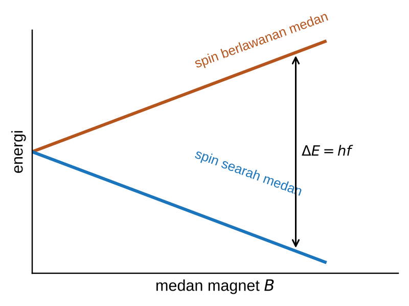
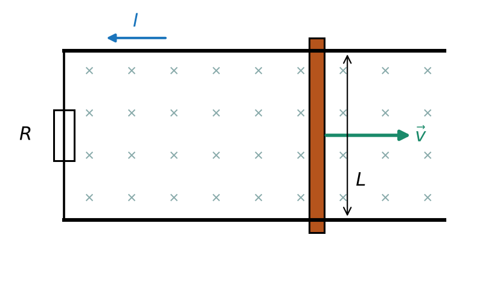
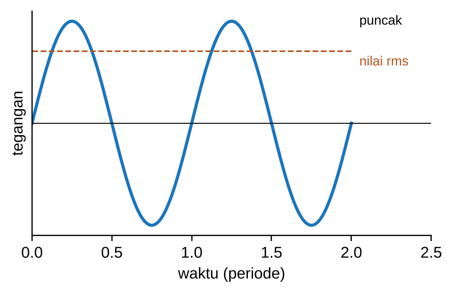
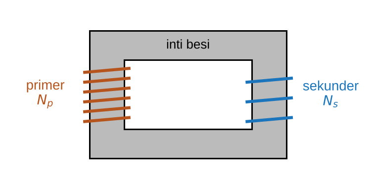
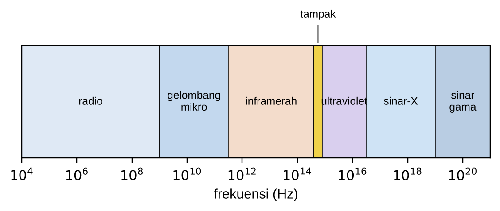

## 14.6 Kemagnetan atom, molekul, dan bahan

### Elektron sebagai magnet

Jika setiap simpal arus adalah dipol magnet, maka elektron yang mengelilingi inti juga demikian. Momen magnet orbitnya muncul dalam kelipatan satu satuan alami, **magneton Bohr**:

$$
\boxed{\mu_B = \frac{e\hbar}{2m_e} = 9{,}274 \times 10^{-24}\ \text{J/T} = 5{,}788 \times 10^{-5}\ \text{eV/T}} \qquad \text{(14.13)}
$$

dengan $\hbar = h/2\pi$. Selain itu, elektron memiliki momen magnet **bawaan** yang tidak berasal dari gerak orbit, yang disebut **spin**. Besarnya juga satu magneton Bohr, dan dalam medan magnet ia hanya dapat mengambil dua arah: searah medan ("naik", ↑) atau berlawanan ("turun", ↓). Inilah bilangan kuantum spin $m_s = \pm\tfrac12$ dalam kimia.

Dua elektron yang **berpasangan** dalam satu orbital berspin berlawanan, dan momen magnetnya saling meniadakan. Jadi kemagnetan atom dan molekul hampir seluruhnya ditentukan oleh **elektron tak berpasangan**.

### Tiga jenis tanggapan bahan

| Jenis | Tanggapan terhadap magnet | Asal | Contoh |
|---|---|---|---|
| Diamagnetik | ditolak sangat lemah | semua elektron berpasangan | H₂O, N₂, NaCl, Cu, benzena |
| Paramagnetik | ditarik lemah | ada elektron tak berpasangan | O₂, NO, Cu²⁺, Fe³⁺, radikal bebas |
| Feromagnetik | ditarik kuat; dapat menjadi magnet tetap | momen atom saling menjajarkan | Fe, Co, Ni, Fe₃O₄ |

**Diamagnetisme** ada pada semua bahan: medan luar mengimbas arus kecil dalam awan elektron, yang menurut hukum Lenz (subbab 14.7) melawan medan itu. Efeknya sangat lemah dan tertutup jika ada elektron tak berpasangan.

**Paramagnetisme**: tiap atom atau molekul adalah magnet kecil yang berarah acak karena gerak termal. Medan luar cenderung menjajarkannya, gerak termal mengacaknya; hasilnya penjajaran kecil yang sebanding dengan $B/T$ (**hukum Curie**).

**Feromagnetisme**: dalam besi, kobalt, dan nikel, interaksi kuantum antaratom membuat momen-momen magnet tetangga saling menjajarkan diri **tanpa** medan luar, dalam daerah-daerah kecil yang disebut **domain**. Pada besi biasa, arah domain-domain itu acak. Medan luar membuat domain yang searah tumbuh; jika penjajaran itu tertinggal setelah medan dicabut, besi menjadi magnet tetap. Di atas **suhu Curie** (770 °C untuk besi), gerak termal mengalahkan interaksi itu dan feromagnetisme hilang.

### Menghitung elektron tak berpasangan

Untuk ion logam transisi deret pertama, momen magnet yang terukur mengikuti rumus **hanya-spin**:

$$
\boxed{\mu = \sqrt{n(n + 2)}\;\mu_B} \qquad \text{(14.14)}
$$

dengan $n$ banyaknya elektron tak berpasangan.

| $n$ | 0 | 1 | 2 | 3 | 4 | 5 |
|---|---|---|---|---|---|---|
| $\mu/\mu_B$ | 0 | 1,73 | 2,83 | 3,87 | 4,90 | 5,92 |

::: {.contoh}
**Contoh 14.20 · Mengapa oksigen cair menempel pada magnet**

Momen magnet molekul O₂ yang terukur 2,83 $\mu_B$; molekul N₂ tidak memiliki momen magnet. (a) Berapa elektron tak berpasangan pada masing-masing? (b) Apa artinya bagi gambaran ikatan pada O₂?

**Penyelesaian.**

(a) Dari tabel, 2,83 $\mu_B$ berarti $n = 2$: molekul O₂ memiliki **dua** elektron tak berpasangan. N₂ memiliki nol.

(b) Rumus Lewis O=O memasangkan semua elektron dan meramalkan O₂ diamagnetik. Ramalan itu salah.

**Memahami hasil.** Teori orbital molekul memberi gambaran yang benar: dua elektron terakhir O₂ menempati dua orbital π* yang berenergi sama, satu elektron tiap orbital, dengan spin sejajar (aturan Hund). N₂, dengan dua elektron lebih sedikit, tidak memiliki elektron di orbital itu. Sifat paramagnetik oksigen adalah salah satu keberhasilan awal teori orbital molekul, dan percobaannya, oksigen cair yang menggantung di antara kutub magnet, dapat dilihat dengan mata.

Akibatnya nyata. Dua elektron tak berpasangan itu membuat O₂ berperilaku sebagai diradikal; itu sebabnya ia bereaksi dengan radikal bebas dengan mudah, tetapi lambat dengan kebanyakan molekul organik, yang semua elektronnya berpasangan.
:::

::: {.contoh}
**Contoh 14.21 · Momen magnet ion logam transisi**

(a) Ramalkan momen magnet Fe³⁺ (3d⁵, spin tinggi), Cu²⁺ (3d⁹), dan Zn²⁺ (3d¹⁰). (b) Suatu senyawa kompleks kobalt(II) memiliki momen magnet terukur 3,9 $\mu_B$. Berapa elektron tak berpasangannya?

**Penyelesaian.**

(a) Fe³⁺: lima elektron menempati lima orbital d, semuanya tak berpasangan: $\sqrt{5 \times 7} = 5{,}92\ \mu_B$. Cu²⁺: sembilan elektron, satu tak berpasangan: $1{,}73\ \mu_B$. Zn²⁺: semua berpasangan: nol (diamagnetik).

(b) 3,9 $\mu_B$ cocok dengan $n = 3$.

**Memahami hasil.** Dengan menimbang cuplikan di dalam dan di luar medan magnet (neraca Gouy), kimiawan menghitung elektron tak berpasangan dalam suatu senyawa kompleks, dan dari situ menyimpulkan apakah kompleks itu berspin tinggi atau rendah. Senyawa Zn²⁺ tidak berwarna dan diamagnetik; senyawa Cu²⁺ berwarna dan paramagnetik; keduanya akibat subkulit d yang penuh atau tidak penuh.
:::

::: {.contoh}
**Contoh 14.22 · Medan melawan suhu**

Bandingkan energi magnet $\mu_BB$ sebuah elektron tak berpasangan dalam medan 1,0 T dengan energi termal $k_BT$ pada (a) 300 K; (b) 1,0 K.

**Penyelesaian.** $\mu_BB = 9{,}27 \times 10^{-24}$ J.

(a) $k_BT = 4{,}14 \times 10^{-21}$ J. Perbandingannya $2{,}2 \times 10^{-3}$.

(b) $k_BT = 1{,}38 \times 10^{-23}$ J. Perbandingannya 0,67.

**Memahami hasil.** Pada suhu kamar, bahkan dalam medan kuat, hanya sekitar dua dari seribu momen yang "lebih" terjajar; paramagnetisme lemah. Pada 1 K, penjajaran hampir lengkap. Bandingkan dengan molekul polar dalam medan listrik (subbab 12.3): persaingan yang sama antara penjajaran dan gerak termal.
:::

### Spin dalam medan magnet: resonansi magnetik

{width=52%}

Dipol magnet dalam medan memiliki energi $U = -\mu B\cos\theta$. Untuk spin elektron, hanya dua arah yang diizinkan, sehingga satu tingkat energi **terpecah menjadi dua** (Gambar 14.6), dengan jarak

$$
\boxed{\Delta E = g\mu_BB \approx 2\mu_BB} \quad \text{(elektron)}. \qquad \text{(14.15)}
$$

Gelombang elektromagnetik berfrekuensi $f = \Delta E/h$ dapat membalik spin dari tingkat bawah ke tingkat atas, dan serapan itu dapat diukur. Inilah **resonansi spin elektron** (ESR atau EPR), yang mendeteksi radikal bebas dan ion paramagnetik.

Banyak **inti atom** juga memiliki spin dan momen magnet: ¹H, ¹³C, ¹⁹F, ³¹P. Momen magnet inti sekitar seribu kali lebih kecil daripada elektron (karena massanya lebih besar), sehingga pemecahannya jatuh di daerah frekuensi radio. Inilah **resonansi magnetik inti** (NMR). Frekuensi resonansinya sebanding dengan medan:

$$
\boxed{f = \frac{\gamma}{2\pi}B} \qquad \text{(14.16)}
$$

| Inti | $\gamma/2\pi$ (MHz/T) | Kelimpahan alami |
|---|---|---|
| ¹H | 42,58 | 99,98% |
| ¹³C | 10,71 | 1,1% |
| ¹⁹F | 40,05 | 100% |
| ³¹P | 17,24 | 100% |
| ¹²C, ¹⁶O | tidak berspin | — |

Spektrometer NMR dinamai menurut frekuensi protonnya: alat "400 MHz" bermedan 9,4 T.

::: {.contoh}
**Contoh 14.23 · Resonansi spin elektron**

Spektrometer ESR bekerja pada medan 0,340 T. (a) Berapa selisih energi kedua arah spin elektron? (b) Berapa frekuensi dan panjang gelombang yang diserap?

**Penyelesaian.**

(a) $\Delta E = 2\mu_BB = 2(9{,}274 \times 10^{-24})(0{,}340) = 6{,}31 \times 10^{-24}$ J $= 3{,}9 \times 10^{-5}$ eV.

(b) $f = \dfrac{\Delta E}{h} = \dfrac{6{,}31 \times 10^{-24}}{6{,}626 \times 10^{-34}} = 9{,}5 \times 10^9$ Hz. $\lambda = \dfrac cf = 3{,}2$ cm.

**Memahami hasil.** Itu gelombang mikro, daerah yang sama dengan radar. ESR hanya "melihat" elektron tak berpasangan, sehingga sangat peka untuk radikal bebas, yang biasanya berkonsentrasi sangat rendah.
:::

::: {.contoh}
**Contoh 14.24 · Spektrometer NMR**

Spektrometer NMR bermedan 9,40 T. (a) Pada frekuensi berapa proton beresonansi? Inti ¹³C? (b) Berapa selisih energi kedua arah spin proton, dan berapa perbandingannya dengan $k_BT$ pada 298 K? (c) Berapa kelebihan populasi tingkat bawah?

**Penyelesaian.**

(a) ¹H: $f = (42{,}58)(9{,}40) = 400$ MHz. ¹³C: $(10{,}71)(9{,}40) = 101$ MHz.

(b) $\Delta E = hf = (6{,}626 \times 10^{-34})(4{,}00 \times 10^8) = 2{,}65 \times 10^{-25}$ J $= 1{,}7 \times 10^{-6}$ eV. Dibandingkan $k_BT = 4{,}11 \times 10^{-21}$ J: $6{,}4 \times 10^{-5}$.

(c) Menurut faktor Boltzmann, perbandingan populasi atas terhadap bawah $e^{-\Delta E/k_BT} \approx 1 - 6{,}4 \times 10^{-5}$. Kelebihan populasi bawah, sebagai bagian dari seluruh inti, kira-kira setengahnya: $3{,}2 \times 10^{-5}$.

**Memahami hasil.** Hanya 32 dari tiap sejuta proton yang menyumbang sinyal bersih; sisanya saling meniadakan. Itu sebabnya NMR adalah teknik yang tidak peka: ia memerlukan miligram cuplikan, sedangkan spektrometer massa cukup dengan nanogram. Itu pula sebabnya kimiawan menginginkan medan sekuat mungkin: pemecahan dan kelebihan populasi sama-sama tumbuh dengan $B$.
:::

::: {.contoh}
**Contoh 14.25 · Geseran kimia**

Elektron di sekitar suatu proton sedikit memerisainya dari medan luar, sehingga proton dalam lingkungan kimia berbeda beresonansi pada frekuensi yang sedikit berbeda. Selisih itu dinyatakan dalam **bagian per sejuta** (ppm) dari frekuensi alat. Pada spektrometer 400 MHz, proton gugus CH₃ etanol muncul pada 1,2 ppm dan proton gugus CH₂ pada 3,7 ppm. (a) Berapa selisih frekuensinya dalam hertz? (b) Berapa pada spektrometer 100 MHz?

**Penyelesaian.**

(a) $(3{,}7 - 1{,}2) \times 10^{-6} \times 400 \times 10^6 = 1000$ Hz.

(b) $2{,}5 \times 10^{-6} \times 100 \times 10^6 = 250$ Hz.

**Memahami hasil.** Dalam ppm, geseran kimia tidak bergantung pada alat; dalam hertz, ia sebanding dengan medan. Alat bermedan lebih kuat merentangkan spektrum lebih lebar, sehingga puncak-puncak yang berdekatan terpisah lebih baik. Selisih 1000 Hz pada 400 juta hertz hanya dapat diukur jika medan seragam sampai sepersemiliar di seluruh cuplikan; itu sebabnya tabung NMR diputar dan magnetnya disetel dengan teliti.
:::

::: {.terapan}
**Kaitan kimia · Tiga alat dari satu bab**

| Alat | Asas fisika | Yang diukur |
|---|---|---|
| Spektrometer massa | $r = mv/qB$ (subbab 14.3) | massa molekul dan pecahannya, $m/z$ |
| NMR | pemecahan tingkat spin inti, $f = \gamma B/2\pi$ | lingkungan kimia tiap atom H, C, ... |
| ESR | pemecahan tingkat spin elektron, $\Delta E = 2\mu_BB$ | elektron tak berpasangan |

MRI di rumah sakit adalah NMR proton air dan lemak dalam tubuh, dengan medan yang sengaja dibuat sedikit berbeda dari titik ke titik sehingga frekuensi resonansi menunjukkan **letak**.
:::

::: {.kuis}
**Kuis cepat 14.6**

Mengapa inti ¹²C tidak memberi sinyal NMR, sedangkan ¹³C memberi? Mengapa spektrum ¹³C jauh lebih lemah daripada spektrum ¹H?
:::

## 14.7 Induksi elektromagnetik

### Percobaan Faraday

Jika arus menghasilkan medan magnet, dapatkah medan magnet menghasilkan arus? Michael Faraday mencarinya selama sepuluh tahun, dan pada tahun 1831 menemukan jawabannya: dapat, tetapi hanya ketika sesuatu **berubah**. Magnet yang diam di dalam kumparan tidak menghasilkan apa-apa. Magnet yang digerakkan masuk atau keluar menghasilkan arus.

Besaran yang menentukan adalah **fluks magnet** melalui simpal:

$$
\boxed{\Phi_B = BA\cos\theta} \qquad \text{(14.17)}
$$

dengan $\theta$ sudut antara medan dan garis normal simpal. Satuannya **weber** (Wb = T·m²).

::: {.inti}
**Hukum Faraday.** Ggl yang terimbas dalam suatu simpal sama dengan laju perubahan fluks magnet yang melaluinya. Untuk kumparan $N$ lilitan:

$$
\varepsilon = -N\frac{\Delta\Phi_B}{\Delta t} . \qquad \text{(14.18)}
$$

**Hukum Lenz.** Arah arus imbas selalu sedemikian sehingga medan magnetnya **melawan perubahan** fluks yang menimbulkannya.
:::

Fluks dapat diubah dengan tiga cara: mengubah $B$, mengubah luas $A$, atau mengubah sudut $\theta$ (memutar simpal). Tanda minus dalam (14.18) adalah hukum Lenz, yang pada dasarnya kekekalan energi: jika arus imbas **memperkuat** perubahan, arus akan tumbuh tanpa batas dari ketiadaan.

::: {.strategi}
**Strategi · Menentukan arah arus imbas**

1. Tentukan arah medan luar yang menembus simpal.
2. Apakah fluksnya bertambah atau berkurang?
3. Medan oleh arus imbas **berlawanan** dengan medan luar jika fluks bertambah, dan **searah** jika fluks berkurang.
4. Dari arah medan imbas itu, tentukan arah arus dengan kaidah tangan kanan (ibu jari searah medan imbas di dalam simpal, jari menunjukkan arus).
:::

### Ggl gerak

{width=56%}

Batang sepanjang $L$ yang bergerak dengan kelajuan $v$ tegak lurus medan (Gambar 14.7) memperluas simpal dengan laju $Lv$, sehingga

$$
\boxed{\varepsilon = BLv} \qquad \text{(14.19)}
$$

Cara lain melihatnya: muatan bebas di dalam batang ikut bergerak dan merasakan gaya magnet $qvB$ sepanjang batang, yang memisahkan muatan positif dan negatif ke kedua ujungnya.

::: {.contoh}
**Contoh 14.26 · Fluks dan ggl imbas**

Kumparan 200 lilitan seluas 5,0 cm² tegak lurus medan magnet. (a) Berapa fluks melalui tiap lilitan ketika medannya 0,40 T? (b) Medan naik dari nol ke 0,40 T dalam 20 ms. Berapa ggl rata-ratanya?

**Penyelesaian.**

(a) $\Phi = BA = (0{,}40)(5{,}0 \times 10^{-4}) = 2{,}0 \times 10^{-4}$ Wb.

(b) $\varepsilon = N\dfrac{\Delta\Phi}{\Delta t} = (200)\dfrac{2{,}0 \times 10^{-4}}{0{,}020} = 2{,}0$ V.

**Memahami hasil.** Jika perubahan yang sama berlangsung sepuluh kali lebih cepat, ggl-nya sepuluh kali lebih besar. Yang menentukan bukan besar medan, melainkan **laju perubahannya**.
:::

::: {.contoh}
**Contoh 14.27 · Arah arus imbas**

Kutub utara magnet batang didekatkan dari atas ke simpal kawat mendatar. (a) Ke mana arah arus imbas, dilihat dari atas? (b) Apa yang terjadi ketika magnet ditarik menjauh?

**Penyelesaian.**

(a) Medan magnet di simpal berarah ke bawah (keluar dari kutub utara) dan **bertambah**. Arus imbas harus menghasilkan medan ke **atas** di dalam simpal. Menurut kaidah tangan kanan, arusnya berlawanan arah jarum jam dilihat dari atas.

(b) Fluks ke bawah berkurang; arus imbas menghasilkan medan ke bawah: searah jarum jam.

**Memahami hasil.** Pada (a), simpal berperilaku seperti magnet dengan kutub utara di atas, menolak magnet yang datang. Pada (b), kutub selatannya di atas, menarik magnet yang pergi. Selalu melawan: untuk menggerakkan magnet diperlukan usaha, dan usaha itulah yang menjadi energi listrik.
:::

::: {.contoh}
**Contoh 14.28 · Batang yang meluncur**

Batang sepanjang 0,50 m meluncur 4,0 m/s pada rel dalam medan 0,30 T; rangkaiannya berhambatan 2,0 Ω (Gambar 14.7). Hitung (a) ggl; (b) arus; (c) gaya yang diperlukan untuk menjaga kelajuannya; (d) daya mekanik dan daya listrik.

**Penyelesaian.**

(a) $\varepsilon = BLv = (0{,}30)(0{,}50)(4{,}0) = 0{,}60$ V.

(b) $I = \dfrac{0{,}60}{2{,}0} = 0{,}30$ A.

(c) Batang berarus dalam medan mengalami gaya $F = ILB = (0{,}30)(0{,}50)(0{,}30) = 0{,}045$ N, **melawan** geraknya. Gaya tarik sebesar itu diperlukan.

(d) Daya mekanik: $Fv = (0{,}045)(4{,}0) = 0{,}18$ W. Daya listrik: $I^2R = (0{,}30)^2(2{,}0) = 0{,}18$ W.

**Memahami hasil.** Sama persis. Inilah generator dalam bentuk paling sederhana: usaha mekanik diubah menjadi energi listrik, joule demi joule. Hukum Lenz menjamin neracanya.
:::

::: {.contoh}
**Contoh 14.29 · Pesawat terbang sebagai batang penghantar**

Pesawat dengan rentang sayap 60 m terbang mendatar 250 m/s di tempat komponen tegak medan Bumi $4{,}0 \times 10^{-5}$ T. Berapa beda potensial antara kedua ujung sayapnya?

**Penyelesaian.** $\varepsilon = BLv = (4{,}0 \times 10^{-5})(60)(250) = 0{,}60$ V.

**Memahami hasil.** Tegangan itu nyata, tetapi tidak dapat dipakai menyalakan lampu di dalam pesawat: kawat yang menghubungkan kedua ujung sayap ikut bergerak dan memperoleh ggl yang sama, sehingga tidak ada arus. Yang diperlukan adalah fluks yang **berubah** melalui simpal tertutup.
:::

::: {.contoh}
**Contoh 14.30 · Mengukur medan dengan kumparan pencari**

Kumparan kecil 200 lilitan seluas 5,0 cm², berhambatan total (dengan alat ukur) 10 Ω, mula-mula tegak lurus medan, lalu dibalik 180°. Muatan yang mengalir terukur $8{,}0 \times 10^{-3}$ C. Berapa medannya?

**Penyelesaian.** Muatan total yang mengalir: $Q = I\,\Delta t = \dfrac{\varepsilon}{R}\Delta t = \dfrac{N\,\Delta\Phi}{R}$, tidak bergantung pada kecepatan membalik. Perubahan fluks ketika dibalik: $2BA$.

$$
B = \frac{QR}{2NA} = \frac{(8{,}0 \times 10^{-3})(10)}{2(200)(5{,}0 \times 10^{-4})} = 0{,}40\ \text{T}.
$$

**Memahami hasil.** Membalik lebih cepat memberi arus lebih besar selama waktu lebih pendek; hasil kalinya tetap. Kumparan pencari adalah cara klasik mengukur medan magnet.
:::

::: {.kuis}
**Kuis cepat 14.7**

Magnet dijatuhkan melalui pipa tembaga tegak. Ia jatuh jauh lebih lambat daripada melalui pipa plastik. Mengapa?
:::

## 14.8 Generator, transformator, dan arus bolak-balik

### Generator

{width=56%}

Kumparan $N$ lilitan seluas $A$ yang diputar dengan kecepatan sudut $\omega$ dalam medan $B$ ditembus fluks $BA\cos\omega t$. Hukum Faraday memberi ggl yang berubah secara sinus:

$$
\boxed{\varepsilon = NBA\omega\sin\omega t} \qquad \text{(14.20)}
$$

Inilah **arus bolak-balik** (AC). Hampir semua listrik dunia dihasilkan dengan cara ini; yang berbeda hanya apa yang memutar kumparannya: uap, air, angin.

**Motor** adalah generator yang dijalankan terbalik, dan ketika berputar motor juga bertindak sebagai generator: kumparannya yang berputar mengimbas **ggl balik** yang melawan tegangan sumber.

### Nilai efektif

Arus bolak-balik berubah arah terus-menerus, sehingga rata-ratanya nol. Yang bermakna adalah nilai **rms** (akar rata-rata kuadrat), yaitu nilai arus searah yang memberi pemanasan sama:

$$
\boxed{V_\text{rms} = \frac{V_0}{\sqrt2}, \qquad I_\text{rms} = \frac{I_0}{\sqrt2}, \qquad P_\text{rata-rata} = I_\text{rms}V_\text{rms}} \qquad \text{(14.21)}
$$

"220 V" pada stopkontak adalah nilai rms. Dengan nilai rms, semua rumus daya Bab 13 berlaku untuk hambatan.

### Transformator

{width=48%}

Dua kumparan dililitkan pada satu inti besi (Gambar 14.9). Arus bolak-balik di kumparan **primer** menghasilkan fluks yang berubah-ubah; inti besi menyalurkan fluks itu ke kumparan **sekunder**. Tiap lilitan di kedua kumparan mengalami perubahan fluks yang sama, sehingga

$$
\boxed{\frac{V_s}{V_p} = \frac{N_s}{N_p}, \qquad \frac{I_s}{I_p} = \frac{N_p}{N_s} \quad \text{(ideal)}} \qquad \text{(14.22)}
$$

Transformator ideal tidak membuang daya: $V_pI_p = V_sI_s$. Menaikkan tegangan berarti menurunkan arus. Transformator hanya bekerja dengan arus yang **berubah**; itu alasan pokok jaringan listrik memakai arus bolak-balik (subbab 13.3).

### Arus pusar

Fluks yang berubah mengimbas arus berputar di dalam **bongkah** logam, disebut **arus pusar**. Menurut hukum Lenz, arus itu melawan perubahan: ia mengerem gerak dan memanaskan logam. Kadang merugikan (inti transformator dibuat berlapis-lapis untuk memutusnya), kadang berguna: rem magnet, kompor induksi, pendeteksi logam.

::: {.contoh}
**Contoh 14.31 · Generator**

Kumparan generator 100 lilitan seluas 0,020 m² berputar 50 kali per detik dalam medan 0,50 T. Berapa ggl puncak dan ggl rms-nya?

**Penyelesaian.** $\omega = 2\pi(50) = 314$ rad/s.

$$
\varepsilon_0 = NBA\omega = (100)(0{,}50)(0{,}020)(314) = 314\ \text{V}, \qquad \varepsilon_\text{rms} = \frac{314}{\sqrt2} = 222\ \text{V}.
$$

**Memahami hasil.** Tegangan sebanding dengan kecepatan putar. Generator jaringan listrik harus berputar pada kecepatan tepat agar frekuensinya tetap 50 Hz.
:::

::: {.contoh}
**Contoh 14.32 · Nilai puncak dan rms**

(a) Berapa tegangan puncak pada stopkontak 220 V? (b) Lampu 100 W dipasang padanya. Berapa arus rms dan arus puncaknya?

**Penyelesaian.**

(a) $V_0 = 220\sqrt2 = 311$ V.

(b) $I_\text{rms} = \dfrac{100}{220} = 0{,}45$ A. $I_0 = 0{,}45\sqrt2 = 0{,}64$ A.

**Memahami hasil.** Penyekat kabel harus tahan 311 V, bukan 220 V. Daya sesaat lampu berayun antara nol dan 200 W seratus kali per detik; yang kita sebut "100 W" adalah rata-ratanya.
:::

::: {.contoh}
**Contoh 14.33 · Transformator penurun tegangan**

Transformator mengubah 220 V menjadi 12 V. Kumparan primernya 1100 lilitan. (a) Berapa lilitan sekundernya? (b) Jika beban menarik 2,0 A, berapa arus primernya?

**Penyelesaian.**

(a) $N_s = 1100 \times \dfrac{12}{220} = 60$ lilitan.

(b) $I_p = I_s\dfrac{V_s}{V_p} = (2{,}0)\dfrac{12}{220} = 0{,}11$ A.

**Memahami hasil.** Daya masuk $(220)(0{,}11) = 24$ W, sama dengan daya keluar $(12)(2{,}0)$. Tegangan turun 18 kali, arus naik 18 kali.
:::

::: {.contoh}
**Contoh 14.34 · Menaikkan tegangan untuk transmisi**

Pembangkit menghasilkan 100 A pada 20 kV. Transformator menaikkannya menjadi 150 kV. (a) Berapa arus di saluran transmisi? (b) Berapa kali rugi daya di saluran berkurang?

**Penyelesaian.**

(a) $I = 100 \times \dfrac{20}{150} = 13$ A.

(b) Rugi sebanding $I^2$: berkurang $\left(\dfrac{150}{20}\right)^2 = 56$ kali.

**Memahami hasil.** Tanpa transformator, jaringan listrik seluas negara tidak mungkin ada. Di dekat pemakai, tegangan diturunkan bertahap: 150 kV, 20 kV, lalu 220 V.
:::

::: {.contoh}
**Contoh 14.35 · Ggl balik motor**

Motor 12 V memiliki hambatan kumparan 0,50 Ω. (a) Berapa arusnya pada saat mulai, ketika belum berputar? (b) Pada kecepatan kerja, ggl baliknya 10 V. Berapa arusnya?

**Penyelesaian.**

(a) $I = \dfrac{12}{0{,}50} = 24$ A.

(b) $I = \dfrac{12 - 10}{0{,}50} = 4{,}0$ A.

**Memahami hasil.** Arus awal enam kali arus kerja. Itu sebabnya lampu meredup sesaat ketika pompa air atau lemari es menyala, dan sebabnya motor yang macet (tidak berputar, tidak ada ggl balik) cepat terbakar.
:::

::: {.kuis}
**Kuis cepat 14.8**

Apa yang terjadi jika kumparan primer transformator dihubungkan ke baterai (arus searah)?
:::

## 14.9 Induktansi dan energi medan magnet

### Induktansi diri

Arus yang berubah dalam suatu kumparan mengubah fluks melalui kumparan itu sendiri, dan karena itu mengimbas ggl **di dalam dirinya sendiri**, yang melawan perubahan arus:

$$
\boxed{\varepsilon = -L\frac{\Delta I}{\Delta t}} \qquad \text{(14.23)}
$$

$L$ adalah **induktansi**, satuannya **henry** (H = V·s/A). Untuk solenoide $N$ lilitan, panjang $\ell$, penampang $A$:

$$
L = \frac{\mu_0N^2A}{\ell} . \qquad \text{(14.24)}
$$

Induktor bagi arus seperti massa bagi kecepatan: ia melawan **perubahan**. Arus dalam induktor tidak dapat melonjak atau putus seketika.

### Energi medan magnet

Mengalirkan arus melalui induktor memerlukan usaha melawan ggl balik. Usaha itu tersimpan dalam medan magnetnya:

$$
\boxed{U = \tfrac12LI^2, \qquad u = \frac{B^2}{2\mu_0}} \qquad \text{(14.25)}
$$

Bandingkan dengan kapasitor: $U = \tfrac12CV^2$ dan $u = \tfrac12\varepsilon_0E^2$. Kapasitor menyimpan energi dalam medan listrik; induktor dalam medan magnet.

### Rangkaian RL dan LC

Dalam rangkaian **RL**, arus tumbuh menuju nilai akhirnya secara eksponen dengan tetapan waktu

$$
\tau = \frac LR, \qquad I = \frac{\varepsilon}{R}\left(1 - e^{-t/\tau}\right) . \qquad \text{(14.26)}
$$

Dalam rangkaian **LC**, energi berayun bolak-balik antara medan listrik kapasitor dan medan magnet induktor, seperti energi potensial dan kinetik pada pegas (Bab 8). Frekuensi alaminya

$$
\boxed{f = \frac{1}{2\pi\sqrt{LC}}} \qquad \text{(14.27)}
$$

Rangkaian LC adalah osilator listrik; ia menala pemancar dan penerima radio, dan kumparan pendeteksi dalam spektrometer NMR.

::: {.contoh}
**Contoh 14.36 · Induktansi dan ggl imbas diri**

Solenoide 1000 lilitan sepanjang 20 cm berpenampang 5,0 cm². (a) Berapa induktansinya? (b) Berapa ggl imbas ketika arusnya naik 2,0 A dalam 1,0 ms? (c) Berapa ggl-nya jika arus 2,0 A itu diputus dalam 10 μs?

**Penyelesaian.**

(a) $L = \dfrac{(4\pi \times 10^{-7})(1000)^2(5{,}0 \times 10^{-4})}{0{,}20} = 3{,}1 \times 10^{-3}$ H.

(b) $\varepsilon = L\dfrac{\Delta I}{\Delta t} = (3{,}1 \times 10^{-3})\dfrac{2{,}0}{1{,}0 \times 10^{-3}} = 6{,}3$ V.

(c) $\varepsilon = (3{,}1 \times 10^{-3})\dfrac{2{,}0}{1{,}0 \times 10^{-5}} = 630$ V.

**Memahami hasil.** Memutus arus dalam kumparan secara tiba-tiba menghasilkan tegangan ratusan volt dari sumber yang hanya beberapa volt, cukup untuk memercikkan bunga api di sakelar. Koil pengapian mobil memanfaatkannya untuk menghasilkan puluhan ribu volt di busi.
:::

::: {.contoh}
**Contoh 14.37 · Energi dalam medan magnet**

(a) Berapa energi tersimpan dalam solenoide Contoh 14.36 pada arus 2,0 A? (b) Berapa rapat energi medan magnet 1,5 T? (c) Taksir energi tersimpan dalam magnet MRI yang medannya 1,5 T mengisi volume 1,0 m³.

**Penyelesaian.**

(a) $U = \tfrac12LI^2 = \tfrac12(3{,}1 \times 10^{-3})(2{,}0)^2 = 6{,}3 \times 10^{-3}$ J.

(b) $u = \dfrac{B^2}{2\mu_0} = \dfrac{(1{,}5)^2}{2(4\pi \times 10^{-7})} = 9{,}0 \times 10^5\ \text{J/m}^3$.

(c) Sekitar $9 \times 10^5$ J, hampir satu megajoule.

**Memahami hasil.** Bandingkan dengan rapat energi medan listrik terkuat di udara, 40 J/m³ (subbab 12.7): medan magnet menyimpan energi jauh lebih rapat. Jika kawat superkonduktor magnet MRI tiba-tiba kehilangan sifat superkonduktornya (*quench*), satu megajoule itu berubah menjadi kalor dalam beberapa detik dan mendidihkan seluruh helium cairnya.
:::

::: {.contoh}
**Contoh 14.38 · Rangkaian RL dan LC**

(a) Kumparan 0,50 H berhambatan 10 Ω dihubungkan ke 12 V. Berapa tetapan waktunya, dan berapa arus setelah 50 ms? (b) Rangkaian penala radio memakai induktor 0,10 μH. Berapa kapasitansi agar beresonansi pada 100 MHz?

**Penyelesaian.**

(a) $\tau = \dfrac{0{,}50}{10} = 50$ ms. Arus akhir $\dfrac{12}{10} = 1{,}2$ A; setelah satu tetapan waktu: $1{,}2(1 - e^{-1}) = 0{,}76$ A.

(b) $C = \dfrac{1}{4\pi^2f^2L} = \dfrac{1}{4\pi^2(1{,}0 \times 10^8)^2(1{,}0 \times 10^{-7})} = 2{,}5 \times 10^{-11}$ F $= 25$ pF.

**Memahami hasil.** Memutar tombol penala radio mengubah kapasitansi, dan dengan itu frekuensi resonansi rangkaian. Rangkaian menanggapi kuat hanya frekuensi pemancar yang sama dengan frekuensi alaminya: resonansi, seperti di Bab 8.
:::

::: {.kuis}
**Kuis cepat 14.9**

Mengapa bunga api memercik di sakelar ketika motor besar dimatikan, tetapi tidak ketika lampu pijar berdaya sama dimatikan?
:::

## 14.10 Gelombang elektromagnetik

### Penyatuan oleh Maxwell

Hukum Faraday menyatakan bahwa medan magnet yang berubah menghasilkan medan listrik. Pada tahun 1865 James Clerk Maxwell melengkapi kesetangkupannya: **medan listrik yang berubah menghasilkan medan magnet**. Dengan tambahan itu, seluruh listrik dan kemagnetan terangkum dalam empat persamaan.

| Persamaan Maxwell | Isinya |
|---|---|
| Hukum Gauss | muatan listrik adalah sumber medan listrik |
| Hukum Gauss untuk magnet | tidak ada kutub magnet tunggal |
| Hukum Faraday | medan magnet yang berubah menghasilkan medan listrik |
| Hukum Ampere–Maxwell | arus **dan** medan listrik yang berubah menghasilkan medan magnet |

Dua baris terakhir bersama-sama meramalkan sesuatu yang baru: medan listrik yang berubah menimbulkan medan magnet yang berubah, yang menimbulkan lagi medan listrik, dan seterusnya. Gangguan itu merambat sendiri melalui ruang hampa sebagai **gelombang elektromagnetik**, dengan laju

$$
\boxed{c = \frac{1}{\sqrt{\mu_0\varepsilon_0}} = 2{,}998 \times 10^8\ \text{m/s}} \qquad \text{(14.28)}
$$

Dua tetapan yang diukur dengan kapasitor dan kumparan di atas meja menghasilkan laju **cahaya**. Maxwell menyimpulkan: cahaya adalah gelombang elektromagnetik. Dua puluh tahun kemudian Heinrich Hertz membangkitkan dan mendeteksi gelombang radio, dan ramalan itu terbukti.

### Sifat gelombang elektromagnetik

- Gelombangnya **transversal**: $\vec E$ dan $\vec B$ saling tegak lurus dan keduanya tegak lurus arah rambat.
- Besar keduanya berhubungan: $E = cB$.
- Tidak memerlukan zat perantara.
- Dibangkitkan oleh muatan yang **dipercepat**: elektron yang berayun dalam antena, atau yang berpindah tingkat dalam atom.
- Membawa energi; intensitasnya $I = \tfrac12c\varepsilon_0E_0^2$.

Semua gelombang elektromagnetik mematuhi $c = f\lambda$ (subbab 9.1). Yang membedakan satu dari yang lain hanya frekuensinya.

{width=82%}

### Spektrum dan spektroskopi

Energi gelombang elektromagnetik diserap dan dipancarkan zat dalam paket-paket (**foton**) berenergi $E = hf$ (Bab 15). Tiap daerah spektrum bersesuaian dengan jenis gerak tertentu dalam molekul, dan menjadi dasar satu cabang spektroskopi:

| Daerah | Frekuensi (Hz) | Energi foton | Yang berubah dalam molekul | Teknik |
|---|---|---|---|---|
| Radio | $10^8$–$10^9$ | $10^{-6}$ eV | arah spin inti | NMR |
| Gelombang mikro | $10^{10}$–$10^{11}$ | $10^{-4}$ eV | rotasi molekul; spin elektron | spektroskopi rotasi, ESR |
| Inframerah | $10^{13}$–$10^{14}$ | 0,1 eV | getaran ikatan | IR |
| Tampak dan ultraviolet | $10^{14}$–$10^{16}$ | 2–10 eV | elektron valensi | UV–Vis |
| Sinar-X | $10^{17}$–$10^{19}$ | $10^3$–$10^5$ eV | elektron kulit dalam | XPS, difraksi sinar-X |

Dari atas ke bawah, energi foton naik sepuluh pangkat sebelas. Bandingkan dengan $k_BT = 0{,}026$ eV: perubahan di atas daerah inframerah tidak dapat ditimbulkan gerak termal pada suhu kamar, dan foton ultraviolet ke atas cukup berenergi untuk memutus ikatan kimia.

::: {.contoh}
**Contoh 14.39 · Laju cahaya dari listrik dan magnet**

Hitung $1/\sqrt{\mu_0\varepsilon_0}$ dengan $\mu_0 = 4\pi \times 10^{-7}$ T·m/A dan $\varepsilon_0 = 8{,}854 \times 10^{-12}\ \text{C}^2/(\text{N·m}^2)$.

**Penyelesaian.**

$$
\mu_0\varepsilon_0 = (1{,}2566 \times 10^{-6})(8{,}854 \times 10^{-12}) = 1{,}1126 \times 10^{-17}\ \text{s}^2/\text{m}^2, \qquad c = \frac{1}{\sqrt{1{,}1126 \times 10^{-17}}} = 2{,}998 \times 10^8\ \text{m/s}.
$$

**Memahami hasil.** Kedua tetapan itu ditentukan dari gaya antarmuatan dan gaya antarkawat berarus, tanpa menyebut cahaya sama sekali. Kesamaan ini termasuk penemuan terbesar dalam sejarah ilmu.
:::

::: {.contoh}
**Contoh 14.40 · Panjang gelombang beberapa pemancar**

Hitung panjang gelombang (a) siaran FM 100 MHz; (b) oven gelombang mikro 2,45 GHz; (c) pemancar spektrometer NMR 400 MHz.

**Penyelesaian.** $\lambda = c/f$.

(a) $\dfrac{2{,}998 \times 10^8}{1{,}00 \times 10^8} = 3{,}0$ m. (b) $\dfrac{2{,}998 \times 10^8}{2{,}45 \times 10^9} = 12{,}2$ cm. (c) 0,75 m.

**Memahami hasil.** Oven gelombang mikro memanaskan dengan memutar-mutar molekul air yang polar (subbab 12.3) 2,45 miliar kali per detik; gesekan dengan molekul tetangga mengubah energi itu menjadi kalor. Lubang-lubang pada kisi logam pintu oven jauh lebih kecil daripada 12 cm, sehingga gelombangnya tidak lolos, sedangkan cahaya (500 nm) lolos dengan mudah.
:::

::: {.contoh}
**Contoh 14.41 · Medan dalam cahaya Matahari**

Intensitas cahaya Matahari di permukaan Bumi sekitar 1000 W/m². Berapa amplitudo medan listrik dan medan magnetnya?

**Penyelesaian.**

$$
E_0 = \sqrt{\frac{2I}{c\varepsilon_0}} = \sqrt{\frac{2(1000)}{(2{,}998 \times 10^8)(8{,}854 \times 10^{-12})}} = 870\ \text{V/m}, \qquad B_0 = \frac{E_0}{c} = 2{,}9 \times 10^{-6}\ \text{T}.
$$

**Memahami hasil.** Medan listriknya lumayan; medan magnetnya hanya 6% medan Bumi. Dalam interaksi cahaya dengan molekul, hampir selalu medan **listrik**-nya yang bekerja, dengan menggoyang muatan-muatan dalam molekul. Bandingkan pula dengan medan di dalam atom, $5 \times 10^{11}$ V/m: cahaya biasa hanyalah gangguan kecil bagi atom.
:::

::: {.contoh}
**Contoh 14.42 · Energi foton di berbagai daerah**

Hitung energi foton (dalam eV) untuk (a) gelombang radio NMR 400 MHz; (b) inframerah $3{,}0 \times 10^{13}$ Hz; (c) cahaya hijau $5{,}5 \times 10^{14}$ Hz; (d) sinar-X $1{,}0 \times 10^{18}$ Hz. ($h = 4{,}136 \times 10^{-15}$ eV·s)

**Penyelesaian.** $E = hf$.

| | Frekuensi (Hz) | Energi foton | Dibandingkan $k_BT$ (0,026 eV) |
|---|---|---|---|
| (a) | $4{,}0 \times 10^8$ | $1{,}7 \times 10^{-6}$ eV | jauh lebih kecil |
| (b) | $3{,}0 \times 10^{13}$ | 0,12 eV | 5 kali |
| (c) | $5{,}5 \times 10^{14}$ | 2,3 eV | 90 kali |
| (d) | $1{,}0 \times 10^{18}$ | 4100 eV | 160 000 kali |

**Memahami hasil.** Foton radio berenergi begitu kecil sehingga tidak dapat mengganggu ikatan apa pun; itu sebabnya MRI aman. Foton hijau berenergi setara ikatan kimia yang lemah, cukup untuk menggerakkan fotosintesis. Foton sinar-X mengoyak elektron dari atom dan merusak molekul; itu sebabnya paparannya harus dibatasi.
:::

::: {.kuis}
**Kuis cepat 14.10**

Gelombang radio, cahaya tampak, dan sinar-X merambat di ruang hampa. Mana yang paling cepat?
:::

## 14.11 Rangkaian arus bolak-balik

Subbab 14.8 memperkenalkan arus bolak-balik sebagai keluaran generator, dan subbab 14.9 menunjukkan bahwa induktor dan kapasitor bersama-sama membentuk osilator. Kini kita lihat apa yang terjadi bila ketiga komponen dasar, resistor, induktor, dan kapasitor, dihubungkan ke sumber bolak-balik $v = V_0 \sin \omega t$ dengan $\omega = 2\pi f$. Pengetahuan ini dipakai setiap kali kita menyalakan motor, menyaring derau dari sinyal detektor, atau menala kumparan spektrometer.

### Reaktansi: "hambatan" yang bergantung pada frekuensi

**Resistor.** Arusnya mengikuti tegangan tanpa tertinggal: $i = v/R$. Arus dan tegangan **sefase**.

**Induktor.** Induktor melawan perubahan arus (subbab 14.9). Makin cepat arus berbalik arah, makin besar ggl lawan, sehingga makin kecil arus yang lolos. Besar "hambatan" induktor, yang disebut **reaktansi induktif**, adalah

$$
X_L = \omega L = 2\pi f L . \qquad \text{(14.29)}
$$

Arus dalam induktor tertinggal seperempat periode (90°) dari tegangannya: tegangan sudah maksimum ketika arus baru mulai naik.

**Kapasitor.** Kapasitor tidak dilalui muatan, tetapi diisi dan dikosongkan berulang-ulang, sehingga di kawat penghubungnya mengalir arus bolak-balik. Makin tinggi frekuensi, makin sering pengisian, dan makin besar arusnya. **Reaktansi kapasitif**-nya

$$
X_C = \frac{1}{\omega C} = \frac{1}{2\pi f C} . \qquad \text{(14.30)}
$$

Arus dalam kapasitor mendahului tegangannya 90°: arus terbesar mengalir ketika kapasitor masih kosong dan tegangannya nol.

::: {.inti}
Induktor menahan frekuensi tinggi dan meloloskan frekuensi rendah (pada arus searah, $X_L = 0$). Kapasitor sebaliknya: menahan frekuensi rendah (pada arus searah, $X_C$ tak hingga) dan meloloskan frekuensi tinggi. Reaktansi diukur dalam ohm, seperti hambatan, tetapi tidak mengubah energi menjadi kalor: energi hanya disimpan sejenak lalu dikembalikan ke sumber.
:::

::: {.contoh}
**Contoh 14.43 · Reaktansi pada frekuensi PLN**

Berapa reaktansi (a) induktor 0,10 H dan (b) kapasitor 10 μF pada 50 Hz? (c) Bagaimana jika frekuensinya 5000 Hz?

**Penyelesaian.**

(a) $X_L = 2\pi(50)(0{,}10) = 31{,}4\ \Omega$.

(b) $X_C = \dfrac{1}{2\pi(50)(10 \times 10^{-6})} = 318\ \Omega$.

(c) Frekuensi 100 kali lebih besar: $X_L = 3140\ \Omega$ dan $X_C = 3{,}18\ \Omega$.

**Memahami hasil.** Dengan menaikkan frekuensi, induktor berubah dari hampir-kawat menjadi hampir-pemutus, dan kapasitor sebaliknya. Kedua sifat ini dipakai untuk memisahkan frekuensi: pada pengeras suara, kapasitor mengirim nada tinggi ke *tweeter* dan induktor mengirim nada rendah ke *woofer*.
:::

### Rangkaian RLC seri dan diagram fasor

Bila $R$, $L$, dan $C$ dihubungkan seri, arus yang sama mengalir di ketiganya, tetapi tegangannya tidak sefase: $V_R$ sefase dengan arus, $V_L$ mendahului 90°, dan $V_C$ tertinggal 90°. Tegangan bolak-balik seperti ini dijumlahkan sebagai **fasor**, yaitu panah berputar yang panjangnya menyatakan amplitudo dan sudutnya menyatakan fase (Gambar 14.11(a)). Penjumlahannya persis penjumlahan vektor di Bab 2: $V_L$ dan $V_C$ berlawanan arah sehingga saling mengurangi, lalu selisihnya dijumlahkan tegak lurus dengan $V_R$ memakai teorema Pythagoras. Hasilnya, arus dibatasi oleh **impedansi**

$$
Z = \sqrt{R^2 + (X_L - X_C)^2}, \qquad I = \frac{V}{Z}, \qquad \tan\phi = \frac{X_L - X_C}{R} , \qquad \text{(14.31)}
$$

dengan $\phi$ beda fase antara tegangan sumber dan arus. Hubungan ini berlaku untuk nilai puncak maupun nilai rms.

{width=92%}

### Resonansi

Karena $X_L$ naik dan $X_C$ turun dengan frekuensi, ada satu frekuensi tempat keduanya sama besar dan saling meniadakan. Di situ $Z = R$, impedansi terkecil, dan arus terbesar:

$$
X_L = X_C \quad\Longrightarrow\quad f_0 = \frac{1}{2\pi\sqrt{LC}} . \qquad \text{(14.32)}
$$

Ini sama dengan frekuensi alami osilator LC di subbab 14.9: sumber yang bergetar pada frekuensi alami rangkaian memompa energi paling efektif, persis seperti resonansi pegas di Bab 8. Ketajaman puncak diukur dengan **faktor mutu** $Q = \dfrac{1}{R}\sqrt{\dfrac{L}{C}}$; lebar puncak kira-kira $f_0/Q$. Hambatan kecil berarti redaman kecil dan puncak tajam (Gambar 14.11(b)).

::: {.contoh}
**Contoh 14.44 · Rangkaian RLC pada 50 Hz**

Resistor 100 Ω, induktor 0,50 H, dan kapasitor 10 μF dihubungkan seri ke sumber 220 V (rms), 50 Hz. Hitung (a) impedansi dan arus; (b) beda fase; (c) frekuensi resonansi dan arus pada frekuensi itu.

**Penyelesaian.**

(a) $X_L = 2\pi(50)(0{,}50) = 157\ \Omega$; $X_C = \dfrac{1}{2\pi(50)(10 \times 10^{-6})} = 318\ \Omega$.

$$
Z = \sqrt{100^2 + (157 - 318)^2} = 190\ \Omega, \qquad I = \frac{220}{190} = 1{,}16\ \text{A}.
$$

(b) $\tan\phi = \dfrac{157 - 318}{100} = -1{,}61$, sehingga $\phi = -58°$. Tanda negatif berarti arus mendahului tegangan: rangkaian bersifat kapasitif.

(c) $f_0 = \dfrac{1}{2\pi\sqrt{(0{,}50)(10 \times 10^{-6})}} = 71\ \text{Hz}$. Di sana $Z = R = 100\ \Omega$ dan $I = 2{,}2$ A.

**Memahami hasil.** Tegangan pada masing-masing komponen saat resonansi: $V_L = V_C = (2{,}2)(224) = 490$ V, lebih dari dua kali tegangan sumber! Keduanya berlawanan fase sehingga saling meniadakan dalam jumlah, tetapi kapasitor tetap harus tahan 490 V. Inilah bahaya tersembunyi rangkaian resonansi.
:::

### Daya dan faktor daya

Hanya resistor yang mengubah energi listrik menjadi kalor atau kerja. Induktor dan kapasitor menyimpan energi selama seperempat periode dan mengembalikannya pada seperempat periode berikutnya. Daya rata-rata yang benar-benar dipakai adalah

$$
P = V_{\text{rms}} I_{\text{rms}} \cos\phi . \qquad \text{(14.33)}
$$

Faktor $\cos\phi$ disebut **faktor daya**. Untuk pemanas listrik, $\phi = 0$ dan faktor dayanya 1. Motor listrik banyak mengandung kumparan sehingga faktor dayanya biasanya 0,7–0,9. Faktor daya rendah berarti arus lebih besar untuk daya yang sama, dan arus besar itu memanaskan kabel ($I^2R$) tanpa menghasilkan kerja. Itu sebabnya pabrik besar didenda PLN bila faktor dayanya rendah, dan mereka memasang **kapasitor kompensasi** yang arusnya mengimbangi arus induktif motor.

::: {.contoh}
**Contoh 14.45 · Memperbaiki faktor daya motor**

Pompa di laboratorium memakai daya 1,0 kW dari jaringan 220 V, 50 Hz, dengan faktor daya 0,80 (induktif). (a) Berapa arusnya? (b) Berapa arusnya bila faktor daya dinaikkan menjadi 1? (c) Berapa kapasitansi kapasitor paralel yang diperlukan?

**Penyelesaian.**

(a) $I = \dfrac{P}{V\cos\phi} = \dfrac{1000}{(220)(0{,}80)} = 5{,}7$ A.

(b) $I = \dfrac{1000}{220} = 4{,}5$ A.

(c) Dengan $\cos\phi = 0{,}80$, $\sin\phi = 0{,}60$. Selain daya nyata 1000 W, ada **daya reaktif** yang bolak-balik antara motor dan jaringan: $Q = VI\sin\phi = (220)(5{,}68)(0{,}60) = 750$ var. Kapasitor harus menyerap daya reaktif yang sama dengan arah berlawanan: $Q = V^2/X_C = V^2\omega C$, sehingga

$$
C = \frac{Q}{V^2\omega} = \frac{750}{(220)^2(2\pi \times 50)} = 49\ \mu\text{F}.
$$

**Memahami hasil.** Arus turun 20% dan rugi kalor di kabel ($\propto I^2$) turun 36%, padahal pompa bekerja sama persis. Kapasitor 49 μF untuk 220 V seukuran kaleng minuman; murah dibandingkan tagihan listrik yang dihematnya.
:::

### Penyaring frekuensi

Karena reaktansi bergantung pada frekuensi, gabungan R dengan C atau L dapat memilah sinyal. Pada **penyaring lolos-rendah RC**, sinyal diambil dari ujung kapasitor. Frekuensi rendah melihat $X_C$ besar dan hampir seluruh tegangan jatuh di kapasitor; frekuensi tinggi melihat $X_C$ kecil dan tegangannya "terhubung singkat". Batasnya ada pada **frekuensi potong** tempat $X_C = R$:

$$
f_c = \frac{1}{2\pi RC} . \qquad \text{(14.34)}
$$

Pada $f_c$ amplitudo keluaran $1/\sqrt{2} = 71\%$ masukan; jauh di atasnya amplitudo turun kira-kira sebanding $f_c/f$.

::: {.contoh}
**Contoh 14.46 · Menyaring derau dari sinyal detektor**

Detektor spektrofotometer menghasilkan sinyal yang berubah lambat (beberapa hertz), ditumpangi derau listrik 20 kHz dari catu daya. Penyaring RC memakai $R = 1{,}0$ kΩ dan $C = 0{,}10$ μF. (a) Berapa frekuensi potongnya? (b) Berapa bagian sinyal 50 Hz dan derau 20 kHz yang lolos? Pakai $V_\text{keluar}/V_\text{masuk} = 1/\sqrt{1 + (f/f_c)^2}$.

**Penyelesaian.**

(a) $f_c = \dfrac{1}{2\pi(1000)(0{,}10 \times 10^{-6})} = 1590$ Hz.

(b) Untuk 50 Hz: $1/\sqrt{1 + (0{,}031)^2} = 0{,}9995$, hampir utuh. Untuk 20 kHz: $1/\sqrt{1 + (12{,}6)^2} = 0{,}079$, tinggal 8%.

**Memahami hasil.** Penyaring sederhana dua komponen menurunkan derau dua belas kali tanpa menyentuh sinyal. Instrumen kimia menyimpan penyaring seperti ini di dalamnya; tombol "*time constant*" atau "*filter*" pada perekam sinyal mengubah $RC$. Tetapan waktu yang terlalu besar memperhalus derau tetapi juga membulatkan puncak yang sempit.
:::

::: {.kuis}
**Kuis cepat 14.11**

Sebuah lampu dihubungkan seri dengan kapasitor ke sumber bolak-balik. Jika frekuensi sumber dinaikkan (tegangan tetap), lampu menjadi lebih terang atau lebih redup?
:::

## 14.12 NMR lebih dalam: membaca spektrum

Subbab 14.6 menunjukkan bahwa proton dalam medan $B$ beresonansi pada $f = (\gamma/2\pi)B$, dan bahwa lingkungan kimia sedikit menggeser frekuensi itu. Spektrum NMR sesungguhnya memuat jauh lebih banyak keterangan. Sebuah spektrum ¹H menjawab empat pertanyaan sekaligus: berapa jenis proton ada (banyaknya sinyal), dalam lingkungan apa masing-masing (geseran kimia), berapa banyak masing-masing (luas sinyal), dan siapa tetangganya (pemecahan). Semuanya dapat dimengerti dengan fisika yang sudah kita pelajari.

### Perisai dan geseran kimia

Medan luar $B_0$ mendorong elektron di sekitar inti beredar (seperti arus induksi, subbab 14.7). Arus kecil ini menimbulkan medan yang **melawan** $B_0$ di tempat inti, sesuai hukum Lenz. Inti merasakan medan yang sedikit lebih lemah:

$$
B_\text{inti} = B_0(1 - \sigma) , \qquad \text{(14.35)}
$$

dengan $\sigma$ **tetapan perisai**, besaran tanpa satuan yang berorde $10^{-5}$. Makin rapat elektron di sekitar proton, makin besar perisainya dan makin rendah frekuensi resonansinya. Atom elektronegatif (O, N, halogen) menarik elektron menjauh dari proton tetangganya; proton itu **kurang terperisai** dan beresonansi pada frekuensi lebih tinggi, yaitu geseran kimia $\delta$ lebih besar. Itulah sebabnya proton CH₂ yang terikat pada O dalam etanol muncul pada 3,7 ppm, sedangkan CH₃ yang lebih jauh muncul pada 1,2 ppm (Gambar 14.12).

Karena $\sigma$ sebanding dengan $B_0$ dalam efeknya, geseran dalam hertz sebanding dengan medan, sedangkan $\delta$ dalam ppm tidak bergantung pada alat:

$$
\delta = \frac{f - f_\text{ref}}{f_\text{alat}} \times 10^6\ \text{ppm} , \qquad \text{(14.36)}
$$

dengan acuan tetrametilsilana (TMS), yang protonnya sangat terperisai, pada 0 ppm.

::: {.contoh}
**Contoh 14.47 · Seberapa besar perisai itu?**

Pada spektrometer 9,40 T, sebuah proton memiliki tetapan perisai $\sigma = 25$ ppm. (a) Berapa medan yang "hilang" di tempat inti? (b) Berapa geseran frekuensinya? (Proton: 42,58 MHz/T.)

**Penyelesaian.**

(a) $\Delta B = \sigma B_0 = (25 \times 10^{-6})(9{,}40) = 2{,}35 \times 10^{-4}$ T $= 235$ μT.

(b) $\Delta f = (42{,}58\ \text{MHz/T})(2{,}35 \times 10^{-4}\ \text{T}) = 10\,000$ Hz.

**Memahami hasil.** Medan yang dilawan elektron hanya 235 μT, lima kali medan Bumi, di tengah medan 9,4 T. Rentang geseran kimia proton seluruhnya sekitar 12 ppm, sehingga seluruh kimia organik terbaca dalam pita frekuensi selebar hanya 5 kHz. NMR mungkin karena magnet superkonduktor dapat dibuat seragam sampai sepersemiliar.
:::

{width=86%}

### Luas sinyal: menghitung proton

Setiap proton menyerap energi radio dengan peluang yang sama, sehingga **luas** (bukan tinggi) suatu sinyal sebanding dengan banyaknya proton penyebabnya. Spektrometer menggambar **kurva integral** bertangga; perbandingan tinggi anak tangganya memberi perbandingan proton, misalnya 3 : 2 : 1 untuk etanol. Karena itu NMR dapat dipakai untuk analisis kuantitatif (qNMR): dengan menambahkan standar internal yang massanya diketahui, kemurnian suatu zat dapat ditentukan tanpa kurva kalibrasi.

### Pemecahan spin–spin: aturan n + 1

Proton tetangga juga bermagnet kecil. Spin masing-masing dapat searah atau berlawanan dengan $B_0$, dengan peluang hampir sama (kelebihan populasinya hanya 32 per sejuta, Contoh 14.24). Medan yang dirasakan proton CH₃ etanol sedikit ditambah atau dikurangi oleh dua proton CH₂ tetangganya. Kemungkinannya:

| Spin dua proton CH₂ | Banyaknya cara | Efek pada medan |
|---|---|---|
| $\uparrow\uparrow$ | 1 | bertambah |
| $\uparrow\downarrow$, $\downarrow\uparrow$ | 2 | tetap |
| $\downarrow\downarrow$ | 1 | berkurang |

Maka sinyal CH₃ terpecah menjadi tiga garis dengan perbandingan 1 : 2 : 1, yaitu **triplet**. Secara umum, $n$ proton tetangga yang setara memecah sinyal menjadi $n + 1$ garis dengan perbandingan tinggi mengikuti **segitiga Pascal**: 1 : 1, 1 : 2 : 1, 1 : 3 : 3 : 1, dan seterusnya. Ini sama dengan menghitung keadaan mikro pada entropi di Bab 11: banyaknya cara menyusun $n$ spin dengan jumlah tertentu menghadap ke atas, seperti banyaknya cara mendapat sejumlah gambar dari $n$ lemparan koin.

Jarak antargaris disebut **tetapan kopling** $J$, dinyatakan dalam hertz. Kopling diteruskan oleh elektron ikatan, bukan oleh medan luar, sehingga $J$ **tidak bergantung** pada kuat medan. Proton yang dipisahkan lebih dari tiga ikatan biasanya tidak saling memecah. Proton yang setara satu sama lain (ketiga proton CH₃) tidak saling memecah.

::: {.contoh}
**Contoh 14.48 · Mengapa medan kuat memperjelas spektrum**

Tetapan kopling antara proton CH₂ dan CH₃ etanol sekitar 7 Hz. (a) Berapa lebar triplet CH₃ (dari garis pertama ke garis ketiga) dalam ppm pada spektrometer 60 MHz dan 400 MHz? (b) Dua sinyal lain dalam suatu molekul terpisah 0,10 ppm. Pada alat mana multipletnya bertumpang tindih?

**Penyelesaian.**

(a) Lebar triplet $2J = 14$ Hz. Pada 60 MHz: $14/60 = 0{,}23$ ppm. Pada 400 MHz: $14/400 = 0{,}035$ ppm.

(b) Pada 60 MHz, multiplet selebar 0,23 ppm jauh melampaui jarak 0,10 ppm, sehingga kedua sinyal bercampur. Pada 400 MHz, multiplet selebar 0,035 ppm terpisah jelas.

**Memahami hasil.** Geseran kimia (dalam Hz) tumbuh dengan medan, sedangkan kopling tidak. Medan kuat "menarik" sinyal-sinyal saling menjauh sambil membiarkan multiplet tetap sempit. Itulah alasan kedua (selain kepekaan) mengapa laboratorium membeli spektrometer 600 MHz atau lebih yang berharga miliaran rupiah.
:::

### Pertukaran kimia

Mengapa proton OH etanol tidak memecah dan tidak terpecah oleh CH₂? Proton OH berpindah dari satu molekul ke molekul lain jutaan kali per detik, dikatalisis sedikit asam atau air. Setiap kali berpindah, ia bertemu tetangga dengan arah spin acak. Bila pertukaran jauh lebih cepat daripada $J$ (beberapa kali per detik sudah cukup), pemecahan **dirata-ratakan** dan yang tampak satu puncak tunggal. Ini contoh asas umum: spektroskopi hanya "melihat" perbedaan yang bertahan lebih lama daripada kira-kira $1/\Delta f$. Dalam etanol yang sangat kering dan murni, pertukaran melambat dan OH memang tampak sebagai triplet. Penambahan D₂O membuat sinyal OH hilang sama sekali karena H diganti D, yang beresonansi pada frekuensi jauh berbeda; inilah cara cepat mengenali proton OH dan NH.

### Relaksasi dan pengukuran pulsa

Spektrometer modern tidak menyapu frekuensi pelan-pelan. Ia memberikan **pulsa** radio singkat yang membalik magnetisasi semua proton sekaligus, lalu merekam sinyal yang meluruh ketika spin-spin itu berpresesi dan kembali. Sinyal waktu ini diubah menjadi spektrum dengan analisis Fourier (subbab 8.12). Setelah pulsa, kelebihan populasi kembali ke nilai setimbang secara eksponen:

$$
M(t) = M_0\left(1 - e^{-t/T_1}\right) , \qquad \text{(14.37)}
$$

dengan $T_1$ **waktu relaksasi spin–kisi**, biasanya 0,5–10 s untuk proton dalam larutan. Kembalinya magnetisasi memerlukan pertukaran energi dengan molekul sekitar ("kisi"), sehingga $T_1$ peka terhadap gerak molekul dan zat paramagnetik. Di MRI, perbedaan $T_1$ air di jaringan yang berbeda itulah yang menghasilkan kontras gambar, dan bahan kontras gadolinium (paramagnetik, subbab 14.6) memperpendek $T_1$ di sekitarnya.

::: {.contoh}
**Contoh 14.49 · Berapa lama menunggu antarpulsa?**

Sebuah proton dalam cuplikan memiliki $T_1 = 2{,}0$ s. Untuk analisis kuantitatif, magnetisasi harus pulih paling sedikit 99% sebelum pulsa berikutnya. (a) Berapa lama harus menunggu? (b) Jika hanya menunggu 2,0 s, berapa persen sinyalnya?

**Penyelesaian.**

(a) $1 - e^{-t/T_1} = 0{,}99$, sehingga $t = T_1\ln 100 = 4{,}6\,T_1 = 9{,}2$ s. Dalam praktik dipakai $5T_1 = 10$ s (pemulihan 99,3%).

(b) $1 - e^{-1} = 0{,}63$, yaitu 63%.

**Memahami hasil.** Jika dua jenis proton memiliki $T_1$ berbeda dan waktu tunggu terlalu singkat, proton yang lambat pulih tampak kurang, dan perbandingan luas sinyal menjadi salah. Pengukuran rutin memakai waktu tunggu singkat demi kecepatan; pengukuran kuantitatif harus sabar. Hukum peluruhan eksponen yang sama sudah kita temui pada pengosongan kapasitor (Bab 13) dan pendinginan benda (Bab 10), dan sama dengan kinetika reaksi orde satu.
:::

::: {.kuis}
**Kuis cepat 14.12**

Spektrum ¹H suatu senyawa menunjukkan triplet (3 H) dan kuartet (2 H). Berapa proton yang bertetangga dengan masing-masing gugus, dan gugus apa yang kemungkinan ada?
:::
