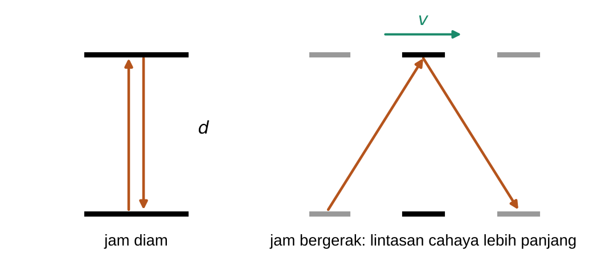
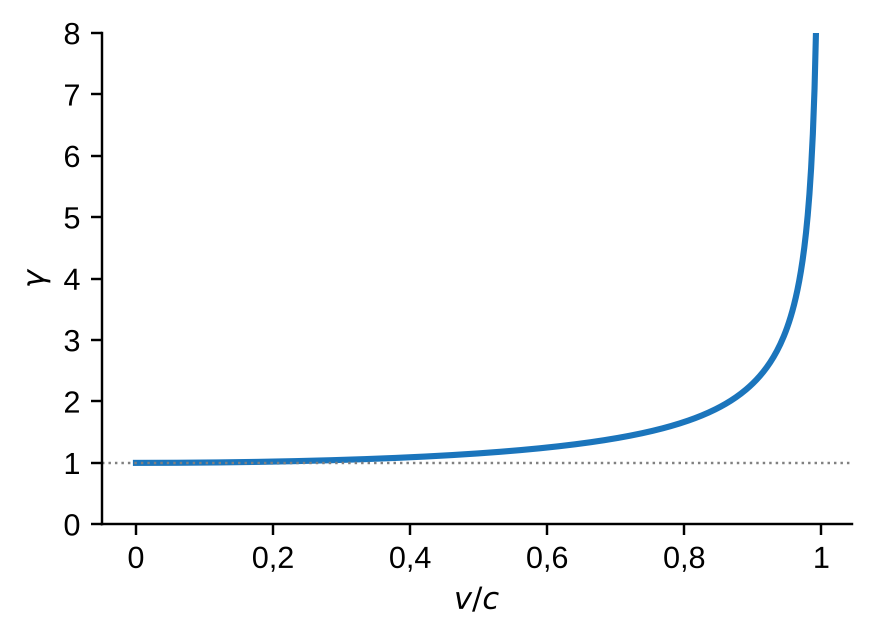
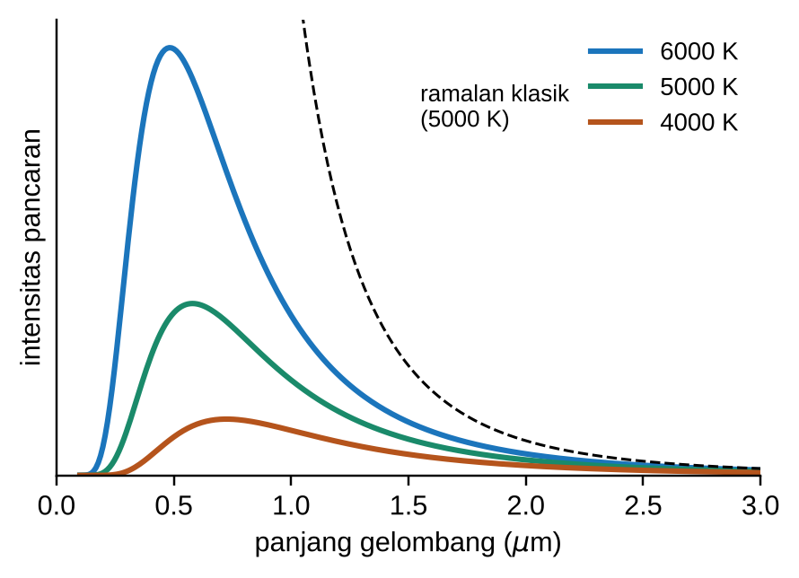

# Bab 15 Fisika Modern

Lampu inframerah 250 W menghangatkan kulit dengan nyaman selama berjam-jam. Lampu ultraviolet yang dayanya seperseratus dari itu membakar kulit dalam beberapa menit, memudarkan warna kain, dan merusak DNA. Menurut fisika yang kita pelajari sampai Bab 14, hal ini tidak masuk akal: gelombang yang membawa energi lebih banyak seharusnya berakibat lebih besar, apa pun warnanya.

Pada awal abad ke-20, teka-teki semacam ini bermunculan. Benda panas tidak memancar seperti ramalan teori. Cahaya merah seterang apa pun tidak dapat melepaskan elektron dari logam, sedangkan cahaya ungu yang redup dapat. Atom memancarkan cahaya hanya pada warna-warna tertentu. Dan menurut teori Maxwell, atom seharusnya tidak dapat ada sama sekali: elektron yang mengorbit akan memancar terus dan jatuh ke inti dalam sepersekian nanodetik.

Jawaban atas semua itu mengubah fisika: energi cahaya datang dalam **paket-paket**, dan besar tiap paket ditentukan warnanya. Yang memutuskan ikatan kimia bukan banyaknya energi yang datang, melainkan energi **tiap paket**. Hitungannya ada di Contoh 15.20.

Bab penutup ini membahas dua revolusi: relativitas, yang mengubah pengertian ruang, waktu, dan massa; dan teori kuantum, yang menjadi dasar seluruh kimia.

::: {.tujuan}
**Tujuan belajar**

Setelah mempelajari bab ini, kamu mampu:

1. Menyatakan dua postulat relativitas khusus dan akibatnya.
2. Menghitung dilatasi waktu dan kontraksi panjang.
3. Memakai hubungan massa–energi, termasuk untuk energi ikat inti.
4. Menjelaskan radiasi benda hitam dan hipotesis kuantum Planck.
5. Menganalisis efek fotolistrik dengan konsep foton.
6. Menghitung energi dan momentum foton, dan menerapkannya pada fotokimia dan sinar-X.
7. Menghitung tingkat energi dan spektrum atom hidrogen dengan model Bohr.
8. Menghitung panjang gelombang de Broglie dan memakai asas ketidakpastian.
9. Menghubungkan bilangan kuantum dengan orbital dan susunan tabel periodik.
:::

::: {.mat}
**Prasyarat**

Dari Bab 4 dan 5: energi kinetik dan momentum. Dari Bab 9: gelombang berdiri dan partikel dalam kotak (9.10). Dari Bab 10: radiasi benda hitam (10.6) dan faktor Boltzmann. Dari Bab 12: energi potensial Coulomb dan elektronvolt (12.6). Dari Bab 14: gelombang elektromagnetik (14.10).

Tetapan yang sering dipakai: $h = 6{,}626 \times 10^{-34}$ J·s $= 4{,}136 \times 10^{-15}$ eV·s; $c = 2{,}998 \times 10^8$ m/s; $hc = 1240$ eV·nm.
:::

## 15.1 Dua awan di langit fisika

Menjelang tahun 1900, fisika tampak hampir selesai. Mekanika Newton menjelaskan gerak dari apel sampai planet; teori Maxwell menyatukan listrik, magnet, dan cahaya; termodinamika dan teori kinetik menjelaskan kalor. Lord Kelvin menyebut hanya ada "dua awan kecil" yang tersisa.

**Awan pertama: laju cahaya.** Persamaan Maxwell meramalkan cahaya merambat dengan laju $c$. Terhadap apa? Gelombang bunyi merambat terhadap udara, jadi cahaya dianggap merambat terhadap zat halus pengisi ruang, **eter**. Bumi yang mengedari Matahari 30 km/s seharusnya mengalami "angin eter", sehingga laju cahaya terukur berbeda menurut arah. Pada tahun 1887 Albert Michelson dan Edward Morley mencarinya dengan interferometer yang sangat peka. Hasilnya nol: laju cahaya sama ke semua arah.

**Awan kedua: radiasi benda panas.** Teori klasik gagal total meramalkan spektrum pancaran benda panas (subbab 15.4).

Awan pertama menjadi teori relativitas. Awan kedua menjadi teori kuantum.

### Postulat Einstein

Pada tahun 1905 Albert Einstein, pegawai kantor paten berusia 26 tahun, menerima hasil Michelson–Morley apa adanya dan menjadikannya titik tolak:

::: {.inti}
**Postulat relativitas khusus.**

1. **Asas relativitas.** Hukum-hukum fisika sama di semua kerangka acuan inersial (yang bergerak lurus beraturan satu terhadap yang lain).
2. **Laju cahaya tetap.** Laju cahaya dalam ruang hampa sama, $c$, bagi semua pengamat, tidak bergantung pada gerak sumber atau gerak pengamat.
:::

Postulat kedua bertentangan dengan akal sehari-hari. Jika kamu mengejar berkas cahaya dengan kelajuan $0{,}9c$, berkas itu tetap menjauh darimu dengan laju $c$, bukan $0{,}1c$. Agar itu mungkin, ada yang harus dikorbankan: anggapan bahwa waktu dan jarak sama bagi semua pengamat.

Akibat pertamanya: **keserempakan itu nisbi**. Dua kejadian yang serempak bagi satu pengamat belum tentu serempak bagi pengamat lain yang bergerak terhadapnya.

::: {.kuis}
**Kuis cepat 15.1**

Pesawat antariksa yang melaju $0{,}5c$ menyalakan lampu depannya. Dengan laju berapa cahaya itu menjauhi pesawat menurut awak pesawat? Menurut pengamat di Bumi?
:::

## 15.2 Dilatasi waktu dan kontraksi panjang

### Jam cahaya

{width=72%}

Bayangkan jam yang terdiri atas dua cermin berjarak $d$; satu "detak" adalah waktu cahaya pergi-pulang (Gambar 15.1). Bagi pengamat yang diam terhadap jam itu, satu detak berlangsung $\Delta t_0 = 2d/c$.

Bagi pengamat yang melihat jam itu melaju dengan kelajuan $v$, cahaya menempuh lintasan miring yang lebih panjang. Tetapi lajunya tetap $c$ (postulat kedua). Jadi detaknya lebih lama. Dengan teorema Pythagoras:

$$
\boxed{\Delta t = \gamma\,\Delta t_0, \qquad \gamma = \frac{1}{\sqrt{1 - v^2/c^2}}} \qquad \text{(15.1)}
$$

Inilah **dilatasi waktu**: jam yang bergerak berjalan lebih lambat. $\Delta t_0$, selang waktu yang diukur oleh jam yang diam terhadap kejadian, disebut **waktu wajar**; ia selalu yang terpendek.

Ini bukan khayalan atau kelemahan jam. **Waktu itu sendiri** berjalan berbeda. Semua proses, termasuk detak jantung, reaksi kimia, dan peluruhan radioaktif, melambat dengan faktor yang sama.

{width=54%}

| $v/c$ | 0,01 | 0,10 | 0,50 | 0,80 | 0,90 | 0,99 | 0,999 |
|---|---|---|---|---|---|---|---|
| $\gamma$ | 1,00005 | 1,005 | 1,155 | 1,667 | 2,294 | 7,09 | 22,4 |

Pada kelajuan sehari-hari $\gamma$ berbeda dari 1 hanya pada angka ke-15; itu sebabnya mekanika Newton bekerja begitu baik. Karena $\gamma$ menuju tak hingga ketika $v \to c$, **tidak ada benda bermassa yang dapat mencapai laju cahaya**.

### Kontraksi panjang

Jika waktu bersifat nisbi, jarak juga. Panjang benda yang diukur pengamat yang melihatnya bergerak lebih pendek, searah geraknya:

$$
\boxed{L = \frac{L_0}{\gamma}} \qquad \text{(15.2)}
$$

$L_0$ adalah **panjang wajar**, panjang benda dalam kerangka diamnya. Ukuran yang tegak lurus arah gerak tidak berubah.

### Penjumlahan kecepatan

Kecepatan tidak lagi dijumlahkan begitu saja. Jika benda bergerak dengan $u'$ terhadap kerangka yang melaju $v$:

$$
u = \frac{u' + v}{1 + u'v/c^2} . \qquad \text{(15.3)}
$$

Hasilnya tidak pernah melampaui $c$.

::: {.contoh}
**Contoh 15.1 · Menghitung γ**

Hitung $\gamma$ untuk (a) pesawat jet 300 m/s; (b) elektron berkelajuan $0{,}60c$; (c) proton berkelajuan $0{,}999c$.

**Penyelesaian.**

(a) $\dfrac{v^2}{c^2} = 1{,}0 \times 10^{-12}$. $\gamma = 1 + 5 \times 10^{-13}$ (dengan hampiran $\gamma \approx 1 + \tfrac12v^2/c^2$).

(b) $\gamma = \dfrac{1}{\sqrt{1 - 0{,}36}} = 1{,}25$.

(c) $\gamma = \dfrac{1}{\sqrt{1 - 0{,}998}} = 22{,}4$.

**Memahami hasil.** Untuk kelajuan kecil, hampiran $\gamma \approx 1 + \dfrac{v^2}{2c^2}$ jauh lebih teliti daripada kalkulator, yang akan membulatkan hasil (a) menjadi tepat 1.
:::

::: {.contoh}
**Contoh 15.2 · Muon dari angkasa**

Muon terbentuk di atmosfer pada ketinggian sekitar 10 km dan melaju ke bawah dengan $0{,}998c$. Umur rata-rata muon yang diam 2,2 μs. (a) Tanpa relativitas, seberapa jauh muon bergerak sebelum meluruh? (b) Berapa jarak itu dengan dilatasi waktu? (c) Bagaimana kejadian ini dilihat dari kerangka muon?

**Penyelesaian.**

(a) $(0{,}998)(2{,}998 \times 10^8)(2{,}2 \times 10^{-6}) = 660$ m.

(b) $\gamma = \dfrac{1}{\sqrt{1 - 0{,}998^2}} = 15{,}8$. Umur muon menurut pengamat di Bumi: $(15{,}8)(2{,}2) = 35$ μs. Jaraknya $660 \times 15{,}8 = 10{,}4$ km.

(c) Dalam kerangka muon, umurnya tetap 2,2 μs, tetapi atmosfer yang melesat ke arahnya **memendek**: $\dfrac{10\ \text{km}}{15{,}8} = 630$ m. Itu dapat ditempuh dalam 2,2 μs.

**Memahami hasil.** Tanpa relativitas, hampir tidak ada muon yang sampai ke permukaan Bumi. Kenyataannya, ratusan muon menembus tubuhmu tiap detik. Kedua pengamat tidak sepakat tentang waktu dan jarak, tetapi sepakat tentang hal yang dapat diperiksa: muon sampai ke tanah. Dilatasi waktu dan kontraksi panjang adalah dua wajah dari satu gejala.
:::

::: {.contoh}
**Contoh 15.3 · Perjalanan ke bintang**

Pesawat antariksa menempuh jarak 8,0 tahun cahaya dengan kelajuan $0{,}80c$. (a) Berapa lama perjalanan itu menurut pengamat di Bumi? (b) Menurut awak pesawat? (c) Berapa jarak yang diukur awak pesawat?

**Penyelesaian.** $\gamma = \dfrac{1}{\sqrt{1 - 0{,}64}} = 1{,}667$.

(a) $\dfrac{8{,}0}{0{,}80} = 10$ tahun.

(b) $\dfrac{10}{1{,}667} = 6{,}0$ tahun.

(c) $\dfrac{8{,}0}{1{,}667} = 4{,}8$ tahun cahaya.

**Memahami hasil.** Awak pesawat menempuh 4,8 tahun cahaya dalam 6,0 tahun, dengan kelajuan $0{,}80c$. Tidak ada yang melampaui cahaya. Awak itu sungguh-sungguh menua empat tahun lebih sedikit daripada orang yang ditinggalkan.
:::

::: {.contoh}
**Contoh 15.4 · Relativitas dalam sakumu**

Satelit GPS mengorbit dengan kelajuan 3,87 km/s. (a) Berapa mikrodetik jamnya tertinggal tiap hari karena dilatasi waktu? (b) Jika tidak dikoreksi, berapa galat jarak yang ditimbulkannya tiap hari?

**Penyelesaian.**

(a) $\gamma - 1 \approx \dfrac{v^2}{2c^2} = \dfrac{(3870)^2}{2(2{,}998 \times 10^8)^2} = 8{,}3 \times 10^{-11}$. Dalam sehari (86 400 s): $(8{,}3 \times 10^{-11})(86\,400) = 7{,}2 \times 10^{-6}$ s $= 7{,}2$ μs.

(b) Sinyal merambat dengan laju cahaya: $(2{,}998 \times 10^8)(7{,}2 \times 10^{-6}) = 2{,}2$ km.

**Memahami hasil.** Ada pengaruh kedua, dari relativitas umum: jam di tempat tinggi, tempat gravitasi lebih lemah, berjalan **lebih cepat** 45,9 μs tiap hari. Selisih bersihnya 38,7 μs tiap hari, setara galat 11,6 km. Jam satelit GPS sengaja disetel untuk mengimbanginya. Setiap kali telepon menunjukkan letakmu, kedua teori Einstein sedang bekerja.
:::

::: {.contoh}
**Contoh 15.5 · Kontraksi dan penjumlahan kecepatan**

(a) Batang sepanjang 1,00 m melaju $0{,}60c$ searah panjangnya. Berapa panjangnya menurut pengamat diam? (b) Dua pesawat saling mendekat, masing-masing $0{,}60c$ terhadap Bumi. Berapa kelajuan satu pesawat menurut pesawat yang lain?

**Penyelesaian.**

(a) $\gamma = 1{,}25$. $L = \dfrac{1{,}00}{1{,}25} = 0{,}80$ m.

(b) $u = \dfrac{0{,}60c + 0{,}60c}{1 + (0{,}60)(0{,}60)} = \dfrac{1{,}20c}{1{,}36} = 0{,}88c$.

**Memahami hasil.** Bukan $1{,}2c$. Dan jika salah satunya adalah berkas cahaya ($u' = c$), rumus (15.3) selalu memberi tepat $c$, sesuai postulat kedua.
:::

::: {.kuis}
**Kuis cepat 15.2**

Kamu berada di dalam pesawat yang melaju $0{,}9c$. Apakah kamu merasa jam tanganmu melambat atau tubuhmu memendek?
:::

## 15.3 Momentum, massa, dan energi

### Momentum dan energi relativistik

Agar kekekalan momentum berlaku di semua kerangka, definisi momentum harus diubah:

$$
\boxed{p = \gamma mv} \qquad \text{(15.4)}
$$

Untuk energi, Einstein memperoleh hasil yang paling terkenal dalam fisika. Energi total benda bermassa $m$:

$$
\boxed{E = \gamma mc^2, \qquad E_0 = mc^2, \qquad K = (\gamma - 1)mc^2} \qquad \text{(15.5)}
$$

$E_0 = mc^2$ adalah **energi diam**: energi yang dimiliki benda hanya karena ia bermassa. $K$ adalah energi kinetik; untuk $v \ll c$ ia kembali menjadi $\tfrac12mv^2$. Energi dan momentum terikat oleh

$$
\boxed{E^2 = (pc)^2 + (mc^2)^2} \qquad \text{(15.6)}
$$

Untuk partikel tak bermassa, seperti foton, $E = pc$.

| Partikel | Massa (u) | Energi diam |
|---|---|---|
| Elektron | 0,000549 | 0,511 MeV |
| Proton | 1,007276 | 938,3 MeV |
| Neutron | 1,008665 | 939,6 MeV |
| 1 u | 1 | 931,5 MeV |

### Massa adalah bentuk energi

::: {.inti}
**Kesetaraan massa dan energi.** Massa adalah energi yang sangat terpadatkan. Setiap perubahan energi diam suatu sistem disertai perubahan massanya:

$$
\Delta E = \Delta m\,c^2 . \qquad \text{(15.7)}
$$
:::

Karena $c^2$ sangat besar, sedikit massa setara dengan energi yang luar biasa besar. Sistem yang terikat selalu **lebih ringan** daripada jumlah bagian-bagiannya; selisihnya, **defek massa**, adalah energi ikat yang dilepas ketika sistem itu terbentuk.

::: {.contoh}
**Contoh 15.6 · Energi diam**

(a) Hitung energi diam elektron dalam MeV. (b) Berapa energi diam 1,0 g zat apa pun?

**Penyelesaian.**

(a) $E_0 = (9{,}109 \times 10^{-31})(2{,}998 \times 10^8)^2 = 8{,}19 \times 10^{-14}$ J $= 0{,}511$ MeV.

(b) $E_0 = (1{,}0 \times 10^{-3})(2{,}998 \times 10^8)^2 = 9{,}0 \times 10^{13}$ J.

**Memahami hasil.** Sembilan puluh terajoule dalam satu gram: 25 juta kW·h, pemakaian listrik sebuah kota kecil selama setahun. Reaksi kimia hanya melepas sepersepuluh miliar bagian darinya; reaksi inti kurang dari satu persen.
:::

::: {.contoh}
**Contoh 15.7 · Elektron dalam mikroskop elektron**

Elektron dipercepat melalui 100 kV. (a) Berapa $\gamma$-nya? (b) Berapa kelajuannya? (c) Berapa hasilnya jika dihitung dengan rumus klasik?

**Penyelesaian.**

(a) $K = 100$ keV. $\gamma = 1 + \dfrac{K}{mc^2} = 1 + \dfrac{100}{511} = 1{,}196$.

(b) $\dfrac vc = \sqrt{1 - \dfrac{1}{\gamma^2}} = \sqrt{1 - 0{,}699} = 0{,}548$.

(c) $v = \sqrt{\dfrac{2K}{m}}$ memberi $\dfrac vc = \sqrt{\dfrac{2(100)}{511}} = 0{,}626$.

**Memahami hasil.** Rumus klasik meleset 14%. Patokan: relativitas tidak boleh diabaikan jika energi kinetik lebih dari beberapa persen energi diam. Untuk elektron itu berarti di atas kira-kira 10 keV; mikroskop elektron dan tabung sinar-X sudah berada di wilayah itu.
:::

::: {.contoh}
**Contoh 15.8 · Elektron 1 MeV**

Elektron berenergi kinetik 1,00 MeV. Hitung energi total, $\gamma$, kelajuan, dan momentumnya (dalam MeV/$c$).

**Penyelesaian.**

$E = K + mc^2 = 1{,}00 + 0{,}511 = 1{,}511$ MeV. $\gamma = \dfrac{1{,}511}{0{,}511} = 2{,}96$.

$\dfrac vc = \sqrt{1 - \dfrac{1}{2{,}96^2}} = 0{,}941$.

$pc = \sqrt{E^2 - (mc^2)^2} = \sqrt{1{,}511^2 - 0{,}511^2} = 1{,}42$ MeV, jadi $p = 1{,}42$ MeV/$c$.

**Memahami hasil.** Melipatduakan energinya lagi hanya menaikkan kelajuan ke $0{,}98c$. Di dekat $c$, energi tambahan hampir seluruhnya menjadi kenaikan $\gamma$, bukan kelajuan.
:::

::: {.contoh}
**Contoh 15.9 · Matahari kehilangan massa**

Matahari memancarkan daya $3{,}83 \times 10^{26}$ W. Berapa massa yang hilang tiap detik?

**Penyelesaian.**

$$
\frac{\Delta m}{\Delta t} = \frac{P}{c^2} = \frac{3{,}83 \times 10^{26}}{(2{,}998 \times 10^8)^2} = 4{,}3 \times 10^9\ \text{kg/s}.
$$

**Memahami hasil.** Empat juta ton tiap detik. Tetapi massa Matahari $2 \times 10^{30}$ kg; selama sepuluh miliar tahun umurnya, ia hanya kehilangan 0,07% massanya.
:::

::: {.contoh}
**Contoh 15.10 · Energi ikat inti helium**

Massa inti ⁴He adalah 4,001506 u. Hitung defek massa dan energi ikatnya, total dan tiap nukleon.

**Penyelesaian.** Massa dua proton dan dua neutron terpisah:

$$
2(1{,}007276) + 2(1{,}008665) = 4{,}031882\ \text{u}.
$$

Defek massa: $4{,}031882 - 4{,}001506 = 0{,}030376$ u. Energi ikat: $(0{,}030376)(931{,}5) = 28{,}3$ MeV, atau 7,07 MeV tiap nukleon.

**Memahami hasil.** Inti helium 0,75% lebih ringan daripada bagian-bagiannya. Energi ikat inti berukuran **juta** elektronvolt tiap partikel, sedangkan energi ikatan kimia beberapa elektronvolt; itu perbandingan antara bom nuklir dan bom kimia.
:::

::: {.contoh}
**Contoh 15.11 · Apakah massa kekal dalam reaksi kimia?**

Pembakaran 2,0 g hidrogen menjadi 18 g air melepas 286 kJ. Berapa massa yang hilang, dan berapa bagian dari massa pereaksi?

**Penyelesaian.**

$$
\Delta m = \frac{\Delta E}{c^2} = \frac{2{,}86 \times 10^5}{(2{,}998 \times 10^8)^2} = 3{,}2 \times 10^{-12}\ \text{kg}.
$$

Bagian dari 18 g: $1{,}8 \times 10^{-10}$.

**Memahami hasil.** Tiga nanogram dari delapan belas gram: seribu kali di bawah kepekaan neraca terbaik. Hukum kekekalan massa Lavoisier tidak **tepat** benar, tetapi kelirunya tidak terukur dalam kimia. Kimiawan boleh terus menyetarakan massa, dengan tahu mengapa itu boleh.
:::

::: {.contoh}
**Contoh 15.12 · Fusi dibandingkan pembakaran**

Fusi deuterium dan tritium, ²H + ³H → ⁴He + n, melepas 17,6 MeV. Massa pereaksinya 5,03 u. (a) Berapa energi tiap kilogram bahan bakar? (b) Bandingkan dengan bensin, 46 MJ/kg.

**Penyelesaian.**

(a) $\dfrac{(17{,}6 \times 10^6)(1{,}602 \times 10^{-19})}{(5{,}03)(1{,}6605 \times 10^{-27})} = 3{,}4 \times 10^{14}$ J/kg.

(b) $\dfrac{3{,}4 \times 10^{14}}{4{,}6 \times 10^7} = 7 \times 10^6$ kali.

**Memahami hasil.** Tujuh juta kali. Itu perbandingan MeV terhadap eV, dan itulah daya tarik energi fusi. Di Matahari, fusi hidrogen menjadi helium mengubah 0,7% massa menjadi energi.
:::

::: {.kuis}
**Kuis cepat 15.3**

Pegas yang dimampatkan menyimpan energi potensial. Apakah massanya berbeda dari pegas yang kendur?
:::

## 15.4 Radiasi benda hitam dan kuantum Planck

### Bencana ultraviolet

Semua benda memancarkan gelombang elektromagnetik karena suhunya (subbab 10.6). Pemancar sempurna, **benda hitam**, memiliki spektrum yang hanya bergantung pada suhu. Dua hukum empirisnya sudah kita kenal:

$$
\lambda_\text{maks}T = 2{,}898 \times 10^{-3}\ \text{m·K} \quad \text{(Wien)}, \qquad P = \sigma AT^4 \quad \text{(Stefan–Boltzmann)}. \qquad \text{(15.8)}
$$

{width=58%}

Fisika klasik tidak dapat menjelaskan bentuk kurva itu. Gelombang berdiri di dalam rongga panas masing-masing mendapat energi rata-rata $k_BT$ menurut ekuipartisi (subbab 10.9), dan makin pendek panjang gelombangnya, makin banyak gelombang berdiri yang muat. Ramalannya: intensitas terus naik pada panjang gelombang pendek, dan energi total yang dipancarkan **tak berhingga** (Gambar 15.3). Kegagalan ini dijuluki **bencana ultraviolet**.

### Hipotesis Planck

Pada bulan Desember 1900, Max Planck menemukan rumus yang cocok sempurna dengan data, dengan satu anggapan yang ia sendiri sebut "tindakan putus asa":

::: {.inti}
**Hipotesis kuantum Planck.** Osilator berfrekuensi $f$ hanya dapat memiliki energi yang merupakan kelipatan bulat dari $hf$:

$$
E = nhf, \qquad n = 0, 1, 2, \dots \qquad \text{(15.9)}
$$

$h = 6{,}626 \times 10^{-34}$ J·s adalah **tetapan Planck**.
:::

Energi tidak dapat diberikan atau diambil sedikit demi sedikit; ia berpindah dalam paket, **kuantum**, sebesar $hf$. Inilah yang menyelamatkan dari bencana: untuk gelombang berfrekuensi tinggi, satu kuantum $hf$ jauh lebih besar daripada $k_BT$, sehingga gerak termal hampir tidak pernah sanggup menyediakannya. Ragam frekuensi tinggi **membeku**, persis seperti getaran molekul yang membeku dalam kapasitas kalor gas (subbab 10.9). Kedua teka-teki itu memiliki satu jawaban.

::: {.contoh}
**Contoh 15.13 · Warna dan suhu**

Tentukan panjang gelombang puncak pancaran (a) lava bersuhu 1200 K; (b) kawat lampu pijar 2800 K; (c) permukaan Matahari 5772 K; (d) radiasi latar kosmik 2,725 K.

**Penyelesaian.** $\lambda_\text{maks} = \dfrac{2{,}898 \times 10^{-3}}{T}$.

| | Suhu | $\lambda_\text{maks}$ | Daerah |
|---|---|---|---|
| (a) | 1200 K | 2,4 μm | inframerah |
| (b) | 2800 K | 1,04 μm | inframerah dekat |
| (c) | 5772 K | 502 nm | tampak (hijau) |
| (d) | 2,725 K | 1,06 mm | gelombang mikro |

**Memahami hasil.** Lava berpijar merah walaupun puncaknya di inframerah: yang kita lihat hanyalah ekor pendek spektrumnya. Lampu pijar membuang sebagian besar energinya sebagai inframerah; itu sebabnya ia boros. Radiasi (d) adalah sisa pijar alam semesta muda, yang kini telah mendingin sampai hampir tiga kelvin.
:::

::: {.contoh}
**Contoh 15.14 · Kuantum melawan energi termal**

Hitung besar satu kuantum $hf$ dan bandingkan dengan $k_BT$ pada 300 K (0,0259 eV) untuk osilator berfrekuensi (a) $1{,}0 \times 10^{12}$ Hz (getaran kisi yang lambat); (b) $5{,}0 \times 10^{13}$ Hz (getaran ikatan molekul); (c) $6{,}0 \times 10^{14}$ Hz (cahaya tampak).

**Penyelesaian.** $hf = (4{,}136 \times 10^{-15}\ \text{eV·s})f$.

(a) 0,0041 eV, yaitu $0{,}16\,k_BT$. (b) 0,21 eV, yaitu $8\,k_BT$. (c) 2,5 eV, yaitu $96\,k_BT$.

**Memahami hasil.** Osilator (a) terisi penuh secara termal dan berperilaku klasik. Osilator (b) hampir beku; faktor Boltzmann-nya $e^{-8} = 3 \times 10^{-4}$. Osilator (c) beku sepenuhnya; itu sebabnya benda pada suhu kamar tidak memancarkan cahaya tampak. Ukuran yang menentukan apakah suatu sistem "kuantum" atau "klasik" selalu perbandingan $hf$ dengan $k_BT$.
:::

::: {.contoh}
**Contoh 15.15 · Mengapa kuantum tidak terasa sehari-hari**

Bandul berfrekuensi 1,0 Hz berayun dengan energi 1,0 J. (a) Berapa besar satu kuantum energinya? (b) Berapa bilangan kuantum $n$-nya?

**Penyelesaian.**

(a) $hf = 6{,}6 \times 10^{-34}$ J.

(b) $n = \dfrac{1{,}0}{6{,}6 \times 10^{-34}} = 1{,}5 \times 10^{33}$.

**Memahami hasil.** Anak tangga energinya $10^{33}$ kali lebih kecil daripada energi bandul; tangga itu tampak sebagai lereng yang mulus. Tetapan Planck begitu kecil sehingga kuantisasi hanya terlihat pada sistem seukuran atom. Fisika klasik adalah batas fisika kuantum untuk bilangan kuantum yang sangat besar.
:::

::: {.kuis}
**Kuis cepat 15.4**

Dua bintang sama besar; yang satu tampak kemerahan, yang lain kebiruan. Mana yang lebih panas, dan mana yang memancarkan daya lebih besar?
:::
