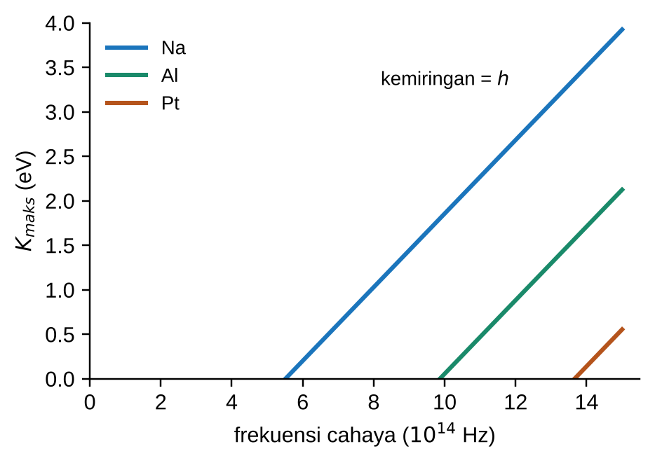
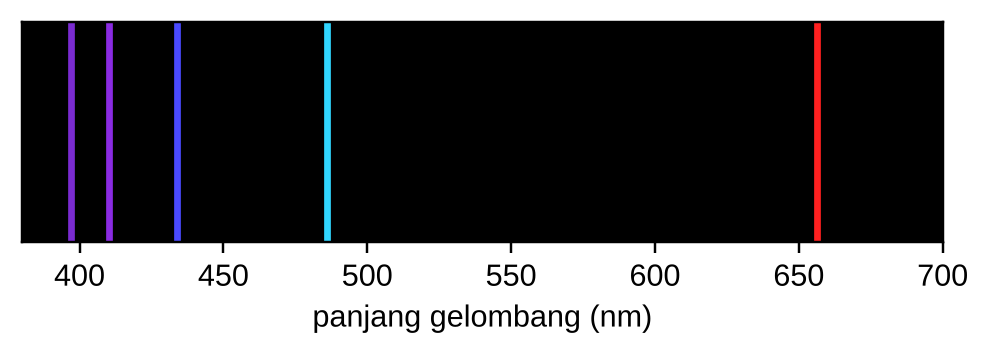
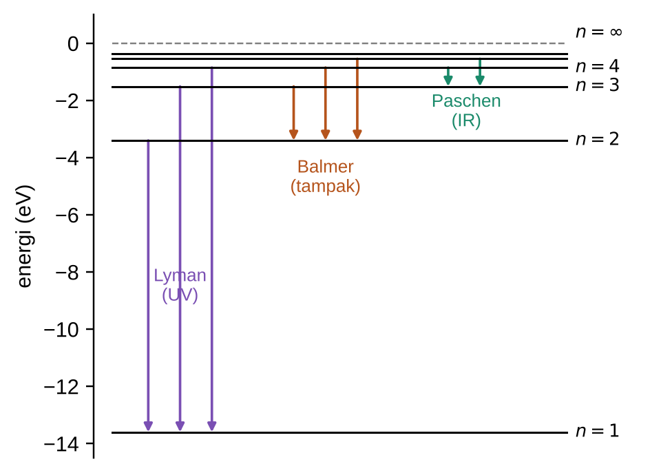
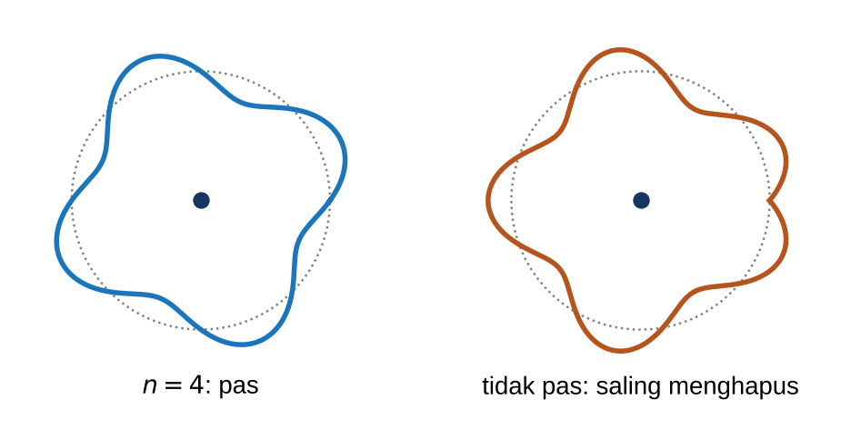
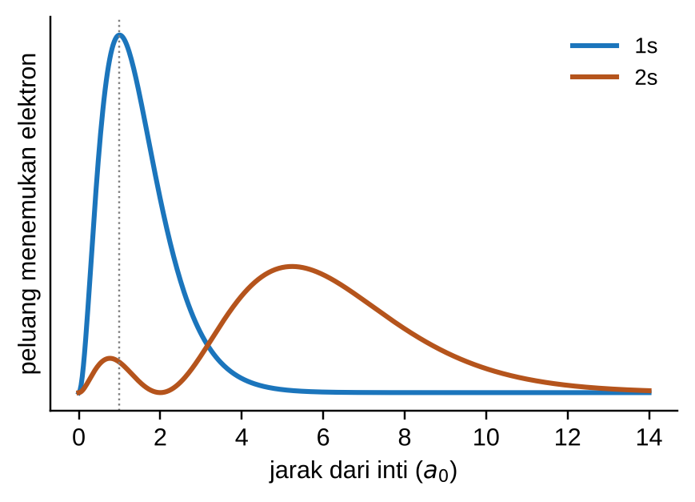
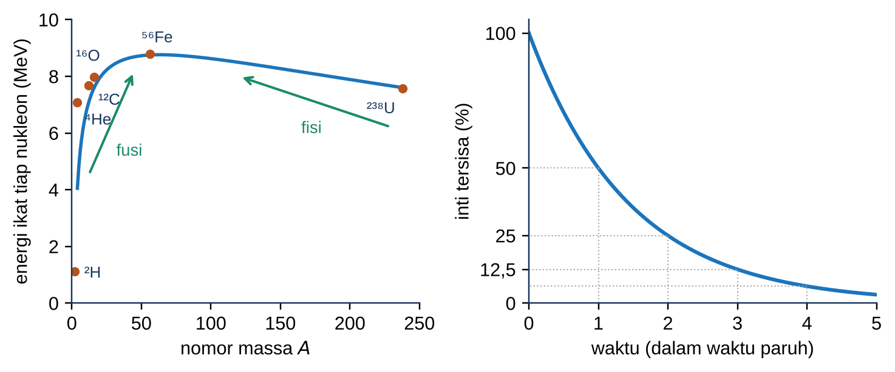

## 15.5 Efek fotolistrik

### Teka-teki

Cahaya yang jatuh pada permukaan logam dapat melepaskan elektron darinya. Gejala ini, **efek fotolistrik**, ditemukan Hertz pada tahun 1887. Pengukuran teliti menunjukkan empat hal, dan tiga di antaranya tidak dapat dijelaskan teori gelombang:

| Pengamatan | Ramalan teori gelombang |
|---|---|
| Ada **frekuensi ambang**: di bawahnya tidak ada elektron yang lepas, seterang apa pun cahayanya | cahaya apa pun, asal cukup terang, seharusnya dapat |
| Energi kinetik elektron bergantung pada **frekuensi**, tidak pada intensitas | seharusnya naik dengan intensitas |
| Elektron lepas **seketika**, bahkan pada cahaya sangat redup | pada cahaya redup seharusnya perlu waktu lama untuk mengumpulkan energi |
| Banyaknya elektron sebanding dengan intensitas | sesuai |

### Penjelasan Einstein

Pada tahun 1905 Einstein mengambil gagasan Planck selangkah lebih jauh. Bukan hanya osilator yang energinya terkuantisasi; **cahaya itu sendiri** terdiri atas paket-paket energi, yang kemudian dinamai **foton**:

$$
\boxed{E = hf = \frac{hc}{\lambda}, \qquad hc = 1240\ \text{eV·nm}} \qquad \text{(15.10)}
$$

Satu foton menyerahkan seluruh energinya kepada **satu** elektron. Untuk lepas dari logam, elektron harus membayar energi paling sedikit sebesar **fungsi kerja** $\phi$, sifat logam itu. Sisanya menjadi energi kinetik:

$$
\boxed{K_\text{maks} = hf - \phi} \qquad \text{(15.11)}
$$

Semua teka-teki terjawab. Jika $hf < \phi$, tidak ada foton yang sanggup melepaskan elektron, berapa pun banyaknya: frekuensi ambangnya $f_0 = \phi/h$. Cahaya lebih terang berarti foton lebih banyak, jadi elektron lebih banyak, tetapi energi tiap elektron tetap. Dan tidak ada waktu tunggu, karena energi datang sekaligus dalam satu paket.

{width=56%}

Energi kinetik itu diukur dengan **potensial henti** $V_0$, tegangan balik yang tepat menghentikan elektron tercepat: $K_\text{maks} = eV_0$. Grafik $K_\text{maks}$ terhadap frekuensi berupa garis lurus dengan kemiringan $h$ untuk **semua** logam (Gambar 15.4). Robert Millikan, yang semula bermaksud membuktikan Einstein keliru, mengukurnya selama sepuluh tahun dan mendapati rumus itu benar.

| Logam | $\phi$ (eV) | Panjang gelombang ambang (nm) |
|---|---|---|
| Sesium | 2,14 | 579 |
| Kalium | 2,30 | 539 |
| Natrium | 2,28 | 544 |
| Seng | 4,33 | 286 |
| Aluminium | 4,08 | 304 |
| Tembaga | 4,65 | 267 |
| Platina | 5,65 | 219 |

Logam alkali, yang elektron valensinya terikat lemah, memiliki fungsi kerja kecil; kecenderungannya sama dengan energi ionisasi.

::: {.contoh}
**Contoh 15.16 · Energi foton**

Hitung energi foton (a) cahaya hijau 500 nm; (b) cahaya merah 700 nm; (c) ultraviolet 250 nm.

**Penyelesaian.** $E = \dfrac{1240\ \text{eV·nm}}{\lambda}$.

(a) 2,48 eV. (b) 1,77 eV. (c) 4,96 eV.

**Memahami hasil.** Foton cahaya tampak berenergi 1,8 sampai 3,1 eV, sekelas dengan energi ikatan kimia. Itu bukan kebetulan: penglihatan dan fotosintesis adalah reaksi kimia yang dipicu foton.
:::

::: {.contoh}
**Contoh 15.17 · Fotolistrik pada natrium**

Cahaya 400 nm jatuh pada natrium ($\phi = 2{,}28$ eV). Tentukan (a) panjang gelombang ambang; (b) energi kinetik maksimum elektron; (c) potensial henti; (d) kelajuan elektron tercepat.

**Penyelesaian.**

(a) $\lambda_0 = \dfrac{1240}{2{,}28} = 544$ nm.

(b) $K_\text{maks} = \dfrac{1240}{400} - 2{,}28 = 3{,}10 - 2{,}28 = 0{,}82$ eV.

(c) $V_0 = 0{,}82$ V.

(d) $v = \sqrt{\dfrac{2K}{m}} = \sqrt{\dfrac{2(0{,}82)(1{,}602 \times 10^{-19})}{9{,}109 \times 10^{-31}}} = 5{,}4 \times 10^5$ m/s.

**Memahami hasil.** Cahaya merah 700 nm (1,77 eV) tidak melepaskan satu elektron pun dari natrium, seterang apa pun; cahaya ungu yang sangat redup melepaskannya seketika.
:::

::: {.contoh}
**Contoh 15.18 · Mengukur tetapan Planck**

Pada suatu logam, potensial henti 0,82 V untuk cahaya 400 nm dan 1,85 V untuk cahaya 300 nm. Tentukan tetapan Planck dan fungsi kerja logam itu dari data ini.

**Penyelesaian.** Frekuensinya: $f_1 = \dfrac{c}{400\ \text{nm}} = 7{,}495 \times 10^{14}$ Hz dan $f_2 = 9{,}993 \times 10^{14}$ Hz. Dari $eV_0 = hf - \phi$, kemiringan garisnya:

$$
h = \frac{e(V_2 - V_1)}{f_2 - f_1} = \frac{(1{,}85 - 0{,}82)\ \text{eV}}{2{,}498 \times 10^{14}\ \text{Hz}} = 4{,}12 \times 10^{-15}\ \text{eV·s} = 6{,}6 \times 10^{-34}\ \text{J·s}.
$$

$\phi = hf_1 - eV_1 = (4{,}12 \times 10^{-15})(7{,}495 \times 10^{14}) - 0{,}82 = 2{,}27$ eV.

**Memahami hasil.** Logam itu natrium. Dua pengukuran tegangan dengan dua warna cahaya memberi salah satu tetapan dasar alam. Cara ini masih menjadi percobaan baku di laboratorium fisika.
:::

::: {.contoh}
**Contoh 15.19 · Menghitung foton**

(a) Laser merah 633 nm berdaya 5,0 mW. Berapa foton yang dipancarkannya tiap detik? (b) Mata manusia dapat mendeteksi kilatan yang hanya berisi sekitar 100 foton 550 nm. Berapa energinya?

**Penyelesaian.**

(a) Energi satu foton: $\dfrac{1240}{633} = 1{,}96$ eV $= 3{,}14 \times 10^{-19}$ J. Banyaknya tiap detik: $\dfrac{5{,}0 \times 10^{-3}}{3{,}14 \times 10^{-19}} = 1{,}6 \times 10^{16}$.

(b) $100 \times \dfrac{1240}{550}$ eV $= 225$ eV $= 3{,}6 \times 10^{-17}$ J.

**Memahami hasil.** Pada (a), foton begitu banyak sehingga cahaya tampak sebagai aliran yang malar; sifat butirannya tersembunyi. Pada (b), mata bekerja hampir pada batas yang diizinkan alam: sel batang retina menanggapi **satu** foton.
:::

::: {.kuis}
**Kuis cepat 15.5**

Cahaya dijatuhkan pada logam dan elektron terlepas. Jika intensitas cahaya dilipatduakan tanpa mengubah warnanya, apa yang terjadi pada (a) banyaknya elektron tiap detik; (b) energi kinetik maksimumnya?
:::

## 15.6 Foton dan materi

### Momentum foton

Foton tidak bermassa, tetapi membawa momentum. Dari $E = pc$ (subbab 15.3):

$$
\boxed{p = \frac Ec = \frac h\lambda} \qquad \text{(15.12)}
$$

Pada tahun 1923 Arthur Compton menembakkan sinar-X pada elektron dan mendapati sinar yang terhambur memiliki panjang gelombang **lebih besar**, persis seperti tumbukan dua bola biliar (Bab 5): foton menyerahkan sebagian energi dan momentumnya kepada elektron. Pergeserannya bergantung pada sudut hambur $\theta$:

$$
\Delta\lambda = \frac{h}{m_ec}(1 - \cos\theta), \qquad \frac{h}{m_ec} = 2{,}43\ \text{pm}. \qquad \text{(15.13)}
$$

**Efek Compton** meyakinkan para fisikawan bahwa foton adalah partikel yang sungguh-sungguh.

### Sinar-X

Dalam tabung sinar-X, elektron dipercepat melalui tegangan $V$ dan dihentikan mendadak oleh sasaran logam. Ini kebalikan efek fotolistrik: energi kinetik elektron menjadi foton. Foton paling berenergi mengambil seluruh energi elektron, sehingga spektrumnya memiliki panjang gelombang terpendek:

$$
\lambda_\text{min} = \frac{hc}{eV} . \qquad \text{(15.14)}
$$

Panjang gelombang sinar-X sekelas dengan jarak antaratom dalam kristal, sehingga kristal bertindak sebagai kisi difraksi baginya. Pantulan dari bidang-bidang atom berjarak $d$ saling memperkuat jika memenuhi **hukum Bragg**:

$$
\boxed{2d\sin\theta = n\lambda} \qquad \text{(15.15)}
$$

Dari sudut-sudut pantulan itu, susunan atom dalam kristal dapat ditentukan. Hampir semua yang kita ketahui tentang struktur zat padat, dari garam dapur sampai protein dan DNA, berasal dari **difraksi sinar-X**.

### Fotokimia

Bagi kimia, akibat terpenting gagasan foton adalah ini:

::: {.inti}
**Hukum fotokimia Stark–Einstein.** Tiap molekul yang bereaksi karena cahaya menyerap **satu** foton. Reaksi hanya terjadi jika energi satu foton itu mencukupi.
:::

Satu mol foton disebut satu **einstein**. Energinya:

$$
\boxed{E_\text{mol} = N_Ahf = \frac{1{,}196 \times 10^5\ \text{kJ·nm/mol}}{\lambda}} \qquad \text{(15.16)}
$$

| Cahaya | $\lambda$ (nm) | Energi foton (eV) | Energi tiap mol (kJ/mol) |
|---|---|---|---|
| Inframerah | 1000 | 1,24 | 120 |
| Merah | 700 | 1,77 | 171 |
| Hijau | 550 | 2,25 | 217 |
| Ungu | 400 | 3,10 | 299 |
| UV-A | 350 | 3,54 | 342 |
| UV-B | 300 | 4,13 | 399 |
| UV-C | 254 | 4,88 | 471 |

Bandingkan dengan energi ikatan: C–C 347, C–H 413, O–H 463, Cl–Cl 243, O=O 498 kJ/mol.

::: {.contoh}
**Contoh 15.20 · Mengapa ultraviolet merusak dan inframerah tidak**

Lampu inframerah memancarkan 250 W pada panjang gelombang sekitar 1000 nm; lampu ultraviolet memancarkan 2,5 W pada 300 nm. (a) Berapa energi tiap foton masing-masing? (b) Berapa foton tiap detik dari masing-masing? (c) Mana yang dapat memutus ikatan C–C (347 kJ/mol, yaitu 3,60 eV)?

**Penyelesaian.**

(a) Inframerah: $\dfrac{1240}{1000} = 1{,}24$ eV. Ultraviolet: $\dfrac{1240}{300} = 4{,}13$ eV.

(b) Inframerah: $\dfrac{250}{(1{,}24)(1{,}602 \times 10^{-19})} = 1{,}3 \times 10^{21}$ foton/s. Ultraviolet: $\dfrac{2{,}5}{(4{,}13)(1{,}602 \times 10^{-19})} = 3{,}8 \times 10^{18}$ foton/s.

(c) Hanya foton ultraviolet: $4{,}13 > 3{,}60$ eV. Foton inframerah, 1,24 eV, tidak cukup.

**Memahami hasil.** Lampu inframerah mengirim foton tiga ratus kali lebih banyak dan energi seratus kali lebih besar, tetapi **tidak satu pun** fotonnya sanggup memutus ikatan. Molekul menyerap foton satu per satu; tiga foton inframerah tidak dapat "patungan". Energi inframerah hanya menggetarkan molekul, yaitu memanaskan. Tiap foton ultraviolet membawa cukup energi untuk memutus ikatan dalam DNA, zat warna, atau plastik.

Inilah jawaban pertanyaan pembuka bab, dan sekaligus penjelasan efek fotolistrik dalam bahasa kimia. Lapisan ozon menyerap foton di bawah 300 nm; tabir surya menyerap sisanya.
:::

::: {.contoh}
**Contoh 15.21 · Memutus molekul klorin dengan cahaya**

Energi ikatan Cl–Cl adalah 243 kJ/mol. (a) Berapa panjang gelombang terpanjang yang dapat memutusnya? (b) Dapatkah cahaya tampak melakukannya?

**Penyelesaian.**

(a) $\lambda = \dfrac{1{,}196 \times 10^5}{243} = 492$ nm.

(b) Ya: cahaya biru dan ungu (di bawah 492 nm) cukup berenergi.

**Memahami hasil.** Itu sebabnya campuran H₂ dan Cl₂ mantap dalam gelap tetapi meledak ketika terkena cahaya terang: foton memecah Cl₂ menjadi dua atom Cl, dan tiap atom memulai reaksi berantai. Gas klorin berwarna kuning-hijau justru karena ia menyerap cahaya biru-ungu.
:::

::: {.contoh}
**Contoh 15.22 · Hasil kuantum**

Lampu raksa 10 W memancarkan cahaya 254 nm; 30% di antaranya diserap larutan. (a) Berapa mol foton yang diserap tiap jam? (b) Jika hasil kuantum reaksinya 0,50 (setengah molekul yang menyerap foton bereaksi), berapa mol yang bereaksi tiap jam?

**Penyelesaian.**

(a) Energi tiap mol foton: $\dfrac{1{,}196 \times 10^5}{254} = 471$ kJ/mol. Energi terserap tiap jam: $(0{,}30)(10)(3600) = 1{,}08 \times 10^4$ J $= 10{,}8$ kJ. Foton terserap: $\dfrac{10{,}8}{471} = 0{,}023$ mol.

(b) $(0{,}50)(0{,}023) = 0{,}011$ mol.

**Memahami hasil.** Foton adalah pereaksi, dan dihitung dalam mol seperti pereaksi lain. Hasil kuantum di atas satu menandakan reaksi berantai; untuk H₂ + Cl₂ nilainya dapat mencapai sejuta.
:::

::: {.contoh}
**Contoh 15.23 · Efisiensi fotosintesis**

Fotosintesis memerlukan sekitar delapan foton merah (680 nm) untuk mengikat satu molekul CO₂. Energi yang tersimpan 479 kJ tiap mol CO₂. Berapa efisiensinya?

**Penyelesaian.** Energi delapan mol foton: $8 \times \dfrac{1{,}196 \times 10^5}{680} = 8 \times 176 = 1407$ kJ.

$$
\text{Efisiensi} = \frac{479}{1407} = 34\% .
$$

**Memahami hasil.** Itu batas atasnya. Efisiensi keseluruhan tanaman terhadap cahaya Matahari hanya sekitar 1%, karena sebagian besar spektrum tidak terserap dan banyak energi terpakai untuk hidup tanaman itu sendiri.
:::

::: {.contoh}
**Contoh 15.24 · Tabung sinar-X dan difraksi kristal**

(a) Tabung sinar-X bekerja pada 30 kV. Berapa panjang gelombang terpendek yang dihasilkannya? (b) Sinar-X tembaga, 0,154 nm, dijatuhkan pada kristal NaCl yang bidang-bidang atomnya berjarak 0,282 nm. Pada sudut berapa pantulan orde pertama terjadi?

**Penyelesaian.**

(a) $\lambda_\text{min} = \dfrac{1240\ \text{eV·nm}}{30\,000\ \text{eV}} = 0{,}041$ nm.

(b) $\sin\theta = \dfrac{\lambda}{2d} = \dfrac{0{,}154}{2(0{,}282)} = 0{,}273$, jadi $\theta = 15{,}8°$.

**Memahami hasil.** Dalam praktik, hitungannya dibalik: sudut diukur, dan jarak antarbidang $d$ dihitung. Nilai $r_0 = 0{,}282$ nm untuk NaCl, yang kita pakai di Bab 12, diperoleh dengan cara ini.
:::

::: {.contoh}
**Contoh 15.25 · Hamburan Compton**

Sinar-X berpanjang gelombang 71,0 pm dihamburkan elektron pada sudut 90°. (a) Berapa panjang gelombang sinar terhambur? (b) Berapa energi yang diterima elektron?

**Penyelesaian.**

(a) $\Delta\lambda = 2{,}43(1 - \cos 90°) = 2{,}43$ pm. $\lambda' = 73{,}4$ pm.

(b) Energi foton sebelum: $\dfrac{1240}{0{,}0710} = 17{,}46$ keV. Sesudah: $\dfrac{1240}{0{,}0734} = 16{,}89$ keV. Elektron menerima 0,57 keV.

**Memahami hasil.** Pergeseran 2,43 pm tidak bergantung pada panjang gelombang datang. Untuk cahaya tampak (500 000 pm) pergeseran itu tidak terlihat; untuk sinar-X ia jelas. Sifat partikel cahaya makin menonjol pada energi foton yang makin tinggi.
:::

::: {.kuis}
**Kuis cepat 15.6**

Cahaya merah yang sangat terang dan cahaya biru yang redup membawa daya yang sama. Mana yang memuat foton lebih banyak tiap detik?
:::

## 15.7 Spektrum atom dan model Bohr

### Garis-garis spektrum

Gas yang dipijarkan dalam tabung lucutan tidak memancarkan spektrum malar seperti benda hitam, melainkan **garis-garis** tajam pada panjang gelombang tertentu, berbeda untuk tiap unsur. Spektrum garis adalah sidik jari unsur; dengan itu Bunsen dan Kirchhoff menemukan sesium dan rubidium, dan helium ditemukan di Matahari sebelum ditemukan di Bumi.

{width=66%}

Untuk hidrogen, Johann Balmer (seorang guru sekolah) menemukan pada tahun 1885 rumus sederhana untuk keempat garis tampaknya, yang kemudian diperluas Johannes Rydberg:

$$
\boxed{\frac1\lambda = R_H\left(\frac{1}{n_1^2} - \frac{1}{n_2^2}\right), \qquad R_H = 1{,}097 \times 10^7\ \text{m}^{-1}} \qquad \text{(15.17)}
$$

dengan $n_1$ dan $n_2 > n_1$ bilangan bulat. Rumus itu cocok sampai enam angka, tetapi selama hampir tiga puluh tahun tidak seorang pun tahu mengapa.

### Model Bohr

Percobaan Rutherford (subbab 12.6) menunjukkan bahwa atom terdiri atas inti kecil yang dikelilingi elektron. Tetapi menurut teori Maxwell, elektron yang mengorbit dipercepat terus dan harus memancar, kehilangan energi, dan jatuh berpilin ke inti dalam $10^{-11}$ s. Atom seharusnya tidak mantap.

Pada tahun 1913 Niels Bohr memotong simpul itu dengan tiga postulat:

1. Elektron hanya dapat berada pada **orbit-orbit tertentu** ("keadaan mantap"), dan pada orbit itu ia tidak memancar.
2. Orbit yang diizinkan adalah yang momentum sudutnya kelipatan bulat $\hbar = h/2\pi$: $\ m_evr = n\hbar$.
3. Atom memancarkan atau menyerap foton hanya ketika elektron **berpindah** dari satu orbit ke orbit lain: $\ hf = E_\text{awal} - E_\text{akhir}$.

Gabungkan postulat 2 dengan gaya Coulomb sebagai gaya sentripetal, dan diperoleh jari-jari dan energi orbit ke-$n$ untuk atom atau ion berelektron satu dengan muatan inti $Z$:

$$
\boxed{r_n = \frac{n^2a_0}{Z}, \qquad a_0 = 0{,}0529\ \text{nm}} \qquad \text{(15.18)}
$$

$$
\boxed{E_n = -\frac{13{,}6\ \text{eV}\;Z^2}{n^2}} \qquad \text{(15.19)}
$$

$a_0$ disebut **jari-jari Bohr**; $n$ adalah **bilangan kuantum utama**. Energi negatif berarti elektron terikat; $n = 1$ adalah **keadaan dasar**, dan $n = \infty$ ($E = 0$) adalah elektron yang lepas.

{width=62%}

Foton yang dipancarkan pada peralihan dari $n_2$ ke $n_1$ berenergi

$$
hf = 13{,}6\ \text{eV}\left(\frac{1}{n_1^2} - \frac{1}{n_2^2}\right),
$$

persis rumus Rydberg, dengan $R_H = \dfrac{13{,}6\ \text{eV}}{hc}$. Tetapan yang selama tiga puluh tahun hanya angka hasil ukur, kini **dihitung** dari $m_e$, $e$, $h$, dan $c$.

| Deret | $n_1$ | Daerah |
|---|---|---|
| Lyman | 1 | ultraviolet |
| Balmer | 2 | tampak |
| Paschen | 3 | inframerah |

::: {.contoh}
**Contoh 15.26 · Deret Balmer**

Hitung panjang gelombang empat garis pertama deret Balmer dan batas deretnya.

**Penyelesaian.** $\dfrac1\lambda = R_H\left(\dfrac14 - \dfrac1{n^2}\right)$.

| $n$ | 3 | 4 | 5 | 6 | $\infty$ |
|---|---|---|---|---|---|
| $\lambda$ (nm) | 656,3 | 486,1 | 434,0 | 410,2 | 364,6 |
| Warna | merah | biru-hijau | biru | ungu | ultraviolet |

**Memahami hasil.** Itulah garis-garis pada Gambar 15.5. Garis merah 656 nm (H-alfa) memberi warna merah muda pada lucutan hidrogen dan pada awan gas di antara bintang-bintang.
:::

::: {.contoh}
**Contoh 15.27 · Tingkat energi dan energi ionisasi**

(a) Hitung energi empat tingkat pertama atom hidrogen. (b) Berapa energi ionisasinya dari keadaan dasar, dalam eV dan kJ/mol? (c) Berapa energi ionisasi dari tingkat $n = 2$?

**Penyelesaian.**

(a) $E_n = -\dfrac{13{,}6}{n^2}$: $-13{,}6$; $-3{,}40$; $-1{,}51$; $-0{,}85$ eV.

(b) 13,6 eV, yaitu $(13{,}6)(96{,}49) = 1312$ kJ/mol.

(c) 3,40 eV.

**Memahami hasil.** Nilai 1312 kJ/mol adalah energi ionisasi hidrogen pada tabel kimia. Jarak antartingkat makin rapat ke atas: dari $n = 1$ ke $n = 2$ diperlukan 10,2 eV, tiga perempat jalan menuju ionisasi.
:::

::: {.contoh}
**Contoh 15.28 · Garis Lyman-alfa dan serapan**

(a) Berapa panjang gelombang foton yang dipancarkan pada peralihan $n = 2 \to 1$? (b) Atom hidrogen dalam keadaan dasar disinari foton 12,09 eV dan foton 11,0 eV. Mana yang diserap?

**Penyelesaian.**

(a) $\Delta E = 13{,}6 - 3{,}40 = 10{,}2$ eV. $\lambda = \dfrac{1240}{10{,}2} = 121{,}6$ nm (ultraviolet jauh).

(b) Selisih tingkat dari $n = 1$: 10,2 eV (ke $n = 2$) dan 12,09 eV (ke $n = 3$). Foton 12,09 eV diserap; foton 11,0 eV tidak cocok dengan selisih mana pun dan lewat begitu saja.

**Memahami hasil.** Atom hanya menyerap foton yang energinya **tepat** sama dengan selisih dua tingkat. Itu sebabnya gas hidrogen tembus pandang bagi cahaya tampak, dan itulah dasar seluruh spektroskopi serapan.
:::

::: {.contoh}
**Contoh 15.29 · Ukuran dan kelajuan dalam atom Bohr**

(a) Berapa jari-jari orbit $n = 1$, 2, dan 100 atom hidrogen? (b) Berapa kelajuan elektron pada orbit pertama, dan berapa perbandingannya dengan $c$?

**Penyelesaian.**

(a) $r_n = n^2a_0$: 0,0529 nm; 0,212 nm; 529 nm.

(b) Dari $m_evr = \hbar$: $v = \dfrac{\hbar}{m_ea_0} = \dfrac{1{,}055 \times 10^{-34}}{(9{,}109 \times 10^{-31})(5{,}29 \times 10^{-11})} = 2{,}19 \times 10^6$ m/s, yaitu $\dfrac{c}{137}$.

**Memahami hasil.** Atom hidrogen pada $n = 100$ ("atom Rydberg") sebesar bakteri dan memang dapat dibuat di laboratorium. Kelajuan elektron kurang dari 1% $c$, sehingga relativitas hanya koreksi kecil pada hidrogen. Pada atom berat seperti emas ($Z = 79$), elektron terdalam bergerak lebih dari separuh laju cahaya, dan pengaruh relativitas menjadi besar; itulah yang membuat emas berwarna kuning dan raksa berwujud cair.
:::

::: {.contoh}
**Contoh 15.30 · Ion mirip hidrogen**

(a) Berapa energi ionisasi He⁺ dan Li²⁺? (b) Berapa panjang gelombang peralihan $n = 4 \to 3$ pada He⁺?

**Penyelesaian.**

(a) $E_1 = -13{,}6Z^2$: He⁺ ($Z = 2$) 54,4 eV; Li²⁺ ($Z = 3$) 122,4 eV.

(b) $\Delta E = (13{,}6)(4)\left(\dfrac19 - \dfrac1{16}\right) = 2{,}644$ eV. $\lambda = \dfrac{1240}{2{,}644} = 469$ nm.

**Memahami hasil.** Nilai 54,4 eV adalah energi ionisasi **kedua** helium yang terukur, tepat. Energi ionisasi **pertama** helium (24,6 eV) tidak dapat dihitung model Bohr, karena ada dua elektron yang saling menolak. Di situlah batas model ini.
:::

::: {.contoh}
**Contoh 15.31 · Muatan inti efektif**

Energi ionisasi pertama natrium 5,14 eV; elektron valensinya berada pada $n = 3$. Jika elektron itu diperlakukan seperti elektron tunggal yang mengelilingi muatan inti efektif $Z_\text{ef}$, berapa $Z_\text{ef}$?

**Penyelesaian.** Dari $5{,}14 = \dfrac{13{,}6\,Z_\text{ef}^2}{3^2}$:

$$
Z_\text{ef} = 3\sqrt{\frac{5{,}14}{13{,}6}} = 1{,}84 .
$$

**Memahami hasil.** Inti natrium bermuatan +11, tetapi sepuluh elektron dalam memerisainya (subbab 12.5). Jika perisai itu sempurna, $Z_\text{ef} = 1$; nilai 1,84 menunjukkan bahwa elektron 3s sesekali menembus ke dalam awan elektron dalam dan merasakan tarikan inti yang lebih kuat. Gagasan "penembusan" inilah yang menjelaskan mengapa orbital s lebih rendah energinya daripada p pada kulit yang sama.
:::

::: {.contoh}
**Contoh 15.32 · Garis sinar-X dan nomor atom**

Sinar-X khas $K_\alpha$ dipancarkan ketika elektron jatuh dari $n = 2$ ke lubang di $n = 1$; elektron itu merasakan muatan inti efektif kira-kira $Z - 1$. Taksir energi dan panjang gelombang garis $K_\alpha$ tembaga ($Z = 29$).

**Penyelesaian.**

$$
E = 13{,}6(Z - 1)^2\left(1 - \frac14\right) = (10{,}2\ \text{eV})(28)^2 = 8{,}0\ \text{keV}, \qquad \lambda = \frac{1240}{8000} = 0{,}155\ \text{nm}.
$$

**Memahami hasil.** Nilai terukur 0,154 nm. Pada tahun 1913 Henry Moseley mengukur garis ini untuk puluhan unsur dan mendapati frekuensinya sebanding dengan $(Z - 1)^2$. Untuk pertama kalinya **nomor atom** dapat diukur langsung; tabel periodik lalu disusun ulang menurut $Z$, bukan massa atom, dan tempat-tempat kosong untuk unsur yang belum ditemukan menjadi jelas. Analisis unsur dengan fluoresens sinar-X memakai asas yang sama.
:::

::: {.contoh}
**Contoh 15.33 · Mengapa hidrogen dingin tidak berpijar**

Berapa perbandingan banyaknya atom hidrogen pada tingkat $n = 2$ terhadap $n = 1$ pada (a) 300 K; (b) 6000 K? Tingkat $n = 2$ memuat empat kali lebih banyak keadaan daripada $n = 1$.

**Penyelesaian.** $\dfrac{N_2}{N_1} = 4e^{-\Delta E/k_BT}$, dengan $\Delta E = 10{,}2$ eV dan $k_B = 8{,}617 \times 10^{-5}$ eV/K.

(a) $\dfrac{\Delta E}{k_BT} = 395$: perbandingannya $4e^{-395} \approx 10^{-171}$.

(b) $\dfrac{\Delta E}{k_BT} = 19{,}7$: perbandingannya $4e^{-19{,}7} = 1 \times 10^{-8}$.

**Memahami hasil.** Pada suhu kamar tidak ada satu atom pun di seluruh alam semesta yang tereksitasi secara termal. Bahkan di permukaan Matahari hanya satu dari seratus juta. Garis Balmer, yang berawal dari $n = 2$, karena itu hanya tampak kuat pada bintang yang cukup panas; dari kekuatan garis-garis seperti ini astronom mengukur suhu bintang.
:::

### Keberhasilan dan kegagalan model Bohr

Model Bohr berhasil untuk spektrum hidrogen dan ion berelektron satu, dan memperkenalkan tiga gagasan yang bertahan: tingkat energi yang terkuantisasi, bilangan kuantum, dan foton sebagai selisih tingkat. Tetapi ia gagal untuk atom berelektron banyak, tidak menjelaskan kekuatan garis atau ikatan kimia, dan postulatnya tidak memiliki dasar. Gambaran "elektron mengorbit seperti planet" ternyata keliru. Jawaban yang lebih dalam datang sepuluh tahun kemudian.

::: {.kuis}
**Kuis cepat 15.7**

Sekumpulan atom hidrogen dieksitasi ke tingkat $n = 4$. Berapa banyak garis spektrum berbeda yang dapat dipancarkannya?
:::

## 15.8 Gelombang materi dan ketidakpastian

### Hipotesis de Broglie

Jika cahaya, yang selama itu dianggap gelombang, ternyata juga bersifat partikel, mungkinkah elektron, yang selama itu dianggap partikel, juga bersifat gelombang? Pada tahun 1924 Louis de Broglie mengusulkannya dalam disertasinya: setiap partikel bermomentum $p$ memiliki panjang gelombang

$$
\boxed{\lambda = \frac hp = \frac{h}{mv}} \qquad \text{(15.20)}
$$

Rumus yang sama dengan (15.12) untuk foton. Untuk elektron yang dipercepat melalui tegangan $V$ (tak relativistik):

$$
\lambda = \frac{h}{\sqrt{2m_eeV}} = \frac{1{,}226\ \text{nm}}{\sqrt{V}} . \qquad \text{(15.21)}
$$

{width=62%}

Gagasan ini langsung menjelaskan postulat Bohr yang misterius. Gelombang elektron yang mengelilingi inti harus bersambung dengan dirinya sendiri, seperti gelombang berdiri pada senar (subbab 9.8): keliling orbit harus memuat bilangan bulat panjang gelombang (Gambar 15.7),

$$
2\pi r = n\lambda = \frac{nh}{m_ev} \quad\Longrightarrow\quad m_evr = n\hbar .
$$

Itu tepat syarat kuantisasi Bohr. **Kuantisasi energi adalah akibat gelombang yang terkurung**, sama seperti senar gitar hanya menghasilkan nada-nada tertentu, dan sama seperti partikel dalam kotak (subbab 9.10).

Pada tahun 1927 Davisson dan Germer menembakkan elektron pada kristal nikel dan memperoleh pola difraksi, persis seperti sinar-X. Elektron memang gelombang. **Dualisme gelombang–partikel** berlaku untuk cahaya dan materi sekaligus.

::: {.contoh}
**Contoh 15.34 · Panjang gelombang elektron dan bola**

Hitung panjang gelombang de Broglie (a) elektron yang dipercepat melalui 100 V; (b) bola 0,15 kg berkelajuan 40 m/s.

**Penyelesaian.**

(a) $\lambda = \dfrac{1{,}226}{\sqrt{100}} = 0{,}123$ nm.

(b) $\lambda = \dfrac{6{,}626 \times 10^{-34}}{(0{,}15)(40)} = 1{,}1 \times 10^{-34}$ m.

**Memahami hasil.** Panjang gelombang elektron itu sekelas jarak antaratom, sehingga kristal mendifraksikannya. Panjang gelombang bola $10^{19}$ kali lebih kecil daripada inti atom; tidak ada celah yang cukup sempit untuk menunjukkan sifat gelombangnya. Benda sehari-hari berperilaku sebagai partikel murni karena $h$ sangat kecil.
:::

::: {.contoh}
**Contoh 15.35 · Mikroskop elektron**

Mikroskop elektron memakai elektron 100 keV. (a) Berapa panjang gelombangnya (pakai rumus relativistik)? (b) Mengapa mikroskop ini dapat melihat jauh lebih rinci daripada mikroskop cahaya?

**Penyelesaian.**

(a) $pc = \sqrt{K^2 + 2Kmc^2} = \sqrt{(100)^2 + 2(100)(511)} = 335$ keV.

$$
\lambda = \frac{hc}{pc} = \frac{1240\ \text{eV·nm}}{335\,000\ \text{eV}} = 3{,}7 \times 10^{-3}\ \text{nm} = 3{,}7\ \text{pm}.
$$

(b) Rincian terkecil yang dapat dibedakan suatu mikroskop kira-kira sebesar panjang gelombang yang dipakainya. Cahaya tampak: 500 nm. Elektron ini: seratus ribu kali lebih pendek.

**Memahami hasil.** Rumus tak relativistik (15.21) memberi 3,9 pm; koreksinya 5%. Mikroskop elektron modern memisahkan atom-atom tunggal; batasnya ditentukan mutu lensa magnetnya, bukan panjang gelombangnya.
:::

::: {.contoh}
**Contoh 15.36 · Neutron termal**

Neutron dari reaktor diperlambat sampai setimbang termal pada 300 K. Berapa panjang gelombang de Broglie-nya pada kelajuan rms?

**Penyelesaian.** $\tfrac12mv^2 = \tfrac32k_BT$ memberi $p = \sqrt{3mk_BT}$:

$$
\lambda = \frac{h}{\sqrt{3mk_BT}} = \frac{6{,}626 \times 10^{-34}}{\sqrt{3(1{,}675 \times 10^{-27})(1{,}381 \times 10^{-23})(300)}} = 1{,}45 \times 10^{-10}\ \text{m} = 0{,}145\ \text{nm}.
$$

**Memahami hasil.** Kebetulan yang menguntungkan: neutron bersuhu kamar memiliki panjang gelombang sebesar jarak antaratom. Difraksi neutron melengkapi difraksi sinar-X: neutron dihamburkan inti, bukan elektron, sehingga dapat "melihat" atom hidrogen yang hampir tak tampak bagi sinar-X.
:::

### Asas ketidakpastian

Gelombang tidak memiliki letak yang tajam. Gelombang sinus murni berpanjang gelombang pasti (momentum pasti) terentang tanpa batas. Untuk membuat paket gelombang yang terkumpul di satu daerah, banyak panjang gelombang harus dicampur, sehingga momentumnya menjadi tidak pasti. Werner Heisenberg merumuskannya pada tahun 1927:

$$
\boxed{\Delta x\,\Delta p \ge \frac\hbar2, \qquad \Delta E\,\Delta t \ge \frac\hbar2} \qquad \text{(15.22)}
$$

dengan $\hbar = 1{,}055 \times 10^{-34}$ J·s. Ini bukan keterbatasan alat ukur; ini sifat alam. Elektron tidak **memiliki** letak dan momentum yang keduanya tajam sekaligus, sehingga gagasan "lintasan" elektron dalam atom tidak bermakna.

::: {.contoh}
**Contoh 15.37 · Mengapa atom tidak runtuh**

Elektron terkurung dalam daerah selebar 0,10 nm, seukuran atom. (a) Berapa ketidakpastian momentum terkecilnya? (b) Berapa energi kinetik yang setara dengannya?

**Penyelesaian.**

(a) $\Delta p = \dfrac{\hbar}{2\Delta x} = \dfrac{1{,}055 \times 10^{-34}}{2(1{,}0 \times 10^{-10})} = 5{,}3 \times 10^{-25}$ kg·m/s.

(b) $K \approx \dfrac{(\Delta p)^2}{2m} = \dfrac{(5{,}3 \times 10^{-25})^2}{2(9{,}109 \times 10^{-31})} = 1{,}5 \times 10^{-19}$ J $\approx 1$ eV.

**Memahami hasil.** Orde elektronvolt, tepat skala energi kimia. Makin sempit elektron dikurung, makin besar energi kinetiknya. Inilah yang mencegah atom runtuh: jika elektron mendekati inti, energi potensialnya turun, tetapi energi kinetiknya naik lebih cepat. Ukuran atom adalah titik imbang keduanya. Pertanyaan pembuka bab, mengapa atom mantap, terjawab bukan oleh orbit Bohr, melainkan oleh asas ketidakpastian.
:::

::: {.contoh}
**Contoh 15.38 · Elektron tidak dapat tinggal di dalam inti**

Ulangi hitungan itu untuk elektron yang dikurung dalam inti selebar 5,0 fm. Bandingkan dengan energi yang lazim di dalam inti (beberapa MeV).

**Penyelesaian.** $\Delta p = \dfrac{1{,}055 \times 10^{-34}}{2(5{,}0 \times 10^{-15})} = 1{,}06 \times 10^{-20}$ kg·m/s. Elektron ini sangat relativistik, jadi $E \approx pc$:

$$
E \approx (1{,}06 \times 10^{-20})(2{,}998 \times 10^8) = 3{,}2 \times 10^{-12}\ \text{J} = 20\ \text{MeV}.
$$

**Memahami hasil.** Dua puluh MeV, jauh di atas energi ikat yang tersedia. Elektron tidak dapat dikurung dalam inti. Karena itu inti tidak mungkin terdiri atas proton dan elektron, seperti yang semula diduga; penemuan neutron pada tahun 1932 menyelesaikan teka-teki itu.
:::

::: {.contoh}
**Contoh 15.39 · Lebar alami garis spektrum**

Keadaan tereksitasi suatu atom berumur rata-rata 10 ns. Berapa ketidakpastian energinya, dan berapa lebar frekuensi garis spektrumnya?

**Penyelesaian.**

$$
\Delta E = \frac{\hbar}{2\Delta t} = \frac{1{,}055 \times 10^{-34}}{2(1{,}0 \times 10^{-8})} = 5{,}3 \times 10^{-27}\ \text{J} = 3{,}3 \times 10^{-8}\ \text{eV}, \qquad \Delta f = \frac{\Delta E}{h} = 8\ \text{MHz}.
$$

**Memahami hasil.** Tidak ada garis spektrum yang tajam sempurna: keadaan yang berumur pendek memiliki energi yang kabur. Dalam NMR, keadaan spin berumur detik, sehingga garisnya dapat selebar kurang dari satu hertz; itu sebabnya NMR mampu memisahkan geseran kimia yang sangat halus.
:::

::: {.kuis}
**Kuis cepat 15.8**

Proton dan elektron memiliki energi kinetik yang sama. Mana yang panjang gelombang de Broglie-nya lebih pendek?
:::

## 15.9 Dari Bohr ke orbital

### Fungsi gelombang

Pada tahun 1926 Erwin Schrödinger menemukan persamaan yang mengatur gelombang materi. Penyelesaiannya, **fungsi gelombang** $\psi$, memuat semua yang dapat diketahui tentang suatu sistem. Max Born memberi tafsirnya:

::: {.inti}
**Tafsir peluang.** Kuadrat fungsi gelombang, $\lvert\psi\rvert^2$, di suatu titik sebanding dengan **peluang** menemukan partikel di sekitar titik itu.
:::

Elektron dalam atom tidak mengorbit; ia digambarkan sebagai awan peluang. Fungsi gelombang satu elektron dalam atom itulah yang oleh kimiawan disebut **orbital**. Untuk atom hidrogen, persamaan Schrödinger memberi tingkat energi yang **sama persis** dengan rumus Bohr (15.19), tetapi kini tanpa postulat tambahan: kuantisasi muncul dengan sendirinya dari syarat bahwa gelombang harus tetap terkurung.

{width=56%}

Jarak paling mungkin elektron 1s dari inti adalah tepat $a_0$, jari-jari Bohr (Gambar 15.8). Bohr benar tentang ukurannya, tetapi keliru tentang gambarannya: elektron dapat ditemukan lebih dekat atau lebih jauh, dan orbital 2s memiliki **simpul**, kulit bola tempat peluangnya nol, seperti simpul pada gelombang berdiri.

### Bilangan kuantum

Gelombang berdiri pada senar (satu dimensi) memerlukan satu bilangan bulat; gelombang elektron dalam ruang tiga dimensi memerlukan tiga, ditambah satu untuk spin:

| Bilangan kuantum | Lambang | Nilai | Menentukan |
|---|---|---|---|
| Utama | $n$ | 1, 2, 3, … | energi dan ukuran orbital |
| Momentum sudut | $\ell$ | 0, 1, …, $n - 1$ | bentuk orbital (s, p, d, f) |
| Magnetik | $m_\ell$ | $-\ell, \dots, +\ell$ | arah orbital dalam ruang |
| Spin | $m_s$ | $+\tfrac12$, $-\tfrac12$ | arah momen magnet elektron (subbab 14.6) |

Untuk tiap $n$ ada $n^2$ orbital. Wolfgang Pauli menambahkan aturan terakhir:

::: {.inti}
**Asas larangan Pauli.** Tidak ada dua elektron dalam satu atom yang memiliki keempat bilangan kuantum yang sama. Jadi tiap orbital memuat paling banyak dua elektron, dengan spin berlawanan.
:::

Dengan itu tiap kulit memuat paling banyak $2n^2$ elektron: 2, 8, 18, 32. Angka-angka itu adalah panjang periode-periode tabel periodik. **Tabel periodik adalah akibat mekanika kuantum.**

::: {.contoh}
**Contoh 15.40 · Menghitung keadaan**

Untuk kulit $n = 3$: (a) subkulit apa saja yang ada; (b) berapa orbital tiap subkulit; (c) berapa elektron yang dapat ditampung seluruhnya?

**Penyelesaian.**

| $\ell$ | Subkulit | Nilai $m_\ell$ | Orbital | Elektron |
|---|---|---|---|---|
| 0 | 3s | 0 | 1 | 2 |
| 1 | 3p | −1, 0, +1 | 3 | 6 |
| 2 | 3d | −2, …, +2 | 5 | 10 |
| | | **Jumlah** | **9** | **18** |

**Memahami hasil.** $n^2 = 9$ orbital dan $2n^2 = 18$ elektron. Angka 2, 6, 10 (dan 14 untuk f) adalah lebar blok s, p, d, dan f tabel periodik.
:::

::: {.contoh}
**Contoh 15.41 · Keperiodikan ukuran atom**

Jelaskan dengan (15.18) dan gagasan muatan inti efektif mengapa (a) atom natrium jauh lebih besar daripada atom neon, walaupun hanya berbeda satu elektron; (b) jari-jari atom mengecil dari natrium ke klorin.

**Penyelesaian.** Ukuran orbital kira-kira $r \approx \dfrac{n^2a_0}{Z_\text{ef}}$.

(a) Elektron ke-11 natrium tidak dapat masuk ke kulit $n = 2$ yang sudah penuh (asas Pauli); ia terpaksa menempati $n = 3$, dengan $Z_\text{ef}$ kecil karena diperisai sepuluh elektron dalam. $n^2$ naik dari 4 ke 9 dan $Z_\text{ef}$ anjlok: orbitalnya jauh lebih besar.

(b) Dari Na ke Cl, $n$ tetap 3, tetapi muatan inti naik dari 11 ke 17 sementara elektron yang ditambahkan berada di kulit yang sama dan hanya sedikit saling memerisai. $Z_\text{ef}$ naik, orbital mengerut.

**Memahami hasil.** Jari-jari atom yang terukur: Na 186 pm dan Cl 99 pm. Kecenderungan energi ionisasi mengikuti penalaran yang sama, lewat $E \approx -13{,}6\,Z_\text{ef}^2/n^2$. Seluruh keperiodikan sifat unsur dapat dibaca dari dua rumus Bohr yang diperbaiki dengan $Z_\text{ef}$.
:::

::: {.terapan}
**Kaitan kimia · Dari fisika ke kimia**

| Gagasan fisika modern | Wujudnya dalam kimia |
|---|---|
| Foton, $E = hf$ | spektroskopi, fotokimia, warna zat |
| Tingkat energi terkuantisasi | spektrum garis, kulit dan subkulit |
| Gelombang materi, $\lambda = h/p$ | orbital; difraksi elektron dan neutron |
| Asas ketidakpastian | ukuran atom; awan elektron, bukan orbit |
| Spin dan asas Pauli | dua elektron tiap orbital; tabel periodik; kemagnetan |
| $E = mc^2$ | energi inti; defek massa; massa atom bukan bilangan bulat |

Ikatan kimia sendiri adalah gejala gelombang: ketika dua atom berdekatan, gelombang elektronnya berinterferensi. Interferensi yang memperkuat di antara kedua inti menghasilkan orbital ikatan; yang melemahkan menghasilkan orbital antiikatan. Mata kuliah kimia kuantum berangkat dari sini.
:::

::: {.kuis}
**Kuis cepat 15.9**

Mengapa kulit pertama hanya memuat dua elektron, sedangkan kulit kedua memuat delapan?
:::

## 15.10 Persamaan Schrödinger: partikel dalam kotak dan penerobosan

### Gelombang yang terkurung

Subbab 15.9 menyebut bahwa kuantisasi muncul "dengan sendirinya" dari persamaan Schrödinger. Kini kita lihat bagaimana caranya pada sistem paling sederhana: sebuah partikel bermassa $m$ yang terkurung di antara dua dinding keras berjarak $L$, dan bebas bergerak di antaranya. Inilah **partikel dalam kotak**.

Karena partikel tidak dapat menembus dinding, gelombangnya harus bernilai nol di kedua dinding, persis seperti senar gitar yang kedua ujungnya terikat (Bab 9). Hanya gelombang berdiri yang memuat setengah panjang gelombang sebanyak bilangan bulat yang diizinkan (Gambar 15.9(a)):

$$
L = n\frac{\lambda}{2}, \qquad n = 1, 2, 3, \dots
$$

Dengan $p = h/\lambda = nh/2L$ (hubungan de Broglie) dan energi kinetik $E = p^2/2m$:

$$
\boxed{E_n = \frac{n^2h^2}{8mL^2}} \qquad \text{(15.23)}
$$

Tiga pelajaran penting terbaca dari rumus ini:

1. **Energi terkuantisasi** karena gelombangnya terkurung. Tidak perlu postulat tambahan.
2. **Energi terendah tidak nol.** Keadaan $n = 1$ memiliki energi $h^2/8mL^2$, yaitu **energi titik nol**. Partikel yang terkurung tidak pernah diam, sesuai asas ketidakpastian: $\Delta x \approx L$ memaksa $\Delta p \approx h/2L$.
3. **Kotak kecil, energi besar.** Jarak antartingkat sebanding dengan $1/mL^2$. Untuk elektron (massa kecil) dalam molekul (kotak kecil), jaraknya beberapa elektronvolt dan terlihat sebagai serapan cahaya. Untuk benda sehari-hari, jaraknya sangat kecil sehingga energi tampak malar.

Persamaan Schrödinger sendiri, untuk satu dimensi, berbunyi

$$
-\frac{\hbar^2}{2m}\frac{d^2\psi}{dx^2} + U(x)\,\psi = E\,\psi . \qquad \text{(15.24)}
$$

Suku pertama adalah energi kinetik: gelombang yang lebih "melengkung" (panjang gelombangnya pendek) berenergi kinetik lebih besar. Suku kedua energi potensial. Persamaan ini hanyalah kekekalan energi, $K + U = E$, yang ditulis untuk gelombang. Di dalam kotak $U = 0$, dan penyelesaiannya adalah gelombang sinus $\psi_n = \sin(n\pi x/L)$ yang sudah kita temukan.

{width=94%}

::: {.contoh}
**Contoh 15.42 · Elektron dan kelereng dalam kotak**

Hitung energi keadaan dasar dan selisih energi $n = 1 \to 2$ untuk (a) elektron dalam kotak 1,0 nm (seukuran molekul); (b) kelereng 1,0 g dalam kotak 1,0 cm.

**Penyelesaian.**

(a) $E_1 = \dfrac{(6{,}626 \times 10^{-34})^2}{8(9{,}109 \times 10^{-31})(1{,}0 \times 10^{-9})^2} = 6{,}0 \times 10^{-20}$ J $= 0{,}38$ eV. Selisih $E_2 - E_1 = 3E_1 = 1{,}1$ eV.

(b) $E_1 = \dfrac{(6{,}626 \times 10^{-34})^2}{8(1{,}0 \times 10^{-3})(1{,}0 \times 10^{-2})^2} = 5{,}5 \times 10^{-61}$ J.

**Memahami hasil.** Selisih 1,1 eV untuk elektron setara dengan foton inframerah dekat (1100 nm): kuantisasi elektron dalam molekul terlihat sebagai spektrum. Energi kelereng $10^{-61}$ J; bandingkan dengan energi termalnya, $k_BT \approx 4 \times 10^{-21}$ J. Tingkat-tingkatnya terlalu rapat untuk dibedakan, dan mekanika Newton berlaku sempurna.
:::

::: {.contoh}
**Contoh 15.43 · Warna molekul berikatan rangkap terkonjugasi**

Pada butadiena, CH₂=CH–CH=CH₂, empat elektron π bergerak bebas sepanjang rantai karbon. Anggap rantai itu kotak dengan panjang $L = 4 \times 0{,}139$ nm $= 0{,}556$ nm (empat panjang ikatan, termasuk setengah ikatan di tiap ujung). (a) Elektron mengisi tingkat dari bawah, dua elektron tiap tingkat. Tingkat mana yang terisi paling atas (HOMO) dan mana yang kosong paling bawah (LUMO)? (b) Berapa panjang gelombang serapan HOMO → LUMO?

**Penyelesaian.**

(a) Empat elektron mengisi $n = 1$ dan $n = 2$. HOMO: $n = 2$; LUMO: $n = 3$.

(b) $\Delta E = (3^2 - 2^2)\dfrac{h^2}{8mL^2} = \dfrac{5(6{,}626 \times 10^{-34})^2}{8(9{,}109 \times 10^{-31})(0{,}556 \times 10^{-9})^2} = 9{,}7 \times 10^{-19}$ J. Maka $\lambda = hc/\Delta E = 204$ nm.

**Memahami hasil.** Hasil terukur 217 nm: model sesederhana ini meleset hanya 6%. Untuk rantai dengan $N$ elektron π, $\Delta E = (N+1)h^2/8mL^2$ dengan $L \propto N$, sehingga $\Delta E$ mengecil kira-kira sebanding $1/N$: **makin panjang rantai terkonjugasi, makin panjang gelombang serapannya**. β-karoten, dengan 22 elektron π, menyerap cahaya biru dan tampak jingga; itulah warna wortel. (Untuk rantai panjang model ini meramalkan geseran yang terlalu besar karena ikatan tunggal dan rangkap tidak sama panjang, tetapi kecenderungannya benar.)
:::

::: {.terapan}
**Kaitan kimia · Titik kuantum**

Kristal nano semikonduktor seperti CdSe yang berdiameter beberapa nanometer adalah "kotak" bagi elektronnya. Celah pita bahan (subbab 13.10) ditambah energi kurungan yang sebanding dengan $1/L^2$. Dengan hanya mengubah ukuran butirnya, kimiawan dapat menyetel warna pancarannya dari merah (butir besar) sampai biru (butir kecil) memakai bahan yang sama. Titik kuantum dipakai pada layar televisi dan sebagai penanda fluoresen dalam biologi; penemuannya dianugerahi Nobel Kimia 2023.
:::

### Penerobosan

Bagaimana jika dinding kotak tidak tak hingga tingginya, melainkan penghalang setinggi $U$ yang lebih besar daripada energi partikel $E$? Secara klasik partikel pasti terpantul. Persamaan Schrödinger berkata lain: di dalam penghalang, gelombang tidak lenyap seketika, tetapi meluruh secara eksponen (Gambar 15.9(b)). Jika penghalangnya tipis, gelombang masih tersisa di seberang, dan partikel dapat ditemukan di sana. Peluang lolosnya kira-kira

$$
T \approx e^{-2\kappa d}, \qquad \kappa = \frac{\sqrt{2m(U - E)}}{\hbar} , \qquad \text{(15.25)}
$$

dengan $d$ tebal penghalang. Inilah **penerobosan** (efek terowongan). Karena bergantung eksponen pada $d$ dan pada $\sqrt{m}$, penerobosan penting hanya untuk partikel ringan dan penghalang setipis ukuran atom.

::: {.contoh}
**Contoh 15.44 · Mikroskop penerobosan (STM)**

Pada mikroskop penerobosan, ujung jarum logam didekatkan sampai sekitar 0,5 nm dari permukaan. Elektron menerobos celah hampa itu; tinggi penghalangnya sama dengan fungsi kerja, sekitar 4,0 eV di atas energi elektron. Berapa kali arus berubah jika jarak berubah 0,10 nm?

**Penyelesaian.**

$$
\kappa = \frac{\sqrt{2(9{,}109 \times 10^{-31})(4{,}0 \times 1{,}602 \times 10^{-19})}}{1{,}055 \times 10^{-34}} = 1{,}02 \times 10^{10}\ \text{m}^{-1}.
$$

Perbandingan arus: $e^{-2\kappa(0{,}10\ \text{nm})} = e^{-2{,}05} = 0{,}13$. Arus berubah hampir **delapan kali**.

**Memahami hasil.** Perubahan jarak sepersepuluh nanometer, kurang dari ukuran satu atom, mengubah arus delapan kali lipat. Dengan menjaga arus tetap sambil menyapu permukaan, gerak naik-turun jarum memetakan atom demi atom. STM adalah alat pertama yang "melihat" atom satu per satu (Nobel Fisika 1986).
:::

::: {.contoh}
**Contoh 15.45 · Elektron dan proton menerobos penghalang yang sama**

Sebuah penghalang setinggi 0,50 eV di atas energi partikel dan setebal 0,050 nm, kira-kira seperti penghalang pada perpindahan antara dua molekul yang berikatan hidrogen. Bandingkan peluang penerobosan elektron dan proton.

**Penyelesaian.** Untuk elektron: $\kappa = 3{,}6 \times 10^9$ m⁻¹ dan $T = e^{-2(3{,}6 \times 10^9)(5{,}0 \times 10^{-11})} = 0{,}70$. Untuk proton, $\kappa$ lebih besar $\sqrt{1836} = 43$ kali, sehingga $T = 1{,}8 \times 10^{-7}$.

**Memahami hasil.** Elektron menerobos hampir tanpa hambatan; proton jauh lebih jarang, tetapi tidak nol, dan dalam reaksi yang terjadi miliaran kali per detik peluang $10^{-7}$ tetap berarti. Penerobosan elektron menjelaskan perpindahan elektron jarak jauh dalam protein fotosintesis dan rantai pernapasan; penerobosan proton dan atom hidrogen ikut menjelaskan mengapa sebagian reaksi enzim berlangsung lebih cepat daripada ramalan teori klasik. Peluruhan alfa inti atom (subbab 15.12) juga penerobosan.
:::

::: {.kuis}
**Kuis cepat 15.10**

Jika panjang kotak dijadikan dua kali, energi keadaan dasar partikel di dalamnya menjadi berapa kali semula?
:::

## 15.11 Ikatan kimia sebagai gejala kuantum

### Mengapa dua atom saling mengikat?

Ikatan kimia adalah salah satu pertanyaan terbesar yang dijawab mekanika kuantum. Contoh paling sederhana adalah ion molekul H₂⁺: dua proton dan satu elektron. Jika elektron berada di dekat proton A, fungsi gelombangnya kira-kira orbital 1s atom A, $\psi_A$; jika di dekat B, $\psi_B$. Ketika kedua proton berdekatan, elektron "melihat" keduanya, dan fungsi gelombangnya menjadi gabungan keduanya. Inilah **kombinasi linear orbital atom** (LCAO). Ada dua gabungan (Gambar 15.10):

- $\psi_A + \psi_B$: kedua gelombang berinterferensi **membangun** di antara inti. Rapat peluang elektron bertambah di daerah antara kedua proton.
- $\psi_A - \psi_B$: kedua gelombang berinterferensi **merusak** di tengah. Ada **simpul** di antara inti, tempat elektron tidak pernah ditemukan.

{width=90%}

Mengapa gabungan pertama mengikat? Ada dua alasan, keduanya sudah kita kenal:

1. **Elektrostatika** (Bab 12). Muatan negatif yang menumpuk di antara dua proton menarik keduanya ke arah tengah, melawan tolakan antarproton.
2. **Energi kinetik kurungan** (subbab 15.10). Pada orbital ikatan, gelombang elektron tersebar di "kotak" yang lebih panjang, meliputi kedua atom. Kotak yang lebih panjang berarti gelombang kurang melengkung dan energi kinetik lebih kecil.

Pada orbital antiikatan, simpul di tengah memaksa gelombang lebih melengkung dan mengusir elektron dari daerah antarinti; energinya lebih tinggi daripada atom terpisah.

### Orde ikatan

Setiap orbital molekul memuat dua elektron (asas Pauli, subbab 15.9). Elektron dalam orbital ikatan merekatkan; elektron dalam orbital antiikatan merenggangkan, sedikit lebih kuat. Kekuatan ikatan diringkas oleh

$$
\text{orde ikatan} = \frac{(\text{elektron ikatan}) - (\text{elektron antiikatan})}{2} . \qquad \text{(15.26)}
$$

| Spesi | Elektron ikatan | Elektron antiikatan | Orde ikatan | Energi ikatan |
|---|---|---|---|---|
| H₂⁺ | 1 | 0 | ½ | 2,65 eV |
| H₂ | 2 | 0 | 1 | 4,48 eV |
| He₂⁺ | 2 | 1 | ½ | 2,4 eV |
| He₂ | 2 | 2 | 0 | tidak terikat |

Inilah sebabnya helium tetap berupa atom tunggal, sedangkan hidrogen berupa molekul H₂. Gagasan yang sama, diterapkan pada orbital 2s dan 2p, menjelaskan mengapa O₂ bersifat paramagnetik (dua elektron tak berpasangan dalam orbital antiikatan, subbab 14.6), sesuatu yang tidak dapat dijelaskan oleh rumus struktur Lewis.

### Energi titik nol dan efek isotop

Kurva energi ikatan (Bab 8) memiliki lembah sedalam $D_e$. Namun molekul tidak pernah duduk di dasar lembah: sebagai osilator kuantum ia selalu memiliki energi titik nol $\tfrac12hf$ (subbab 8.7). Energi yang benar-benar diperlukan untuk memutus ikatan adalah

$$
D_0 = D_e - \tfrac12hf . \qquad \text{(15.27)}
$$

Kurva energi ditentukan oleh elektron, sehingga sama untuk semua isotop. Tetapi frekuensi getaran $f = \frac{1}{2\pi}\sqrt{k/\mu}$ bergantung pada massa tereduksi $\mu$: isotop yang lebih berat bergetar lebih lambat, duduk lebih rendah di lembah, dan ikatannya sedikit lebih kuat.

::: {.contoh}
**Contoh 15.46 · H₂ dan D₂**

Kedalaman lembah energi H₂ dan D₂ sama, $D_e = 4{,}75$ eV. Bilangan gelombang getarannya 4401 cm⁻¹ (H₂) dan 3115 cm⁻¹ (D₂). Hitung energi titik nol dan energi disosiasi $D_0$ keduanya.

**Penyelesaian.** Energi titik nol $\tfrac12hc\tilde\nu$:

H₂: $\tfrac12(6{,}626 \times 10^{-34})(2{,}998 \times 10^{10}\ \text{cm/s})(4401\ \text{cm}^{-1}) = 4{,}37 \times 10^{-20}$ J $= 0{,}273$ eV, sehingga $D_0 = 4{,}48$ eV.

D₂: dengan cara sama, 0,193 eV, sehingga $D_0 = 4{,}56$ eV.

**Memahami hasil.** Perbandingan bilangan gelombang $4401/3115 = 1{,}41 \approx \sqrt2$, sesuai dengan massa tereduksi D₂ yang dua kali H₂. Ikatan D–D lebih kuat 0,08 eV (8 kJ/mol) daripada H–H **hanya karena energi titik nol**. Dalam fisika klasik tidak ada perbedaan sama sekali.
:::

::: {.contoh}
**Contoh 15.47 · Efek isotop kinetik**

Dalam suatu reaksi, ikatan C–H putus pada tahap penentu laju. Getaran C–H berbilangan gelombang sekitar 2900 cm⁻¹, dan C–D sekitar 2100 cm⁻¹. Anggap energi titik nol hilang seluruhnya dalam keadaan transisi. Perkirakan perbandingan laju $k_\text{H}/k_\text{D}$ pada 298 K.

**Penyelesaian.** Selisih energi titik nol: $\tfrac12hc(2900 - 2100)\ \text{cm}^{-1} = 7{,}9 \times 10^{-21}$ J $= 0{,}050$ eV. Ikatan C–D memerlukan energi aktivasi lebih besar sebanyak itu. Menurut faktor Boltzmann (Bab 10):

$$
\frac{k_\text{H}}{k_\text{D}} = e^{\Delta E/k_BT} = e^{(7{,}9 \times 10^{-21})/(1{,}381 \times 10^{-23})(298)} = e^{1{,}93} \approx 7 .
$$

**Memahami hasil.** Nilai terukur untuk banyak reaksi pemutusan C–H memang 2 sampai 8. Kimiawan memakai efek ini untuk menyelidiki mekanisme: jika mengganti H dengan D memperlambat reaksi beberapa kali, ikatan C–H putus pada tahap penentu laju. Industri farmasi memakainya pula: obat yang sebagian H-nya diganti D diuraikan tubuh lebih lambat.
:::

::: {.kuis}
**Kuis cepat 15.11**

Berapa orde ikatan ion He₂⁺, dan apakah ion itu dapat ada?
:::

## 15.12 Inti atom dan radioaktivitas

### Ukuran dan kerapatan inti

Inti atom tersusun dari proton dan neutron (bersama disebut **nukleon**). Jumlahnya, nomor massa $A$, menentukan ukuran inti: percobaan hamburan memberi jari-jari

$$
r = r_0A^{1/3}, \qquad r_0 = 1{,}2\ \text{fm} = 1{,}2 \times 10^{-15}\ \text{m} . \qquad \text{(15.28)}
$$

Volume inti sebanding dengan $A$: nukleon berdesakan seperti butir dalam setetes cairan, dan kerapatan semua inti hampir sama.

::: {.contoh}
**Contoh 15.48 · Seberapa padat materi inti?**

(a) Berapa jari-jari inti ¹²C dan ²³⁸U? (b) Berapa massa jenis materi inti?

**Penyelesaian.**

(a) ¹²C: $(1{,}2)(12)^{1/3} = 2{,}7$ fm. ²³⁸U: $(1{,}2)(238)^{1/3} = 7{,}4$ fm.

(b) Tiap nukleon bermassa sekitar 1 u dan menempati volume $\tfrac43\pi r_0^3$:

$$
\rho = \frac{1{,}66 \times 10^{-27}\ \text{kg}}{\tfrac43\pi(1{,}2 \times 10^{-15}\ \text{m})^3} = 2{,}3 \times 10^{17}\ \text{kg/m}^3 .
$$

**Memahami hasil.** Atom karbon berjari-jari sekitar 70 pm, dua puluh lima ribu kali inti karbon. Hampir seluruh volume atom kosong (diisi awan elektron), dan hampir seluruh massanya di inti. Satu sendok teh materi inti bermassa sekitar satu miliar ton; bintang neutron terbuat dari materi seperti ini.
:::

### Energi ikat dan kestabilan

Proton-proton dalam inti saling menolak dengan gaya Coulomb yang sangat besar pada jarak sedekat itu. Yang menahan mereka adalah **gaya kuat**, tarikan antarnukleon yang lebih kuat daripada gaya listrik tetapi hanya bekerja sampai sekitar 2 fm. Energi ikat inti dihitung dari defek massa (subbab 15.3, Contoh 15.10). Gambar 15.11(a) menunjukkan energi ikat **tiap nukleon** untuk seluruh unsur:

- Kurva naik tajam untuk inti ringan: nukleon di permukaan inti kecil kekurangan tetangga.
- Puncaknya sekitar besi dan nikel, 8,8 MeV tiap nukleon: inti paling stabil.
- Kurva turun perlahan untuk inti berat karena tolakan listrik antara banyak proton mulai mengalahkan gaya kuat yang jangkauannya pendek.

Akibatnya, energi dilepaskan bila inti ringan **digabung** (**fusi**) atau inti berat **dibelah** (**fisi**), karena keduanya bergerak menuju puncak kurva. Matahari bersinar karena fusi hidrogen menjadi helium; reaktor nuklir bekerja dengan fisi uranium.

{width=94%}

::: {.contoh}
**Contoh 15.49 · Energi fisi dan fusi**

(a) Setiap fisi ²³⁵U melepaskan sekitar 200 MeV. Berapa energi dari fisi seluruh inti dalam 1,0 g ²³⁵U? Bandingkan dengan pembakaran 1,0 g batu bara (sekitar 30 kJ). (b) Reaksi fusi ²H + ³H → ⁴He + n. Massa atom: ²H 2,014102 u; ³H 3,016049 u; ⁴He 4,002603 u; n 1,008665 u. Berapa energi tiap reaksi?

**Penyelesaian.**

(a) Banyaknya inti: $\dfrac{1{,}0}{235}(6{,}022 \times 10^{23}) = 2{,}56 \times 10^{21}$. Energi: $(2{,}56 \times 10^{21})(200 \times 10^6)(1{,}602 \times 10^{-19}\ \text{J}) = 8{,}2 \times 10^{10}$ J. Perbandingannya dengan batu bara: $8{,}2 \times 10^{10}/3{,}0 \times 10^4 = 2{,}7$ juta kali.

(b) Defek massa: $(2{,}014102 + 3{,}016049) - (4{,}002603 + 1{,}008665) = 0{,}018883$ u. Energi: $(0{,}018883)(931{,}5) = 17{,}6$ MeV.

**Memahami hasil.** Reaksi kimia melibatkan elektron dengan energi beberapa eV tiap ikatan; reaksi inti melibatkan nukleon dengan energi jutaan eV. Perbandingan "juta kali" itu muncul berulang kali, dan mencerminkan perbandingan ukuran atom dengan ukuran inti. Per kilogram bahan bakar, fusi D–T melepaskan sekitar empat kali lebih banyak energi daripada fisi uranium.
:::

### Peluruhan radioaktif

Inti yang tidak stabil berubah dengan sendirinya menjadi inti lain sambil memancarkan radiasi:

| Peluruhan | Yang dipancarkan | Perubahan inti | Contoh |
|---|---|---|---|
| Alfa (α) | inti ⁴He | $Z$ berkurang 2, $A$ berkurang 4 | ²³⁸U → ²³⁴Th + α |
| Beta minus (β⁻) | elektron dan antineutrino | neutron → proton; $Z$ bertambah 1 | ¹⁴C → ¹⁴N + β⁻ |
| Beta plus (β⁺) | positron dan neutrino | proton → neutron; $Z$ berkurang 1 | ¹⁸F → ¹⁸O + β⁺ |
| Gama (γ) | foton berenergi tinggi | hanya energi inti yang turun | ⁹⁹ᵐTc → ⁹⁹Tc + γ |

Dalam peluruhan alfa, partikel alfa sebenarnya terkurung di balik penghalang Coulomb yang lebih tinggi daripada energinya, dan lolos dengan **penerobosan** (subbab 15.10). Karena peluang penerobosan sangat peka terhadap energi, waktu paruh pemancar alfa terentang dari sepersejuta detik sampai miliaran tahun.

Setiap inti meluruh secara acak, tanpa "ingatan" dan tanpa dipengaruhi suhu atau ikatan kimia. Yang tetap hanyalah peluangnya tiap satuan waktu, **tetapan peluruhan** $\lambda$. Laju peluruhan, yang disebut **aktivitas**, sebanding dengan banyaknya inti:

$$
A = \lambda N, \qquad N = N_0e^{-\lambda t}, \qquad t_{1/2} = \frac{\ln 2}{\lambda} . \qquad \text{(15.29)}
$$

Ini persis kinetika reaksi orde satu. Satuan aktivitas adalah **becquerel** (1 Bq = 1 peluruhan tiap detik). Setelah satu **waktu paruh** $t_{1/2}$, tersisa separuh; setelah dua, seperempat; dan seterusnya (Gambar 15.11(b)).

::: {.contoh}
**Contoh 15.50 · Penanggalan radiokarbon**

Sinar kosmis terus-menerus membentuk ¹⁴C di atmosfer, sehingga karbon dalam makhluk hidup mengandung ¹⁴C dengan perbandingan tetap sekitar $1{,}2 \times 10^{-12}$ terhadap ¹²C. Setelah makhluk itu mati, ¹⁴C tidak lagi diganti dan meluruh dengan waktu paruh 5730 tahun. (a) Berapa aktivitas 1,0 g karbon dari makhluk hidup? (b) Sepotong kayu dari situs purbakala memiliki aktivitas ¹⁴C 40% dari kayu segar. Berapa umurnya?

**Penyelesaian.**

(a) Banyaknya ¹⁴C dan tetapan peluruhannya:

$$
N = \frac{1{,}0}{12}(6{,}022 \times 10^{23})(1{,}2 \times 10^{-12}) = 6{,}0 \times 10^{10}, \qquad \lambda = \frac{0{,}693}{(5730)(3{,}156 \times 10^7\ \text{s})} = 3{,}83 \times 10^{-12}\ \text{s}^{-1}.
$$

Aktivitas: $A = \lambda N = 0{,}23$ Bq, sekitar 14 peluruhan tiap menit.

(b) $e^{-\lambda t} = 0{,}40$, sehingga

$$
t = \frac{t_{1/2}}{\ln 2}\ln\frac{1}{0{,}40} = \frac{5730}{0{,}693}(0{,}916) = 7600\ \text{tahun}.
$$

**Memahami hasil.** Aktivitas 14 peluruhan tiap menit tiap gram itu kecil; pencacah yang peka dan pelindung terhadap radiasi latar diperlukan. Kini dipakai spektrometer massa pemercepat (Bab 14) yang menghitung atom ¹⁴C langsung, sehingga cukup beberapa miligram cuplikan. Batas metode ini sekitar 50 000 tahun (hampir sembilan waktu paruh), ketika ¹⁴C yang tersisa tinggal 0,2%.
:::

::: {.contoh}
**Contoh 15.51 · Radioisotop di rumah sakit**

Teknesium-99m, pemancar gama dengan waktu paruh 6,0 jam, adalah radioisotop yang paling banyak dipakai untuk pencitraan medis. Pasien disuntik dengan aktivitas 740 MBq. (a) Berapa aktivitas yang tersisa setelah 24 jam? (b) Mengapa waktu paruh 6 jam dianggap ideal?

**Penyelesaian.**

(a) 24 jam adalah empat waktu paruh: $740 \times (\tfrac12)^4 = 46$ MBq, yaitu 6,25%.

(b) Cukup panjang untuk menyiapkan, menyuntikkan, dan memotret pasien selama beberapa jam; cukup pendek sehingga sehari kemudian aktivitas dalam tubuh tinggal sedikit.

**Memahami hasil.** Pilihan isotop dalam kedokteran nuklir adalah persoalan waktu paruh dan jenis radiasi. Pemancar gama dipilih untuk pencitraan karena sinarnya menembus tubuh dan dapat ditangkap kamera. Pemancar β⁺ seperti ¹⁸F (waktu paruh 110 menit) dipakai untuk PET: positronnya bertemu elektron dan musnah menjadi dua foton gama berlawanan arah, sesuai $E = mc^2$ dari subbab 15.3. Pemancar beta seperti ¹³¹I (8,0 hari) dipakai untuk terapi kelenjar tiroid, karena radiasinya merusak jaringan di sekitarnya saja.
:::

::: {.kuis}
**Kuis cepat 15.12**

Suatu isotop memiliki waktu paruh 10 hari. Apakah setelah 20 hari isotop itu sudah habis meluruh?
:::
