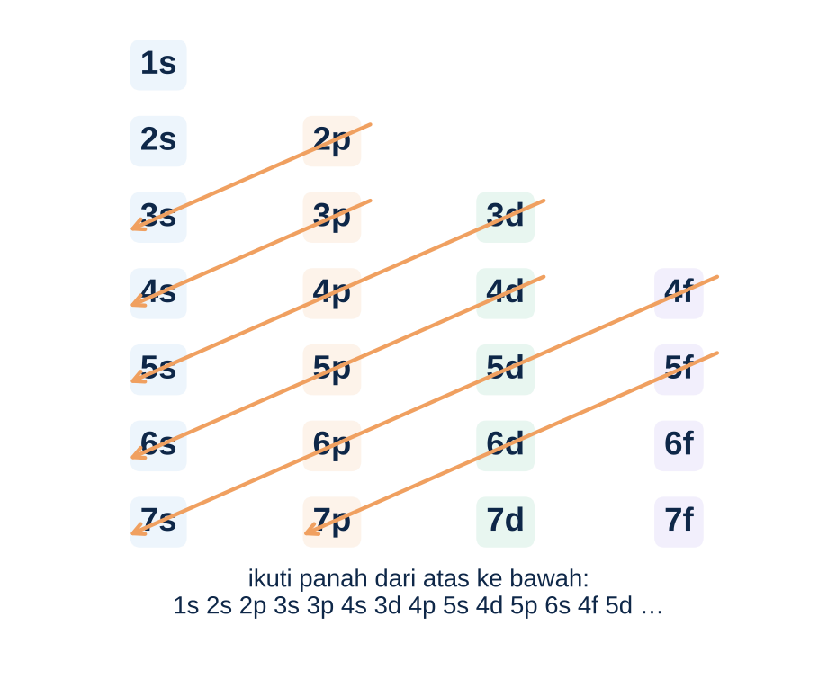

# Bab 1 Struktur Atom dan Sifat Periodik

Letakkan sepotong natrium dan sekeping emas di atas meja. Keduanya logam, keduanya mengilap ketika baru dipotong, dan keduanya mempunyai satu elektron s di kulit terluarnya: natrium [Ne] 3s¹, emas [Xe] 4f¹⁴ 5d¹⁰ 6s¹. Namun dalam beberapa detik permukaan natrium sudah kusam karena bereaksi dengan udara, dan bila dijatuhkan ke air ia berdesis, meleleh, dan melepaskan gas hidrogen yang bisa menyala. Emas tidak berubah walaupun dibiarkan ribuan tahun. Topeng emas Tutankhamun masih berkilau setelah lebih dari 3 300 tahun di dalam makam. Ada yang lebih aneh lagi: emas dapat **menerima** elektron dan membentuk ion auride, Au⁻, dalam senyawa CsAu, sesuatu yang biasanya hanya dilakukan oleh unsur nonlogam seperti halogen. Satu elektron s yang sama, dua perilaku yang bertolak belakang. Dari mana bedanya?

Jawabannya adalah gagasan pokok bab ini: **sifat kimia sebuah unsur ditentukan oleh seberapa kuat elektron terluarnya dipegang oleh inti**, dan kekuatan pegangan itu bergantung pada lebih banyak hal daripada sekadar jumlah proton. Elektron-elektron di bagian dalam menghalangi tarikan inti, tetapi tidak semuanya menghalangi dengan sama baik. Elektron d dan f, misalnya, adalah penghalang yang buruk. Pada unsur sangat berat seperti emas, elektron yang bergerak dekat inti bahkan mencapai kelajuan yang cukup dekat dengan kelajuan cahaya sehingga teori relativitas ikut berperan.

Bab ini membangun alat untuk menjelaskan sifat unsur dari struktur atomnya. Kita mulai dari asal-usul unsur dan ringkasan orbital atom hidrogen yang sudah diturunkan di *Kimia Kuantum*. Lalu kita melihat apa yang berubah ketika atom mempunyai banyak elektron: perisai, penetrasi, dan **muatan inti efektif**, yang akan kita hitung dengan aturan Slater. Dari situ kita menyusun konfigurasi elektron dan tabel periodik, lalu memakai muatan inti efektif untuk menjelaskan tren jari-jari, energi ionisasi, afinitas elektron, dan keelektronegatifan. Bab ini ditutup dengan tiga gagasan yang sering membuat kimia anorganik tampak "melanggar aturan": polarisabilitas, efek relativistik, dan keanehan unsur periode kedua.

::: {.kuis}
**Pertanyaan pembuka**

1. Mengapa elektron 4s diisi lebih dahulu daripada 3d pada kalium, tetapi pada ion Fe²⁺ justru elektron 4s yang lepas lebih dahulu?
2. Mengapa energi ionisasi boron lebih kecil daripada berilium, padahal boron mempunyai satu proton lebih banyak?
3. Mengapa ion F⁻, Na⁺, dan Mg²⁺ mempunyai jari-jari yang sangat berbeda, padahal jumlah elektronnya sama?
4. Mengapa zirkonium dan hafnium hampir tidak dapat dibedakan secara kimia, padahal hafnium mempunyai 32 elektron lebih banyak?
5. Mengapa aluminium klorida mudah menyublim pada 180 °C, sedangkan natrium klorida baru meleleh pada 801 °C?
6. Mengapa nitrogen berupa molekul N₂ yang hampir tidak reaktif, sedangkan fosfor berupa molekul P₄ yang terbakar sendiri di udara?
:::

::: {.tujuan}
**Tujuan belajar**

Setelah mempelajari bab ini, kamu mampu:

1. Menjelaskan asal-usul unsur dan membaca data kelimpahan unsur.
2. Menentukan bilangan kuantum, jumlah simpul, dan energi orbital atom hidrogenik.
3. Menjelaskan perisai dan penetrasi, lalu menghitung muatan inti efektif dengan aturan Slater.
4. Menuliskan konfigurasi elektron atom dan ion, termasuk pengecualian pada blok d.
5. Menjelaskan tren jari-jari atom dan ion, energi ionisasi, dan afinitas elektron dari muatan inti efektif, termasuk lekukan-lekukannya.
6. Menghitung keelektronegatifan dengan cara Pauling, Mulliken, dan Allred–Rochow, serta membandingkan ketiganya.
7. Meramalkan karakter kovalen senyawa ionik dengan aturan Fajans.
8. Menjelaskan efek relativistik, efek pasangan inert, keanehan periode kedua, dan hubungan diagonal.
:::

::: {.mat}
**Prasyarat**

Dari *Kimia Kuantum*: atom hidrogen dan bentuk orbital (Bab 7, terutama subbab 7.4–7.8), muatan efektif helium dengan metode variasi (subbab 8.3), asas Pauli, dan atom berelektron banyak (subbab 9.5–9.9). Dari Kimia Dasar: konfigurasi elektron dan tabel periodik. Bab ini mengulang semua yang diperlukan secara ringkas.
:::

## 1.1 Kimia anorganik: cakupan dan cara berpikirnya

Kimia organik adalah kimia senyawa karbon. Kimia anorganik adalah kimia **semua unsur yang lain**, sekitar seratus unsur dengan perilaku yang sangat beragam: gas mulia yang hampir tidak bereaksi, logam alkali yang bereaksi hebat dengan air, logam transisi yang berwarna-warni, unsur tanah jarang yang sifatnya hampir kembar, dan unsur radioaktif yang intinya pecah sendiri. Senyawa karbon yang sederhana, seperti CO, CO₂, karbonat, karbida, dan sianida, juga biasanya dibahas di sini.

Keberagaman itu menimbulkan kesan bahwa kimia anorganik hanyalah kumpulan fakta yang harus dihafal: rumus mineral, warna larutan, reaksi yang tampak tanpa pola. Kesan itu keliru. Hampir semua fakta tersebut dapat dijelaskan dengan sedikit gagasan yang dipakai berulang-ulang:

* **Seberapa kuat inti memegang elektronnya.** Inilah yang menentukan ukuran atom, energi ionisasi, afinitas elektron, dan keelektronegatifan (bab ini).
* **Bagaimana elektron dibagi di antara atom.** Teori ikatan valensi, orbital molekul, dan simetri menjelaskan bentuk molekul dan kekuatan ikatan (Bab 2–4).
* **Bagaimana ion-ion tersusun dalam padatan** dan berapa energi yang dilepaskan ketika mereka berkumpul (Bab 5–7).
* **Ke mana proton dan elektron berpindah dalam reaksi**, yaitu kimia asam–basa dan redoks (Bab 8–10).

Cara berpikir di buku ini mengikuti urutan itu. Setiap kali kita bertemu tren, misalnya "energi ionisasi naik dari kiri ke kanan", kita akan melihat **data**nya lebih dahulu, lalu bertanya model mana yang menjelaskannya, lalu memeriksa di mana model itu gagal. Data selalu menjadi hakim terakhir. Model yang baik adalah model yang menjelaskan sebagian besar data dengan sedikit gagasan dan memberi tahu kita kapan harus curiga.

::: {.terapan}
**Kimia anorganik di sekitar kita**

Ponsel di tanganmu berisi lebih dari 60 unsur: litium dan kobalt di baterai, silikon yang didoping fosfor dan boron di prosesor, indium timah oksida di layar sentuh, neodimium di pengeras suara, tantalum di kapasitor, dan emas di kontak listrik. Pupuk yang menghidupi separuh penduduk dunia berasal dari amonia yang dibuat dengan katalis besi (proses Haber–Bosch). Hemoglobin membawa oksigen dengan atom besi, klorofil menangkap cahaya dengan atom magnesium, dan obat kanker sisplatin bekerja dengan atom platina. Semua ini adalah kimia anorganik.
:::

::: {.kuis}
**Kuis cepat 1.1** Sebutkan empat gagasan besar yang dipakai berulang-ulang untuk menjelaskan fakta kimia anorganik. Mengapa data harus dilihat sebelum model?
:::

## 1.2 Asal unsur dan kelimpahannya

Sebelum bertanya bagaimana atom berperilaku, wajar bertanya dari mana atom-atom itu datang. Jawabannya juga menjelaskan mengapa sebagian unsur melimpah dan sebagian lain sangat langka.

### Dentuman Besar dan bintang

Beberapa menit setelah Dentuman Besar, alam semesta cukup dingin sehingga proton dan neutron dapat bergabung, tetapi juga cepat mendingin sehingga penggabungan itu hanya sempat berjalan sedikit. Hasilnya hampir seluruhnya **hidrogen dan helium**, ditambah sedikit sekali litium. Sampai sekarang, sekitar 74 persen massa materi biasa di alam semesta masih berupa hidrogen dan sekitar 24 persen helium. Semua unsur lain, yang dalam astronomi disebut "logam", hanya sekitar 2 persen.

Unsur yang lebih berat dibuat di dalam **bintang**. Di inti bintang seperti Matahari, hidrogen bergabung menjadi helium. Bintang yang lebih besar, setelah hidrogennya habis, membakar helium menjadi karbon dan oksigen, lalu karbon dan oksigen menjadi neon, magnesium, silikon, dan belerang, sampai akhirnya besi. Penggabungan berhenti di **besi** karena inti besi (lebih tepatnya ⁵⁶Fe dan ⁶²Ni) mempunyai energi ikat per nukleon yang paling besar. Menggabungkan inti besi dengan inti lain justru **menyerap** energi, bukan melepaskannya, sehingga bintang tidak lagi dapat memperoleh energi dari situ. Bab 13 menghitung energi ikat ini dari defek massa.

Unsur yang lebih berat daripada besi dibuat dengan **penangkapan neutron**: inti menyerap neutron satu per satu, lalu sebagian neutron berubah menjadi proton melalui peluruhan β. Proses lambat (proses s) terjadi di bintang raksasa tua. Proses cepat (proses r) terjadi dalam ledakan dahsyat, terutama tabrakan dua bintang neutron. Emas di cincinmu kemungkinan besar dibuat dalam peristiwa seperti itu.

### Kelimpahan di Bumi

Komposisi kerak Bumi sangat berbeda dari alam semesta, karena hidrogen dan helium yang ringan sebagian besar lepas ke angkasa ketika Bumi terbentuk, dan karena besi serta nikel tenggelam ke inti Bumi. Kerak Bumi didominasi oleh unsur-unsur pembentuk batuan silikat.

Tabel 1.1 Delapan unsur terbanyak di kerak Bumi, dalam persen massa.

| Unsur | O | Si | Al | Fe | Ca | Na | Mg | K |
|---|---|---|---|---|---|---|---|---|
| Persen massa | 46,1 | 28,2 | 8,23 | 5,63 | 4,15 | 2,36 | 2,33 | 2,09 |

Delapan unsur ini mencakup sekitar 99 persen massa kerak. Unsur yang penting bagi teknologi, seperti tembaga, timah, litium, dan unsur tanah jarang, hanya ada dalam jumlah sangat kecil. Kita dapat menambangnya karena proses geologi kadang memekatkannya di satu tempat, membentuk **bijih**.

::: {.contoh}
**Contoh 1.1 · Dari persen massa ke persen jumlah atom**

Oksigen menyumbang 46,1 persen massa kerak. Berapa persen dari **jumlah atom** di kerak (hanya delapan unsur pada Tabel 1.1 yang dihitung) yang merupakan atom oksigen?

**Rencana.** Persen massa tidak sama dengan persen jumlah atom, karena atom yang ringan lebih banyak jumlahnya untuk massa yang sama. Ambil 100 g kerak, ubah massa setiap unsur menjadi mol dengan membagi massa molarnya, lalu bandingkan.

**Penyelesaian.** Dalam 100 g: oksigen $46{,}1 / 16{,}00 = 2{,}881$ mol; silikon $28{,}2 / 28{,}09 = 1{,}004$ mol; aluminium $8{,}23 / 26{,}98 = 0{,}305$ mol; besi $5{,}63 / 55{,}85 = 0{,}101$ mol; kalsium $4{,}15 / 40{,}08 = 0{,}104$ mol; natrium $2{,}36 / 22{,}99 = 0{,}103$ mol; magnesium $2{,}33 / 24{,}31 = 0{,}096$ mol; kalium $2{,}09 / 39{,}10 = 0{,}054$ mol. Jumlahnya 4,647 mol. Fraksi oksigen:

$$\frac{2{,}881}{4{,}647} \times 100\% = 62{,}0\%$$

**Memahami hasil.** Hampir dua dari setiap tiga atom di kerak Bumi adalah atom oksigen. Karena atom oksigen (sebagai ion O²⁻, jari-jari 140 pm) jauh lebih besar daripada Si⁴⁺ dan Al³⁺, kerak Bumi dapat dibayangkan sebagai tumpukan rapat ion oksida, dengan ion-ion logam kecil terselip di celah-celahnya. Gambaran inilah yang akan kita pakai untuk struktur kristal di Bab 5.
:::

::: {.kuis}
**Kuis cepat 1.2** Mengapa penggabungan inti di dalam bintang berhenti di sekitar besi? Dari mana asal unsur yang lebih berat daripada besi?
:::

## 1.3 Orbital atom hidrogenik

Atom hidrogen, dan ion yang hanya mempunyai satu elektron seperti He⁺ dan Li²⁺ (disebut atom **hidrogenik**), adalah satu-satunya atom yang persamaan Schrödingernya dapat diselesaikan secara tepat. Penyelesaian itu diturunkan lengkap di Bab 7 *Kimia Kuantum*. Di sini kita hanya merangkum hasil yang akan dipakai terus di buku ini.

### Bilangan kuantum

Setiap orbital ditandai oleh tiga bilangan kuantum:

* **Bilangan kuantum utama** *n* = 1, 2, 3, … menentukan energi dan ukuran orbital.
* **Bilangan kuantum momentum sudut** *l* = 0, 1, …, *n* − 1 menentukan bentuk orbital. Huruf s, p, d, f berarti *l* = 0, 1, 2, 3.
* **Bilangan kuantum magnetik** *m*ₗ = −*l*, …, 0, …, +*l* menentukan arah orbital. Ada 2*l* + 1 orbital untuk setiap *l*: satu orbital s, tiga p, lima d, tujuh f.

Elektron juga mempunyai **spin** dengan bilangan kuantum *m*ₛ = +½ atau −½. Menurut asas larangan Pauli, satu orbital memuat paling banyak dua elektron dengan spin berlawanan.

### Energi

Energi orbital atom hidrogenik dengan muatan inti *Z* hanya bergantung pada *n*:

$$E_n = -\frac{Z^2}{n^2}\,R, \qquad R = 13{,}606\ \text{eV} \qquad \text{(1.1)}$$

*R* adalah energi Rydberg, sama dengan energi ionisasi atom hidrogen dalam keadaan dasar. Karena energi hanya bergantung pada *n*, orbital 2s dan 2p atom hidrogen mempunyai energi yang persis sama. Keadaan seperti ini disebut **terdegenerasi**. Kita akan melihat sebentar lagi bahwa degenerasi ini **hilang** begitu atom mempunyai lebih dari satu elektron, dan hilangnya degenerasi itulah yang membentuk tabel periodik.

### Simpul

Fungsi gelombang mempunyai daerah tempat nilainya nol, yang disebut **simpul**. Ada dua jenis:

* **simpul radial** berupa permukaan bola, jumlahnya *n* − *l* − 1;
* **simpul sudut** berupa bidang atau kerucut, jumlahnya *l*.

Jumlah seluruh simpul adalah *n* − 1. Makin banyak simpul, makin tinggi energi orbital, sama seperti gelombang berdiri pada senar gitar: nada yang lebih tinggi mempunyai lebih banyak titik diam.

::: {.contoh}
**Contoh 1.2 · Energi ionisasi ion hidrogenik dan jumlah simpul**

(a) Hitung energi yang diperlukan untuk melepaskan elektron dari ion He⁺ dalam keadaan dasar. (b) Tentukan jumlah simpul radial dan sudut orbital 3p, 4d, 5s, dan 4f.

**Penyelesaian.** (a) He⁺ mempunyai *Z* = 2 dan elektronnya di *n* = 1. Menurut persamaan (1.1), $E_1 = -2^2 \times 13{,}606 / 1^2 = -54{,}4$ eV. Untuk melepaskan elektron sampai *E* = 0 diperlukan **54,4 eV**.

(b) Dengan simpul radial = *n* − *l* − 1 dan simpul sudut = *l*:

| Orbital | *n* | *l* | Simpul radial | Simpul sudut | Jumlah |
|---|---|---|---|---|---|
| 3p | 3 | 1 | 1 | 1 | 2 |
| 4d | 4 | 2 | 1 | 2 | 3 |
| 5s | 5 | 0 | 4 | 0 | 4 |
| 4f | 4 | 3 | 0 | 3 | 3 |

**Memahami hasil.** Energi ionisasi He⁺ empat kali energi ionisasi hidrogen, karena tarikan inti bermuatan dua menarik elektron dua kali lebih kuat dan sekaligus menariknya lebih dekat. Perhatikan bahwa orbital 4f tidak mempunyai simpul radial sama sekali. Akibatnya elektron 4f terkumpul di daerah yang cukup sempit, jauh di dalam atom, dan hampir tidak ikut dalam ikatan. Inilah sebabnya lantanida sangat mirip satu sama lain (subbab 1.8).
:::

### Fungsi sebaran radial

Bentuk orbital menunjukkan ke arah mana elektron cenderung berada. Untuk menjawab **seberapa jauh** dari inti, kita memakai **fungsi sebaran radial** *P*(*r*), yaitu peluang menemukan elektron di dalam kulit bola tipis berjari-jari *r*. Gambar 1.1 memperlihatkan fungsi ini untuk orbital 1s, 2s, dan 2p atom hidrogen.

{width=82%}

Perhatikan dua hal pada gambar itu. Pertama, puncak utama orbital 2s berada **sedikit lebih jauh** dari inti daripada puncak 2p. Kedua, orbital 2s mempunyai **puncak kecil di dekat inti**, di dalam daerah yang ditempati elektron 1s. Orbital 2p tidak mempunyai puncak seperti itu. Pada atom hidrogen, kedua perbedaan ini saling meniadakan sehingga energi 2s dan 2p sama. Pada atom berelektron banyak, puncak kecil itu menjadi sangat penting.

::: {.kuis}
**Kuis cepat 1.3** Berapa energi ionisasi ion Li²⁺? Berapa simpul radial yang dimiliki orbital 3s, 3d, dan 6p?
:::

## 1.4 Atom berelektron banyak: perisai dan penetrasi

Atom litium mempunyai tiga elektron: dua di orbital 1s dan satu di orbital kulit kedua. Pertanyaannya, apakah elektron ketiga itu memilih 2s atau 2p? Pada atom hidrogen keduanya sama energinya. Pada litium, percobaan menunjukkan dengan tegas bahwa **2s lebih rendah**. Mengapa?

### Perisai

Bayangkan elektron terluar litium melihat ke arah inti. Inti bermuatan +3, tetapi di antara inti dan elektron itu terdapat dua elektron 1s yang bermuatan negatif. Kedua elektron 1s itu "menghalangi" sebagian tarikan inti. Efek ini disebut **perisai** (*shielding* atau *screening*). Elektron terluar seakan-akan hanya merasakan muatan inti yang lebih kecil, yang disebut **muatan inti efektif**:

$$Z_\text{ef} = Z - S \qquad \text{(1.2)}$$

*S* adalah **tetapan perisai**, yang menyatakan berapa besar muatan inti yang tertutupi oleh elektron-elektron lain. Kalau perisai sempurna, dua elektron 1s menutupi tepat dua satuan muatan, sehingga elektron terluar litium merasakan *Z*ₑf = 3 − 2 = 1, persis seperti elektron pada atom hidrogen.

Perisai sempurna hanya terjadi kalau elektron terluar **selalu** berada di luar elektron-elektron dalam. Kenyataannya tidak begitu. Elektron bergerak di seluruh ruang, dan kadang-kadang elektron terluar masuk ke dekat inti, ke dalam daerah elektron 1s. Selama berada di sana, ia merasakan muatan inti yang hampir penuh.

### Penetrasi

Kemampuan sebuah orbital untuk masuk ke daerah dekat inti disebut **penetrasi**. Kembali ke Gambar 1.1: orbital 2s mempunyai puncak kecil di dekat inti, sedangkan 2p tidak. Jadi elektron 2s **lebih sering menembus** ke dalam kulit 1s daripada elektron 2p. Akibatnya elektron 2s merasakan muatan inti efektif yang lebih besar, terikat lebih kuat, dan energinya lebih rendah.

Secara umum, untuk *n* yang sama, penetrasi berkurang dengan urutan s > p > d > f. Alasannya terlihat dari jumlah simpul radial: orbital s mempunyai simpul radial paling banyak, sehingga mempunyai puncak-puncak kecil paling banyak di dekat inti. Orbital dengan *l* besar didorong menjauh dari inti oleh "penghalang sentrifugal" momentum sudutnya. Karena itu, dalam atom berelektron banyak:

$$E(n\text{s}) < E(n\text{p}) < E(n\text{d}) < E(n\text{f})$$

::: {.inti}
**Perisai dan penetrasi.** Elektron dalam mengurangi tarikan inti yang dirasakan elektron luar ($Z_\text{ef} = Z - S$). Orbital yang lebih menembus ke dekat inti (s > p > d > f) kurang terlindung, merasakan $Z_\text{ef}$ lebih besar, dan energinya lebih rendah. **Inilah sebabnya degenerasi 2s–2p pada hidrogen hilang pada atom berelektron banyak.**
:::

### Bukti dari spektrum

Apakah semua ini hanya cerita? Kita dapat mengukur energi setiap orbital dari spektrum atom. Energi ionisasi litium dari keadaan dasar 1s² 2s¹ adalah 5,392 eV. Garis merah litium pada 670,8 nm adalah loncatan elektron dari 2s ke 2p, dengan energi

$$E_\text{foton} = \frac{hc}{\lambda} = \frac{1239{,}84\ \text{eV nm}}{670{,}8\ \text{nm}} = 1{,}848\ \text{eV}$$

Jadi elektron di orbital 2p terikat dengan energi 5,392 − 1,848 = 3,544 eV, lebih lemah daripada di 2s. Kita dapat mengubah energi ikat ini menjadi muatan inti efektif dengan membalik persamaan (1.1): sebuah elektron dengan energi ikat *I* di kulit *n* "terasa seperti" elektron pada atom hidrogenik dengan muatan

$$Z_\text{ef} = n\sqrt{\frac{I}{R}} \qquad \text{(1.3)}$$

::: {.contoh}
**Contoh 1.3 · Muatan inti efektif dari spektrum litium dan natrium**

Hitung *Z*ₑf untuk elektron 2s dan 2p litium, serta 3s, 3p, dan 3d natrium. Data: energi ionisasi Na 5,139 eV; garis kuning Na 589,0 nm (3s → 3p); tingkat 3d natrium terletak 29 172,8 cm⁻¹ di atas keadaan dasar.

**Penyelesaian.** *Litium.* Dengan persamaan (1.3): 2s, $2\sqrt{5{,}392/13{,}606} = 1{,}26$; 2p, $2\sqrt{3{,}544/13{,}606} = 1{,}02$.

*Natrium.* Energi foton 589,0 nm adalah $1239{,}84/589{,}0 = 2{,}105$ eV, sehingga energi ikat 3p adalah $5{,}139 - 2{,}105 = 3{,}035$ eV. Tingkat 3d berada $29\,172{,}8 / 8065{,}54 = 3{,}617$ eV di atas keadaan dasar, sehingga energi ikatnya $5{,}139 - 3{,}617 = 1{,}522$ eV. Maka

| Orbital Na | Energi ikat (eV) | *Z*ₑf |
|---|---|---|
| 3s | 5,139 | $3\sqrt{5{,}139/13{,}606} = 1{,}84$ |
| 3p | 3,035 | $3\sqrt{3{,}035/13{,}606} = 1{,}42$ |
| 3d | 1,522 | $3\sqrt{1{,}522/13{,}606} = 1{,}00$ |

**Memahami hasil.** Natrium mempunyai 11 proton dan 10 elektron dalam. Kalau perisai sempurna, *Z*ₑf untuk elektron terluar tepat 1. Elektron 3d hampir tidak menembus sama sekali ke dalam kulit-kulit dalam, sehingga ia benar-benar merasakan *Z*ₑf = 1,00, persis seperti elektron di atom hidrogen. Elektron 3p menembus sebagian (1,42), dan elektron 3s menembus paling banyak (1,84). Tabel ini adalah bukti langsung urutan s > p > d.
:::

::: {.awas}
**Awas: perisai bukan dinding.** Jangan membayangkan elektron dalam sebagai cangkang kaku yang menghalangi tarikan inti seluruhnya atau tidak sama sekali. Perisai adalah efek rata-rata: elektron luar kadang di luar elektron dalam (terlindung), kadang di dalamnya (tidak terlindung). Karena itulah *S* bukan bilangan bulat, dan karena itu pula elektron di kulit yang sama saling melindungi sedikit sekali.
:::

::: {.kuis}
**Kuis cepat 1.4** Garis kuning kalium (3d dan 4p tidak terlibat) ada pada 766,5 nm untuk loncatan 4s → 4p, dan energi ionisasi kalium 4,341 eV. Hitung *Z*ₑf untuk elektron 4s dan 4p. Mana yang lebih besar, dan mengapa?
:::

## 1.5 Aturan Slater dan muatan inti efektif

Menghitung *Z*ₑf dari spektrum hanya mungkin untuk orbital yang energinya sudah diukur. Pada 1930, John Slater mengusulkan aturan sederhana untuk **menaksir** tetapan perisai *S* tanpa perhitungan kuantum. Aturan ini kasar, tetapi cukup baik untuk memahami tren, dan menjadi alat utama kita sepanjang bab ini.

::: {.strategi}
**Aturan Slater untuk menaksir tetapan perisai *S***

1. Tulis konfigurasi elektron dalam kelompok-kelompok berikut, berurutan: (1s) (2s, 2p) (3s, 3p) (3d) (4s, 4p) (4d) (4f) (5s, 5p) … Orbital s dan p dengan *n* yang sama berada dalam **satu** kelompok.
2. Elektron di kelompok **sebelah kanan** kelompok yang ditinjau tidak menyumbang perisai.
3. **Untuk elektron s atau p yang ditinjau:**
   * setiap elektron lain di kelompok yang sama menyumbang 0,35 (khusus kelompok 1s: 0,30);
   * setiap elektron di kulit *n* − 1 menyumbang 0,85;
   * setiap elektron di kulit *n* − 2 atau lebih dalam menyumbang 1,00.
4. **Untuk elektron d atau f yang ditinjau:**
   * setiap elektron lain di kelompok yang sama menyumbang 0,35;
   * setiap elektron di **semua** kelompok sebelah kiri menyumbang 1,00.
5. Jumlahkan semua sumbangan untuk memperoleh *S*, lalu $Z_\text{ef} = Z - S$.
:::

Aturan ini mencerminkan semua yang kita bahas di subbab 1.4. Elektron di kelompok yang sama hampir tidak saling melindungi (0,35), karena rata-rata berada pada jarak yang sama dari inti. Elektron di kulit tepat di dalamnya melindungi dengan baik tetapi tidak sempurna (0,85), karena elektron s dan p luar masih sedikit menembus. Elektron yang jauh lebih dalam melindungi sepenuhnya (1,00). Untuk elektron d dan f, yang hampir tidak menembus, semua elektron yang lebih dalam dianggap melindungi sepenuhnya.

::: {.contoh}
**Contoh 1.4 · Muatan inti efektif nitrogen dan klorin**

Hitung *Z*ₑf untuk elektron 2p atom nitrogen dan elektron 3p atom klorin.

**Penyelesaian.** *Nitrogen* (*Z* = 7): (1s²) (2s² 2p³). Elektron 2p yang ditinjau mempunyai empat elektron lain di kelompok (2s, 2p), masing-masing 0,35, dan dua elektron 1s di kulit *n* − 1, masing-masing 0,85:

$$S = 4(0{,}35) + 2(0{,}85) = 1{,}40 + 1{,}70 = 3{,}10, \qquad Z_\text{ef} = 7 - 3{,}10 = 3{,}90$$

*Klorin* (*Z* = 17): (1s²) (2s² 2p⁶) (3s² 3p⁵). Elektron 3p yang ditinjau mempunyai enam elektron lain di kelompok (3s, 3p), delapan elektron di kulit *n* − 1 = 2, dan dua elektron di kulit 1:

$$S = 6(0{,}35) + 8(0{,}85) + 2(1{,}00) = 2{,}10 + 6{,}80 + 2{,}00 = 10{,}90, \qquad Z_\text{ef} = 17 - 10{,}90 = 6{,}10$$

**Memahami hasil.** Dari 17 proton klorin, elektron terluarnya hanya merasakan sekitar 6. Namun 6 tetap jauh lebih besar daripada 2,20 yang dirasakan elektron 3s natrium di periode yang sama. Inilah alasan klorin memegang elektronnya erat-erat dan cenderung menerima elektron, sedangkan natrium mudah melepaskannya.
:::

### Tren *Z*ₑf dalam tabel periodik

Gambar 1.2 memperlihatkan *Z*ₑf elektron terluar untuk 18 unsur pertama. Dua pola langsung terlihat.

{width=84%}

* **Sepanjang periode, *Z*ₑf naik.** Dari litium ke neon, setiap langkah menambah satu proton dan satu elektron di kelompok yang sama. Proton itu menambah muatan inti satu satuan penuh, tetapi elektron baru hanya melindungi 0,35. Jadi *Z*ₑf naik sekitar 0,65 setiap langkah.
* **Di awal periode baru, *Z*ₑf turun tajam.** Elektron pertama di kulit baru (Li, Na) dilindungi oleh seluruh kulit yang sudah penuh di bawahnya.

Nilai Slater dan nilai dari energi ionisasi tidak sama besar, karena keduanya menjawab pertanyaan yang sedikit berbeda. *Z*ₑf Slater menggambarkan tarikan yang dirasakan elektron di dalam atom netral. *Z*ₑf dari energi ionisasi adalah satu angka yang menghasilkan energi pelepasan elektron, dan pelepasan itu juga mengubah tolakan di antara elektron-elektron yang tersisa. Yang penting bagi kita, **keduanya menunjukkan pola yang sama**, dan pola inilah yang akan menjelaskan semua tren periodik.

### Mengapa 4s diisi sebelum 3d, tetapi lepas lebih dahulu

Teka-teki pertama di awal bab dapat dijawab dengan aturan Slater.

::: {.contoh}
**Contoh 1.5 · Kalium: 4s atau 3d?**

Kalium (*Z* = 19) mempunyai konfigurasi [Ar] untuk 18 elektron pertama. Bandingkan *Z*ₑf elektron ke-19 bila ditempatkan di 4s dan bila ditempatkan di 3d.

**Penyelesaian.** *Di 4s:* tidak ada elektron lain di kelompok (4s, 4p); delapan elektron (3s, 3p) di kulit *n* − 1; sepuluh elektron di kulit 1 dan 2.

$$S = 8(0{,}85) + 10(1{,}00) = 16{,}80, \qquad Z_\text{ef} = 19 - 16{,}80 = 2{,}20$$

*Di 3d:* tidak ada elektron lain di kelompok 3d; semua 18 elektron di sebelah kiri menyumbang 1,00.

$$S = 18(1{,}00) = 18{,}00, \qquad Z_\text{ef} = 19 - 18{,}00 = 1{,}00$$

**Memahami hasil.** Elektron 4s menembus jauh ke dalam kulit argon, sedangkan 3d hampir tidak. Akibatnya pada kalium elektron 4s merasakan tarikan dua kali lebih besar dan energinya lebih rendah. Karena itu kalium adalah [Ar] 4s¹, bukan [Ar] 3d¹.
:::

Mengapa kemudian, pada besi, elektron **4s** yang lepas lebih dahulu ketika membentuk Fe²⁺? Hitung lagi dengan Slater untuk besi, [Ar] 3d⁶ 4s². Untuk elektron 4s: satu elektron 4s lain (0,35), empat belas elektron di kulit *n* − 1 = 3 (3s, 3p, 3d; masing-masing 0,85), dan sepuluh elektron lebih dalam (1,00), sehingga *S* = 22,25 dan *Z*ₑf = 3,75. Untuk elektron 3d: lima elektron 3d lain (0,35) dan delapan belas elektron di sebelah kiri (1,00), sehingga *S* = 19,75 dan *Z*ₑf = 6,25.

Begitu ada beberapa proton tambahan dan kulit 3d mulai terisi, elektron 3d merasakan muatan inti yang **lebih besar** daripada elektron 4s, dan orbital 3d menyusut ke dalam atom. Orbital 4s tetap jauh lebih besar, dan elektronnya berada di bagian paling luar atom. Pada logam transisi, energi orbital 3d sudah **lebih rendah** daripada 4s. Konfigurasi atom netral tetap 3dⁿ 4s² karena memasukkan semua elektron ke 3d akan menambah tolakan antar-elektron di orbital 3d yang kecil itu. Namun pada ion, muatan positif menarik semua orbital, dan orbital 3d yang lebih kompak lebih diuntungkan. Akibatnya semua ion logam transisi deret pertama mempunyai konfigurasi 3dⁿ tanpa elektron 4s.

::: {.inti}
**Urutan pengisian lawan urutan pelepasan.** Pada K dan Ca, 4s lebih rendah daripada 3d, sehingga 4s diisi lebih dahulu. Mulai skandium, 3d sudah lebih rendah, tetapi atom netral tetap memakai 4s² untuk mengurangi tolakan. **Ion logam transisi selalu kehilangan elektron 4s lebih dahulu**: Fe²⁺ adalah [Ar] 3d⁶, bukan [Ar] 3d⁴ 4s².
:::

::: {.kuis}
**Kuis cepat 1.5** Hitung *Z*ₑf Slater untuk elektron 2p fluorin dan elektron 3s natrium. Mana yang lebih mudah dilepaskan?
:::

## 1.6 Konfigurasi elektron

Dengan memahami mengapa orbital berbeda energi, kita dapat menyusun konfigurasi elektron atom mana pun dengan tiga aturan.

* **Aufbau ("membangun").** Elektron mengisi orbital dengan energi terendah lebih dahulu. Urutan praktisnya mengikuti **aturan *n* + *l***: orbital dengan *n* + *l* lebih kecil diisi lebih dahulu, dan bila *n* + *l* sama, yang *n*-nya lebih kecil didahulukan. Gambar 1.3 menunjukkan urutan ini sebagai panah-panah diagonal.
* **Asas larangan Pauli.** Satu orbital memuat paling banyak dua elektron, dengan spin berlawanan.
* **Aturan Hund.** Bila ada beberapa orbital dengan energi sama (misalnya tiga orbital 2p), elektron mengisi orbital yang berbeda dengan spin sejajar sebelum berpasangan. Dua elektron di orbital yang berbeda saling menjauh, sehingga tolakannya lebih kecil, dan spin sejajar memberi tambahan kestabilan yang disebut **energi pertukaran** (subbab 9.12 *Kimia Kuantum*).

{width=56%}

::: {.contoh}
**Contoh 1.6 · Konfigurasi atom dan ion**

Tuliskan konfigurasi elektron (a) selenium, *Z* = 34; (b) Fe³⁺; (c) Cu⁺; (d) Gd, *Z* = 64.

**Penyelesaian.** (a) Selenium: 34 elektron mengikuti urutan Gambar 1.3: 1s² 2s² 2p⁶ 3s² 3p⁶ 4s² 3d¹⁰ 4p⁴, atau ringkasnya **[Ar] 3d¹⁰ 4s² 4p⁴**. Penulisan dengan 3d sebelum 4s mengikuti kebiasaan IUPAC: orbital ditulis menurut urutan *n*, bukan urutan pengisian.

(b) Fe (*Z* = 26) adalah [Ar] 3d⁶ 4s². Fe³⁺ kehilangan tiga elektron: dua dari 4s lebih dahulu, lalu satu dari 3d. Hasilnya **[Ar] 3d⁵**, dengan lima elektron tak berpasangan di lima orbital d (aturan Hund).

(c) Cu (*Z* = 29) adalah [Ar] 3d¹⁰ 4s¹ (pengecualian, lihat di bawah). Cu⁺ kehilangan elektron 4s: **[Ar] 3d¹⁰**.

(d) Gadolinium: urutan *n* + *l* memberi [Xe] 4f⁸ 6s². Konfigurasi yang terukur adalah **[Xe] 4f⁷ 5d¹ 6s²**: satu elektron pindah ke 5d sehingga kulit 4f terisi tepat setengah.

**Memahami hasil.** Fe³⁺ dengan d⁵ dan Cu⁺ dengan d¹⁰ adalah konfigurasi yang istimewa stabil (setengah penuh dan penuh). Itulah sebabnya Fe³⁺ lebih mudah terbentuk di udara daripada Fe²⁺, dan Cu⁺ tidak berwarna (tidak ada tempat kosong di d untuk loncatan elektron d–d, Bab 11).
:::

### Pengecualian dalam blok d

Beberapa atom tidak mengikuti urutan *n* + *l* secara tepat. Yang paling terkenal di deret pertama adalah kromium dan tembaga:

| Unsur | Menurut urutan *n* + *l* | Terukur |
|---|---|---|
| Cr | [Ar] 3d⁴ 4s² | [Ar] 3d⁵ 4s¹ |
| Cu | [Ar] 3d⁹ 4s² | [Ar] 3d¹⁰ 4s¹ |
| Mo | [Kr] 4d⁴ 5s² | [Kr] 4d⁵ 5s¹ |
| Pd | [Kr] 4d⁸ 5s² | [Kr] 4d¹⁰ |
| Ag | [Kr] 4d⁹ 5s² | [Kr] 4d¹⁰ 5s¹ |
| Au | [Xe] 4f¹⁴ 5d⁹ 6s² | [Xe] 4f¹⁴ 5d¹⁰ 6s¹ |

Penjelasan yang sering diberikan adalah "subkulit setengah penuh dan penuh lebih stabil". Penjelasan yang lebih tepat: pada unsur-unsur ini energi orbital (n − 1)d dan *n*s sudah **sangat berdekatan**, sehingga selisih kecil dalam tolakan dan energi pertukaran menentukan pilihan. Lima elektron d dengan spin sejajar (Cr) memaksimalkan energi pertukaran. Pada tembaga, orbital 3d sudah turun cukup rendah sehingga mengisinya penuh lebih menguntungkan daripada menyimpan dua elektron di 4s.

::: {.awas}
**Awas: konfigurasi atom bukan ramalan kimia.** Konfigurasi menggambarkan atom **bebas** dalam fase gas. Dalam senyawa, yang menentukan adalah energi orbital setelah atom diikat ligan atau tetangganya. Jangan menebak muatan ion yang stabil hanya dari konfigurasi atom: kromium paling sering dijumpai sebagai Cr³⁺ (d³) dan Cr(VI), bukan Cr⁺ (d⁵) walaupun d⁵ "setengah penuh".
:::

::: {.kuis}
**Kuis cepat 1.6** Tuliskan konfigurasi elektron Mn²⁺, Co³⁺, Zn²⁺, dan Ag⁺. Berapa elektron tak berpasangan pada masing-masing ion (anggap aturan Hund berlaku)?
:::
