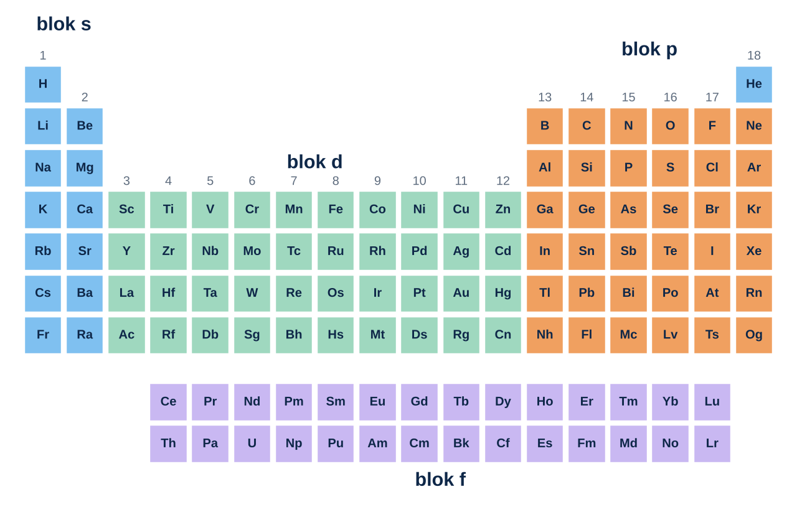
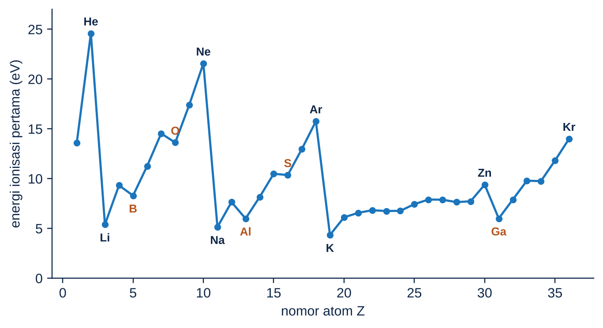
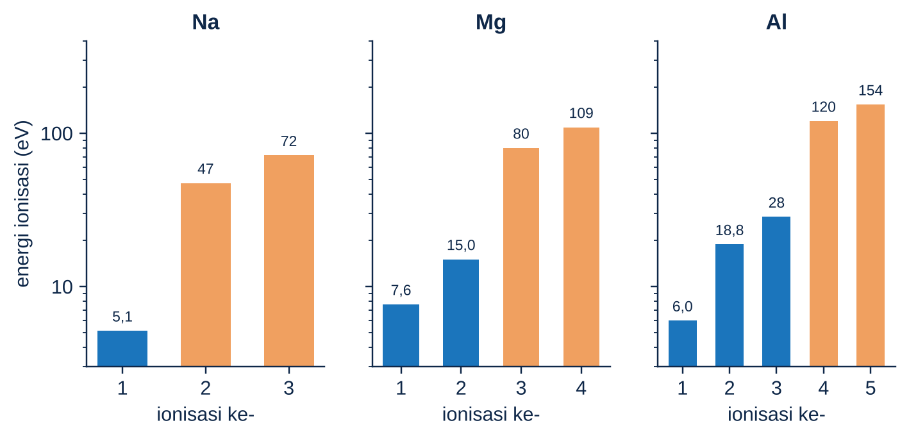
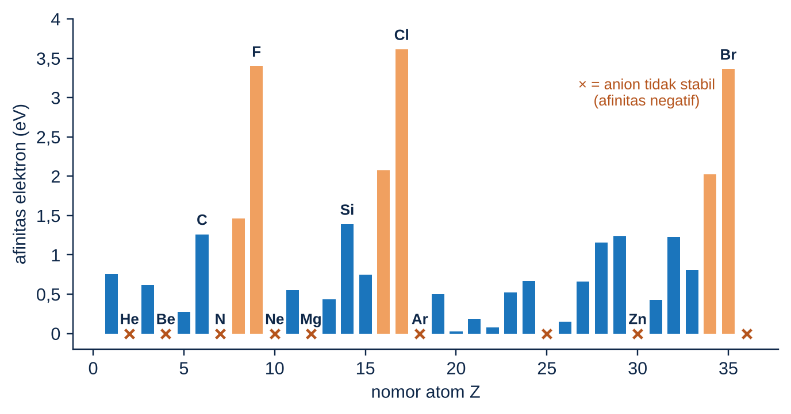

## 1.7 Tabel periodik: blok, golongan, periode

Tabel periodik yang kita kenal sekarang disusun Dmitri Mendeleev pada 1869, jauh sebelum elektron ditemukan. Mendeleev mengurutkan unsur menurut massa atom dan menempatkan unsur dengan sifat kimia mirip dalam satu kolom, sambil berani membiarkan kotak kosong untuk unsur yang belum ditemukan. Ramalannya tentang "eka-silikon" (sekarang germanium) ternyata tepat sampai ke massa jenis dan rumus oksidanya. Penjelasan **mengapa** susunan itu berhasil baru datang setelah mekanika kuantum: tabel periodik adalah peta konfigurasi elektron.

{width=92%}

* **Periode** (baris) bersesuaian dengan bilangan kuantum utama kulit terluar. Panjang periode adalah 2, 8, 8, 18, 18, 32, 32, sama dengan jumlah elektron yang dapat ditampung oleh orbital-orbital yang diisi sepanjang periode itu menurut aturan *n* + *l*. Periode 4, misalnya, mengisi 4s (2), 3d (10), dan 4p (6): jumlahnya 18.
* **Golongan** (kolom) dinomori 1–18 menurut IUPAC. Unsur dalam satu golongan mempunyai konfigurasi elektron terluar yang sama, sehingga sifat kimianya mirip.
* **Blok** menunjukkan jenis orbital yang terakhir diisi.

Beberapa golongan mempunyai nama yang masih dipakai luas: logam alkali (1), logam alkali tanah (2), pniktogen (15), kalkogen (16), halogen (17), dan gas mulia (18). Unsur blok d disebut **logam transisi**, dan unsur blok f disebut **lantanida** (La–Lu) dan **aktinida** (Ac–Lr). Skandium, itrium, dan lantanida bersama-sama disebut **unsur tanah jarang**.

### Membaca letak unsur dari konfigurasinya

Hubungan konfigurasi–tabel berlaku dua arah. Dari konfigurasi kita dapat menunjuk letak unsur:

* blok = jenis orbital terakhir yang diisi;
* periode = *n* terbesar;
* golongan: blok s = jumlah elektron *n*s; blok d = jumlah elektron (*n* − 1)d ditambah *n*s; blok p = 10 + jumlah elektron *n*s dan *n*p.

::: {.contoh}
**Contoh 1.7 · Menentukan letak unsur dari konfigurasi**

Tentukan blok, periode, dan golongan unsur dengan konfigurasi (a) [Ar] 3d¹⁰ 4s² 4p⁴; (b) [Kr] 4d¹⁰ 5s¹; (c) [Xe] 6s²; (d) [Ar] 3d⁷ 4s².

**Penyelesaian.** (a) Orbital terakhir 4p: blok p, periode 4. Elektron di kulit terluar 4s² 4p⁴ berjumlah 6, sehingga golongan 10 + 6 = 16. Ini **selenium**.
(b) Orbital terakhir yang diisi 4d (5s¹ hanya karena pengecualian seperti Cu): blok d, periode 5. Elektron (*n* − 1)d dan *n*s berjumlah 10 + 1 = 11: golongan 11. Ini **perak**.
(c) Blok s, periode 6, golongan 2: **barium**.
(d) Blok d, periode 4, 7 + 2 = 9: golongan 9, **kobalt**.

**Memahami hasil.** Golongan 11 (Cu, Ag, Au) dan golongan 1 (Na, K, Cs) sama-sama mempunyai satu elektron s terluar, tetapi berada di blok yang berbeda: di bawah elektron s golongan 11 terdapat kulit d yang penuh. Kulit d yang penuh itu, seperti akan kita lihat, melindungi inti dengan buruk. Inilah separuh jawaban teka-teki natrium dan emas.
:::

::: {.awas}
**Awas: hidrogen dan helium.** Hidrogen ditempatkan di golongan 1 karena konfigurasinya 1s¹, tetapi sifatnya bukan logam alkali: energi ionisasinya 13,6 eV, hampir tiga kali natrium. Hidrogen dapat juga dianggap mirip halogen (membentuk H⁻) atau mirip karbon (keelektronegatifan sedang). Helium (1s²) ditempatkan di golongan 18 karena sifatnya sebagai gas mulia, walaupun konfigurasinya blok s. Bab 12 membahas keduanya.
:::

::: {.kuis}
**Kuis cepat 1.7** Tentukan blok, periode, dan golongan unsur [Kr] 4d⁵ 5s¹ dan [Xe] 4f¹⁴ 5d¹⁰ 6s² 6p². Sebutkan nama unsurnya.
:::

## 1.8 Jari-jari atom dan ion

Atom tidak mempunyai tepi yang tajam: awan elektronnya menipis perlahan tanpa batas. Karena itu "jari-jari atom" selalu didefinisikan dari **jarak antar-inti** yang dapat diukur, lalu dibagi di antara kedua atom. Ada beberapa definisi, dan penting untuk tidak mencampurnya:

* **Jari-jari kovalen**: setengah panjang ikatan tunggal antara dua atom yang sama (misalnya setengah panjang ikatan Cl–Cl).
* **Jari-jari logam**: setengah jarak antara inti-inti tetangga terdekat dalam kristal logam.
* **Jari-jari van der Waals**: setengah jarak terdekat antara dua atom yang tidak berikatan, misalnya antara dua molekul yang bersentuhan dalam kristal.
* **Jari-jari ion**: bagian dari jarak kation–anion dalam kristal ionik yang diberikan kepada masing-masing ion. Nilai yang paling banyak dipakai adalah tabel **Shannon**, yang juga mencantumkan bilangan koordinasi, karena ion yang dikelilingi lebih banyak tetangga tampak sedikit lebih besar.

### Tren jari-jari atom

{width=96%}

Gambar 1.5 memperlihatkan dua tren yang langsung dijelaskan oleh *Z*ₑf:

* **Sepanjang periode, jari-jari mengecil.** *Z*ₑf naik (subbab 1.5), sehingga elektron terluar ditarik lebih dekat ke inti. Dari litium (128 pm) ke fluorin (57 pm), jari-jari kovalen berkurang lebih dari setengah.
* **Ke bawah golongan, jari-jari membesar.** Setiap periode menambah satu kulit dengan *n* lebih besar, dan orbital dengan *n* besar lebih jauh dari inti. Kenaikan *Z*ₑf ke bawah golongan kecil, sehingga efek *n* yang menang.

Di deret logam transisi, pengecilannya jauh lebih landai. Elektron yang ditambahkan masuk ke orbital (*n* − 1)d di bagian dalam, dan elektron d itu melindungi elektron *n*s terluar cukup baik, sehingga *Z*ₑf untuk elektron terluar naik pelan-pelan saja.

### Jari-jari ion

Ion positif selalu **lebih kecil** daripada atom netralnya, dan ion negatif selalu **lebih besar**. Kation kehilangan elektron, sering kali seluruh kulit terluarnya (Na → Na⁺ kehilangan kulit ketiga), sedangkan muatan inti tetap. Anion mendapat elektron tambahan yang saling menolak dan mengembangkan awan elektron.

Perbandingan yang paling bersih adalah **deret isoelektronik**: ion-ion dengan jumlah elektron yang sama. O²⁻, F⁻, Na⁺, Mg²⁺, dan Al³⁺ semuanya mempunyai 10 elektron dalam konfigurasi [Ne]. Yang berbeda hanya muatan inti, dari 8 sampai 13. Makin besar muatan inti, makin kuat kesepuluh elektron itu ditarik, dan jari-jari turun dari 140 pm ke 53,5 pm (Gambar 1.5 kanan).

::: {.contoh}
**Contoh 1.8 · Mengurutkan jari-jari ion**

Urutkan dari yang terkecil: Cl⁻, K⁺, S²⁻, Ca²⁺, Ar. Jelaskan alasannya.

**Penyelesaian.** Kelimanya mempunyai 18 elektron, konfigurasi [Ar]. Muatan intinya: S 16, Cl 17, Ar 18, K 19, Ca 20. Makin besar muatan inti, makin kecil partikelnya. Urutannya:

$$\text{Ca}^{2+} < \text{K}^+ < \text{Ar} < \text{Cl}^- < \text{S}^{2-}$$

Jari-jari Shannon (bilangan koordinasi 6) memberi Ca²⁺ 100 pm, K⁺ 138 pm, Cl⁻ 181 pm, dan S²⁻ 184 pm. Argon tidak membentuk kristal ionik, sehingga tidak ada jari-jari ionnya, tetapi letaknya pasti di antara K⁺ dan Cl⁻.

**Memahami hasil.** Dalam deret isoelektronik, satu-satunya yang berubah adalah tarikan inti. Itulah sebabnya pembandingan ini lebih meyakinkan daripada membandingkan, misalnya, Na⁺ dengan Cl⁻, yang berbeda jumlah elektron dan jumlah kulit sekaligus.
:::

### Kontraksi lantanida

Jari-jari logam titanium, zirkonium, dan hafnium (golongan 4) adalah 147, 160, dan 159 pm. Dari periode 4 ke periode 5, jari-jari bertambah 13 pm seperti yang diharapkan. Namun dari periode 5 ke periode 6, jari-jari **tidak bertambah sama sekali**. Jari-jari ion Zr⁴⁺ dan Hf⁴⁺ juga hampir sama: 72 dan 71 pm.

Penyebabnya terletak di antara keduanya. Sebelum hafnium, empat belas lantanida mengisi orbital 4f. Orbital f, seperti sudah kita lihat, hampir tidak menembus dan sangat buruk sebagai perisai bagi elektron terluar. Empat belas proton ditambahkan ke inti, tetapi empat belas elektron 4f yang menyertainya hanya sedikit sekali mengurangi tarikan itu. Akibatnya *Z*ₑf untuk elektron 5d dan 6s hafnium jauh lebih besar daripada yang diperkirakan, dan atomnya tertarik mengecil, kira-kira tepat menghapus pertambahan ukuran akibat kulit baru. Efek ini disebut **kontraksi lantanida**.

::: {.terapan}
**Zirkonium dan hafnium dalam reaktor nuklir**

Karena ukuran dan muatannya hampir sama, Zr dan Hf selalu ditemukan bersama dalam mineral zirkon dan sangat sulit dipisahkan. Pemisahan itu justru penting: paduan zirkonium dipakai sebagai selongsong bahan bakar reaktor nuklir karena hampir tidak menyerap neutron, sedangkan hafnium menyerap neutron sangat kuat dan dipakai sebagai batang kendali. Zirkonium untuk reaktor harus mengandung hafnium kurang dari 0,01 persen, dan pemisahannya memerlukan ekstraksi pelarut bertahap yang panjang.
:::

::: {.kuis}
**Kuis cepat 1.8** Mana yang lebih besar: (a) Fe²⁺ atau Fe³⁺; (b) O²⁻ atau S²⁻; (c) Na⁺ atau F⁻? Untuk masing-masing, sebutkan faktor penentunya.
:::

## 1.9 Energi ionisasi

**Energi ionisasi pertama**, *I*₁, adalah energi minimum yang diperlukan untuk melepaskan satu elektron dari atom dalam fase gas pada keadaan dasarnya:

$$\text{M(g)} \rightarrow \text{M}^+\text{(g)} + \text{e}^-$$

Energi ionisasi selalu positif, karena elektron selalu terikat. Satuannya eV per atom atau kJ mol⁻¹, dengan 1 eV = 96,485 kJ mol⁻¹. Energi ionisasi diukur langsung dari spektrum atom atau spektroskopi fotoelektron, sehingga datanya sangat tepat. Karena itu energi ionisasi adalah ujian terbaik untuk gagasan *Z*ₑf.

### Tren umum dan lekukannya

{width=92%}

Gambar 1.6 memperlihatkan pola gigi gergaji yang sangat jelas. Energi ionisasi naik sepanjang periode dan turun tajam di awal periode baru. Ini cerminan langsung *Z*ₑf: elektron gas mulia merasakan *Z*ₑf terbesar di periodenya, dan elektron pertama di kulit baru (Li, Na, K) merasakan *Z*ₑf terkecil.

Namun kenaikan sepanjang periode tidak mulus. Ada dua lekukan di setiap periode pendek:

* **Be → B** (dan Mg → Al): energi ionisasi **turun** 99 kJ mol⁻¹ walaupun boron mempunyai satu proton lebih banyak. Elektron yang lepas dari boron adalah elektron **2p**, sedangkan dari berilium elektron **2s**. Orbital 2p kurang menembus daripada 2s, sehingga lebih terlindung oleh elektron 2s dan lebih mudah dilepas.
* **N → O** (dan P → S): energi ionisasi turun 88 kJ mol⁻¹. Nitrogen mempunyai tiga elektron 2p di tiga orbital berbeda dengan spin sejajar. Oksigen mempunyai empat, sehingga satu orbital 2p harus berisi **dua** elektron. Kedua elektron di orbital yang sama saling menolak kuat, dan oksigen tidak lagi mendapat seluruh energi pertukaran yang dinikmati nitrogen. Melepaskan salah satu elektron berpasangan itu lebih mudah.

Di deret logam transisi (Sc–Zn), energi ionisasi hampir datar sekitar 6,5–7,9 eV, karena elektron yang lepas selalu elektron 4s dan *Z*ₑf-nya hanya naik pelan. Zink menonjol sedikit (9,39 eV) karena kulit 3d¹⁰ dan 4s² sama-sama penuh.

::: {.inti}
**Energi ionisasi dan *Z*ₑf.** Energi ionisasi naik sepanjang periode (Z_ef naik) dan turun ke bawah golongan (*n* naik). Lekukan di golongan 13 menunjukkan 2p kurang menembus daripada 2s; lekukan di golongan 16 menunjukkan tolakan elektron berpasangan.
:::

### Energi ionisasi berurutan

Setelah satu elektron lepas, elektron kedua dapat dilepas dengan energi ionisasi kedua, *I*₂, dan seterusnya. Energi ionisasi berurutan selalu makin besar, karena setiap elektron berikutnya dilepas dari ion yang makin positif. Yang menarik adalah **lompatannya**.

{width=92%}

Natrium: *I*₁ = 5,1 eV, *I*₂ = 47,3 eV, lompatan sembilan kali. Magnesium: *I*₁ = 7,6 eV, *I*₂ = 15,0 eV, lalu *I*₃ = 80,1 eV, lompatan lebih dari lima kali. Lompatan besar selalu terjadi ketika elektron mulai diambil dari **kulit dalam** yang berkonfigurasi gas mulia, karena elektron-elektron itu merasakan *Z*ₑf yang jauh lebih besar dan berada jauh lebih dekat ke inti. Karena itu Na hanya membentuk Na⁺ dan Mg hanya membentuk Mg²⁺ dalam senyawanya.

::: {.contoh}
**Contoh 1.9 · Menentukan golongan dari energi ionisasi berurutan**

Energi ionisasi berurutan sebuah unsur periode 3 adalah 578; 1 817; 2 745; 11 577 kJ mol⁻¹. Tentukan golongannya dan tuliskan rumus oksidanya.

**Penyelesaian.** Hitung rasio setiap energi ionisasi terhadap sebelumnya: $1817/578 = 3{,}1$; $2745/1817 = 1{,}5$; $11577/2745 = 4{,}2$. Lompatan terbesar terjadi antara *I*₃ dan *I*₄. Jadi unsur ini mempunyai **tiga elektron valensi**: golongan 13. Di periode 3, itu **aluminium**. Ionnya Al³⁺ dan oksidanya **Al₂O₃**.

**Memahami hasil.** Perhatikan bahwa rasio *I*₂/*I*₁ juga cukup besar (3,1). Ini karena elektron pertama berasal dari 3p dan elektron kedua dari 3s yang lebih menembus. Lompatan yang benar-benar menentukan adalah yang **terbesar**, yaitu masuk ke kulit [Ne]. Dalam soal seperti ini, selalu cari lompatan terbesar, bukan lompatan pertama.
:::

### Mengapa senyawa ionik tetap terbentuk

Ada satu kenyataan yang mengejutkan bila dihitung. Energi untuk membentuk sepasang ion gas Na⁺ dan Cl⁻ dari atom-atomnya adalah

$$I_1(\text{Na}) - A(\text{Cl}) = 496 - 349 = +147\ \text{kJ mol}^{-1}$$

Positif. Memindahkan elektron dari natrium ke klorin dalam fase gas **tidak** menguntungkan. Bahkan untuk unsur paling mudah melepas elektron (Cs, 376 kJ mol⁻¹) dan paling suka menerima elektron (Cl, 349 kJ mol⁻¹), selisihnya tetap positif. Jadi senyawa ionik **tidak** terbentuk karena atom "ingin" menyerahkan atau menerima elektron, melainkan karena energi yang dilepaskan ketika ion-ion bermuatan berlawanan tersusun rapat dalam kristal, yaitu **energi kisi**, jauh lebih besar daripada 147 kJ mol⁻¹. Bab 6 menghitung energi kisi itu.

::: {.awas}
**Awas: "atom ingin mencapai oktet".** Kalimat ini sering dipakai untuk menjelaskan pembentukan ion, tetapi keliru bila dibaca secara harfiah. Natrium tidak "ingin" melepas elektronnya: perlu 496 kJ mol⁻¹ untuk merebutnya. Konfigurasi oktet stabil karena melepaskan elektron berikutnya sangat sulit, bukan karena atom netral menyukai keadaan itu.
:::

::: {.kuis}
**Kuis cepat 1.9** Energi ionisasi berurutan unsur X (kJ mol⁻¹): 738; 1 451; 7 733; 10 543. Tentukan golongan X. Mengapa *I*₁ fosfor (1 012 kJ mol⁻¹) lebih besar daripada *I*₁ belerang (1 000 kJ mol⁻¹)?
:::

## 1.10 Afinitas elektron

**Afinitas elektron**, *A* atau *E*ₑₐ, adalah energi yang **dilepaskan** ketika atom dalam fase gas menerima satu elektron:

$$\text{X(g)} + \text{e}^- \rightarrow \text{X}^-\text{(g)}$$

Dengan definisi ini, afinitas elektron positif berarti anionnya **stabil**: energi dilepaskan. Klorin mempunyai *A* = 3,613 eV = 349 kJ mol⁻¹. Perubahan entalpi reaksinya, Δ*H*, kira-kira sama besar tetapi bertanda negatif (−349 kJ mol⁻¹), karena entalpi turun ketika energi dilepaskan.

::: {.awas}
**Awas: dua konvensi tanda.** Sebagian buku menuliskan "afinitas elektron klorin = −349 kJ mol⁻¹", yang sebenarnya adalah perubahan entalpi Δ*H*ₑₐ. Buku ini memakai konvensi IUPAC: *A* positif bila energi dilepaskan. Selalu periksa konvensi yang dipakai sebelum memasukkan angka ke siklus termokimia (Bab 6). Gagasan fisisnya tetap sama: makin besar energi yang dilepaskan, makin stabil anionnya.
:::

### Tren afinitas elektron

{width=92%}

Gambar 1.8 memperlihatkan pola yang lebih tidak beraturan daripada energi ionisasi, tetapi dengan logika yang sama:

* **Halogen mempunyai afinitas terbesar.** Elektron tambahan melengkapi subkulit p dan merasakan *Z*ₑf besar.
* **Gas mulia dan golongan 2 tidak membentuk anion stabil.** Elektron tambahan harus masuk ke kulit atau subkulit baru (ns² np⁶ + e⁻ → kulit baru; ns² + e⁻ → np) dan sangat terlindung.
* **Nitrogen** hampir nol (sedikit negatif), sedangkan karbon 1,26 eV. Elektron tambahan pada nitrogen harus berpasangan di orbital 2p yang sudah berisi satu elektron, sehingga kehilangan keuntungan setengah penuh. Ini cermin dari lekukan N → O pada energi ionisasi.

### Keanehan periode kedua: fluorin lawan klorin

Fluorin mempunyai afinitas elektron **lebih kecil** daripada klorin (328 lawan 349 kJ mol⁻¹), walaupun fluorin lebih elektronegatif. Hal yang sama terjadi pada oksigen dan belerang (141 lawan 200 kJ mol⁻¹), serta karbon dan silikon (122 lawan 134 kJ mol⁻¹).

::: {.contoh}
**Contoh 1.10 · Mengapa fluorin menerima elektron kurang bersemangat daripada klorin?**

Jelaskan mengapa *A*(F) < *A*(Cl), padahal *Z*ₑf Slater untuk elektron 2p fluorin (5,20) dan 3p klorin (6,10) tidak jauh berbeda, dan fluorin jauh lebih kecil.

**Penyelesaian.** Atom fluorin sangat kecil (jari-jari kovalen 57 pm, dibandingkan 102 pm untuk klorin). Tujuh elektron di kulit kedua fluorin sudah berdesakan dalam volume kecil. Elektron kedelapan yang masuk harus berada sangat dekat dengan ketujuh elektron itu, sehingga **tolakan antar-elektron** jauh lebih besar daripada di klorin, yang kulit ketiganya lebih lapang. Tarikan inti yang lebih kuat pada jarak dekat sebagian besar diimbangi oleh tolakan tambahan ini.

**Memahami hasil.** Ukuran yang kecil tidak selalu berarti "lebih suka elektron". Fluorin tetap unsur paling elektronegatif, karena keelektronegatifan menyangkut tarikan elektron **dalam ikatan**, bukan pembentukan anion bebas. Keanehan unsur periode kedua akibat ukurannya yang kecil akan muncul lagi di subbab 1.14: ikatan F–F yang lemah, ikatan π N≡N dan C=O yang kuat, dan tidak adanya senyawa NCl₅.
:::

### Afinitas elektron kedua

Penambahan elektron kedua pada anion selalu **menyerap** energi, karena elektron itu ditolak oleh muatan negatif yang sudah ada. Untuk O⁻ + e⁻ → O²⁻, energi yang diserap diperkirakan sekitar 800 kJ mol⁻¹ (diturunkan dari siklus Born–Haber, karena O²⁻ tidak stabil sebagai ion bebas). Jadi ion oksida, sama seperti Na⁺ dalam subbab 1.9, hanya ada karena energi kisi kristal yang sangat besar menstabilkannya. Bab 6 menunjukkan bahwa energi kisi MgO hampir empat kali NaCl, cukup untuk membayar biaya itu.

::: {.kuis}
**Kuis cepat 1.10** Ramalkan mana yang mempunyai afinitas elektron lebih besar: (a) P atau S; (b) Li atau Be; (c) Br atau I. Berikan alasan masing-masing.
:::
