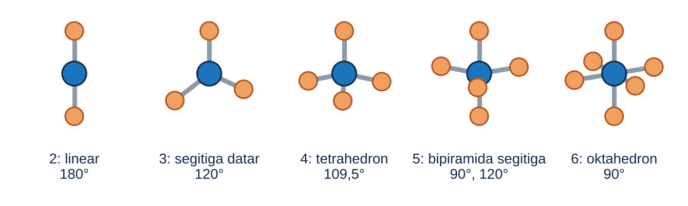
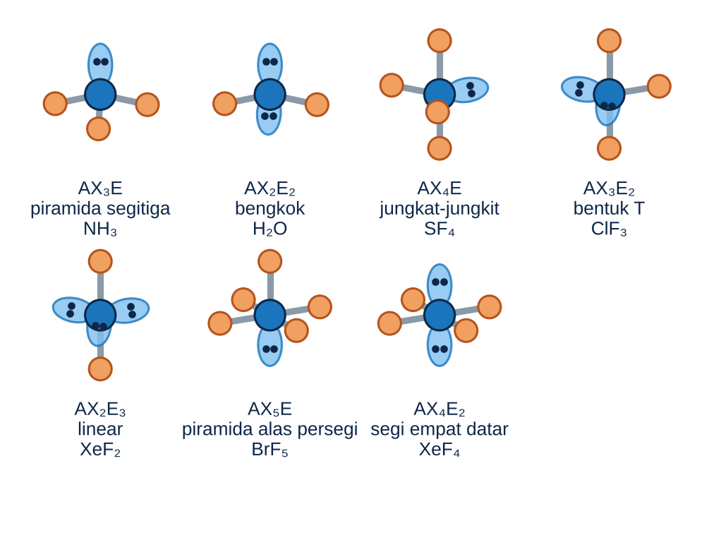
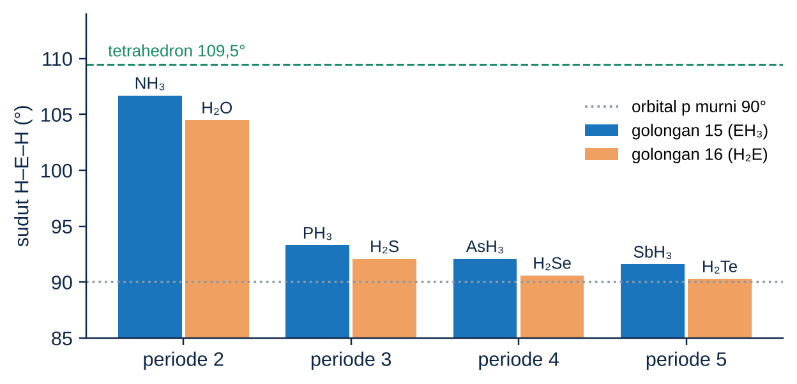
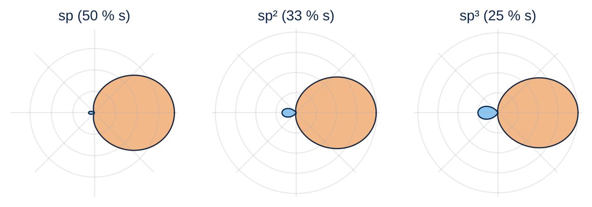

## 2.4 VSEPR: dasar dan geometri dasar

Struktur Lewis memberi tahu kita sambungan atom dan letak pasangan elektron, tetapi tidak bentuk tiga dimensinya. Model yang paling sederhana dan paling berhasil untuk meramalkan bentuk adalah **teori tolakan pasangan elektron kulit valensi** (*valence shell electron pair repulsion*, VSEPR), dikembangkan Ronald Gillespie dan Ronald Nyholm pada 1957.

Gagasannya hanya satu kalimat: **daerah-daerah elektron di sekitar atom pusat saling menolak dan mengatur diri sejauh mungkin satu sama lain**. Yang dihitung adalah **daerah elektron** (sering disebut domain): setiap ikatan (tunggal, rangkap dua, atau rangkap tiga dihitung satu daerah) dan setiap pasangan bebas.

Bila ada *n* daerah elektron, susunan dengan tolakan terkecil adalah susunan yang menjauhkan semuanya sejauh mungkin di permukaan bola. Untuk *n* = 2 sampai 6, susunannya adalah bentuk-bentuk geometri yang sudah dikenal (Gambar 2.1):

{width=96%}

| Daerah elektron | Susunan | Sudut ideal | Contoh tanpa pasangan bebas |
|---|---|---|---|
| 2 | linear | 180° | BeCl₂ (gas), CO₂, HgCl₂ |
| 3 | segitiga datar | 120° | BF₃, SO₃, NO₃⁻ |
| 4 | tetrahedron | 109,5° | CH₄, SiCl₄, SO₄²⁻, NH₄⁺ |
| 5 | bipiramida segitiga | 90° dan 120° | PCl₅, SbCl₅ |
| 6 | oktahedron | 90° | SF₆, [SiF₆]²⁻, [PF₆]⁻ |
| 7 | bipiramida pentagonal | 72° dan 90° | IF₇ |

Notasi yang sering dipakai adalah **AXₘEₙ**: A atom pusat, X atom yang terikat (*m* buah), E pasangan bebas (*n* buah). Jumlah daerah elektron adalah *m* + *n*.

Bipiramida segitiga berbeda dari susunan lain: kelima posisinya **tidak setara**. Dua posisi **aksial** (atas dan bawah) masing-masing mempunyai tiga tetangga pada 90°, sedangkan tiga posisi **ekuatorial** (di bidang tengah) masing-masing hanya mempunyai dua tetangga pada 90° dan dua pada 120°. Posisi ekuatorial lebih lapang, dan fakta ini menjadi penting begitu ada pasangan bebas.

::: {.kuis}
**Kuis cepat 2.4** Berapa daerah elektron di sekitar atom pusat dalam SO₃, SO₄²⁻, dan PF₆⁻? Ramalkan susunannya.
:::

## 2.5 VSEPR: pasangan bebas, ikatan rangkap, dan keelektronegatifan

### Pasangan bebas menentukan bentuk

Susunan daerah elektron dan **bentuk molekul** tidak selalu sama. Bentuk molekul hanya menyebut letak **atom**, karena hanya atom yang dapat "dilihat" oleh difraksi sinar-X atau spektroskopi. Pasangan bebas ikut menentukan susunan, tetapi tidak ikut disebut dalam nama bentuknya. Amonia mempunyai empat daerah (tiga ikatan dan satu pasangan bebas) yang tersusun tetrahedron, tetapi bentuk molekulnya **piramida segitiga**. Air mempunyai empat daerah (dua ikatan, dua pasangan bebas), dan bentuknya **bengkok**.

{width=94%}

Pasangan bebas hanya ditarik oleh **satu** inti, sedangkan pasangan ikatan ditarik oleh dua inti. Akibatnya pasangan bebas lebih "gemuk", lebih dekat ke atom pusat, dan menolak lebih kuat. Urutan kekuatan tolakannya:

$$\text{bebas–bebas} > \text{bebas–ikatan} > \text{ikatan–ikatan}$$

Dari urutan ini muncul dua aturan:

* **Sudut ikatan mengecil bila ada pasangan bebas.** CH₄ 109,5°, NH₃ 106,7°, H₂O 104,5°: setiap pasangan bebas tambahan mendorong ikatan-ikatan lebih rapat.
* **Pada bipiramida segitiga, pasangan bebas menempati posisi ekuatorial**, karena di sana hanya ada dua tetangga pada 90°. Pada oktahedron, dua pasangan bebas menempati posisi yang **berseberangan** (180°), sehingga tidak ada tolakan bebas–bebas pada 90°.

::: {.contoh}
**Contoh 2.5 · Bentuk ClF₃, I₃⁻, dan XeF₄**

Ramalkan bentuk ketiga spesies ini.

**Penyelesaian.** *ClF₃:* Cl 7 + 3 × 7 = 28 elektron. Tiga ikatan dan pasangan bebas F memakai 24, sisa 4 elektron = dua pasangan bebas pada Cl. Lima daerah (AX₃E₂), susunan bipiramida segitiga. Dua pasangan bebas di posisi ekuatorial, sehingga atom F menempati dua posisi aksial dan satu ekuatorial: **bentuk T**. Sudut F(aksial)–Cl–F(ekuatorial) terukur 87,5°, sedikit kurang dari 90° karena didorong pasangan bebas.

*I₃⁻:* dari Contoh 2.4, iodin pusat mempunyai dua ikatan dan tiga pasangan bebas: AX₂E₃, susunan bipiramida segitiga. Ketiga pasangan bebas menempati ketiga posisi ekuatorial, kedua atom I menempati posisi aksial: **linear**.

*XeF₄:* Xe mempunyai empat ikatan dan dua pasangan bebas (Contoh 2.4): AX₄E₂, oktahedron. Dua pasangan bebas berseberangan, empat F di bidang ekuatorial: **segi empat datar**.

**Memahami hasil.** Ketiga hasil ini cocok sepenuhnya dengan struktur yang ditentukan dengan difraksi. Teka-teki pembuka terjawab: CH₄ mempunyai empat daerah (tetrahedron), sedangkan XeF₄ mempunyai enam (oktahedron dengan dua posisi diisi pasangan bebas). Jumlah ikatan sama, jumlah daerah elektron berbeda.
:::

::: {.contoh}
**Contoh 2.6 · Mengapa pasangan bebas SF₄ di posisi ekuatorial?**

SF₄ mempunyai empat ikatan dan satu pasangan bebas (AX₄E). Bandingkan jumlah tolakan pada 90° bila pasangan bebas diletakkan di posisi aksial dan bila di posisi ekuatorial.

**Penyelesaian.** *Pasangan bebas aksial:* pasangan bebas mempunyai tiga tetangga ekuatorial pada 90°, sehingga ada **tiga** tolakan bebas–ikatan pada 90°.

*Pasangan bebas ekuatorial:* pasangan bebas hanya mempunyai dua tetangga pada 90° (kedua posisi aksial), sehingga ada **dua** tolakan bebas–ikatan pada 90°.

Tolakan pada 90° jauh lebih besar daripada tolakan pada 120° atau lebih, sehingga hanya tolakan 90° yang perlu dihitung. Posisi ekuatorial menang: bentuknya **jungkat-jungkit**.

**Memahami hasil.** Data SF₄: sudut F(aksial)–S–F(aksial) 173° (bukan 180°) dan F(ekuatorial)–S–F(ekuatorial) 102° (bukan 120°). Kedua sudut itu lebih kecil daripada ideal, persis karena pasangan bebas ekuatorial mendorong semua ikatan menjauh darinya. Cara menghitung tolakan 90° ini berlaku untuk semua kasus bipiramida segitiga.
:::

### Ikatan rangkap

Ikatan rangkap mengandung empat atau enam elektron, sehingga daerahnya lebih "gemuk" daripada ikatan tunggal dan menolak lebih kuat, walaupun tetap dihitung sebagai satu daerah. Dalam fosgen, COCl₂, susunannya segitiga datar, tetapi sudut Cl–C–Cl hanya 111,8° dan sudut O=C–Cl 124,1°. Ikatan rangkap C=O mendorong kedua ikatan C–Cl lebih rapat.

### Keelektronegatifan

Sudut ikatan juga bergantung pada keelektronegatifan atom yang terikat. Bandingkan NH₃ (106,7°) dengan NF₃ (102,2°), serta H₂O (104,5°) dengan OF₂ (103,1°). Fluorin yang sangat elektronegatif menarik pasangan elektron ikatan menjauh dari atom pusat. Daerah elektron ikatan menjadi lebih ramping di dekat atom pusat dan menolak lebih lemah, sehingga ikatan-ikatan dapat saling mendekat. Sebaliknya, makin elektronegatif **atom pusat**, makin dekat pasangan ikatan ke pusat dan makin besar sudutnya: NH₃ (106,7°) > PH₃ (93,3°).

{width=82%}

::: {.contoh}
**Contoh 2.7 · Mengurutkan sudut ikatan**

Urutkan dari sudut terbesar: (a) NH₃, NF₃, PH₃; (b) H₂O, H₂S, OF₂. Jelaskan.

**Penyelesaian.** (a) NH₃ dan NF₃ mempunyai atom pusat sama, sedangkan F menarik elektron ikatan menjauh dari N, sehingga NF₃ lebih sempit. PH₃ mempunyai atom pusat yang kurang elektronegatif dan lebih besar, sehingga pasangan ikatan lebih jauh dari pusat dan sudut jauh lebih kecil. Urutan: **NH₃ (106,7°) > NF₃ (102,2°) > PH₃ (93,3°)**.

(b) Dengan alasan yang sama: **H₂O (104,5°) > OF₂ (103,1°) > H₂S (92,1°)**.

**Memahami hasil.** Pengaruh atom pusat (periode 2 lawan 3) jauh lebih besar daripada pengaruh atom ujung. Penurunan dari 104,5° ke 92° tidak dapat dijelaskan dengan "keelektronegatifan" saja. Subbab 2.8 akan menunjukkan bahwa pada atom periode 3 ke bawah, orbital s dan p hampir tidak bercampur, dan ikatan dibentuk hampir hanya dengan orbital p.
:::

::: {.kuis}
**Kuis cepat 2.5** Ramalkan bentuk BrF₅, SnCl₂ (gas), dan ICl₄⁻. Pada BrF₅, apakah sudut F(aksial)–Br–F(basal) sedikit lebih besar atau lebih kecil daripada 90°?
:::

## 2.6 Kegagalan VSEPR

VSEPR sangat berhasil untuk senyawa unsur blok p, tetapi ada tiga golongan senyawa yang tidak dapat dijelaskannya.

* **Ion dengan pasangan bebas yang "tidak aktif".** Ion [TeCl₆]²⁻, [SeCl₆]²⁻, dan [SbCl₆]³⁻ mempunyai tujuh daerah elektron (enam ikatan dan satu pasangan bebas). VSEPR meramalkan bentuk yang terdistorsi, tetapi semuanya oktahedron sempurna. Pasangan bebasnya menempati orbital s yang bulat dan tidak mempunyai arah, sehingga tidak menolak ikatan mana pun. Ini adalah kerabat efek pasangan inert (subbab 1.13). Sebaliknya, XeF₆ dengan konfigurasi yang sama berupa oktahedron yang terdistorsi, karena pasangan bebasnya aktif. Batas antara keduanya halus.
* **Molekul ionik logam berat dalam fase gas.** VSEPR meramalkan semua dihalida golongan 2 linear (dua daerah). BeF₂ dan MgF₂ memang linear, tetapi CaF₂, SrF₂, dan BaF₂ dalam fase gas **bengkok**, dengan sudut sekitar 140°, 108°, dan 100°. Kation yang besar mempunyai kulit (n − 1)d yang dapat terpolarisasi oleh ion fluorida, dan polarisasi itulah yang membengkokkan molekul.
* **Kompleks logam transisi.** Bentuk kompleks ditentukan terutama oleh elektron d dan interaksinya dengan ligan, bukan oleh tolakan pasangan elektron. [Ni(CN)₄]²⁻ berbentuk segi empat datar, sedangkan [NiCl₄]²⁻ tetrahedron, walaupun keduanya mempunyai empat ligan. Penjelasannya memerlukan teori medan kristal (Bab 11).

::: {.contoh}
**Contoh 2.8 · Dua ion dengan tujuh daerah elektron**

[IF₆]⁻ dan [TeCl₆]²⁻ sama-sama mempunyai enam ikatan dan satu pasangan bebas. [IF₆]⁻ berupa oktahedron terdistorsi, sedangkan [TeCl₆]²⁻ oktahedron sempurna. Usulkan penyebab perbedaannya.

**Penyelesaian.** Pasangan bebas dapat "aktif secara stereokimia" bila menempati orbital yang mempunyai arah (campuran s dan p) dan cukup dekat dengan pasangan ikatan untuk menolaknya. Atom pusat yang besar dengan ligan yang besar dan banyak (Te dengan enam Cl, jari-jari Cl lebih besar daripada F) tidak menyisakan ruang bagi pasangan bebas untuk menonjol ke satu arah. Pasangan bebas memilih tetap berada di orbital 5s yang bulat. Pada [IF₆]⁻, ligan F yang kecil menyisakan ruang, sehingga pasangan bebas mengambil sebagian karakter p dan menonjol ke satu arah.

**Memahami hasil.** VSEPR menganggap semua daerah elektron menolak dengan cara yang sama. Kenyataannya, ruang di sekitar atom pusat dan energi orbital s ikut menentukan. Bila ragu, struktur terukur adalah hakimnya.
:::

::: {.kuis}
**Kuis cepat 2.6** Mengapa VSEPR tidak dapat menjelaskan perbedaan bentuk [Ni(CN)₄]²⁻ dan [NiCl₄]²⁻?
:::

## 2.7 Teori ikatan valensi dan hibridisasi

VSEPR meramalkan bentuk tanpa menyebut orbital sama sekali. **Teori ikatan valensi** (VB) melengkapinya dengan gambaran orbital: ikatan kovalen terbentuk ketika **orbital-orbital dua atom bertumpang tindih** dan sepasang elektron dengan spin berlawanan menempati daerah tumpang tindih itu. Teori ini diturunkan di Bab 12 *Kimia Kuantum*. Di sini kita merangkum dan memakainya.

### Ikatan σ dan π

Tumpang tindih **ujung ke ujung**, di sepanjang sumbu antar-inti, menghasilkan **ikatan σ**. Tumpang tindih **sisi ke sisi** dua orbital p yang sejajar menghasilkan **ikatan π**, dengan rapat elektron di atas dan di bawah sumbu. Ikatan tunggal adalah satu ikatan σ; ikatan rangkap dua adalah σ + π; ikatan rangkap tiga adalah σ + 2π. Ikatan π hanya terbentuk bila orbital p cukup dekat untuk tumpang tindih sisi ke sisi, dan karena itu ikatan π kuat terutama untuk unsur periode 2 (subbab 1.14).

### Hibridisasi

Orbital atom murni tidak cocok dengan bentuk molekul. Orbital 2p karbon saling tegak lurus (90°), tetapi sudut H–C–H metana 109,5°. Linus Pauling (1931) mengusulkan bahwa atom pusat **mencampur** orbital-orbital valensinya menjadi orbital **hibrida** baru yang mengarah ke sudut-sudut geometri yang sesuai.

| Hibrida | Orbital yang dicampur | Jumlah | Susunan | Sudut | Karakter s |
|---|---|---|---|---|---|
| sp | s + p | 2 | linear | 180° | 50 % |
| sp² | s + 2p | 3 | segitiga datar | 120° | 33 % |
| sp³ | s + 3p | 4 | tetrahedron | 109,5° | 25 % |

{width=86%}

Jumlah orbital hibrida selalu sama dengan jumlah orbital atom yang dicampur, dan jumlah hibrida yang diperlukan sama dengan jumlah daerah elektron VSEPR. Itulah sebabnya VSEPR dan hibridisasi selalu sepakat: empat daerah memerlukan empat hibrida sp³, tiga daerah memerlukan sp², dan seterusnya.

Untuk dua hibrida setara yang masing-masing mempunyai fraksi s sebesar α dan fraksi p sebesar 1 − α, sudut θ di antara keduanya memenuhi

$$\cos\theta = -\frac{\alpha}{1 - \alpha} \qquad \text{(2.2)}$$

Untuk sp³ (α = ¼): $\cos\theta = -\tfrac13$, θ = 109,47°. Untuk sp² (α = ⅓): $\cos\theta = -\tfrac12$, θ = 120°. Persamaan ini dapat dibalik untuk membaca karakter s dari sudut ikatan terukur.

::: {.contoh}
**Contoh 2.9 · Karakter s ikatan O–H dalam air**

Sudut H–O–H dalam air 104,5°. Anggap kedua orbital oksigen yang membentuk ikatan O–H setara. Hitung karakter s masing-masing, lalu karakter s yang tersisa untuk kedua pasangan bebas.

**Penyelesaian.** Dari persamaan (2.2): $\cos 104{,}5° = -0{,}2504 = -\alpha/(1 - \alpha)$. Maka $\alpha = 0{,}2504(1 - \alpha)$, sehingga $\alpha = 0{,}2504 / 1{,}2504 = 0{,}200$. Setiap orbital ikatan O–H mengandung **20 % karakter s**.

Oksigen hanya mempunyai satu orbital 2s, sehingga jumlah karakter s di keempat orbital valensinya tepat 1 (100 %). Kedua orbital ikatan memakai $2 \times 0{,}20 = 0{,}40$. Sisanya, **0,60**, terdapat pada kedua pasangan bebas, masing-masing 30 %.

**Memahami hasil.** Oksigen dalam air **bukan** sp³ murni. Pasangan bebasnya lebih kaya karakter s (30 %) daripada pasangan ikatan (20 %). Ini masuk akal: orbital s lebih dekat ke inti, dan pasangan bebas yang hanya terikat satu inti "lebih suka" berada di orbital yang energinya lebih rendah. Gagasan ini dirumuskan lebih umum dalam aturan Bent (subbab 2.8).
:::

### Hibridisasi bukan sebab, melainkan gambaran

Hibridisasi adalah **cara menggambarkan** ikatan setelah bentuk molekul diketahui, bukan penyebab bentuk itu. Atom tidak "memutuskan" untuk berhibridisasi lalu membentuk ikatan. Bentuk ditentukan oleh energi total molekul, dan hibridisasi hanyalah orbital-orbital yang paling cocok untuk menggambarkan bentuk itu dalam bahasa ikatan lokal dua pusat dua elektron. Bab 4 akan menggambarkan molekul yang sama dengan orbital molekul yang tersebar ke seluruh molekul. Kedua gambaran setara untuk keadaan dasar, dan masing-masing lebih berguna untuk pertanyaan yang berbeda.

::: {.kuis}
**Kuis cepat 2.7** Tentukan hibridisasi atom pusat dalam BF₃, CO₂, NH₄⁺, dan [BF₄]⁻. Berapa ikatan σ dan π dalam N₂ dan dalam CO₂?
:::

## 2.8 Aturan Bent dan karakter s

Pada 1961 Henry Bent merangkum pola yang terlihat pada air dan banyak molekul lain dalam satu kalimat:

::: {.inti}
**Aturan Bent.** Karakter s atom pusat **terkonsentrasi pada orbital yang mengarah ke substituen yang lebih elektropositif** (dan ke pasangan bebas). Orbital yang mengarah ke substituen yang lebih elektronegatif mempunyai karakter p lebih besar.
:::

Alasannya: orbital s lebih rendah energinya dan lebih dekat ke inti. Elektron di orbital yang kaya karakter s lebih "dipegang" oleh atom pusat. Bila pasangan ikatan ditarik oleh substituen yang sangat elektronegatif, atom pusat tidak banyak memperoleh keuntungan dengan memakai orbital s yang berharga untuk ikatan itu. Lebih menguntungkan memakai karakter s untuk ikatan dengan substituen elektropositif, yang pasangan elektronnya lebih banyak berada di dekat atom pusat.

Karakter p yang lebih besar berarti sudut lebih kecil, menurut persamaan (2.2). Jadi sudut **di antara dua substituen elektronegatif lebih kecil** daripada sudut di antara dua substituen elektropositif.

::: {.contoh}
**Contoh 2.10 · Sudut dalam CH₂F₂**

Dalam difluorometana, CH₂F₂, sudut F–C–F sekitar 108,3° dan sudut H–C–H sekitar 113,7°. Jelaskan dengan aturan Bent, lalu hitung karakter s orbital karbon yang mengarah ke F dan ke H (anggap pasangan orbital setara).

**Penyelesaian.** Fluorin jauh lebih elektronegatif daripada hidrogen, sehingga menurut aturan Bent orbital C→F mendapat lebih banyak karakter p (sudut lebih kecil) dan orbital C→H lebih banyak karakter s (sudut lebih besar). Dengan persamaan (2.2):

*C→F:* $\cos 108{,}3° = -0{,}314$; $\alpha = 0{,}314/1{,}314 = 0{,}239$, sekitar 24 % s.
*C→H:* $\cos 113{,}7° = -0{,}402$; $\alpha = 0{,}402/1{,}402 = 0{,}287$, sekitar 29 % s.

Pemeriksaan: $2(0{,}239) + 2(0{,}287) = 1{,}05$, mendekati 1 sebagaimana seharusnya (perbedaan kecil karena anggapan setara dan pembulatan sudut).

**Memahami hasil.** Karbon dalam CH₂F₂ bukan sp³ murni: ikatan C–H mendapat karakter s lebih banyak daripada ikatan C–F. Akibat yang dapat diukur: ikatan C–H dalam CH₂F₂ lebih pendek dan lebih asam daripada dalam CH₄. Aturan Bent juga menjelaskan mengapa pada PCl₃F₂ yang berbentuk bipiramida segitiga, atom F yang lebih elektronegatif menempati posisi **aksial**: orbital aksial mempunyai karakter p lebih besar.
:::

### Mengapa sudut hidrida periode 3 mendekati 90°

Kembali ke Gambar 2.3. Untuk PH₃ (93,3°), persamaan (2.2) memberi karakter s ikatan P–H hanya sekitar 5 %. Untuk H₂S (92,1°), sekitar 3,5 %. Artinya atom pusat periode 3 ke bawah membentuk ikatan **hampir hanya dengan orbital p**, dan orbital s-nya ditempati pasangan bebas.

Ada dua penyebab. Pertama, selisih energi antara orbital *n*s dan *n*p makin besar ke bawah golongan (orbital s menembus dan merasakan *Z*ₑf besar, subbab 1.4–1.5), sehingga mencampur keduanya makin mahal. Kedua, orbital 3p dan 4p lebih besar dan menyebar, sehingga tumpang tindihnya dengan orbital 1s hidrogen tidak banyak bertambah bila diberi karakter s. Hasilnya adalah kecenderungan yang sama dengan efek pasangan inert: ke bawah golongan, pasangan elektron *n*s makin enggan ikut berikatan.

::: {.awas}
**Awas: "sp³" untuk semua atom dengan empat daerah elektron.** Menyebut nitrogen dalam NH₃ dan fosfor dalam PH₃ sama-sama sp³ akan menyembunyikan perbedaan besar di antara keduanya. Label hibridisasi bulat (sp, sp², sp³) adalah pendekatan. Untuk unsur periode 3 ke bawah, gambaran "ikatan p dan pasangan bebas s" sering lebih mendekati kenyataan.
:::

::: {.kuis}
**Kuis cepat 2.8** Pada SF₄ (jungkat-jungkit), atom F aksial atau ekuatorial yang mempunyai ikatan S–F lebih panjang? Gunakan aturan Bent: posisi mana yang memakai orbital dengan karakter p lebih besar?
:::
