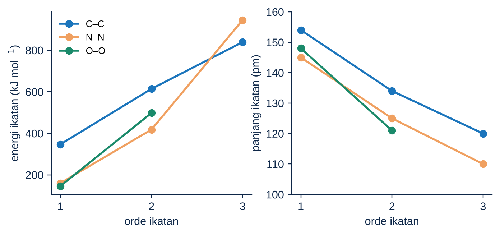
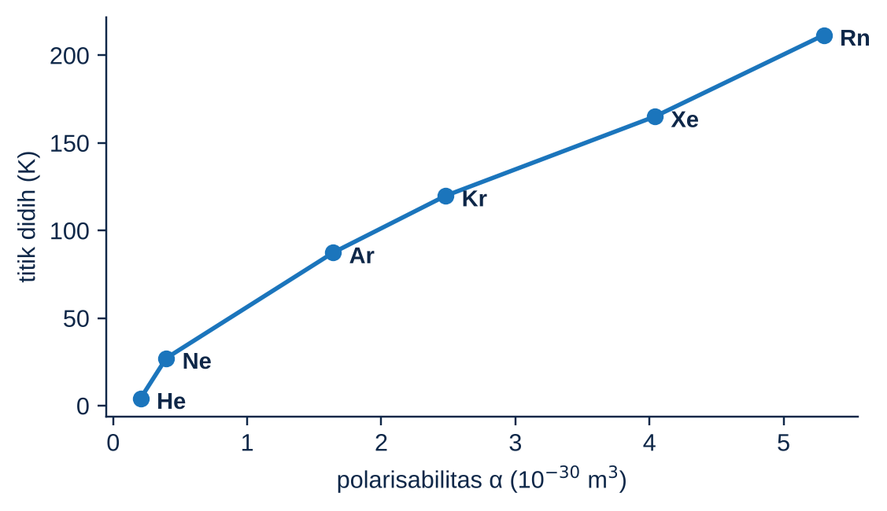
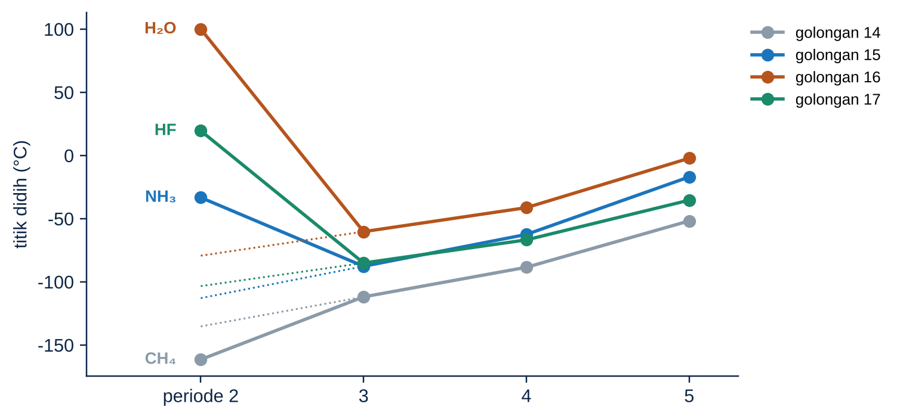

## 2.9 Kepolaran dan momen dipol

Bila dua atom yang berbeda keelektronegatifan berbagi sepasang elektron, pasangan itu condong ke atom yang lebih elektronegatif. Atom itu mendapat muatan parsial negatif, δ−, dan pasangannya muatan parsial positif, δ+. Ikatan seperti ini disebut **ikatan kovalen polar**.

### Momen dipol

Ukuran kuantitatif kepolaran adalah **momen dipol**, μ. Untuk dua muatan +*q* dan −*q* yang terpisah sejauh *d*:

$$\mu = q\,d \qquad \text{(2.3)}$$

Satuan SI-nya C m, tetapi kimiawan memakai **debye** (D): 1 D = 3,336 × 10⁻³⁰ C m. Sebagai patokan, satu muatan elektron dan satu muatan proton yang terpisah 100 pm mempunyai momen dipol 4,80 D. Momen dipol adalah besaran **vektor**. Dalam buku ini panah dipol digambar dari ujung positif ke ujung negatif, kebiasaan yang umum dalam kimia.

::: {.contoh}
**Contoh 2.11 · Muatan parsial dalam hidrogen halida**

Momen dipol HCl 1,109 D dan panjang ikatannya 127,4 pm. Hitung muatan parsial *q* sebagai fraksi muatan elektron. Bandingkan dengan HF (1,826 D, 91,7 pm).

**Penyelesaian.** Dari persamaan (2.3), $q = \mu / d$:

$$q_\text{HCl} = \frac{1{,}109 \times 3{,}336 \times 10^{-30}\ \text{C m}}{127{,}4 \times 10^{-12}\ \text{m}} = 2{,}904 \times 10^{-20}\ \text{C}$$

Dibagi muatan elektron (1,602 × 10⁻¹⁹ C): $q/e = 0{,}181$. Dengan cara yang sama, untuk HF: $q/e = 0{,}415$.

**Memahami hasil.** Ikatan H–Cl berperilaku seakan-akan 18 % satu muatan elektron berpindah dari H ke Cl, sedangkan pada H–F sekitar 42 %. Urutan ini sesuai dengan selisih keelektronegatifan (0,96 dan 1,78, subbab 1.11). Untuk HBr dan HI hasilnya 12 % dan 6 %. Angka-angka ini menunjukkan secara langsung bahwa tidak ada garis tajam antara ikatan kovalen dan ionik.
:::

### Kepolaran molekul

Molekul dengan ikatan polar belum tentu polar. Momen dipol molekul adalah **jumlah vektor** semua momen dipol ikatan, ditambah sumbangan pasangan bebas. Pada molekul yang simetris, vektor-vektor itu saling meniadakan.

{width=94%}

* CO₂ (linear), BF₃ (segitiga datar), CCl₄ (tetrahedron), SF₆ (oktahedron), XeF₄ (segi empat datar): semua ikatannya polar, tetapi **μ = 0**.
* H₂O (bengkok, 1,85 D), NH₃ (piramida, 1,47 D), SO₂ (bengkok, 1,63 D), SF₄ (jungkat-jungkit, 0,63 D): **polar**.

Teka-teki NH₃ lawan NF₃ diselesaikan oleh pasangan bebas. Pada NH₃, ikatan N–H polar ke arah N (N lebih elektronegatif), dan pasangan bebas di puncak piramida juga menyumbang dipol ke arah yang sama: kedua sumbangan menjumlah, μ = 1,47 D. Pada NF₃, ikatan N–F polar ke arah F, ke bawah, sedangkan pasangan bebas tetap menyumbang ke atas: kedua sumbangan hampir saling meniadakan, μ = 0,23 D.

::: {.contoh}
**Contoh 2.12 · Molekul mana yang polar?**

Tentukan apakah molekul berikut polar: PCl₅, SF₄, XeF₂, ClF₃, SO₃, CHCl₃.

**Penyelesaian.** Tentukan bentuk dengan VSEPR, lalu periksa apakah dipol ikatan saling meniadakan.

* PCl₅: bipiramida segitiga tanpa pasangan bebas. Tiga dipol ekuatorial meniadakan satu sama lain, dua aksial juga. **Nonpolar.**
* SF₄: jungkat-jungkit, pasangan bebas di ekuatorial. Tidak simetris. **Polar.**
* XeF₂: linear (pasangan bebas di tiga posisi ekuatorial, simetris). **Nonpolar.**
* ClF₃: bentuk T. **Polar.**
* SO₃: segitiga datar. **Nonpolar.**
* CHCl₃: tetrahedron dengan satu H dan tiga Cl, tidak simetris. **Polar** (1,04 D).

**Memahami hasil.** Langkah kuncinya selalu sama: bentuk dulu, baru kepolaran. Kesimetrian dapat ditentukan dengan lebih ketat memakai teori grup (Bab 3): molekul hanya dapat polar bila grup titiknya tidak mempunyai pusat inversi dan tidak mempunyai lebih dari satu sumbu putar.
:::

::: {.kuis}
**Kuis cepat 2.9** Mana yang mempunyai momen dipol lebih besar: CH₃Cl atau CCl₄; cis- atau trans-PtCl₂(NH₃)₂; SO₂ atau CO₂? Jelaskan.
:::

## 2.10 Panjang, kekuatan, dan entalpi ikatan

### Orde ikatan

Makin banyak pasangan elektron yang dibagi di antara dua atom, makin kuat dan makin pendek ikatannya. Gambar 2.6 memperlihatkan pola ini untuk ikatan C–C, N–N, dan O–O.

{width=90%}

Dua hal penting terlihat. Pertama, energi ikatan rangkap **tidak** sama dengan dua kali ikatan tunggal. Untuk karbon, ikatan π pertama menambah 267 kJ mol⁻¹ (614 − 347) dan ikatan π kedua 225 kJ mol⁻¹, keduanya lebih lemah daripada ikatan σ. Kedua, untuk nitrogen kebalikannya: ikatan tunggal N–N sangat lemah (160 kJ mol⁻¹, karena tolakan pasangan bebas, subbab 1.14), sedangkan ikatan π menambah 258 dan kemudian 527 kJ mol⁻¹. Itulah sebabnya N≡N (945 kJ mol⁻¹) adalah salah satu ikatan terkuat dalam kimia, dan mengapa banyak senyawa nitrogen (azida, nitro, nitrat organik) cenderung meledak membentuk N₂.

Tabel 2.1 Energi ikatan rata-rata (kJ mol⁻¹) dan panjang ikatan khas (pm).

| Ikatan | *D* | *r* | Ikatan | *D* | *r* | Ikatan | *D* | *r* |
|---|---|---|---|---|---|---|---|---|
| H–H | 436 | 74 | C–C | 347 | 154 | N–N | 160 | 145 |
| C–H | 413 | 109 | C=C | 614 | 134 | N=N | 418 | 125 |
| N–H | 391 | 101 | C≡C | 839 | 120 | N≡N | 945 | 110 |
| O–H | 463 | 96 | C–O | 358 | 143 | O–O | 146 | 148 |
| F–H | 570 | 92 | C=O (CO₂) | 799 | 116 | O=O | 498 | 121 |
| Si–O | 452 | 163 | C≡O | 1072 | 113 | F–F | 159 | 142 |

### Menaksir entalpi reaksi

Energi ikatan rata-rata dapat dipakai untuk **menaksir** entalpi reaksi dalam fase gas. Reaksi dapat dibayangkan sebagai dua langkah: semua ikatan pereaksi diputus (menyerap energi), lalu semua ikatan hasil dibentuk (melepaskan energi):

$$\Delta H \approx \sum D(\text{diputus}) - \sum D(\text{dibentuk}) \qquad \text{(2.4)}$$

::: {.contoh}
**Contoh 2.13 · Pembentukan amonia dan pembakaran metana**

Taksir Δ*H* untuk (a) N₂(g) + 3 H₂(g) → 2 NH₃(g) dan (b) CH₄(g) + 2 O₂(g) → CO₂(g) + 2 H₂O(g) dengan Tabel 2.1. Data terukur: −92 dan −802 kJ.

**Penyelesaian.** (a) Diputus: satu N≡N dan tiga H–H, $945 + 3(436) = 2253$ kJ. Dibentuk: enam N–H, $6(391) = 2346$ kJ. $\Delta H \approx 2253 - 2346 = -93$ kJ.

(b) Diputus: empat C–H dan dua O=O, $4(413) + 2(498) = 2648$ kJ. Dibentuk: dua C=O dalam CO₂ dan empat O–H, $2(799) + 4(463) = 3450$ kJ. $\Delta H \approx 2648 - 3450 = -802$ kJ.

**Memahami hasil.** Kedua taksiran sangat dekat dengan nilai terukur. Untuk reaksi lain kesalahannya bisa beberapa puluh kJ, karena energi ikatan rata-rata adalah rata-rata dari banyak senyawa, sedangkan energi sebuah ikatan bergantung pada lingkungannya. Untuk hitungan yang tepat, gunakan entalpi pembentukan standar (*Termodinamika Kimia*, Bab 4). Perhatikan pula pada (a): reaksi yang memutus ikatan N≡N yang sangat kuat hanya sedikit eksoterm, dan memerlukan katalis serta suhu tinggi untuk berlangsung cepat. Inilah tantangan proses Haber–Bosch.
:::

::: {.kuis}
**Kuis cepat 2.10** Taksir Δ*H* untuk H₂(g) + F₂(g) → 2 HF(g) dengan Tabel 2.1. Mengapa reaksi ini sangat eksoterm walaupun ikatan H–H kuat?
:::

## 2.11 Spesies isoelektronik dan isolobal sederhana

Dua spesies disebut **isoelektronik** bila mempunyai jumlah elektron valensi yang sama dan kerangka atom yang sama. Spesies isoelektronik mempunyai struktur Lewis yang serupa dan, karena itu, bentuk yang sama.

Tabel 2.2 Beberapa deret isoelektronik.

| Elektron valensi | Spesies | Bentuk |
|---|---|---|
| 10 (diatomik) | N₂, CO, CN⁻, NO⁺, C₂²⁻ | linear, ikatan rangkap tiga |
| 16 (triatomik) | CO₂, N₂O, NO₂⁺, N₃⁻, NCO⁻, OCN⁻ | linear |
| 8 (AH₄) | CH₄, NH₄⁺, BH₄⁻ | tetrahedron |
| 24 (AX₃) | BF₃, CO₃²⁻, NO₃⁻, SO₃ | segitiga datar |
| 32 (AX₄) | SiF₄, PO₄³⁻, SO₄²⁻, ClO₄⁻ | tetrahedron |
| 30 (B₃N₃H₆ lawan C₆H₆) | borazina dan benzena | cincin datar |

::: {.contoh}
**Contoh 2.14 · Meramalkan dari spesies isoelektronik**

(a) Ion azida, N₃⁻, isoelektronik dengan CO₂. Ramalkan bentuk dan orde ikatannya. (b) Mengapa CO dan N₂ isoelektronik, tetapi CO jauh lebih reaktif sebagai ligan logam?

**Penyelesaian.** (a) CO₂ linear dengan dua ikatan rangkap. Maka N₃⁻ juga linear, dengan dua ikatan N=N (orde ikatan 2 masing-masing, pada struktur penyumbang utama ⁻N=N⁺=N⁻). Kedua ikatan N–N dalam azida memang sama panjang, 116 pm.

(b) Isoelektronik berarti struktur Lewis sama, tetapi distribusi elektron tidak sama. Pada CO, atom karbon yang kurang elektronegatif membawa muatan formal −1 dan pasangan bebas yang energinya cukup tinggi, sehingga mudah disumbangkan ke logam. N₂ simetris dan pasangan bebasnya lebih rendah energinya. Bab 4 menjelaskannya dengan orbital molekul: HOMO CO terpusat pada karbon.

**Memahami hasil.** Prinsip isoelektronik meramalkan **bentuk** dengan sangat baik, tetapi tidak selalu meramalkan **reaktivitas**. Kemiripan bentuk borazina dan benzena, misalnya, tidak berarti kemiripan reaksi: ikatan B–N polar, sehingga borazina mudah diadisi air dan HCl, sedangkan benzena tidak.
:::

Gagasan yang lebih luas adalah **analogi isolobal**: dua fragmen molekul isolobal bila orbital-orbital terluarnya mempunyai jumlah, bentuk, dan isi elektron yang serupa. Fragmen CH₃ dan Mn(CO)₅, misalnya, sama-sama mempunyai satu orbital setengah terisi yang mengarah keluar, sehingga keduanya dapat membentuk dimer (C₂H₆ dan Mn₂(CO)₁₀). Analogi ini dibahas lebih lanjut dalam kimia organologam.

::: {.kuis}
**Kuis cepat 2.11** Sebutkan satu spesies yang isoelektronik dengan (a) NO₃⁻, (b) ClO₄⁻, (c) NH₄⁺. Ramalkan bentuk ion sianat, OCN⁻.
:::

## 2.12 Gaya-gaya kimia antarmolekul

Ikatan kovalen mengikat atom **di dalam** molekul. Gaya yang lebih lemah bekerja **di antara** molekul, dan gaya-gaya inilah yang menentukan apakah sebuah zat berupa gas, cairan, atau padatan pada suhu kamar, serta apakah ia larut dalam air. Semuanya berasal dari tarikan listrik antara muatan, tetapi dalam bentuk yang berbeda.

Tabel 2.3 Gaya antarmolekul dan besarnya yang khas.

| Gaya | Antara | Bergantung pada jarak | Energi khas (kJ mol⁻¹) |
|---|---|---|---|
| ion–ion | ion bermuatan | $1/r$ | 400–4000 (dalam kisi) |
| ion–dipol | ion dan molekul polar | $1/r^2$ | 40–600 (hidrasi ion) |
| dipol–dipol | dua molekul polar | $1/r^3$ (rata-rata termal $1/r^6$) | 1–5 |
| dispersi London | semua molekul | $1/r^6$ | 0,1–40 |
| ikatan hidrogen | X–H···Y, X dan Y sangat elektronegatif | pendek, terarah | 10–40 (sampai 160) |

### Ion–dipol

Ketika garam larut dalam air, setiap ion dikelilingi molekul air yang mengarahkan ujung berlawanan muatan ke arahnya: ujung O (δ−) ke kation, ujung H (δ+) ke anion. Energi interaksi ini, **entalpi hidrasi**, sangat besar untuk ion kecil bermuatan besar (Mg²⁺, Al³⁺), dan menjadi kunci kelarutan garam (Bab 6 dan 10).

### Dipol–dipol

Molekul polar saling menarik dengan mengarahkan ujung positif ke ujung negatif molekul tetangga. Gerak termal terus mengacak arah molekul, sehingga tarikan rata-ratanya lemah dan menurun cepat dengan jarak.

### Gaya dispersi London

Bahkan atom gas mulia dan molekul nonpolar seperti N₂ dan CH₄ dapat dicairkan, jadi pasti ada tarikan di antara mereka. Pada 1930 Fritz London menjelaskannya: awan elektron selalu bergerak, sehingga pada setiap saat sebuah atom mempunyai **dipol sesaat** kecil. Dipol sesaat ini menginduksi dipol pada atom tetangga, dan kedua dipol itu saling menarik. Gaya ini disebut **gaya dispersi London** dan bekerja di antara **semua** molekul.

Besarnya gaya dispersi bergantung pada **polarisabilitas** (subbab 1.12): makin besar dan makin longgar awan elektron, makin mudah terbentuk dipol sesaat, makin kuat gayanya. Gambar 2.7 memperlihatkannya untuk gas mulia: titik didih naik hampir sebanding dengan polarisabilitas, dari helium (4,2 K) sampai radon (211,5 K).

{width=70%}

::: {.contoh}
**Contoh 2.15 · Titik didih halogen**

Titik didih halogen: F₂ −188 °C, Cl₂ −34 °C, Br₂ 59 °C, I₂ 184 °C. Jelaskan mengapa pada suhu kamar F₂ dan Cl₂ gas, Br₂ cair, dan I₂ padat.

**Penyelesaian.** Keempatnya molekul nonpolar, sehingga satu-satunya gaya antarmolekul adalah gaya dispersi. Dari F₂ ke I₂, jumlah elektron naik dari 18 ke 106 dan awan elektron makin besar dan longgar. Polarisabilitas naik tajam, gaya dispersi makin kuat, dan titik didih naik lebih dari 370 derajat.

**Memahami hasil.** Gaya dispersi sering dianggap "gaya lemah", tetapi untuk molekul besar ia bisa menjadi gaya antarmolekul yang terkuat. Iodin padat bertahan pada suhu kamar hanya karena gaya dispersi. Pada molekul besar seperti polietilena, gaya dispersi yang dijumlahkan di sepanjang rantai panjang membuat plastik itu padat dan kuat.
:::

::: {.kuis}
**Kuis cepat 2.12** Urutkan titik didih: Ar, Kr, CH₄, SiH₄. Gaya antarmolekul apa yang terlibat?
:::

## 2.13 Ikatan hidrogen dan akibatnya

Gambar 2.8 memperlihatkan salah satu grafik terpenting dalam kimia. Titik didih hidrida golongan 14 (CH₄, SiH₄, GeH₄, SnH₄) naik teratur ke bawah golongan, sesuai dengan gaya dispersi yang makin besar. Hidrida golongan 15, 16, dan 17 mengikuti pola yang sama dari periode 3 ke bawah, tetapi hidrida periode 2, yaitu NH₃, H₂O, dan HF, **melonjak** jauh di atas garis.

{width=82%}

::: {.contoh}
**Contoh 2.16 · Seberapa besar lonjakan titik didih air?**

Dengan memperpanjang garis lurus titik didih H₂S (−60,3 °C), H₂Se (−41,3 °C), dan H₂Te (−2,2 °C) ke periode 2, taksir titik didih air bila tidak ada ikatan hidrogen. Lakukan juga untuk HF dan NH₃.

**Penyelesaian.** Garis lurus terbaik melalui ketiga titik (periode 3, 4, 5) dengan regresi linear memberi titik didih sekitar −93 °C untuk periode 2. Air sebenarnya mendidih pada 100 °C, sehingga ikatan hidrogen menaikkan titik didihnya sekitar **193 derajat**. Dengan cara yang sama: HF terukur 19,5 °C, ekstrapolasi −112 °C, selisih sekitar 132 derajat; NH₃ terukur −33,3 °C, ekstrapolasi −126 °C, selisih sekitar 93 derajat. CH₄ justru sedikit **di bawah** ekstrapolasinya.

**Memahami hasil.** Tanpa ikatan hidrogen, air akan menjadi gas pada suhu kamar, dan Bumi tidak akan mempunyai lautan. Urutan lonjakan H₂O > HF > NH₃ mencerminkan dua hal: kekuatan setiap ikatan hidrogen (terkuat untuk F, karena paling elektronegatif) dan **jumlah** ikatan hidrogen per molekul. Setiap molekul air dapat membentuk empat ikatan hidrogen (dua lewat H-nya, dua lewat pasangan bebasnya), sedangkan HF rata-rata hanya dua dan NH₃ dibatasi oleh hanya satu pasangan bebas.
:::

### Apa itu ikatan hidrogen

**Ikatan hidrogen** adalah tarikan antara atom hidrogen yang terikat pada atom sangat elektronegatif X (F, O, N) dan pasangan bebas pada atom elektronegatif Y di molekul lain: X–H···Y. Ada tiga syarat yang membuatnya istimewa:

* Ikatan X–H sangat polar, sehingga H membawa muatan positif parsial yang besar.
* Hidrogen sangat kecil dan tidak mempunyai elektron dalam, sehingga pasangan bebas Y dapat mendekat sangat rapat ke protonnya.
* Interaksinya **terarah**: paling kuat bila X–H···Y segaris.

Ikatan hidrogen biasa berkekuatan sekitar 10–40 kJ mol⁻¹ (sekitar 20 kJ mol⁻¹ dalam air), sepuluh kali gaya dipol–dipol biasa tetapi sepuluh kali lebih lemah daripada ikatan kovalen. Ion bifluorida, [F–H–F]⁻, mempunyai ikatan hidrogen terkuat yang dikenal, sekitar 160 kJ mol⁻¹. Kedua jarak H–F di sana sama, dan proton terletak tepat di tengah: ikatan hidrogen yang sangat kuat menjadi sulit dibedakan dari ikatan kovalen tiga pusat.

### Akibat ikatan hidrogen

* **Es mengapung.** Dalam es, setiap molekul air membentuk empat ikatan hidrogen yang tersusun tetrahedron, menghasilkan kisi terbuka dengan banyak ruang kosong. Ketika es mencair, sebagian ikatan putus dan molekul dapat saling mendekat, sehingga air cair lebih rapat daripada es (massa jenis maksimum pada 4 °C). Bab 12 kembali ke air dan es.
* **Kalor penguapan dan kapasitas kalor air yang besar**, yang menstabilkan iklim Bumi dan suhu tubuh.
* **Struktur biomolekul.** Pasangan basa DNA dan bentuk heliks protein dipertahankan oleh ikatan hidrogen.
* **Kelarutan.** Amonia, metanol, dan HF sangat larut dalam air karena dapat membentuk ikatan hidrogen dengan air.

::: {.awas}
**Awas: H dalam CH₄ dan HCl.** Tidak setiap atom hidrogen dapat membentuk ikatan hidrogen yang berarti. Ikatan C–H hampir tidak polar, sehingga metana tidak membentuk ikatan hidrogen. Klorin cukup elektronegatif tetapi besar, sehingga pasangan bebasnya menyebar dan ikatan hidrogen Cl–H···Cl lemah. Itulah sebabnya HCl mendidih pada −85 °C, jauh di bawah HF.
:::

::: {.kuis}
**Kuis cepat 2.13** Mengapa etanol (C₂H₅OH, 78 °C) mendidih jauh lebih tinggi daripada dimetil eter (CH₃OCH₃, −24 °C), padahal rumus molekulnya sama? Mengapa HF cair tetapi HCl gas pada 0 °C?
:::

## Menuju bab berikutnya

Teka-teki XeF₄ terjawab oleh satu gagasan: bentuk ditentukan oleh **semua** pasangan elektron di sekitar atom pusat. Metana mempunyai empat pasangan, tersusun tetrahedron. Xenon dalam XeF₄ mempunyai enam pasangan, tersusun oktahedron, dan dua pasangan bebas memilih posisi berseberangan sehingga keempat atom fluorin tertinggal dalam satu bidang. Gagasan yang sama menjelaskan bentuk T ClF₃, bentuk jungkat-jungkit SF₄, dan ion I₃⁻ yang linear.

Bab ini membangun alat-alat ikatan lokal: struktur Lewis, muatan formal, bilangan oksidasi, VSEPR, hibridisasi, dan aturan Bent. Dengan alat-alat itu kita dapat meramalkan bentuk dan kepolaran molekul, menaksir entalpi reaksi, dan menjelaskan gaya antarmolekul yang menentukan sifat fisis zat. Namun ada pertanyaan yang tidak dapat dijawab model-model ini. Mengapa O₂ bersifat paramagnetik? Bagaimana diborana dapat mempunyai atom hidrogen yang menjembatani dua atom boron? Mengapa CO terikat ke logam lewat karbon, bukan oksigen? Untuk menjawabnya kita memerlukan orbital yang tersebar ke seluruh molekul, yaitu **orbital molekul**. Langkah pertama adalah bahasa yang memungkinkan kita memilih orbital mana yang boleh bergabung: **simetri molekul dan teori grup** (Bab 3), yang kemudian dipakai untuk menyusun diagram orbital molekul di Bab 4.
