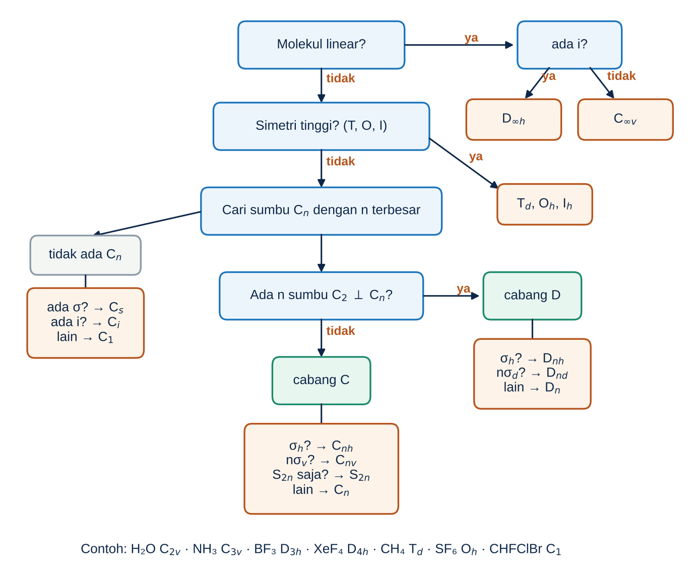

# Bab 3 Simetri Molekul dan Teori Grup

Pada 1965 Barnett Rosenberg, seorang ahli biofisika di Michigan, mengalirkan arus listrik melalui elektrode platina yang dicelupkan ke biakan bakteri. Bakterinya berhenti membelah dan tumbuh memanjang seperti benang. Penyebabnya ternyata bukan arus listrik, melainkan sedikit senyawa platina yang terlarut dari elektrode: Pt(NH₃)₂Cl₂. Senyawa ini kemudian menjadi **cisplatin**, salah satu obat kanker yang paling banyak dipakai di dunia. Yang mengherankan, ada dua senyawa dengan rumus yang sama persis. Keduanya serbuk kuning, keduanya mempunyai satu atom platina dikelilingi dua NH₃ dan dua Cl dalam satu bidang datar. Pada isomer **cis**, kedua atom Cl bersebelahan. Pada isomer **trans**, keduanya berseberangan. Isomer cis membunuh sel kanker, sedangkan isomer trans hampir tidak aktif. Bagaimana kimiawan memastikan isomer mana yang ada di dalam botol, sebelum ada alat difraksi sinar-X di setiap laboratorium?

Jawabannya ternyata dapat diperoleh hanya dengan **menghitung**. Spektrum inframerah isomer cis menunjukkan **dua** pita regangan Pt–Cl, sedangkan isomer trans hanya **satu**. Hitungan itu dapat diramalkan dengan teliti dari **simetri** kedua molekul, tanpa perhitungan kuantum yang rumit. Bahasa yang memungkinkan ramalan seperti itu adalah **teori grup**, cabang matematika tentang simetri.

Bab ini membangun bahasa itu langkah demi langkah. Kita mulai dari hal yang bisa dilihat: unsur dan operasi simetri sebuah molekul. Lalu kita belajar menggolongkan setiap molekul ke dalam **grup titik**, dan melihat bahwa grup titik saja sudah memberi tahu apakah molekul itu kiral atau polar. Setelah itu kita menerjemahkan operasi simetri menjadi matriks dan **karakter**, membaca **tabel karakter**, dan memakai **rumus reduksi** untuk menguraikan gerakan molekul menjadi bagian-bagian yang sesuai dengan simetrinya. Dengan alat-alat itu kita akan menghitung berapa pita IR dan Raman yang dimiliki sebuah molekul, menjawab teka-teki cisplatin, dan menyusun **kombinasi orbital teradaptasi simetri** yang menjadi bahan baku diagram orbital molekul di Bab 4.

::: {.kuis}
**Pertanyaan pembuka**

1. Apa bedanya "unsur simetri" dan "operasi simetri"? Mengapa keduanya perlu dibedakan?
2. Molekul CH₄ tidak mempunyai bidang cermin yang tegak lurus sumbu C₂-nya. Mengapa ia tetap dapat "dicerminkan" ke dirinya sendiri dengan operasi S₄?
3. Bagaimana kita dapat memastikan bahwa sebuah molekul kiral hanya dengan melihat simetrinya, tanpa membuat bayangan cerminnya?
4. Mengapa SF₆ mempunyai 15 mode getaran, tetapi spektrum IR-nya hanya menunjukkan 2 pita?
5. Mengapa tidak ada mode getaran CO₂ yang aktif sekaligus di IR dan di Raman?
6. Bagaimana dua isomer Pt(NH₃)₂Cl₂ dapat dibedakan dari spektrum inframerahnya?
:::

::: {.tujuan}
**Tujuan belajar**

Setelah mempelajari bab ini, kamu mampu:

1. Mengenali unsur simetri (E, Cₙ, σ, i, Sₙ) pada molekul dan menjalankan operasi simetrinya.
2. Menentukan grup titik molekul dengan diagram alir.
3. Meramalkan kepolaran dan kiralitas molekul dari grup titiknya.
4. Menuliskan matriks operasi simetri dan menghitung karakternya.
5. Membaca tabel karakter: label Mulliken, karakter, dan fungsi basis.
6. Menguraikan representasi tereduksi dengan rumus reduksi.
7. Menghitung mode getaran sebuah molekul dan meramalkan pita IR dan Raman, termasuk untuk membedakan isomer.
8. Menyusun kombinasi linear teradaptasi simetri (SALC) dengan operator proyeksi, dan menentukan orbital atom pusat mana yang dapat bergabung dengannya.
:::

::: {.mat}
**Prasyarat**

Bab 2 buku ini: bentuk molekul dengan VSEPR (subbab 2.4–2.5). Dari *Kimia Kuantum*: Bab 10 (teori grup dari sudut pandang mekanika kuantum) dan perkalian matriks (Bab 2). Bab ini dapat dibaca tanpa *Kimia Kuantum*: semua alat matematika diperkenalkan di sini, dengan penekanan pada penerapan dalam kimia anorganik.
:::

## 3.1 Unsur dan operasi simetri

Ambil sebuah molekul air dan putar setengah lingkaran (180°) mengelilingi garis yang membagi sudut H–O–H. Kedua atom hidrogen bertukar tempat, tetapi karena keduanya identik, molekul setelah diputar tampak **persis sama** dengan sebelumnya. Kalau kamu memejamkan mata ketika putaran itu dilakukan, kamu tidak akan tahu bahwa molekul sudah diputar. Gerakan seperti ini disebut **operasi simetri**: gerakan yang membawa molekul ke posisi yang tidak dapat dibedakan dari posisi semula.

Setiap operasi simetri dilakukan terhadap suatu benda geometris: garis, bidang, atau titik. Benda geometris itu disebut **unsur simetri**. Garis yang menjadi poros putaran pada air adalah unsur simetri; putarannya sendiri adalah operasi simetri. Pembedaan ini terdengar sepele, tetapi penting, karena satu unsur dapat menghasilkan beberapa operasi. Sumbu putar tiga kali pada amonia, misalnya, menghasilkan putaran 120° dan putaran 240°, dua operasi yang berbeda.

Untuk molekul, cukup ada lima jenis unsur simetri. Semuanya melewati satu titik yang tetap, yaitu pusat massa molekul. Karena itu himpunan simetri sebuah molekul disebut **grup titik**.

Tabel 3.1 Lima jenis unsur dan operasi simetri.

| Lambang | Unsur | Operasi |
|---|---|---|
| E | (identitas) | tidak melakukan apa-apa |
| Cₙ | sumbu putar *n*-kali | putar 360°/*n* |
| σ | bidang cermin | cerminkan setiap atom melalui bidang |
| i | pusat inversi | bawa setiap atom (*x*, *y*, *z*) ke (−*x*, −*y*, −*z*) |
| Sₙ | sumbu putar tak wajar | putar 360°/*n*, lalu cerminkan melalui bidang ⟂ sumbu |

### Identitas, E

Operasi yang tidak melakukan apa-apa tampak tidak berguna, tetapi diperlukan karena alasan matematis yang akan terlihat di subbab 3.4: setiap grup harus mempunyai unsur yang "netral", seperti angka 1 dalam perkalian. Semua molekul, bahkan yang paling tidak simetris, mempunyai E.

### Sumbu putar, Cₙ

Sumbu Cₙ adalah garis sehingga putaran 360°/*n* membawa molekul ke posisi yang setara. Air mempunyai C₂ (putar 180°), amonia C₃ (120°), XeF₄ C₄ (90°), benzena C₆ (60°). Putaran yang diulang juga operasi simetri: C₃ diulang dua kali menghasilkan C₃² (putar 240°), dan C₃ diulang tiga kali kembali ke E.

Bila sebuah molekul mempunyai beberapa sumbu putar, sumbu dengan *n* terbesar disebut **sumbu utama**, dan biasanya diletakkan sepanjang sumbu *z*.

### Bidang cermin, σ

Bidang cermin membagi molekul menjadi dua bagian yang saling merupakan bayangan cermin. Ada tiga jenis, dibedakan oleh letaknya terhadap sumbu utama:

* **σₕ** (horizontal): tegak lurus sumbu utama. BF₃ yang datar mempunyai σₕ, yaitu bidang molekul itu sendiri.
* **σᵥ** (vertikal): memuat sumbu utama. Air mempunyai dua σᵥ: bidang molekul dan bidang yang tegak lurus padanya melalui atom O.
* **σd** (dihedral): memuat sumbu utama dan membagi dua sudut antara dua sumbu C₂ yang tegak lurus sumbu utama.

{width=96%}

### Pusat inversi, i

Pusat inversi adalah titik di tengah molekul sehingga, untuk setiap atom, ada atom yang sama tepat di seberang titik itu, pada jarak yang sama. Operasinya membawa setiap titik (*x*, *y*, *z*) ke (−*x*, −*y*, −*z*). CO₂, SF₆, XeF₄, benzena, dan trans-Pt(NH₃)₂Cl₂ mempunyai pusat inversi. H₂O, NH₃, CH₄, dan cis-Pt(NH₃)₂Cl₂ tidak. Perhatikan CH₄: atom C memang di tengah, tetapi di seberang setiap atom H tidak ada atom H lain, melainkan sebuah "lubang".

### Sumbu putar tak wajar, Sₙ

Operasi Sₙ adalah dua langkah: putar 360°/*n*, lalu cerminkan melalui bidang yang tegak lurus sumbu putar itu. Yang menarik, **masing-masing langkah tidak perlu merupakan operasi simetri sendiri**. Hanya gabungan keduanya yang harus membawa molekul ke posisi setara.

{width=88%}

::: {.contoh}
**Contoh 3.1 · Mencari S₄ pada metana**

Metana mempunyai tiga sumbu C₂, masing-masing melalui atom C dan membagi dua sudut H–C–H. Tunjukkan bahwa setiap sumbu C₂ itu juga sumbu S₄, padahal metana tidak mempunyai sumbu C₄ dan tidak mempunyai bidang cermin yang tegak lurus sumbu itu.

**Gambaran fisis.** Letakkan metana sehingga dua atom H berada di atas bidang mendatar (dalam bidang tegak depan–belakang) dan dua di bawah (dalam bidang tegak kiri–kanan). Sumbu C₂ tegak melalui C.

**Penyelesaian.** *Putar 90°.* Kedua H atas berpindah dari bidang depan–belakang ke bidang kiri–kanan, dan kedua H bawah berpindah dari kiri–kanan ke depan–belakang. Sekarang dua H atas berada di kiri–kanan, padahal semula H atas ada di depan–belakang: molekul **tidak** setara dengan awal. Jadi C₄ bukan operasi simetri.

*Cerminkan melalui bidang mendatar.* Kedua H atas (di kiri–kanan) pindah ke bawah, dan kedua H bawah (di depan–belakang) pindah ke atas. Hasilnya: H atas di depan–belakang, H bawah di kiri–kanan, persis seperti awal. Gabungan kedua langkah adalah operasi simetri: **S₄**.

**Memahami hasil.** Metana mempunyai tiga sumbu S₄ (berimpit dengan tiga sumbu C₂), dan setiap sumbu menghasilkan dua operasi, S₄ dan S₄³. Bersama yang lain, metana mempunyai 24 operasi simetri. Sumbu S₄ ini penting: ia menunjukkan bahwa metana "berbalik" ke bayangan cerminnya sendiri, sehingga tidak kiral, walaupun tidak mempunyai pusat inversi. Subbab 3.3 memakai gagasan ini.
:::

Dua kasus khusus Sₙ sudah kita kenal dengan nama lain: S₁ (putar 360°, lalu cerminkan) sama dengan σ, dan S₂ (putar 180°, lalu cerminkan) sama dengan i. Karena itu **setiap molekul yang mempunyai bidang cermin atau pusat inversi mempunyai sumbu Sₙ**.

::: {.contoh}
**Contoh 3.2 · Mendaftar unsur simetri**

Daftarkan semua unsur simetri pada (a) NH₃, (b) BF₃, (c) XeF₄.

**Penyelesaian.** (a) NH₃ (piramida segitiga): E, satu C₃ (memberi operasi C₃ dan C₃²), tiga σᵥ (masing-masing memuat N–H dan sumbu C₃). Tidak ada i, tidak ada C₂, tidak ada σₕ. Jumlah operasi: 1 + 2 + 3 = **6**.

(b) BF₃ (segitiga datar): E; C₃ (C₃, C₃²); tiga C₂ (sepanjang setiap ikatan B–F, di bidang molekul); σₕ (bidang molekul); tiga σᵥ (tegak, masing-masing memuat satu B–F); S₃ (C₃ diikuti σₕ, memberi S₃ dan S₃⁵). Jumlah operasi: 1 + 2 + 3 + 1 + 2 + 3 = **12**.

(c) XeF₄ (segi empat datar): E; C₄ (C₄, C₂ = C₄², C₄³); empat C₂ tegak lurus C₄ (dua melalui F–Xe–F, dua di antara ikatan); i; σₕ; empat σᵥ (dua memuat ikatan, dua di antaranya, disebut σd); S₄ (S₄, S₄³). Jumlah operasi: **16**.

**Memahami hasil.** Makin simetris molekulnya, makin banyak operasinya. Jumlah operasi ini, yang disebut **orde** grup dan diberi lambang *h*, akan muncul di setiap rumus teori grup. NH₃ mempunyai *h* = 6, BF₃ *h* = 12, XeF₄ *h* = 16, CH₄ *h* = 24, dan SF₆ *h* = 48.
:::

::: {.kuis}
**Kuis cepat 3.1** Sebutkan semua unsur simetri pada CO₂ dan pada trans-N₂F₂ (F–N=N–F dengan kedua F berseberangan, datar). Mana yang mempunyai pusat inversi?
:::

## 3.2 Grup titik dan diagram alir penentuannya

Himpunan semua operasi simetri sebuah molekul disebut **grup titik**-nya. Molekul-molekul dengan himpunan operasi yang sama berada dalam grup titik yang sama, walaupun atom-atomnya sangat berbeda. H₂O, SO₂, SF₄, dan cis-Pt(NH₃)₂Cl₂ semuanya berada dalam grup **C₂ᵥ**, sehingga semua yang akan kita pelajari tentang C₂ᵥ berlaku untuk keempatnya sekaligus. Inilah kekuatan teori grup: kerja satu kali untuk satu grup, dipakai untuk ribuan molekul.

Nama grup titik mengikuti notasi Schoenflies, yang langsung menceritakan unsur simetri utamanya:

* **C₁, Cₛ, Cᵢ**: simetri sangat rendah (hanya E; E dan σ; E dan i).
* **Cₙ**: hanya sumbu Cₙ.
* **Cₙᵥ**: Cₙ ditambah *n* bidang σᵥ. Contoh: H₂O (C₂ᵥ), NH₃ (C₃ᵥ), HCl (C∞ᵥ).
* **Cₙₕ**: Cₙ ditambah σₕ. Contoh: trans-N₂F₂ (C₂ₕ), asam borat B(OH)₃ yang datar (C₃ₕ).
* **Dₙ**: Cₙ ditambah *n* sumbu C₂ yang tegak lurus padanya. Contoh: [Co(en)₃]³⁺ (D₃).
* **Dₙₕ**: Dₙ ditambah σₕ. Contoh: BF₃ (D₃ₕ), XeF₄ (D₄ₕ), benzena (D₆ₕ), CO₂ (D∞ₕ).
* **Dₙd**: Dₙ ditambah *n* bidang σd. Contoh: alena (D₂d), etana bersilang (D₃d).
* **Grup simetri tinggi**: tetrahedron **T~d~** (CH₄, SiF₄, [NiCl₄]²⁻), oktahedron **O~h~** (SF₆, [Co(NH₃)₆]³⁺), ikosahedron **I~h~** (C₆₀, [B₁₂H₁₂]²⁻).

### Diagram alir

Untuk menentukan grup titik sebuah molekul, kita mengajukan serangkaian pertanyaan dengan urutan tertentu. Gambar 3.3 merangkumnya.

{width=84%}

::: {.strategi}
**Langkah menentukan grup titik**

1. **Gambar bentuk molekul** dengan VSEPR (Bab 2). Semua langkah berikutnya bergantung pada bentuk yang benar.
2. **Linear?** Bila ya: ada pusat inversi → **D∞ₕ** (CO₂, N₂, HC≡CH); tidak ada → **C∞ᵥ** (HCl, CO, HCN).
3. **Simetri tinggi?** Bentuk tetrahedron, oktahedron, atau ikosahedron yang semua sudutnya ditempati atom yang sama → **T~d~, O~h~, I~h~**.
4. **Cari sumbu Cₙ dengan *n* terbesar.** Bila tidak ada sumbu sama sekali: ada σ → **Cₛ**; ada i → **Cᵢ**; tidak ada apa-apa → **C₁**.
5. **Ada *n* sumbu C₂ yang tegak lurus Cₙ?** Bila ya, cabang **D**: ada σₕ → **Dₙₕ**; ada *n* σd → **Dₙd**; tidak ada bidang → **Dₙ**.
6. **Bila tidak ada C₂ yang tegak lurus**, cabang **C**: ada σₕ → **Cₙₕ**; ada *n* σᵥ → **Cₙᵥ**; hanya S₂ₙ → **S₂ₙ**; tidak ada → **Cₙ**.
:::

::: {.contoh}
**Contoh 3.3 · Menentukan grup titik**

Tentukan grup titik: (a) PCl₅, (b) SF₄, (c) trans-[PtCl₂(NH₃)₂] (anggap NH₃ sebagai bola), (d) CHFClBr, (e) [Co(en)₃]³⁺, dengan en = etilenadiamina yang menjembatani dua posisi bersebelahan.

**Penyelesaian.** (a) PCl₅, bipiramida segitiga. Tidak linear, bukan simetri tinggi. Sumbu utama C₃ (melalui kedua Cl aksial). Ada tiga C₂ tegak lurus (sepanjang P–Cl ekuatorial): cabang D. Ada σₕ (bidang ekuatorial): **D₃ₕ**.

(b) SF₄, jungkat-jungkit. Sumbu utama C₂ (membagi dua sudut F(ek)–S–F(ek), melalui pasangan bebas). Tidak ada C₂ lain: cabang C. Tidak ada σₕ, tetapi ada dua σᵥ (bidang yang memuat kedua F aksial, dan bidang yang memuat kedua F ekuatorial): **C₂ᵥ**.

(c) trans-[PtCl₂(NH₃)₂], segi empat datar. Sumbu utama C₂ (tegak lurus bidang). Ada dua C₂ lain di bidang (sepanjang Cl–Pt–Cl dan N–Pt–N): cabang D, dengan *n* = 2. Ada σₕ (bidang molekul): **D₂ₕ**.

(d) CHFClBr, karbon dengan empat substituen berbeda. Tidak ada sumbu, tidak ada bidang, tidak ada i: **C₁**.

(e) [Co(en)₃]³⁺. Ketiga cincin en tersusun seperti baling-baling di sekitar sumbu C₃. Ada tiga C₂ tegak lurus C₃ (masing-masing membelah satu cincin en). Tidak ada bidang cermin sama sekali, karena cincin-cincin berputar ke satu arah: **D₃**.

**Memahami hasil.** Pada (c), isomer cis tidak mempunyai C₂ di bidang yang melalui pasangan Cl, karena kedua Cl bersebelahan; sumbu C₂-nya terletak di bidang molekul, membagi dua sudut Cl–Pt–Cl, dan grupnya C₂ᵥ. Perbedaan grup titik inilah, D₂ₕ lawan C₂ᵥ, yang akan menjelaskan perbedaan spektrum IR kedua isomer di subbab 3.7. Hasil (e) akan menjadi penting sebentar lagi: grup D₃ tidak mempunyai bidang cermin maupun Sₙ.
:::

::: {.awas}
**Awas: lupa sumbu C₂ yang tegak lurus.** Kesalahan paling sering adalah menyimpulkan Cₙᵥ padahal sebenarnya Dₙₕ, karena tidak memeriksa sumbu C₂ yang tegak lurus sumbu utama. BF₃ mempunyai tiga σᵥ, sehingga sekilas tampak C₃ᵥ seperti NH₃. Namun BF₃ juga mempunyai tiga C₂ di bidangnya dan sebuah σₕ, sehingga grupnya D₃ₕ. Langkah 5 diagram alir harus selalu ditanyakan sebelum langkah 6.
:::

::: {.kuis}
**Kuis cepat 3.2** Tentukan grup titik: SO₃, SO₂, ClF₃, CH₂Cl₂, [PtCl₄]²⁻, benzena, dan C₆₀.
:::

## 3.3 Akibat langsung simetri: kiralitas dan kepolaran

Sebelum menyentuh matriks dan tabel, grup titik sudah dapat menjawab dua pertanyaan penting tentang sebuah molekul.

### Kepolaran

Momen dipol adalah sebuah vektor yang terikat pada molekul. Bila molekul dikenai operasi simetri, molekulnya tidak berubah, sehingga **vektor momen dipol pun tidak boleh berubah**. Akibatnya:

* Bila molekul mempunyai sumbu Cₙ, momen dipol harus terletak **di sepanjang** sumbu itu (putaran akan mengubah arah vektor yang miring).
* Bila molekul mempunyai **lebih dari satu** sumbu Cₙ, tidak ada arah yang terletak di sepanjang semua sumbu: momen dipol harus nol.
* Bila molekul mempunyai σₕ, momen dipol tidak boleh mempunyai komponen tegak lurus σₕ; bila ada juga sumbu utama, hasilnya nol.
* Bila molekul mempunyai **pusat inversi**, inversi membalik arah setiap vektor, sehingga momen dipol harus nol.

::: {.inti}
**Aturan kepolaran.** Molekul hanya dapat polar bila grup titiknya **C₁, Cₛ, Cₙ, atau Cₙᵥ**. Semua grup lain (Cᵢ, Cₙₕ, Dₙ, Dₙₕ, Dₙd, T~d~, O~h~, I~h~) nonpolar.
:::

Aturan ini memberi hasil yang sama dengan penjumlahan vektor ikatan di subbab 2.9, tetapi lebih cepat dan tidak pernah salah, selama grup titiknya benar.

### Kiralitas

Sebuah molekul disebut **kiral** bila tidak dapat ditumpangtindihkan dengan bayangan cerminnya, seperti tangan kiri dan tangan kanan. Molekul kiral memutar bidang cahaya terpolarisasi dan dapat berinteraksi berbeda dengan molekul kiral lain, misalnya enzim dalam tubuh.

Kapan sebuah molekul **sama** dengan bayangan cerminnya? Bila ada operasi simetri yang mengubah "kanan" menjadi "kiri", yaitu operasi yang melibatkan pencerminan. Semua operasi seperti itu adalah sumbu putar tak wajar Sₙ (ingat: σ = S₁ dan i = S₂).

::: {.inti}
**Aturan kiralitas.** Molekul kiral **bila dan hanya bila** tidak mempunyai sumbu Sₙ apa pun (termasuk σ dan i). Dalam bahasa grup titik: hanya molekul dengan grup **C₁, Cₙ, atau Dₙ** yang kiral.
:::

::: {.contoh}
**Contoh 3.4 · Kepolaran dan kiralitas dari grup titik**

Ramalkan kepolaran dan kiralitas: (a) CHFClBr (C₁), (b) [Co(en)₃]³⁺ (D₃), (c) SF₄ (C₂ᵥ), (d) trans-[PtCl₂(NH₃)₂] (D₂ₕ), (e) CH₄ (T~d~).

**Penyelesaian.**

| Molekul | Grup | Polar? | Kiral? |
|---|---|---|---|
| CHFClBr | C₁ | ya | ya |
| [Co(en)₃]³⁺ | D₃ | tidak (beberapa sumbu C) | ya (tanpa Sₙ) |
| SF₄ | C₂ᵥ | ya | tidak (ada σᵥ) |
| trans-[PtCl₂(NH₃)₂] | D₂ₕ | tidak | tidak |
| CH₄ | T~d~ | tidak | tidak (ada σd dan S₄) |

**Memahami hasil.** [Co(en)₃]³⁺ adalah contoh molekul yang kiral tetapi tidak polar, kombinasi yang tidak mungkin diramalkan dengan "ada atom karbon asimetris". Ion ini tidak mempunyai atom karbon kiral sama sekali, tetapi bentuknya seperti baling-baling yang hanya berputar ke satu arah, sehingga ada dua enansiomer yang diberi nama Δ dan Λ. Alfred Werner memisahkan kedua enansiomer kompleks seperti ini pada 1911, dan itulah bukti yang meyakinkan dunia bahwa teori koordinasinya benar (Bab 11).
:::

::: {.kuis}
**Kuis cepat 3.3** Manakah yang kiral: [Co(NH₃)₆]³⁺, cis-[Co(en)₂Cl₂]⁺, trans-[Co(en)₂Cl₂]⁺? (Petunjuk: tentukan dulu apakah ada bidang cermin.)
:::
