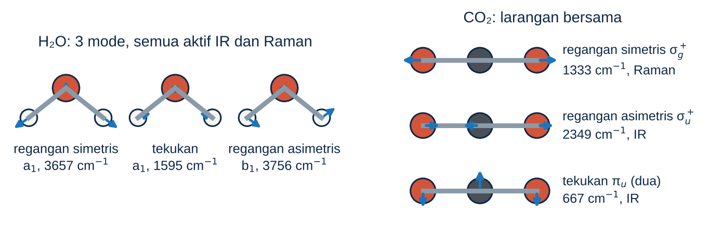
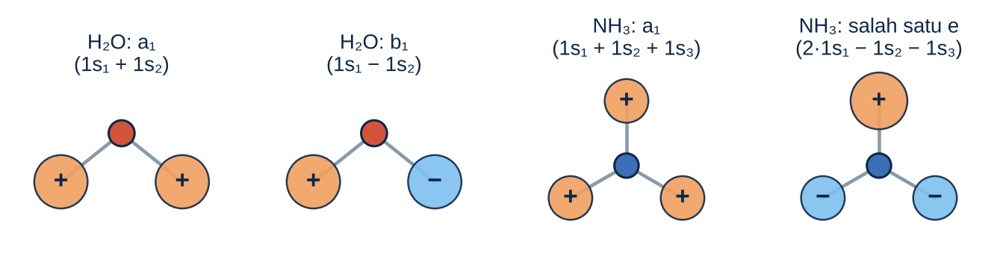

## 3.7 Getaran molekul: aktif IR dan aktif Raman

Sekarang kita siap memakai semua alat tadi untuk sesuatu yang dapat diukur. Molekul tidak pernah diam: atom-atomnya terus bergetar di sekitar posisi setimbangnya. Gerak yang tampak acak ini sebenarnya dapat diuraikan menjadi beberapa **mode normal**, yaitu pola getaran ketika semua atom bergerak dengan frekuensi yang sama dan fase yang serempak. Setiap mode normal mempunyai frekuensinya sendiri, dan frekuensi itulah yang terlihat sebagai pita dalam spektrum inframerah (IR) dan Raman.

### Berapa banyak mode getaran?

Molekul dengan *N* atom mempunyai 3*N* derajat kebebasan, karena setiap atom dapat bergerak ke arah *x*, *y*, dan *z*. Tiga di antaranya adalah translasi molekul utuh, dan tiga lagi rotasi molekul utuh (hanya dua untuk molekul linear, karena putaran mengelilingi sumbu molekul tidak memindahkan atom). Sisanya adalah getaran:

$$\text{jumlah mode getaran} = 3N - 6 \quad (\text{linear: } 3N - 5) \qquad \text{(3.4)}$$

Air mempunyai 3 mode, amonia 6, metana 9, SF₆ 15, dan CO₂ 4.

### Simetri setiap mode

Teori grup memberi lebih dari sekadar jumlah. Γ₃N yang kita uraikan di subbab 3.6 memuat semua gerak atom. Translasi berperilaku seperti *x*, *y*, *z*, dan rotasi seperti *R*~*x*~, *R*~*y*~, *R*~*z*~; keduanya dapat dibaca langsung dari kolom fungsi basis tabel karakter. Mengurangkannya dari Γ₃N menyisakan simetri getaran:

$$\Gamma_\text{vib} = \Gamma_{3N} - \Gamma_\text{trans} - \Gamma_\text{rot} \qquad \text{(3.5)}$$

Untuk air: Γ₃N = 3A₁ + A₂ + 3B₁ + 2B₂. Dari Tabel 3.3, Γ~trans~ = A₁ + B₁ + B₂ (*z*, *x*, *y*) dan Γ~rot~ = A₂ + B₁ + B₂ (*R*~*z*~, *R*~*y*~, *R*~*x*~). Jadi

$$\Gamma_\text{vib}(\text{H}_2\text{O}) = 2A_1 + B_1$$

Tiga mode, sesuai 3*N* − 6 = 3. Dua mode A₁ adalah regangan simetris dan tekukan: keduanya tidak mengubah simetri molekul. Mode B₁ adalah regangan asimetris: satu ikatan memanjang sementara yang lain memendek, sehingga simetri C₂ "rusak" sesaat (karakter C₂ = −1).

{width=98%}

### Aturan seleksi: kapan sebuah mode terlihat?

Tidak semua mode menghasilkan pita. Dua aturan seleksi memutuskannya, dan keduanya dapat dibaca langsung dari tabel karakter.

**Inframerah.** Sebuah mode menyerap cahaya IR hanya bila getarannya **mengubah momen dipol** molekul. Medan listrik cahaya mendorong muatan maju-mundur; agar energi berpindah, gerak atom harus menggerakkan muatan. Momen dipol berperilaku seperti vektor (*x*, *y*, *z*), sehingga:

::: {.inti}
**Aktif IR**: mode yang irepnya sama dengan irep *x*, *y*, atau *z*.

**Aktif Raman**: mode yang irepnya sama dengan irep salah satu fungsi kuadrat (*x*², *xy*, *x*² − *y*², …).
:::

**Raman.** Pada spektroskopi Raman, cahaya tampak atau laser dihamburkan oleh molekul, dan sebagian kecil cahaya kembali dengan energi yang bergeser sebesar energi satu getaran. Ini terjadi bila getaran mengubah **polarisabilitas** molekul, yaitu seberapa mudah awan elektronnya diregangkan oleh medan listrik. Polarisabilitas adalah besaran yang menghubungkan dua arah (medan di arah *x* dapat menginduksi dipol di arah *y*), sehingga ia berperilaku seperti hasil kali dua koordinat: *x*², *xy*, dan seterusnya.

Untuk air, A₁ memuat *z* dan *x*², sedangkan B₁ memuat *x* dan *xz*. Ketiga mode aktif IR dan Raman sekaligus. Spektrum IR uap air memang menunjukkan tiga pita dasar, pada 3657, 1595, dan 3756 cm⁻¹.

::: {.contoh}
**Contoh 3.8 · Spektrum metana dan amonia**

Ramalkan jumlah pita dasar IR dan Raman untuk (a) CH₄ (T~d~) dan (b) NH₃ (C₃ᵥ).

**Rencana.** Hitung Γ₃N, uraikan, kurangi translasi dan rotasi, lalu cocokkan dengan kolom fungsi basis.

**Penyelesaian.** (a) Atom tetap dalam CH₄: E, 5; C₃, 2 (C dan H di sumbu); C₂, 1 (C); S₄, 1 (C); σd, 3 (C dan dua H di bidang). Dikalikan sumbangan (3, 0, −1, −1, 1): χ(Γ₃N) = (15, 0, −1, −1, 3). Rumus reduksi (*h* = 24) memberi Γ₃N = A₁ + E + T₁ + 3T₂. Dalam T~d~, translasi (*x*, *y*, *z*) adalah T₂ dan rotasi T₁, sehingga

$$\Gamma_\text{vib} = A_1 + E + 2T_2$$

Pemeriksaan dimensi: 1 + 2 + 2 × 3 = 9 = 3(5) − 6. ✓ Hanya T₂ yang memuat (*x*, *y*, *z*): **2 pita IR**. Fungsi kuadrat ada di A₁ (*x*² + *y*² + *z*²), E, dan T₂: **4 pita Raman**.

(b) Dari Contoh 3.7, Γ₃N = 3A₁ + A₂ + 4E. Translasi A₁ + E, rotasi A₂ + E, sehingga Γ~vib~ = 2A₁ + 2E. Dalam C₃ᵥ, A₁ dan E memuat fungsi linear maupun kuadrat: **4 pita IR, 4 pita Raman**, semuanya berimpit.

**Memahami hasil.** Metana mempunyai 9 mode getaran tetapi hanya 2 pita IR. Penyebabnya dua: mode-mode yang membentuk irep E dan T merosot (dua atau tiga mode berfrekuensi sama, satu pita), dan mode A₁ serta E tidak mengubah momen dipol. Data terukur: pita IR metana pada 3019 dan 1306 cm⁻¹ (keduanya T₂), dan Raman tambahan pada 2917 (A₁) dan 1534 cm⁻¹ (E). Amonia (6 mode, 4 pita): 3337 dan 950 cm⁻¹ (A₁), 3444 dan 1627 cm⁻¹ (E).
:::

### Aturan larangan bersama

Bila molekul mempunyai **pusat inversi**, *x*, *y*, *z* semuanya berganti tanda oleh *i* (irep u), sedangkan semua fungsi kuadrat tidak berubah (irep g). Akibatnya tidak ada irep yang memuat keduanya.

::: {.inti}
**Aturan larangan bersama.** Pada molekul yang mempunyai pusat inversi, tidak ada mode getaran yang aktif sekaligus di IR dan di Raman. Mode g hanya mungkin aktif Raman, mode u hanya mungkin aktif IR.
:::

CO₂ adalah contoh klasik (Gambar 3.4). Regangan simetrisnya (σ~g~⁺, 1333 cm⁻¹) tidak mengubah momen dipol, karena kedua ikatan C=O memanjang bersama dan molekul tetap simetris; mode ini hanya tampak di Raman. Regangan asimetris (σ~u~⁺, 2349 cm⁻¹) dan dua tekukan yang setara (π~u~, 667 cm⁻¹) menggeser muatan dan hanya tampak di IR. Dua pita IR inilah yang membuat CO₂ menjadi gas rumah kaca: pita 667 cm⁻¹ berada tepat di puncak radiasi panas bumi.

SF₆ memperlihatkan aturan ini dengan lebih dramatis. Hitungan dengan tabel O~h~ memberi Γ~vib~ = A₁g + E~g~ + T₂g + 2T₁u + T₂u, yaitu 15 mode. Hanya kedua T₁u yang aktif IR (939 dan 614 cm⁻¹); A₁g, E~g~, dan T₂g aktif Raman (774, 642, dan 525 cm⁻¹); dan mode T₂u tidak aktif di keduanya, sebuah mode "diam" yang hanya dapat diketahui frekuensinya secara tidak langsung. Kebalikannya juga berguna: bila sebuah senyawa menunjukkan pita yang berimpit di IR dan Raman, senyawa itu **pasti tidak** mempunyai pusat inversi.

### Teka-teki cisplatin terjawab

Untuk membedakan isomer, kita sering tidak memerlukan semua mode. Cukup lihat sekelompok ikatan tertentu, misalnya kedua ikatan Pt–Cl. Gagasannya sama: setiap ikatan dianggap sebagai sebuah vektor, dan kita menghitung berapa banyak ikatan yang **tidak berpindah** oleh setiap operasi.

::: {.contoh}
**Contoh 3.9 · cis- dan trans-[PtCl₂(NH₃)₂]**

Ramalkan jumlah pita regangan Pt–Cl di IR dan Raman untuk kedua isomer.

**Penyelesaian.** *Isomer cis* (C₂ᵥ, molekul di bidang *xz*, sumbu C₂ membagi dua sudut Cl–Pt–Cl). E: kedua ikatan tetap (2). C₂: kedua Cl bertukar (0). σᵥ(*xz*), bidang molekul: kedua ikatan tetap (2). σᵥ′(*yz*): kedua Cl bertukar (0). Γ(Pt–Cl) = (2, 0, 2, 0). Reduksi dengan *h* = 4:

* *n*(A₁) = ¼(2 + 0 + 2 + 0) = 1; *n*(A₂) = ¼(2 − 2) = 0; *n*(B₁) = ¼(2 + 2) = 1; *n*(B₂) = ¼(2 − 2) = 0.

Γ(Pt–Cl) = A₁ + B₁. Keduanya memuat fungsi linear (*z* dan *x*): **dua pita IR**, juga dua pita Raman.

*Isomer trans* (D₂ₕ, Cl–Pt–Cl sepanjang *x*). Ikatan tetap oleh E (2), C₂(*x*) (2), σ(*xy*) (2), dan σ(*xz*) (2); semua operasi lain menukar kedua Cl (0). Reduksi dengan tabel D₂ₕ (Lampiran B) memberi Γ(Pt–Cl) = A~g~ + B₃u. A~g~ hanya aktif Raman, B₃u hanya aktif IR: **satu pita IR**, satu pita Raman di frekuensi lain.

**Memahami hasil.** Gambarannya mudah dibayangkan. Pada isomer trans, regangan simetris menarik kedua Cl keluar bersamaan dari arah berlawanan: momen dipol tidak berubah, IR tidak melihatnya. Hanya regangan asimetris yang terlihat. Pada isomer cis, kedua Cl berada di sisi yang sama, sehingga regangan simetris pun menggeser muatan dan terlihat di IR. Spektrum cisplatin memang menunjukkan dua pita Pt–Cl berdekatan di sekitar 320–330 cm⁻¹, sedangkan transplatin hanya satu. Tanpa satu pun perhitungan kuantum, sebuah tabel berisi angka 1 dan −1 sudah memisahkan obat kanker dari kembarnya yang tidak aktif.
:::

::: {.terapan}
**Menghitung pita karbonil.** Logam karbonil adalah tempat teori grup paling sering dipakai di laboratorium sintesis anorganik. Regangan C≡O muncul pada 1850–2150 cm⁻¹, daerah yang hampir selalu bersih dari pita lain, dan jumlah pitanya langsung menunjukkan susunan ligan. Untuk kompleks oktahedron M(CO)₄L₂: isomer **cis** (C₂ᵥ) memberi Γ(CO) = 2A₁ + B₁ + B₂, yaitu **empat** pita IR, sedangkan isomer **trans** (D₄ₕ) memberi A₁g + B₁g + E~u~, hanya **satu** pita IR. Untuk M(CO)₃L₃, isomer *fac* (C₃ᵥ) memberi dua pita dan isomer *mer* (C₂ᵥ) tiga. Hitungan ini dipakai setiap hari untuk memeriksa hasil reaksi substitusi ligan (Bab 11).
:::

::: {.kuis}
**Kuis cepat 3.7** BF₃ (D₃ₕ) mempunyai Γ~vib~ = A₁′ + 2E′ + A₂″. Dengan tabel D₃ₕ di Lampiran B, berapa pita IR dan Raman yang diramalkan? Mana yang berimpit?
:::

## 3.8 Kombinasi linear teradaptasi simetri dan operator proyeksi

Di Bab 4 kita akan menyusun orbital molekul dengan menggabungkan orbital atom pusat dengan orbital atom-atom di sekelilingnya (ligan). Masalahnya, orbital ligan berada di beberapa atom sekaligus. Orbital 1s hidrogen pada air tidak dapat bergabung dengan orbital oksigen satu per satu, karena setiap operasi simetri menukar kedua H. Jalan keluarnya adalah menggabungkan dulu orbital-orbital ligan menjadi **kombinasi linear teradaptasi simetri** (*symmetry-adapted linear combination*, SALC), yaitu kombinasi yang masing-masing berperilaku sebagai satu irep grup. Kombinasi seperti ini sering juga disebut **orbital gugus ligan**.

### Berapa banyak SALC dan dari irep apa?

Langkah pertama sama dengan menghitung getaran: tentukan representasi orbital-orbital ligan dengan menghitung berapa orbital yang **tidak berpindah** oleh setiap operasi.

Untuk kedua orbital 1s hidrogen pada air: E, 2; C₂, 0 (kedua H bertukar); σᵥ(*xz*), 2 (keduanya di bidang); σᵥ′(*yz*), 0. Γ(1s) = (2, 0, 2, 0) = **A₁ + B₁**. Jadi akan ada satu SALC bersimetri A₁ dan satu bersimetri B₁.

### Operator proyeksi

Untuk menuliskan bentuk SALC-nya, kita memakai **operator proyeksi**. Resepnya: ambil satu orbital ligan φ, kenai dengan setiap operasi R dalam grup, kalikan hasilnya dengan karakter irep yang diinginkan, lalu jumlahkan.

$$\hat P^{(i)}\varphi = \frac{d_i}{h}\sum_R \chi_i(R)\,\hat R\,\varphi \qquad \text{(3.6)}$$

Penjumlahan dilakukan untuk **setiap operasi** (bukan per kelas). Dalam praktik faktor *d*~*i*~/*h* dapat diabaikan, karena hasilnya akan dinormalkan juga.

::: {.contoh}
**Contoh 3.10 · SALC hidrogen pada air dan amonia**

Susun SALC orbital 1s hidrogen untuk (a) H₂O dan (b) NH₃.

**Penyelesaian.** (a) Beri nama kedua orbital φ~a~ dan φ~b~. Tabel pengaruh operasi terhadap φ~a~:

| R | E | C₂ | σᵥ(*xz*) | σᵥ′(*yz*) |
|---|---|---|---|---|
| *R*φ~a~ | φ~a~ | φ~b~ | φ~a~ | φ~b~ |

Kalikan dengan karakter A₁ (1, 1, 1, 1) dan jumlahkan: φ~a~ + φ~b~ + φ~a~ + φ~b~ = 2(φ~a~ + φ~b~). Dengan karakter B₁ (1, −1, 1, −1): φ~a~ − φ~b~ + φ~a~ − φ~b~ = 2(φ~a~ − φ~b~). Setelah dinormalkan (dengan mengabaikan tumpang tindih antar-H):

$$\psi(a_1) = \tfrac{1}{\sqrt2}(\varphi_a + \varphi_b) \qquad \psi(b_1) = \tfrac{1}{\sqrt2}(\varphi_a - \varphi_b)$$

Sebagai pemeriksaan, coba proyeksikan ke A₂ (1, 1, −1, −1): φ~a~ + φ~b~ − φ~a~ − φ~b~ = 0. Memang tidak ada SALC A₂, sesuai hasil reduksi.

(b) Untuk NH₃, Γ(1s) = (3, 0, 1) = A₁ + E. Keenam operasi C₃ᵥ membawa φ₁ ke: E → φ₁; C₃ → φ₂; C₃² → φ₃; σᵥ(1), bidang yang memuat H₁ → φ₁; σᵥ(2) → φ₃; σᵥ(3) → φ₂. Dengan karakter A₁ (semua 1): 2(φ₁ + φ₂ + φ₃). Dengan karakter E (2, −1, −1, 0, 0, 0): 2φ₁ − φ₂ − φ₃. Setelah dinormalkan:

$$\psi(a_1) = \tfrac{1}{\sqrt3}(\varphi_1 + \varphi_2 + \varphi_3) \qquad \psi(e) = \tfrac{1}{\sqrt6}(2\varphi_1 - \varphi_2 - \varphi_3)$$

Irep E berdimensi dua, sehingga ada satu SALC e lagi. Memproyeksikan φ₂ memberi 2φ₂ − φ₃ − φ₁, yang tidak tegak lurus terhadap SALC pertama. Kombinasi yang tegak lurus adalah $\tfrac{1}{\sqrt2}(\varphi_2 - \varphi_3)$.

**Memahami hasil.** Perhatikan pola tandanya (Gambar 3.5). SALC a₁ selalu "semua tanda sama", sedangkan SALC lain mempunyai bidang simpul. SALC b₁ air mempunyai bidang simpul di bidang *yz*, persis seperti orbital 2p~*x*~ oksigen; itulah sebabnya keduanya dapat bergabung. SALC e amonia yang pertama mirip 2p~*y*~ (cuping besar di satu arah, kecil berlawanan tanda di arah lain), dan yang kedua mirip 2p~*x*~.
:::

{width=96%}

::: {.dalam}
**Mengapa operator proyeksi bekerja?** Hasil Σ~R~ χ~*i*~(*R*) *R*φ adalah "rata-rata berbobot" dari semua salinan φ yang dihasilkan simetri. Bagian φ yang tidak berperilaku seperti irep *i* saling meniadakan dalam jumlah itu, persis seperti rumus reduksi meniadakan irep yang tidak dicari. Yang tersisa hanya bagian yang bersimetri *i*. Bila hasilnya nol, berarti φ sama sekali tidak mengandung komponen irep itu.
:::

Tabel 3.6 merangkum SALC σ (satu orbital yang mengarah ke atom pusat pada setiap ligan) untuk bentuk-bentuk yang paling sering dijumpai. Kita akan memakainya berulang kali di Bab 4 dan Bab 11.

Tabel 3.6 Simetri SALC σ ligan untuk bentuk molekul umum.

| Bentuk | Contoh | Grup | SALC σ |
|---|---|---|---|
| bengkok, 2 ligan | H₂O | C₂ᵥ | A₁ + B₁ |
| piramida segitiga | NH₃ | C₃ᵥ | A₁ + E |
| segitiga datar | BF₃ | D₃ₕ | A₁′ + E′ |
| tetrahedron | CH₄, [NiCl₄]²⁻ | T~d~ | A₁ + T₂ |
| segi empat datar | [PtCl₄]²⁻ | D₄ₕ | A₁g + B₁g + E~u~ |
| oktahedron | SF₆, [Co(NH₃)₆]³⁺ | O~h~ | A₁g + E~g~ + T₁u |

::: {.kuis}
**Kuis cepat 3.8** Hitung Γ untuk keempat orbital σ ligan pada [PtCl₄]²⁻ (D₄ₕ) dan periksa bahwa hasil reduksinya sesuai Tabel 3.6.
:::

## 3.9 Simetri orbital atom dan orbital yang boleh bergabung

Langkah terakhir menghubungkan semuanya. Kapan dua orbital boleh bergabung membentuk orbital molekul? Jawaban kuantumnya: bila integral tumpang tindihnya, ∫φ₁φ₂ dτ, tidak nol. Teori grup memberi cara cepat untuk mengetahui kapan integral itu **pasti nol**.

Bayangkan orbital 2p~*y*~ oksigen dan SALC a₁ hidrogen pada air. SALC a₁ positif di mana-mana di sekitar kedua H. Orbital 2p~*y*~ positif di satu sisi bidang molekul dan negatif di sisi lainnya. Hasil kali keduanya positif di satu sisi bidang dan negatif di sisi lain, dengan besar yang sama persis. Bila dijumlahkan di seluruh ruang, sumbangan positif dan negatif saling meniadakan: integralnya nol. Ini bukan kebetulan bentuk; ini terjadi karena σᵥ(*xz*) mengubah tanda salah satu orbital dan tidak mengubah yang lain.

::: {.inti}
**Aturan tumpang tindih.** Dua orbital hanya dapat mempunyai tumpang tindih (dan berinteraksi membentuk orbital molekul) bila keduanya termasuk **irep yang sama**. Orbital dengan irep berbeda tidak pernah bercampur, berapa pun dekat energinya.
:::

Aturan ini adalah alasan utama mengapa teori grup sangat berguna dalam kimia anorganik. Untuk menyusun diagram orbital molekul, kita tidak perlu memeriksa setiap pasangan orbital; cukup kelompokkan orbital menurut irepnya, dan hanya orbital dalam kelompok yang sama yang perlu dipikirkan.

::: {.contoh}
**Contoh 3.11 · Orbital mana yang bergabung?**

Untuk setiap molekul, tentukan simetri orbital valensi atom pusat, cocokkan dengan SALC σ ligan (Tabel 3.6), dan tentukan orbital mana yang tidak mempunyai pasangan: (a) H₂O, (b) CH₄, (c) BF₃, (d) kompleks oktahedron ML₆ dengan logam transisi (orbital valensi *n*d, (*n*+1)s, (*n*+1)p).

**Penyelesaian.** Simetri orbital pusat dibaca dari kolom fungsi basis: s selalu simetris total, p seperti (*x*, *y*, *z*), d seperti fungsi kuadrat.

| Molekul | Orbital pusat | SALC σ | Bergabung | Tanpa pasangan |
|---|---|---|---|---|
| H₂O | 2s (a₁), 2p~*z*~ (a₁), 2p~*x*~ (b₁), 2p~*y*~ (b₂) | a₁ + b₁ | 2s, 2p~*z*~ dengan a₁; 2p~*x*~ dengan b₁ | 2p~*y*~ (b₂) |
| CH₄ | 2s (a₁), 2p (t₂) | a₁ + t₂ | semua | tidak ada |
| BF₃ | 2s (a₁′), 2p~*x*~, 2p~*y*~ (e′), 2p~*z*~ (a₂″) | a₁′ + e′ | 2s dengan a₁′; 2p~*x,y*~ dengan e′ | 2p~*z*~ (a₂″) |
| ML₆ | *n*s (a₁g), *n*p (t₁u), d~*z*²~, d~*x*²−*y*²~ (e~g~), d~*xy*~, d~*xz*~, d~*yz*~ (t₂g) | a₁g + e~g~ + t₁u | s, p, dan e~g~ | t₂g |

**Memahami hasil.** Setiap baris membawa satu fakta kimia yang akan kita jelaskan lebih jauh:

* **Air**: 2p~*y*~ menjadi orbital tak berikatan, dan dua pasangan bebas air ternyata **tidak setara** energinya. Spektrum fotoelektron air menunjukkan empat pita valensi, bukan dua seperti gambaran "dua pasangan bebas sp³ yang identik" (Bab 4).
* **Metana**: keempat SALC bergabung, menghasilkan dua tingkat ikatan, a₁ (satu orbital) dan t₂ (tiga orbital setara). Spektrum fotoelektron metana memang menunjukkan dua pita, sekitar 23 eV dan 14 eV, bukan satu pita untuk "empat ikatan sp³ yang identik". Teori grup meramalkannya, dan hibridisasi tidak.
* **BF₃**: orbital 2p~*z*~ boron kosong dan tidak terpakai untuk ikatan σ. Itulah orbital yang menerima pasangan elektron NH₃ ketika BF₃ bertindak sebagai asam Lewis (subbab 2.3, Bab 8). Orbital ini juga dapat bergabung dengan SALC π ligan F yang bersimetri a₂″, sehingga ada sedikit ikatan π B–F.
* **Kompleks oktahedron**: ketiga orbital t₂g tidak ikut dalam ikatan σ, sedangkan kedua orbital e~g~ ikut dan terdorong naik energinya. Pemisahan inilah, antara t₂g dan e~g~, yang menjadi inti teori medan ligan dan menjelaskan warna serta sifat magnet senyawa koordinasi (Bab 11).
:::

::: {.awas}
**Awas: "sama irep" adalah syarat perlu, bukan syarat cukup.** Dua orbital dengan irep sama **boleh** bergabung, tetapi seberapa kuat penggabungannya bergantung pada besar tumpang tindih dan selisih energinya (Bab 4). Orbital 1s oksigen pada air bersimetri a₁, sama dengan SALC a₁ hidrogen, tetapi energinya lebih dari 500 eV lebih rendah, sehingga praktis tidak ikut berikatan. Teori grup memberi tahu siapa yang **boleh** berpasangan; energi dan jarak memberi tahu siapa yang **benar-benar** berpasangan.
:::

::: {.kuis}
**Kuis cepat 3.9** Pada kompleks tetrahedron ML₄ (T~d~), orbital d logam terbagi menjadi e (d~*z*²~, d~*x*²−*y*²~) dan t₂ (d~*xy*~, d~*xz*~, d~*yz*~). Orbital d mana yang dapat bergabung dengan SALC σ ligan (a₁ + t₂)?
:::

## Menuju bab berikutnya

Teka-teki cisplatin terjawab tanpa satu pun perhitungan kuantum yang rumit. Isomer cis (C₂ᵥ) mempunyai dua regangan Pt–Cl yang keduanya mengubah momen dipol, sehingga terlihat dua pita IR. Isomer trans (D₂ₕ) mempunyai pusat inversi, dan aturan larangan bersama membagi kedua regangannya antara IR dan Raman, sehingga IR hanya melihat satu. Bahasa yang kita pakai, yaitu grup titik, tabel karakter, dan rumus reduksi, berlaku sama untuk molekul kecil seperti air dan untuk kompleks logam yang besar.

Bab ini juga menyiapkan bahan baku Bab 4. Kita sudah dapat menentukan simetri setiap orbital atom pusat, menyusun SALC orbital ligan, dan memilih pasangan orbital yang boleh bergabung. Yang belum kita lakukan adalah menentukan **energi** orbital-orbital molekul yang terbentuk, mengisinya dengan elektron, dan membaca sifat-sifat molekul darinya. Mengapa O₂ paramagnetik? Mengapa air mempunyai dua pasangan bebas yang berbeda energi? Mengapa CO terikat ke logam lewat karbon? Semua pertanyaan itu menunggu di **Bab 4, Teori Orbital Molekul**.
