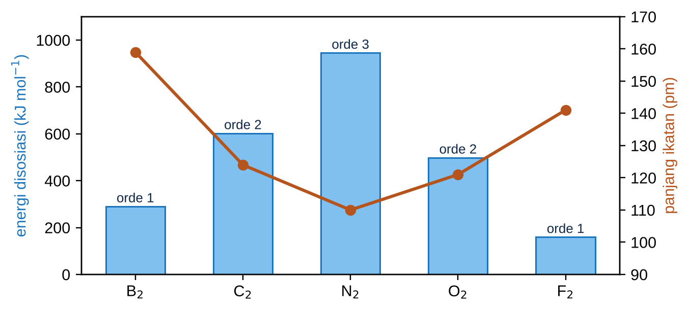
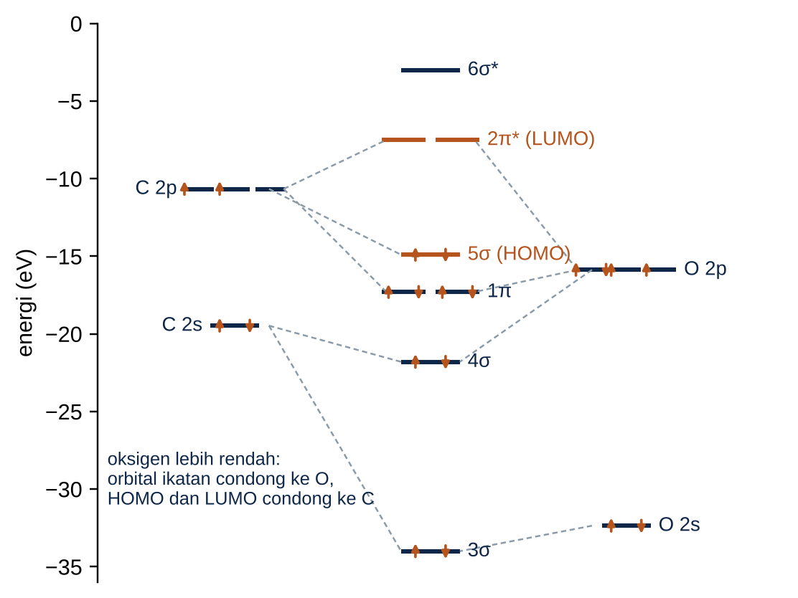
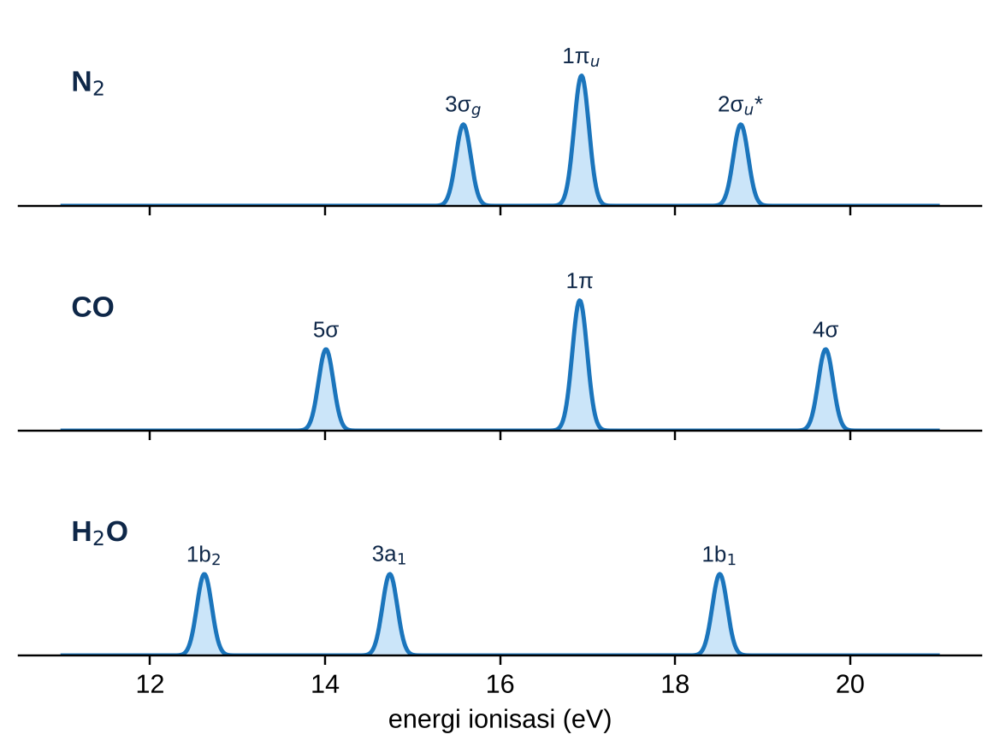

# Bab 4 Orbital Molekul dalam Kimia Anorganik

Tuangkan oksigen cair, cairan biru pucat yang mendidih pada −183 °C, di antara dua kutub magnet yang kuat. Cairan itu tidak jatuh. Ia menggantung di celah magnet seperti jembatan kecil, ditahan oleh gaya magnet, sampai menguap habis. Nitrogen cair, yang dituang dengan cara yang sama, langsung mengalir lewat begitu saja. Oksigen bersifat **paramagnetik**: molekulnya membawa elektron yang tidak berpasangan, yang berperilaku seperti magnet-magnet kecil. Nitrogen **diamagnetik**: semua elektronnya berpasangan.

Struktur Lewis O₂ yang kita pelajari di Bab 2, O=O dengan dua pasangan bebas pada setiap atom, memasangkan semua elektronnya. Struktur itu memenuhi aturan oktet dan memberi ikatan rangkap dua yang sesuai dengan panjang ikatannya, tetapi ia meramalkan bahwa oksigen diamagnetik, dan itu salah. Kesalahan ini bukan sekadar urusan magnet. Karena dua elektron tidak berpasangan itulah oksigen di udara bereaksi lambat dengan zat organik (sebuah larangan spin yang membuat kita tidak terbakar spontan), dan karena itu pula bentuk oksigen yang "tereksitasi", oksigen singlet, sangat reaktif. Model yang menjelaskan semua ini adalah **teori orbital molekul**, yang menganggap elektron tidak dimiliki oleh satu ikatan atau satu atom, melainkan tersebar di seluruh molekul.

Bab ini membangun teori itu dari yang paling sederhana. Kita mulai dari dua atom: aturan penggabungan orbital, molekul diatomik periode 2, dan molekul heteronuklir seperti CO yang menjadi ligan terpenting dalam kimia organologam. Kita melihat bukti eksperimennya dari spektroskopi fotoelektron. Lalu, dengan bekal SALC dari Bab 3, kita menyusun diagram orbital molekul untuk BeH₂, CO₂, H₂O, NH₃, CH₄, dan SF₆. Di bagian akhir kita membahas ikatan yang tidak dapat digambarkan dengan pasangan elektron biasa, yaitu ikatan tiga pusat pada diborana dan XeF₂, diagram Walsh yang menjelaskan mengapa air bengkok, dan orbital perbatasan HOMO dan LUMO yang mengendalikan reaktivitas.

::: {.kuis}
**Pertanyaan pembuka**

1. Mengapa orbital antiikatan naik lebih tinggi daripada orbital ikatan turun?
2. Mengapa B₂ paramagnetik, padahal C₂ diamagnetik?
3. Karbon monoksida mempunyai atom oksigen yang lebih elektronegatif. Mengapa CO terikat ke logam melalui atom karbon?
4. Bagaimana spektrum fotoelektron membuktikan bahwa orbital molekul itu nyata?
5. Diborana, B₂H₆, hanya mempunyai 12 elektron valensi, tetapi delapan "ikatan". Bagaimana mungkin?
6. Mengapa air bengkok, sedangkan BeH₂ dan CO₂ linear?
:::

::: {.tujuan}
**Tujuan belajar**

Setelah mempelajari bab ini, kamu mampu:

1. Menjelaskan aturan penggabungan orbital atom (simetri, energi, tumpang tindih) dan menghitung orde ikatan.
2. Menyusun diagram orbital molekul diatomik homonuklir periode 2, termasuk pengaruh pencampuran s–p, dan meramalkan sifat magnet serta panjang ikatan.
3. Menyusun diagram orbital molekul diatomik heteronuklir (CO, NO, HF, CN⁻) dari energi orbital atom.
4. Menafsirkan spektrum fotoelektron dengan teorema Koopmans dan struktur getarannya.
5. Menyusun diagram orbital molekul poliatom dengan SALC: BeH₂, CO₂, H₂O, NH₃, CH₄, dan SF₆.
6. Menjelaskan ikatan tiga pusat dua elektron dan tiga pusat empat elektron.
7. Memakai diagram Walsh untuk meramalkan bentuk molekul AH₂.
8. Memakai HOMO dan LUMO untuk menjelaskan sifat asam–basa Lewis dan ikatan ligan ke logam.
:::

::: {.mat}
**Prasyarat**

Bab 1 (energi orbital atom dan muatan inti efektif), Bab 2 (struktur Lewis, orde ikatan), dan Bab 3 (grup titik, tabel karakter, SALC). Dari *Kimia Kuantum*: Bab 11 (ion H₂⁺ dan metode variasi) dan Bab 13 (orbital molekul poliatom). Bab ini berdiri sendiri; penurunan matematis LCAO yang lengkap ada di *Kimia Kuantum*.
:::

## 4.1 LCAO dan aturan penggabungan orbital

Bayangkan dua atom hidrogen yang saling mendekat. Selama keduanya jauh, setiap elektron menempati orbital 1s atomnya sendiri. Ketika jarak mengecil, elektron atom A mulai merasakan tarikan inti B, dan sebaliknya. Pada jarak ikatan, tidak masuk akal lagi menanyakan elektron itu "milik" atom mana: ia bergerak di sekitar kedua inti. Orbital yang ditempatinya adalah **orbital molekul**.

Bentuk pasti orbital molekul diperoleh dari persamaan Schrödinger, tetapi ada pendekatan yang sederhana dan ternyata sangat baik: orbital molekul dianggap sebagai **gabungan linear orbital atom** (*linear combination of atomic orbitals*, LCAO). Untuk dua orbital 1s:

$$\psi = c_A\,\psi_A + c_B\,\psi_B \qquad \text{(4.1)}$$

Untuk dua atom yang sama, koefisiennya hanya dapat sama besar, sehingga ada dua kombinasi: **jumlah** dan **selisih**.

{width=96%}

Pada kombinasi **jumlah**, kedua gelombang saling menguatkan di daerah antara inti. Kerapatan elektron di sana bertambah, dan elektron yang berada di antara dua inti ditarik oleh keduanya sekaligus. Energinya lebih rendah daripada orbital atom semula: ini **orbital ikatan**. Pada kombinasi **selisih**, kedua gelombang saling meniadakan di tengah, sehingga ada **bidang simpul** di antara inti. Elektron terdorong ke luar, ke sisi yang jauh dari inti lain, dan energinya naik: ini **orbital antiikatan**, ditandai dengan bintang (*).

Dua pengamatan penting dari Gambar 4.1:

* **Jumlah orbital kekal.** Dua orbital atom menghasilkan dua orbital molekul. *n* orbital atom selalu menghasilkan *n* orbital molekul.
* **Orbital antiikatan naik lebih jauh daripada orbital ikatan turun.** Penyebabnya adalah tumpang tindih: penormalan orbital ikatan dibagi dengan bilangan yang lebih besar daripada 2, dan penormalan orbital antiikatan dengan bilangan yang lebih kecil. Akibat kimianya besar. He₂ akan mengisi orbital ikatan dan antiikatan masing-masing dengan dua elektron, dan karena antiikatan menaikkan energi lebih banyak daripada ikatan menurunkannya, He₂ secara keseluruhan tidak stabil. Itulah sebabnya helium tetap berupa atom tunggal.

### Orde ikatan

Elektron di orbital ikatan memperkuat ikatan; elektron di orbital antiikatan melemahkannya. Ukuran yang paling sederhana adalah **orde ikatan**:

$$\text{orde ikatan} = \tfrac12\,(n_\text{ikatan} - n_\text{antiikatan}) \qquad \text{(4.2)}$$

H₂ (dua elektron ikatan) mempunyai orde 1; He₂⁺ (dua ikatan, satu antiikatan) orde ½, dan memang ada sebagai ion dalam lucutan listrik helium; He₂ orde 0.

### Tiga syarat penggabungan

Tidak semua pasangan orbital atom dapat bergabung dengan berarti. Ada tiga syarat:

1. **Simetri sama.** Ini adalah aturan tumpang tindih dari subbab 3.9. Orbital s satu atom dan orbital p~*x*~ atom lain yang terletak pada sumbu *z* tidak dapat bergabung: setengah cuping p~*x*~ bertumpang tindih positif dengan s, setengahnya negatif, dan totalnya nol.
2. **Energi berdekatan.** Makin dekat energi dua orbital atom, makin besar pergeseran energi orbital molekul yang terbentuk. Bila selisih energinya besar, orbital ikatan hampir sama dengan orbital atom yang lebih rendah, dan orbital antiikatan hampir sama dengan yang lebih tinggi: penggabungan hampir tidak terjadi.
3. **Tumpang tindih cukup besar.** Orbital harus berukuran sebanding dan mengarah ke tempat yang tepat. Orbital 1s hidrogen yang kecil bertumpang tindih buruk dengan orbital 5p iodin yang besar dan menyebar, sehingga ikatan H–I lemah.

### Ikatan σ, π, dan δ

Orbital molekul diatomik digolongkan menurut jumlah bidang simpul yang memuat sumbu ikatan:

* **σ** (sigma): tidak ada bidang simpul yang memuat sumbu. Terbentuk dari s + s, p~*z*~ + p~*z*~, s + p~*z*~, atau d~*z*²~ + d~*z*²~. Simetris silinder terhadap sumbu ikatan.
* **π** (pi): satu bidang simpul memuat sumbu. Terbentuk dari p~*x*~ + p~*x*~, p~*y*~ + p~*y*~, atau d~*xz*~ + d~*xz*~. Selalu berpasangan dan merosot.
* **δ** (delta): dua bidang simpul memuat sumbu. Hanya dari orbital d: d~*xy*~ + d~*xy*~ atau d~*x*²−*y*²~ + d~*x*²−*y*²~. Tumpang tindihnya terjadi "muka bertemu muka" dengan keempat cuping.

Untuk molekul dengan pusat inversi, ditambahkan indeks **g** atau **u** (subbab 3.5). Orbital ikatan σ bersifat g, antiikatan σ* bersifat u; sebaliknya, orbital ikatan π bersifat u dan antiikatan π* bersifat g. Indeks ini terbalik antara σ dan π karena orbital p sendiri bersifat u: cuping-cupingnya berganti tanda melalui pusat atom.

::: {.terapan}
**Ikatan rangkap empat.** Pada 1964, F. A. Cotton menentukan struktur ion [Re₂Cl₈]²⁻ dan menemukan dua hal yang mengejutkan. Jarak Re–Re hanya 224 pm, jauh lebih pendek daripada dalam logam renium (275 pm). Kedua gugus ReCl₄ juga tersusun **tertutup** (atom Cl berhadapan), bukan bersilang seperti yang diharapkan agar tolakan Cl–Cl minimum. Penjelasan Cotton: kedua atom Re, masing-masing d⁴, membentuk satu ikatan σ, dua ikatan π, dan satu ikatan **δ** dari orbital d~*xy*~. Ikatan δ hanya terbentuk bila cuping d~*xy*~ kedua atom berhadapan, dan itu memaksa susunan tertutup. Delapan elektron d mengisi σ²π⁴δ²: **orde ikatan empat**, sesuatu yang tidak mungkin terjadi pada unsur golongan utama.
:::

::: {.kuis}
**Kuis cepat 4.1** Tentukan orde ikatan H₂⁺, H₂⁻, dan He₂²⁺. Manakah yang diramalkan paling stabil? (He₂²⁺ memang terdeteksi dalam spektrometer massa, walaupun kedua intinya saling menolak kuat.)
:::

## 4.2 Diatomik homonuklir periode 2 dan pencampuran s–p

Untuk atom periode 2, setiap atom membawa empat orbital valensi: 2s dan tiga 2p. Dari delapan orbital atom terbentuk delapan orbital molekul.

* 2s + 2s → σ~g~(2s) dan σ~u~*(2s)
* 2p~*z*~ + 2p~*z*~ (sepanjang sumbu ikatan) → σ~g~(2p) dan σ~u~*(2p)
* 2p~*x*~ + 2p~*x*~ dan 2p~*y*~ + 2p~*y*~ → dua π~u~ dan dua π~g~*

Kita mengisi orbital-orbital ini dari bawah, mengikuti prinsip Aufbau, larangan Pauli, dan aturan Hund, persis seperti mengisi orbital atom.

### Diagram tanpa pencampuran: O₂ dan F₂

Dalam diagram paling sederhana, orbital 2s hanya bergabung dengan 2s, dan 2p hanya dengan 2p. Tumpang tindih σ antara 2p~*z*~ yang saling mengarah lebih besar daripada tumpang tindih π yang menyamping, sehingga σ~g~(2p) turun lebih jauh daripada π~u~. Urutannya:

σ~g~(2s) < σ~u~*(2s) < **σ~g~(2p) < π~u~** < π~g~* < σ~u~*(2p)

Oksigen mempunyai 12 elektron valensi. Sepuluh elektron pertama mengisi penuh σ~g~(2s), σ~u~*(2s), σ~g~(2p), dan π~u~. Dua elektron sisanya masuk ke **dua orbital π~g~* yang merosot**. Menurut aturan Hund, keduanya menempati orbital yang berbeda dengan spin sejajar.

{width=98%}

Teka-teki pembuka terjawab: **O₂ mempunyai dua elektron tak berpasangan**, sehingga paramagnetik. Orde ikatannya ½(8 − 4) = 2, sesuai dengan ikatan rangkap dua dalam struktur Lewis. Teori orbital molekul mempertahankan apa yang benar dari struktur Lewis dan membetulkan apa yang salah.

### Pencampuran s–p: B₂, C₂, dan N₂

Diagram O₂ tidak berlaku untuk unsur di sebelah kirinya. B₂ ternyata paramagnetik dengan dua elektron tak berpasangan, dan C₂ diamagnetik. Bila memakai urutan O₂, B₂ (6 elektron valensi) akan menempatkan dua elektron terakhirnya di σ~g~(2p) sebagai pasangan, sehingga diamagnetik, dan itu salah.

Penyebabnya adalah orbital σ~g~(2s) dan σ~g~(2p) yang **bersimetri sama** (keduanya σ~g~). Menurut syarat penggabungan, keduanya dapat bercampur, dan seberapa kuat pencampurannya bergantung pada selisih energi 2s dan 2p atom. Selisih ini kecil di awal periode (boron sekitar 5,7 eV) dan membesar ke kanan (oksigen sekitar 16,5 eV, fluorin sekitar 27,7 eV), karena elektron 2s merasakan muatan inti efektif yang naik jauh lebih cepat daripada elektron 2p (subbab 1.6). Pada B, C, dan N, pencampurannya kuat: orbital σ~g~ bawah turun sedikit, dan orbital σ~g~(2p) terdorong ke atas, **melewati π~u~**. Hal yang sama terjadi pada pasangan σ~u~*.

Akibatnya, untuk B₂ sampai N₂ urutannya:

σ~g~(2s) < σ~u~*(2s) < **π~u~ < σ~g~(2p)** < π~g~* < σ~u~*(2p)

Sekarang B₂ menempatkan dua elektron terakhirnya di **dua orbital π~u~** yang merosot, dengan spin sejajar: paramagnetik, sesuai eksperimen. C₂ mengisi penuh π~u~ dan diamagnetik.

Tabel 4.1 Molekul diatomik homonuklir periode 2. Data eksperimen molekul gas.

| Molekul | Konfigurasi valensi | Orde ikatan | Elektron tak berpasangan | Panjang ikatan (pm) | *D* (kJ mol⁻¹) |
|---|---|---|---|---|---|
| Li₂ | σ~g~² | 1 | 0 | 267 | 105 |
| Be₂ | σ~g~² σ~u~*² | 0 | 0 | (245) | (≈ 11) |
| B₂ | … π~u~² | 1 | 2 | 159 | 290 |
| C₂ | … π~u~⁴ | 2 | 0 | 124 | 602 |
| N₂ | … π~u~⁴ σ~g~² | 3 | 0 | 110 | 945 |
| O₂ | … σ~g~² π~u~⁴ π~g~*² | 2 | 2 | 121 | 498 |
| F₂ | … π~u~⁴ π~g~*⁴ | 1 | 0 | 141 | 159 |
| Ne₂ | … π~g~*⁴ σ~u~*² | 0 | 0 | tidak terikat | — |

{width=74%}

Tabel 4.1 menunjukkan betapa baiknya orde ikatan meramalkan kekuatan dan panjang ikatan. Be₂ dengan orde nol hanya terikat sangat lemah oleh gaya dispersi, dan baru dideteksi dalam berkas molekul dingin. Ne₂ tidak terikat sama sekali.

::: {.contoh}
**Contoh 4.1 · Ion-ion oksigen**

Tentukan konfigurasi, orde ikatan, dan jumlah elektron tak berpasangan untuk O₂⁺, O₂, O₂⁻ (superoksida), dan O₂²⁻ (peroksida). Urutkan panjang ikatannya.

**Penyelesaian.** Elektron valensi: 11, 12, 13, 14. Delapan elektron mengisi orbital ikatan (σ~g~(2s), σ~g~(2p), dua π~u~) dan dua mengisi σ~u~*(2s); sisanya masuk ke π~g~*.

| Spesies | Elektron di π~g~* | Orde ikatan | Tak berpasangan | Panjang terukur (pm) |
|---|---|---|---|---|
| O₂⁺ | 1 | ½(8 − 3) = 2,5 | 1 | 112 |
| O₂ | 2 | ½(8 − 4) = 2 | 2 | 121 |
| O₂⁻ | 3 | ½(8 − 5) = 1,5 | 1 | 135 |
| O₂²⁻ | 4 | ½(8 − 6) = 1 | 0 | 149 |

**Memahami hasil.** Setiap elektron yang ditambahkan masuk ke orbital antiikatan, sehingga ikatan melemah dan memanjang secara teratur, sekitar 12 pm per elektron. Garam dari ion-ion ini nyata: KO₂ (kalium superoksida, kuning, paramagnetik) dipakai dalam alat bantu napas karena bereaksi dengan CO₂ dan uap air napas sambil melepaskan O₂; Na₂O₂ (natrium peroksida) diamagnetik; dan O₂⁺ dikenal dalam garam [O₂]⁺[PtF₆]⁻, yang dibuat Neil Bartlett pada 1962 sesaat sebelum ia membuat senyawa gas mulia pertama (Bab 12). Frekuensi regangan O–O dalam spektrum Raman juga turun teratur dari O₂⁺ ke O₂²⁻, dan frekuensi ini dipakai ahli bioanorganik untuk mengenali apakah oksigen yang terikat pada protein berbentuk superoksida atau peroksida.
:::

::: {.awas}
**Awas: menulis orde ikatan dari struktur Lewis.** Struktur Lewis O₂⁻ dapat ditulis dengan satu ikatan tunggal dan satu elektron tak berpasangan, sehingga mahasiswa sering menulis "orde 1". Teori orbital molekul memberi 1,5, dan panjang ikatan 135 pm, yang terletak di antara O₂ (121 pm, orde 2) dan O₂²⁻ (149 pm, orde 1), mendukung nilai 1,5. Bila struktur Lewis memerlukan elektron ganjil atau resonansi, percayai orbital molekul.
:::

::: {.kuis}
**Kuis cepat 4.2** Tentukan orde ikatan dan sifat magnet C₂²⁻ (ion asetilida dalam CaC₂) dan N₂⁺. Mana yang lebih pendek ikatannya: N₂ atau N₂⁺?
:::

## 4.3 Diatomik heteronuklir: CO, NO, HF, dan CN⁻

Bila kedua atom berbeda, orbital atomnya tidak lagi berenergi sama. Atom yang lebih elektronegatif mempunyai orbital yang lebih rendah, karena elektronnya terikat lebih kuat. Diagram orbital molekul menjadi miring, dan kita memerlukan nilai energi orbital atom untuk menggambarnya.

Tabel 4.2 Energi orbital valensi atom (eV), dari rata-rata energi ionisasi orbital (H. B. Gray). Nilai negatif: energi elektron relatif terhadap elektron bebas.

| Atom | ns | np | Atom | ns | np |
|---|---|---|---|---|---|
| H (1s) | −13,6 | | N | −25,5 | −13,1 |
| Li | −5,5 | | O | −32,4 | −15,9 |
| Be | −9,3 | | F | −46,4 | −18,7 |
| B | −14,0 | −8,3 | Cl | −25,3 | −13,8 |
| C | −19,5 | −10,7 | S | −20,7 | −11,7 |

### Polaritas orbital: siapa yang memiliki elektron?

Gagasan terpenting untuk molekul heteronuklir adalah **orbital ikatan condong ke atom yang lebih elektronegatif, dan orbital antiikatan condong ke atom yang kurang elektronegatif**. Alasannya mengikuti dari aturan penggabungan: orbital molekul yang energinya dekat dengan suatu orbital atom akan menyerupai orbital atom itu. Orbital ikatan berada di bawah, dekat orbital atom yang lebih rendah (atom elektronegatif), sehingga koefisien atom itu lebih besar. Orbital antiikatan berada di atas, dekat orbital atom yang lebih tinggi.

Dalam batas ekstrem, ketika selisih energinya sangat besar, orbital ikatan **hampir seluruhnya** berada pada atom elektronegatif. Elektron praktis berpindah ke atom itu: ikatannya menjadi **ionik**. Contoh: pada LiF, orbital 2s Li (−5,5 eV) dan 2p F (−18,7 eV) terpisah 13 eV; orbital ikatan σ hampir murni 2p fluorin, dan molekul LiF dalam fase gas lebih tepat dipandang sebagai Li⁺F⁻. Teori orbital molekul dengan demikian mencakup seluruh rentang ikatan, dari kovalen murni (H₂) sampai ionik (LiF), tanpa perlu dua teori yang terpisah.

### Karbon monoksida

CO mempunyai 10 elektron valensi, sama dengan N₂: keduanya **isoelektronik**. Diagramnya mirip N₂, tetapi miring: semua orbital oksigen lebih rendah daripada orbital karbon (Tabel 4.2). Karena tidak ada pusat inversi, label g dan u hilang, dan orbital diberi nomor menurut urutan energi dalam setiap simetri: 3σ, 4σ, 1π, 5σ, 2π*, 6σ*.

{width=72%}

Dua orbital paling atas menentukan kimia CO:

* **HOMO 5σ** adalah orbital yang hampir tak berikatan, tersusun terutama dari 2s dan 2p~*z*~ **karbon**, dan menonjol keluar dari atom C, menjauhi O. Ini adalah "pasangan bebas karbon" dalam struktur Lewis :C≡O:, tetapi lebih besar dan lebih tinggi energinya daripada pasangan bebas oksigen.
* **LUMO 2π*** adalah sepasang orbital antiikatan yang juga lebih besar pada karbon.

Karena kedua orbital perbatasan ini besar pada karbon, CO berinteraksi dengan logam melalui **karbon**, walaupun oksigen lebih elektronegatif. Subbab 4.10 membahas akibatnya, dan Bab 11 memakainya untuk menjelaskan logam karbonil. Ini juga sebabnya CO beracun: ia terikat ke atom besi hemoglobin melalui karbonnya, sekitar 200 kali lebih kuat daripada O₂.

### NO, CN⁻, dan HF

::: {.contoh}
**Contoh 4.2 · NO, NO⁺, dan CN⁻**

Dengan diagram yang mirip CO, tentukan orde ikatan dan sifat magnet NO, NO⁺, dan CN⁻. Panjang ikatan terukur: NO 115 pm, NO⁺ 106 pm.

**Penyelesaian.** NO mempunyai 5 + 6 = 11 elektron valensi. Sepuluh elektron mengisi orbital seperti CO (orde 3), dan elektron ke-11 masuk ke 2π*, orbital antiikatan. Orde ikatan = ½(8 − 3) = **2,5**; satu elektron tak berpasangan: **paramagnetik**.

NO⁺ kehilangan elektron 2π* itu: 10 elektron, isoelektronik dengan CO dan N₂, orde **3**, diamagnetik.

CN⁻ mempunyai 4 + 5 + 1 = 10 elektron: isoelektronik dengan CO, orde **3**, diamagnetik.

**Memahami hasil.** Melepaskan elektron dari NO **memperpendek** ikatan sebanyak 9 pm, berlawanan dengan intuisi bahwa ionisasi melemahkan ikatan. Alasannya, elektron yang dilepas berasal dari orbital antiikatan. Energi ionisasi NO juga rendah (9,26 eV), karena elektron 2π* berada tinggi. NO⁺ (ion nitrosil) mudah dibuat dan dikenal dalam garam seperti NO⁺BF₄⁻. Ion sianida, dengan HOMO pada karbon seperti CO, juga terikat ke logam lewat karbon, dan ia juga beracun dengan cara yang serupa: menghambat enzim sitokrom c oksidase yang mengandung besi.
:::

Hidrogen fluorida menunjukkan prinsip penggabungan dengan sangat jelas. Hidrogen hanya membawa satu orbital, 1s (−13,6 eV). Dari empat orbital valensi fluorin, siapa yang akan bergabung dengannya?

* **F 2s** (−46,4 eV): simetrinya cocok (σ), tetapi energinya 33 eV lebih rendah. Penggabungan sangat lemah; orbital ini tetap hampir murni F 2s.
* **F 2p~*x*~, 2p~*y*~**: simetri π, tidak cocok dengan 1s. Keduanya menjadi orbital **tak berikatan**, pasangan bebas F.
* **F 2p~*z*~** (−18,7 eV): simetri σ cocok, energinya 5 eV di bawah H 1s. Inilah satu-satunya penggabungan yang berarti, membentuk orbital ikatan σ yang condong kuat ke F.

Delapan elektron valensi HF menempati: F 2s (hampir tak berikatan), σ ikatan, dan dua π tak berikatan. Orde ikatan 1, dengan tiga pasangan bebas pada F, persis struktur Lewis, tetapi sekarang kita juga tahu energi relatifnya: pasangan bebas π lebih tinggi (lebih mudah diionisasi, 16,0 eV) daripada pasangan σ ikatan (19,9 eV). Orbital σ yang condong ke F membuat ikatan sangat polar, sesuai momen dipol 1,83 D.

::: {.kuis}
**Kuis cepat 4.3** Isoelektronik dengan CO: N₂, CN⁻, NO⁺, dan C₂²⁻. Mana di antaranya yang HOMO-nya paling besar pada atom yang kurang elektronegatif? Mana yang diramalkan tidak polar sama sekali?
:::

## 4.4 Spektroskopi fotoelektron sebagai bukti

Sejauh ini orbital molekul tampak seperti konstruksi teoretis. Adakah cara melihatnya? Ada, dan caranya mirip efek fotolistrik yang dijelaskan Einstein: sinari molekul dengan foton yang berenergi cukup tinggi, lalu ukur energi kinetik elektron yang terlempar keluar.

$$h\nu = \text{EI} + E_\text{k} \qquad \text{(4.3)}$$

Foton berenergi *hν* diketahui; energi kinetik *E*~k~ diukur; selisihnya adalah **energi ionisasi** EI elektron itu. Pada **spektroskopi fotoelektron** (*photoelectron spectroscopy*, PES), sumber yang paling umum adalah lampu helium yang memancarkan garis He I dengan *hν* = 21,22 eV, cukup untuk mengionkan semua orbital valensi kebanyakan molekul kecil. Setiap orbital terisi menghasilkan satu pita.

**Teorema Koopmans** menghubungkan pengukuran dengan teori: energi ionisasi dari suatu orbital kira-kira sama dengan negatif energi orbital itu, EI ≈ −ε. Teorema ini mengandaikan bahwa orbital-orbital lain tidak berubah ketika satu elektron dilepas. Pendekatan ini kasar, tetapi biasanya memberi urutan yang benar dan nilai dalam beberapa eV.

{width=84%}

### Membaca spektrum: posisi dan bentuk pita

PES memberi dua jenis informasi.

**Posisi pita** memberi energi setiap orbital terisi. Spektrum N₂ menunjukkan tiga pita valensi pada 15,58, 16,93, dan 18,75 eV. Pita dengan energi ionisasi terendah, 15,58 eV, berasal dari **σ~g~(2p)**, bukan dari π~u~. Inilah bukti langsung pencampuran s–p: orbital σ~g~(2p) benar-benar berada di atas π~u~ pada N₂. Pita π juga sekitar dua kali lebih kuat, karena ada empat elektron π dan hanya dua elektron σ.

**Bentuk pita** memberi tahu sifat ikatan orbital itu. Ketika elektron dilepas, ion yang terbentuk dapat tertinggal dalam beberapa tingkat getaran. Bila elektron berasal dari orbital **tak berikatan**, ikatan hampir tidak berubah, dan ion hampir selalu terbentuk di tingkat getaran terendah: **pita tajam** dengan satu puncak. Bila elektron berasal dari orbital **ikatan**, ikatan dalam ion melemah dan memanjang, sehingga ion terbentuk dalam banyak tingkat getaran: **pita lebar dengan deret puncak**. Jarak antarpuncak adalah frekuensi getaran ion; makin kecil dibandingkan frekuensi molekul netral, makin kuat sifat ikatan orbital yang dilepas.

::: {.contoh}
**Contoh 4.3 · Spektrum fotoelektron N₂**

Spektrum He I N₂ menunjukkan pita pada 15,58, 16,93, dan 18,75 eV. (a) Hitung energi kinetik fotoelektron dari setiap pita. (b) Pita 16,93 eV menunjukkan deret getaran dengan jarak sekitar 1900 cm⁻¹, sedangkan pita 15,58 eV hampir tunggal dengan jarak getaran sekitar 2200 cm⁻¹. Frekuensi getaran N₂ netral 2330 cm⁻¹. Apa yang dapat disimpulkan tentang sifat kedua orbital?

**Penyelesaian.** (a) Dari persamaan (4.3), *E*~k~ = 21,22 − EI: **5,64**, **4,29**, dan **2,47 eV**.

(b) Melepas elektron dari orbital 16,93 eV menurunkan frekuensi getaran dari 2330 ke sekitar 1900 cm⁻¹: ikatan melemah cukup banyak. Orbital ini adalah orbital **ikatan kuat**, yaitu π~u~. Melepas elektron dari orbital 15,58 eV hanya sedikit menurunkan frekuensi (ke sekitar 2200 cm⁻¹) dan memberi pita tajam: orbital ini hanya **sedikit berikatan**, yaitu σ~g~(2p) yang telah terdorong ke atas oleh pencampuran s–p dan memperoleh sifat tak berikatan.

**Memahami hasil.** Struktur getaran PES adalah alat diagnosis yang tidak bergantung pada perhitungan apa pun. Pada CO, pola yang sama muncul: pita 14,01 eV (5σ) tajam, sesuai HOMO yang hampir tak berikatan, dan pita 16,9 eV (1π) lebar dengan deret getaran panjang.
:::

### Air: dua pasangan bebas yang tidak sama

Spektrum fotoelektron air menunjukkan **empat** pita valensi: 12,62, 14,74, 18,51, dan sekitar 32,2 eV. Gambaran Lewis dengan dua pasangan bebas "sp³" yang setara dan dua ikatan setara meramalkan hanya dua jenis elektron. Teori orbital molekul dengan simetri C₂ᵥ meramalkan empat orbital terisi dengan simetri berbeda (subbab 4.6), dan kedua pasangan bebas ternyata menempati orbital yang sangat berbeda: satu (1b₂) murni 2p oksigen yang tegak lurus bidang molekul, dengan pita tajam pada 12,62 eV, dan satu lagi (3a₁) bercampur dengan ikatan O–H, pada 14,74 eV.

Tabel 4.3 Energi ionisasi eksperimen (PES) dan energi orbital hasil perhitungan (teorema Koopmans, Hartree–Fock).

| Molekul | Orbital | EI eksperimen (eV) | −ε perhitungan (eV) |
|---|---|---|---|
| H₂O | 1b₂, 3a₁, 1b₁, 2a₁ | 12,62; 14,74; 18,51; 32,2 | 13,42; 15,42; 19,02; 36,37 |
| NH₃ | 3a₁, 1e, 2a₁ | 10,85; 16,4; 27,0 | 11,45; 16,72; 30,78 |
| CH₄ | 1t₂, 2a₁ | 14,4; 23,0 | 14,78; 25,67 |
| CO | 5σ, 1π, 4σ | 14,01; 16,91; 19,72 | 14,93; 17,27; 21,83 |
| CO₂ | 1π~g~, 1π~u~, 3σ~u~, 4σ~g~ | 13,78; 17,59; 18,08; 19,40 | 14,59; 19,29; 20,05; 21,62 |

::: {.awas}
**Awas: Koopmans tidak selalu benar, dan label b₁/b₂ air bergantung sumbu.** Untuk N₂, perhitungan Hartree–Fock dengan teorema Koopmans justru menempatkan π~u~ (16,55 eV) di atas σ~g~ (17,04 eV), berlawanan dengan eksperimen. Ketika elektron dilepas, elektron-elektron lain menata ulang diri ("relaksasi"), dan korelasi elektron yang diabaikan Hartree–Fock tidak sama untuk kedua orbital. Teorema Koopmans adalah pedoman, bukan hukum; eksperimen selalu menjadi hakim terakhir. Satu hal lagi: buku ini meletakkan air di bidang *xz* (seperti di Bab 3), sehingga HOMO-nya berlabel 1b₂. Banyak artikel PES meletakkan air di bidang *yz* dan menyebut HOMO yang sama **1b₁**. Orbitalnya sama; hanya namanya yang tertukar. Periksa selalu sumbu yang dipakai sebelum membandingkan label.
:::

::: {.kuis}
**Kuis cepat 4.4** Pita pertama spektrum PES air (12,62 eV) tajam, dengan sedikit sekali struktur getaran regangan O–H. Apa artinya bagi sifat orbital 1b₂? Mengapa ini masuk akal dari bentuk orbitalnya?
:::
