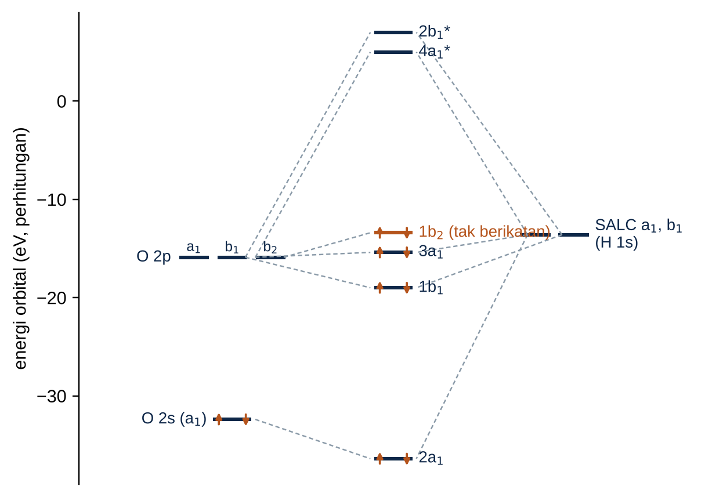
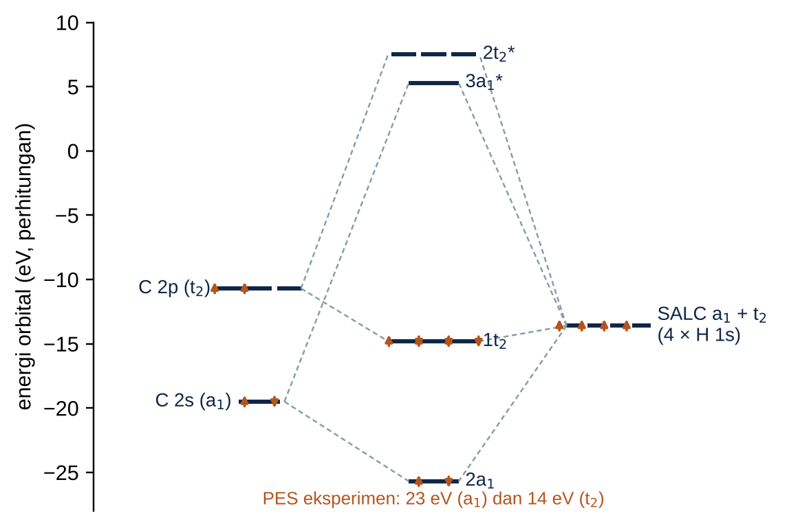

## 4.5 Molekul linear tiga atom: BeH₂ dan CO₂

Untuk molekul dengan lebih dari dua atom, menggabungkan orbital satu per satu cepat menjadi kacau. Bab 3 menyiapkan jalan keluarnya, dan resepnya selalu sama.

::: {.strategi}
**Langkah menyusun diagram orbital molekul poliatom**

1. Tentukan **grup titik** dan letakkan sumbu *z* sepanjang sumbu utama.
2. Tentukan **simetri orbital valensi atom pusat** dari kolom fungsi basis tabel karakter.
3. Susun **SALC** orbital atom-atom ujung (subbab 3.8) dan tentukan simetrinya.
4. **Gabungkan** orbital pusat dengan SALC yang **simetrinya sama**. Setiap pasangan memberi satu orbital ikatan dan satu antiikatan. Orbital tanpa pasangan menjadi **tak berikatan**.
5. Urutkan energi dengan pedoman: orbital atom yang lebih elektronegatif lebih rendah; tumpang tindih σ lebih besar daripada π; makin banyak simpul, makin tinggi.
6. **Isi** elektron valensi dari bawah, lalu bandingkan dengan data (PES, magnet, panjang ikatan).
:::

### BeH₂

Berilium hidrida dalam fase gas adalah molekul linear H–Be–H (grup D∞ₕ). Kita mengikuti resep:

* Orbital Be: 2s bersimetri σ~g~⁺; 2p~*z*~ bersimetri σ~u~⁺; 2p~*x*~ dan 2p~*y*~ bersimetri π~u~.
* SALC dua orbital 1s H: jumlah (φ₁ + φ₂) bersimetri σ~g~⁺, selisih (φ₁ − φ₂) bersimetri σ~u~⁺.
* Penggabungan: 2s dengan SALC σ~g~⁺; 2p~*z*~ dengan SALC σ~u~⁺. Kedua orbital π~u~ (2p~*x*~, 2p~*y*~) tidak mempunyai pasangan dan tetap kosong sebagai orbital tak berikatan.

Empat elektron valensi (dua dari Be, satu dari setiap H) mengisi dua orbital ikatan, σ~g~ dan σ~u~. **Setiap orbital ikatan tersebar di ketiga atom**: elektron tidak duduk di "ikatan Be–H kiri" atau "kanan". Namun jumlahnya, dua pasangan ikatan untuk dua ikatan Be–H, memberi orde ikatan rata-rata satu per ikatan, sama dengan struktur Lewis. Perhitungan memberi energi orbital −13,3 eV (σ~g~) dan −12,2 eV (σ~u~).

Dua orbital 2p kosong membuat BeH₂ sangat kekurangan elektron. Dalam fase padat, molekul-molekulnya saling menempel menjadi rantai polimer dengan atom H yang menjembatani dua atom Be, jenis ikatan yang dibahas di subbab 4.8.

### CO₂

Karbon dioksida (D∞ₕ) jauh lebih kaya. Setiap atom oksigen membawa empat orbital valensi, sehingga ada delapan SALC oksigen:

Tabel 4.4 SALC oksigen pada CO₂ dan pasangannya pada karbon.

| SALC oksigen | Simetri | Orbital karbon | Hasil |
|---|---|---|---|
| 2s(O₁) + 2s(O₂) | σ~g~⁺ | 2s | ikatan lemah (energi berjauhan) |
| 2s(O₁) − 2s(O₂) | σ~u~⁺ | 2p~*z*~ | ikatan lemah |
| 2p~*z*~ jumlah | σ~g~⁺ | 2s | ikatan σ |
| 2p~*z*~ selisih | σ~u~⁺ | 2p~*z*~ | ikatan σ |
| 2p~*x*~, 2p~*y*~ (tanda sama ke arah luar) | π~u~ | 2p~*x*~, 2p~*y*~ | ikatan π (tiga pusat) |
| 2p~*x*~, 2p~*y*~ (tanda berlawanan) | π~g~ | tidak ada | **tak berikatan** |

Tabel ini memperlihatkan kekuatan pendekatan simetri. SALC π~g~ tidak menemukan pasangan apa pun pada karbon, karena karbon tidak mempunyai orbital valensi π~g~ (yang bisa menjadi pasangannya hanya orbital d, yang terlalu tinggi). Akibatnya, ada sepasang orbital π~g~ yang **murni oksigen** dan tak berikatan.

Enam belas elektron valensi mengisi, dari bawah: dua orbital yang didominasi O 2s (σ~g~ dan σ~u~), dua orbital ikatan σ (σ~g~, σ~u~), dua orbital ikatan π~u~, dan dua orbital tak berikatan π~g~ sebagai HOMO. Hitungannya: dua ikatan σ dan dua ikatan π, persis O=C=O. Pasangan bebas oksigen pun muncul: dua orbital O 2s dan dua orbital π~g~.

PES CO₂ mengonfirmasi urutan ini: HOMO 1π~g~ pada 13,78 eV adalah pita yang tajam (tak berikatan), diikuti 1π~u~ pada 17,59 eV dengan deret getaran yang panjang (ikatan), lalu 3σ~u~ (18,08 eV) dan 4σ~g~ (19,40 eV).

::: {.dalam}
**Ikatan π yang tersebar di tiga atom.** Dalam struktur Lewis O=C=O, setiap ikatan rangkap mempunyai satu ikatan π yang terkunci di antara C dan satu O. Dalam teori orbital molekul, kedua orbital π~u~ masing-masing tersebar di ketiga atom, dan kedua orbital π~g~ terisi tetapi hanya berada pada kedua O. Gambaran keseluruhannya setara: empat elektron di π~u~ (ikatan) dan empat di π~g~ (tak berikatan, "pasangan bebas" O) memberi dua ikatan π. Perbedaannya muncul ketika kita mengionkan molekul: elektron yang dilepas berasal dari satu orbital yang tersebar, bukan dari "satu ikatan C=O". Itulah sebabnya ion CO₂⁺ tetap simetris, dengan kedua ikatan C–O sama panjang.
:::

::: {.kuis}
**Kuis cepat 4.5** Ion azida N₃⁻ dan ion nitronium NO₂⁺ isoelektronik dengan CO₂. Berapa elektron valensi masing-masing? Apa yang dapat diramalkan tentang bentuk dan orde ikatannya?
:::

## 4.6 Molekul bengkok dan piramida: H₂O dan NH₃

### Air

Air termasuk grup C₂ᵥ. Kita memakai sumbu yang sama dengan Bab 3: molekul di bidang *xz*, sumbu C₂ sepanjang *z*.

* Orbital O: 2s (a₁), 2p~*z*~ (a₁), 2p~*x*~ (b₁, di bidang molekul), 2p~*y*~ (b₂, tegak lurus bidang).
* SALC H 1s: a₁ (jumlah) dan b₁ (selisih), dari Contoh 3.10.
* Penggabungan: SALC b₁ dengan 2p~*x*~; SALC a₁ dengan **dua** orbital O sekaligus, 2s dan 2p~*z*~, karena ketiganya bersimetri a₁. Orbital 2p~*y*~ (b₂) tidak mempunyai pasangan.

{width=76%}

Delapan elektron valensi mengisi empat orbital, dari bawah:

1. **2a₁** (−36,4 eV): terutama O 2s dengan sedikit ikatan ke H. Sangat rendah, berperilaku hampir seperti pasangan bebas 2s.
2. **1b₁** (−19,0 eV): ikatan O–H yang kuat, dari 2p~*x*~ dan SALC b₁. Tersebar di ketiga atom, dengan simpul di bidang *yz*.
3. **3a₁** (−15,4 eV): campuran O 2p~*z*~, O 2s, dan SALC a₁. Sedikit berikatan; sebagian besar kerapatannya menonjol ke arah yang berlawanan dari H, sehingga berperilaku seperti "pasangan bebas" yang mengarah keluar di sepanjang sumbu C₂.
4. **1b₂** (−13,4 eV, HOMO): 2p~*y*~ oksigen murni, tegak lurus bidang molekul, tak berikatan sama sekali.

Gambaran ini menjelaskan empat pita PES air (subbab 4.4). Gambaran ini juga menjawab pertanyaan yang lazim: apakah air mempunyai "dua pasangan bebas setara di orbital sp³"? Untuk **energi**, tidak: kedua pasangan bebas berada pada orbital berbeda dengan energi ionisasi yang terpisah 2 eV. Untuk **kerapatan elektron total**, gambaran sp³ tetap dapat dipakai, karena orbital 3a₁ dan 1b₂ dapat dicampur ulang menjadi dua "telinga kelinci" yang setara tanpa mengubah kerapatan total. Kedua gambaran itu benar untuk pertanyaannya masing-masing.

### Amonia

Amonia termasuk C₃ᵥ, dengan sumbu C₃ sepanjang *z*.

* Orbital N: 2s (a₁), 2p~*z*~ (a₁), (2p~*x*~, 2p~*y*~) bersama-sama (e).
* SALC tiga H 1s: a₁ + e (Contoh 3.10).
* Penggabungan: SALC e dengan pasangan (2p~*x*~, 2p~*y*~) membentuk dua orbital ikatan **1e** yang merosot; SALC a₁ dengan 2s dan 2p~*z*~ membentuk **2a₁** (rendah, ikatan) dan **3a₁** (hampir tak berikatan).

::: {.contoh}
**Contoh 4.4 · Orbital molekul amonia**

(a) Isi delapan elektron valensi amonia ke dalam orbital molekulnya. (b) Orbital mana yang merupakan "pasangan bebas" nitrogen? (c) PES amonia menunjukkan pita pada 10,85, 16,4, dan 27,0 eV. Cocokkan dengan orbitalnya.

**Penyelesaian.** (a) Dari bawah: 2a₁ (2 elektron), 1e (4 elektron dalam dua orbital merosot), 3a₁ (2 elektron). Semuanya terisi; orbital antiikatan 4a₁* dan 2e* kosong.

(b) **3a₁**: tersusun terutama dari N 2p~*z*~ dengan sedikit 2s, menonjol sepanjang sumbu C₃ menjauhi atom H. Ia hanya sedikit berikatan karena SALC a₁ hidrogen sudah "dipakai" oleh 2a₁.

(c) Energi ionisasi terendah berasal dari orbital tertinggi: 10,85 eV → **3a₁** (pasangan bebas); 16,4 eV → **1e** (ikatan N–H, pita dengan intensitas sekitar dua kali karena empat elektron); 27,0 eV → **2a₁** (terutama N 2s).

**Memahami hasil.** HOMO amonia adalah pasangan bebas 3a₁ yang tinggi energinya dan mengarah keluar: itulah yang membuat amonia menjadi basa Lewis dan ligan yang baik (subbab 4.10). Pita 10,85 eV dalam PES amonia juga menunjukkan deret getaran panjang dari gerak **payung** (tekukan simetris), bukan regangan N–H. Ion NH₃⁺ yang terbentuk hampir datar: melepas satu elektron dari 3a₁ menghilangkan alasan molekul itu untuk berbentuk piramida, sesuatu yang akan dijelaskan oleh diagram Walsh di subbab 4.9.
:::

::: {.kuis}
**Kuis cepat 4.6** Molekul H₂S mempunyai sudut 92°, jauh lebih kecil daripada air. Pita pertama PES H₂S berada pada 10,5 eV. Orbital apakah itu, dan mengapa energinya lebih rendah daripada pita pertama air (12,62 eV)?
:::

## 4.7 Molekul tetrahedral dan oktahedral: CH₄ dan SF₆

### Metana

Metana (T~d~) adalah contoh paling bersih bahwa teori grup meramalkan sesuatu yang tidak dapat diramalkan gambaran hibridisasi.

* Orbital C: 2s (a₁), tiga 2p (t₂).
* SALC empat H 1s: a₁ + t₂ (Tabel 3.6).
* Penggabungan: a₁ dengan a₁, dan ketiga t₂ dengan ketiga t₂. Tidak ada orbital yang tersisa.

{width=72%}

Delapan elektron mengisi 2a₁ (2 elektron) dan 1t₂ (6 elektron). **Dua** tingkat energi, sehingga PES menunjukkan dua pita: sekitar 23 eV untuk 2a₁ dan sekitar 14 eV untuk 1t₂.

::: {.dalam}
**Orbital terdelokalisasi lawan ikatan terlokalisasi.** Bila keempat orbital molekul terisi metana (satu a₁ dan tiga t₂) dicampur ulang dengan kombinasi yang tepat, misalnya (a₁ + t₂ˣ + t₂ʸ + t₂ᶻ)/2 dan seterusnya, diperoleh empat orbital setara yang masing-masing terpusat pada satu ikatan C–H: inilah "orbital ikatan sp³". Pencampuran ulang semacam ini (transformasi uniter) tidak mengubah fungsi gelombang total, kerapatan elektron, maupun energi total. Jadi gambaran terlokalisasi dan terdelokalisasi **setara untuk sifat keadaan dasar**: panjang ikatan, sudut, dan momen dipol. Yang berbeda adalah sifat yang melibatkan **satu** elektron, seperti energi ionisasi dan spektrum elektronik. Untuk sifat-sifat ini, hanya orbital terdelokalisasi yang benar, karena hanya orbital itulah yang merupakan keadaan dengan energi tertentu.
:::

### Belerang heksafluorida dan molekul oktahedral

SF₆ (O~h~) adalah molekul "hipervalen" yang di Bab 2 dijelaskan tanpa orbital d. Sekarang kita dapat membuktikannya.

* Orbital S valensi: 3s (a₁g), 3p (t₁u). Orbital 3d (e~g~ + t₂g) jauh lebih tinggi; untuk sementara diabaikan.
* SALC σ dari enam F (satu orbital 2p yang mengarah ke S pada setiap F): a₁g + e~g~ + t₁u (Tabel 3.6).
* Penggabungan: a₁g dengan 3s, t₁u dengan 3p. SALC e~g~ **tidak mempunyai pasangan** tanpa orbital d.

::: {.contoh}
**Contoh 4.5 · Ikatan dalam SF₆ tanpa orbital d**

Hitung elektron yang terlibat dalam ikatan σ S–F, tentukan orbital mana yang terisi, dan hitung orde ikatan rata-rata S–F. Di mana muatan negatifnya berkumpul?

**Penyelesaian.** Sistem σ: belerang menyumbang 6 elektron valensi, dan setiap F menyumbang 1 elektron dari orbital σ-nya (elektron F lainnya mengisi orbital 2s dan 2p π yang tidak ikut ikatan σ). Jumlahnya 6 + 6 = 12 elektron.

Orbital ikatan: a₁g (1 orbital) dan t₁u (3 orbital), yaitu 4 orbital, 8 elektron. Sisanya, 4 elektron, mengisi kedua orbital e~g~ yang **tak berikatan dan seluruhnya berada pada atom F**.

Orde ikatan: 4 pasangan ikatan dibagi atas 6 ikatan S–F, yaitu ⅔ per ikatan.

**Memahami hasil.** SF₆ tidak memerlukan 12 elektron di sekitar belerang. Hanya 8 elektron ikatan yang tersebar di antara S dan F; 4 elektron lainnya berada pada fluorin. Akibatnya atom F membawa muatan negatif parsial yang cukup besar, dan atom S positif. Inilah penjelasan modern untuk hipervalensi yang disebut di subbab 2.3: ikatan polar banyak pusat dengan muatan pada atom ujung yang elektronegatif, bukan orbital sp³d². Bila orbital 3d diikutkan, ia dapat sedikit bergabung dengan SALC e~g~, dan perhitungan menunjukkan sumbangannya kecil sekali. Penjelasan ini juga menerangkan mengapa hanya ligan elektronegatif (F, O, Cl) yang membentuk senyawa hipervalen yang stabil: hanya merekalah yang dapat menampung muatan negatif di orbital tak berikatan e~g~.
:::

Pola yang sama, SALC a₁g + e~g~ + t₁u, berlaku untuk setiap kompleks oktahedron ML₆. Perbedaannya, logam transisi mempunyai orbital *n*d yang energinya **dekat** dengan orbital ligan, sehingga dua orbital d (e~g~) ikut bergabung dengan SALC e~g~, sedangkan tiga orbital d lainnya (t₂g) tetap tak berikatan untuk ikatan σ. Selisih energi antara t₂g dan e~g~* menjadi pusat **teori medan ligan** di Bab 11.

::: {.kuis}
**Kuis cepat 4.7** Dalam ion [BF₄]⁻ (T~d~), orbital B mana yang bergabung dengan SALC σ fluorin? Apakah ada SALC σ yang tersisa tanpa pasangan? Bandingkan dengan SF₆.
:::
