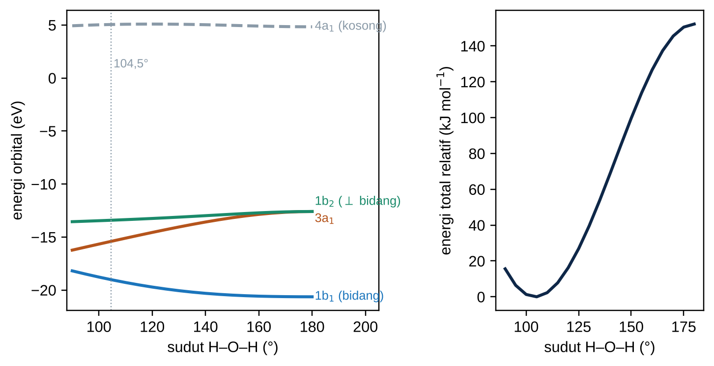
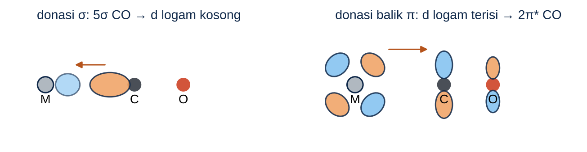

## 4.8 Ikatan tiga pusat: diborana dan XeF₂

Struktur Lewis mengandaikan bahwa setiap ikatan adalah sepasang elektron di antara **dua** atom. Teori orbital molekul tidak membuat anggapan itu, dan ada dua golongan senyawa penting yang hanya dapat dijelaskan dengan ikatan yang melibatkan **tiga** atom.

### Diborana: tiga pusat, dua elektron

Boron hidrida yang paling sederhana bukan BH₃ melainkan dimernya, **diborana** B₂H₆. Strukturnya, yang dipastikan dengan difraksi elektron pada 1951, mengejutkan: empat atom H **ujung** terletak dalam satu bidang bersama kedua B, dan dua atom H **jembatan** berada di atas dan di bawah bidang itu, masing-masing terikat pada kedua atom B sekaligus. Ikatan B–H jembatan (133 pm) lebih panjang daripada B–H ujung (119 pm).

Hitung elektronnya: 2 × 3 (B) + 6 × 1 (H) = **12 elektron valensi**. Struktur seperti etana, dengan tujuh ikatan dua pusat (satu B–B dan enam B–H), memerlukan 14 elektron. Diborana kekurangan dua elektron untuk struktur klasik apa pun.

Jalan keluarnya: empat ikatan B–H ujung adalah ikatan dua pusat dua elektron (2c-2e) biasa, memakai 8 elektron. Empat elektron sisanya membentuk **dua ikatan tiga pusat dua elektron (3c-2e)**, satu untuk setiap jembatan B–H–B.

Ambil satu jembatan. Setiap atom B menyumbang satu orbital (secara kasar hibrida sp³) yang mengarah ke H jembatan, dan H menyumbang 1s. Tiga orbital atom menghasilkan tiga orbital molekul:

* **ikatan**: ketiga orbital bertanda sama, tanpa simpul; energi rendah.
* **tak berikatan**: kedua orbital B bertanda berlawanan, dan H tidak ikut (simpul tepat pada H).
* **antiikatan**: tanda bergantian, dua simpul; energi tinggi.

{width=96%}

Dua elektron mengisi orbital ikatan, yang mengikat **ketiga** atom sekaligus. Satu pasangan elektron untuk dua "ikatan" B–H: setiap ikatan B–H jembatan mempunyai orde ½, sesuai dengan panjangnya yang lebih besar. Dengan cara ini, dua elektron yang tersedia dipakai seefisien mungkin. Ikatan 3c-2e adalah ciri senyawa **kekurangan elektron**: boran, aluminium alkil seperti Al₂(CH₃)₆, dan banyak hidrida logam. William Lipscomb menerima Hadiah Nobel Kimia 1976 untuk mengembangkan teori ikatan boran yang lebih besar, yang semuanya dibangun dari ikatan 3c-2e.

::: {.awas}
**Awas: tidak semua jembatan adalah 3c-2e.** Al₂Cl₆ juga dimer dengan dua atom Cl jembatan, dan sekilas tampak seperti diborana. Namun klorin mempunyai pasangan bebas. Setiap Cl jembatan memakai satu ikatan biasa ke Al pertama dan **menyumbangkan pasangan bebasnya** ke Al kedua (ikatan koordinasi 2c-2e). Hitung elektronnya: Al₂Cl₆ mempunyai 48 elektron valensi, cukup untuk delapan ikatan 2c-2e dengan pasangan bebas pada semua Cl. Jembatan 3c-2e hanya diperlukan bila atom jembatan **tidak** mempunyai pasangan bebas, seperti H dalam B₂H₆ atau gugus CH₃ dalam Al₂(CH₃)₆.
:::

### XeF₂ dan I₃⁻: tiga pusat, empat elektron

Golongan kedua adalah kebalikannya: molekul **kaya elektron** yang dalam struktur Lewis tampak melanggar oktet, misalnya XeF₂, I₃⁻, dan ion bifluorida [F–H–F]⁻. Ambil XeF₂ yang linear. Ikatan σ melibatkan satu orbital dari setiap atom yang terletak pada sumbu: Xe 5p~*z*~ dan 2p~*z*~ dari kedua F. Tiga orbital ini kembali menghasilkan orbital ikatan, tak berikatan, dan antiikatan, dengan pola yang sama seperti di atas.

Sistem ini membawa **empat** elektron: dua dari Xe 5p~*z*~ dan satu dari setiap F 2p~*z*~. Dua elektron mengisi orbital ikatan, dan dua mengisi orbital **tak berikatan**, yang mempunyai simpul pada Xe dan seluruhnya berada pada **kedua F**. Orbital antiikatan kosong. Inilah **ikatan tiga pusat empat elektron (3c-4e)**.

Tiga akibatnya dapat diuji:

1. **Orde ikatan ½ per ikatan.** Satu pasangan ikatan dibagi untuk dua ikatan Xe–F. Ikatan dalam senyawa hipervalen memang panjang dan relatif lemah: I–I dalam I₃⁻ 290 pm, dibandingkan 267 pm dalam I₂.
2. **Muatan negatif pada atom ujung.** Pasangan tak berikatan berada pada kedua F, sehingga setiap F membawa sekitar −½ muatan dan Xe sekitar +1. Inilah sebabnya senyawa gas mulia dan senyawa hipervalen hanya stabil dengan ligan yang sangat elektronegatif (F, O, Cl).
3. **Tanpa orbital d.** Seluruh ikatan dijelaskan dengan orbital p. Gambaran "dsp³ pada xenon" tidak diperlukan.

Ion bifluorida [F–H–F]⁻ adalah kasus yang sama dengan H di tengah: orbital 1s hidrogen bergabung dengan SALC 2p~*z*~ fluorin. Ikatan hidrogen dalam ion ini simetris, kedua jarak H–F sama (113 pm, dibandingkan 92 pm dalam HF), dan merupakan ikatan hidrogen terkuat yang dikenal, sekitar 160 kJ mol⁻¹.

::: {.contoh}
**Contoh 4.6 · Menghitung ikatan dalam diborana dan XeF₄**

(a) Tunjukkan bahwa jumlah elektron dalam B₂H₆ cocok dengan empat ikatan 2c-2e dan dua ikatan 3c-2e. (b) XeF₄ berbentuk segi empat datar (Bab 2). Jelaskan ikatannya dengan dua sistem 3c-4e, dan tentukan orde ikatan Xe–F rata-rata.

**Penyelesaian.** (a) 4 × 2 + 2 × 2 = 12 elektron, sama dengan jumlah elektron valensi B₂H₆. ✓

(b) Pada bidang molekul, dua pasang F yang berseberangan (sumbu *x* dan *y*) masing-masing membentuk satu sistem 3c-4e dengan satu orbital 5p xenon (5p~*x*~ dan 5p~*y*~). Setiap sistem: dua elektron ikatan dan dua tak berikatan pada F. Xenon menyumbang empat elektron ke kedua sistem; empat elektron Xe lainnya mengisi 5s dan 5p~*z*~ sebagai dua pasangan bebas, satu di atas dan satu di bawah bidang (secara kasar, sesuai VSEPR). Orde ikatan: dua pasangan ikatan untuk empat ikatan Xe–F, yaitu **½**.

**Memahami hasil.** Gambaran 3c-4e menjelaskan secara alami mengapa XeF₂ linear dan XeF₄ datar: ikatan hipervalen selalu terbentuk berpasangan di sepanjang satu garis lurus, memakai satu orbital p yang menunjuk ke dua arah berlawanan. Panjang ikatan Xe–F dalam XeF₂ (198 pm) dan XeF₄ (195 pm) hampir sama, sesuai orde ikatan ½ di keduanya.
:::

::: {.kuis}
**Kuis cepat 4.8** Bila satu elektron ditambahkan ke sistem 3c-4e (sehingga menjadi 3c-5e), orbital mana yang terisi? Apa yang terjadi pada ikatannya? (Petunjuk: lihat Gambar 4.8.)
:::

## 4.9 Diagram Walsh: mengapa H₂O bengkok

VSEPR meramalkan bahwa air bengkok karena empat pasangan elektron tersusun tetrahedron. Teori orbital molekul memberi penjelasan yang berbeda dan lebih umum: molekul memilih bentuk yang membuat **energi orbital-orbital terisinya** serendah mungkin. Untuk melihatnya, kita melacak bagaimana energi setiap orbital berubah ketika sudut ikatan berubah. Grafik energi orbital terhadap sudut disebut **diagram Walsh**, dinamai menurut A. D. Walsh yang memperkenalkannya pada 1953.

{width=98%}

Mulai dari molekul AH₂ yang linear (D∞ₕ), lalu tekuk sedikit demi sedikit (C₂ᵥ). Ikuti empat orbital valensi terendah:

* **2a₁** (σ~g~ pada bentuk linear): terutama 2s A. Sedikit naik ketika ditekuk, karena tumpang tindih s dengan kedua H sedikit berkurang. Perubahannya kecil.
* **1b₁** (σ~u~ pada bentuk linear): ikatan dari p~*x*~ A dengan SALC selisih H. Pada bentuk linear, kedua H tepat di sumbu cuping p, dan tumpang tindihnya maksimum. Ketika ditekuk, kedua H bergerak menjauhi sumbu cuping: orbital ini **naik**. Orbital ini lebih menyukai bentuk linear.
* **3a₁** (salah satu π~u~ pada bentuk linear): ini kunci seluruh diagram. Pada bentuk linear, orbital ini adalah p~*z*~ A yang tegak lurus sumbu molekul, **tak berikatan** murni, karena kedua H terletak pada bidang simpulnya. Ketika ditekuk, kedua H bergerak keluar dari bidang simpul, sehingga p~*z*~ mulai bertumpang tindih dengan SALC a₁ hidrogen dan juga bercampur dengan 2s A. Energinya **turun tajam**. Orbital ini sangat menyukai bentuk bengkok.
* **1b₂** (π~u~ yang lain): p~*y*~ A, tegak lurus bidang molekul pada sudut berapa pun. Tetap tak berikatan; energinya hampir tidak berubah.

Bentuk molekul ditentukan oleh orbital mana yang terisi:

* **4 elektron valensi** (BeH₂, BH₂⁺): mengisi 2a₁ dan 1b₁. Keduanya menyukai bentuk linear: molekul **linear**.
* **5–8 elektron valensi** (BH₂, CH₂, NH₂, H₂O): mulai mengisi 3a₁, yang sangat menyukai bentuk bengkok. Penurunan energi 3a₁ mengalahkan kenaikan 1b₁: molekul **bengkok**.

Untuk air (8 elektron), perhitungan memberi sudut optimum 104,4° dan energi bentuk linear 152 kJ mol⁻¹ lebih tinggi daripada bentuk bengkok (nilai eksperimen sekitar 133 kJ mol⁻¹).

::: {.contoh}
**Contoh 4.7 · Meramalkan sudut AH₂ dan AB₂**

(a) Urutkan sudut H–A–H dalam BH₂ (5 elektron valensi), CH₂ triplet (6 elektron, dengan satu elektron di 3a₁ dan satu di 1b₂), CH₂ singlet (6 elektron, keduanya di 3a₁), dan H₂O (8 elektron). (b) Diagram Walsh untuk molekul AB₂ dengan atom B berat (O, F) menghasilkan aturan: 16 elektron valensi linear, 17–20 elektron bengkok. Ramalkan bentuk NO₂⁺, NO₂, dan NO₂⁻.

**Penyelesaian.** (a) Makin banyak elektron di 3a₁, makin kuat dorongan untuk menekuk.

* BH₂: satu elektron di 3a₁ → bengkok sedang. Terukur **131°**.
* CH₂ triplet: satu elektron di 3a₁ (satu lagi di 1b₂ yang tidak peduli sudut) → mirip BH₂. Terukur **sekitar 134°**.
* CH₂ singlet: **dua** elektron di 3a₁ → jauh lebih bengkok. Terukur **102°**.
* H₂O: dua elektron di 3a₁, dua di 1b₂ → bengkok kuat. **104,5°**.

(b) NO₂⁺: 5 + 12 − 1 = 16 elektron → **linear** (180°, isoelektronik dengan CO₂). NO₂: 17 elektron → **bengkok** (terukur 134°). NO₂⁻: 18 elektron → **lebih bengkok** (115°).

**Memahami hasil.** Diagram Walsh meramalkan bukan hanya linear atau bengkok, tetapi juga **arah perubahan** sudut ketika elektron ditambah atau dikurangi, termasuk untuk radikal (BH₂, NO₂) dan keadaan tereksitasi (CH₂ singlet lawan triplet), yang tidak dapat ditangani VSEPR dengan nyaman. Karbena triplet dan singlet adalah zat antara penting dalam kimia organik; perbedaan bentuknya, yang diramalkan dengan tepat oleh Walsh, menentukan reaktivitasnya.
:::

::: {.kuis}
**Kuis cepat 4.9** Ion H₃O⁺ dan NH₃ isoelektronik (8 elektron valensi, AH₃). Diagram Walsh untuk AH₃ menunjukkan bahwa orbital 3a₁ (pasangan bebas) turun ketika molekul datar menjadi piramida. Ramalkan bentuk BH₃ (6 elektron) dan CH₃⁺, serta CH₃⁻ (8 elektron).
:::

## 4.10 HOMO, LUMO, dan reaktivitas anorganik

Kebanyakan reaksi kimia melibatkan perpindahan atau pembagian elektron antara dua molekul. Kenichi Fukui (Nobel 1981) menunjukkan bahwa interaksi yang paling menentukan biasanya terjadi antara dua orbital saja: **orbital terisi tertinggi** (*highest occupied molecular orbital*, **HOMO**) satu molekul dan **orbital kosong terendah** (*lowest unoccupied molecular orbital*, **LUMO**) molekul lain. Keduanya disebut **orbital perbatasan**.

Alasannya mengikuti aturan penggabungan dari subbab 4.1. Interaksi dua orbital terisi tidak menurunkan energi (ikatan dan antiikatan sama-sama terisi, dan antiikatan naik lebih banyak). Interaksi dua orbital kosong tidak berpengaruh karena tidak ada elektron. Yang menurunkan energi adalah interaksi orbital **terisi** dengan orbital **kosong**: kedua elektron turun ke orbital ikatan yang baru. Penurunan terbesar terjadi bila kedua orbital berenergi berdekatan, yaitu HOMO yang tinggi dan LUMO yang rendah.

::: {.inti}
**Asam dan basa Lewis dalam bahasa orbital.** Basa Lewis adalah molekul dengan **HOMO yang tinggi** dan mudah dijangkau (pasangan bebas). Asam Lewis adalah molekul dengan **LUMO yang rendah** dan mudah dijangkau (orbital kosong). Reaksi asam–basa Lewis adalah penggabungan HOMO basa dengan LUMO asam.
:::

Reaksi NH₃ + BF₃ → H₃N–BF₃ adalah contoh baku. HOMO amonia adalah orbital 3a₁, pasangan bebas yang mengarah keluar dari N (subbab 4.6). LUMO BF₃ adalah orbital 2p~*z*~ boron yang kosong, tegak lurus bidang molekul (a₂″, subbab 3.9). Ketika amonia mendekat dari atas bidang BF₃, kedua orbital bergabung membentuk ikatan B–N, dan BF₃ yang datar menjadi piramida.

### Karbon monoksida sebagai ligan

Kimia organologam dibangun di atas interaksi orbital perbatasan CO dengan logam. Dua interaksi bekerja bersama:

1. **Donasi σ**: HOMO 5σ, yang besar pada karbon, menyumbangkan pasangan elektron ke orbital d kosong logam yang mengarah ke CO.
2. **Donasi balik π**: orbital d logam yang **terisi** (d~*xz*~, d~*yz*~) menyumbangkan elektron ke LUMO 2π* CO, yang juga besar pada karbon.

{width=90%}

Kedua interaksi saling memperkuat: donasi σ membuat logam lebih kaya elektron, sehingga lebih mampu menyumbang balik, dan donasi balik mengurangi muatan pada logam, sehingga lebih mampu menerima donasi σ. Karena 2π* adalah orbital **antiikatan** C–O, donasi balik **melemahkan ikatan C–O**, dan ini terlihat langsung dalam spektrum IR. Frekuensi regangan C≡O turun dari 2143 cm⁻¹ pada CO bebas menjadi sekitar 2000 cm⁻¹ pada Cr(CO)₆, dan lebih rendah lagi bila logamnya lebih kaya elektron.

::: {.contoh}
**Contoh 4.8 · Membaca frekuensi CO**

Frekuensi regangan C≡O (cm⁻¹, rata-rata pita IR): CO bebas 2143; [Mn(CO)₆]⁺ 2090; Cr(CO)₆ 2000; [V(CO)₆]⁻ 1860. (a) Jelaskan urutan ini dengan donasi balik π. (b) N₂ isoelektronik dengan CO, tetapi kompleks logam–N₂ jauh lebih jarang. Jelaskan dengan HOMO dan LUMO kedua molekul.

**Penyelesaian.** (a) Ketiga kompleks isoelektronik (d⁶), tetapi muatannya berbeda: +1, 0, −1. Makin negatif muatan kompleks, makin tinggi energi orbital d logam dan makin besar donasi balik ke 2π* CO. Makin banyak elektron di orbital antiikatan C–O, makin lemah ikatannya dan makin rendah frekuensinya: [Mn(CO)₆]⁺ > Cr(CO)₆ > [V(CO)₆]⁻.

(b) HOMO N₂ (3σ~g~, 15,58 eV) **lebih rendah** daripada HOMO CO (5σ, 14,01 eV), sehingga N₂ donor σ yang lebih lemah. HOMO N₂ juga simetris pada kedua atom, sedangkan HOMO CO terpusat pada C dan menonjol keluar. LUMO π* N₂ juga lebih tinggi dan tersebar sama pada kedua atom, sehingga N₂ akseptor π yang lebih lemah. Kedua alasan membuat N₂ ligan yang jauh lebih buruk daripada CO.

**Memahami hasil.** Rendahnya kemampuan N₂ untuk terikat pada logam adalah bagian dari alasan mengapa N₂ sangat tidak reaktif dan mengapa fiksasi nitrogen sangat sulit, baik di pabrik (proses Haber–Bosch yang memerlukan suhu dan tekanan tinggi) maupun di alam (enzim nitrogenase dengan gugus besi–molibdenum yang rumit). Kompleks N₂ pertama, [Ru(NH₃)₅(N₂)]²⁺, baru ditemukan pada 1965.
:::

::: {.terapan}
**Warna iodin dalam berbagai pelarut.** Larutan iodin dalam CCl₄ atau heksana berwarna ungu, sama dengan uap iodin. Dalam etanol, aseton, atau benzena, warnanya cokelat. Pelarut-pelarut kedua mempunyai pasangan bebas (O) atau elektron π dengan HOMO yang cukup tinggi, yang menyumbang ke LUMO iodin, yaitu orbital antiikatan σ* I–I. Terbentuk **kompleks transfer muatan** yang menyerap cahaya pada panjang gelombang lebih pendek, sehingga warnanya bergeser ke cokelat. Pengisian sebagian σ* juga melemahkan ikatan I–I. Bila donasi diteruskan sampai penuh, ikatan I–I putus; ini adalah langkah awal banyak reaksi iodin dengan basa Lewis, dan juga gambaran awal ikatan 3c-4e dalam I₃⁻ (I⁻ menyumbang ke σ* I₂).
:::

::: {.kuis}
**Kuis cepat 4.10** Ion CN⁻ dan NO⁺ isoelektronik dengan CO. Mana yang diramalkan sebagai donor σ terkuat dan mana akseptor π terkuat? (Petunjuk: muatan negatif menaikkan energi semua orbital, muatan positif menurunkannya.)
:::

## Menuju bab berikutnya

Oksigen menggantung di antara kutub magnet karena dua elektronnya menempati dua orbital π* yang merosot dengan spin sejajar, sesuatu yang tidak dapat ditunjukkan struktur Lewis. Teori orbital molekul tidak membuang apa yang benar dari struktur Lewis: orde ikatan, pasangan bebas, dan ikatan rangkap tetap muncul. Namun ia menambahkan energi setiap elektron, yang dapat diukur dengan PES, dan dengan itu menjelaskan sifat magnet, ikatan tiga pusat, bentuk molekul dari diagram Walsh, dan reaktivitas dari orbital perbatasan.

Semua molekul dalam bab ini terdiri atas beberapa atom saja. Bagaimana bila atom yang bergabung bukan dua atau enam, melainkan 10²³? Natrium klorida, intan, dan logam tembaga adalah padatan dengan susunan atom yang berulang di seluruh kristal. Bab 5 mulai dari sisi geometri: bagaimana ion dan atom tersusun dalam kristal, dan bagaimana ukuran ion menentukan susunan itu. Bab 6 menghitung energi yang menyatukan kristal ionik. Bab 7 kembali ke orbital molekul dalam skala yang sangat besar: ketika jumlah atom menuju tak hingga, tingkat-tingkat energi orbital menyatu menjadi **pita**, dan teori pita itulah yang membedakan logam, semikonduktor, dan isolator.
