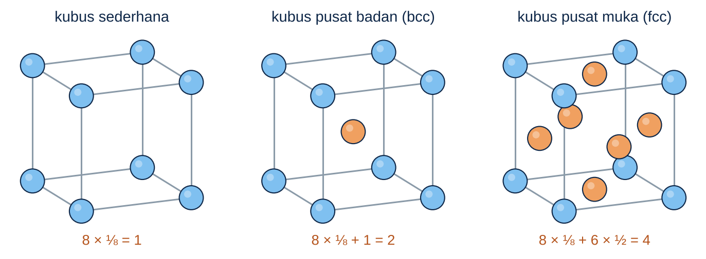

# Bab 5 Padatan Ionik dan Struktur Kristal

Pada 1913, William Henry Bragg dan putranya, William Lawrence Bragg, menyinari sebutir kristal garam dapur dengan sinar-X dan merekam pola berkas yang dipantulkannya. Dari pola itu mereka menyusun struktur kristal pertama yang pernah ditentukan manusia, dan hasilnya membuat sebagian kimiawan gelisah. Di dalam kristal NaCl **tidak ada molekul NaCl**. Setiap ion natrium dikelilingi enam ion klorida pada jarak yang persis sama, dan setiap ion klorida dikelilingi enam ion natrium. Tidak ada satu pun klorida yang dapat disebut "pasangan" natrium tertentu. Bahkan bertahun-tahun kemudian, pada 1927, kimiawan Inggris Henry Armstrong masih menulis surat ke majalah *Nature* yang menyebut gagasan ini bertentangan dengan akal sehat. Ia keliru. Rumus NaCl hanya menyatakan **perbandingan** ion, sedangkan zat yang sesungguhnya adalah satu kristal raksasa yang tersusun berulang dalam tiga dimensi.

Bab ini membahas bagaimana atom dan ion tersusun dalam padatan. Kita mulai dari pertanyaan yang tampak sederhana: bagaimana menumpuk bola-bola sama besar serapat mungkin? Jawabannya, yaitu dua cara kemasan rapat beserta rongga-rongga di antaranya, ternyata menjelaskan struktur sebagian besar logam dan senyawa ionik. Lalu kita mengenal sel satuan dan struktur-struktur prototipe (NaCl, CsCl, ZnS, CaF₂, rutil, perovskit, spinel), menguji aturan rasio jari-jari beserta kegagalannya, dan mempelajari difraksi sinar-X yang menjadi bukti semua struktur itu. Bab ditutup dengan ketidaksempurnaan kristal, polimorfisme, padatan amorf seperti kaca, dan padatan kovalen jaringan seperti intan dan grafit.

::: {.kuis}
**Pertanyaan pembuka**

1. Berapa persen ruang yang dapat diisi oleh bola-bola sama besar yang ditumpuk serapat mungkin? Adakah cara yang lebih rapat?
2. Mengapa NaCl dan CsCl mempunyai struktur kristal yang berbeda, padahal Na dan Cs segolongan?
3. Bagaimana menghitung massa jenis sebuah kristal hanya dari ukuran sel satuannya?
4. Mengapa pola difraksi sinar-X KCl tampak seperti kristal dengan sel satuan yang separuh ukurannya?
5. Mengapa kristal yang "sempurna" tidak dapat ada pada suhu di atas nol mutlak?
6. Intan dan grafit sama-sama karbon murni. Mengapa yang satu paling keras dan yang lain licin dan menghantarkan listrik?
:::

::: {.tujuan}
**Tujuan belajar**

Setelah mempelajari bab ini, kamu mampu:

1. Menjelaskan kemasan rapat hcp dan ccp, menghitung efisiensi kemasan, dan menentukan jumlah serta ukuran rongga tetrahedral dan oktahedral.
2. Menghitung isi sel satuan, massa jenis, dan jarak antaratom dari parameter kisi.
3. Mendeskripsikan struktur prototipe NaCl, CsCl, sfalerit, wurtzit, NiAs, fluorit, antifluorit, rutil, CdI₂, perovskit, dan spinel dengan bahasa kemasan rapat dan bilangan koordinasi.
4. Memakai aturan rasio jari-jari dan menjelaskan mengapa aturan itu sering gagal.
5. Memakai hukum Bragg dan aturan kepunahan untuk menafsirkan pola difraksi serbuk sederhana.
6. Menjelaskan cacat Schottky, Frenkel, dan nonstoikiometri, serta akibatnya pada sifat padatan.
7. Membedakan polimorfisme, padatan kristal, dan padatan amorf.
8. Menjelaskan struktur dan sifat intan, grafit, dan alotrop karbon lainnya.
:::

::: {.mat}
**Prasyarat**

Bab 1 (jari-jari ion dan tren periodik, aturan Fajans di subbab 1.12), Bab 2 (geometri koordinasi), Bab 3 (operasi simetri: sumbu putar dan bidang cermin muncul lagi sebagai unsur simetri kristal). Matematika: geometri kubus (diagonal sisi dan diagonal ruang) dan trigonometri dasar.
:::

## 5.1 Kemasan rapat bola: hcp dan ccp

Banyak padatan dapat dibayangkan sebagai bola-bola yang ditumpuk. Atom logam dalam logam murni dapat dianggap bola-bola yang sama besar, dan dalam kebanyakan senyawa ionik, anion yang besar membentuk kerangka bola-bola yang di antara celahnya terselip kation yang lebih kecil. Maka pertanyaan pertama kita adalah persoalan geometri murni: bagaimana menyusun bola sama besar agar memakan ruang sekecil mungkin?

### Satu lapisan, dua lapisan, tiga lapisan

Mulailah dengan satu lapisan datar. Susunan terapat adalah susunan heksagonal: setiap bola menyentuh enam tetangga, seperti jeruk yang disusun di atas meja. Sebut lapisan ini **A**.

Lapisan kedua diletakkan di atas celah-celah lapisan A. Lapisan A mempunyai dua jenis celah berbentuk segitiga, dan bola lapisan kedua hanya dapat menempati salah satu jenis, karena bola-bola itu terlalu besar untuk mengisi keduanya. Sebut posisi yang dipilih **B**. Pilihan ini tidak penting, karena kedua jenis celah setara.

Lapisan ketiga barulah memberi pilihan yang sungguh berbeda. Bola-bola lapisan ketiga dapat:

* diletakkan **tepat di atas bola lapisan A**, sehingga urutannya ABABAB… Susunan ini disebut **kemasan rapat heksagonal** (*hexagonal close packing*, **hcp**);
* diletakkan di atas celah lapisan A yang belum terpakai, posisi **C**, sehingga urutannya ABCABC… Susunan ini disebut **kemasan rapat kubus** (*cubic close packing*, **ccp**). Bila dilihat dari arah lain, ccp ternyata sama dengan kisi kubus pusat muka (subbab 5.3).

{width=92%}

Pada kedua susunan, setiap bola menyentuh **12 tetangga**: enam di lapisannya sendiri, tiga di atas, dan tiga di bawah. Bilangan koordinasi 12 adalah yang tertinggi yang mungkin untuk bola sama besar.

### Efisiensi kemasan

Bagian ruang yang terisi bola disebut **efisiensi kemasan** (atau fraksi kemasan). Untuk hcp dan ccp nilainya sama, $\pi/(3\sqrt2) = 0{,}740$, yaitu **74,0 %**. Carl Friedrich Gauss membuktikan pada 1831 bahwa tidak ada susunan **teratur** yang lebih rapat, dan Johannes Kepler sudah menduganya pada 1611. Bukti bahwa tidak ada susunan apa pun, teratur atau tidak, yang lebih rapat baru diselesaikan oleh Thomas Hales pada 1998 dengan bantuan komputer.

Tabel 5.1 Efisiensi kemasan beberapa susunan bola sama besar.

| Susunan | Bilangan koordinasi | Efisiensi | Contoh logam |
|---|---|---|---|
| kemasan rapat (hcp, ccp) | 12 | 74,0 % | Mg, Zn, Ti (hcp); Cu, Ag, Au, Al (ccp) |
| kubus pusat badan (bcc) | 8 (+6 sedikit lebih jauh) | 68,0 % | Na, K, Fe, Cr, W |
| kubus sederhana | 6 | 52,4 % | Po (satu-satunya unsur) |
| intan | 4 | 34,0 % | C, Si, Ge, Sn abu-abu |

Kebanyakan logam mengadopsi hcp, ccp, atau bcc. Perbedaan energi antara ketiganya kecil, sehingga banyak logam berubah struktur ketika dipanaskan, misalnya besi: bcc di bawah 912 °C, ccp antara 912 dan 1394 °C, lalu bcc lagi sampai meleleh (subbab 5.10). Struktur intan yang sangat longgar menunjukkan sesuatu yang berbeda: atom di sana tidak bersentuhan sebagai bola, melainkan diikat oleh ikatan kovalen yang terarah (subbab 5.12).

::: {.kuis}
**Kuis cepat 5.1** Dalam hcp, lapisan ketiga terletak tepat di atas lapisan pertama. Apakah ada bola dalam ccp yang terletak tepat di atas bola lain pada jarak tiga lapisan? Pada jarak berapa lapisan bola-bola kembali sejajar?
:::

## 5.2 Rongga tetrahedral dan oktahedral

Sebanyak 26 % ruang dalam kemasan rapat tetap kosong. Ruang kosong itu tidak tersebar acak; ia terkumpul dalam **rongga** (*hole* atau *interstitial site*) dengan dua bentuk saja.

* **Rongga tetrahedral**: celah di antara tiga bola dalam satu lapisan dan satu bola di lapisan berikutnya yang berada tepat di atas celah itu. Empat bola di sekelilingnya membentuk tetrahedron. Atom kecil yang menempati rongga ini mempunyai bilangan koordinasi 4.
* **Rongga oktahedral**: celah di antara tiga bola satu lapisan dan tiga bola lapisan berikutnya yang berputar 60° terhadapnya. Enam bola membentuk oktahedron. Atom di dalamnya mempunyai bilangan koordinasi 6.

{width=96%}

### Berapa banyak rongga?

::: {.inti}
Dalam kemasan rapat dengan *N* bola terdapat **N rongga oktahedral** dan **2N rongga tetrahedral**.
:::

Bilangan ini dapat dibuktikan dengan menghitung. Setiap bola menjadi salah satu dari enam bola yang mengelilingi rongga oktahedral, dan setiap bola bersentuhan dengan enam rongga oktahedral; jadi rongga oktahedral = *N* × 6 / 6 = *N*. Setiap bola juga bersentuhan dengan delapan rongga tetrahedral, masing-masing dibagi oleh empat bola; jadi rongga tetrahedral = *N* × 8 / 4 = 2*N*.

### Seberapa besar rongga itu?

Rongga oktahedral lebih besar daripada rongga tetrahedral. Ukurannya dapat dihitung dari geometri. Untuk rongga oktahedral, potong melalui empat bola yang terletak di satu bidang (Gambar 5.2 kanan). Keempat bola bersentuhan membentuk persegi dengan sisi 2*r*, dan diagonal persegi itu 2√2 *r*. Diagonal itu sama dengan dua jari-jari bola besar ditambah garis tengah bola kecil di pusat:

$$2r_- + 2r_+ = 2\sqrt2\,r_- \quad\Rightarrow\quad \frac{r_+}{r_-} = \sqrt2 - 1 = 0{,}414 \qquad \text{(5.1)}$$

Dengan cara yang serupa (memakai diagonal ruang kubus), rongga tetrahedral memberi *r*₊/*r*₋ = √(3/2) − 1 = 0,225, dan rongga kubus (delapan bola di sudut kubus sederhana) memberi √3 − 1 = 0,732.

Tabel 5.2 Ukuran rongga di antara bola-bola bersentuhan berjari-jari *r*₋.

| Rongga | Bilangan koordinasi | *r*₊/*r*₋ terbesar yang muat tanpa meregangkan kisi |
|---|---|---|
| segitiga | 3 | 0,155 |
| tetrahedral | 4 | 0,225 |
| oktahedral | 6 | 0,414 |
| kubus | 8 | 0,732 |

Bilangan-bilangan ini adalah dasar **aturan rasio jari-jari** yang akan kita uji di subbab 5.7.

### Struktur sebagai rongga yang terisi

Cara yang sangat berguna untuk mengingat struktur senyawa ionik adalah: **anion membentuk kemasan rapat, dan kation mengisi sebagian rongganya**. Pertanyaannya tinggal tiga: jenis kemasan (ccp atau hcp), jenis rongga (oktahedral atau tetrahedral), dan berapa bagian rongga yang terisi. Stoikiometri menentukan bagian terakhir.

::: {.contoh}
**Contoh 5.1 · Rumus dari rongga yang terisi**

Anion X membentuk kemasan rapat. Tentukan rumus empiris senyawa bila kation M mengisi (a) semua rongga oktahedral, (b) semua rongga tetrahedral, (c) setengah rongga tetrahedral, (d) dua pertiga rongga oktahedral.

**Penyelesaian.** Ambil *N* anion; ada *N* rongga oktahedral dan 2*N* rongga tetrahedral.

(a) *N* kation untuk *N* anion: **MX**. Dengan anion ccp, inilah struktur NaCl.

(b) 2*N* kation untuk *N* anion: **M₂X**. Dengan anion ccp, struktur antifluorit (Li₂O, Na₂O).

(c) *N* kation untuk *N* anion: **MX**. Dengan anion ccp, struktur sfalerit (ZnS); dengan hcp, wurtzit.

(d) ⅔*N* kation untuk *N* anion: **M₂X₃**. Dengan anion hcp, struktur korundum (α-Al₂O₃, juga Fe₂O₃ dan Cr₂O₃).

**Memahami hasil.** Dengan tiga pertanyaan sederhana, kita dapat membangun puluhan struktur dari satu gagasan. Struktur yang tampak rumit seperti korundum hanyalah anion oksida hcp dengan dua pertiga rongga oktahedral terisi Al³⁺ dalam pola yang teratur. Muatan menentukan stoikiometri, stoikiometri menentukan berapa rongga yang terisi, dan ukuran ion menentukan rongga jenis apa yang dipakai.
:::

::: {.kuis}
**Kuis cepat 5.2** Dalam spinel MgAl₂O₄, ion oksida membentuk ccp. Berapa rongga oktahedral dan tetrahedral yang tersedia per satuan rumus? Bila Mg²⁺ menempati rongga tetrahedral dan Al³⁺ rongga oktahedral, berapa bagian masing-masing jenis rongga yang terisi?
:::

## 5.3 Sel satuan, kisi Bravais, dan menghitung isi sel

Kristal adalah pola yang berulang tanpa akhir dalam tiga arah. Seperti kertas dinding yang cukup digambarkan dengan satu ubin beserta aturan pengulangannya, kristal cukup digambarkan dengan satu kotak kecil yang bila digeser berulang-ulang ke tiga arah akan membangun seluruh kristal. Kotak itu disebut **sel satuan**.

Sel satuan adalah paralelepipedum yang dicirikan oleh enam **parameter kisi**: tiga panjang rusuk *a*, *b*, *c* dan tiga sudut α, β, γ di antara rusuk-rusuk itu. Menurut hubungan di antara parameter-parameter itu, semua kristal terbagi atas **tujuh sistem kristal**.

Tabel 5.3 Tujuh sistem kristal.

| Sistem | Syarat parameter | Simetri minimum | Contoh |
|---|---|---|---|
| kubus | *a* = *b* = *c*; α = β = γ = 90° | empat C₃ | NaCl, Cu, intan |
| tetragonal | *a* = *b* ≠ *c*; semua 90° | satu C₄ | rutil TiO₂, timah putih |
| ortorombik | *a* ≠ *b* ≠ *c*; semua 90° | tiga C₂ tegak lurus | belerang rombik |
| heksagonal | *a* = *b* ≠ *c*; α = β = 90°, γ = 120° | satu C₆ | grafit, Mg, ZnO |
| trigonal (rombohedral) | *a* = *b* = *c*; α = β = γ ≠ 90° | satu C₃ | kalsit, korundum |
| monoklin | *a* ≠ *b* ≠ *c*; α = γ = 90°, β ≠ 90° | satu C₂ | belerang monoklin |
| triklin | tanpa syarat | tidak ada (hanya *i* atau E) | CuSO₄·5H₂O |

Selain bentuk sel, kita perlu tahu letak **titik kisi** di dalamnya. Titik kisi dapat berada hanya di sudut sel (**primitif**, P), juga di pusat badan (**pusat badan**, I), di pusat setiap muka (**pusat muka**, F), atau di pusat sepasang muka (**pusat alas**, C). Auguste Bravais menunjukkan pada 1848 bahwa gabungan tujuh sistem dan jenis pemusatan ini hanya menghasilkan **14 kisi berbeda**, yang kini disebut **kisi Bravais**. Untuk sistem kubus ada tiga: kubus primitif (P), kubus pusat badan (I, bcc), dan kubus pusat muka (F, fcc).

### Menghitung isi sel

Atom yang terletak di sudut, rusuk, atau muka sel satuan dimiliki bersama oleh beberapa sel yang bersebelahan. Untuk menghitung berapa atom yang benar-benar "milik" satu sel, setiap atom dihitung dengan bobot:

* di **sudut**: dimiliki bersama oleh 8 sel → bobot **⅛**
* di **rusuk**: 4 sel → bobot **¼**
* di **muka**: 2 sel → bobot **½**
* di **dalam** sel: bobot **1**

{width=96%}

Jumlah satuan rumus dalam satu sel diberi lambang *Z*. Dari *Z*, massa molar *M*, dan volume sel *V*, massa jenis kristal langsung diperoleh:

$$\rho = \frac{Z\,M}{N_\text{A}\,V} \qquad \text{(5.2)}$$

::: {.contoh}
**Contoh 5.2 · Massa jenis dan jari-jari dari parameter kisi**

(a) NaCl mengkristal dalam sel kubus pusat muka dengan *a* = 564,0 pm. Hitung jumlah ion Na⁺ dan Cl⁻ dalam satu sel, massa jenisnya, dan jarak Na–Cl. (b) Tembaga (ccp, fcc) mempunyai *a* = 361,5 pm. Hitung jari-jari atom tembaga dan massa jenisnya.

**Rencana.** Hitung isi sel dengan bobot posisi, lalu pakai persamaan (5.2). Jarak antaratom diperoleh dari geometri: pada fcc, bola-bola bersentuhan sepanjang diagonal muka.

**Penyelesaian.** (a) Ion Cl⁻ di sudut dan pusat muka: 8 × ⅛ + 6 × ½ = 4. Ion Na⁺ di pusat badan dan di tengah setiap rusuk: 1 + 12 × ¼ = 4. Jadi *Z* = 4 satuan NaCl. Volume sel: (564,0 × 10⁻¹⁰ cm)³ = 1,794 × 10⁻²² cm³.

$$\rho = \frac{4 \times 58{,}44}{6{,}022 \times 10^{23} \times 1{,}794 \times 10^{-22}} = 2{,}164\ \text{g cm}^{-3}$$

Nilai terukur 2,165 g cm⁻³. Na⁺ dan Cl⁻ bertetangga sepanjang rusuk, sehingga jarak Na–Cl = *a*/2 = **282,0 pm**.

(b) Pada fcc, atom bersentuhan sepanjang diagonal muka: 4*r* = √2 *a*, sehingga *r* = √2 × 361,5 / 4 = **127,8 pm**. Massa jenis: ρ = 4 × 63,546 / (6,022 × 10²³ × (361,5 × 10⁻¹⁰)³) = **8,94 g cm⁻³** (terukur 8,96).

**Memahami hasil.** Kecocokan massa jenis hitung dengan massa jenis terukur adalah pemeriksaan yang kuat bahwa struktur yang diusulkan benar. Kebalikannya juga dipakai: bila massa jenis dan parameter kisi diketahui, persamaan (5.2) memberi *Z*, atau dapat dipakai untuk menentukan bilangan Avogadro dengan sangat teliti. Proyek Avogadro internasional menentukan *N*~A~ dari bola silikon-28 murni dengan cara ini, dan hasilnya ikut menjadi dasar definisi kilogram yang baru pada 2019.
:::

::: {.awas}
**Awas: mengubah satuan volume.** Kesalahan paling sering dalam menghitung massa jenis adalah konversi pm³ ke cm³. Karena 1 pm = 10⁻¹⁰ cm, maka 1 pm³ = 10⁻³⁰ cm³, bukan 10⁻¹⁰ cm³. Hitung dulu *a* dalam cm, baru dipangkatkan tiga. Periksa hasil: massa jenis padatan anorganik hampir selalu antara 1 dan 23 g cm⁻³.
:::

::: {.kuis}
**Kuis cepat 5.3** Besi α (bcc) mempunyai *a* = 286,7 pm. Di sepanjang garis mana atom-atom bcc bersentuhan? Hitung jari-jari atom besi dan massa jenisnya.
:::
