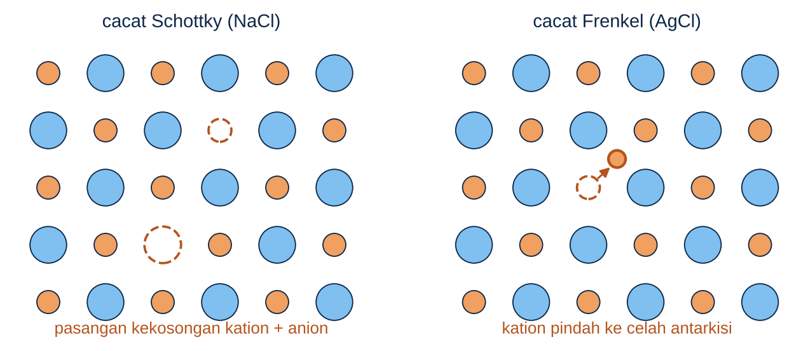

## 5.8 Difraksi sinar-X dan hukum Bragg

Semua struktur di bab ini diketahui dari satu teknik: **difraksi sinar-X**. Sinar-X mempunyai panjang gelombang sekitar 50–250 pm, sebanding dengan jarak antaratom dalam kristal. Ketika gelombang seperti ini bertemu susunan atom yang teratur, setiap atom menghamburkan sebagian kecil gelombang ke segala arah. Pada kebanyakan arah, gelombang-gelombang hamburan itu saling meniadakan. Hanya pada arah-arah tertentu semuanya sefase dan saling menguatkan, menghasilkan berkas yang kuat. Pola arah-arah itu adalah "sidik jari" susunan atom.

### Hukum Bragg

William Lawrence Bragg, yang saat itu berusia 22 tahun, menemukan cara sederhana untuk memahami arah-arah itu. Ia membayangkan kristal sebagai tumpukan **bidang-bidang atom** sejajar yang berjarak *d*, masing-masing memantulkan sebagian kecil sinar-X seperti cermin yang hampir tembus pandang.

Ambil dua sinar sejajar yang datang dengan sudut θ terhadap bidang (Gambar 5.7 kiri). Sinar yang dipantulkan bidang kedua menempuh jalan lebih panjang daripada sinar yang dipantulkan bidang pertama: lebih panjang *d* sin θ saat masuk dan *d* sin θ lagi saat keluar, total 2*d* sin θ. Kedua sinar saling menguatkan hanya bila selisih jalan itu tepat satu, dua, atau sejumlah bulat panjang gelombang:

$$n\lambda = 2d\sin\theta \qquad \text{(5.4)}$$

Pada sudut-sudut lain, sinar-sinar dari ribuan bidang yang berurutan mempunyai fase yang tersebar merata dan saling meniadakan sepenuhnya. Itulah sebabnya pantulan Bragg sangat tajam: ia hanya muncul pada sudut-sudut tertentu.

{width=98%}

### Indeks Miller dan jarak antarbidang

Setiap keluarga bidang dalam kristal diberi tiga bilangan bulat (*hkl*), yang disebut **indeks Miller**: bidang itu memotong sumbu sel pada *a*/*h*, *b*/*k*, dan *c*/*l*. Bidang (100) adalah muka sel; (110) memotong dua sumbu dan sejajar sumbu ketiga; (111) memotong ketiga sumbu pada jarak yang sama. Untuk sel kubus, jarak antarbidang adalah:

$$d_{hkl} = \frac{a}{\sqrt{h^2 + k^2 + l^2}} \qquad \text{(5.5)}$$

Dengan menggabungkan persamaan (5.4) dan (5.5), setiap puncak dalam pola difraksi dapat diberi indeks, dan dari posisinya parameter kisi dapat dihitung.

### Aturan kepunahan

Tidak setiap (*hkl*) memberi puncak. Pada kisi berpusat, atom-atom di pusat badan atau pusat muka membentuk bidang-bidang tambahan di antara bidang-bidang (*hkl*) tertentu, dan pantulannya tepat berlawanan fase sehingga saling meniadakan. Hasilnya adalah **aturan kepunahan**:

* kubus primitif (P): semua (*hkl*) muncul;
* kubus pusat badan (I): hanya bila *h* + *k* + *l* genap (110, 200, 211, 220, …);
* kubus pusat muka (F): hanya bila *h*, *k*, *l* semuanya genap atau semuanya ganjil (111, 200, 220, 311, 222, …).

Dengan melihat puncak mana yang hilang, kita dapat menentukan jenis kisi bahkan sebelum menghitung apa pun.

::: {.contoh}
**Contoh 5.5 · Pola difraksi NaCl dan KCl**

(a) Pada pola difraksi serbuk NaCl dengan radiasi Cu Kα (λ = 154,06 pm), puncak paling kuat terletak pada 2θ = 31,70°. Bila puncak itu adalah (200), hitung *d* dan *a*. (b) NaCl dan KCl sama-sama berstruktur garam batu dengan kisi F. Mengapa pola KCl tidak menunjukkan puncak (111) dan (311) yang terlihat lemah pada NaCl? Apa kesimpulan yang salah yang dapat ditarik oleh orang yang hanya melihat pola KCl?

**Penyelesaian.** (a) θ = 15,85°. Dari persamaan (5.4) dengan *n* = 1: *d* = 154,06 / (2 sin 15,85°) = **282,0 pm**. Dari persamaan (5.5), *a* = *d*√(2² + 0 + 0) = 2 × 282,0 = **564,0 pm**.

(b) Dalam struktur garam batu, bidang (111) bergantian memuat hanya kation dan hanya anion. Hamburan dari kedua jenis bidang berlawanan fase, sehingga intensitas puncak dengan indeks ganjil sebanding dengan (*f*~Cl~ − *f*~M~)², selisih daya hambur kedua ion, sedangkan puncak dengan indeks genap sebanding dengan jumlahnya (*f*~Cl~ + *f*~M~)². Daya hambur ion sebanding dengan jumlah elektronnya. Pada NaCl, Cl⁻ mempunyai 18 elektron dan Na⁺ 10: selisihnya 8, sehingga puncak ganjil tampak lemah. Pada KCl, K⁺ dan Cl⁻ **sama-sama 18 elektron**: selisihnya nol, dan puncak ganjil lenyap.

Orang yang hanya melihat pola KCl akan menyimpulkan bahwa KCl adalah **kubus primitif** dengan *a* = 314,6 pm, setengah dari nilai sebenarnya, seolah-olah hanya ada satu jenis atom. Sinar-X tidak dapat membedakan dua ion yang isoelektronik.

**Memahami hasil.** Intensitas puncak membawa informasi tentang jenis dan letak atom, bukan hanya jenis kisi. Bragg sendiri pada 1913 membandingkan NaCl dengan KCl dan memakai perbedaan ini sebagai bukti bahwa kristal tersusun dari ion-ion yang berbeda, bukan dari molekul. Untuk memisahkan atom dengan jumlah elektron yang hampir sama, atau untuk menemukan atom hidrogen yang hampir tidak menghambur sinar-X, kimiawan memakai **difraksi neutron**, karena neutron dihamburkan oleh inti, bukan elektron.
:::

Difraksi **serbuk**, seperti contoh di atas, memakai jutaan butir kristal kecil yang menghadap ke segala arah, dan merupakan cara rutin untuk mengenali zat padat (setiap senyawa mempunyai pola sendiri, tersimpan dalam basis data yang memuat ratusan ribu pola) dan untuk memeriksa kemurnian hasil sintesis. Difraksi **kristal tunggal** mengukur ribuan pantulan dari satu kristal kecil, dan dari intensitasnya peta kerapatan elektron tiga dimensi dapat dihitung. Inilah cara struktur ratusan ribu molekul dan kristal, dari garam sampai protein dan DNA, telah ditentukan.

::: {.kuis}
**Kuis cepat 5.8** Logam tungsten (bcc, *a* = 316,5 pm). Tuliskan tiga indeks (*hkl*) pertama yang muncul dalam pola serbuknya dan hitung 2θ untuk yang pertama dengan Cu Kα.
:::

## 5.9 Cacat kristal: Schottky, Frenkel, dan nonstoikiometri

Kristal yang sempurna, dengan setiap atom tepat di tempatnya, hanya mungkin pada 0 K. Pada suhu lebih tinggi, setiap kristal **pasti** mengandung cacat, dan alasannya termodinamika, bukan kecerobohan dalam membuat kristal.

Membuat satu cacat, misalnya memindahkan satu ion dari tempatnya, memerlukan energi: Δ*H* positif. Tetapi cacat itu dapat berada di salah satu dari sekian banyak tempat dalam kristal, sehingga entropi naik: Δ*S* positif. Untuk cacat yang jumlahnya sedikit, kenaikan entropi per cacat sangat besar (ada sangat banyak cara menyebar sedikit cacat di antara 10²³ tempat). Akibatnya, Δ*G* = Δ*H* − *T*Δ*S* selalu menjadi negatif untuk sejumlah kecil cacat, dan jumlah cacat pada kesetimbangan naik tajam dengan suhu.

### Cacat intrinsik

{width=88%}

* **Cacat Schottky**: sepasang kekosongan, satu kation dan satu anion, sehingga kristal tetap netral. Umum pada senyawa ionik dengan bilangan koordinasi tinggi dan ion berukuran sebanding: NaCl, KCl, CsCl, MgO.
* **Cacat Frenkel**: satu ion pindah dari tempatnya ke **celah antarkisi** (posisi yang biasanya kosong), meninggalkan kekosongan. Umum bila salah satu ion kecil atau mudah terpolarisasi sehingga muat di celah: Ag⁺ dalam AgCl dan AgBr, atau anion F⁻ dalam CaF₂ (Frenkel anion), karena struktur fluorit mempunyai rongga kubus kosong yang besar.

Fraksi cacat pada kesetimbangan kira-kira

$$\frac{n}{N} \approx \exp\!\left(-\frac{\Delta H}{2RT}\right) \qquad \text{(5.6)}$$

dengan Δ*H* energi membentuk satu pasangan cacat per mol. Faktor 2 muncul karena satu pasangan cacat terdiri atas dua cacat yang tersebar secara bebas.

::: {.contoh}
**Contoh 5.6 · Berapa banyak kekosongan dalam NaCl?**

Energi pembentukan satu pasangan Schottky dalam NaCl sekitar 2,3 eV (220 kJ mol⁻¹). Hitung fraksi kekosongan pada 300 K dan 1000 K (sedikit di bawah titik leleh, 1074 K).

**Penyelesaian.** Dalam satuan per partikel, *n*/*N* = exp(−Δ*H*/2*kT*) dengan *k* = 8,617 × 10⁻⁵ eV K⁻¹.

* 300 K: *kT* = 0,0259 eV; *n*/*N* = exp(−2,3/0,0517) = exp(−44,5) = **5 × 10⁻²⁰**.
* 1000 K: *kT* = 0,0862 eV; *n*/*N* = exp(−13,3) = **1,6 × 10⁻⁶**.

**Memahami hasil.** Pada suhu kamar, satu mol NaCl hanya mengandung sekitar 30 000 kekosongan, praktis sempurna. Di dekat titik leleh, satu dari sejuta tempat kosong, peningkatan 10¹³ kali. Kekosongan-kekosongan ini adalah jalan bagi ion untuk berpindah, sehingga **konduktivitas ionik** padatan naik tajam dengan suhu. Dalam praktik, kristal NaCl biasa mengandung jauh lebih banyak kekosongan daripada hitungan ini, karena pengotor ion bervalensi dua (misalnya Ca²⁺ yang menggantikan Na⁺) memaksa terbentuknya kekosongan Na⁺ tambahan untuk menjaga kenetralan. Cacat seperti ini disebut **cacat ekstrinsik**.
:::

### Pusat warna

Kristal NaCl yang dipanaskan dalam uap natrium menjadi kuning; KCl dalam uap kalium menjadi ungu. Atom logam berlebih masuk ke kristal sebagai kation, dan elektronnya terperangkap di **kekosongan anion**, tempat yang semestinya diisi Cl⁻. Elektron yang terperangkap ini berperilaku seperti "partikel dalam kotak" tiga dimensi dan menyerap cahaya tampak. Cacat ini disebut **pusat F** (dari bahasa Jerman *Farbe*, warna). Warna biru pada sebagian garam batu alam dan warna ungu pada sebagian fluorit berasal dari pusat warna yang terbentuk oleh radiasi alam.

### Nonstoikiometri

Senyawa logam transisi sering tidak mempunyai komposisi yang tepat sesuai rumus sederhananya, karena logamnya dapat berada dalam dua bilangan oksidasi. Contoh paling terkenal adalah besi(II) oksida. Senyawa FeO yang tepat stoikiometris tidak dapat dibuat pada tekanan biasa; yang ada adalah **wustit**, Fe~1−*x*~O dengan *x* sekitar 0,05–0,16. Struktur garam batunya mengandung kekosongan Fe, dan muatan dikompensasi oleh sebagian besi yang berbilangan oksidasi +3.

::: {.contoh}
**Contoh 5.7 · Fe₀,₉₅O dan zirkonia yang distabilkan itrium**

(a) Untuk Fe₀,₉₅O, hitung jumlah Fe²⁺, Fe³⁺, dan kekosongan per satu O²⁻. (b) Zirkonia stabil itrium (YSZ) dibuat dengan melarutkan 8 % mol Y₂O₃ dalam ZrO₂ berstruktur fluorit. Setiap dua Y³⁺ yang menggantikan dua Zr⁴⁺ menciptakan satu kekosongan O²⁻. Berapa persen tempat oksida yang kosong?

**Penyelesaian.** (a) Misalkan per satuan rumus ada *a* Fe²⁺ dan *b* Fe³⁺. Jumlah atom: *a* + *b* = 0,95. Kenetralan: 2*a* + 3*b* = 2. Dari kedua persamaan: *b* = 2 − 2(0,95) = **0,10** dan *a* = **0,85**. Kekosongan Fe per satu O: 1 − 0,95 = **0,05**. Setiap kekosongan Fe²⁺ dikompensasi oleh dua Fe³⁺.

(b) Komposisi (ZrO₂)₀,₉₂(Y₂O₃)₀,₀₈: kation 0,92 Zr + 0,16 Y = 1,08; oksida 0,92 × 2 + 0,08 × 3 = 2,08. Struktur fluorit menyediakan dua tempat oksida per kation, yaitu 2,16. Kekosongan: 2,16 − 2,08 = 0,08 dari 2,16 tempat, yaitu **3,7 %**.

**Memahami hasil.** Kekosongan oksida yang sengaja dibuat dalam YSZ memungkinkan ion O²⁻ melompat dari satu tempat ke tempat lain pada suhu tinggi. YSZ menjadi **konduktor ion oksida** padat, bahan inti sensor oksigen (sensor lambda) di setiap mobil berbahan bakar bensin dan elektrolit sel bahan bakar oksida padat. Cacat yang biasanya dianggap merusak di sini justru menjadi fungsi bahan.
:::

Nonstoikiometri juga menjelaskan mengapa ZnO berwarna kuning ketika panas: oksigen sedikit lepas menjadi Zn~1+*x*~O, dan elektron yang tertinggal membuat bahan menyerap cahaya biru dan menjadi semikonduktor tipe-n (Bab 7).

::: {.kuis}
**Kuis cepat 5.9** Mengapa cacat Frenkel kation umum pada AgBr tetapi jarang pada NaCl, walaupun keduanya berstruktur garam batu? (Petunjuk: bandingkan daya polarisasi dan sifat kovalen kedua kation.)
:::

## 5.10 Polimorfisme dan transisi fasa padat

Banyak zat dapat mengkristal dalam lebih dari satu struktur. Kemampuan ini disebut **polimorfisme**, dan untuk unsur disebut **alotropi**. Pada setiap suhu dan tekanan, hanya satu polimorf yang paling stabil secara termodinamika, yaitu yang energi Gibbs-nya terendah, tetapi polimorf lain dapat bertahan sangat lama bila perubahannya lambat.

Tabel 5.5 Beberapa polimorf penting.

| Zat | Polimorf | Catatan |
|---|---|---|
| Fe | α (bcc) → γ (ccp, 912 °C) → δ (bcc, 1394 °C) | baja dikeraskan dengan memanfaatkan transisi α–γ |
| Sn | timah putih (logam, 7,29 g cm⁻³) ⇄ timah abu-abu (intan, 5,77 g cm⁻³), 13,2 °C | "penyakit timah" pada suhu dingin |
| C | grafit, intan, fulerena | intan metastabil pada tekanan biasa |
| SiO₂ | kuarsa (KB 4), tridimit, kristobalit, koesit, stishovit (rutil, KB 6) | stishovit terbentuk pada tekanan tinggi tumbukan meteorit |
| TiO₂ | rutil, anatas, brookit | anatas fotokatalis lebih aktif |
| CaCO₃ | kalsit, aragonit | cangkang moluska memakai aragonit |
| ZnS | sfalerit, wurtzit | berbeda urutan lapisan |

Dua pola umum terlihat dalam tabel ini dan dalam subbab 5.7:

* **Tekanan tinggi menaikkan bilangan koordinasi.** Struktur dengan koordinasi lebih tinggi lebih rapat. SiO₂ berubah dari kuarsa (Si KB 4, 2,65 g cm⁻³) menjadi stishovit bertipe rutil (Si KB 6, 4,29 g cm⁻³) di atas sekitar 9 GPa. Di mantel Bumi, sebagian besar silikon berkoordinasi enam.
* **Suhu tinggi menyukai struktur yang lebih terbuka dan simetris.** Pada suhu tinggi, entropi lebih berperan, dan struktur dengan getaran lebih bebas menjadi lebih stabil (CsCl → NaCl, α-Fe → γ-Fe pada suhu yang sangat tinggi kembali ke bcc).

Transisi fasa padat terbagi menjadi dua jenis. Transisi **perpindahan** (*displacive*) hanya menggeser atom sedikit tanpa memutus ikatan, misalnya kuarsa α ⇄ kuarsa β pada 573 °C; transisi ini cepat dan bolak-balik. Transisi **rekonstruktif** memerlukan pemutusan dan pembentukan ulang ikatan, misalnya kuarsa → kristobalit atau grafit → intan; transisi ini lambat, sering memerlukan katalis atau suhu sangat tinggi, dan itulah sebabnya intan dapat bertahan di suhu kamar.

::: {.contoh}
**Contoh 5.8 · Penyakit timah**

Timah putih (β-Sn, 7,29 g cm⁻³) berubah menjadi timah abu-abu (α-Sn, struktur intan, 5,77 g cm⁻³) di bawah 13,2 °C, walaupun perubahannya sangat lambat kecuali pada suhu jauh di bawah titik transisi. Hitung persentase pertambahan volume dan jelaskan akibatnya pada benda dari timah.

**Penyelesaian.** Volume berbanding terbalik dengan massa jenis: *V*~abu~/*V*~putih~ = 7,29/5,77 = 1,263. Volume bertambah **26 %**.

**Memahami hasil.** Pertambahan volume sebesar itu tidak dapat ditampung oleh benda padat: timah abu-abu muncul sebagai bintik-bintik yang menggembung dan hancur menjadi serbuk, lalu menyebar seperti penyakit ke bagian yang masih putih. Kancing timah, pipa organ di gereja-gereja Eropa utara pada musim dingin, dan solder di daerah sangat dingin pernah rusak dengan cara ini. Timah abu-abu juga menunjukkan bahwa sifat unsur bergantung pada strukturnya: timah putih adalah logam, timah abu-abu bertipe intan adalah semikonduktor, seperti germanium di atasnya.
:::

::: {.kuis}
**Kuis cepat 5.10** Mengapa stishovit, polimorf SiO₂ berkoordinasi enam, ditemukan di kawah meteorit dan tidak di batuan permukaan biasa?
:::

## 5.11 Padatan kristal dan amorf; kaca

Tidak semua padatan mempunyai susunan yang berulang. Kaca jendela, plastik, aspal, dan silikon pada sel surya film tipis adalah padatan **amorf**: atom-atomnya tersusun teratur hanya dalam jarak dekat (setiap Si tetap dikelilingi empat O dalam kaca silika), tetapi keteraturan itu hilang setelah beberapa jarak atom. Padatan kristal mempunyai **keteraturan jarak jauh**; padatan amorf hanya **keteraturan jarak dekat**.

Tabel 5.6 Perbedaan padatan kristal dan amorf.

| Sifat | Kristal | Amorf |
|---|---|---|
| keteraturan | jarak dekat dan jauh | hanya jarak dekat |
| pelelehan | pada titik leleh tajam | melunak bertahap melewati suhu transisi kaca *T*~g~ |
| pola difraksi | puncak-puncak tajam | beberapa pita lebar ("halo") |
| pecahan | sepanjang bidang belah tertentu | konkoid (melengkung), seperti kaca pecah |
| sifat arah | dapat bergantung arah (anisotropik) | sama ke segala arah (isotropik) |

### Struktur kaca

Pada 1932, William Zachariasen mengusulkan bahwa kaca oksida adalah **jaringan acak kontinu**: satuan-satuan koordinasi yang sama dengan kristalnya (tetrahedron SiO₄ dalam kaca silika) tetap utuh dan tetap terhubung lewat sudut, tetapi sudut-sudut ikatan Si–O–Si bervariasi, sehingga cincin-cincin yang terbentuk berukuran beragam dan tidak ada pola yang berulang.

{width=88%}

Oksida yang mudah membentuk jaringan seperti ini disebut **pembentuk jaringan**: SiO₂, B₂O₃, P₂O₅, GeO₂. Ciri umumnya: kation kecil bermuatan tinggi dengan ikatan cukup kovalen, satuan koordinasi kecil (segitiga atau tetrahedron) yang berbagi sudut, dan setiap oksigen menjembatani paling banyak dua kation.

Kaca silika murni sulit dibuat karena titik lelehnya sangat tinggi (sekitar 1710 °C) dan lelehannya sangat kental. Penambahan oksida seperti Na₂O dan CaO, yang disebut **pengubah jaringan**, memutus sebagian jembatan Si–O–Si:

$$\equiv\text{Si–O–Si}\equiv + \text{Na}_2\text{O} \rightarrow 2\,\equiv\text{Si–O}^-\ \text{Na}^+$$

Setiap Na₂O mengubah satu oksigen jembatan menjadi dua **oksigen tak menjembatani**. Jaringan menjadi lebih terputus-putus, sehingga suhu leleh dan kekentalan turun drastis. Kaca jendela biasa (kaca soda–kapur) mengandung sekitar 72 % SiO₂, 14 % Na₂O, dan 10 % CaO; CaO ditambahkan agar kaca tidak larut dalam air. Kaca borosilikat (Pyrex), dengan sekitar 13 % B₂O₃ dan sedikit Na₂O, memuai jauh lebih sedikit ketika dipanaskan, sehingga tahan perubahan suhu mendadak dan dipakai untuk alat gelas laboratorium.

::: {.kuis}
**Kuis cepat 5.11** Dalam kaca natrium disilikat, Na₂O·2SiO₂, berapa oksigen tak menjembatani per atom Si? Berapa jembatan Si–O–Si yang tersisa untuk setiap Si?
:::

## 5.12 Padatan kovalen jaringan: intan, grafit, dan alotrop karbon lain

Pada padatan kovalen jaringan, seluruh kristal diikat oleh ikatan kovalen yang terarah, tanpa molekul terpisah. Sifatnya ditentukan oleh **dimensi** jaringan ikatan itu: tiga dimensi (intan, kuarsa, SiC), dua dimensi (grafit, h-BN), atau satu dimensi (rantai belerang plastis, asbes).

{width=86%}

### Intan

Struktur intan sama dengan sfalerit (subbab 5.4) dengan semua atom berupa karbon: atom C membentuk fcc, dan C lain mengisi setengah rongga tetrahedral. Setiap atom terikat tetrahedral pada empat atom lain dengan ikatan C–C tunggal sepanjang 154 pm, sama dengan ikatan C–C dalam etana. Seluruh kristal adalah satu molekul raksasa.

Jaringan tiga dimensi yang kaku ini membuat intan menjadi bahan alami terkeras, dengan titik leleh di atas 3500 °C. Semua elektron valensinya terikat dalam ikatan σ yang terlokalisasi, sehingga intan adalah isolator listrik (celah pita 5,5 eV, Bab 7) dan bening. Namun kekakuan jaringannya membuat getaran kisi merambat sangat cepat, sehingga intan adalah **penghantar panas** terbaik di antara semua bahan pada suhu kamar, sekitar lima kali tembaga.

### Grafit

Pada grafit, setiap atom C terikat pada tiga tetangga dalam satu bidang (sp², 120°), membentuk lapisan heksagonal seperti sarang lebah. Ikatan C–C dalam lapisan (142 pm) lebih pendek daripada intan, karena orbital p~*z*~ yang tersisa pada setiap atom bergabung menjadi sistem π yang tersebar di seluruh lapisan, memberi orde ikatan sekitar 1⅓. Lapisan-lapisan bertumpuk dengan urutan ABAB pada jarak 335 pm, hanya diikat gaya van der Waals.

Struktur ini menjelaskan semua sifat grafit:

* **lunak dan licin**: lapisan mudah bergeser satu terhadap yang lain (pelumas kering, isi pensil);
* **menghantarkan listrik di sepanjang lapisan** karena elektron π terdelokalisasi, tetapi sekitar seribu kali lebih buruk dalam arah tegak lurus lapisan;
* **dapat disisipi**: ion Li⁺ masuk di antara lapisan membentuk LiC₆, dan inilah anode hampir semua baterai litium-ion.

### Intan atau grafit: mana yang stabil?

Pada 25 °C dan 1 bar, grafit lebih stabil daripada intan: Δ*G*°~f~(intan) = +2,90 kJ mol⁻¹. Intan bertahan hanya karena perubahan menjadi grafit memerlukan pemutusan ikatan C–C yang sangat kuat, sehingga lajunya praktis nol pada suhu kamar. "Berlian itu abadi" secara kinetika, bukan termodinamika.

::: {.contoh}
**Contoh 5.9 · Tekanan untuk membuat intan**

Massa jenis grafit 2,262 g cm⁻³ dan intan 3,515 g cm⁻³. Taksir tekanan minimum yang diperlukan agar intan lebih stabil daripada grafit pada 25 °C, dengan menganggap kedua padatan tidak termampatkan.

**Rencana.** Pada suhu tetap, (∂*G*/∂*p*)~*T*~ = *V*. Tekanan membuat fasa yang volumenya lebih kecil lebih stabil. Cari tekanan saat Δ*G* untuk grafit → intan menjadi nol.

**Penyelesaian.** Volume molar: grafit 12,011/2,262 = 5,310 cm³ mol⁻¹; intan 12,011/3,515 = 3,417 cm³ mol⁻¹. Δ*V* = −1,893 cm³ mol⁻¹ = −1,893 × 10⁻⁶ m³ mol⁻¹. Agar Δ*G*° + Δ*V*(*p* − *p*°) = 0:

$$p \approx \frac{2900\ \text{J mol}^{-1}}{1{,}893 \times 10^{-6}\ \text{m}^3\,\text{mol}^{-1}} = 1{,}5 \times 10^9\ \text{Pa} = 1{,}5\ \text{GPa}$$

**Memahami hasil.** Pada suhu kamar, sekitar 15 000 atm sudah cukup secara termodinamika. Namun pada suhu kamar perubahannya terlalu lambat. Agar cepat, diperlukan suhu sekitar 1500 °C, dan karena Δ*G*° naik dengan suhu, tekanannya pun harus dinaikkan menjadi 5–6 GPa, ditambah logam cair (Fe, Ni) sebagai pelarut dan katalis. Inilah proses tekanan tinggi–suhu tinggi (HPHT) yang pertama kali berhasil di laboratorium General Electric pada 1954. Kini sebagian besar intan industri dibuat dengan cara ini, atau dengan **pengendapan uap kimia** (CVD) dari metana pada tekanan rendah, yang memanfaatkan kinetika, bukan termodinamika.
:::

### Alotrop karbon lain

* **Fulerena** (C₆₀, ditemukan 1985, Nobel Kimia 1996): molekul berbentuk bola sepak dengan 12 cincin segi lima dan 20 segi enam, grup titik I~h~ (Bab 3). Berbeda dari intan dan grafit, fulerena adalah padatan molekuler: molekul C₆₀ tersusun dalam kristal ccp dan diikat gaya van der Waals.
* **Nanotabung karbon**: lembaran grafit yang tergulung menjadi tabung bergaris tengah beberapa nanometer; bergantung pada arah gulungannya, dapat bersifat logam atau semikonduktor.
* **Grafena** (diisolasi 2004, Nobel Fisika 2010): satu lapisan grafit tunggal setebal satu atom, sangat kuat dan penghantar listrik yang luar biasa.

### Padatan jaringan lain

Boron nitrida, BN, isoelektronik dengan C₂, membentuk dua polimorf yang meniru karbon: h-BN berlapis seperti grafit (disebut "grafit putih", tetapi isolator karena perbedaan keelektronegatifan B dan N melokalisasi elektron π) dan c-BN bertipe sfalerit, hampir sekeras intan. Silikon karbida (SiC) bertipe intan dan wurtzit, keras dan tahan panas, kini dipakai dalam elektronika daya kendaraan listrik. Kuarsa, SiO₂, adalah jaringan tetrahedron SiO₄ yang berbagi semua sudutnya; ia menjadi bahan dasar kaca (subbab 5.11) dan keluarga besar silikat yang menyusun kerak Bumi.

::: {.kuis}
**Kuis cepat 5.12** Silikon mengkristal dalam struktur intan dengan *a* = 543,1 pm. Hitung panjang ikatan Si–Si dan massa jenis silikon. Mengapa silikon tidak membentuk alotrop berlapis seperti grafit?
:::

## Menuju bab berikutnya

Di dalam kristal garam dapur memang tidak ada molekul NaCl. Yang ada adalah dua kisi ion yang saling menembus, setiap ion dikelilingi enam ion berlawanan muatan, dan rumus NaCl hanya menyatakan perbandingannya. Bab ini menyusun bahasa untuk struktur seperti itu: kemasan rapat dan rongga, sel satuan, struktur prototipe, rasio jari-jari, dan difraksi sinar-X yang membuktikan semuanya. Kita juga melihat bahwa kristal nyata tidak pernah sempurna, bahwa satu zat dapat mempunyai banyak struktur, dan bahwa keteraturan jarak jauh tidak mutlak diperlukan untuk sebuah padatan.

Ada satu pertanyaan yang belum dijawab. Mengapa NaCl stabil sebagai kristal, padahal membentuk ion Na⁺ dan Cl⁻ dari atom-atomnya justru memerlukan energi (energi ionisasi Na 496 kJ mol⁻¹ lebih besar daripada afinitas elektron Cl 349 kJ mol⁻¹)? Jawabannya adalah energi yang dilepaskan ketika ion-ion tersusun dalam kisi, yaitu **energi kisi**. Bab 6 menghitungnya dengan siklus Born–Haber, persamaan Born–Landé, dan persamaan Kapustinskii, lalu memakainya untuk menjelaskan kestabilan, kelarutan, dan penguraian termal senyawa ionik.
