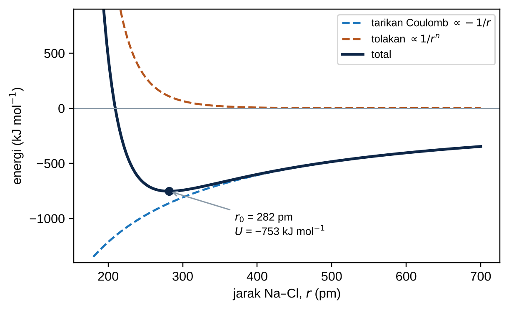
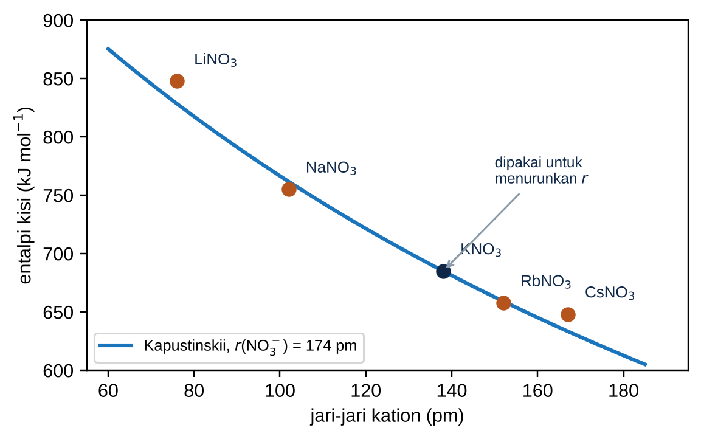
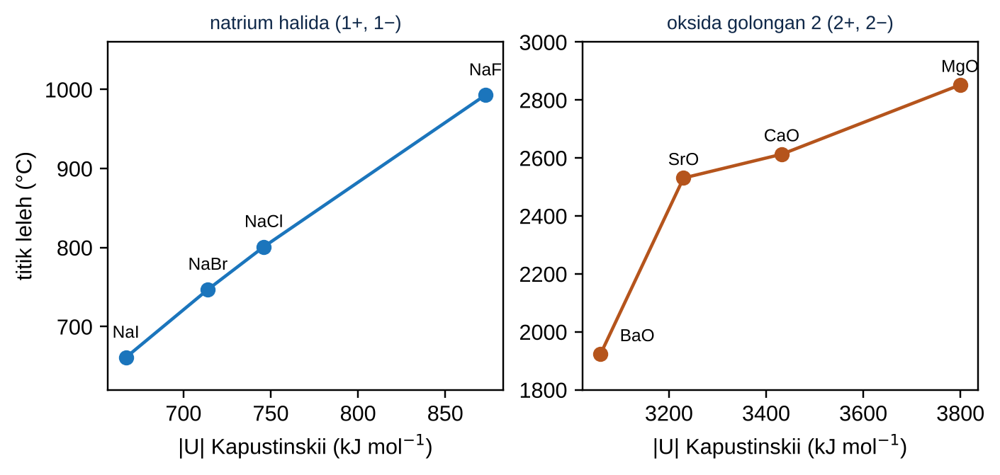

# Bab 6 Energetika Padatan Ionik

Magnesium terbakar di udara dengan nyala putih yang menyilaukan, dan bila dimasukkan ke gas klorin ia membentuk magnesium klorida, MgCl₂. Mengapa MgCl₂ dan bukan MgCl? Pertanyaan ini lebih membingungkan daripada kelihatannya. Melepas elektron pertama dari magnesium memerlukan 738 kJ mol⁻¹, tetapi melepas elektron kedua memerlukan 1451 kJ mol⁻¹, hampir dua kali lipat. Bila atom selalu memilih jalan yang paling murah energinya, magnesium seharusnya berhenti pada Mg⁺ dan membentuk MgCl, yang rumusnya pun menyerupai NaCl tetangganya. Kenyataannya, MgCl tidak pernah dijumpai sebagai padatan yang stabil. Ada energi lain yang lebih besar daripada energi ionisasi kedua, cukup besar untuk membayarnya dan masih menyisakan keuntungan. Energi itu adalah **energi kisi**: energi yang dilepaskan ketika ion-ion bermuatan berlawanan berkumpul menjadi kristal.

Bab 5 membahas bagaimana ion tersusun dalam kristal. Bab ini membahas mengapa susunan itu stabil dan seberapa stabil. Kita mulai dengan model elektrostatik sederhana: ion sebagai titik bermuatan yang tarik-menarik dan tolak-menolak menurut hukum Coulomb. Model ini menghasilkan tetapan Madelung, persamaan Born–Landé dan Born–Mayer, serta persamaan Kapustinskii yang sangat praktis. Lalu kita membangun siklus Born–Haber, yang menghitung energi kisi dari data termokimia yang dapat diukur. Membandingkan kedua cara itu memberi alat yang kuat: kita dapat meramalkan apakah senyawa yang belum pernah dibuat akan stabil, menjelaskan mengapa sebagian garam larut dan yang lain tidak, mengapa MgCO₃ terurai jauh lebih mudah daripada BaCO₃, dan mengukur seberapa jauh suatu senyawa "ionik" sebenarnya mempunyai sifat kovalen.

::: {.kuis}
**Pertanyaan pembuka**

1. Mengapa magnesium membentuk MgCl₂, padahal energi ionisasi keduanya hampir dua kali yang pertama?
2. Mengapa energi elektrostatik sebuah kristal tidak sama dengan energi satu pasangan ion dikalikan jumlah pasangan?
3. Energi kisi tidak dapat diukur langsung. Bagaimana cara mengetahuinya?
4. Mengapa NeCl tidak ada, tetapi XeF₂ ada?
5. Mengapa LiF sukar larut dalam air, sedangkan CsF sangat mudah larut?
6. Mengapa MgCO₃ terurai pada sekitar 300 °C, sedangkan BaCO₃ memerlukan lebih dari 1200 °C?
:::

::: {.tujuan}
**Tujuan belajar**

Setelah mempelajari bab ini, kamu mampu:

1. Mendefinisikan energi kisi dan entalpi kisi serta menjelaskan arti fisisnya.
2. Menjelaskan asal tetapan Madelung dan menghitungnya untuk kristal sederhana.
3. Memakai persamaan Born–Landé, Born–Mayer, dan Kapustinskii untuk menghitung energi kisi.
4. Menyusun siklus Born–Haber dan memakainya untuk menghitung energi kisi, afinitas elektron, atau entalpi pembentukan.
5. Memakai perhitungan energi kisi untuk menilai kestabilan senyawa hipotetis.
6. Menjelaskan kelarutan garam dengan keseimbangan entalpi kisi dan entalpi hidrasi.
7. Menjelaskan tren kestabilan termal karbonat dan peroksida dengan energi kisi.
8. Memakai selisih antara energi kisi hitung dan ukur sebagai ukuran karakter kovalen.
:::

::: {.mat}
**Prasyarat**

Bab 1 (energi ionisasi, afinitas elektron, aturan Fajans), Bab 5 (struktur prototipe, jari-jari ion), dan termokimia dasar dari Kimia Dasar: hukum Hess, entalpi pembentukan standar, dan Δ*G* = Δ*H* − *T*Δ*S*. Fisika: hukum Coulomb.
:::

## 6.1 Energi kisi: definisi dan arti fisisnya

**Energi kisi** *U* adalah perubahan energi ketika satu mol padatan ionik terbentuk dari ion-ionnya yang berada dalam fase gas, saling berjauhan tak hingga:

$$\text{M}^+(\text{g}) + \text{X}^-(\text{g}) \rightarrow \text{MX}(\text{s}) \qquad U < 0$$

Nilainya negatif, karena pembentukan kisi melepaskan energi. Housecroft dan Sharpe memakai arah ini. Weller dan kawan-kawan memakai arah sebaliknya, yaitu energi yang **diperlukan** untuk memecah kristal menjadi ion gas, sehingga nilainya positif. Kedua kebiasaan sama-sama lazim, dan yang penting adalah menyatakan arahnya dengan jelas. Dalam buku ini, *U* bernilai negatif (pembentukan), sedangkan **entalpi kisi** Δ~kisi~*H* yang diperoleh dari siklus Born–Haber kita tulis sebagai besaran positif untuk proses pemecahan:

$$\text{MX}(\text{s}) \rightarrow \text{M}^+(\text{g}) + \text{X}^-(\text{g}) \qquad \Delta_\text{kisi}H > 0$$

Energi kisi dan entalpi kisi berbeda sedikit, karena pemecahan kristal menghasilkan gas yang melakukan kerja ekspansi. Untuk MX, selisihnya 2*RT*, sekitar 5 kJ mol⁻¹ pada 298 K, kurang dari 1 % nilai biasa. Kita akan mengabaikannya kecuali dinyatakan lain.

Seberapa besar energi ini? Untuk NaCl, entalpi kisinya 788 kJ mol⁻¹. Bandingkan dengan energi ikatan kovalen yang biasa, 150–500 kJ mol⁻¹ (Tabel 2.1). Kristal ionik diikat oleh energi yang sangat besar, dan itulah sebabnya senyawa ionik mempunyai titik leleh tinggi (NaCl 801 °C, MgO 2852 °C) dan keras tetapi rapuh. Energi kisi juga sangat bergantung pada **muatan**: MgO, yang ion-ionnya bermuatan ±2 dan ukurannya mirip NaCl, mempunyai entalpi kisi 3795 kJ mol⁻¹, hampir lima kali NaCl.

::: {.kuis}
**Kuis cepat 6.1** Tuliskan persamaan reaksi yang entalpinya sama dengan entalpi kisi CaF₂ (arah pemecahan). Mengapa entalpi kisi tidak dapat diukur langsung di laboratorium?
:::

## 6.2 Model elektrostatik: tetapan Madelung

Model paling sederhana untuk kristal ionik: ion adalah bola bermuatan yang hanya berinteraksi lewat gaya Coulomb, dan bola-bola itu tidak saling menembus. Energi dua ion bermuatan *z*₁*e* dan *z*₂*e* pada jarak *r* adalah

$$E = \frac{z_1 z_2 e^2}{4\pi\varepsilon_0\,r} \qquad \text{(6.1)}$$

Untuk sepasang Na⁺ dan Cl⁻ pada jarak 282 pm, energinya −8,2 × 10⁻¹⁹ J, atau −493 kJ per mol pasangan ion. Namun kristal bukan kumpulan pasangan ion yang terpisah. Setiap Na⁺ dalam NaCl mempunyai:

* 6 Cl⁻ pada jarak *r* (tarik),
* 12 Na⁺ pada jarak √2 *r* (tolak),
* 8 Cl⁻ pada jarak √3 *r* (tarik),
* 6 Na⁺ pada jarak 2*r* (tolak),
* 24 Cl⁻ pada jarak √5 *r* (tarik), dan seterusnya, tanpa akhir.

Energi total sebuah ion adalah jumlah semua interaksi itu:

$$E = -\frac{e^2}{4\pi\varepsilon_0\,r}\left(\frac{6}{1} - \frac{12}{\sqrt2} + \frac{8}{\sqrt3} - \frac{6}{\sqrt4} + \frac{24}{\sqrt5} - \cdots\right)$$

Bilangan di dalam kurung hanya bergantung pada **geometri** kristal, tidak pada jenis ion atau ukurannya. Bilangan ini disebut **tetapan Madelung**, *A*, menurut Erwin Madelung yang pertama kali menghitungnya pada 1918. Untuk satu mol kristal:

$$U = -\frac{N_\text{A}\,A\,|z_+ z_-|\,e^2}{4\pi\varepsilon_0\,r_0} \qquad \text{(6.2)}$$

Tetapan Madelung mengukur seberapa jauh susunan kristal **lebih stabil** daripada sekumpulan pasangan ion terpisah. Untuk NaCl, *A* = 1,748: kristal 75 % lebih stabil daripada pasangan ion pada jarak yang sama.

### Menghitung tetapan Madelung

Deret di atas tampak sederhana, tetapi ia menyimpan jebakan. Bila dijumlahkan kulit demi kulit seperti tertulis, jumlah parsialnya tidak mendekati nilai apa pun: 6; −2,49; 2,13; −0,87; 9,87; … Suku-suku berikutnya tidak mengecil, karena jumlah tetangga di setiap kulit bertambah sebanding dengan *r*², lebih cepat daripada 1/*r* mengecilkannya.

{width=96%}

Penyebabnya fisis: setiap kulit membawa muatan bersih yang besar, positif atau negatif, sehingga jumlah parsial menggambarkan sebuah ion yang dikelilingi bola bermuatan besar. Harry Evjen (1932) menunjukkan jalan keluarnya: jumlahkan ion di dalam kubus yang makin besar, dan beri ion di permukaan kubus bobot pecahan (½ di muka, ¼ di rusuk, ⅛ di sudut), persis seperti menghitung isi sel satuan di Bab 5. Setiap kubus menjadi **netral**, dan jumlahnya konvergen dengan cepat.

::: {.contoh}
**Contoh 6.1 · Tetapan Madelung dengan kubus Evjen**

Hitung tetapan Madelung NaCl dengan kubus Evjen terkecil, yaitu kubus 3 × 3 × 3 ion yang berpusat pada satu Na⁺ (kubus dengan *N* = 1).

**Penyelesaian.** Kubus ini memuat ion pusat dan 26 ion di sekelilingnya, semuanya di permukaan kubus:

* 6 Cl⁻ di pusat muka, jarak *r*, bobot ½: sumbangan 6 × ½ / 1 = +3,000
* 12 Na⁺ di tengah rusuk, jarak √2 *r*, bobot ¼: −12 × ¼ / √2 = −2,121
* 8 Cl⁻ di sudut, jarak √3 *r*, bobot ⅛: +8 × ⅛ / √3 = +0,577

*A* ≈ 3,000 − 2,121 + 0,577 = **1,456**.

Dengan *N* = 2 (kubus 5 × 5 × 5), *A* = 1,752; dengan *N* = 3, 1,747; dengan *N* = 10, 1,74757. Nilai pastinya 1,74756.

**Memahami hasil.** Kubus terkecil sudah memberi nilai yang hanya 17 % terlalu kecil, dan kubus berikutnya hanya 0,2 % terlalu besar. Kuncinya adalah menjaga setiap potongan kristal tetap netral. Pelajaran ini berlaku umum dalam perhitungan elektrostatik kristal: muatan yang tidak seimbang di tepi menghasilkan galat yang sangat besar. Komputer modern memakai metode Ewald yang lebih canggih dengan gagasan yang sama.
:::

Tabel 6.1 Tetapan Madelung struktur penting (dihitung untuk jarak kation–anion terdekat).

| Struktur | KB | *A* |
|---|---|---|
| garam batu (NaCl) | 6:6 | 1,74756 |
| sesium klorida | 8:8 | 1,76267 |
| sfalerit (ZnS) | 4:4 | 1,63806 |
| wurtzit | 4:4 | 1,64132 |
| fluorit (CaF₂) | 8:4 | 2,51939 |
| rutil (TiO₂) | 6:3 | 2,408 |
| korundum (Al₂O₃) | 6:4 | 4,1719 |

Dua hal patut diperhatikan. Pertama, *A* naik sedikit dengan bilangan koordinasi (1,638 → 1,748 → 1,763), tetapi perbedaan antara NaCl dan CsCl hanya 0,9 %. Inilah sebabnya pilihan antara kedua struktur mudah dibalik oleh faktor-faktor kecil (subbab 5.7). Kedua, untuk struktur dengan lebih banyak ion per satuan rumus (fluorit, korundum), *A* lebih besar, karena didefinisikan per satuan rumus. Untuk membandingkan, banyak penulis membagi *A* dengan jumlah ion per satuan rumus, *ν*: NaCl 0,874, CsCl 0,881, fluorit 0,840, korundum 0,834. Hasil bagi ini hampir tetap, dan pengamatan itulah yang menjadi dasar persamaan Kapustinskii (subbab 6.4).

::: {.kuis}
**Kuis cepat 6.2** Untuk rantai satu dimensi ion bergantian + − + − dengan jarak *r*, tunjukkan bahwa tetapan Madelungnya adalah 2(1 − ½ + ⅓ − ¼ + ⋯) = 2 ln 2 = 1,386. Mengapa nilainya lebih kecil daripada untuk NaCl?
:::

## 6.3 Persamaan Born–Landé dan Born–Mayer

Persamaan (6.2) hanya memuat tarikan. Bila hanya itu yang ada, ion-ion akan terus mendekat tanpa batas. Yang menghentikannya adalah **tolakan** antara awan elektron yang mulai bertumpang tindih ketika ion terlalu dekat. Tolakan ini berasal dari larangan Pauli dan sangat curam: hampir nol pada jarak biasa, lalu melonjak ketika ion "bersentuhan".

{width=78%}

### Persamaan Born–Landé

Max Born dan Alfred Landé (1918) menggambarkan tolakan dengan suku *B*/*r*^*n*^, dengan *n* yang besar. Energi total:

$$U(r) = -\frac{N_\text{A} A |z_+z_-| e^2}{4\pi\varepsilon_0\,r} + \frac{B}{r^n}$$

Pada jarak kesetimbangan *r*₀, energi minimum: d*U*/d*r* = 0. Dari syarat ini *B* dapat dihilangkan, dan hasilnya:

$$U = -\frac{N_\text{A} A |z_+z_-| e^2}{4\pi\varepsilon_0\,r_0}\left(1 - \frac1n\right) \qquad \text{(6.3)}$$

Tolakan hanya mengurangi energi tarik dengan faktor (1 − 1/*n*), yaitu sekitar 10–15 %. Bilangan *n*, disebut **eksponen Born**, ditentukan dari kemampatan kristal (seberapa mudah kristal ditekan): makin besar *n*, makin keras ion. Nilainya bergantung pada konfigurasi elektron ion.

Tabel 6.2 Eksponen Born. Untuk garam dengan dua ion berbeda, pakai rata-ratanya.

| Konfigurasi ion | Contoh | *n* |
|---|---|---|
| He | Li⁺ | 5 |
| Ne | Na⁺, Mg²⁺, F⁻, O²⁻ | 7 |
| Ar | K⁺, Ca²⁺, Cl⁻ | 9 |
| Kr | Rb⁺, Br⁻, Ag⁺ | 10 |
| Xe | Cs⁺, I⁻ | 12 |

Untuk perhitungan, tetapan gabungan *N*~A~*e*²/(4πε₀) = 1,389 × 10⁵ kJ mol⁻¹ pm sangat praktis: cukup dibagi dengan *r*₀ dalam pikometer.

::: {.contoh}
**Contoh 6.2 · Energi kisi NaCl dan MgO dengan Born–Landé**

Hitung energi kisi (a) NaCl (*r*₀ = 282,0 pm) dan (b) MgO (*r*₀ = 210,6 pm), keduanya bertipe garam batu. Bandingkan dengan entalpi kisi dari siklus Born–Haber: 787 dan 3795 kJ mol⁻¹.

**Penyelesaian.** (a) *A* = 1,74756; |*z*₊*z*₋| = 1; *n* = (7 + 9)/2 = 8.

$$U = -\frac{1{,}389 \times 10^5 \times 1{,}74756 \times 1}{282{,}0}\left(1 - \frac18\right) = -861 \times 0{,}875 = -753\ \text{kJ mol}^{-1}$$

(b) |*z*₊*z*₋| = 4; *n* = (7 + 7)/2 = 7.

$$U = -\frac{1{,}389 \times 10^5 \times 1{,}74756 \times 4}{210{,}6}\left(1 - \frac17\right) = -4611 \times 0{,}857 = -3953\ \text{kJ mol}^{-1}$$

**Memahami hasil.** Untuk NaCl, model ionik memberi nilai 4 % lebih kecil daripada siklus Born–Haber; untuk MgO, 4 % lebih besar. Kesepakatan dalam 5 % untuk model yang hanya memakai hukum Coulomb dan satu parameter tolakan adalah keberhasilan besar, dan menunjukkan bahwa kedua senyawa memang sangat ionik. Faktor 4 dari muatan (|*z*₊*z*₋| = 4 lawan 1) dan jarak yang lebih pendek menjelaskan mengapa entalpi kisi MgO hampir lima kali NaCl, dan mengapa MgO meleleh lebih dari 2000 derajat lebih tinggi.
:::

### Persamaan Born–Mayer

Teori kuantum menunjukkan bahwa tolakan antara awan elektron lebih tepat digambarkan dengan fungsi eksponensial, *B* e^−*r*/ρ^, daripada pangkat *r*. Born dan Joseph Mayer (1932) memakai bentuk ini dan memperoleh:

$$U = -\frac{N_\text{A} A |z_+z_-| e^2}{4\pi\varepsilon_0\,r_0}\left(1 - \frac{\rho}{r_0}\right) \qquad \text{(6.4)}$$

dengan ρ = 34,5 pm yang hampir sama untuk semua halida alkali. Persamaan ini tidak memerlukan eksponen Born yang berbeda untuk setiap ion, dan hasilnya untuk NaCl (−756 kJ mol⁻¹) hampir sama dengan Born–Landé.

::: {.kuis}
**Kuis cepat 6.3** Hitung energi kisi KCl (*r*₀ = 314,6 pm, *n* = 9) dengan persamaan Born–Landé. Bandingkan dengan NaCl. Faktor apa yang paling menentukan perbedaannya?
:::

### Dari mana eksponen Born? Kemampatan kristal

Tabel 6.2 tampak seperti daftar angka yang dihafal, padahal setiap angkanya diukur. Gagasannya sederhana: bila kristal ditekan, ion-ion didorong saling mendekat dan tolakan naik. Makin "keras" ion (makin besar *n*), makin sulit kristal ditekan. Jadi *n* dapat dibaca dari **modulus ruah** *K* (kebalikan kemampatan κ), yang mudah diukur dengan menekan kristal dan mencatat perubahan volumenya.

Turunannya hanya memerlukan dua langkah kalkulus. Tulis energi per mol sebagai *U*(*r*) = −*a*/*r* + *b*/*r*^*n*^ dengan *a* = *N*~A~*A*|*z*₊*z*₋|*e*²/(4πε₀). Modulus ruah didefinisikan sebagai *K* = *V*(d²*U*/d*V*²) pada kesetimbangan. Untuk struktur garam batu, satu mol pasangan ion menempati volume *V* = 2*N*~A~*r*³, sehingga d*V*/d*r* = 6*N*~A~*r*². Karena d*U*/d*r* = 0 di *r*₀, turunan kedua terhadap *V* hanyalah turunan kedua terhadap *r* dikali (d*r*/d*V*)²:

$$\frac{\mathrm{d}^2U}{\mathrm{d}V^2} = \frac{\mathrm{d}^2U}{\mathrm{d}r^2}\left(\frac{\mathrm{d}r}{\mathrm{d}V}\right)^2 = \frac{a(n-1)}{r_0^3}\cdot\frac{1}{36N_\text{A}^2r_0^4}$$

Suku *a*(*n* − 1)/*r*₀³ diperoleh dengan menurunkan *U*(*r*) dua kali lalu memakai syarat kesetimbangan untuk menghilangkan *b*. Mengalikan dengan *V* = 2*N*~A~*r*₀³ dan menyusun ulang memberi

$$n = 1 + \frac{72\pi\varepsilon_0\,r_0^4\,K}{A\,z^2e^2} \qquad \text{(6.5)}$$

Persamaan (6.5) memperlihatkan sesuatu yang menarik: *n* bergantung pada pangkat empat jarak antarion. Kesalahan 1 % pada *r*₀ menjadi kesalahan 4 % pada (*n* − 1). Karena itulah nilai di Tabel 6.2 dibulatkan, dan karena itu pula energi kisi tidak terlalu peka terhadap *n*: faktor (1 − 1/*n*) hanya berubah dari 0,875 ke 0,889 bila *n* naik dari 8 ke 9.

::: {.contoh}
**Contoh 6.3 · Eksponen Born NaCl dan KCl dari kemampatannya**

Modulus ruah NaCl adalah 24,0 GPa dan KCl 17,4 GPa; jarak antarion masing-masing 282,0 dan 314,7 pm. Hitung eksponen Born keduanya dan bandingkan dengan Tabel 6.2.

**Rencana.** Masukkan ke persamaan (6.5) dalam satuan SI: *r*₀ dalam meter, *K* dalam pascal, *A* = 1,74756, *z* = 1.

**Penyelesaian.** Untuk NaCl:

$$n - 1 = \frac{72\pi\,(8{,}854\times10^{-12})\,(2{,}820\times10^{-10})^4\,(2{,}40\times10^{10})}{1{,}74756\,(1{,}602\times10^{-19})^2} = 6{,}78$$

sehingga *n* = 7,8. Perhitungan yang sama untuk KCl memberi *n* = 8,6.

**Memahami hasil.** Tabel 6.2 meramalkan 8 untuk NaCl (rata-rata Ne dan Ar) dan 9 untuk KCl (Ar dan Ar). Kesepakatan ini bukan kebetulan: Tabel 6.2 memang disusun dari pengukuran seperti ini. KCl lebih mudah ditekan (*K* lebih kecil) karena ionnya lebih besar dan jarak antarionnya lebih panjang, tetapi awan elektron K⁺ yang berkulit lebih banyak justru lebih "keras" pada jarak dekat, sehingga *n* lebih besar.
:::

## 6.4 Persamaan Kapustinskii

Persamaan Born–Landé memerlukan struktur kristal, karena tetapan Madelung bergantung padanya. Bagaimana bila strukturnya belum diketahui, misalnya untuk senyawa yang belum pernah dibuat? Anatoli Kapustinskii (1956) memanfaatkan pengamatan di subbab 6.2: *A*/*ν* hampir sama untuk semua struktur, sekitar 0,87. Dengan mengganti *A* menjadi 0,87*ν*, memakai jumlah jari-jari ion sebagai *r*₀, dan memakai bentuk Born–Mayer untuk tolakan, ia memperoleh:

$$U = -\frac{1{,}2025 \times 10^5\ \nu\,|z_+z_-|}{r_+ + r_-}\left(1 - \frac{34{,}5}{r_+ + r_-}\right)\ \text{kJ mol}^{-1} \qquad \text{(6.6)}$$

dengan *r* dalam pikometer dan *ν* jumlah ion dalam satuan rumus (2 untuk NaCl, 3 untuk CaF₂ dan Na₂O, 5 untuk Al₂O₃).

::: {.contoh}
**Contoh 6.4 · Persamaan Kapustinskii**

Hitung energi kisi NaCl, MgO, dan CaF₂ dengan persamaan Kapustinskii, memakai jari-jari Shannon KB 6: Na⁺ 102, Mg²⁺ 72, Ca²⁺ 100, Cl⁻ 181, O²⁻ 140, F⁻ 133 pm. Bandingkan dengan siklus Born–Haber (787, 3795, 2651 kJ mol⁻¹).

**Penyelesaian.**

* NaCl: *ν* = 2, |*z*₊*z*₋| = 1, *r*₊ + *r*₋ = 283 pm. *U* = −(1,2025 × 10⁵ × 2/283)(1 − 34,5/283) = −850 × 0,878 = **−746 kJ mol⁻¹** (selisih 5 %).
* MgO: *ν* = 2, |*z*₊*z*₋| = 4, jumlah jari-jari 212 pm. *U* = **−3799 kJ mol⁻¹** (selisih 0,1 %).
* CaF₂: *ν* = 3, |*z*₊*z*₋| = 2, jumlah jari-jari 233 pm. *U* = **−2638 kJ mol⁻¹** (selisih 0,5 %).

**Memahami hasil.** Tanpa mengetahui struktur kristal apa pun, persamaan Kapustinskii memberi energi kisi dalam beberapa persen. Kekuatan sebenarnya muncul pada senyawa yang strukturnya tidak diketahui atau senyawanya belum ada. Untuk ion poliatomik (CO₃²⁻, SO₄²⁻, NO₃⁻), "jari-jari termokimia" dapat diturunkan secara terbalik dari entalpi kisi yang diketahui, lalu dipakai untuk garam-garam lain. Kita memakainya untuk karbonat di subbab 6.8.
:::

Persamaan Kapustinskii juga menunjukkan dengan jelas apa yang menentukan besarnya energi kisi:

::: {.inti}
Energi kisi sebanding dengan **hasil kali muatan** ion dan **jumlah ion** dalam satuan rumus, dan berbanding terbalik dengan **jumlah jari-jari** ion. Ion kecil bermuatan tinggi menghasilkan kisi yang paling stabil.
:::

### Jari-jari termokimia ion poliatomik

Ion seperti NO₃⁻, CO₃²⁻, atau SO₄²⁻ bukan bola, sehingga tidak mempunyai jari-jari dalam arti biasa. Namun persamaan Kapustinskii dapat dibalik: bila entalpi kisi suatu garam diketahui dari siklus Born–Haber dan jari-jari kationnya diketahui, kita dapat mencari jari-jari anion yang membuat persamaan (6.6) tepat. Jari-jari "efektif" ini disebut **jari-jari termokimia**. Ia tidak mengukur ukuran geometris ion, tetapi ukuran bola bermuatan yang **berperilaku energetik** sama dengan ion itu di dalam kisi. Tabel jari-jari termokimia yang paling lengkap disusun oleh H. D. B. Jenkins dan rekan (1999) untuk lebih dari 400 ion.

::: {.contoh}
**Contoh 6.5 · Jari-jari termokimia ion nitrat**

Entalpi kisi KNO₃ adalah 685 kJ mol⁻¹. (a) Dengan *r*(K⁺) = 138 pm, carilah jari-jari termokimia NO₃⁻. (b) Ramalkan entalpi kisi LiNO₃, NaNO₃, RbNO₃, dan CsNO₃ (*r*₊ = 76, 102, 152, 167 pm) dan bandingkan dengan nilai dari siklus: 848, 755, 658, 648 kJ mol⁻¹.

**Rencana.** Persamaan (6.6) untuk garam 1+/1− (*ν* = 2) hanya mengandung satu bilangan yang tidak diketahui, yaitu jumlah jari-jari *s* = *r*₊ + *r*₋. Selesaikan untuk *s*, lalu kurangkan *r*(K⁺).

**Penyelesaian.** (a) Kita mencari *s* sehingga (2,405 × 10⁵/*s*)(1 − 34,5/*s*) = 685. Persamaan ini kuadratik dalam 1/*s*; penyelesaiannya (atau cukup dicoba-coba) adalah *s* = 312 pm. Jadi *r*(NO₃⁻) = 312 − 138 = **174 pm**.

(b) Dengan *r*(NO₃⁻) = 174 pm:

| Garam | *r*₊ + *r*₋ (pm) | Kapustinskii | Siklus | Selisih |
|---|---|---|---|---|
| LiNO₃ | 250 | 828 | 848 | −2,3 % |
| NaNO₃ | 276 | 762 | 755 | +0,9 % |
| RbNO₃ | 326 | 659 | 658 | +0,2 % |
| CsNO₃ | 341 | 633 | 648 | −2,3 % |

**Memahami hasil.** Satu jari-jari yang diturunkan dari satu garam meramalkan empat garam lain dalam 2–3 % (Gambar 6.3). Inilah kekuatan jari-jari termokimia: sekali diturunkan, ia dapat dipakai untuk garam yang belum pernah diukur. Penyimpangan terbesar ada di ujung deret. Li⁺ yang sangat kecil mempolarisasi nitrat (ada sedikit sifat kovalen yang menambah energi kisi), sedangkan Cs⁺ dalam nitratnya mempunyai bilangan koordinasi lebih besar daripada 6, sehingga jari-jari 167 pm terlalu kecil sebagai wakilnya. Nilai yang ditabelkan Jenkins sedikit berbeda dari 174 pm karena dirata-ratakan dari banyak garam, tetapi idenya sama persis.
:::

{width=78%}

Jari-jari termokimia yang sudah dipakai di buku ini sejalan dengan nilai Jenkins: CO₃²⁻ sekitar 178 pm (subbab 6.8), dan ion besar seperti BF₄⁻ atau PtF₆⁻ yang muncul di Bab 10 dan Bab 12 berjari-jari di atas 200 pm. Perhatikan bahwa nitrat (174 pm) dan karbonat (178 pm) hampir sama besar walaupun muatannya berbeda; keduanya planar segitiga dengan tiga oksigen.

### Energi kisi dan sifat fisis

Energi kisi yang besar berarti ion-ion terikat kuat di tempatnya. Akibatnya terlihat pada sifat fisis yang paling sederhana: titik leleh, kekerasan, dan ketahanan terhadap pelarut.

{width=88%}

Dalam setiap deret senyawa sejenis, titik leleh naik bersama energi kisi (Gambar 6.4): NaI (661 °C) < NaBr < NaCl < NaF (993 °C), dan BaO (1923 °C) < SrO < CaO < MgO (2852 °C). Lompatan dari halida ke oksida, dari sekitar 800 °C ke lebih dari 2500 °C, mencerminkan faktor muatan empat kali lipat dalam persamaan (6.6). Itulah sebabnya MgO dan CaO dipakai sebagai bata tahan api untuk melapisi tanur baja, dan sebabnya Al₂O₃ (energi kisi lebih dari 15 000 kJ mol⁻¹) begitu keras sehingga dipakai sebagai amplas dan, dalam bentuk kristal tunggalnya, sebagai safir dan rubi.

::: {.awas}
**Awas: titik leleh bukan ukuran energi kisi.** Pelelehan tidak memisahkan ion menjadi gas; ia hanya merusak keteraturan jarak jauh, sedangkan ion-ion dalam lelehan tetap dikelilingi ion berlawanan. Entalpi peleburan NaCl hanya 28 kJ mol⁻¹, sekitar 4 % energi kisinya. Karena itu korelasi pada Gambar 6.4 hanya berlaku di dalam deret yang strukturnya sama. Untuk senyawa dengan struktur berbeda atau ikatan yang cukup kovalen, titik leleh dapat menyimpang jauh: AlCl₃ yang secara formal "3+/1−" menyublim pada 180 °C, karena padatannya berlapis dan uapnya terdiri atas molekul Al₂Cl₆.
:::

::: {.kuis}
**Kuis cepat 6.4** Urutkan entalpi kisi tanpa menghitung, lalu periksa dengan persamaan Kapustinskii: NaF, NaCl, MgF₂, Na₂O.
:::
