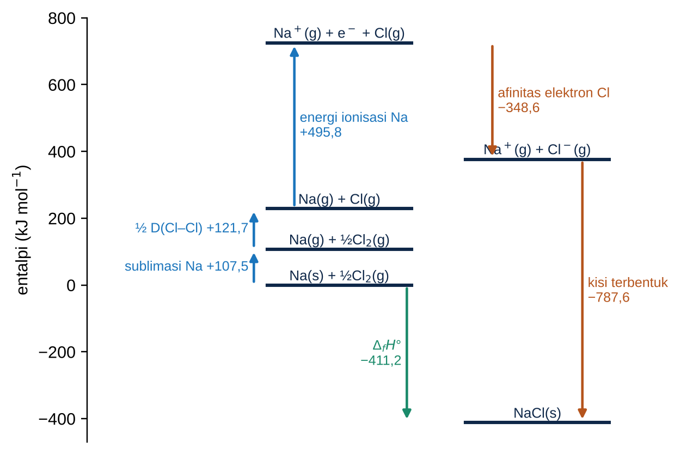
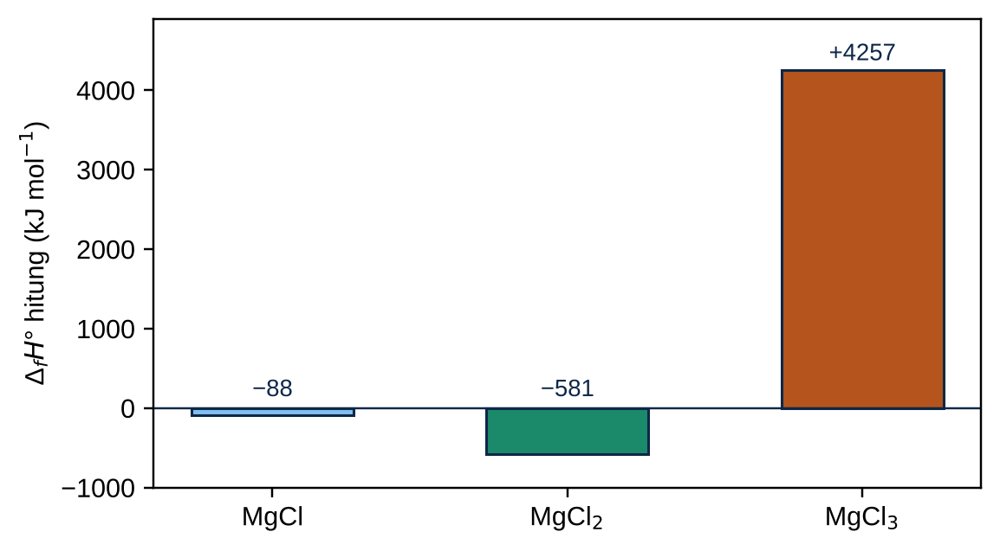

## 6.5 Siklus Born–Haber

Energi kisi tidak dapat diukur langsung, karena kita tidak dapat mengumpulkan ion Na⁺ dan Cl⁻ dalam fase gas lalu membiarkannya mengkristal sambil mengukur panasnya. Namun energi kisi dapat **dihitung** dari besaran-besaran lain yang dapat diukur, dengan memakai hukum Hess: perubahan entalpi suatu proses tidak bergantung pada jalan yang ditempuh. Born dan Fritz Haber (1919) menyusun jalan memutar dari unsur-unsur ke kristal yang setiap langkahnya terukur, kecuali satu: langkah pembentukan kisi.

### Langkah-langkah siklus untuk NaCl

Pembentukan NaCl dari unsur-unsurnya dapat terjadi langsung:

$$\text{Na(s)} + \tfrac12\text{Cl}_2\text{(g)} \rightarrow \text{NaCl(s)} \qquad \Delta_\text{f}H^\circ = -411{,}2\ \text{kJ mol}^{-1}$$

atau lewat lima langkah:

1. **Sublimasi** natrium: Na(s) → Na(g), Δ~sub~*H* = +107,5 kJ mol⁻¹.
2. **Disosiasi** setengah mol Cl₂: ½Cl₂(g) → Cl(g), ½*D*(Cl–Cl) = +121,7 kJ mol⁻¹.
3. **Ionisasi** natrium: Na(g) → Na⁺(g) + e⁻, *I*₁ = +495,8 kJ mol⁻¹.
4. **Penangkapan elektron** oleh klorin: Cl(g) + e⁻ → Cl⁻(g), Δ~eg~*H* = −348,6 kJ mol⁻¹ (afinitas elektron 348,6 kJ mol⁻¹).
5. **Pembentukan kisi**: Na⁺(g) + Cl⁻(g) → NaCl(s), −Δ~kisi~*H*.

{width=82%}

Kedua jalan harus memberi perubahan entalpi yang sama:

$$\Delta_\text{f}H^\circ = \Delta_\text{sub}H + \tfrac12 D + I_1 + \Delta_\text{eg}H - \Delta_\text{kisi}H \qquad \text{(6.7)}$$

sehingga

$$\Delta_\text{kisi}H = 107{,}5 + 121{,}7 + 495{,}8 - 348{,}6 + 411{,}2 = 787{,}6\ \text{kJ mol}^{-1}$$

Siklus ini juga memperlihatkan **mengapa** NaCl terbentuk. Tiga langkah pertama memerlukan 725 kJ mol⁻¹. Penangkapan elektron oleh klorin mengembalikan hanya 349 kJ mol⁻¹, sehingga membentuk sepasang ion gas Na⁺ dan Cl⁻ dari unsur-unsurnya masih memerlukan 376 kJ mol⁻¹. Membuat ion terpisah tidak menguntungkan. Yang membuat reaksi sangat eksoterm adalah langkah terakhir: ion-ion berkumpul menjadi kisi dan melepaskan 788 kJ mol⁻¹. **Energi kisi adalah gaya pendorong pembentukan senyawa ionik.**

::: {.awas}
**Awas: tanda afinitas elektron.** Afinitas elektron klorin adalah 348,6 kJ mol⁻¹ (positif, menurut definisi: energi yang dilepas). Perubahan entalpi penangkapan elektron adalah −348,6 kJ mol⁻¹. Dalam siklus Born–Haber, yang dimasukkan adalah perubahan entalpinya. Kesalahan tanda di langkah ini adalah sumber galat paling umum, dan langsung mengubah hasil hampir 700 kJ mol⁻¹. Cara aman: gambar diagram energinya dan beri setiap panah arah naik atau turun.
:::

::: {.contoh}
**Contoh 6.6 · Siklus untuk CaF₂ dan afinitas elektron kedua oksigen**

(a) Hitung entalpi kisi CaF₂ dari data: Δ~sub~*H*(Ca) = 177,8; *I*₁ + *I*₂(Ca) = 589,8 + 1145,4; *D*(F–F) = 158,8; Δ~eg~*H*(F) = −328,2 (per atom); Δ~f~*H*°(CaF₂) = −1228,0 kJ mol⁻¹.

(b) Ion O²⁻ tidak stabil sebagai ion gas, sehingga afinitas elektron keduanya tidak dapat diukur langsung. Dengan siklus Born–Haber untuk MgO, hitung perubahan entalpi O(g) + 2e⁻ → O²⁻(g). Data: Δ~sub~*H*(Mg) = 147,1; *I*₁ + *I*₂(Mg) = 737,7 + 1450,7; ½*D*(O=O) = 249,2; Δ~f~*H*°(MgO) = −601,6; entalpi kisi 3795 kJ mol⁻¹ (dari perhitungan teoretis yang teliti).

**Penyelesaian.** (a) Dua atom F, dua penangkapan elektron:

Δ~kisi~*H* = 177,8 + 589,8 + 1145,4 + 158,8 + 2(−328,2) + 1228,0 = **2643 kJ mol⁻¹**

(b) Susun ulang persamaan siklus dengan perubahan entalpi penangkapan dua elektron, Δ~eg~*H*(O → O²⁻), sebagai yang dicari:

Δ~eg~*H*(O → O²⁻) = Δ~f~*H*° − Δ~sub~*H* − (*I*₁ + *I*₂) − ½*D* + Δ~kisi~*H*
= −601,6 − 147,1 − 2188,4 − 249,2 + 3795 = **+609 kJ mol⁻¹**

Karena penangkapan elektron pertama melepaskan 141 kJ mol⁻¹, penangkapan elektron kedua **memerlukan** sekitar 750 kJ mol⁻¹.

**Memahami hasil.** Menambahkan elektron kedua ke O⁻ sangat tidak menguntungkan, karena elektron itu harus melawan tolakan muatan negatif yang sudah ada. Ion O²⁻ yang bebas akan langsung melepaskan elektronnya. Ion oksida hanya ada **di dalam kisi**, distabilkan oleh kation di sekitarnya. Hal yang sama berlaku untuk S²⁻, N³⁻, dan anion bermuatan tinggi lainnya. Jadi ketika kita berbicara tentang "ion O²⁻" dalam MgO, kita membicarakan sesuatu yang hanya bermakna di dalam padatan, dan siklus Born–Haber adalah satu-satunya cara untuk menimbang energinya.
:::

::: {.kuis}
**Kuis cepat 6.5** Hitung entalpi kisi KCl dari data: Δ~sub~*H*(K) = 89,0; *I*₁(K) = 418,8; ½*D*(Cl–Cl) = 121,7; Δ~eg~*H*(Cl) = −348,6; Δ~f~*H*°(KCl) = −436,5 kJ mol⁻¹. Mengapa entalpi kisi KCl lebih kecil daripada NaCl, padahal Δ~f~*H*° KCl lebih negatif?
:::

::: {.contoh}
**Contoh 6.7 · Ion amonium yang menyamar sebagai kalium**

Energi pembentukan ion NH₄⁺ gas dapat dihitung dari afinitas proton amonia (853,6 kJ mol⁻¹, subbab 8.2): Δ~f~*H*°(NH₄⁺, g) = Δ~f~*H*°(NH₃, g) + Δ~f~*H*°(H⁺, g) − PA, dengan Δ~f~*H*°(NH₃, g) = −45,9 dan Δ~f~*H*°(H⁺, g) = 1536,2 kJ mol⁻¹. Dengan Δ~f~*H*°(Cl⁻, g) = −233,1 dan Δ~f~*H*°(NH₄Cl, s) = −314,4 kJ mol⁻¹, hitung entalpi kisi NH₄Cl dan bandingkan dengan KCl (717 kJ mol⁻¹) dan RbCl (sekitar 692 kJ mol⁻¹).

**Penyelesaian.** Δ~f~*H*°(NH₄⁺, g) = −45,9 + 1536,2 − 853,6 = **+636,7 kJ mol⁻¹**. Entalpi kisi = Δ~f~*H*°(NH₄⁺, g) + Δ~f~*H*°(Cl⁻, g) − Δ~f~*H*°(NH₄Cl, s) = 636,7 − 233,1 + 314,4 = **718 kJ mol⁻¹**.

**Memahami hasil.** Entalpi kisi NH₄Cl hampir tepat sama dengan KCl. Persamaan Kapustinskii menyatakan bahwa energi kisi garam 1+/1− dengan anion sama hanya ditentukan oleh jari-jari kation; jadi ion NH₄⁺ berukuran hampir sama dengan K⁺ (sekitar 140–150 pm), walaupun ia ion poliatomik. Kimia mengonfirmasi hal ini: garam amonium sering **isomorf** dengan garam kalium dan rubidium (NH₄ClO₄ dan KClO₄, tawas amonium dan tawas kalium), dan kelarutannya mirip. Inilah contoh nyata "jari-jari termokimia" ion poliatomik yang disebut di subbab 6.4.
:::

## 6.6 Menguji senyawa hipotetis: NeCl, MgCl, dan CaCl

Kini kita dapat menjawab teka-teki pembuka. Siklus Born–Haber dapat dijalankan **ke arah sebaliknya**: bila energi kisi diperkirakan dengan persamaan Kapustinskii, entalpi pembentukan senyawa yang belum pernah dibuat dapat dihitung. Bila hasilnya sangat positif, senyawa itu tidak akan terbentuk.

::: {.strategi}
**Langkah menilai senyawa hipotetis**

1. Tuliskan siklus Born–Haber untuk senyawa itu.
2. Ambil data atom yang terukur: sublimasi, disosiasi, energi ionisasi, afinitas elektron.
3. Taksir energi kisi dengan persamaan Kapustinskii; bila jari-jari ion hipotetis tidak diketahui, pakai jari-jari ion yang mirip ukurannya.
4. Hitung Δ~f~*H*°.
5. Bila Δ~f~*H*° negatif, periksa juga apakah senyawa itu akan **terdisproporsionasi** menjadi senyawa lain yang lebih stabil.
:::

::: {.contoh}
**Contoh 6.8 · Mengapa MgCl₂, bukan MgCl atau MgCl₃?**

Hitung Δ~f~*H*° untuk MgCl, MgCl₂, dan MgCl₃ dengan persamaan Kapustinskii. Anggap Mg⁺ seukuran Na⁺ (102 pm), Mg²⁺ 72 pm, Mg³⁺ 60 pm, Cl⁻ 181 pm. Data Mg: Δ~sub~*H* = 147,1; *I*₁ = 737,7; *I*₂ = 1450,7; *I*₃ = 7732,7 kJ mol⁻¹. Cl: ½*D* = 121,7; Δ~eg~*H* = −348,6 kJ mol⁻¹. Lalu periksa apakah MgCl stabil terhadap 2MgCl(s) → Mg(s) + MgCl₂(s), dengan Δ~f~*H*°(MgCl₂) terukur −641,3 kJ mol⁻¹.

**Penyelesaian.** Energi kisi (Kapustinskii):

* MgCl: *ν* = 2, |*z*₊*z*₋| = 1, 283 pm → −746 kJ mol⁻¹
* MgCl₂: *ν* = 3, |*z*₊*z*₋| = 2, 253 pm → −2463 kJ mol⁻¹
* MgCl₃: *ν* = 4, |*z*₊*z*₋| = 3, 241 pm → −5130 kJ mol⁻¹

Entalpi pembentukan, Δ~f~*H*° = Δ~sub~*H* + Σ*I* + *m*(½*D* + Δ~eg~*H*) + *U* untuk MgCl~*m*~:

* MgCl: 147,1 + 737,7 + (121,7 − 348,6) − 746 = **−88 kJ mol⁻¹**
* MgCl₂: 147,1 + 737,7 + 1450,7 + 2(−226,9) − 2463 = **−581 kJ mol⁻¹** (terukur −641)
* MgCl₃: 147,1 + 737,7 + 1450,7 + 7732,7 + 3(−226,9) − 5130 = **+4257 kJ mol⁻¹**

Disproporsionasi: Δ*H* = −641,3 − 2(−88) = **−465 kJ** per 2 mol MgCl.

{width=64%}

**Memahami hasil.** MgCl sebenarnya stabil terhadap unsur-unsurnya (Δ~f~*H*° negatif), tetapi MgCl₂ **jauh** lebih stabil. Energi ionisasi kedua yang besar (1451 kJ mol⁻¹) dibayar lunas oleh kenaikan energi kisi: dari 746 menjadi 2463 kJ mol⁻¹, karena muatan kation berlipat dua, ukurannya mengecil, dan jumlah ion bertambah. Sebaliknya, energi ionisasi ketiga (7733 kJ mol⁻¹) memerlukan pengambilan elektron dari kulit 2p yang penuh dan dekat inti, dan tidak ada kenaikan energi kisi yang dapat membayarnya. Inilah penjelasan energetika untuk "valensi" magnesium. Perhitungan Kapustinskii untuk MgCl₂ meleset 60 kJ mol⁻¹ (9 %), tetapi kesimpulannya tidak terpengaruh, karena selisih antarpilihan berukuran ratusan sampai ribuan kJ.
:::

Dengan cara yang sama:

* **CaCl** (anggap Ca⁺ seukuran K⁺): Δ~f~*H*° ≈ −132 kJ mol⁻¹, tetapi disproporsionasi menjadi Ca + CaCl₂ melepaskan sekitar 532 kJ. Kalsium, seperti magnesium, selalu bervalensi dua.
* **NeCl** (anggap Ne⁺ seukuran Na⁺): energi ionisasi neon sangat besar (2081 kJ mol⁻¹), dan energi kisi monovalen hanya sekitar 750 kJ mol⁻¹. Δ~f~*H*° ≈ **+1108 kJ mol⁻¹**. Senyawa ini tidak mungkin ada.

::: {.terapan}
**Bartlett dan senyawa gas mulia pertama.** Pada 1962, Neil Bartlett menemukan bahwa platina heksafluorida, PtF₆, adalah oksidator yang begitu kuat sehingga dapat mengambil elektron dari molekul O₂, membentuk padatan merah [O₂]⁺[PtF₆]⁻. Ia lalu memperhatikan sesuatu yang sederhana dari tabel energi ionisasi: O₂ 12,07 eV, xenon 12,13 eV, hampir sama. Ion [Xe]⁺ juga berukuran hampir sama dengan [O₂]⁺, sehingga energi kisi garamnya dengan [PtF₆]⁻ akan serupa. Kesimpulan dari siklus Born–Haber: bila [O₂]⁺[PtF₆]⁻ stabil, maka garam xenon juga harus stabil. Ia mencampur gas xenon dengan uap PtF₆ dan segera memperoleh padatan jingga-kuning, senyawa gas mulia pertama di dunia. Penalaran yang sama menjelaskan mengapa neon dan helium, dengan energi ionisasi 21,6 dan 24,6 eV, tetap tanpa senyawa yang stabil (Bab 12).
:::

::: {.kuis}
**Kuis cepat 6.6** Natrium tidak pernah membentuk NaCl₂, walaupun kenaikan energi kisi dari NaCl ke NaCl₂ kira-kira sebesar dari MgCl ke MgCl₂ (sekitar 1700 kJ mol⁻¹). Dengan *I*₂(Na) = 4562 kJ mol⁻¹, jelaskan mengapa.
:::
