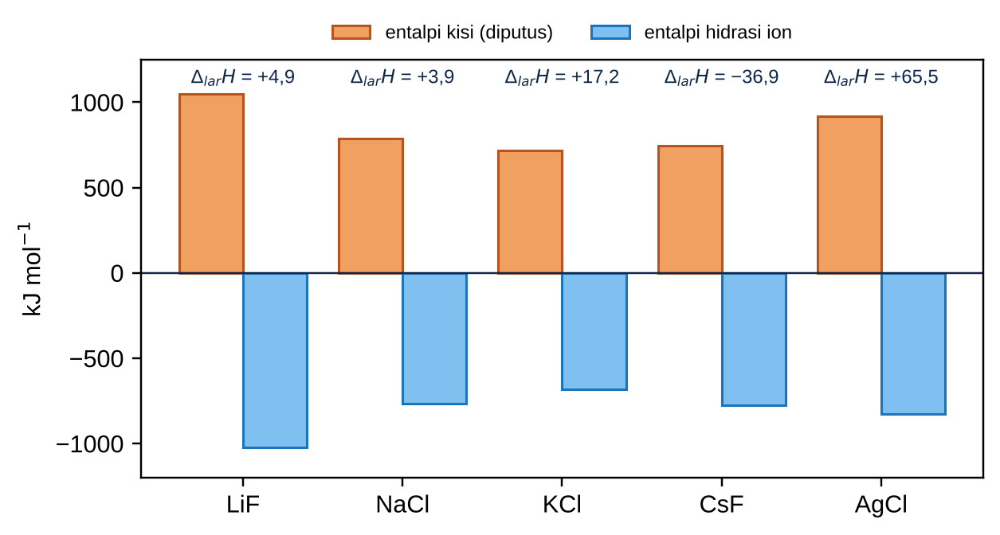
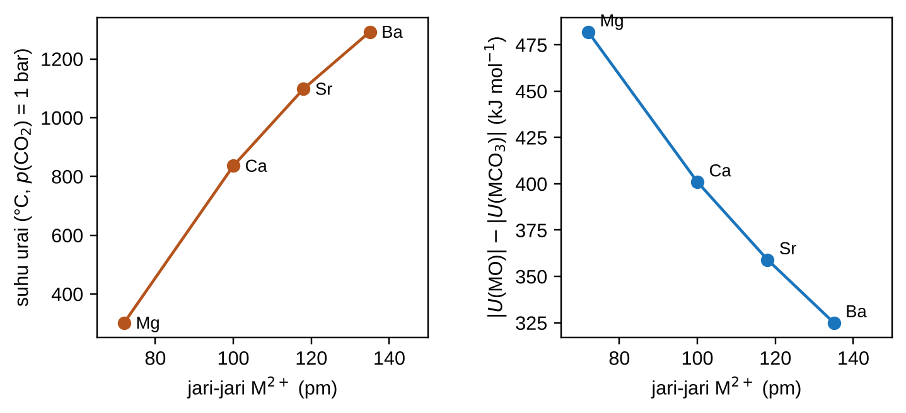
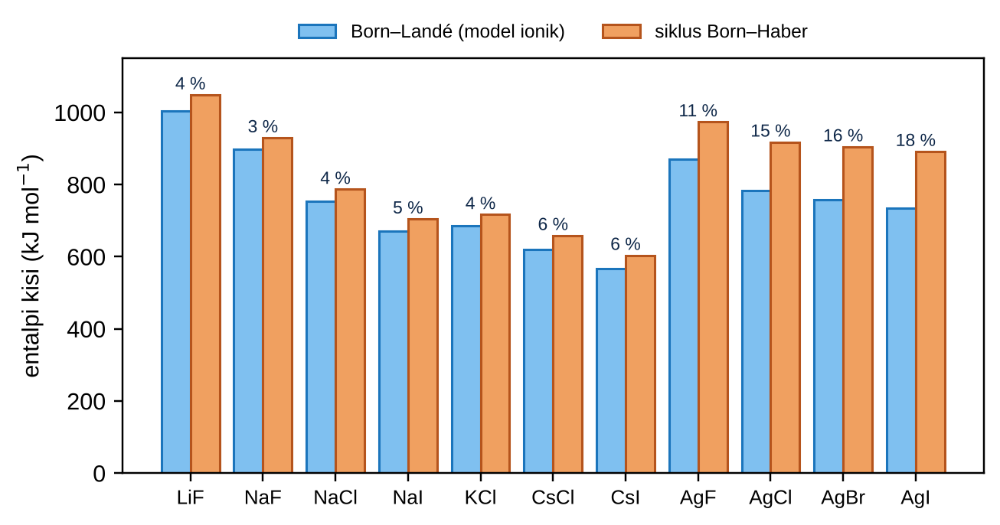

## 6.7 Kelarutan garam: energi kisi lawan entalpi hidrasi

Ketika garam larut dalam air, dua hal terjadi bersamaan: kisi dibongkar, dan ion-ion yang terlepas dikelilingi molekul air yang mengarahkan ujung negatifnya (O) ke kation dan ujung positifnya (H) ke anion. Proses ini dapat dipecah menjadi dua langkah khayal:

$$\text{MX(s)} \xrightarrow{\ \Delta_\text{kisi}H\ } \text{M}^+(\text{g}) + \text{X}^-(\text{g}) \xrightarrow{\ \Delta_\text{hid}H\ } \text{M}^+(\text{aq}) + \text{X}^-(\text{aq})$$

$$\Delta_\text{lar}H = \Delta_\text{kisi}H + \Delta_\text{hid}H(\text{M}^+) + \Delta_\text{hid}H(\text{X}^-) \qquad \text{(6.7)}$$

Entalpi kisi positif (memerlukan energi), entalpi hidrasi negatif (melepaskan energi). Keduanya besar, ratusan sampai ribuan kJ mol⁻¹, dan hampir saling meniadakan.

Tabel 6.3 Entalpi hidrasi ion (kJ mol⁻¹, 298 K).

| Kation | Δ~hid~*H* | Kation | Δ~hid~*H* | Anion | Δ~hid~*H* |
|---|---|---|---|---|---|
| Li⁺ | −519 | Mg²⁺ | −1921 | F⁻ | −504 |
| Na⁺ | −404 | Ca²⁺ | −1577 | Cl⁻ | −361 |
| K⁺ | −321 | Sr²⁺ | −1443 | Br⁻ | −330 |
| Rb⁺ | −296 | Ba²⁺ | −1305 | I⁻ | −285 |
| Cs⁺ | −271 | Al³⁺ | −4665 | OH⁻ | −460 |

Entalpi hidrasi makin negatif untuk ion yang **kecil** dan **bermuatan tinggi**, karena medan listrik di permukaannya lebih kuat dan molekul air dapat mendekat lebih rapat. Secara kasar, Δ~hid~*H* sebanding dengan *z*²/*r*.

{width=82%}

::: {.contoh}
**Contoh 6.6 · Entalpi pelarutan dari dua bilangan besar**

Hitung Δ~lar~*H* untuk NaCl, KCl, LiF, CsF, dan AgCl dengan persamaan (6.7). Entalpi kisi (siklus Born–Haber): NaCl 787, KCl 717, LiF 1049, CsF 744, AgCl 918 kJ mol⁻¹. Entalpi hidrasi dari Tabel 6.3 (Ag⁺: −464). Bandingkan dengan nilai terukur: +3,9; +17,2; +4,9; −36,9; +65,5 kJ mol⁻¹.

**Penyelesaian.**

| Garam | Δ~kisi~*H* | ΣΔ~hid~*H* | Δ~lar~*H* hitung | Δ~lar~*H* terukur |
|---|---|---|---|---|
| NaCl | 787 | −765 | +22 | +3,9 |
| KCl | 717 | −682 | +35 | +17,2 |
| LiF | 1049 | −1023 | +26 | +4,9 |
| CsF | 744 | −775 | −31 | −36,9 |
| AgCl | 918 | −825 | +93 | +65,5 |

**Memahami hasil.** Hasil hitung meleset sampai 20 kJ mol⁻¹, karena Δ~lar~*H* adalah selisih kecil dari dua bilangan yang masing-masing mempunyai ketidakpastian beberapa puluh kJ mol⁻¹. Namun polanya benar: CsF dan garam yang ion-ionnya berbeda ukuran larut secara eksoterm, AgCl sangat endoterm. Pelajaran penting: **entalpi pelarutan tidak dapat diramalkan dengan tepat dari data termokimia**, dan tanda serta besarnya dapat berubah oleh perubahan kecil. NaCl larut walaupun pelarutannya sedikit endoterm, karena kenaikan entropi (ion-ion terlepas dari kisi yang teratur) membuat Δ~lar~*G* negatif. AgCl tidak larut terutama karena entalpi kisinya yang besar, akibat sifat kovalen ikatannya (subbab 6.9).
:::

### Aturan ukuran: ion berbeda ukuran lebih mudah larut

Karena ramalan kuantitatif sulit, kimiawan memakai aturan kualitatif yang mengikuti dari bentuk kedua besaran:

* entalpi kisi sebanding dengan 1/(*r*₊ + *r*₋): bergantung pada **jumlah** jari-jari;
* entalpi hidrasi sebanding dengan 1/*r*₊ + 1/*r*₋: bergantung pada **masing-masing** jari-jari, dan didominasi oleh ion yang lebih kecil.

Bila kedua ion **kecil**, entalpi kisi sangat besar, dan hidrasi tidak cukup untuk membayarnya. Bila satu ion kecil dan yang lain besar, entalpi kisi relatif kecil (jumlah jari-jari besar), tetapi hidrasi ion kecil tetap sangat besar: garam mudah larut.

::: {.inti}
**Aturan ukuran.** Garam yang ion-ionnya **berukuran sangat berbeda** cenderung mudah larut; garam yang ion-ionnya **berukuran sama** cenderung sukar larut.
:::

Contoh-contoh yang dapat diamati:

* LiF (dua ion kecil) larut hanya 0,13 g per 100 g air; CsF (kation besar, anion kecil) larut sekitar 370 g per 100 g air.
* **Sulfat** golongan 2: SO₄²⁻ besar, sehingga kelarutan turun dari MgSO₄ (garam Inggris, sangat larut) ke BaSO₄ (praktis tidak larut, 0,00024 g per 100 g air), karena Ba²⁺ juga besar.
* **Hidroksida** golongan 2: OH⁻ kecil, sehingga trennya terbalik: Mg(OH)₂ sangat sukar larut (bahan obat maag "susu magnesia"), Ba(OH)₂ cukup larut (sekitar 4 g per 100 g air).

::: {.terapan}
**Barium untuk foto rontgen.** Ion Ba²⁺ beracun: ia mengganggu kanal ion kalium dalam sel otot. Namun pasien yang diperiksa saluran pencernaannya dengan sinar-X meminum "bubur barium", suspensi BaSO₄, karena atom barium yang berat menyerap sinar-X dengan kuat dan membuat lambung serta usus tampak jelas. Hal ini aman hanya karena BaSO₄ sangat sukar larut (*K*~sp~ sekitar 10⁻¹⁰): dua ion besar yang ukurannya serasi membentuk kisi yang tidak dapat dibongkar oleh hidrasi. Barium karbonat, yang larut dalam asam lambung, sangat beracun dan dipakai sebagai racun tikus.
:::

::: {.kuis}
**Kuis cepat 6.7** Ramalkan dengan aturan ukuran: mana yang lebih larut dalam setiap pasangan? (a) LiI atau LiF; (b) MgF₂ atau MgI₂; (c) CaSO₄ atau BaSO₄; (d) Ca(OH)₂ atau Ba(OH)₂.
:::

## 6.8 Kestabilan termal karbonat dan peroksida

Kalsium karbonat (batu kapur) terurai menjadi kapur tohor ketika dipanaskan, reaksi yang sudah dipakai manusia selama ribuan tahun untuk membuat kapur dan semen:

$$\text{CaCO}_3(\text{s}) \rightarrow \text{CaO}(\text{s}) + \text{CO}_2(\text{g})$$

Karbonat logam golongan 2 lainnya mengalami reaksi yang sama, tetapi pada suhu yang sangat berbeda.

::: {.contoh}
**Contoh 6.7 · Suhu penguraian karbonat golongan 2**

Hitung suhu ketika tekanan kesetimbangan CO₂ di atas MCO₃ mencapai 1 bar, untuk M = Mg, Ca, Sr, Ba. Data (Δ~f~*H*° dalam kJ mol⁻¹, *S*° dalam J K⁻¹ mol⁻¹):

| Zat | Δ~f~*H*° | *S*° | Zat | Δ~f~*H*° | *S*° |
|---|---|---|---|---|---|
| MgCO₃ | −1095,8 | 65,7 | MgO | −601,6 | 26,9 |
| CaCO₃ | −1206,9 | 92,9 | CaO | −635,1 | 39,8 |
| SrCO₃ | −1220,1 | 97,1 | SrO | −592,0 | 54,4 |
| BaCO₃ | −1216,3 | 112,1 | BaO | −553,5 | 70,4 |
| CO₂ | −393,5 | 213,8 | | | |

**Rencana.** Pada *p*(CO₂) = 1 bar, Δ~r~*G*° = 0, sehingga *T* = Δ~r~*H*°/Δ~r~*S*° (anggap Δ*H* dan Δ*S* tidak bergantung suhu).

**Penyelesaian.** Untuk CaCO₃: Δ~r~*H*° = −635,1 − 393,5 + 1206,9 = 178,3 kJ mol⁻¹; Δ~r~*S*° = 39,8 + 213,8 − 92,9 = 160,7 J K⁻¹ mol⁻¹. *T* = 178 300/160,7 = 1110 K = **836 °C**. Dengan cara yang sama:

| M | Δ~r~*H*° | Δ~r~*S*° | *T* |
|---|---|---|---|
| Mg | 100,7 | 175,0 | 302 °C |
| Ca | 178,3 | 160,7 | 836 °C |
| Sr | 234,6 | 171,1 | 1098 °C |
| Ba | 269,3 | 172,1 | 1292 °C |

**Memahami hasil.** Δ~r~*S*° hampir sama untuk keempatnya, karena hampir seluruhnya berasal dari satu mol gas CO₂ yang terbentuk. Perbedaan suhu ditentukan oleh **Δ~r~*H*°**, yang naik tajam dari Mg ke Ba. Tanur kapur memang dioperasikan sekitar 900 °C, sedikit di atas suhu hitung CaCO₃, agar CO₂ cepat keluar.
:::

### Mengapa kation kecil membuat karbonat kurang stabil?

Jawabannya ada pada energi kisi. Ketika MCO₃ terurai, anion besar CO₃²⁻ (jari-jari termokimia sekitar 178 pm) diganti anion kecil O²⁻ (140 pm). Energi kisi naik, karena jumlah jari-jari mengecil. Seberapa besar kenaikan itu bergantung pada ukuran kation:

* Bila kation **kecil** (Mg²⁺, 72 pm), jumlah jari-jari berubah dari 250 menjadi 212 pm, perubahan relatif besar (15 %), dan energi kisi naik banyak.
* Bila kation **besar** (Ba²⁺, 135 pm), jumlah jari-jari berubah dari 313 menjadi 275 pm, perubahan relatif lebih kecil (12 %), dan kenaikan energi kisi lebih kecil.

{width=90%}

Persamaan Kapustinskii memberi kenaikan energi kisi sebesar 482 kJ mol⁻¹ untuk Mg dan hanya 325 kJ mol⁻¹ untuk Ba. Kenaikan energi kisi ini "membantu" penguraian: makin besar, makin mudah karbonat terurai. Pandangan lain yang setara memakai aturan Fajans (subbab 1.12): kation kecil bermuatan tinggi mempolarisasi anion karbonat, menarik kerapatan elektron ke arah salah satu oksigen, dan melemahkan ikatan C–O, sehingga CO₂ lebih mudah lepas.

::: {.inti}
**Ion besar distabilkan oleh ion besar.** Anion besar yang dapat terurai menjadi anion kecil (CO₃²⁻ → O²⁻, O₂²⁻ → O²⁻, NO₃⁻ → O²⁻) paling stabil bila bergabung dengan kation besar. Kation kecil mendorong penguraiannya.
:::

Prinsip ini menjelaskan banyak pengamatan dalam kimia unsur golongan utama:

* **Karbonat alkali**: Li₂CO₃ terurai menjadi Li₂O dan CO₂ ketika dipanaskan kuat; karbonat Na sampai Cs meleleh tanpa terurai.
* **Nitrat**: LiNO₃ terurai menjadi Li₂O, NO₂, dan O₂ (seperti nitrat golongan 2), sedangkan NaNO₃ dan KNO₃ hanya melepas O₂ dan menjadi nitrit.
* **Oksida yang terbentuk ketika logam alkali dibakar di udara**: litium membentuk oksida Li₂O, natrium terutama peroksida Na₂O₂, sedangkan kalium, rubidium, dan sesium membentuk superoksida MO₂. Anion makin besar (O²⁻ < O₂²⁻ < O₂⁻) hanya stabil dengan kation makin besar. Ozonida MO₃ yang lebih besar lagi hanya dikenal untuk K, Rb, dan Cs.
* **Peroksida golongan 2**: BaO₂ dapat dibuat dengan memanaskan BaO dalam udara pada sekitar 500 °C, dan melepaskan kembali O₂ pada sekitar 800 °C. Proses bolak-balik ini (proses Brin) pernah dipakai untuk memisahkan oksigen dari udara pada akhir abad ke-19. MgO₂ hampir tidak dapat dibuat murni.

::: {.kuis}
**Kuis cepat 6.8** Urutkan kestabilan termal Li₂CO₃, Na₂CO₃, dan K₂CO₃, serta MgO₂, CaO₂, dan BaO₂. Jelaskan dengan satu prinsip.
:::

## 6.9 Karakter kovalen dan selisih energi kisi hitung–ukur

Kita sekarang mempunyai dua cara untuk mendapatkan energi kisi: **model ionik** (Born–Landé, Born–Mayer, Kapustinskii), yang menganggap ion sebagai bola bermuatan murni, dan **siklus Born–Haber**, yang tidak membuat anggapan apa pun tentang jenis ikatan karena seluruhnya dari data termokimia. Bila keduanya cocok, senyawa itu memang ionik. Bila tidak cocok, selisihnya mengukur seberapa jauh senyawa itu menyimpang dari model ionik.

{width=86%}

Dua pola terlihat pada Gambar 6.7:

1. **Halida alkali**: model ionik selalu sedikit terlalu kecil, sekitar 3–6 %. Selisih ini sistematis, terutama karena model sederhana mengabaikan gaya dispersi antara ion (yang menambah sekitar 2–5 % energi kisi, terbesar untuk ion besar seperti Cs⁺ dan I⁻). Model yang lebih lengkap, dengan suku dispersi dan energi titik nol, cocok dalam 1–2 %.
2. **Halida perak**: selisihnya jauh lebih besar dan **naik** dari AgF (11 %) ke AgI (18 %). Ini bukan galat model, melainkan tanda energi tambahan yang tidak dimuat model ionik sama sekali: **ikatan kovalen**.

::: {.contoh}
**Contoh 6.8 · Mengukur karakter kovalen perak halida**

Hitung entalpi kisi AgCl dengan persamaan Born–Landé (garam batu, *r*₀ = 277,5 pm, *n* = 9,5) dan bandingkan dengan siklus Born–Haber (918 kJ mol⁻¹). Bandingkan dengan NaCl, yang ukuran kationnya hampir sama (Ag⁺ 115 pm, Na⁺ 102 pm).

**Penyelesaian.**

$$U = -\frac{1{,}389 \times 10^5 \times 1{,}74756}{277{,}5}\left(1 - \frac{1}{9{,}5}\right) = -875 \times 0{,}895 = -783\ \text{kJ mol}^{-1}$$

Selisih dengan siklus: 918 − 783 = **135 kJ mol⁻¹** (15 %). Untuk NaCl, selisihnya hanya 787 − 753 = 34 kJ mol⁻¹ (4 %).

**Memahami hasil.** AgCl dan NaCl mempunyai struktur yang sama, jarak antarion hampir sama, dan model ionik memberi energi kisi yang hampir sama (783 lawan 753). Namun kisi AgCl **lebih stabil sekitar 130 kJ mol⁻¹** daripada yang dapat dijelaskan oleh tarikan ion. Energi tambahan ini berasal dari sifat kovalen ikatan Ag–Cl: ion Ag⁺ (4d¹⁰) mempolarisasi Cl⁻, dan sebagian kerapatan elektron dibagi di antara keduanya (aturan Fajans, subbab 1.12). Kestabilan tambahan inilah yang membuat AgCl sukar larut (subbab 6.7), walaupun NaCl sangat mudah larut.
:::

Selisih ini memberi ukuran kuantitatif untuk gagasan kualitatif yang sudah kita kenal:

* Karakter kovalen naik ketika **anion makin mudah terpolarisasi** (AgF < AgCl < AgBr < AgI). Kelarutannya turun ke arah yang sama, dan warnanya berubah dari putih ke kuning.
* Karakter kovalen besar bila **kationnya bukan berkonfigurasi gas mulia** (Ag⁺, Cu⁺, Tl⁺, Zn²⁺, Cd²⁺, Hg²⁺). Elektron d menutupi muatan inti dengan buruk, sehingga daya polarisasi kation lebih besar daripada yang diduga dari ukurannya.
* Ketika karakter kovalen sangat besar, **strukturnya pun berubah**: AgI meninggalkan struktur garam batu dan memilih wurtzit dengan koordinasi 4 (subbab 5.7), dan senyawa seperti CdI₂ membentuk lapisan.

Siklus Born–Haber dan model ionik bersama-sama membentuk jembatan antara Bab 2 (ikatan kovalen) dan Bab 5 (padatan ionik). Ikatan ionik dan kovalen bukan dua kotak yang terpisah, melainkan dua ujung satu rentang, dan selisih energi kisi hitung–ukur adalah salah satu cara untuk menentukan letak suatu senyawa di rentang itu.

::: {.kuis}
**Kuis cepat 6.9** Entalpi kisi CuCl dari siklus Born–Haber adalah 996 kJ mol⁻¹, sedangkan model ionik (struktur sfalerit) memberi sekitar 860 kJ mol⁻¹. Berapa persen selisihnya? Bandingkan dengan NaCl dan jelaskan.
:::

## Menuju bab berikutnya

Magnesium membentuk MgCl₂ karena kenaikan energi kisi dari MgCl ke MgCl₂, sekitar 1700 kJ mol⁻¹, lebih dari cukup untuk membayar energi ionisasi kedua (1451 kJ mol⁻¹). Energi kisi, yang tidak dapat diukur langsung tetapi dapat dihitung dengan dua cara yang saling memeriksa, ternyata menjadi kunci untuk menjawab banyak pertanyaan: senyawa mana yang ada, garam mana yang larut, karbonat mana yang tahan panas, dan seberapa ionik sebuah ikatan "ionik".

Padatan ionik adalah isolator: semua elektronnya terikat erat pada ion-ionnya. Ada golongan padatan yang sama sekali berbeda, yang elektron-elektronnya bergerak bebas di seluruh kristal. Mengapa tembaga menghantarkan listrik, silikon menghantarkan sedikit dan makin baik ketika dipanaskan, dan intan tidak sama sekali? Bab 7 menjawabnya dengan memperluas teori orbital molekul dari Bab 4 ke kristal yang berisi 10²³ atom, ketika tingkat-tingkat energi menyatu menjadi **pita**.
