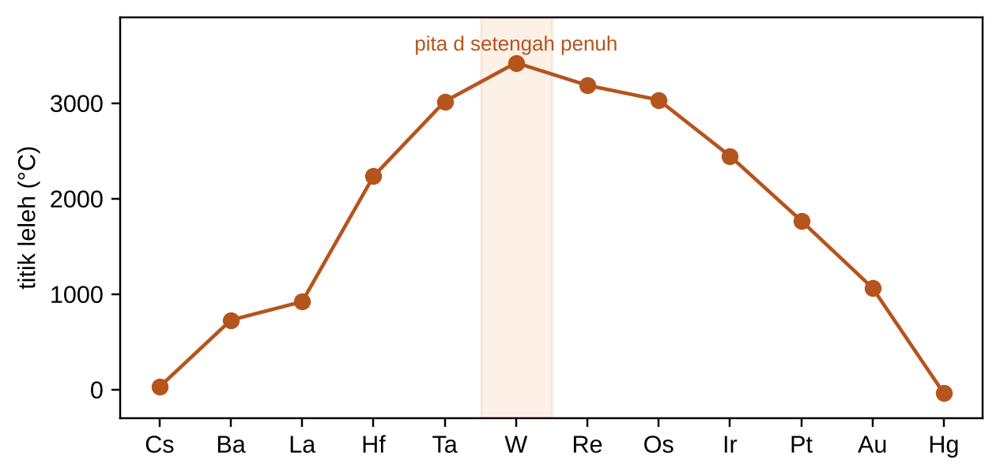

# Bab 7 Logam, Semikonduktor, dan Teori Pita

Seutas kawat tembaga di dalam rumah menghantarkan listrik sekitar 10²⁰ kali lebih baik daripada sebutir intan, dan sekitar 10¹¹ kali lebih baik daripada sekeping silikon murni. Tidak ada besaran fisis lain yang nilainya untuk zat sehari-hari terbentang selebar ini. Yang lebih aneh lagi: bila dipanaskan, tembaga menghantarkan **lebih buruk**, sedangkan silikon menghantarkan **jauh lebih baik**. Silikon yang sama, bila dicampur sedikit sekali fosfor, satu atom P untuk setiap sejuta atom Si, menjadi beberapa juta kali lebih konduktif. Dari campuran sekecil itu, ditambah lapisan yang dicampur boron, dibangun setiap cip komputer, setiap lampu LED, dan setiap panel surya di dunia.

Teori yang menjelaskan semua ini adalah **teori pita**, yang tidak lain adalah teori orbital molekul (Bab 4) untuk molekul yang sangat besar. Bila *N* atom bergabung, *N* orbital atom menghasilkan *N* orbital molekul. Ketika *N* sebesar 10²³, tingkat-tingkat energi itu begitu rapat sehingga membentuk **pita** yang tampak kontinu. Apakah sebuah padatan logam, semikonduktor, atau isolator ditentukan oleh satu hal: apakah pita tertingginya terisi penuh atau sebagian, dan seberapa lebar celah ke pita berikutnya.

Bab ini mulai dari logam: sifat-sifatnya, strukturnya, dan paduannya. Lalu kita membangun pita dari orbital molekul, mengenal kerapatan keadaan dan tingkat Fermi, dan membedakan konduktor, isolator, dan semikonduktor. Bagian akhir membahas semikonduktor yang didoping, sambungan p–n yang menjadi dasar dioda, LED, dan sel surya, hubungan celah pita dengan warna padatan, serta superkonduktor.

::: {.kuis}
**Pertanyaan pembuka**

1. Mengapa logam berkilau, dapat ditempa, dan menghantarkan listrik serta panas dengan baik?
2. Mengapa tungsten meleleh pada 3422 °C, sedangkan raksa sudah cair pada suhu kamar?
3. Bagaimana tingkat-tingkat energi diskret orbital molekul berubah menjadi pita?
4. Mengapa logam menghantarkan lebih buruk ketika dipanaskan, sedangkan semikonduktor lebih baik?
5. Bagaimana satu atom fosfor per sejuta atom silikon dapat menaikkan konduktivitas jutaan kali?
6. Mengapa CdS kuning, HgS merah, dan silikon hitam?
:::

::: {.tujuan}
**Tujuan belajar**

Setelah mempelajari bab ini, kamu mampu:

1. Menjelaskan sifat-sifat khas logam dan tren titik leleh logam transisi dengan pengisian pita.
2. Membedakan paduan substitusi, paduan interstisi, dan senyawa antarlogam, serta memakai aturan Hume-Rothery.
3. Menjelaskan terbentuknya pita dari orbital molekul dan faktor yang menentukan lebar pita.
4. Menjelaskan kerapatan keadaan, tingkat Fermi, dan fungsi Fermi–Dirac, serta menghitung energi Fermi model elektron bebas.
5. Membedakan konduktor, semilogam, semikonduktor, dan isolator dari struktur pita dan ketergantungan konduktivitas pada suhu.
6. Menjelaskan doping tipe n dan tipe p serta menghitung pengaruhnya pada jumlah pembawa muatan.
7. Menjelaskan cara kerja sambungan p–n, dioda, LED, dan sel surya.
8. Menghubungkan celah pita dengan warna dan menjelaskan tren celah pita dalam tabel periodik.
9. Menjelaskan ciri superkonduktor dan contoh bahan fungsional.
:::

::: {.mat}
**Prasyarat**

Bab 4 (orbital molekul, kombinasi ikatan dan antiikatan), Bab 5 (struktur logam dan struktur sfalerit), Bab 6 (karakter ionik dan kovalen). Dari *Kimia Kuantum*: Bab 13 (metode Hückel, subbab padatan). Dari *Fisika Umum*: arus listrik, hambatan, dan konduktivitas.
:::

## 7.1 Sifat logam dan struktur logam

Sekitar tiga perempat unsur adalah logam. Logam mempunyai sifat-sifat yang langsung dikenali:

* **Konduktivitas listrik tinggi** (10⁴–10⁶ S cm⁻¹) yang **turun** ketika suhu naik.
* **Konduktivitas panas tinggi**; menurut hukum Wiedemann–Franz, konduktivitas panas sebanding dengan konduktivitas listrik, karena keduanya dibawa oleh elektron yang sama.
* **Kilap logam**: permukaan logam memantulkan hampir semua cahaya tampak.
* **Dapat ditempa dan ditarik** menjadi lembaran dan kawat tanpa patah.

Keempat sifat ini dapat dijelaskan dengan gambaran sederhana: logam adalah kisi kation yang terendam dalam "lautan" elektron valensi yang bebas bergerak ke seluruh kristal. Elektron bebas menghantarkan listrik dan panas; elektron bebas pula yang menyerap lalu memancarkan kembali cahaya pada semua panjang gelombang tampak, sehingga logam berkilau. Karena ikatan logam tidak terarah, lapisan-lapisan atom dapat bergeser satu terhadap yang lain tanpa memutus ikatan: logam dapat ditempa. Bandingkan dengan kristal ionik (Bab 6), yang pecah ketika lapisan bergeser karena ion sejenis menjadi bertetangga.

::: {.contoh}
**Contoh 7.1 · Hukum Wiedemann–Franz untuk tembaga**

Hukum Wiedemann–Franz menyatakan κ/σ*T* = *L*, dengan *L* = 2,44 × 10⁻⁸ W Ω K⁻² (bilangan Lorenz), κ konduktivitas panas, dan σ konduktivitas listrik. Konduktivitas listrik tembaga pada 300 K adalah 5,96 × 10⁷ S m⁻¹. Ramalkan konduktivitas panasnya dan bandingkan dengan nilai terukur 401 W m⁻¹ K⁻¹.

**Penyelesaian.** κ = *L*σ*T* = 2,44 × 10⁻⁸ × 5,96 × 10⁷ × 300 = **436 W m⁻¹ K⁻¹**, sekitar 9 % di atas nilai terukur.

**Memahami hasil.** Kesesuaian sebaik ini hanya mungkin bila panas dan listrik dibawa oleh partikel yang sama: elektron bebas. Bilangan Lorenz bahkan dapat diturunkan dari teori kuantum elektron dalam logam, (π²/3)(*k*/*e*)², tanpa satu pun parameter empiris. Isolator yang baik dapat juga menghantarkan panas dengan sangat baik (intan, sekitar 2000 W m⁻¹ K⁻¹), tetapi lewat getaran kisi, bukan elektron; karena itu intan dan logam tidak mengikuti hukum yang sama.
:::

### Struktur logam

Sebagian besar logam mengadopsi salah satu dari tiga struktur yang dibahas di Bab 5: ccp (Cu, Ag, Au, Al, Ni, Pt, Pb), hcp (Mg, Zn, Ti, Co, Cd), atau bcc (logam alkali, Fe, Cr, Mo, W, V). Ketiganya berbeda energi hanya sedikit, sehingga struktur yang dipilih bergantung pada detail jumlah elektron d dan s, dan banyak logam berubah struktur dengan suhu atau tekanan. Logam yang paling mudah ditempa (Au, Ag, Cu, Al, Pt) hampir semuanya ccp, karena ccp mempunyai empat arah bidang kemasan rapat yang dapat bergeser, sedangkan hcp hanya satu.

::: {.contoh}
**Contoh 7.2 · Besi menyusut ketika dipanaskan melewati 912 °C**

Besi α (bcc) berubah menjadi besi γ (fcc) pada 912 °C. Pada suhu itu parameter kisinya 290,4 pm (bcc) dan 364,7 pm (fcc). (a) Hitung fraksi ruang yang terisi bola pada bcc dan fcc. (b) Bila atom besi adalah bola keras yang ukurannya tidak berubah, berapa persen volume akan berkurang pada transisi? (c) Hitung perubahan volume per atom yang sebenarnya dari parameter kisi, dan jari-jari atom dalam kedua struktur.

**Rencana.** Pada bcc, bola bersentuhan sepanjang diagonal ruang (4*r* = √3 *a*, 2 atom per sel); pada fcc sepanjang diagonal muka (4*r* = √2 *a*, 4 atom per sel). Fraksi kemasan = volume bola dalam sel dibagi volume sel.

**Penyelesaian.** (a) bcc: 2 × (4/3)π*r*³/*a*³ dengan *r* = √3*a*/4 memberi π√3/8 = **0,680**. fcc: 4 × (4/3)π*r*³/*a*³ dengan *r* = √2*a*/4 memberi π/(3√2) = **0,740**.

(b) Untuk bola yang sama, volume berbanding terbalik dengan fraksi kemasan: 0,680/0,740 = 0,919, sehingga volume berkurang **8,1 %**.

(c) Volume per atom: bcc 290,4³/2 = 1,2245 × 10⁷ pm³; fcc 364,7³/4 = 1,2127 × 10⁷ pm³. Volume hanya berkurang **1,0 %**. Jari-jari atom: bcc √3 × 290,4/4 = 125,7 pm; fcc √2 × 364,7/4 = 128,9 pm.

**Memahami hasil.** Atom besi bukan bola keras. Ketika jumlah tetangganya naik dari 8 menjadi 12, setiap ikatan menjadi sedikit lebih lemah dan lebih panjang, sehingga jari-jari "membesar" sekitar 2,5 %. Hampir seluruh keuntungan kemasan yang lebih rapat dihabiskan oleh pemanjangan ini. Pengamatan yang sama dirumuskan Goldschmidt sebagai koreksi jari-jari terhadap bilangan koordinasi (sekitar 3 % lebih kecil bila koordinasi turun dari 12 ke 8). Penyusutan 1 % ini nyata dan penting bagi pandai besi dan insinyur: baja yang dipanaskan melewati suhu transisi tiba-tiba menyusut, lalu memuai kembali ketika didinginkan.
:::

### Titik leleh dan pengisian pita

Kekuatan ikatan logam sangat beragam. Raksa cair pada suhu kamar, sesium meleleh pada 28 °C (di telapak tangan), sedangkan tungsten baru meleleh pada 3422 °C, logam dengan titik leleh tertinggi, yang karena itu dipakai untuk kawat pijar lampu dan elektrode las.

{width=82%}

Pola pada Gambar 7.1 dapat dijelaskan dengan gagasan yang akan dibangun di subbab 7.3: orbital valensi semua atom bergabung membentuk pita yang **bagian bawahnya berikatan dan bagian atasnya antiikatan**. Pita d mempunyai sepuluh elektron per atom bila penuh. Dari Cs ke W, elektron mengisi bagian bawah pita (berikatan), dan kekuatan ikatan naik. Pada W (sekitar enam elektron valensi s + d), bagian berikatan hampir penuh dan bagian antiikatan hampir kosong: ikatan terkuat. Setelah itu, elektron tambahan masuk ke bagian antiikatan, dan ikatan melemah lagi sampai Hg (d¹⁰s²), yang semua orbital d-nya penuh dan hanya diikat lemah oleh elektron 6s. (Raksa juga istimewa karena efek relativistik membuat orbital 6s-nya sangat terikat dan enggan dibagi, sehingga ikatannya lebih lemah lagi.)

::: {.kuis}
**Kuis cepat 7.1** Mengapa titik leleh logam alkali turun dari Li (181 °C) ke Cs (28 °C)? Hubungkan dengan jari-jari atom dan jumlah elektron valensi.
:::

## 7.2 Paduan: larutan padat dan senyawa antarlogam

Logam murni jarang dipakai apa adanya. Hampir semua logam teknik adalah **paduan**: campuran dua logam atau lebih, atau logam dengan sedikit nonlogam. Paduan biasanya lebih keras dan lebih kuat daripada logam murninya, karena atom asing mengganggu pergeseran lapisan atom.

### Larutan padat substitusi

Pada larutan padat substitusi, atom-atom logam kedua menggantikan atom logam pertama secara acak di titik-titik kisi. William Hume-Rothery merangkum kapan dua logam dapat bercampur dalam segala perbandingan:

::: {.inti}
**Aturan Hume-Rothery untuk larutan padat substitusi**

1. Jari-jari atom berbeda **kurang dari sekitar 15 %**.
2. Kedua logam mempunyai **struktur kristal yang sama**.
3. **Keelektronegatifan** keduanya mirip (bila sangat berbeda, terbentuk senyawa).
4. **Valensi** keduanya mirip.
:::

Contoh klasik adalah Cu–Ni: keduanya ccp, jari-jari 128 dan 124 pm (berbeda 3 %), keelektronegatifan 1,90 dan 1,91. Keduanya bercampur dalam segala perbandingan, dan paduannya, misalnya monel (Ni–Cu) dan kupronikel (Cu–Ni, bahan koin), sangat tahan korosi. Emas dan perak (keduanya ccp, jari-jari sama 144 pm) juga bercampur sempurna: emas putih dan emas 18 karat adalah larutan padat. Sebaliknya, Cu dan Ag (berbeda 12,5 %, mendekati batas) hanya larut sebagian satu sama lain.

### Larutan padat interstisi

Atom kecil seperti H, B, C, dan N dapat menempati **rongga** di antara atom logam (Bab 5) tanpa menggantikannya. Contoh terpenting adalah **baja**: karbon menempati rongga oktahedral dalam besi γ (ccp) pada suhu tinggi. Jari-jari karbon (77 pm) sebenarnya lebih besar daripada rongga oktahedral besi ccp (sekitar 53 pm), sehingga karbon meregangkan kisi, dan kelarutannya terbatas (paling banyak sekitar 2 % massa). Ketika baja didinginkan cepat, karbon terperangkap dalam kisi besi yang terdistorsi (martensit), sehingga baja menjadi sangat keras; inilah dasar pengerasan baja sejak zaman pandai besi.

Paladium dapat menyerap hidrogen sampai sekitar 900 kali volumenya sendiri (Contoh 7.3), dengan atom H menempati rongga oktahedral kisi ccp paladium. Sifat ini dipakai untuk memurnikan hidrogen: hanya H₂ yang dapat menembus membran paladium.

::: {.contoh}
**Contoh 7.3 · Mengapa besi γ melarutkan karbon seratus kali lebih banyak daripada besi α?**

(a) Dengan parameter kisi besi γ 364,7 pm dan besi α 286,65 pm, hitung jari-jari rongga oktahedral fcc dan rongga terbesar (tetrahedral) dalam bcc. Bandingkan dengan jari-jari karbon (77 pm). (b) Paladium (ρ = 12,02 g cm⁻³) menyerap hidrogen sampai komposisi PdH~0,7~. Berapa volume gas H₂ (25 °C, 1 bar) yang diserap oleh 1 cm³ paladium?

**Penyelesaian.** (a) Pada fcc, rongga oktahedral terletak di tengah rusuk; jaraknya ke pusat atom tetangga adalah *a*/2. Jari-jari atom *r* = √2*a*/4 = 128,9 pm, sehingga jari-jari rongga = 182,4 − 128,9 = **53 pm** (sesuai rasio 0,414*r*). Pada bcc, *r* = √3 × 286,65/4 = 124,1 pm. Rongga tetrahedral terletak pada jarak √5*a*/4 = 160,2 pm dari atom terdekat, sehingga jari-jarinya **36 pm**; rongga oktahedral bcc tidak simetris dan pada arah yang paling sempit hanya **19 pm**.

(b) 1 cm³ Pd = 12,02/106,42 = 0,1129 mol. PdH~0,7~ mengandung 0,0790 mol H, yaitu 0,0395 mol H₂. Volumenya *V* = *nRT*/*p* = 0,0395 × 8,314 × 298,15/10⁵ = 9,8 × 10⁻⁴ m³ = **0,98 L**, hampir **seribu kali** volume logamnya.

**Memahami hasil.** Karbon (77 pm) terlalu besar untuk semua rongga besi, tetapi jauh lebih "pas" di rongga oktahedral fcc (53 pm) daripada di rongga bcc (19–36 pm). Akibatnya kelarutan maksimum karbon dalam besi γ sekitar 2,1 % massa, sedangkan dalam besi α hanya 0,022 %. Seluruh metalurgi baja bertumpu pada perbedaan ini: baja dipanaskan sampai besi γ untuk melarutkan karbon, lalu didinginkan. Bila didinginkan perlahan, karbon keluar membentuk Fe₃C (sementit); bila didinginkan cepat, karbon terperangkap dalam kisi bcc yang terpaksa memanjang menjadi tetragonal (martensit), dan baja menjadi keras. Pada paladium, atom H (jari-jari kovalen 31–37 pm) cukup kecil untuk masuk ke rongga oktahedral (sekitar 57 pm pada Pd) tanpa merusak kisi; kisi hanya memuai sekitar 3,5 %, sehingga Pd dapat menyerap dan melepas hidrogen berulang-ulang.
:::

### Senyawa antarlogam

Bila kedua logam berbeda cukup jauh dalam ukuran atau keelektronegatifan, yang terbentuk bukan larutan acak, melainkan **senyawa antarlogam** dengan komposisi tertentu dan susunan atom yang teratur. Beberapa di antaranya sangat penting:

* **Nd₂Fe₁₄B**: magnet permanen terkuat, dalam motor mobil listrik, turbin angin, dan pengeras suara ponsel.
* **SmCo₅**: magnet yang tahan suhu tinggi.
* **LaNi₅**: menyerap hidrogen secara bolak-balik membentuk LaNi₅H₆, dasar baterai nikel–logam hidrida.
* **Nb₃Sn** dan **NbTi**: superkonduktor untuk magnet MRI (subbab 7.9).
* **Ni₃Al**: fasa penguat dalam paduan super untuk sudu turbin mesin jet.

Hume-Rothery juga menemukan bahwa pada paduan tembaga, perak, dan emas dengan logam bervalensi lebih tinggi, struktur yang terbentuk ditentukan oleh **konsentrasi elektron** *e*/*a*, yaitu jumlah elektron valensi rata-rata per atom, bukan oleh unsur-unsurnya. Struktur bcc (fasa β) muncul pada *e*/*a* = 3/2, fasa γ yang rumit pada 21/13, dan fasa ε (hcp) pada 7/4. Paduan seperti ini disebut **senyawa elektron**.

::: {.contoh}
**Contoh 7.4 · Konsentrasi elektron pada kuningan dan perunggu**

Hitung *e*/*a* untuk CuZn, Cu₅Zn₈, CuZn₃, Cu₅Sn, Cu₃₁Sn₈, dan Cu₃Sn, dengan elektron valensi Cu = 1, Zn = 2, Sn = 4. Kelompokkan menurut fasa Hume-Rothery.

**Penyelesaian.**

| Senyawa | Elektron | Atom | *e*/*a* | Fasa |
|---|---|---|---|---|
| CuZn | 1 + 2 = 3 | 2 | 1,500 | β (bcc) |
| Cu₅Sn | 5 + 4 = 9 | 6 | 1,500 | β (bcc) |
| Cu₅Zn₈ | 5 + 16 = 21 | 13 | 1,615 | γ |
| Cu₃₁Sn₈ | 31 + 32 = 63 | 39 | 1,615 | γ |
| CuZn₃ | 1 + 6 = 7 | 4 | 1,750 | ε (hcp) |
| Cu₃Sn | 3 + 4 = 7 | 4 | 1,750 | ε (hcp) |

**Memahami hasil.** Kuningan (Cu–Zn) dan perunggu (Cu–Sn) dengan rumus yang sangat berbeda, CuZn dan Cu₅Sn, mempunyai struktur yang sama karena konsentrasi elektronnya sama. Struktur ditentukan oleh **jumlah elektron dalam pita**, bukan oleh jenis atom. Penjelasannya menunggu subbab 7.4: setiap struktur kristal mempunyai pola kerapatan keadaan sendiri, dan struktur yang paling stabil adalah yang tingkat Fermi-nya jatuh di daerah yang paling menguntungkan.
:::

::: {.kuis}
**Kuis cepat 7.2** Apakah Fe dan Cr (keduanya bcc, jari-jari 126 dan 128 pm, keelektronegatifan 1,83 dan 1,66) diramalkan membentuk larutan padat yang luas? Baja tahan karat mengandung sekitar 18 % Cr; apa peran Cr di dalamnya?
:::
