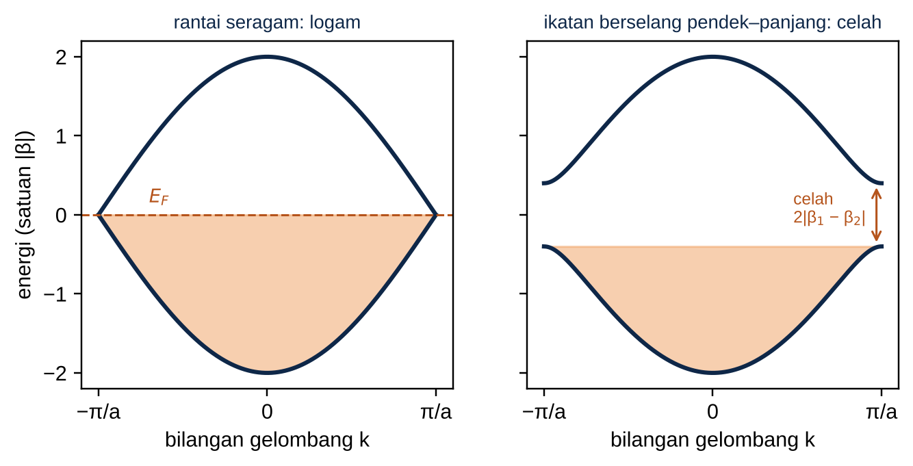
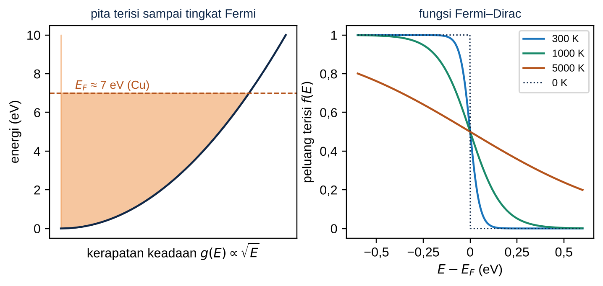

## 7.3 Dari orbital molekul ke pita

Bayangkan sebuah rantai atom hidrogen (atau litium) yang makin panjang, setiap atom membawa satu orbital s. Dua atom menghasilkan dua orbital molekul: satu ikatan, satu antiikatan (Bab 4). Tiga atom menghasilkan tiga orbital: ikatan, tak berikatan, antiikatan (seperti sistem tiga pusat di subbab 4.8). Empat atom menghasilkan empat orbital, dan seterusnya.

Metode Hückel memberi energi orbital untuk rantai *N* atom dengan rumus sederhana:

$$E_k = \alpha + 2\beta\cos\frac{k\pi}{N+1}, \qquad k = 1, 2, \ldots, N \qquad \text{(7.1)}$$

dengan α energi orbital atom dan β (negatif) integral resonansi antara dua atom bertetangga, ukuran seberapa kuat orbitalnya bertumpang tindih.

{width=82%}

Dua hal terlihat pada Gambar 7.2:

1. **Lebar pita tidak bertambah tanpa batas.** Untuk *N* = 2, jarak tingkat terendah ke tertinggi 2|β|; untuk *N* = 10, 3,84|β|; untuk *N* tak hingga, tepat 4|β|. Lebar pita ditentukan oleh **kekuatan tumpang tindih** antartetangga, bukan oleh jumlah atom.
2. **Jarak antartingkat menyusut** sebanding 1/*N*. Untuk satu mol atom, jarak itu sekitar 10⁻²³ kali |β|, jauh di bawah energi termal apa pun. Elektron dapat berpindah ke tingkat di atasnya hampir tanpa biaya energi.

Orbital terendah dalam pita adalah kombinasi tanpa simpul (semua orbital bertanda sama), sangat berikatan. Orbital tertinggi mempunyai tanda yang berganti di setiap atom, sangat antiikatan. Di antara keduanya, jumlah simpul bertambah satu per satu.

### Pita s, pita p, dan pita d

Setiap jenis orbital atom menghasilkan pitanya sendiri. Pada logam, orbital s dan p yang menyebar bertumpang tindih kuat dengan tetangganya dan menghasilkan pita yang **lebar** (beberapa sampai sepuluhan eV). Orbital d lebih kecil dan lebih terpusat pada atomnya, sehingga tumpang tindihnya kecil dan pita d **sempit** (beberapa eV). Orbital 4f bahkan lebih terpusat, dan pada lantanida hampir tidak membentuk pita sama sekali: elektron 4f tetap terlokalisasi pada atomnya, yang menjelaskan mengapa senyawa lantanida mempunyai sifat magnet dan spektrum yang hampir sama dengan ion bebasnya.

Bila dua pita cukup lebar, keduanya dapat **bertumpang tindih**. Inilah sebabnya magnesium dan berilium adalah logam. Magnesium mempunyai konfigurasi 3s², sehingga pita 3s-nya (dua elektron per orbital) seharusnya penuh, dan padatan seharusnya isolator. Namun pita 3s dan 3p bertumpang tindih, sehingga elektron sebagian mengisi pita 3p, dan kedua pita sama-sama terisi sebagian.

### Distorsi Peierls: mengapa rantai logam satu dimensi jarang ada

Rantai atom H dengan satu elektron per atom seharusnya menjadi logam: pita s-nya terisi setengah. Namun rantai seperti itu tidak stabil. Rudolf Peierls menunjukkan bahwa rantai satu dimensi yang pitanya terisi sebagian selalu dapat menurunkan energinya dengan **mendistorsi** diri: atom-atom berpasangan menjadi ikatan pendek dan panjang yang berselang-seling. Dengan dua integral resonansi berbeda, β₁ untuk ikatan pendek dan β₂ untuk ikatan panjang, pita terbelah menjadi dua, dengan celah 2|β₁ − β₂| tepat di tingkat Fermi.

{width=80%}

Elektron yang semuanya berada di pita bawah mendapat penurunan energi, sedangkan pita atas yang naik kosong. Inilah sebabnya rantai H yang panjang tidak ada: ia "mendistorsi" sampai ekstrem, menjadi molekul-molekul H₂ yang terpisah. Contoh yang lebih menarik adalah **poliasetilena**, (CH)~*n*~: setiap atom C menyumbang satu elektron π, sehingga sistem π-nya seharusnya logam, tetapi ikatan rangkap dan tunggal yang berselang-seling membuatnya semikonduktor dengan celah sekitar 1,5 eV. Alan Heeger, Alan MacDiarmid, dan Hideki Shirakawa menemukan (1977) bahwa poliasetilena yang didoping iodin (yang menarik elektron dari pita π) menghantarkan listrik hampir seperti logam, penemuan yang membuka bidang polimer konduktif (Hadiah Nobel Kimia 2000). Dalam tiga dimensi, distorsi seperti ini biasanya tidak menguntungkan, karena tidak mungkin membuka celah di seluruh permukaan Fermi sekaligus; itulah sebabnya logam tiga dimensi stabil.

::: {.kuis}
**Kuis cepat 7.3** Satu mol litium membentuk satu pita 2s dengan 6 × 10²³ orbital. Berapa elektron yang mengisi pita itu, dan berapa bagian pita yang terisi?
:::

## 7.4 Kerapatan keadaan dan tingkat Fermi

Karena tingkat-tingkat dalam pita begitu rapat, kita berhenti membicarakan tingkat satu per satu dan beralih ke **kerapatan keadaan** *g*(*E*): jumlah orbital per satuan selang energi di sekitar energi *E*. Kerapatan keadaan tidak merata di sepanjang pita. Untuk rantai satu dimensi, tingkat-tingkat paling rapat di dekat tepi pita (lihat *N* = 30 pada Gambar 7.2). Untuk elektron bebas dalam kotak tiga dimensi, kerapatan keadaan naik sebanding √*E*.

Pada 0 K, elektron mengisi orbital dari bawah, dua elektron per orbital, sampai semua elektron tertampung. Energi orbital terisi tertinggi disebut **energi Fermi**, *E*~F~ (pada padatan, "HOMO" berubah nama menjadi tingkat Fermi). Model elektron bebas, yang menganggap elektron valensi logam bergerak bebas dalam kotak seukuran kristal, memberi:

$$E_\text{F} = \frac{\hbar^2}{2m_\text{e}}\left(3\pi^2 n\right)^{2/3} \qquad \text{(7.2)}$$

dengan *n* jumlah elektron bebas per satuan volume.

::: {.contoh}
**Contoh 7.3 · Energi Fermi tembaga dan natrium**

Hitung energi Fermi tembaga (ccp, *a* = 361,5 pm, satu elektron valensi per atom) dan natrium (bcc, *a* = 429,1 pm, satu elektron per atom). Bandingkan dengan energi termal *kT* pada 300 K.

**Penyelesaian.** Tembaga: 4 atom per sel, *n* = 4/(361,5 × 10⁻¹² m)³ = 8,47 × 10²⁸ m⁻³. Dari persamaan (7.2):

$$E_\text{F} = \frac{(1{,}055 \times 10^{-34})^2}{2 \times 9{,}109 \times 10^{-31}}\left(3\pi^2 \times 8{,}47 \times 10^{28}\right)^{2/3} = 1{,}13 \times 10^{-18}\ \text{J} = 7{,}0\ \text{eV}$$

Natrium: 2 atom per sel, *n* = 2,53 × 10²⁸ m⁻³, *E*~F~ = **3,1 eV**. Pada 300 K, *kT* = 0,026 eV.

**Memahami hasil.** Energi Fermi beberapa eV, sekitar 270 kali *kT* pada suhu kamar. Elektron teratas dalam tembaga bergerak dengan kelajuan 1,6 × 10⁶ m s⁻¹, bahkan pada 0 K, karena larangan Pauli memaksa elektron-elektron menempati orbital dengan energi kinetik makin tinggi. Model ini sangat sederhana, mengabaikan inti dan tolakan antarelektron, tetapi untuk logam alkali dan logam mulia hasilnya cocok dengan pengukuran dalam beberapa puluh persen.
:::

::: {.contoh}
**Contoh 7.4 · Seberapa jauh elektron bergerak sebelum terhambur?**

Dalam model Drude, konduktivitas logam adalah σ = *ne*²τ/*m*~e~, dengan τ waktu rata-rata antara dua hamburan. Untuk tembaga (σ = 5,96 × 10⁷ S m⁻¹, *n* = 8,47 × 10²⁸ m⁻³, *E*~F~ = 7,0 eV), hitung τ dan **lintasan bebas rata-rata** ℓ = *v*~F~τ, dengan *v*~F~ kelajuan elektron di tingkat Fermi.

**Penyelesaian.** τ = σ*m*~e~/(*ne*²) = 5,96 × 10⁷ × 9,109 × 10⁻³¹/(8,47 × 10²⁸ × (1,602 × 10⁻¹⁹)²) = **2,5 × 10⁻¹⁴ s**. *v*~F~ = √(2*E*~F~/*m*~e~) = 1,57 × 10⁶ m s⁻¹. ℓ = 1,57 × 10⁶ × 2,5 × 10⁻¹⁴ = **3,9 × 10⁻⁸ m = 39 nm**.

**Memahami hasil.** Sebuah elektron dalam tembaga melewati sekitar 150 atom sebelum terhambur. Bila elektron adalah partikel klasik yang menabrak setiap ion, lintasan bebasnya hanya sekitar jarak antaratom. Mekanika kuantum menjelaskan perbedaannya: elektron adalah gelombang, dan gelombang dalam kisi yang **sempurna** dan periodik tidak terhambur sama sekali. Hamburan hanya terjadi oleh ketidaksempurnaan: getaran termal kisi (yang membuat hambatan naik dengan suhu), atom pengotor, dan cacat (subbab 5.9). Itulah sebabnya hambatan tembaga yang sangat murni pada suhu helium cair bisa ribuan kali lebih kecil daripada pada suhu kamar, dan sebabnya kawat tembaga untuk listrik harus sangat murni (subbab 9.4).
:::

### Fungsi Fermi–Dirac

Pada suhu di atas 0 K, sebagian elektron di dekat *E*~F~ tereksitasi ke orbital di atasnya. Peluang sebuah orbital berenergi *E* terisi diberikan oleh **fungsi Fermi–Dirac**:

$$f(E) = \frac{1}{e^{(E - E_\text{F})/kT} + 1} \qquad \text{(7.3)}$$

Pada *E* = *E*~F~, peluangnya tepat ½. Jauh di bawah *E*~F~, hampir 1; jauh di atas, hampir 0. Lebar daerah peralihan hanya beberapa *kT*.

{width=96%}

Gambar 7.4 menjelaskan teka-teki lama. Menurut fisika klasik, setiap elektron bebas seharusnya menyerap panas seperti atom gas (³⁄₂*k* per elektron), sehingga logam seharusnya mempunyai kapasitas panas jauh lebih besar daripada isolator. Kenyataannya tidak. Hanya elektron yang berada dalam beberapa *kT* dari *E*~F~ yang dapat naik ke orbital kosong; elektron yang lebih dalam tidak mempunyai tempat kosong di dekatnya untuk dituju. Pada suhu kamar, kurang dari 1 % elektron valensi yang "aktif" (kira-kira *kT*/*E*~F~). Prinsip yang sama berlaku untuk konduksi: **hanya elektron di dekat tingkat Fermi yang dapat menghantarkan listrik**, karena hanya mereka yang dapat dipercepat ke orbital kosong dengan energi sedikit lebih tinggi.

::: {.kuis}
**Kuis cepat 7.4** Pada 300 K, berapa peluang sebuah orbital yang 0,1 eV di atas *E*~F~ terisi? Dan orbital 0,5 eV di atas *E*~F~?
:::

## 7.5 Konduktor, isolator, dan semikonduktor intrinsik

Sekarang kita dapat menggolongkan padatan menurut struktur pitanya. Yang menentukan adalah apa yang ada di sekitar tingkat Fermi.

{width=96%}

* **Logam**: tingkat Fermi berada **di dalam pita** yang terisi sebagian. Ada banyak orbital kosong tepat di atas orbital terisi teratas, sehingga medan listrik sekecil apa pun dapat menggerakkan elektron.
* **Isolator**: pita teratas yang terisi (disebut **pita valensi**) penuh, dan pita kosong berikutnya (**pita konduksi**) terpisah oleh **celah pita** *E*~g~ yang besar (lebih dari sekitar 3–4 eV). Elektron tidak dapat bergerak, karena tidak ada orbital kosong di dekatnya. Intan (*E*~g~ = 5,5 eV) dan NaCl (sekitar 9 eV) adalah isolator.
* **Semikonduktor**: sama dengan isolator, tetapi celahnya kecil (sekitar 0,1–3 eV). Pada suhu kamar, sebagian kecil elektron tereksitasi secara termal ke pita konduksi, meninggalkan **lubang** (*hole*) di pita valensi. Elektron di pita konduksi dan lubang di pita valensi sama-sama dapat bergerak dan menghantarkan listrik. Silikon (1,12 eV), germanium (0,66 eV), dan GaAs (1,42 eV) adalah semikonduktor.
* **Semilogam**: pita valensi dan pita konduksi bersentuhan atau sedikit bertumpang tindih, sehingga jumlah pembawa muatan kecil tetapi tidak nol, misalnya grafit, bismut, dan timah abu-abu.

Perbedaan antara semikonduktor dan isolator hanya soal ukuran celah, tidak ada batas yang tajam. Perbedaan logam dan semikonduktor lebih mendasar dan terlihat dari **ketergantungan pada suhu**:

* Pada **logam**, jumlah elektron yang dapat bergerak praktis tetap. Ketika suhu naik, getaran kisi makin kuat dan makin sering menghamburkan elektron, sehingga konduktivitas **turun**.
* Pada **semikonduktor**, jumlah pembawa muatan **naik** secara eksponensial dengan suhu, jauh lebih cepat daripada efek hamburan, sehingga konduktivitas **naik**.

### Berapa banyak pembawa muatan?

Pada semikonduktor murni (**intrinsik**), jumlah elektron di pita konduksi sama dengan jumlah lubang di pita valensi, *n* = *p* = *n*~i~, dengan:

$$n_\text{i} = \sqrt{N_\text{c}N_\text{v}}\ \exp\!\left(-\frac{E_\text{g}}{2kT}\right) \qquad \text{(7.4)}$$

*N*~c~ dan *N*~v~ adalah "kerapatan keadaan efektif" pita konduksi dan valensi, sekitar 10¹⁹ cm⁻³ untuk kebanyakan semikonduktor. Faktor 2 dalam eksponen muncul karena setiap eksitasi menghasilkan dua pembawa sekaligus, satu elektron dan satu lubang. Konduktivitas sebanding dengan jumlah pembawa dan mobilitasnya μ:

$$\sigma = n e \mu_\text{e} + p e \mu_\text{h} \qquad \text{(7.5)}$$

::: {.contoh}
**Contoh 7.5 · Pembawa intrinsik dalam Si, Ge, GaAs, dan intan**

Hitung *n*~i~ pada 300 K. Data (*E*~g~ dalam eV; *N*~c~, *N*~v~ dalam cm⁻³): Si 1,12, 2,8 × 10¹⁹, 1,04 × 10¹⁹; Ge 0,66, 1,04 × 10¹⁹, 6,0 × 10¹⁸; GaAs 1,42, 4,7 × 10¹⁷, 7,0 × 10¹⁸; intan 5,47, ≈ 10¹⁹, ≈ 10¹⁹. Lalu hitung konduktivitas silikon murni dengan μ~e~ = 1400 dan μ~h~ = 450 cm² V⁻¹ s⁻¹.

**Penyelesaian.** Untuk Si: √(2,8 × 10¹⁹ × 1,04 × 10¹⁹) = 1,71 × 10¹⁹; exp(−1,12/0,0517) = 3,9 × 10⁻¹⁰. *n*~i~ = **7 × 10⁹ cm⁻³** (nilai terukur yang lazim dipakai sekitar 1 × 10¹⁰ cm⁻³). Dengan cara yang sama: Ge **2 × 10¹³**, GaAs **2 × 10⁶**, intan **10⁻²⁷ cm⁻³**.

Konduktivitas Si murni dengan *n*~i~ = 1 × 10¹⁰ cm⁻³: σ = 10¹⁰ × 1,602 × 10⁻¹⁹ × (1400 + 450) = **3 × 10⁻⁶ S cm⁻¹**, sekitar 10¹¹ kali lebih kecil daripada tembaga (6 × 10⁵ S cm⁻¹).

**Memahami hasil.** Silikon mempunyai 5 × 10²² atom per cm³, tetapi pada suhu kamar hanya satu dari sekitar 10¹² elektron valensinya yang berada di pita konduksi. Celah pita masuk ke dalam eksponen, sehingga perbedaan celah yang kecil menghasilkan perbedaan jumlah pembawa yang sangat besar: Ge (celah 0,66 eV) mempunyai sekitar 3000 kali lebih banyak pembawa daripada Si, dan intan praktis tidak mempunyai satu pun. Pembawa intrinsik juga naik sangat cepat dengan suhu (Gambar 7.6 kanan): silikon pada 400 K mempunyai sekitar 350 kali lebih banyak pembawa daripada pada 300 K. Inilah sebabnya perangkat elektronik harus didinginkan, dan mengapa GaAs dan SiC (celah lebih besar) dipakai untuk elektronika suhu tinggi.
:::

::: {.contoh}
**Contoh 7.6 · Pemanasan kecil, perubahan besar**

Dengan persamaan (7.4), dan dengan memperhitungkan bahwa *N*~c~*N*~v~ sebanding dengan *T*³, hitung berapa kali *n*~i~ silikon (*E*~g~ = 1,12 eV) bertambah bila suhu naik dari 300 K ke 350 K.

**Penyelesaian.** *n*~i~(350)/*n*~i~(300) = (350/300)^3/2^ × exp[−(1,12/2*k*)(1/350 − 1/300)]. Dengan *k* = 8,617 × 10⁻⁵ eV K⁻¹: faktor pertama 1,26; eksponen = (1,12/1,723 × 10⁻⁴) × 4,76 × 10⁻⁴ = 3,10, sehingga faktor kedua 22,1. Hasilnya **sekitar 28 kali**.

**Memahami hasil.** Pemanasan 50 derajat menaikkan jumlah pembawa intrinsik hampir tiga puluh kali. Pada logam, pemanasan yang sama **menaikkan** hambatan sekitar 20 %. Perbedaan arah dan besar ini adalah cara paling sederhana membedakan semikonduktor dari logam di laboratorium, dan dasar **termistor**: sensor suhu dari oksida semikonduktor yang hambatannya turun tajam ketika dipanaskan.
:::

### Tren celah pita dalam tabel periodik

Celah pita mengikuti dua tren yang dapat dimengerti dengan gambaran ikatan–antiikatan. Pita valensi berasal dari orbital ikatan, dan pita konduksi dari orbital antiikatan; celah mencerminkan jarak antara keduanya, yang besar bila ikatannya kuat.

1. **Turun ke bawah golongan**, celah mengecil: C (intan) 5,5; Si 1,12; Ge 0,66; Sn abu-abu 0 eV. Ikatan makin panjang dan lemah, sehingga orbital ikatan dan antiikatan makin dekat. Timah putih dan timbal adalah logam.
2. **Makin besar perbedaan keelektronegatifan** dalam deret isoelektronik, celah **membesar**: Ge 0,66; GaAs 1,42; ZnSe 2,7; CuBr 3,0 eV. Makin ionik ikatannya, makin terpusat pita valensi pada anion dan pita konduksi pada kation, dan makin besar jaraknya. Pada batas ionik penuh, celah sangat besar (NaCl sekitar 9 eV).

::: {.kuis}
**Kuis cepat 7.5** Urutkan celah pita AlP, GaP, InP, serta GaN, GaP, GaAs dengan memakai kedua tren di atas.
:::
