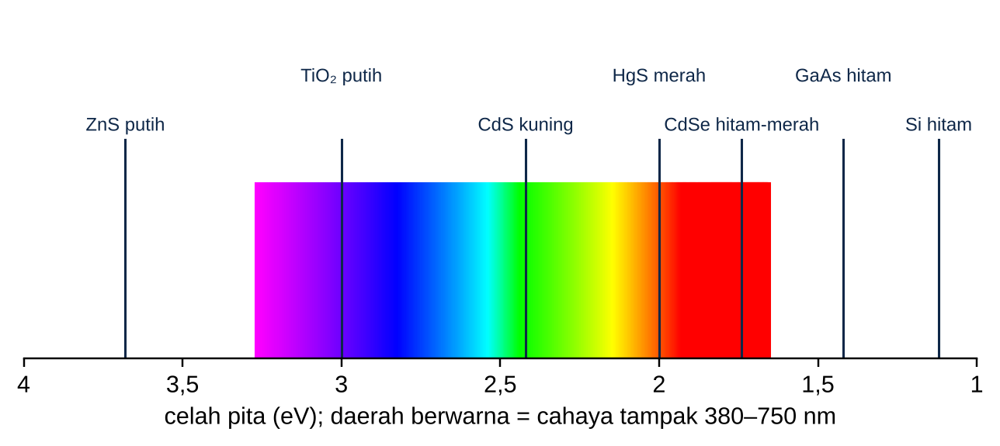

## 7.6 Semikonduktor tipe n dan tipe p

Silikon murni hampir tidak berguna sebagai bahan elektronik: pembawanya terlalu sedikit, dan jumlahnya berubah liar dengan suhu. Yang membuat silikon menjadi bahan terpenting abad ke-20 adalah kemampuannya untuk **didoping**: dicampur dengan sedikit atom asing yang menambah elektron atau lubang dalam jumlah yang dapat diatur dengan tepat.

### Tipe n: donor

Ganti satu atom Si (golongan 14, empat elektron valensi) dengan atom fosfor (golongan 15, lima elektron valensi). Empat elektron P dipakai untuk empat ikatan dengan Si tetangganya, seperti Si yang digantikannya. Elektron kelima tidak mendapat tempat dalam ikatan. Ia tetap terikat lemah pada ion P⁺, mengorbit seperti elektron dalam atom hidrogen raksasa.

Seberapa lemah? Kita dapat menaksirnya dengan model atom hidrogen (Bab 1), dengan dua penyesuaian: elektron bergerak dalam silikon yang mempunyai tetapan dielektrik ε~r~ = 11,7, yang melemahkan tarikan Coulomb, dan elektron di pita konduksi berperilaku seolah-olah bermassa efektif *m*\* = 0,26 *m*~e~. Energi ikatnya:

$$E_\text{d} = 13{,}6\ \text{eV} \times \frac{m^*/m_\text{e}}{\varepsilon_\text{r}^2} \qquad \text{(7.6)}$$

::: {.contoh}
**Contoh 7.4 · Atom hidrogen di dalam silikon**

Hitung energi ikat elektron donor dan jari-jari orbitnya dalam silikon (*m*\* = 0,26 *m*~e~, ε~r~ = 11,7). Bandingkan energinya dengan *kT* pada 300 K. Jari-jari Bohr hidrogen 0,0529 nm, dan jari-jari orbit donor *a* = *a*₀ ε~r~/(*m*\*/*m*~e~).

**Penyelesaian.** *E*~d~ = 13,6 × 0,26/11,7² = **0,026 eV** (26 meV). Jari-jari: 0,0529 × 11,7/0,26 = **2,4 nm**, sekitar sepuluh jarak Si–Si. Energi termal *kT* = 0,026 eV pada 300 K, sama dengan energi ikat.

**Memahami hasil.** Model sederhana ini memberi 26 meV, sedangkan pengukuran untuk P dalam Si memberi 45 meV; perbedaannya karena elektron yang dekat dengan inti P merasakan lebih dari sekadar muatan titik yang dilemahkan. Namun kesimpulannya jelas: energi ikat donor hanya sebanding dengan *kT*, sehingga pada suhu kamar hampir semua atom donor sudah melepaskan elektronnya ke pita konduksi. Dalam diagram pita, tingkat donor terletak tepat di bawah pita konduksi (Gambar 7.5 kiri). Elektron yang hampir bebas ini mengorbit dalam bola berjari-jari 2,4 nm yang memuat sekitar 3000 atom Si; jadi "atom hidrogen" di dalam silikon jauh lebih besar dan jauh lebih lemah daripada atom hidrogen biasa.
:::

Silikon yang didoping fosfor (atau As, Sb) disebut **tipe n**, karena pembawa muatan utamanya negatif (elektron).

### Tipe p: akseptor

Sebaliknya, ganti Si dengan boron (golongan 13, tiga elektron valensi). Salah satu dari empat ikatan B–Si kekurangan satu elektron. Elektron dari ikatan Si–Si di dekatnya mudah melompat untuk mengisinya, sehingga "kekurangan" itu berpindah ke tempat lain: terbentuk **lubang** yang bebas bergerak di pita valensi. Dalam diagram pita, tingkat akseptor terletak tepat di atas pita valensi (energi ionisasi B dalam Si juga sekitar 45 meV). Silikon seperti ini disebut **tipe p**, karena pembawa utamanya positif (lubang).

{width=98%}

### Seberapa besar pengaruh doping?

Pada kesetimbangan, hasil kali jumlah elektron dan lubang selalu tetap, sama dengan kuadrat jumlah pembawa intrinsik:

$$n\,p = n_\text{i}^2 \qquad \text{(7.7)}$$

Persamaan ini adalah **hukum aksi massa** untuk "reaksi" pembentukan pasangan elektron–lubang, analog dengan [H⁺][OH⁻] = *K*~w~ dalam air. Menambah elektron dengan donor sekaligus mengurangi lubang, persis seperti menambah asam mengurangi [OH⁻].

::: {.contoh}
**Contoh 7.5 · Satu atom per sejuta**

Silikon (5,0 × 10²² atom per cm³, *n*~i~ = 1,0 × 10¹⁰ cm⁻³) didoping dengan 1 ppm fosfor. Hitung jumlah elektron dan lubang, serta perbandingan konduktivitasnya dengan silikon murni (anggap mobilitas tetap: μ~e~ = 1400, μ~h~ = 450 cm² V⁻¹ s⁻¹).

**Penyelesaian.** Donor: 5,0 × 10²² × 10⁻⁶ = 5,0 × 10¹⁶ cm⁻³, semuanya terionisasi, sehingga *n* ≈ **5,0 × 10¹⁶ cm⁻³**. Dari persamaan (7.7): *p* = (10¹⁰)²/(5,0 × 10¹⁶) = **2 × 10³ cm⁻³**.

Konduktivitas: σ = 5,0 × 10¹⁶ × 1,602 × 10⁻¹⁹ × 1400 = **11 S cm⁻¹**, dibandingkan 3 × 10⁻⁶ S cm⁻¹ untuk silikon murni: naik sekitar **4 × 10⁶ kali**.

**Memahami hasil.** Satu atom asing per sejuta atom menaikkan konduktivitas empat juta kali dan membuat lubang hampir lenyap. Di sisi lain, ini juga menunjukkan betapa murninya silikon untuk elektronika harus dibuat sebelum didoping: pengotor yang tidak dikehendaki harus berada di bawah sekitar satu per milyar. Silikon kelas elektronik dimurnikan sampai 99,9999999 % (sembilan angka sembilan), salah satu bahan termurni yang pernah dibuat manusia. Doping juga membuat jumlah pembawa hampir tidak bergantung pada suhu (garis putus-putus pada Gambar 7.5 kanan) sampai pembawa intrinsik menyusulnya pada sekitar 600 K.
:::

::: {.kuis}
**Kuis cepat 7.6** Sebutkan unsur yang dapat menjadi donor dan akseptor untuk GaAs, bila unsur itu menggantikan (a) Ga, (b) As. Silikon dapat menggantikan keduanya; apa akibatnya?
:::

## 7.7 Sambungan p–n: dioda, LED, dan sel surya

Hampir semua perangkat semikonduktor dibangun dari satu struktur: **sambungan p–n**, daerah tempat silikon tipe p bertemu dengan silikon tipe n di dalam kristal yang sama.

Ketika kedua daerah bertemu, elektron dari sisi n berdifusi ke sisi p dan bergabung dengan lubang di sana; lubang dari sisi p berdifusi ke sisi n dan bergabung dengan elektron. Di sekitar sambungan terbentuk **daerah deplesi** yang hampir tanpa pembawa, berisi ion donor positif (sisi n) dan ion akseptor negatif (sisi p) yang tidak dapat bergerak. Muatan-muatan ini menimbulkan medan listrik yang menahan difusi lebih lanjut. Dalam diagram pita, pita-pita **melengkung** di sekitar sambungan, sehingga tingkat Fermi sama di kedua sisi, dan terbentuk penghalang energi bagi elektron yang ingin berpindah dari n ke p (sekitar 0,7 eV untuk silikon).

{width=94%}

### Dioda

Bila sisi p diberi tegangan positif terhadap sisi n (**tegangan maju**), penghalang turun, dan arus besar mengalir. Bila tegangannya dibalik (**tegangan mundur**), penghalang naik, dan hampir tidak ada arus. Sambungan p–n hanya mengalirkan arus satu arah: inilah **dioda**, yang mengubah arus bolak-balik menjadi arus searah di setiap pengisi daya. Transistor, komponen dasar setiap cip, adalah dua sambungan yang disusun bertolak belakang (n–p–n atau p–n–p), atau sambungan yang penghalangnya diatur oleh elektrode ketiga.

### LED: listrik menjadi cahaya

Pada tegangan maju, elektron dari pita konduksi sisi n bertemu lubang di pita valensi sisi p, lalu jatuh ke dalamnya. Energi yang dilepaskan sama dengan celah pita. Pada silikon, energi ini hampir seluruhnya menjadi panas (karena silikon mempunyai celah **tak langsung**, sehingga transisinya memerlukan bantuan getaran kisi). Pada semikonduktor bercelah **langsung** seperti GaAs dan GaN, energi itu keluar sebagai foton dengan panjang gelombang

$$\lambda = \frac{hc}{E_\text{g}} = \frac{1240\ \text{nm eV}}{E_\text{g}} \qquad \text{(7.8)}$$

Inilah **dioda pemancar cahaya** (LED). GaAs (1,42 eV) memancarkan inframerah 873 nm (remote televisi); GaAsP memancarkan merah; GaP hijau. LED biru memerlukan celah sekitar 2,7 eV, dan bertahun-tahun tidak berhasil dibuat sampai Isamu Akasaki, Hiroshi Amano, dan Shuji Nakamura berhasil menumbuhkan kristal GaN dan InGaN yang cukup baik pada awal 1990-an (Nobel Fisika 2014). LED biru yang dilapisi fosfor kuning (Y₃Al₅O₁₂ yang didoping Ce³⁺) menghasilkan cahaya putih: lampu LED yang kini menerangi hampir setiap rumah, dengan efisiensi sekitar lima kali lampu pijar.

### Sel surya: cahaya menjadi listrik

Sel surya adalah LED yang bekerja terbalik. Foton dengan energi lebih besar daripada celah pita mengangkat elektron dari pita valensi ke pita konduksi, membentuk pasangan elektron–lubang. Bila pasangan itu terbentuk di dekat sambungan, medan listrik di daerah deplesi memisahkannya: elektron didorong ke sisi n, lubang ke sisi p. Kedua sisi menjadi bermuatan, dan bila dihubungkan lewat beban luar, arus mengalir.

Pemilihan celah pita adalah kompromi. Foton dengan energi di bawah celah tidak diserap sama sekali. Foton dengan energi di atas celah diserap, tetapi kelebihan energinya hilang sebagai panas. William Shockley dan Hans-Joachim Queisser menghitung pada 1961 bahwa efisiensi maksimum sambungan tunggal di bawah sinar matahari adalah sekitar 33 %, pada celah sekitar 1,34 eV. Silikon (1,12 eV) dekat dengan nilai optimum ini, murah, dan melimpah; sel surya silikon terbaik kini mencapai sekitar 27 %.

::: {.kuis}
**Kuis cepat 7.7** Hitung panjang gelombang foton yang dipancarkan LED GaN (*E*~g~ = 3,4 eV) dan LED GaP (*E*~g~ = 2,26 eV). Mengapa LED putih tidak dibuat dengan GaN murni?
:::

## 7.8 Celah pita dan warna padatan

Persamaan (7.8) juga menjelaskan warna banyak padatan. Sebuah semikonduktor menyerap semua foton yang energinya **lebih besar** daripada celah pitanya dan meneruskan (atau memantulkan) foton yang energinya lebih kecil. Cahaya tampak terentang dari sekitar 1,65 eV (merah, 750 nm) sampai 3,3 eV (ungu, 380 nm).

{width=94%}

Tabel 7.1 Celah pita dan warna beberapa padatan.

| Padatan | *E*~g~ (eV) | λ tepi serapan (nm) | Cahaya yang diserap | Warna tampak |
|---|---|---|---|---|
| intan | 5,5 | 227 | ultraungu jauh | bening |
| ZnS | 3,7 | 337 | ultraungu | putih (serbuk) |
| TiO₂ (rutil) | 3,0 | 413 | ultraungu + sedikit ungu | putih |
| CdS | 2,42 | 512 | biru, ungu | kuning |
| HgS (cinnabar) | 2,0 | 620 | semua kecuali merah | merah |
| CdSe | 1,74 | 713 | hampir semua | merah tua sampai hitam |
| Si | 1,12 | 1107 | semua cahaya tampak | hitam, berkilau abu-abu |

Pigmen-pigmen ini sudah dipakai jauh sebelum teori pita ada. Cinnabar (HgS) adalah merah vermilion pada lukisan dinding Romawi dan pernis Tiongkok. Kuning kadmium (CdS) adalah kuning cerah pada lukisan Van Gogh. Titanium dioksida, putih paling terang yang dikenal, menyerap ultraungu dan menghamburkan semua cahaya tampak; inilah pigmen dalam cat putih, kertas, dan tabir surya.

Seri CdS (kuning) – CdSe (merah) – CdTe (hitam) memperlihatkan tren di subbab 7.5: ke bawah golongan, celah mengecil, dan warnanya bergeser dari kuning ke merah ke hitam. Larutan padat CdS~*x*~Se~1−*x*~ mempunyai celah di antaranya, sehingga pembuat pigmen dapat memperoleh setiap warna dari kuning sampai merah marun hanya dengan mengatur perbandingan S dan Se.

::: {.terapan}
**Titik kuantum.** Bila kristal CdSe diperkecil sampai beberapa nanometer, elektron dan lubang terkurung dalam ruang yang lebih kecil daripada orbit alaminya (seperti jari-jari donor di subbab 7.6). Akibatnya, seperti partikel dalam kotak, energinya naik dan celah efektif membesar. Kristal CdSe berukuran 2 nm berpendar hijau, 6 nm merah: satu bahan, semua warna, hanya diatur dengan ukuran. Partikel seperti ini disebut **titik kuantum**. Moungi Bawendi, Louis Brus, dan Aleksey Ekimov menerima Hadiah Nobel Kimia 2023 untuk penemuan dan sintesisnya. Titik kuantum kini dipakai dalam layar televisi QLED dan sebagai penanda fluoresens dalam biologi.
:::

::: {.kuis}
**Kuis cepat 7.8** ZnO (*E*~g~ = 3,37 eV) dipakai sebagai tabir surya. Hitung panjang gelombang tepi serapannya. Mengapa bahan ini tampak putih, bukan berwarna?
:::

## 7.9 Superkonduktor dan bahan fungsional

### Superkonduktor

Pada 1911, Heike Kamerlingh Onnes, orang pertama yang berhasil mencairkan helium, mendinginkan raksa dan mengukur hambatannya. Pada 4,15 K, hambatan itu tiba-tiba lenyap, bukan menjadi kecil, melainkan **nol** dalam batas ketelitian pengukuran. Arus yang dibangkitkan dalam cincin superkonduktor dapat mengalir bertahun-tahun tanpa berkurang. Fenomena ini disebut **superkonduktivitas**, dan suhu di bawahnya terjadi disebut **suhu kritis** *T*~c~.

{width=92%}

Superkonduktor mempunyai dua ciri utama:

1. **Hambatan nol** di bawah *T*~c~.
2. **Efek Meissner** (1933): superkonduktor menolak medan magnet dari dalam tubuhnya. Karena itu magnet kecil dapat melayang di atas superkonduktor yang didinginkan, pertunjukan yang terkenal di kelas kimia.

Teori yang menjelaskan superkonduktor klasik disusun oleh John Bardeen, Leon Cooper, dan Robert Schrieffer pada 1957 (teori BCS, Nobel Fisika 1972). Dua elektron dengan spin berlawanan saling tarik secara tidak langsung lewat getaran kisi: elektron pertama menarik ion-ion positif ke arahnya, dan daerah yang sedikit lebih positif itu menarik elektron kedua. Pasangan ini, **pasangan Cooper**, berperilaku sebagai satu kesatuan yang dapat bergerak tanpa dihamburkan oleh kisi.

Selama 75 tahun, *T*~c~ tertinggi tidak melampaui 23 K (Nb₃Ge), sehingga semua penerapan memerlukan helium cair yang mahal. Pada 1986, Georg Bednorz dan Alex Müller menemukan bahwa oksida tembaga berlapis La–Ba–Cu–O menjadi superkonduktor pada sekitar 35 K (Nobel Fisika 1987, hanya setahun kemudian). Pada 1987, Paul Chu dan rekan-rekannya membuat **YBa₂Cu₃O₇** (YBCO) dengan *T*~c~ = 93 K, di atas titik didih nitrogen cair yang murah. Struktur YBCO adalah perovskit (subbab 5.6) yang ditumpuk tiga dan kehilangan sebagian oksigen, dengan bidang-bidang CuO₂ tempat superkonduktivitas terjadi. Rekor pada tekanan biasa kini dipegang oleh HgBa₂Ca₂Cu₃O₈ (133 K, 1993). Mekanisme superkonduktivitas kuprat masih menjadi salah satu pertanyaan besar yang belum terjawab dalam fisika zat padat.

Dalam praktik, superkonduktor yang paling banyak dipakai justru yang lama: kawat paduan NbTi (*T*~c~ ≈ 9 K) dan Nb₃Sn (18 K), yang didinginkan dengan helium cair, menjadi kumparan magnet MRI di rumah sakit, spektrometer NMR di laboratorium kimia, dan magnet pemercepat partikel. Bahan ini mudah dibuat menjadi kawat, sedangkan kuprat adalah keramik yang rapuh.

### Bahan fungsional lain

Kimia zat padat anorganik menyediakan banyak bahan yang fungsinya berasal dari struktur dan struktur pitanya:

* **Oksida konduktor transparan**: In₂O₃ yang didoping Sn (ITO) mempunyai celah besar (sekitar 3,7 eV, sehingga bening) tetapi didoping berat sampai menghantarkan listrik seperti logam. Setiap layar sentuh dan panel surya memakainya sebagai elektrode tembus cahaya.
* **Fotokatalis**: TiO₂ anatas menyerap ultraungu dan membentuk pasangan elektron–lubang yang cukup energetik untuk mengoksidasi zat organik di permukaannya; dipakai pada kaca yang membersihkan diri dan pengolahan air.
* **Piezoelektrik dan feroelektrik**: BaTiO₃ dan Pb(Zr,Ti)O₃ (subbab 5.6) mengubah tekanan menjadi tegangan dan sebaliknya; dipakai pada pemantik gas, sensor, dan alat ultrasonografi.
* **Termoelektrik**: Bi₂Te₃ mengubah selisih suhu langsung menjadi listrik, atau sebaliknya memompa panas dengan listrik; dipakai pada pendingin portabel dan pembangkit listrik wahana antariksa.
* **Elektrode baterai**: LiCoO₂ dan LiFePO₄ (katode) serta grafit (anode, subbab 5.12) dalam baterai litium-ion, yang semuanya bekerja dengan menyisipkan dan melepaskan ion Li⁺ dari kisi.

::: {.kuis}
**Kuis cepat 7.9** Mengapa penemuan YBCO dengan *T*~c~ = 93 K dianggap terobosan besar, walaupun superkonduktor NbTi dengan *T*~c~ 9 K masih lebih banyak dipakai?
:::

## Menuju bab berikutnya

Tembaga, silikon, dan intan berbeda konduktivitas sampai 10²⁰ kali karena satu hal: letak tingkat Fermi terhadap pita-pita energi. Pada tembaga, tingkat Fermi berada di tengah pita yang terisi sebagian; pada silikon, di dalam celah kecil 1,1 eV; pada intan, di dalam celah lebar 5,5 eV. Satu atom fosfor per sejuta atom silikon menambah elektron tepat di bawah pita konduksi, dan sambungan antara silikon tipe n dan tipe p menghasilkan dioda, LED, dan sel surya. Teori pita, yaitu teori orbital molekul untuk 10²³ atom, menyatukan semuanya.

Bab 7 menutup Bagian II tentang ikatan dan struktur. Bagian III beralih ke kimia yang terjadi dalam larutan. Bab 8 dimulai dengan reaksi yang paling umum dalam kimia anorganik: reaksi asam–basa. Kita akan melihat bahwa konsep HOMO dan LUMO dari Bab 4 serta energi kisi dan hidrasi dari Bab 6 muncul lagi untuk menjelaskan mengapa sebagian oksida bersifat asam dan yang lain basa, mengapa HF asam lemah sedangkan HI asam kuat, dan mengapa sebagian logam lebih menyukai ligan oksigen sedangkan yang lain menyukai belerang.
