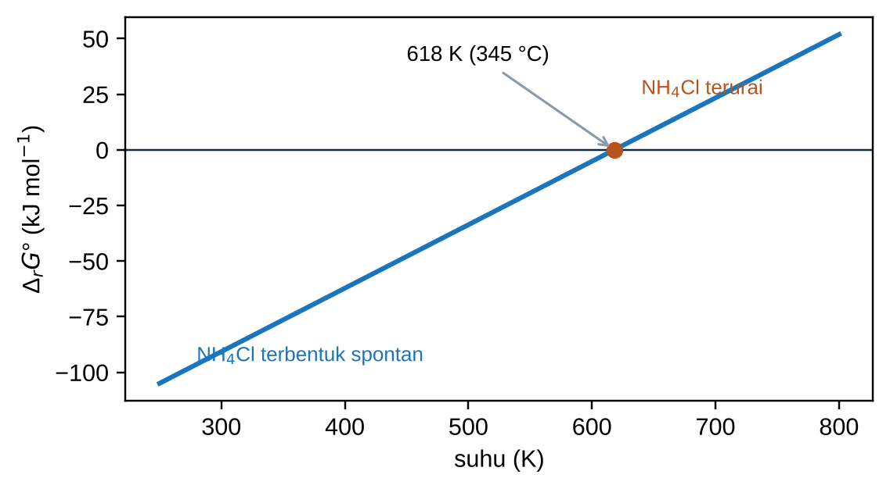

# Bab 8 Asam dan Basa

Asam sulfat pekat adalah salah satu asam terkuat yang biasa ditemui di laboratorium. Ia mengarangkan gula, melarutkan banyak logam, dan memprotonkan hampir semua basa. Namun pada 1960-an, George Olah menemukan campuran HSO₃F dan SbF₅ yang **lebih dari sepuluh juta kali** lebih asam daripada asam sulfat murni. Campuran ini, yang kemudian dijuluki "asam ajaib", dapat memprotonkan metana, hidrokarbon paling tidak reaktif, menghasilkan ion CH₅⁺ yang karbonnya tampak mengikat lima hidrogen. Sebatang lilin yang dicelupkan ke dalamnya larut. Olah menerima Hadiah Nobel Kimia 1994 untuk penelitian ini. Bagaimana mungkin ada asam yang jauh lebih kuat daripada asam yang "paling kuat"? Dan mengapa asam sekuat itu tidak dapat diukur kekuatannya di dalam air?

Jawabannya memerlukan cara pandang yang lebih luas daripada definisi asam yang dipelajari di sekolah. Bab ini mulai dari prinsip dasar setiap reaksi: energi Gibbs dan kesetimbangan. Lalu kita mengenal beberapa definisi asam–basa, dari Arrhenius sampai Lewis, masing-masing berguna untuk keadaan tertentu. Kita memakai definisi Brønsted–Lowry untuk memahami mengapa HF asam lemah sedangkan HI asam kuat, mengapa HClO₄ jauh lebih asam daripada HOCl, mengapa larutan besi(III) bersifat asam, dan mengapa SO₃ asam sedangkan Na₂O basa. Kita melihat bagaimana pelarut membatasi kekuatan asam yang dapat "terlihat" di dalamnya. Lalu kita beralih ke definisi Lewis yang lebih luas, prinsip asam–basa keras dan lunak (HSAB) yang meramalkan logam mana menyukai ligan mana, parameter Drago–Wayland, superasam, dan asam padat seperti zeolit yang menjadi katalis terpenting dalam industri minyak bumi.

::: {.kuis}
**Pertanyaan pembuka**

1. Mengapa reaksi NH₃ + HCl → NH₄Cl berjalan pada suhu kamar tetapi berbalik pada suhu tinggi?
2. Apa kelebihan dan keterbatasan definisi asam Arrhenius, Brønsted–Lowry, dan Lewis?
3. Mengapa HF asam lemah, padahal fluorin unsur paling elektronegatif?
4. Mengapa larutan FeCl₃ dalam air bersifat asam?
5. Mengapa merkuri ditemukan di alam sebagai sulfida (HgS), sedangkan aluminium sebagai oksida?
6. Bagaimana sebuah padatan, seperti zeolit, dapat bertindak sebagai asam yang sangat kuat?
:::

::: {.tujuan}
**Tujuan belajar**

Setelah mempelajari bab ini, kamu mampu:

1. Menjelaskan gaya dorong reaksi kimia dengan Δ*G*, Δ*H*, Δ*S*, dan hubungan Δ*G*° dengan tetapan kesetimbangan.
2. Membandingkan definisi asam–basa Arrhenius, Brønsted–Lowry, Lux–Flood, sistem pelarut, Lewis, dan Usanovich.
3. Memakai *K*~a~ dan p*K*~a~ untuk membandingkan kekuatan asam dalam air.
4. Menjelaskan tren keasaman hidrida biner dan asam okso, termasuk aturan Pauling.
5. Menjelaskan keasaman ion logam terhidrat dan sifat asam, basa, dan amfoter oksida.
6. Menjelaskan efek pelarut: pelevelan dan pembedaan.
7. Mengenali asam dan basa Lewis, termasuk asam golongan 13 dan 14, dan memakai HSAB serta parameter Drago–Wayland.
8. Menjelaskan superasam, superbasa, dan asam padat.
:::

::: {.mat}
**Prasyarat**

Bab 1 (keelektronegatifan, polarisabilitas), Bab 4 (HOMO dan LUMO, subbab 4.10), dan Bab 6 (energi kisi dan hidrasi). Dari Kimia Dasar: kesetimbangan asam–basa dan pH. Dari *Termodinamika Kimia*: energi Gibbs dan tetapan kesetimbangan. Dari *Kimia Organik 1*: asam–basa organik dan p*K*~a~ (Bab 3).
:::

## 8.1 Prinsip dasar reaksi kimia: gaya dorong dan kesetimbangan

Sebelum membahas asam dan basa, kita perlu satu alat yang berlaku untuk semua reaksi: kriteria yang menentukan apakah sebuah reaksi dapat berjalan. Alat itu adalah **energi Gibbs**. Pada suhu dan tekanan tetap, reaksi berjalan spontan ke arah yang menurunkan energi Gibbs sistem:

$$\Delta G = \Delta H - T\Delta S \qquad \text{(8.1)}$$

Dua faktor menentukan Δ*G*: perubahan entalpi Δ*H* (panas yang dilepas atau diserap, terutama dari ikatan yang diputus dan dibentuk) dan perubahan entropi Δ*S* (perubahan "keacakan", terutama dari jumlah partikel bebas, khususnya gas). Reaksi yang eksoterm (Δ*H* < 0) **dan** menaikkan entropi (Δ*S* > 0) selalu spontan. Bila kedua faktor bertentangan, suhu yang menentukan pemenang: suhu tinggi memperbesar peran entropi.

Energi Gibbs standar berhubungan langsung dengan tetapan kesetimbangan:

$$\Delta G^\circ = -RT\ln K \qquad \text{(8.2)}$$

Pada 298 K, setiap 5,71 kJ mol⁻¹ dalam Δ*G*° setara dengan faktor 10 dalam *K*. Reaksi dengan Δ*G*° = −57 kJ mol⁻¹ mempunyai *K* sekitar 10¹⁰; reaksi dengan Δ*G*° = +57 kJ mol⁻¹ mempunyai *K* sekitar 10⁻¹⁰. Persamaan ini adalah jembatan antara termodinamika dan semua tetapan yang dipakai di bab ini: *K*~a~, *K*~b~, *K*~w~, dan *K*~sp~.

::: {.contoh}
**Contoh 8.1 · Asap putih amonium klorida**

Bila botol amonia pekat dan botol asam klorida pekat dibuka berdekatan, terbentuk asap putih NH₄Cl. Hitung Δ*H*°, Δ*S*°, dan Δ*G*° pada 298 K untuk NH₃(g) + HCl(g) → NH₄Cl(s), dan suhu ketika Δ*G*° = 0. Data: Δ~f~*H*° (kJ mol⁻¹) NH₃(g) −45,9; HCl(g) −92,3; NH₄Cl(s) −314,4. *S*° (J K⁻¹ mol⁻¹) NH₃(g) 192,8; HCl(g) 186,9; NH₄Cl(s) 94,6.

**Penyelesaian.** Δ*H*° = −314,4 − (−45,9) − (−92,3) = **−176,2 kJ mol⁻¹**. Δ*S*° = 94,6 − 192,8 − 186,9 = **−285,1 J K⁻¹ mol⁻¹**. Pada 298 K: Δ*G*° = −176,2 − 298,15 × (−0,2851) = **−91,2 kJ mol⁻¹**. Δ*G*° = 0 pada *T* = 176 200/285,1 = **618 K** (345 °C).

{width=66%}

**Memahami hasil.** Reaksi ini adalah reaksi asam–basa: HCl memberikan proton kepada NH₃. Ia sangat eksoterm, tetapi entropinya turun tajam karena dua molekul gas menjadi satu padatan. Pada suhu kamar entalpi menang; di atas 618 K entropi menang, dan NH₄Cl menyublim sambil terurai. Inilah sebabnya NH₄Cl yang dipanaskan dalam tabung reaksi tampak "menyublim": ia terurai di bagian bawah yang panas dan terbentuk kembali di bagian atas yang dingin. Pembahasan lengkap energi Gibbs ada di buku *Termodinamika Kimia*.
:::

::: {.kuis}
**Kuis cepat 8.1** Sebuah asam mempunyai p*K*~a~ = 4,76. Berapa Δ*G*° untuk disosiasinya pada 298 K? Apa arti tanda positifnya?
:::

## 8.2 Teori-teori asam–basa

Tidak ada satu definisi asam dan basa yang "benar". Setiap definisi adalah alat yang dipilih menurut sistem yang dihadapi, dan definisi yang lebih umum mencakup definisi yang lebih sempit.

Tabel 8.1 Definisi asam–basa.

| Definisi (tahun) | Asam | Basa | Contoh reaksi |
|---|---|---|---|
| Arrhenius (1887) | menghasilkan H⁺ dalam air | menghasilkan OH⁻ dalam air | HCl + NaOH → NaCl + H₂O |
| Brønsted–Lowry (1923) | donor proton | akseptor proton | NH₃ + H₂O ⇌ NH₄⁺ + OH⁻ |
| Lux–Flood (1939, 1947) | akseptor ion oksida O²⁻ | donor ion oksida | CaO + SiO₂ → CaSiO₃ |
| sistem pelarut (1905–1925) | menaikkan kation khas pelarut | menaikkan anion khas pelarut | dalam NH₃ cair: NH₄Cl + NaNH₂ → NaCl + 2NH₃ |
| Lewis (1923) | akseptor pasangan elektron | donor pasangan elektron | BF₃ + NH₃ → F₃B–NH₃ |
| Usanovich (1939) | menerima anion/elektron atau melepas kation | kebalikannya | mencakup redoks |

### Arrhenius

Definisi Svante Arrhenius terbatas pada larutan air. Ia tidak dapat menjelaskan mengapa NH₃, yang tidak mengandung OH, bersifat basa, dan tidak berlaku untuk reaksi dalam pelarut lain atau tanpa pelarut.

### Brønsted–Lowry

Johannes Brønsted dan Thomas Lowry, secara terpisah pada 1923, mendefinisikan asam sebagai **donor proton** dan basa sebagai **akseptor proton**. Setiap reaksi asam–basa adalah perpindahan proton dari satu basa ke basa lain:

$$\text{HA} + \text{B} \rightleftharpoons \text{A}^- + \text{HB}^+$$

Asam HA dan basa A⁻ yang berbeda satu proton disebut **pasangan konjugat**. Makin kuat suatu asam, makin lemah basa konjugatnya. Definisi ini berlaku dalam pelarut apa pun dan bahkan dalam fase gas, dan menjadi definisi utama untuk kimia larutan (subbab 8.3–8.8).

### Lux–Flood: asam dan basa oksida

Hermann Lux dan Håkon Flood mendefinisikan basa sebagai **donor ion oksida** dan asam sebagai **akseptor ion oksida**. Definisi ini berguna untuk reaksi suhu tinggi dalam lelehan, misalnya dalam metalurgi dan industri kaca dan semen, di mana tidak ada air maupun proton:

$$\underset{\text{basa}}{\text{CaO}} + \underset{\text{asam}}{\text{SiO}_2} \rightarrow \text{CaSiO}_3$$

Dalam tanur tinggi, batu kapur (yang terurai menjadi CaO) ditambahkan untuk mengikat SiO₂ dari bijih besi menjadi terak kalsium silikat yang cair dan mudah dipisahkan.

### Sistem pelarut

Banyak pelarut mengalami autoionisasi seperti air: 2H₂O ⇌ H₃O⁺ + OH⁻, 2NH₃ ⇌ NH₄⁺ + NH₂⁻, 2BrF₃ ⇌ BrF₂⁺ + BrF₄⁻. Dalam definisi sistem pelarut, asam adalah zat yang menaikkan konsentrasi kation khas pelarut, dan basa menaikkan konsentrasi anion khasnya. Dalam BrF₃ cair, SbF₅ adalah asam (menarik F⁻ dari BrF₄⁻, menaikkan BrF₂⁺) walaupun tidak mengandung hidrogen. Definisi ini dibahas lebih lanjut di Bab 10.

### Lewis

Gilbert Lewis, juga pada 1923, mendefinisikan asam sebagai **akseptor pasangan elektron** dan basa sebagai **donor pasangan elektron**. Dalam bahasa Bab 4: basa Lewis menyumbangkan elektron dari HOMO-nya ke LUMO asam Lewis. Setiap basa Brønsted adalah basa Lewis (ia memberikan pasangan elektronnya kepada proton), tetapi asam Lewis mencakup jauh lebih banyak zat daripada donor proton: kation logam, BF₃, AlCl₃, SO₃, CO₂. Pembentukan setiap senyawa koordinasi adalah reaksi asam–basa Lewis (subbab 8.9 dan Bab 11).

### Usanovich

Mikhail Usanovich memperluas definisi sampai mencakup setiap reaksi yang melibatkan perpindahan muatan, termasuk reaksi redoks. Definisi ini paling umum, tetapi justru karena terlalu umum, ia jarang dipakai: hampir setiap reaksi menjadi reaksi asam–basa.

::: {.kuis}
**Kuis cepat 8.2** Golongkan setiap reaksi menurut definisi yang paling sesuai: (a) SO₃ + H₂O → H₂SO₄; (b) Na₂O + SO₃ → Na₂SO₄ (lelehan); (c) Ag⁺ + 2NH₃ → [Ag(NH₃)₂]⁺; (d) HNO₃ + H₂SO₄ → H₂NO₃⁺ + HSO₄⁻.
:::

## 8.3 Brønsted–Lowry: *K*~a~ dan p*K*~a~ dalam air

Dalam air, kekuatan asam diukur dengan **tetapan disosiasi asam** *K*~a~:

$$\text{HA(aq)} + \text{H}_2\text{O(l)} \rightleftharpoons \text{H}_3\text{O}^+(\text{aq}) + \text{A}^-(\text{aq}) \qquad K_\text{a} = \frac{[\text{H}_3\text{O}^+][\text{A}^-]}{[\text{HA}]}$$

dan biasanya dinyatakan sebagai p*K*~a~ = −log *K*~a~. Makin kecil p*K*~a~, makin kuat asamnya. Dari persamaan (8.2), setiap satuan p*K*~a~ setara dengan 5,71 kJ mol⁻¹ dalam Δ*G*° disosiasi.

Air sendiri adalah asam dan basa sekaligus (**amfiprotik**):

$$2\text{H}_2\text{O} \rightleftharpoons \text{H}_3\text{O}^+ + \text{OH}^- \qquad K_\text{w} = 1{,}0 \times 10^{-14}\ \text{pada 25 °C}$$

Untuk pasangan konjugat HA/A⁻ dalam air berlaku *K*~a~*K*~b~ = *K*~w~, atau p*K*~a~ + p*K*~b~ = 14,00.

Tabel 8.2 p*K*~a~ beberapa asam anorganik dalam air pada 25 °C (nilai untuk asam sangat kuat hanya taksiran).

| Asam | p*K*~a~ | Asam | p*K*~a~ |
|---|---|---|---|
| HClO₄ | ≈ −10 | HF | 3,17 |
| HI | ≈ −10 | HNO₂ | 3,25 |
| HBr | ≈ −9 | H₂CO₃ (p*K*~a1~) | 6,35 |
| HCl | ≈ −6 | H₂S (p*K*~a1~) | 7,0 |
| H₂SO₄ (p*K*~a1~) | ≈ −3 | HOCl | 7,53 |
| H₃O⁺ | −1,74 | NH₄⁺ | 9,25 |
| HNO₃ | −1,4 | B(OH)₃ | 9,24 |
| HSO₄⁻ | 1,99 | HCO₃⁻ | 10,33 |
| H₃PO₄ (p*K*~a1~) | 2,15 | H₂O | 15,74 |

::: {.contoh}
**Contoh 8.2 · Seberapa terdisosiasi?**

Hitung pH dan persen disosiasi larutan 0,10 mol L⁻¹ HF (p*K*~a~ = 3,17) dan HOCl (p*K*~a~ = 7,53).

**Penyelesaian.** Misalkan *x* = [H₃O⁺] = [A⁻]. Dari *K*~a~ = *x*²/(0,10 − *x*), pecahkan persamaan kuadrat:

* HF: *K*~a~ = 6,8 × 10⁻⁴; *x* = 7,9 × 10⁻³ mol L⁻¹; pH = **2,10**; disosiasi **7,9 %**.
* HOCl: *K*~a~ = 3,0 × 10⁻⁸; *x* = 5,4 × 10⁻⁵ mol L⁻¹; pH = **4,27**; disosiasi **0,05 %**.

**Memahami hasil.** Selisih empat satuan p*K*~a~ (sekitar 25 kJ mol⁻¹ dalam Δ*G*°) membuat disosiasi berbeda lebih dari seratus kali. Asam "lemah" seperti HF sebenarnya cukup berbahaya: ia masih menghasilkan pH 2 pada 0,1 mol L⁻¹, dan molekul HF yang tidak terdisosiasi justru mudah menembus kulit dan menyerang kalsium tulang. Subbab-subbab berikutnya menjelaskan **mengapa** p*K*~a~ setiap asam bernilai demikian.
:::

::: {.kuis}
**Kuis cepat 8.3** p*K*~a~ NH₄⁺ adalah 9,25. Berapa p*K*~b~ NH₃? Manakah basa yang lebih kuat, NH₃ atau F⁻?
:::
