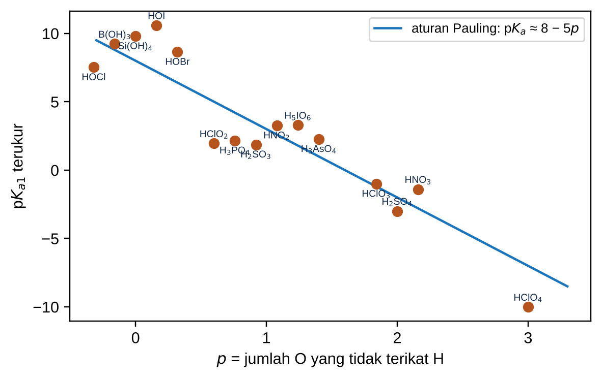
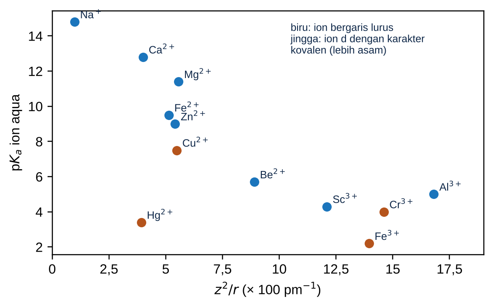
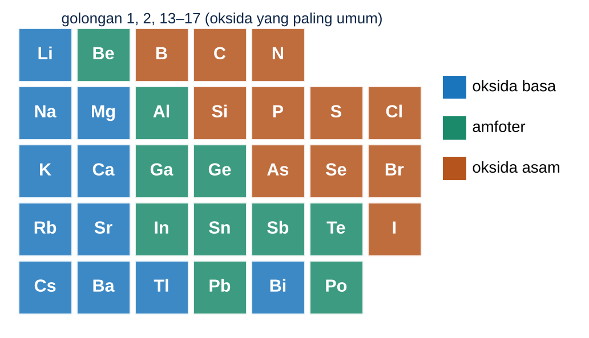
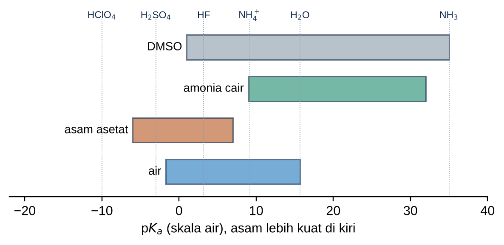

## 8.4 Asam biner: tren golongan dan periode

Asam biner adalah hidrida H~*n*~X, dengan proton terikat langsung pada atom X. Dua tren terlihat jelas dalam p*K*~a~-nya.

Tabel 8.3 p*K*~a~ hidrida biner dalam air (nilai untuk CH₄ dan NH₃ hanya taksiran).

| Golongan 14 | p*K*~a~ | Golongan 15 | p*K*~a~ | Golongan 16 | p*K*~a~ | Golongan 17 | p*K*~a~ |
|---|---|---|---|---|---|---|---|
| CH₄ | ≈ 50 | NH₃ | ≈ 38 | H₂O | 15,7 | HF | 3,2 |
| | | PH₃ | ≈ 27 | H₂S | 7,0 | HCl | ≈ −6 |
| | | | | H₂Se | 3,9 | HBr | ≈ −9 |
| | | | | H₂Te | 2,6 | HI | ≈ −10 |

**Sepanjang periode** (CH₄ → NH₃ → H₂O → HF), keasaman naik sangat tajam, karena keelektronegatifan X naik. Atom X yang lebih elektronegatif menarik pasangan elektron ikatan H–X lebih kuat, sehingga proton lebih mudah lepas, dan, yang lebih penting, menstabilkan muatan negatif pada basa konjugatnya X⁻.

**Ke bawah golongan** (HF → HCl → HBr → HI, atau H₂O → H₂S → H₂Se → H₂Te), keasaman juga naik, walaupun keelektronegatifan **turun**. Penyebab utamanya adalah **kekuatan ikatan H–X** yang turun tajam: H–F 570, H–Cl 432, H–Br 366, H–I 298 kJ mol⁻¹. Ikatan yang lebih lemah lebih mudah putus. Selain itu, muatan negatif pada anion yang besar (I⁻) tersebar dalam volume besar, sehingga anion itu stabil walaupun hidrasinya lemah.

Mengapa HF hanya asam lemah? Ada tiga faktor yang bekerja bersama. Pertama, ikatan H–F sangat kuat. Kedua, ion F⁻ yang kecil memang terhidrasi sangat kuat (−504 kJ mol⁻¹), tetapi hidrasi itu juga **menata** banyak molekul air di sekitarnya, sehingga entropi turun tajam dan sebagian keuntungan entalpi hilang. Ketiga, dalam larutan pekat, HF membentuk ikatan hidrogen yang sangat kuat dengan F⁻ menjadi HF₂⁻ (subbab 4.8). Gabungan faktor-faktor ini membuat Δ*G*° disosiasi HF positif (p*K*~a~ 3,2), sedangkan untuk HCl sangat negatif.

::: {.awas}
**Awas: keelektronegatifan bukan satu-satunya penentu.** Aturan "makin elektronegatif X, makin asam H–X" hanya berlaku dalam satu periode, ketika ukuran atom X hampir sama. Dalam satu golongan, ukuran dan kekuatan ikatan lebih menentukan, dan trennya berbalik. Kesalahan yang sering terjadi: meramalkan HF lebih asam daripada HI karena F lebih elektronegatif.
:::

::: {.kuis}
**Kuis cepat 8.4** Urutkan keasaman: (a) H₂O, H₂S, NH₃, HF; (b) PH₃, H₂S, HCl, SiH₄. Jelaskan tren yang dipakai untuk masing-masing.
:::

## 8.5 Asam okso: aturan Pauling

Pada asam okso, proton terikat pada oksigen, dan oksigen terikat pada atom pusat E: E–O–H. Rumus umumnya dapat ditulis O~*p*~E(OH)~*q*~. Keasaman ditentukan terutama oleh seberapa kuat atom pusat beserta gugus-gugus lain di sekitarnya menarik kerapatan elektron dari ikatan O–H, dan seberapa baik muatan negatif pada basa konjugatnya dapat tersebar.

Linus Pauling merangkum pengamatan dalam dua aturan empiris:

::: {.inti}
**Aturan Pauling untuk asam okso O~*p*~E(OH)~*q*~**

1. p*K*~a1~ ≈ 8 − 5*p*, dengan *p* jumlah atom O yang **tidak** terikat pada H.
2. Setiap disosiasi berikutnya menaikkan p*K*~a~ sekitar 5 satuan.
:::

{width=84%}

Penjelasan aturan pertama: setiap O tambahan tanpa H (oksigen "okso") menarik kerapatan elektron dari atom pusat, yang lalu menarik dari gugus O–H. Lebih penting lagi, ketika proton lepas, muatan negatif pada basa konjugat dapat tersebar lewat resonansi ke semua O okso. ClO₄⁻ menyebarkan satu muatan ke empat atom O; ClO⁻ hanya mempunyai satu O. Penjelasan aturan kedua: melepas proton kedua dari anion yang sudah bermuatan negatif melawan tarikan muatan itu.

::: {.contoh}
**Contoh 8.3 · Meramalkan p*K*~a~ asam okso**

Ramalkan p*K*~a~ dengan aturan Pauling dan bandingkan dengan nilai terukur: (a) deret HOCl, HClO₂, HClO₃, HClO₄; (b) ketiga p*K*~a~ H₃PO₄; (c) H₃PO₃, yang ternyata hanya diprotik; (d) H₂CO₃ (p*K*~a1~ terukur 6,35).

**Penyelesaian.** (a) Struktur: HOCl (*p* = 0), OCl(OH) (*p* = 1), O₂Cl(OH) (*p* = 2), O₃Cl(OH) (*p* = 3). Ramalan 8, 3, −2, −7; terukur 7,5; 2,0; −1; ≈ −10.

(b) H₃PO₄ = OP(OH)₃, *p* = 1: ramalan 3, 8, 13; terukur 2,15; 7,20; 12,35. Cocok sangat baik.

(c) Bila H₃PO₃ ditulis P(OH)₃ (*p* = 0), ramalan p*K*~a1~ = 8. Terukur 1,3, yang cocok untuk *p* = 1. Kesimpulan: strukturnya **HPO(OH)₂**, dengan satu H terikat langsung pada P dan tidak asam. Itulah sebabnya H₃PO₃ hanya diprotik. Dengan penalaran yang sama, H₃PO₂ adalah H₂PO(OH), monoprotik.

(d) H₂CO₃ = OC(OH)₂, *p* = 1: ramalan 3, terukur "6,35". Penyimpangan ini semu: hanya sekitar 0,2 % CO₂ terlarut yang benar-benar berbentuk H₂CO₃; sisanya CO₂ yang hanya terlarut. p*K*~a~ yang dihitung dengan konsentrasi H₂CO₃ sesungguhnya adalah sekitar **3,6**, sesuai aturan Pauling.

**Memahami hasil.** Aturan sederhana ini bukan hanya meramalkan kekuatan asam, tetapi juga dapat dipakai **terbalik** untuk menentukan struktur. Fosfor dalam H₃PO₃ dan H₃PO₂ terikat langsung pada hidrogen, dan bukti pertamanya adalah p*K*~a~ yang "terlalu kecil" untuk struktur P(OH)₃. Spektroskopi NMR ³¹P kemudian memastikannya: ada kopling P–H yang sangat besar.
:::

Asam borat, B(OH)₃, adalah kasus khusus. Ramalan Pauling untuk *p* = 0 adalah 8, dan terukur 9,24, tetapi asam borat **tidak** memberikan proton dari gugus OH-nya. Ia adalah asam **Lewis**: atom B yang kekurangan elektron menerima ion OH⁻ dari air, dan proton yang dilepaskan berasal dari air:

$$\text{B(OH)}_3 + 2\text{H}_2\text{O} \rightleftharpoons \text{B(OH)}_4^- + \text{H}_3\text{O}^+$$

::: {.kuis}
**Kuis cepat 8.5** Ramalkan p*K*~a1~ untuk H₂SO₄, H₂SO₃, HNO₃, HNO₂, dan H₅IO₆ (= OI(OH)₅). Urutkan kekuatannya.
:::

## 8.6 Asam aqua dan hidrolisis kation

Larutan FeCl₃ dalam air bersifat asam, dengan pH sekitar 2 pada 0,1 mol L⁻¹. Larutan AlCl₃ dan Cr(NO₃)₃ juga asam. Sumber proton bukan ion logam itu sendiri, melainkan **molekul air yang terikat padanya**. Ion logam dalam air terhidrasi sebagai **ion aqua**, misalnya [Fe(H₂O)₆]³⁺, dan kation yang bermuatan tinggi menarik kerapatan elektron dari O–H air terkoordinasi, sehingga proton mudah lepas:

$$[\text{Fe(H}_2\text{O)}_6]^{3+} + \text{H}_2\text{O} \rightleftharpoons [\text{Fe(OH)(H}_2\text{O)}_5]^{2+} + \text{H}_3\text{O}^+ \qquad \text{p}K_\text{a} = 2{,}2$$

Reaksi ini disebut **hidrolisis kation**.

{width=78%}

Kekuatan asam aqua mengikuti dua faktor:

1. **Muatan dan ukuran**: makin besar *z*²/*r* (rapat muatan), makin asam. Na⁺ (p*K*~a~ 14,8) hampir tidak asam; Mg²⁺ (11,4) asam lemah; Al³⁺ (5,0) asam yang cukup kuat, sebanding dengan asam asetat.
2. **Karakter kovalen**: ion logam transisi dan logam pasca-transisi lebih asam daripada yang diramalkan dari *z*²/*r* saja: Cu²⁺ (7,5) lebih asam daripada Mg²⁺ yang seukuran (11,4), dan Hg²⁺ (3,4) jauh lebih asam daripada Ca²⁺ (12,8). Ion-ion ini mempunyai daya polarisasi besar (aturan Fajans) dan membentuk ikatan M–O yang lebih kovalen dan kuat dengan OH⁻.

::: {.contoh}
**Contoh 8.4 · pH larutan garam besi(III) dan aluminium**

Hitung pH larutan 0,10 mol L⁻¹ Fe(NO₃)₃ (p*K*~a~ = 2,2) dan Al(NO₃)₃ (p*K*~a~ = 5,0), dengan hanya memperhitungkan disosiasi pertama.

**Penyelesaian.** Dengan cara yang sama seperti Contoh 8.2: Fe³⁺: *x* = 0,022 mol L⁻¹, pH = **1,65** (22 % terdisosiasi). Al³⁺: *x* = 1,0 × 10⁻³ mol L⁻¹, pH = **3,0**.

**Memahami hasil.** Larutan garam besi(III) sama asamnya dengan larutan HCl 0,02 mol L⁻¹. Inilah sebabnya larutan FeCl₃ dipakai untuk mengetsa tembaga pada pembuatan papan sirkuit, dan sebabnya garam besi(III) dan aluminium harus disimpan dalam larutan sedikit asam: bila pH naik, hidrolisis berlanjut, ion-ion hidrokso saling menjembatani (**olasi**), dan akhirnya mengendap sebagai oksida hidrat yang cokelat (Fe) atau putih bergelatin (Al). Aluminium sulfat (tawas) dipakai untuk menjernihkan air justru karena endapan Al(OH)₃ yang bergelatin itu menangkap partikel kotoran ketika mengendap.
:::

### Dari aqua ke okso

Bila rapat muatan sangat besar, proton terus lepas sampai air terkoordinasi menjadi hidrokso (OH⁻) lalu okso (O²⁻). Bilangan oksidasi tinggi menghasilkan **oksoanion**:

* Bilangan oksidasi rendah (+1, +2): ion aqua, [M(H₂O)₆]^*z*+^, misalnya Na⁺, Mg²⁺, Fe²⁺.
* Menengah (+3, +4): campuran aqua dan hidrokso, mudah mengendap sebagai hidroksida, misalnya Al³⁺, Fe³⁺, Ti⁴⁺.
* Tinggi (+6, +7): okso murni, misalnya CrO₄²⁻, MnO₄⁻, OsO₄.

Kromium memperlihatkan seluruh rentang ini: Cr²⁺ dan Cr³⁺ adalah ion aqua, sedangkan Cr(VI) adalah kromat CrO₄²⁻ atau dikromat Cr₂O₇²⁻.

::: {.kuis}
**Kuis cepat 8.6** Urutkan keasaman ion aqua Na⁺, Ca²⁺, Zn²⁺, Al³⁺, dan Fe³⁺. Mengapa larutan Na₂CO₃ basa, sedangkan larutan AlCl₃ asam?
:::

## 8.7 Oksida asam, basa, dan amfoter

Oksida unsur dapat digolongkan menurut reaksinya dengan air, asam, dan basa:

* **Oksida basa** bereaksi dengan air membentuk hidroksida, atau dengan asam membentuk garam: Na₂O + H₂O → 2NaOH; MgO + 2HCl → MgCl₂ + H₂O. Umumnya oksida logam dengan bilangan oksidasi rendah, bersifat ionik (O²⁻ adalah basa sangat kuat).
* **Oksida asam** bereaksi dengan air membentuk asam okso, atau dengan basa membentuk garam: SO₃ + H₂O → H₂SO₄; CO₂ + 2NaOH → Na₂CO₃ + H₂O. Umumnya oksida nonlogam dan oksida logam dengan bilangan oksidasi tinggi, bersifat kovalen.
* **Oksida amfoter** bereaksi dengan asam maupun basa: Al₂O₃ + 6H⁺ → 2Al³⁺ + 3H₂O dan Al₂O₃ + 2OH⁻ + 3H₂O → 2[Al(OH)₄]⁻.

{width=78%}

Pola pada Gambar 8.4 mengikuti keelektronegatifan: oksida unsur elektropositif ionik dan basa; oksida unsur elektronegatif kovalen dan asam; amfoter berada di perbatasan (Be, Al, Ga, Zn, Sn, Pb). Pola ini juga berhubungan dengan subbab 8.6: ion logam dengan rapat muatan sedang menghasilkan hidroksida yang dapat menerima maupun memberikan proton.

Untuk satu unsur dengan beberapa bilangan oksidasi, keasaman naik dengan bilangan oksidasi, karena rapat muatan atom pusat naik dan ikatannya makin kovalen:

| Unsur | Basa | Amfoter | Asam |
|---|---|---|---|
| Cr | CrO (+2) | Cr₂O₃ (+3) | CrO₃ (+6) → H₂CrO₄ |
| Mn | MnO (+2) | MnO₂ (+4) | Mn₂O₇ (+7) → HMnO₄ |
| V | VO (+2) | V₂O₃, VO₂ | V₂O₅ (+5) → vanadat |

Hujan asam adalah kimia oksida asam dalam skala besar: SO₂ dari pembakaran batu bara dan NO~*x*~ dari mesin kendaraan teroksidasi di atmosfer menjadi SO₃ dan NO₂, yang larut dalam tetes hujan menjadi H₂SO₄ dan HNO₃.

::: {.kuis}
**Kuis cepat 8.7** Tuliskan persamaan reaksi ZnO dengan HCl dan dengan NaOH berlebih. Apa nama ion seng yang terbentuk dalam basa?
:::

## 8.8 Efek pelarut: pelevelan dan pembedaan

Dalam air, HCl, HBr, HI, HNO₃, H₂SO₄, dan HClO₄ semuanya tampak sama kuat: semuanya terionisasi sempurna. Padahal di fase gas dan dalam pelarut lain, kekuatan mereka berbeda jauh. Mengapa air "tidak dapat membedakan"?

Asam yang lebih kuat daripada H₃O⁺ (p*K*~a~ < −1,74) memberikan protonnya sepenuhnya kepada air:

$$\text{HClO}_4 + \text{H}_2\text{O} \rightarrow \text{H}_3\text{O}^+ + \text{ClO}_4^-$$

Asam terkuat yang dapat ada dalam air adalah **H₃O⁺** itu sendiri. Semua asam yang lebih kuat "diturunkan" ke kekuatan H₃O⁺. Efek ini disebut **pelevelan**, dan air disebut **pelarut pelevel** bagi asam-asam itu. Dengan cara yang sama, basa terkuat dalam air adalah OH⁻; basa yang lebih kuat, seperti O²⁻, NH₂⁻, dan H⁻, langsung bereaksi dengan air:

$$\text{O}^{2-} + \text{H}_2\text{O} \rightarrow 2\text{OH}^- \qquad \text{H}^- + \text{H}_2\text{O} \rightarrow \text{H}_2 + \text{OH}^-$$

Akibatnya setiap pelarut mempunyai **jendela** keasaman yang dapat diamati: dalam air sekitar 16 satuan p*K*~a~, dari H₃O⁺ (−1,74) sampai H₂O (15,74).

{width=88%}

Untuk membedakan asam-asam yang sangat kuat, kita memerlukan pelarut yang **lebih lemah sebagai basa** daripada air, misalnya asam asetat murni. Dalam asam asetat, asam-asam mineral hanya terionisasi sebagian, dan urutannya dapat diukur: HClO₄ > HBr > H₂SO₄ > HCl > HNO₃. Asam asetat disebut **pelarut pembeda** bagi asam-asam ini. Sebaliknya, untuk membedakan basa-basa yang sangat kuat, diperlukan pelarut yang lebih lemah sebagai asam, misalnya amonia cair atau DMSO. Dalam amonia cair, asam asetat yang lemah dalam air menjadi asam kuat, karena NH₃ adalah basa yang jauh lebih kuat daripada H₂O.

::: {.dalam}
**Kebasaan amina di fase gas dan dalam air.** Di fase gas, tanpa pelarut, kebasaan amina naik teratur dengan jumlah gugus metil: NH₃ < MeNH₂ < Me₂NH < Me₃N, karena gugus metil mendorong elektron dan menstabilkan kation. Dalam air, urutannya kacau: p*K*~a~ asam konjugatnya NH₄⁺ 9,25; MeNH₃⁺ 10,64; Me₂NH₂⁺ 10,73; Me₃NH⁺ 9,80. Trimetilamina lebih lemah daripada dimetilamina, karena kation Me₃NH⁺ hanya mempunyai satu H untuk membentuk ikatan hidrogen dengan air, sehingga kurang distabilkan pelarut. Kekuatan asam dan basa dalam larutan selalu merupakan sifat **zat terlarut bersama pelarutnya**.
:::

::: {.kuis}
**Kuis cepat 8.8** Mengapa NaH tidak dapat dipakai dalam larutan air, tetapi dapat dipakai sebagai basa dalam THF kering? Asam terkuat apa yang dapat ada dalam amonia cair?
:::
