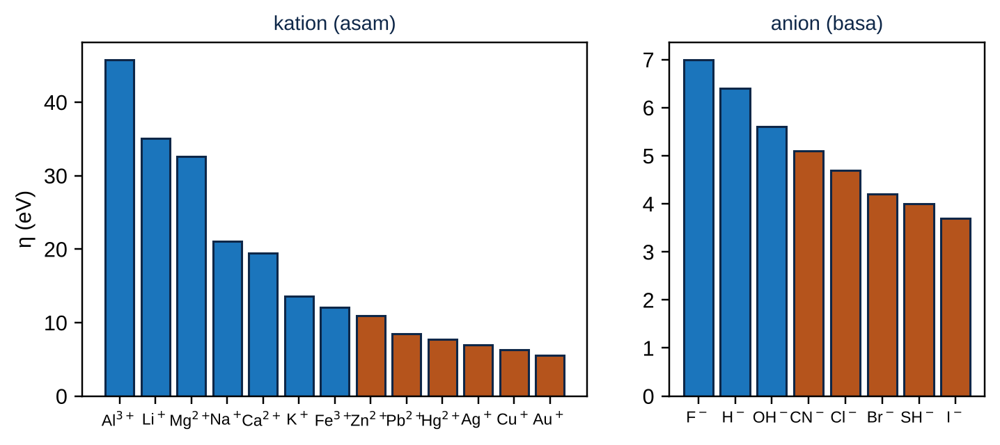
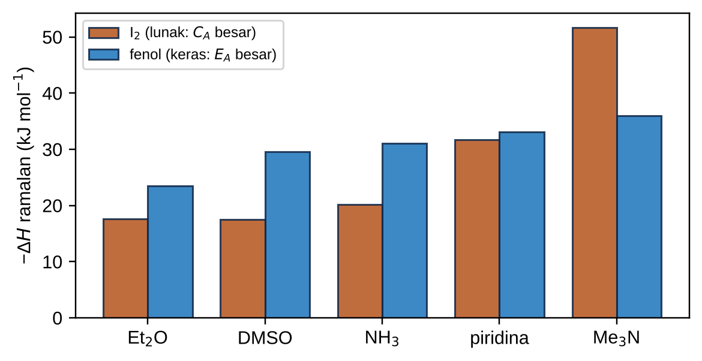
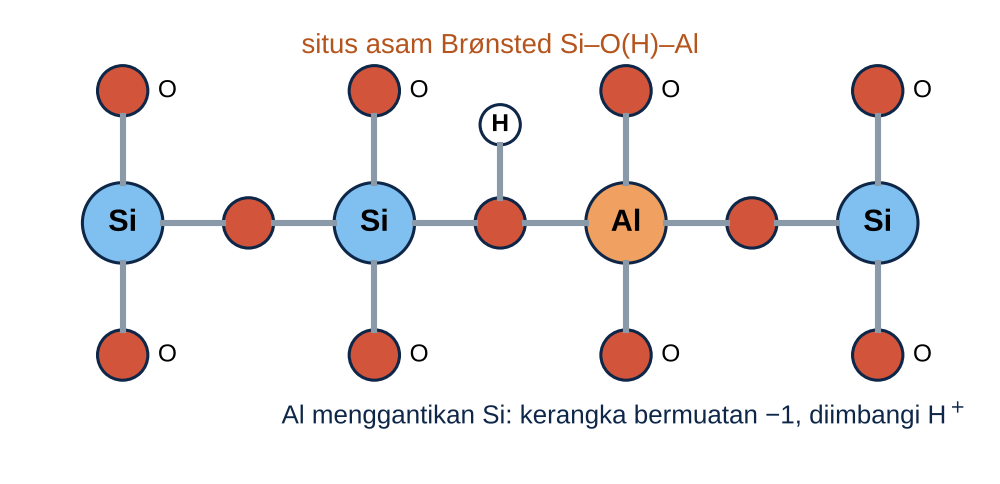

## 8.9 Asam dan basa Lewis

Definisi Lewis memindahkan perhatian dari proton ke **pasangan elektron**. Basa Lewis mempunyai pasangan elektron yang dapat disumbangkan (pasangan bebas atau elektron π); asam Lewis mempunyai orbital kosong yang dapat menerimanya. Hasil reaksinya disebut **aduk** atau **kompleks**:

$$\text{BF}_3 + :\text{NH}_3 \rightarrow \text{F}_3\text{B–NH}_3 \qquad \text{Ag}^+ + 2:\text{NH}_3 \rightarrow [\text{H}_3\text{N–Ag–NH}_3]^+$$

Dalam bahasa orbital molekul (subbab 4.10), reaksi Lewis adalah interaksi **HOMO basa** dengan **LUMO asam**. Basa yang kuat mempunyai HOMO tinggi dan mudah dijangkau; asam yang kuat mempunyai LUMO rendah dan mudah dijangkau.

Jenis-jenis asam Lewis yang penting:

* **Kation logam**, terutama yang bermuatan tinggi: setiap ion aqua [M(H₂O)₆]^*z*+^ adalah aduk asam Lewis M^*z*+^ dengan enam basa Lewis H₂O. Kimia koordinasi (Bab 11) seluruhnya adalah kimia asam–basa Lewis.
* **Senyawa kekurangan elektron**: BF₃, BCl₃, AlCl₃, GaCl₃, dengan orbital p kosong.
* **Senyawa yang dapat memperluas koordinasinya**: SiF₄, SnCl₄, PF₅, SbF₅, yang menerima ligan tambahan.
* **Senyawa dengan ikatan π yang dapat menerima elektron**: SO₃ dan CO₂ (CO₂ + OH⁻ → HCO₃⁻).
* **Molekul dengan orbital σ\* rendah**: I₂ dan Br₂, yang membentuk kompleks transfer muatan dengan donor (subbab 4.10).

Basa Lewis yang penting: anion (F⁻, Cl⁻, OH⁻, CN⁻), molekul dengan pasangan bebas (NH₃, H₂O, fosfina R₃P, eter, CO), dan sistem π (alkena, benzena).

Ukuran kekuatan asam Lewis tidak dapat berupa satu bilangan seperti p*K*~a~, karena urutan kekuatan bergantung pada asam atau basa pasangannya. Ini adalah pokok bahasan subbab 8.11 dan 8.12.

### Mengukur keasaman Lewis

Karena tidak ada skala tunggal seperti p*K*~a~, kimiawan memakai beberapa ukuran yang masing-masing mengacu pada satu basa baku:

* **Afinitas ion fluorida** (FIA): −Δ*H* untuk reaksi A(g) + F⁻(g) → AF⁻(g), biasanya dihitung secara kuantum. Asam Lewis yang FIA-nya lebih besar daripada SbF₅ disebut **asam Lewis super**.
* **Metode Gutmann–Beckett**: pergeseran ³¹P NMR trietilfosfina oksida Et₃PO ketika berikatan dengan asam Lewis, analog bilangan akseptor pelarut (subbab 10.2).
* **Entalpi aduk** dengan beberapa basa sekaligus, yang menjadi dasar parameter Drago–Wayland (subbab 8.12).

Ketiganya memberi urutan yang serupa untuk asam yang mirip, tetapi dapat berbeda untuk asam yang sangat berbeda jenisnya, karena masing-masing mengukur kekuatan terhadap satu basa tertentu.

::: {.awas}
**Awas: rintangan ruang.** Basa yang secara elektronik kuat dapat menjadi lemah bila gugus besar menghalangi akses ke pasangan elektronnya. Trimetilamina membentuk aduk yang stabil dengan BF₃, tetapi aduknya dengan B(CH₃)₃ jauh lebih lemah daripada yang diharapkan karena gugus metil pada kedua pihak saling bertabrakan. Bila rintangan sangat besar, asam dan basa tidak dapat bergabung sama sekali walaupun keduanya kuat; pasangan seperti ini disebut **pasangan Lewis frustrasi** dan dapat memecah molekul H₂ di antara keduanya, sebuah cara baru untuk mengaktifkan hidrogen tanpa logam.
:::

::: {.kuis}
**Kuis cepat 8.9** Identifikasi asam dan basa Lewis: (a) AlCl₃ + Cl⁻ → AlCl₄⁻; (b) SO₃ + H₂O → H₂SO₄ (langkah pertama); (c) Ni + 4CO → Ni(CO)₄; (d) I₂ + I⁻ → I₃⁻.
:::

## 8.10 Asam Lewis golongan 13 dan 14

### Trihalida boron dan aluminium

Trihalida boron BX₃ adalah molekul datar dengan orbital 2p~*z*~ kosong pada boron, sehingga asam Lewis yang khas. Berdasarkan keelektronegatifan saja, BF₃ seharusnya asam terkuat, karena F menarik elektron paling kuat dan membuat B paling positif. Kenyataannya urutannya terbalik:

$$\text{BF}_3 < \text{BCl}_3 < \text{BBr}_3 \quad (\text{keasaman Lewis terhadap NH}_3\text{ atau piridina})$$

Penjelasannya ada di subbab 4.10 dan soal pembahasan Bab 4: pasangan bebas p fluorin menyumbang ke orbital 2p~*z*~ boron yang kosong (ikatan π B–F), sehingga orbital itu sebagian terisi dan kurang siap menerima basa. Tumpang tindih 2p–2p antara B dan F jauh lebih baik daripada 2p–3p (B–Cl) atau 2p–4p (B–Br). Ketika aduk terbentuk, boron menjadi piramida dan ikatan π ini hilang; kehilangan itu paling besar untuk BF₃.

Aluminium triklorida adalah asam Lewis yang lebih kuat lagi, karena aluminium lebih besar dan ikatan π Al–Cl lemah. Dalam fase padat dan uap pada suhu rendah, AlCl₃ memuaskan keasamannya dengan membentuk dimer Al₂Cl₆ (subbab 4.8). AlCl₃ adalah katalis dalam reaksi Friedel–Crafts: ia menarik Cl⁻ dari RCl untuk menghasilkan karbokation:

$$\text{RCl} + \text{AlCl}_3 \rightarrow \text{R}^+ + \text{AlCl}_4^-$$

### Asam Lewis golongan 14

Karbon tidak mempunyai orbital kosong yang mudah dijangkau dan tidak dapat memperluas koordinasinya, sehingga CF₄ dan CCl₄ bukan asam Lewis. Unsur di bawahnya berbeda: SiF₄ menerima dua F⁻ membentuk SiF₆²⁻ yang oktahedral, dan SnCl₄ menerima dua Cl⁻ membentuk SnCl₆²⁻. Keasaman Lewis naik ke bawah golongan karena atom pusat makin besar dan dapat menampung lebih banyak ligan:

$$\text{SiF}_4 + 2\text{F}^- \rightarrow \text{SiF}_6^{2-} \qquad \text{SnCl}_4 + 2\text{Cl}^- \rightarrow \text{SnCl}_6^{2-}$$

Kemampuan Si untuk menerima pasangan elektron juga menjelaskan perbedaan dramatis antara CCl₄ dan SiCl₄ terhadap air. CCl₄ tidak bereaksi dengan air walaupun reaksinya sangat eksoterm, karena tidak ada jalan bagi molekul air untuk menyerang karbon. SiCl₄ berasap di udara lembap dan terhidrolisis seketika, karena air dapat menyerang silikon membentuk zat antara berkoordinasi lima sebelum Cl⁻ lepas. Perbedaan ini adalah perbedaan **kinetika**, bukan termodinamika.

::: {.kuis}
**Kuis cepat 8.10** Mengapa BF₃ tetap dipakai sebagai katalis asam Lewis walaupun BCl₃ lebih kuat? (Petunjuk: bandingkan kestabilan terhadap air dan kemudahan penanganan; BF₃ tersedia sebagai aduk cair BF₃·OEt₂.)
:::

## 8.11 Asam dan basa keras dan lunak (HSAB)

Mengapa aluminium, magnesium, dan kalsium ditemukan di kerak bumi sebagai oksida, karbonat, dan silikat, sedangkan merkuri, timbal, dan tembaga ditemukan sebagai sulfida (HgS cinnabar, PbS galena, CuFeS₂ kalkopirit)? Mengapa merkuri sangat beracun, sedangkan ion kalsium tidak? Mengapa AgF larut dalam air, sedangkan AgI tidak? Ralph Pearson merangkum pengamatan seperti ini pada 1963 dalam satu prinsip.

Asam dan basa dibagi menjadi dua golongan:

* **Keras**: kecil, bermuatan tinggi (untuk asam) atau sangat elektronegatif (untuk basa), sukar terpolarisasi. Asam keras: H⁺, Li⁺, Na⁺, Mg²⁺, Ca²⁺, Al³⁺, Ti⁴⁺, Cr³⁺, Fe³⁺. Basa keras: F⁻, OH⁻, H₂O, O²⁻, NH₃, CO₃²⁻, SO₄²⁻.
* **Lunak**: besar, bermuatan rendah, mudah terpolarisasi. Asam lunak: Cu⁺, Ag⁺, Au⁺, Hg²⁺, Cd²⁺, Pt²⁺, Pd²⁺, Tl⁺. Basa lunak: I⁻, SH⁻, RS⁻, CN⁻, CO, R₃P, H⁻.
* **Perbatasan**: Fe²⁺, Co²⁺, Ni²⁺, Cu²⁺, Zn²⁺, Pb²⁺; Br⁻, piridina, NO₂⁻, N₃⁻.

::: {.inti}
**Prinsip HSAB.** Asam keras lebih menyukai basa keras, dan asam lunak lebih menyukai basa lunak.
:::

Interaksi keras–keras terutama bersifat **elektrostatik** (ionik): ion kecil bermuatan tinggi saling tarik kuat. Interaksi lunak–lunak terutama bersifat **kovalen**: orbital yang besar dan berenergi dekat bertumpang tindih dengan baik. Dalam bahasa orbital perbatasan: spesies keras mempunyai celah HOMO–LUMO yang besar; spesies lunak mempunyai celah kecil.

### Penjelasan orbital: persamaan Klopman

Gilles Klopman (1968) memberi dasar teori untuk HSAB dengan memecah energi interaksi asam–basa menjadi dua bagian: suku **muatan** (tarikan Coulomb antara muatan asam dan basa) dan suku **orbital** (penurunan energi karena HOMO basa bertumpang tindih dengan LUMO asam, yang besar bila kedua orbital berenergi dekat). Pada spesies keras, HOMO basa sangat rendah dan LUMO asam sangat tinggi, sehingga suku orbital kecil dan interaksi didominasi muatan: **terkendali muatan**. Pada spesies lunak, HOMO basa tinggi dan LUMO asam rendah, sehingga keduanya berdekatan dan suku orbital mendominasi: **terkendali orbital**. Asam keras dan basa keras bergabung karena muatan; asam lunak dan basa lunak bergabung karena orbital. Pasangan campuran tidak mendapat keuntungan penuh dari keduanya.

### Kekerasan absolut

Pearson dan Robert Parr (1983) memberi ukuran kuantitatif: **kekerasan absolut**, setengah selisih energi ionisasi dan afinitas elektron:

$$\eta = \frac{I - A}{2} \qquad \text{(8.5)}$$

Untuk kation M^*z*+^, *I* adalah energi ionisasi berikutnya dan *A* adalah energi ionisasi yang membentuk ion itu. Untuk anion X⁻, dipakai *I* dan *A* atom X netral. Spesies dengan η besar sukar menerima maupun melepas elektron: keras.

{width=94%}

::: {.contoh}
**Contoh 8.10 · Menghitung kekerasan**

Hitung η untuk Na⁺, Ag⁺, Al³⁺, dan Hg²⁺, serta F⁻ dan I⁻. Data (eV): Na *I*₁ 5,139, *I*₂ 47,286; Ag *I*₁ 7,576, *I*₂ 21,48; Al *I*₃ 28,448, *I*₄ 119,99; Hg *I*₂ 18,757, *I*₃ 34,2; F *I* 17,423, *A* 3,401; I *I* 10,451, *A* 3,059.

**Penyelesaian.**

* Na⁺: (47,286 − 5,139)/2 = **21,1 eV**
* Ag⁺: (21,48 − 7,576)/2 = **7,0 eV**
* Al³⁺: (119,99 − 28,448)/2 = **45,8 eV**
* Hg²⁺: (34,2 − 18,757)/2 = **7,7 eV**
* F⁻: (17,423 − 3,401)/2 = **7,0 eV**
* I⁻: (10,451 − 3,059)/2 = **3,7 eV**

**Memahami hasil.** Na⁺ dan Ag⁺ mempunyai muatan sama dan ukuran mirip, tetapi Ag⁺ tiga kali lebih lunak. Penyebabnya terlihat dari data: elektron 4d Ag⁺ relatif mudah dilepas (*I*₂ hanya 21 eV), sedangkan Na⁺ harus kehilangan elektron dari kulit 2p yang penuh (*I*₂ 47 eV). Kekerasan mengukur seberapa "kaku" awan elektron sebuah spesies.
:::

::: {.contoh}
**Contoh 8.11 · Kelarutan perak halida**

Dengan *K*~sp~ AgCl 1,8 × 10⁻¹⁰, AgBr 5,0 × 10⁻¹³, dan AgI 8,5 × 10⁻¹⁷, hitung kelarutan masing-masing dalam mg L⁻¹. AgF sangat mudah larut (lebih dari 100 g per 100 mL air). Jelaskan polanya dengan HSAB dan dengan energetika kisi.

**Penyelesaian.** *s* = √*K*~sp~: AgCl 1,34 × 10⁻⁵ mol L⁻¹ = **1,9 mg L⁻¹**; AgBr 7,1 × 10⁻⁷ mol L⁻¹ = **0,13 mg L⁻¹**; AgI 9,2 × 10⁻⁹ mol L⁻¹ = **0,0022 mg L⁻¹**.

**Memahami hasil.** Dari F⁻ ke I⁻, kelarutan turun dari lebih dari 10⁶ mg L⁻¹ menjadi sekitar 0,002 mg L⁻¹, faktor hampir satu miliar. Untuk garam natrium, urutannya justru berlawanan (NaF paling sukar larut di antara natrium halida). HSAB menjelaskan perbedaannya: Ag⁺ asam lunak, sehingga ikatan Ag–X makin kovalen dan kuat dari F ke I, sedangkan Na⁺ asam keras lebih menyukai F⁻. Dalam bahasa Bab 6, energi kisi AgI jauh lebih besar daripada yang diramalkan model ionik (subbab 6.9), dan kelebihan kovalen itu tidak dapat diimbangi hidrasi ion yang besar. Perbedaan kelarutan inilah yang dipakai dalam fotografi klasik (AgBr peka cahaya, dilarutkan oleh tiosulfat yang lunak) dan dalam titrasi argentometri.
:::

### Penerapan HSAB

* **Mineral**: asam keras (Mg²⁺, Ca²⁺, Al³⁺) berada di batuan sebagai oksida, silikat, dan karbonat (basa keras O²⁻, SiO₄⁴⁻, CO₃²⁻); asam lunak (Cu⁺, Ag⁺, Hg²⁺, Pb²⁺) sebagai sulfida (basa lunak S²⁻). Geokimiawan Victor Goldschmidt menyebut golongan pertama **litofil** ("suka batu") dan golongan kedua **kalkofil** ("suka tembaga/sulfida").
* **Racun logam berat**: Hg²⁺, Cd²⁺, dan Pb²⁺ adalah asam lunak yang terikat sangat kuat pada gugus –SH (sistein) dalam protein dan enzim, mengubah bentuknya dan mematikan fungsinya. Penawar racun logam berat, seperti dimerkaprol (BAL), mengandung gugus tiol yang mengikat logam lebih kuat daripada protein lalu dikeluarkan bersama urin.
* **Kelarutan perak halida**: Ag⁺ (lunak) membentuk ikatan paling kuat dengan I⁻ (paling lunak), sehingga AgI paling sukar larut; AgF, pasangan lunak–keras, larut baik (sejalan dengan subbab 6.9).
* **Isomer ikatan**: ion tiosianat SCN⁻ dapat terikat lewat S (lunak) atau N (lebih keras). Ia terikat lewat S pada Pt²⁺ dan Hg²⁺, dan lewat N pada Co³⁺ dan Fe³⁺ (Bab 11).

::: {.awas}
**Awas: HSAB bukan ukuran kekuatan.** Prinsip HSAB tidak mengatakan bahwa interaksi lunak–lunak selalu lebih kuat daripada keras–lunak. OH⁻ adalah basa yang jauh lebih kuat daripada I⁻ terhadap hampir semua asam. HSAB hanya membandingkan **preferensi**: di antara dua basa yang kekuatannya mirip, asam lunak memilih yang lunak. Untuk memisahkan faktor kekuatan dan kekerasan, diperlukan dua parameter, dan itulah gagasan subbab berikutnya.
:::

::: {.kuis}
**Kuis cepat 8.11** Ramalkan arah kesetimbangan dengan HSAB: (a) HgF₂ + BeI₂ ⇌ HgI₂ + BeF₂; (b) AgCl + I⁻ ⇌ AgI + Cl⁻; (c) [Co(NH₃)₅F]²⁺ + I⁻ atau [Co(NH₃)₅I]²⁺ + F⁻, mana yang lebih stabil?
:::

## 8.12 Parameter Drago–Wayland

Russell Drago dan Bradford Wayland (1965) mengusulkan bahwa entalpi pembentukan aduk asam–basa Lewis dalam pelarut yang tidak berinteraksi dapat dipecah menjadi bagian elektrostatik dan bagian kovalen:

$$-\Delta H = E_\text{A}E_\text{B} + C_\text{A}C_\text{B} \qquad \text{(8.6)}$$

Setiap asam mempunyai dua bilangan, *E*~A~ (kecenderungan elektrostatik) dan *C*~A~ (kecenderungan kovalen), dan setiap basa juga dua, *E*~B~ dan *C*~B~. Dengan beberapa puluh parameter, persamaan ini meramalkan ratusan entalpi aduk dalam sekitar 1 kJ mol⁻¹.

Tabel 8.5 Parameter Drago–Wayland (dalam (kkal mol⁻¹)^1/2^; I₂ dipakai sebagai acuan dengan *E*~A~ = *C*~A~ = 1).

| Asam | *E*~A~ | *C*~A~ | Basa | *E*~B~ | *C*~B~ |
|---|---|---|---|---|---|
| I₂ | 1,00 | 1,00 | NH₃ | 1,36 | 3,46 |
| fenol | 4,33 | 0,442 | piridina | 1,17 | 6,40 |
| BF₃ | 9,88 | 1,62 | (CH₃)₃N | 0,808 | 11,54 |
| | | | dietil eter | 0,963 | 3,25 |
| | | | DMSO | 1,34 | 2,85 |
| | | | aseton | 0,987 | 2,33 |

Nilai dalam Tabel 8.5 berasal dari himpunan parameter asli Drago dan rekan (acuan I₂: *E*~A~ = *C*~A~ = 1), yang juga dipakai dalam buku Huheey. Drago kemudian memperbarui seluruh himpunan dengan acuan berbeda (model ECW, I₂: *E*~A~ = 0,50 dan *C*~A~ = 2,0). Kedua himpunan memberi entalpi yang hampir sama, tetapi angka dari himpunan yang berbeda **tidak boleh dicampur** dalam satu perhitungan.

::: {.contoh}
**Contoh 8.12 · Urutan basa bergantung asamnya**

Hitung −Δ*H* untuk aduk I₂ dan fenol dengan dietil eter dan DMSO. Bandingkan urutannya. Untuk I₂–piridina, entalpi terukur sekitar 33 kJ mol⁻¹.

**Penyelesaian.** Dengan persamaan (8.6), dalam kkal mol⁻¹ lalu dikalikan 4,184:

* I₂–eter: 1,00 × 0,963 + 1,00 × 3,25 = 4,21 kkal = **17,6 kJ mol⁻¹**
* I₂–DMSO: 1,34 + 2,85 = 4,19 kkal = **17,5 kJ mol⁻¹**
* fenol–eter: 4,33 × 0,963 + 0,442 × 3,25 = 5,61 kkal = **23,5 kJ mol⁻¹**
* fenol–DMSO: 4,33 × 1,34 + 0,442 × 2,85 = 7,06 kkal = **29,5 kJ mol⁻¹**
* I₂–piridina: 1,17 + 6,40 = 7,57 kkal = **31,7 kJ mol⁻¹**

**Memahami hasil.** Terhadap I₂, eter dan DMSO hampir sama kuat. Terhadap fenol, DMSO jauh lebih kuat. Fenol adalah asam dengan *E*~A~ besar (donor ikatan hidrogen, interaksi terutama elektrostatik), sehingga lebih menyukai DMSO yang mempunyai *E*~B~ lebih besar (oksigen S=O yang sangat polar). I₂ mempunyai *C*~A~ relatif besar (interaksi kovalen dengan orbital σ\*), sehingga perbedaan *E*~B~ kurang berpengaruh. Pola yang sama terlihat untuk semua basa (Gambar 8.10): basa dengan *C*~B~ besar seperti (CH₃)₃N jauh lebih kuat terhadap I₂ daripada terhadap fenol. Inilah versi kuantitatif HSAB: tidak ada skala kekuatan basa yang tunggal.
:::

{width=76%}

::: {.kuis}
**Kuis cepat 8.12** Hitung −Δ*H* untuk BF₃–NH₃ dan BF₃–(CH₃)₃N dengan Tabel 8.5. Basa mana yang lebih kuat terhadap BF₃?
:::

## 8.13 Superasam dan superbasa

### Superasam

Ronald Gillespie mendefinisikan **superasam** sebagai asam yang lebih kuat daripada asam sulfat 100 %. Kekuatan asam sepekat ini tidak dapat diukur dengan pH, karena tidak ada air. Louis Hammett (1932) memakai **fungsi keasaman Hammett**, *H*~0~, yang diukur dengan basa indikator lemah B:

$$H_0 = \text{p}K_\text{BH^+} - \log\frac{[\text{BH}^+]}{[\text{B}]} \qquad \text{(8.7)}$$

Dalam larutan encer, *H*~0~ sama dengan pH. Untuk asam pekat, *H*~0~ menjadi negatif: makin negatif, makin kuat.

Tabel 8.6 Fungsi keasaman Hammett beberapa asam pekat.

| Asam | *H*~0~ |
|---|---|
| HF cair | −15 (anhidrat, sangat murni: lebih rendah) |
| H₂SO₄ 100 % | −12,0 |
| HSO₃F | −15,1 |
| HSO₃F + SbF₅ ("asam ajaib") | sampai sekitar −19 |
| HF + SbF₅ (asam fluoroantimonat) | sampai sekitar −21 atau lebih rendah |

::: {.contoh}
**Contoh 8.13 · Mengukur *H*~0~ dengan indikator**

Indikator 2,4,6-trinitroanilina mempunyai p*K*~BH⁺~ sekitar −10,1. Dalam suatu campuran asam, spektrum UV–tampak menunjukkan perbandingan [BH⁺]/[B] = 10. (a) Hitung *H*~0~. (b) Berapa kali lebih asam campuran ini dibanding larutan dengan *H*~0~ = 0?

**Penyelesaian.** (a) *H*~0~ = −10,1 − log 10 = **−11,1**. (b) Skala *H*~0~ logaritmik seperti pH: 10^11,1^ ≈ **1,3 × 10¹¹ kali**.

**Memahami hasil.** Untuk mengukur keasaman di luar jangkauan pH, dipakai serangkaian indikator yang makin lemah kebasaannya, masing-masing berguna dalam rentang sekitar 2 satuan di sekitar p*K*~BH⁺~-nya. Dengan rangkaian nitroanilina dan nitrobenzena, Hammett dan para penerusnya menyusun skala keasaman sampai *H*~0~ sekitar −27. Asam sulfat 100 % (*H*~0~ = −12,0) sekitar 10¹² kali lebih asam daripada larutan asam encer pH 0; asam fluoroantimonat sekitar sepuluh miliar kali lebih asam lagi.
:::

Superasam bekerja dengan menggabungkan asam Brønsted kuat dengan asam Lewis sangat kuat (SbF₅). Asam Lewis menarik basa konjugat dari asam Brønsted, sehingga proton "tidak mempunyai tempat pulang":

$$2\text{HF} + \text{SbF}_5 \rightarrow \text{H}_2\text{F}^+ + \text{SbF}_6^-$$

Anion SbF₆⁻ hampir sama sekali bukan basa, sehingga kation H₂F⁺ adalah donor proton yang luar biasa kuat. Dalam superasam, hidrokarbon jenuh pun terprotonasi: metana menjadi CH₅⁺, dan alkana bercabang menjadi karbokation yang cukup stabil untuk diamati dengan NMR. Olah memakai larutan ini untuk mempelajari karbokation yang sebelumnya hanya dibayangkan sebagai zat antara.

### Superbasa

Di ujung lain, **superbasa** adalah basa yang jauh lebih kuat daripada OH⁻, yang hanya dapat dipakai dalam pelarut yang tidak bersifat asam (eter, alkana, amonia cair). Contoh: natrium amida NaNH₂ (p*K*~a~ NH₃ sekitar 38), litium diisopropilamida (LDA, dari amina dengan p*K*~a~ sekitar 36), dan butillitium (p*K*~a~ butana sekitar 50). Basa-basa ini memungkinkan pembentukan karbanion dan banyak reaksi sintesis organik dan organologam.

::: {.kuis}
**Kuis cepat 8.13** Mengapa superasam harus disimpan dalam wadah teflon, bukan kaca? Mengapa NaNH₂ tidak dapat dipakai dalam air?
:::

## 8.14 Asam padat: zeolit dan katalis

Asam cair seperti H₂SO₄ dan HF dulu dipakai sebagai katalis dalam pengolahan minyak bumi, tetapi korosif, berbahaya, dan sulit dipisahkan dari produk. Industri modern beralih ke **asam padat**, terutama **zeolit**.

Zeolit adalah aluminosilikat kristal yang kerangkanya tersusun dari tetrahedron SiO₄ dan AlO₄ yang berbagi sudut, membentuk saluran dan rongga berukuran molekul (sekitar 0,3–1 nm). Setiap Si⁴⁺ yang diganti Al³⁺ menciptakan muatan −1 pada kerangka. Muatan ini diimbangi oleh kation (Na⁺ pada zeolit alam). Bila kation itu diganti H⁺, proton terikat pada oksigen yang menjembatani Si dan Al, membentuk situs **asam Brønsted** yang sangat kuat:

{width=80%}

Ada beberapa sifat yang membuat zeolit sangat berharga:

* **Keasaman kuat dan dapat diatur** dengan perbandingan Si/Al. Al terlalu banyak mengurangi kekuatan tiap situs; aturan Löwenstein melarang dua Al bertetangga langsung (Al–O–Al).
* **Selektivitas bentuk**: hanya molekul yang muat di saluran yang dapat masuk ke situs asam, dan hanya produk yang muat yang dapat keluar. Zeolit ZSM-5 mengubah metanol menjadi bensin dengan hidrokarbon berukuran tertentu, dan memilih *p*-xilena di antara isomer xilena.
* **Tahan suhu tinggi dan dapat diregenerasi**.

::: {.contoh}
**Contoh 8.14 · Berapa banyak situs asam?**

Zeolit H-ZSM-5 mempunyai 96 atom T (Si + Al) per sel satuan. Untuk perbandingan Si/Al = 15, hitung (a) jumlah Al, dan karena itu situs asam, per sel satuan; (b) jumlah situs asam per gram (mmol g⁻¹), dengan menganggap setiap atom T membawa dua atom O.

**Penyelesaian.** (a) Si/Al = 15 berarti 1 Al per 16 atom T: 96/16 = **6 situs** per sel satuan. (b) Per 16 atom T ada 15 satuan SiO₂ (60,08 g mol⁻¹) dan satu satuan HAlO₂ (59,99 g mol⁻¹): massa = 15 × 60,08 + 59,99 = 961,2 g per mol situs. Jadi **1,04 mmol g⁻¹**.

**Memahami hasil.** Satu gram zeolit membawa sekitar satu milimol proton yang sangat asam, sebanding dengan kapasitas resin penukar ion. Dengan menaikkan Si/Al (misalnya dengan dealuminasi memakai uap), jumlah situs berkurang tetapi kekuatan setiap situs bertambah, karena situs-situs itu makin terisolasi satu sama lain. Pengaturan Si/Al inilah yang memungkinkan perancang katalis menyetel zeolit untuk reaksi tertentu.
:::

Katalis perengkahan katalitik fluida (FCC), yang memecah fraksi minyak berat menjadi bensin di hampir setiap kilang minyak dunia, adalah zeolit Y. Selain zeolit, asam padat lain meliputi lempung yang diaktivasi asam, zirkonia tersulfatasi, dan resin penukar ion asam sulfonat. Zeolit juga dipakai sebagai penukar ion dalam deterjen (menggantikan fosfat untuk melunakkan air) dan sebagai penyaring molekul untuk mengeringkan pelarut.

::: {.kuis}
**Kuis cepat 8.14** Sebuah zeolit mempunyai perbandingan Si/Al = 15. Berapa situs asam yang mungkin per 100 atom T (Si + Al) dalam kerangka bentuk-H-nya?
:::

## Menuju bab berikutnya

Asam ajaib Olah memprotonkan metana karena dua hal yang sudah kita pahami: proton diberikan oleh asam Brønsted yang sangat kuat, dan basa konjugatnya ditangkap oleh asam Lewis yang sangat kuat (SbF₅), sehingga tidak ada basa di sekitarnya yang dapat merebut proton kembali. Kekuatan seperti ini tidak dapat diukur di dalam air, karena air melevelkan semua asam yang lebih kuat daripada H₃O⁺. Bab ini menyusun alat untuk memahami keasaman dari tingkat molekul: kekuatan ikatan dan keelektronegatifan untuk asam biner, aturan Pauling untuk asam okso, rapat muatan untuk ion aqua, dan HSAB serta parameter Drago–Wayland untuk asam dan basa Lewis.

Reaksi asam–basa adalah perpindahan **proton** atau pembagian **pasangan elektron**. Ada golongan reaksi yang sama pentingnya, yang memindahkan **elektron** sepenuhnya dari satu zat ke zat lain: reaksi oksidasi–reduksi. Bab 9 membahasnya: setengah reaksi, potensial elektrode, persamaan Nernst, dan diagram-diagram yang dipakai kimiawan anorganik untuk meramalkan bilangan oksidasi mana yang stabil dalam kondisi tertentu.
